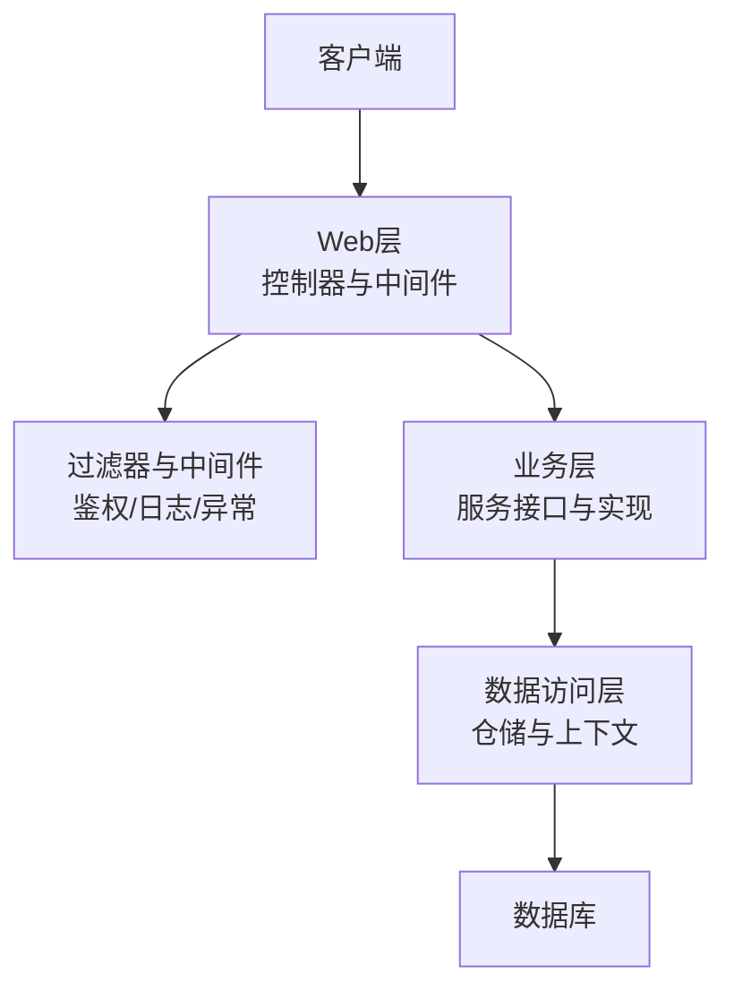
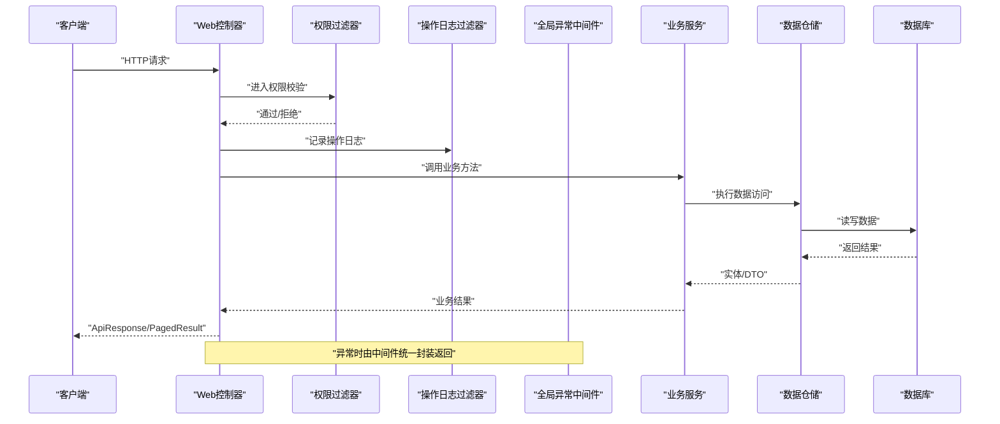
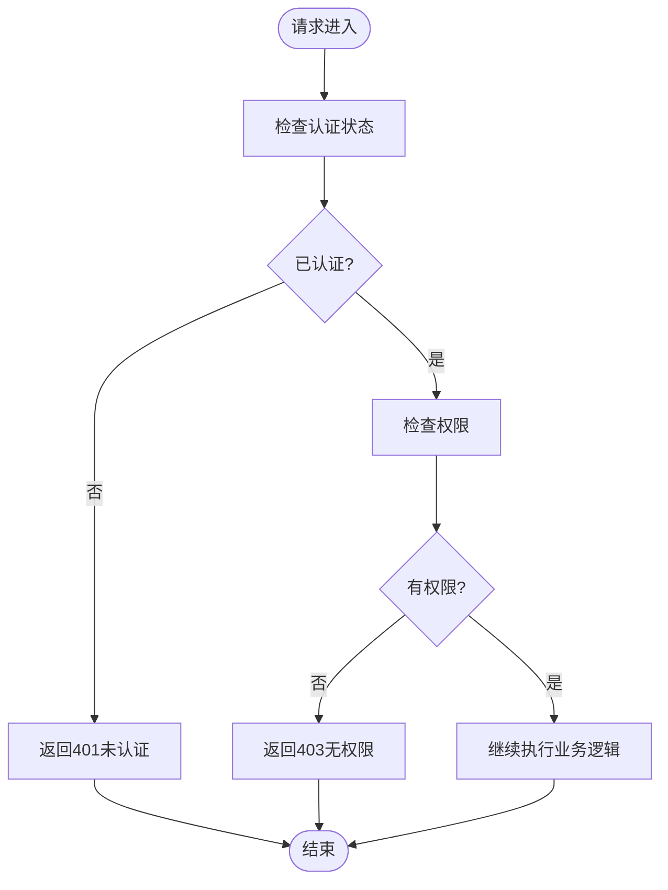
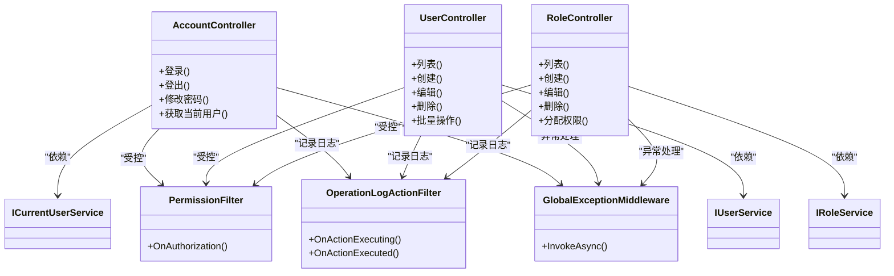

# API接口文档

<cite>
**本文引用的文件**   
- [Program.cs](file://EquipmentIMS.Web/Program.cs)
- [AccountController.cs](file://EquipmentIMS.Web/Controllers/AccountController.cs)
- [UserController.cs](file://EquipmentIMS.Web/Controllers/UserController.cs)
- [RoleController.cs](file://EquipmentIMS.Web/Controllers/RoleController.cs)
- [PermissionFilter.cs](file://EquipmentIMS.Web/Filters/PermissionFilter.cs)
- [GlobalExceptionMiddleware.cs](file://EquipmentIMS.Web/Filters/GlobalExceptionMiddleware.cs)
- [OperationLogActionFilter.cs](file://EquipmentIMS.Web/Filters/OperationLogActionFilter.cs)
- [ApiResponse.cs](file://EquipmentIMS.Models/DTOs/ApiResponse.cs)
- [PagedResult.cs](file://EquipmentIMS.Models/DTOs/PagedResult.cs)
- [BusinessException.cs](file://EquipmentIMS.Models/Exceptions/BusinessException.cs)
- [NotFoundException.cs](file://EquipmentIMS.Models/Exceptions/NotFoundException.cs)
- [ValidationException.cs](file://EquipmentIMS.Models/Exceptions/ValidationException.cs)
- [IUserService.cs](file://EquipmentIMS.BLL/Interfaces/IUserService.cs)
- [IRoleService.cs](file://EquipmentIMS.BLL/Interfaces/IRoleService.cs)
- [ICurrentUserService.cs](file://EquipmentIMS.BLL/Interfaces/ICurrentUserService.cs)
- [ProductController.cs](file://EquipmentIMS.Web/Controllers/ProductController.cs)
- [StockController.cs](file://EquipmentIMS.Web/Controllers/StockController.cs)
- [PurchaseOrderController.cs](file://EquipmentIMS.Web/Controllers/PurchaseOrderController.cs)
- [SaleOrderController.cs](file://EquipmentIMS.Web/Controllers/SaleOrderController.cs)
- [ReportController.cs](file://EquipmentIMS.Web/Controllers/ReportController.cs)
</cite>

## 目录
1. [简介](#简介)
2. [项目结构](#项目结构)
3. [核心组件](#核心组件)
4. [架构总览](#架构总览)
5. [详细组件分析](#详细组件分析)
6. [依赖分析](#依赖分析)
7. [性能考虑](#性能考虑)
8. [故障排查指南](#故障排查指南)
9. [结论](#结论)
10. [附录](#附录)

## 简介
本文件为THMS（设备库存管理系统）的API接口文档，覆盖RESTful端点、统一响应格式、分页规范、身份认证与权限验证、会话管理、错误码与异常处理策略，以及文件上传下载、批量操作、搜索过滤等高级用法。同时提供测试工具与调试技巧建议，帮助前后端团队快速集成与联调。

## 项目结构
系统采用分层架构：Web层（控制器与中间件）、BLL业务层（服务接口与实现）、DAL数据访问层（仓储与上下文）、Models领域模型与DTO。API入口由Web层的控制器暴露，通过过滤器与中间件完成鉴权、日志与全局异常处理。

图表来源
- [Program.cs](file://EquipmentIMS.Web/Program.cs)
- [PermissionFilter.cs](file://EquipmentIMS.Web/Filters/PermissionFilter.cs)
- [GlobalExceptionMiddleware.cs](file://EquipmentIMS.Web/Filters/GlobalExceptionMiddleware.cs)
- [IUserService.cs](file://EquipmentIMS.BLL/Interfaces/IUserService.cs)

章节来源
- [Program.cs](file://EquipmentIMS.Web/Program.cs)

## 核心组件
- 统一响应体 ApiResponse：所有API返回的标准包装结构，包含状态码、消息与数据字段，便于前端一致化处理。
- 分页结果 PagedResult：通用分页数据结构，包含记录集合、总数、页码与每页大小等元信息。
- 全局异常处理 GlobalExceptionMiddleware：捕获未处理异常并转换为标准ApiResponse，保证对外一致性。
- 权限过滤器 PermissionFilter：基于角色与权限的访问控制，拦截无权限请求。
- 操作日志 OperationLogActionFilter：在关键动作执行前后记录审计日志。

章节来源
- [ApiResponse.cs](file://EquipmentIMS.Models/DTOs/ApiResponse.cs)
- [PagedResult.cs](file://EquipmentIMS.Models/DTOs/PagedResult.cs)
- [GlobalExceptionMiddleware.cs](file://EquipmentIMS.Web/Filters/GlobalExceptionMiddleware.cs)
- [PermissionFilter.cs](file://EquipmentIMS.Web/Filters/PermissionFilter.cs)
- [OperationLogActionFilter.cs](file://EquipmentIMS.Web/Filters/OperationLogActionFilter.cs)

## 架构总览
下图展示了典型API请求从客户端到数据库的调用链路与横切关注点（鉴权、日志、异常）。

图表来源
- [AccountController.cs](file://EquipmentIMS.Web/Controllers/AccountController.cs)
- [PermissionFilter.cs](file://EquipmentIMS.Web/Filters/PermissionFilter.cs)
- [OperationLogActionFilter.cs](file://EquipmentIMS.Web/Filters/OperationLogActionFilter.cs)
- [GlobalExceptionMiddleware.cs](file://EquipmentIMS.Web/Filters/GlobalExceptionMiddleware.cs)
- [IUserService.cs](file://EquipmentIMS.BLL/Interfaces/IUserService.cs)

## 详细组件分析

### 认证与会话管理
- 登录接口：用于用户凭据校验并颁发令牌或建立会话。
- 登出接口：销毁会话或使令牌失效。
- 修改密码接口：更新当前用户密码。
- 获取当前用户信息接口：返回已认证用户的上下文信息。

说明
- 认证机制：支持基于令牌（如JWT）或Cookie会话模式；具体取决于应用配置。
- 会话管理：若使用Cookie，需确保跨域与安全属性正确设置；若使用令牌，需在请求头携带令牌。
- 安全建议：强制HTTPS、最小化敏感信息、令牌过期与刷新策略。

章节来源
- [AccountController.cs](file://EquipmentIMS.Web/Controllers/AccountController.cs)
- [ICurrentUserService.cs](file://EquipmentIMS.BLL/Interfaces/ICurrentUserService.cs)

### 用户管理
- 用户列表：分页查询用户，支持按关键字、状态、角色筛选。
- 创建/编辑用户：新增或更新用户基本信息与角色分配。
- 删除用户：逻辑删除或物理删除，受权限控制。
- 批量操作：批量启用/禁用、批量分配角色等。

说明
- 权限控制：通过权限过滤器校验角色与权限。
- 输入校验：服务端对必填字段、格式进行校验，失败返回统一错误响应。
- 审计日志：关键操作自动记录操作人、时间、IP与变更摘要。

章节来源
- [UserController.cs](file://EquipmentIMS.Web/Controllers/UserController.cs)
- [PermissionFilter.cs](file://EquipmentIMS.Web/Filters/PermissionFilter.cs)
- [OperationLogActionFilter.cs](file://EquipmentIMS.Web/Filters/OperationLogActionFilter.cs)
- [IUserService.cs](file://EquipmentIMS.BLL/Interfaces/IUserService.cs)

### 角色与权限
- 角色列表：分页查询角色，支持关键字与状态筛选。
- 创建/编辑角色：维护角色名称、描述与状态。
- 权限分配：为角色授予或撤销权限项。
- 角色删除：检查关联用户后执行删除。

说明
- 权限模型：基于RBAC（角色-权限）模型，控制器与方法级注解驱动鉴权。
- 缓存优化：权限树可缓存以提升鉴权性能。

章节来源
- [RoleController.cs](file://EquipmentIMS.Web/Controllers/RoleController.cs)
- [IRoleService.cs](file://EquipmentIMS.BLL/Interfaces/IRoleService.cs)
- [PermissionFilter.cs](file://EquipmentIMS.Web/Filters/PermissionFilter.cs)

### 商品与库存
- 商品管理：CRUD、导入导出、价格维护。
- 库存查询：实时库存、预警、出入库流水。
- 入库/出库：采购入库与销售出库流程。
- 盘点与调拨：库存盘点、仓库间调拨。

说明
- 搜索过滤：支持多条件组合查询、范围筛选、排序与分页。
- 批量操作：批量导入、批量调价、批量调整库存。
- 文件上传：Excel模板导入、报表导出。

章节来源
- [ProductController.cs](file://EquipmentIMS.Web/Controllers/ProductController.cs)
- [StockController.cs](file://EquipmentIMS.Web/Controllers/StockController.cs)
- [PurchaseOrderController.cs](file://EquipmentIMS.Web/Controllers/PurchaseOrderController.cs)
- [SaleOrderController.cs](file://EquipmentIMS.Web/Controllers/SaleOrderController.cs)

### 报表与导出
- 报表查询：库存、采购、销售、维修等维度报表。
- 异步导出：大数据量导出任务后台执行，完成后通知下载。

说明
- 导出任务：提交任务后轮询任务状态，成功后获取下载链接。
- 性能优化：分页加载、流式写入、压缩传输。

章节来源
- [ReportController.cs](file://EquipmentIMS.Web/Controllers/ReportController.cs)

### 统一响应格式 ApiResponse
- 用途：所有API返回的统一包装结构，便于前端统一解析与错误提示。
- 字段说明：
  - code：业务状态码（成功/失败/未授权等）
  - message：提示信息
  - data：业务数据（可为对象、集合或空）
- 设计原则：
  - HTTP状态码尽量保持2xx，业务状态由code表达
  - 错误场景message清晰可读，便于定位问题

章节来源
- [ApiResponse.cs](file://EquipmentIMS.Models/DTOs/ApiResponse.cs)

### 分页结果 PagedResult
- 用途：通用分页数据结构，适用于列表类接口。
- 字段说明：
  - items：当前页数据集合
  - total：总记录数
  - pageIndex：当前页码
  - pageSize：每页大小
- 使用建议：
  - 前端根据total计算总页数
  - 结合搜索参数进行二次查询

章节来源
- [PagedResult.cs](file://EquipmentIMS.Models/DTOs/PagedResult.cs)

### 错误码定义与异常处理
- 常见业务异常：
  - 业务规则异常：违反业务约束（如库存不足）
  - 资源不存在异常：请求的资源ID无效
  - 参数校验异常：请求参数不合法
- 全局异常处理：
  - 中间件捕获未处理异常，转换为ApiResponse
  - 记录错误日志，避免泄露敏感信息
- 错误码建议：
  - 200：成功
  - 400：参数错误
  - 401：未认证
  - 403：无权限
  - 404：资源不存在
  - 500：服务器内部错误

章节来源
- [GlobalExceptionMiddleware.cs](file://EquipmentIMS.Web/Filters/GlobalExceptionMiddleware.cs)
- [BusinessException.cs](file://EquipmentIMS.Models/Exceptions/BusinessException.cs)
- [NotFoundException.cs](file://EquipmentIMS.Models/Exceptions/NotFoundException.cs)
- [ValidationException.cs](file://EquipmentIMS.Models/Exceptions/ValidationException.cs)

### 权限验证流程
- 过滤器拦截：进入控制器前执行权限校验
- 权限判定：基于用户角色与目标资源的权限映射
- 拒绝处理：无权限时返回403并附带明确提示
- 审计记录：记录访问尝试与结果

图表来源
- [PermissionFilter.cs](file://EquipmentIMS.Web/Filters/PermissionFilter.cs)

章节来源
- [PermissionFilter.cs](file://EquipmentIMS.Web/Filters/PermissionFilter.cs)

### 文件上传与下载
- 上传：
  - 支持单文件与多文件上传
  - 限制文件大小与类型，防止恶意文件
  - 返回文件标识或下载链接
- 下载：
  - 支持直接下载与分片下载
  - 大文件建议使用异步任务+下载链接方式
- 安全：
  - 校验Content-Type与MIME类型
  - 存储路径隔离与访问控制

章节来源
- [ProductController.cs](file://EquipmentIMS.Web/Controllers/ProductController.cs)
- [ReportController.cs](file://EquipmentIMS.Web/Controllers/ReportController.cs)

### 批量操作
- 适用场景：批量启用/禁用、批量分配角色、批量导入导出
- 事务性：批量写操作应保证原子性与回滚
- 进度反馈：长耗时操作建议异步任务+进度查询

章节来源
- [UserController.cs](file://EquipmentIMS.Web/Controllers/UserController.cs)
- [ProductController.cs](file://EquipmentIMS.Web/Controllers/ProductController.cs)

### 搜索与过滤
- 查询参数：关键字、日期范围、状态、分类、仓库等
- 排序与分页：支持多字段排序与分页
- 性能优化：索引、缓存热点查询、避免N+1查询

章节来源
- [StockController.cs](file://EquipmentIMS.Web/Controllers/StockController.cs)
- [PurchaseOrderController.cs](file://EquipmentIMS.Web/Controllers/PurchaseOrderController.cs)
- [SaleOrderController.cs](file://EquipmentIMS.Web/Controllers/SaleOrderController.cs)

## 依赖分析
- 控制器与服务解耦：控制器仅负责请求路由与参数绑定，业务逻辑下沉至服务层。
- 过滤器与中间件：横切关注点集中管理，提升代码复用与一致性。
- 异常与日志：全局异常中间件与操作日志过滤器协同工作，保障可观测性。

图表来源
- [AccountController.cs](file://EquipmentIMS.Web/Controllers/AccountController.cs)
- [UserController.cs](file://EquipmentIMS.Web/Controllers/UserController.cs)
- [RoleController.cs](file://EquipmentIMS.Web/Controllers/RoleController.cs)
- [PermissionFilter.cs](file://EquipmentIMS.Web/Filters/PermissionFilter.cs)
- [GlobalExceptionMiddleware.cs](file://EquipmentIMS.Web/Filters/GlobalExceptionMiddleware.cs)
- [OperationLogActionFilter.cs](file://EquipmentIMS.Web/Filters/OperationLogActionFilter.cs)
- [IUserService.cs](file://EquipmentIMS.BLL/Interfaces/IUserService.cs)
- [IRoleService.cs](file://EquipmentIMS.BLL/Interfaces/IRoleService.cs)
- [ICurrentUserService.cs](file://EquipmentIMS.BLL/Interfaces/ICurrentUserService.cs)

章节来源
- [AccountController.cs](file://EquipmentIMS.Web/Controllers/AccountController.cs)
- [UserController.cs](file://EquipmentIMS.Web/Controllers/UserController.cs)
- [RoleController.cs](file://EquipmentIMS.Web/Controllers/RoleController.cs)
- [PermissionFilter.cs](file://EquipmentIMS.Web/Filters/PermissionFilter.cs)
- [GlobalExceptionMiddleware.cs](file://EquipmentIMS.Web/Filters/GlobalExceptionMiddleware.cs)
- [OperationLogActionFilter.cs](file://EquipmentIMS.Web/Filters/OperationLogActionFilter.cs)
- [IUserService.cs](file://EquipmentIMS.BLL/Interfaces/IUserService.cs)
- [IRoleService.cs](file://EquipmentIMS.BLL/Interfaces/IRoleService.cs)
- [ICurrentUserService.cs](file://EquipmentIMS.BLL/Interfaces/ICurrentUserService.cs)

## 性能考虑
- 分页与索引：列表接口默认分页，数据库层建立必要索引。
- 缓存策略：热点数据（如权限树、字典表）使用内存缓存。
- 异步导出：大数据量导出采用后台任务，避免阻塞主线程。
- 连接池与超时：合理配置数据库连接池与超时时间。
- 压缩传输：启用Gzip压缩减少带宽占用。

[本节为通用指导，无需特定文件引用]

## 故障排查指南
- 常见问题：
  - 401未认证：检查令牌是否过期或缺失
  - 403无权限：确认用户角色与权限映射是否正确
  - 404资源不存在：核对ID与数据有效性
  - 500服务器错误：查看全局异常日志与堆栈
- 调试技巧：
  - 开启开发环境详细日志
  - 使用浏览器开发者工具查看网络请求与响应
  - 通过操作日志过滤器追踪关键动作
  - 复现问题时抓取完整请求与响应报文

章节来源
- [GlobalExceptionMiddleware.cs](file://EquipmentIMS.Web/Filters/GlobalExceptionMiddleware.cs)
- [OperationLogActionFilter.cs](file://EquipmentIMS.Web/Filters/OperationLogActionFilter.cs)

## 结论
本文档系统化梳理了THMS系统的API接口、统一响应与分页规范、认证与权限机制、异常处理策略以及高级功能使用方法。遵循本文规范可实现前后端高效协作与稳定交付。

## 附录

### API端点清单（示例）
- 认证与会话
  - POST /api/account/login
  - POST /api/account/logout
  - PUT /api/account/change-password
  - GET /api/account/me
- 用户管理
  - GET /api/users
  - POST /api/users
  - PUT /api/users/{id}
  - DELETE /api/users/{id}
  - POST /api/users/batch
- 角色与权限
  - GET /api/roles
  - POST /api/roles
  - PUT /api/roles/{id}
  - DELETE /api/roles/{id}
  - PUT /api/roles/{id}/permissions
- 商品与库存
  - GET /api/products
  - POST /api/products
  - PUT /api/products/{id}
  - DELETE /api/products/{id}
  - GET /api/stock
  - POST /api/stock/check
  - POST /api/stock/transfer
- 采购与销售
  - GET /api/purchase-orders
  - POST /api/purchase-orders
  - GET /api/sale-orders
  - POST /api/sale-orders
- 报表与导出
  - GET /api/reports/inventory
  - GET /api/reports/purchase
  - GET /api/reports/sale
  - POST /api/reports/export

说明
- 以上为端点命名约定示例，实际路径以控制器路由为准。
- 所有接口均返回ApiResponse或PagedResult。

章节来源
- [AccountController.cs](file://EquipmentIMS.Web/Controllers/AccountController.cs)
- [UserController.cs](file://EquipmentIMS.Web/Controllers/UserController.cs)
- [RoleController.cs](file://EquipmentIMS.Web/Controllers/RoleController.cs)
- [ProductController.cs](file://EquipmentIMS.Web/Controllers/ProductController.cs)
- [StockController.cs](file://EquipmentIMS.Web/Controllers/StockController.cs)
- [PurchaseOrderController.cs](file://EquipmentIMS.Web/Controllers/PurchaseOrderController.cs)
- [SaleOrderController.cs](file://EquipmentIMS.Web/Controllers/SaleOrderController.cs)
- [ReportController.cs](file://EquipmentIMS.Web/Controllers/ReportController.cs)

### 请求与响应示例（结构说明）
- 请求头
  - Authorization：Bearer <令牌>（若使用令牌认证）
  - Content-Type：application/json 或 multipart/form-data（文件上传）
- 成功响应（ApiResponse）
  - code：200
  - message：成功
  - data：业务数据
- 分页响应（PagedResult）
  - items：数组
  - total：整数
  - pageIndex：整数
  - pageSize：整数
- 错误响应（ApiResponse）
  - code：非200的业务码
  - message：错误描述
  - data：null或附加信息

章节来源
- [ApiResponse.cs](file://EquipmentIMS.Models/DTOs/ApiResponse.cs)
- [PagedResult.cs](file://EquipmentIMS.Models/DTOs/PagedResult.cs)

### 错误码定义（建议）
- 200：成功
- 400：参数错误
- 401：未认证
- 403：无权限
- 404：资源不存在
- 500：服务器内部错误

章节来源
- [GlobalExceptionMiddleware.cs](file://EquipmentIMS.Web/Filters/GlobalExceptionMiddleware.cs)
- [BusinessException.cs](file://EquipmentIMS.Models/Exceptions/BusinessException.cs)
- [NotFoundException.cs](file://EquipmentIMS.Models/Exceptions/NotFoundException.cs)
- [ValidationException.cs](file://EquipmentIMS.Models/Exceptions/ValidationException.cs)

### API测试工具与调试技巧
- 推荐工具：Postman、Insomnia、curl
- 常用技巧：
  - 保存环境变量（如BaseURL、Token）
  - 使用预请求脚本注入令牌
  - 断言响应结构与状态码
  - 录制与回放请求序列
  - 对比不同环境的差异

[本节为通用指导，无需特定文件引用]