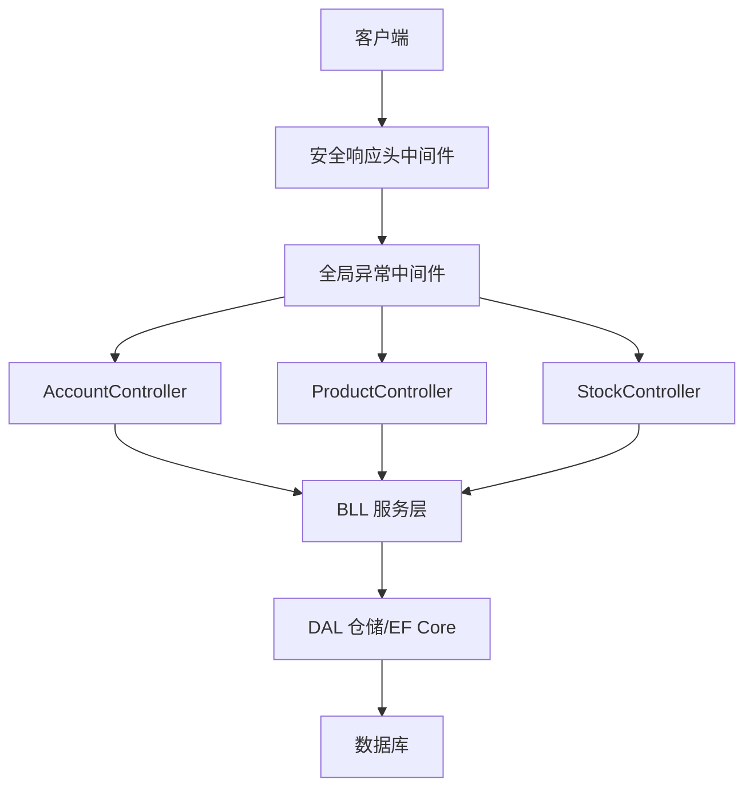
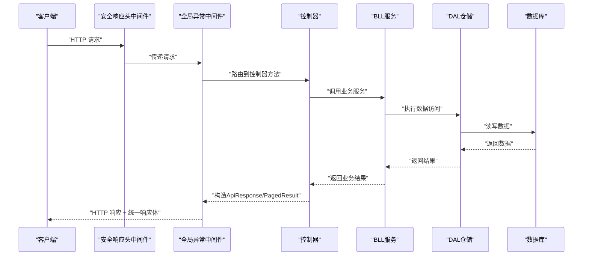
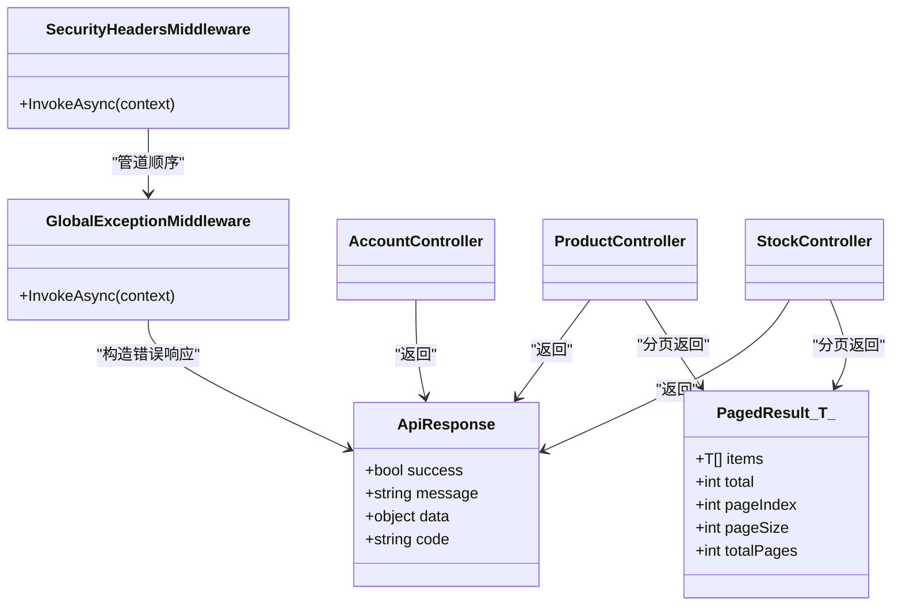

# API概述与规范

<cite>
**本文引用的文件**   
- [EquipmentIMS.Web/Program.cs](file://EquipmentIMS.Web/Program.cs)
- [EquipmentIMS.Web/Filters/GlobalExceptionMiddleware.cs](file://EquipmentIMS.Web/Filters/GlobalExceptionMiddleware.cs)
- [EquipmentIMS.Web/Filters/SecurityHeadersMiddleware.cs](file://EquipmentIMS.Web/Filters/SecurityHeadersMiddleware.cs)
- [EquipmentIMS.Models/DTOs/ApiResponse.cs](file://EquipmentIMS.Models/DTOs/ApiResponse.cs)
- [EquipmentIMS.Models/DTOs/PagedResult.cs](file://EquipmentIMS.Models/DTOs/PagedResult.cs)
- [EquipmentIMS.Models/Exceptions/BusinessException.cs](file://EquipmentIMS.Models/Exceptions/BusinessException.cs)
- [EquipmentIMS.Models/Exceptions/NotFoundException.cs](file://EquipmentIMS.Models/Exceptions/NotFoundException.cs)
- [EquipmentIMS.Models/Exceptions/ValidationException.cs](file://EquipmentIMS.Models/Exceptions/ValidationException.cs)
- [EquipmentIMS.Web/Controllers/AccountController.cs](file://EquipmentIMS.Web/Controllers/AccountController.cs)
- [EquipmentIMS.Web/Controllers/ProductController.cs](file://EquipmentIMS.Web/Controllers/ProductController.cs)
- [EquipmentIMS.Web/Controllers/StockController.cs](file://EquipmentIMS.Web/Controllers/StockController.cs)
</cite>

## 目录
1. [简介](#简介)
2. [项目结构](#项目结构)
3. [核心组件](#核心组件)
4. [架构总览](#架构总览)
5. [详细组件分析](#详细组件分析)
6. [依赖关系分析](#依赖关系分析)
7. [性能考虑](#性能考虑)
8. [故障排查指南](#故障排查指南)
9. [结论](#结论)
10. [附录](#附录)

## 简介
本文件为THMS系统的API概述与规范，面向前后端开发者、测试工程师与运维人员。文档聚焦于RESTful设计原则、统一响应格式(ApiResponse)、分页结果(PagedResult)规范、HTTP状态码与错误码约定、异常处理策略、通用请求头与内容类型、字符编码、API版本管理与向后兼容性保证，以及API测试工具与调试技巧。

## 项目结构
THMS采用分层架构：Web层(Controllers/Middleware/Filters)负责HTTP协议与横切关注点；BLL层提供业务服务；DAL层封装数据访问；Models层定义DTO、实体、枚举与异常类型。API相关的关键位置如下：
- Web入口与中间件注册：Program.cs
- 全局异常处理与安全响应头：GlobalExceptionMiddleware.cs、SecurityHeadersMiddleware.cs
- 统一响应与分页模型：ApiResponse.cs、PagedResult.cs
- 领域异常类型：BusinessException.cs、NotFoundException.cs、ValidationException.cs
- 典型控制器示例：AccountController.cs、ProductController.cs、StockController.cs

图表来源
- [EquipmentIMS.Web/Program.cs](file://EquipmentIMS.Web/Program.cs)
- [EquipmentIMS.Web/Filters/GlobalExceptionMiddleware.cs](file://EquipmentIMS.Web/Filters/GlobalExceptionMiddleware.cs)
- [EquipmentIMS.Web/Filters/SecurityHeadersMiddleware.cs](file://EquipmentIMS.Web/Filters/SecurityHeadersMiddleware.cs)
- [EquipmentIMS.Web/Controllers/AccountController.cs](file://EquipmentIMS.Web/Controllers/AccountController.cs)
- [EquipmentIMS.Web/Controllers/ProductController.cs](file://EquipmentIMS.Web/Controllers/ProductController.cs)
- [EquipmentIMS.Web/Controllers/StockController.cs](file://EquipmentIMS.Web/Controllers/StockController.cs)

章节来源
- [EquipmentIMS.Web/Program.cs](file://EquipmentIMS.Web/Program.cs)
- [EquipmentIMS.Web/Filters/GlobalExceptionMiddleware.cs](file://EquipmentIMS.Web/Filters/GlobalExceptionMiddleware.cs)
- [EquipmentIMS.Web/Filters/SecurityHeadersMiddleware.cs](file://EquipmentIMS.Web/Filters/SecurityHeadersMiddleware.cs)
- [EquipmentIMS.Web/Controllers/AccountController.cs](file://EquipmentIMS.Web/Controllers/AccountController.cs)
- [EquipmentIMS.Web/Controllers/ProductController.cs](file://EquipmentIMS.Web/Controllers/ProductController.cs)
- [EquipmentIMS.Web/Controllers/StockController.cs](file://EquipmentIMS.Web/Controllers/StockController.cs)

## 核心组件
本节对API相关的核心数据结构与处理机制进行说明。

- 统一响应格式 ApiResponse
  - 用于所有API的标准化返回体，包含成功/失败标识、消息、数据载荷等字段。
  - 建议字段语义：
    - success: 布尔值，表示本次调用是否成功
    - message: 字符串，人类可读的消息或错误信息
    - data: 任意类型，承载具体业务数据
    - code: 可选的业务错误码（当success=false时）
  - 使用场景：
    - 成功：success=true, data=业务对象或集合
    - 失败：success=false, message=错误描述, code=业务错误码

- 分页结果 PagedResult
  - 用于列表查询的分页包装，便于前端渲染分页控件。
  - 建议字段语义：
    - items: 当前页的数据集合
    - total: 总记录数
    - pageIndex: 当前页码
    - pageSize: 每页大小
    - totalPages: 总页数（可由total/pageSize计算）
  - 使用场景：
    - 列表接口返回PagedResult<T>，前端根据total与page控制分页

- 领域异常类型
  - BusinessException: 业务规则校验失败或业务逻辑异常
  - NotFoundException: 资源不存在
  - ValidationException: 参数校验失败
  - 这些异常由全局异常中间件捕获并转换为统一的ApiResponse与合适的HTTP状态码

章节来源
- [EquipmentIMS.Models/DTOs/ApiResponse.cs](file://EquipmentIMS.Models/DTOs/ApiResponse.cs)
- [EquipmentIMS.Models/DTOs/PagedResult.cs](file://EquipmentIMS.Models/DTOs/PagedResult.cs)
- [EquipmentIMS.Models/Exceptions/BusinessException.cs](file://EquipmentIMS.Models/Exceptions/BusinessException.cs)
- [EquipmentIMS.Models/Exceptions/NotFoundException.cs](file://EquipmentIMS.Models/Exceptions/NotFoundException.cs)
- [EquipmentIMS.Models/Exceptions/ValidationException.cs](file://EquipmentIMS.Models/Exceptions/ValidationException.cs)

## 架构总览
下图展示一次典型的API请求在系统中的流转路径，包括中间件、控制器、BLL/DAL与统一响应生成过程。

图表来源
- [EquipmentIMS.Web/Program.cs](file://EquipmentIMS.Web/Program.cs)
- [EquipmentIMS.Web/Filters/GlobalExceptionMiddleware.cs](file://EquipmentIMS.Web/Filters/GlobalExceptionMiddleware.cs)
- [EquipmentIMS.Web/Filters/SecurityHeadersMiddleware.cs](file://EquipmentIMS.Web/Filters/SecurityHeadersMiddleware.cs)
- [EquipmentIMS.Web/Controllers/AccountController.cs](file://EquipmentIMS.Web/Controllers/AccountController.cs)
- [EquipmentIMS.Web/Controllers/ProductController.cs](file://EquipmentIMS.Web/Controllers/ProductController.cs)
- [EquipmentIMS.Web/Controllers/StockController.cs](file://EquipmentIMS.Web/Controllers/StockController.cs)

## 详细组件分析

### 统一响应格式 ApiResponse
- 目标：确保所有API返回一致的JSON结构，简化前端解析与错误处理。
- 字段约定：
  - success: 布尔值
  - message: 字符串
  - data: 任意类型
  - code: 可选的业务错误码
- 使用建议：
  - 成功路径：success=true, data=业务对象或集合
  - 失败路径：success=false, message=错误描述, code=业务错误码
  - 分页接口：data=PagedResult<T>

章节来源
- [EquipmentIMS.Models/DTOs/ApiResponse.cs](file://EquipmentIMS.Models/DTOs/ApiResponse.cs)

### 分页结果 PagedResult
- 目标：为列表查询提供标准分页包装，便于前端分页控件渲染。
- 字段约定：
  - items: 当前页数据集合
  - total: 总记录数
  - pageIndex: 当前页码
  - pageSize: 每页大小
  - totalPages: 总页数（可计算）
- 使用建议：
  - 列表接口返回PagedResult<T>
  - 前端根据total与pageIndex/pageSize实现分页导航

章节来源
- [EquipmentIMS.Models/DTOs/PagedResult.cs](file://EquipmentIMS.Models/DTOs/PagedResult.cs)

### 全局异常处理与错误码
- 全局异常中间件负责捕获未处理异常，将其转换为统一的ApiResponse与合适的HTTP状态码。
- 常见异常映射建议：
  - ValidationException -> 400 Bad Request
  - NotFoundException -> 404 Not Found
  - BusinessException -> 422 Unprocessable Entity 或 400 Bad Request（按业务语义选择）
  - 其他未分类异常 -> 500 Internal Server Error
- 错误码定义建议：
  - 使用业务错误码(code)区分不同错误场景，message提供人类可读描述
  - 错误码命名建议采用“模块_子域_错误”三段式，如“库存_不足”、“用户_已存在”

章节来源
- [EquipmentIMS.Web/Filters/GlobalExceptionMiddleware.cs](file://EquipmentIMS.Web/Filters/GlobalExceptionMiddleware.cs)
- [EquipmentIMS.Models/Exceptions/BusinessException.cs](file://EquipmentIMS.Models/Exceptions/BusinessException.cs)
- [EquipmentIMS.Models/Exceptions/NotFoundException.cs](file://EquipmentIMS.Models/Exceptions/NotFoundException.cs)
- [EquipmentIMS.Models/Exceptions/ValidationException.cs](file://EquipmentIMS.Models/Exceptions/ValidationException.cs)

### 安全响应头中间件
- 目的：为所有响应附加安全相关的HTTP响应头，提升安全性。
- 常见响应头建议：
  - X-Content-Type-Options: nosniff
  - X-Frame-Options: DENY
  - Strict-Transport-Security: max-age=...
  - Content-Security-Policy: ...
  - Referrer-Policy: strict-origin-when-cross-origin
- 配置方式：在Program中注册中间件管道

章节来源
- [EquipmentIMS.Web/Filters/SecurityHeadersMiddleware.cs](file://EquipmentIMS.Web/Filters/SecurityHeadersMiddleware.cs)
- [EquipmentIMS.Web/Program.cs](file://EquipmentIMS.Web/Program.cs)

### 控制器与API设计示例
- AccountController：账户登录、登出、密码修改等认证授权相关接口
- ProductController：产品CRUD、搜索、分页等基础数据管理接口
- StockController：库存查询、盘点、出入库等业务接口

设计要点：
- RESTful风格：名词化资源路径，动词通过HTTP方法表达
- 统一响应：所有接口返回ApiResponse或PagedResult
- 状态码：遵循HTTP语义，结合ApiResponse.success/message/code
- 分页：列表接口使用PagedResult<T>

章节来源
- [EquipmentIMS.Web/Controllers/AccountController.cs](file://EquipmentIMS.Web/Controllers/AccountController.cs)
- [EquipmentIMS.Web/Controllers/ProductController.cs](file://EquipmentIMS.Web/Controllers/ProductController.cs)
- [EquipmentIMS.Web/Controllers/StockController.cs](file://EquipmentIMS.Web/Controllers/StockController.cs)

## 依赖关系分析
- 中间件依赖：
  - SecurityHeadersMiddleware：注入安全响应头
  - GlobalExceptionMiddleware：捕获异常并转换响应
- 控制器依赖：
  - 控制器调用BLL服务，BLL再调用DAL仓储与数据库
- DTO与异常：
  - ApiResponse与PagedResult被控制器广泛使用
  - 领域异常被全局异常中间件捕获并转换

图表来源
- [EquipmentIMS.Models/DTOs/ApiResponse.cs](file://EquipmentIMS.Models/DTOs/ApiResponse.cs)
- [EquipmentIMS.Models/DTOs/PagedResult.cs](file://EquipmentIMS.Models/DTOs/PagedResult.cs)
- [EquipmentIMS.Web/Filters/GlobalExceptionMiddleware.cs](file://EquipmentIMS.Web/Filters/GlobalExceptionMiddleware.cs)
- [EquipmentIMS.Web/Filters/SecurityHeadersMiddleware.cs](file://EquipmentIMS.Web/Filters/SecurityHeadersMiddleware.cs)
- [EquipmentIMS.Web/Controllers/AccountController.cs](file://EquipmentIMS.Web/Controllers/AccountController.cs)
- [EquipmentIMS.Web/Controllers/ProductController.cs](file://EquipmentIMS.Web/Controllers/ProductController.cs)
- [EquipmentIMS.Web/Controllers/StockController.cs](file://EquipmentIMS.Web/Controllers/StockController.cs)

## 性能考虑
- 分页与过滤：
  - 列表接口默认启用分页，避免一次性返回大量数据
  - 支持常用过滤条件以减少无效数据传输
- 缓存策略：
  - 对热点只读数据（如字典、配置）引入内存缓存
- 序列化优化：
  - 合理设置JSON序列化选项，减少冗余字段
- 连接池与异步：
  - 使用异步I/O与数据库连接池，提高并发处理能力

[本节为通用指导，不直接分析具体文件]

## 故障排查指南
- 常见问题定位：
  - 检查全局异常中间件是否正确捕获并转换异常
  - 确认安全响应头中间件是否按预期添加响应头
  - 验证控制器返回的ApiResponse/PagedResult是否符合规范
- 日志与追踪：
  - 在关键路径添加结构化日志，记录请求ID、用户、耗时与错误堆栈
- 调试技巧：
  - 使用Postman/Newman进行接口自动化测试
  - 使用浏览器开发者工具查看网络请求与响应
  - 开启开发环境详细错误信息，生产环境关闭敏感信息

章节来源
- [EquipmentIMS.Web/Filters/GlobalExceptionMiddleware.cs](file://EquipmentIMS.Web/Filters/GlobalExceptionMiddleware.cs)
- [EquipmentIMS.Web/Filters/SecurityHeadersMiddleware.cs](file://EquipmentIMS.Web/Filters/SecurityHeadersMiddleware.cs)

## 结论
本规范明确了THMS系统API的统一响应格式、分页模型、异常处理与中间件策略，有助于前后端协作与系统稳定性。建议在后续迭代中持续完善错误码体系、增加API版本管理策略与兼容性保障，并通过自动化测试与监控提升质量与可观测性。

[本节为总结性内容，不直接分析具体文件]

## 附录

### RESTful API设计原则
- 资源命名：使用名词复数形式，层级清晰
- HTTP方法：GET/POST/PUT/PATCH/DELETE对应读取/创建/更新/部分更新/删除
- 状态码：遵循HTTP语义，结合ApiResponse.success/message/code
- 查询参数：使用query string传递过滤、排序、分页参数
- 幂等性：GET/PUT/DELETE应满足幂等要求

### 统一响应格式 ApiResponse
- 字段：success、message、data、code
- 成功：success=true, data=业务对象或集合
- 失败：success=false, message=错误描述, code=业务错误码

章节来源
- [EquipmentIMS.Models/DTOs/ApiResponse.cs](file://EquipmentIMS.Models/DTOs/ApiResponse.cs)

### 分页结果 PagedResult
- 字段：items、total、pageIndex、pageSize、totalPages
- 使用：列表接口返回PagedResult<T>

章节来源
- [EquipmentIMS.Models/DTOs/PagedResult.cs](file://EquipmentIMS.Models/DTOs/PagedResult.cs)

### HTTP状态码使用规范
- 2xx：成功
- 400：请求参数错误或校验失败
- 401：未认证
- 403：无权限
- 404：资源不存在
- 422：业务规则失败
- 5xx：服务器内部错误

### 错误码定义与异常处理策略
- 错误码：业务错误码(code)，与message配合
- 异常映射：
  - ValidationException -> 400
  - NotFoundException -> 404
  - BusinessException -> 422或400
  - 其他 -> 500

章节来源
- [EquipmentIMS.Web/Filters/GlobalExceptionMiddleware.cs](file://EquipmentIMS.Web/Filters/GlobalExceptionMiddleware.cs)
- [EquipmentIMS.Models/Exceptions/BusinessException.cs](file://EquipmentIMS.Models/Exceptions/BusinessException.cs)
- [EquipmentIMS.Models/Exceptions/NotFoundException.cs](file://EquipmentIMS.Models/Exceptions/NotFoundException.cs)
- [EquipmentIMS.Models/Exceptions/ValidationException.cs](file://EquipmentIMS.Models/Exceptions/ValidationException.cs)

### 请求头设置、内容类型与字符编码
- 内容类型：application/json
- 字符编码：UTF-8
- 必要请求头：
  - Authorization: Bearer <token>
  - Accept: application/json
  - Content-Type: application/json
- 安全响应头：由SecurityHeadersMiddleware统一添加

章节来源
- [EquipmentIMS.Web/Filters/SecurityHeadersMiddleware.cs](file://EquipmentIMS.Web/Filters/SecurityHeadersMiddleware.cs)

### API版本管理与向后兼容
- 版本策略：URL前缀(/api/v1/)或请求头(Accept-Version)
- 兼容性保证：
  - 新增字段保持向后兼容
  - 废弃字段保留一段时间并提供迁移指引
  - 重大变更发布新版本，旧版本继续维护一段时间

[本节为通用指导，不直接分析具体文件]

### API测试工具推荐与调试技巧
- 工具：Postman、Newman、Swagger/OpenAPI（若启用）
- 技巧：
  - 使用环境变量管理Base URL与Token
  - 编写集合脚本进行回归测试
  - 结合日志与链路追踪定位问题

[本节为通用指导，不直接分析具体文件]