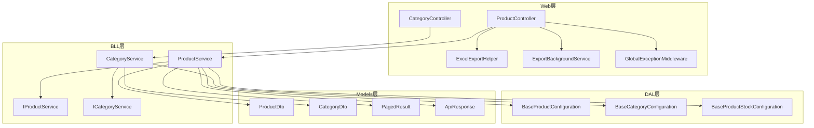
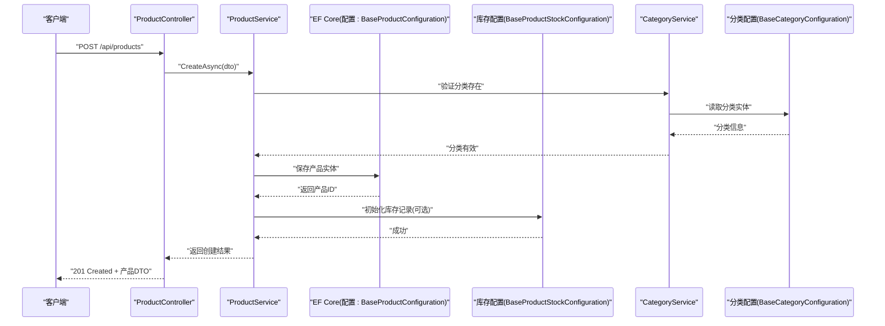
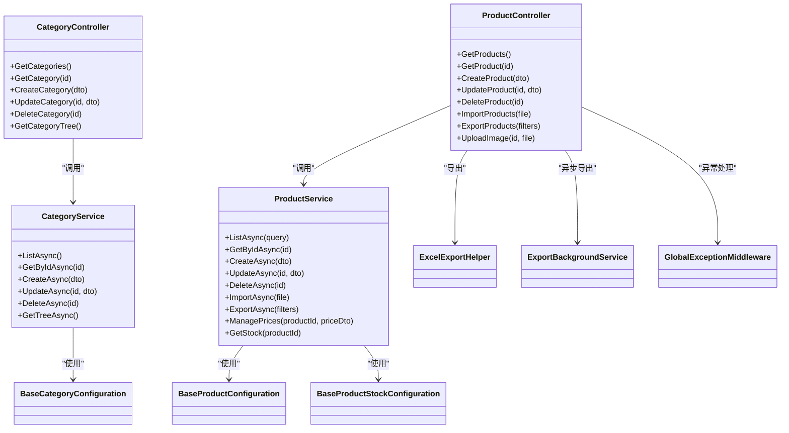

# 产品管理API

<cite>
**本文引用的文件**   
- [ProductController.cs](file://EquipmentIMS.Web/Controllers/ProductController.cs)
- [CategoryController.cs](file://EquipmentIMS.Web/Controllers/CategoryController.cs)
- [ProductService.cs](file://EquipmentIMS.BLL/Services/ProductService.cs)
- [CategoryService.cs](file://EquipmentIMS.BLL/Services/CategoryService.cs)
- [IProductService.cs](file://EquipmentIMS.BLL/Interfaces/IProductService.cs)
- [ICategoryService.cs](file://EquipmentIMS.BLL/Interfaces/ICategoryService.cs)
- [ProductDto.cs](file://EquipmentIMS.Models/DTOs/ProductDto.cs)
- [CategoryDto.cs](file://EquipmentIMS.Models/DTOs/CategoryDto.cs)
- [PagedResult.cs](file://EquipmentIMS.Models/DTOs/PagedResult.cs)
- [ApiResponse.cs](file://EquipmentIMS.Models/DTOs/ApiResponse.cs)
- [BaseProductConfiguration.cs](file://EquipmentIMS.DAL/Configurations/BaseProductConfiguration.cs)
- [BaseCategoryConfiguration.cs](file://EquipmentIMS.DAL/Configurations/BaseCategoryConfiguration.cs)
- [BaseProductStockConfiguration.cs](file://EquipmentIMS.DAL/Configurations/BaseProductStockConfiguration.cs)
- [ExcelExportHelper.cs](file://EquipmentIMS.Web/Helpers/ExcelExportHelper.cs)
- [ExportBackgroundService.cs](file://EquipmentIMS.Web/BackgroundServices/ExportBackgroundService.cs)
- [GlobalExceptionMiddleware.cs](file://EquipmentIMS.Web/Filters/GlobalExceptionMiddleware.cs)
</cite>

## 目录
1. [简介](#简介)
2. [项目结构](#项目结构)
3. [核心组件](#核心组件)
4. [架构总览](#架构总览)
5. [详细组件分析](#详细组件分析)
6. [依赖关系分析](#依赖关系分析)
7. [性能考虑](#性能考虑)
8. [故障排查指南](#故障排查指南)
9. [结论](#结论)
10. [附录：接口清单与数据模型](#附录接口清单与数据模型)

## 简介
本文件为“产品管理模块”的API接口文档，覆盖产品分类管理与产品信息CRUD、搜索过滤与分页、批量导入导出、图片上传、状态管理、价格管理与库存关联等能力。文档面向前后端开发者与集成方，提供清晰的接口约定、数据模型说明、业务规则与错误处理建议。

## 项目结构
产品管理相关代码采用分层架构：Web层控制器负责HTTP请求与响应；BLL层服务封装业务逻辑；DAL层通过EF Core配置实体映射；Models层定义DTO、实体与枚举；辅助工具提供Excel导出与后台任务支持。

图表来源
- [ProductController.cs](file://EquipmentIMS.Web/Controllers/ProductController.cs)
- [CategoryController.cs](file://EquipmentIMS.Web/Controllers/CategoryController.cs)
- [ProductService.cs](file://EquipmentIMS.BLL/Services/ProductService.cs)
- [CategoryService.cs](file://EquipmentIMS.BLL/Services/CategoryService.cs)
- [IProductService.cs](file://EquipmentIMS.BLL/Interfaces/IProductService.cs)
- [ICategoryService.cs](file://EquipmentIMS.BLL/Interfaces/ICategoryService.cs)
- [BaseProductConfiguration.cs](file://EquipmentIMS.DAL/Configurations/BaseProductConfiguration.cs)
- [BaseCategoryConfiguration.cs](file://EquipmentIMS.DAL/Configurations/BaseCategoryConfiguration.cs)
- [BaseProductStockConfiguration.cs](file://EquipmentIMS.DAL/Configurations/BaseProductStockConfiguration.cs)
- [ExcelExportHelper.cs](file://EquipmentIMS.Web/Helpers/ExcelExportHelper.cs)
- [ExportBackgroundService.cs](file://EquipmentIMS.Web/BackgroundServices/ExportBackgroundService.cs)
- [GlobalExceptionMiddleware.cs](file://EquipmentIMS.Web/Filters/GlobalExceptionMiddleware.cs)
- [ProductDto.cs](file://EquipmentIMS.Models/DTOs/ProductDto.cs)
- [CategoryDto.cs](file://EquipmentIMS.Models/DTOs/CategoryDto.cs)
- [PagedResult.cs](file://EquipmentIMS.Models/DTOs/PagedResult.cs)
- [ApiResponse.cs](file://EquipmentIMS.Models/DTOs/ApiResponse.cs)

章节来源
- [ProductController.cs](file://EquipmentIMS.Web/Controllers/ProductController.cs)
- [CategoryController.cs](file://EquipmentIMS.Web/Controllers/CategoryController.cs)
- [ProductService.cs](file://EquipmentIMS.BLL/Services/ProductService.cs)
- [CategoryService.cs](file://EquipmentIMS.BLL/Services/CategoryService.cs)
- [IProductService.cs](file://EquipmentIMS.BLL/Interfaces/IProductService.cs)
- [ICategoryService.cs](file://EquipmentIMS.BLL/Interfaces/ICategoryService.cs)
- [BaseProductConfiguration.cs](file://EquipmentIMS.DAL/Configurations/BaseProductConfiguration.cs)
- [BaseCategoryConfiguration.cs](file://EquipmentIMS.DAL/Configurations/BaseCategoryConfiguration.cs)
- [BaseProductStockConfiguration.cs](file://EquipmentIMS.DAL/Configurations/BaseProductStockConfiguration.cs)
- [ExcelExportHelper.cs](file://EquipmentIMS.Web/Helpers/ExcelExportHelper.cs)
- [ExportBackgroundService.cs](file://EquipmentIMS.Web/BackgroundServices/ExportBackgroundService.cs)
- [GlobalExceptionMiddleware.cs](file://EquipmentIMS.Web/Filters/GlobalExceptionMiddleware.cs)
- [ProductDto.cs](file://EquipmentIMS.Models/DTOs/ProductDto.cs)
- [CategoryDto.cs](file://EquipmentIMS.Models/DTOs/CategoryDto.cs)
- [PagedResult.cs](file://EquipmentIMS.Models/DTOs/PagedResult.cs)
- [ApiResponse.cs](file://EquipmentIMS.Models/DTOs/ApiResponse.cs)

## 核心组件
- 控制器层
  - 产品控制器：提供产品分类与产品的REST接口，包括列表、详情、新增、修改、删除、搜索分页、导入导出、图片上传等。
  - 分类控制器：提供分类的CRUD与树形结构查询。
- 服务层
  - 产品服务：实现产品领域逻辑，含校验、事务、库存联动、价格策略、导入导出编排。
  - 分类服务：实现分类领域逻辑，含层级维护与排序。
- 数据访问层
  - EF Core配置：产品、分类、产品库存实体的字段约束、索引与关系映射。
- 模型层
  - DTO：产品与分类的数据传输对象、分页结果、统一响应体。
- 辅助与基础设施
  - Excel导出助手：生成Excel流或文件。
  - 后台导出服务：异步执行大批量导出任务。
  - 全局异常中间件：统一异常捕获与错误响应。

章节来源
- [ProductController.cs](file://EquipmentIMS.Web/Controllers/ProductController.cs)
- [CategoryController.cs](file://EquipmentIMS.Web/Controllers/CategoryController.cs)
- [ProductService.cs](file://EquipmentIMS.BLL/Services/ProductService.cs)
- [CategoryService.cs](file://EquipmentIMS.BLL/Services/CategoryService.cs)
- [BaseProductConfiguration.cs](file://EquipmentIMS.DAL/Configurations/BaseProductConfiguration.cs)
- [BaseCategoryConfiguration.cs](file://EquipmentIMS.DAL/Configurations/BaseCategoryConfiguration.cs)
- [BaseProductStockConfiguration.cs](file://EquipmentIMS.DAL/Configurations/BaseProductStockConfiguration.cs)
- [ExcelExportHelper.cs](file://EquipmentIMS.Web/Helpers/ExcelExportHelper.cs)
- [ExportBackgroundService.cs](file://EquipmentIMS.Web/BackgroundServices/ExportBackgroundService.cs)
- [GlobalExceptionMiddleware.cs](file://EquipmentIMS.Web/Filters/GlobalExceptionMiddleware.cs)
- [ProductDto.cs](file://EquipmentIMS.Models/DTOs/ProductDto.cs)
- [CategoryDto.cs](file://EquipmentIMS.Models/DTOs/CategoryDto.cs)
- [PagedResult.cs](file://EquipmentIMS.Models/DTOs/PagedResult.cs)
- [ApiResponse.cs](file://EquipmentIMS.Models/DTOs/ApiResponse.cs)

## 架构总览
产品管理API遵循典型的三层架构与依赖注入模式。控制器仅做参数绑定与调用服务；服务层承载业务规则与跨域操作（如库存、价格）；数据访问通过EF Core配置完成持久化。

图表来源
- [ProductController.cs](file://EquipmentIMS.Web/Controllers/ProductController.cs)
- [ProductService.cs](file://EquipmentIMS.BLL/Services/ProductService.cs)
- [CategoryService.cs](file://EquipmentIMS.BLL/Services/CategoryService.cs)
- [BaseProductConfiguration.cs](file://EquipmentIMS.DAL/Configurations/BaseProductConfiguration.cs)
- [BaseProductStockConfiguration.cs](file://EquipmentIMS.DAL/Configurations/BaseProductStockConfiguration.cs)
- [BaseCategoryConfiguration.cs](file://EquipmentIMS.DAL/Configurations/BaseCategoryConfiguration.cs)

## 详细组件分析

### 产品分类管理接口
- 功能范围
  - 分类CRUD：新增、编辑、删除、获取详情。
  - 树形结构：按层级返回分类树。
  - 排序与启用/禁用：控制显示顺序与可用性。
- 典型请求路径
  - GET /api/categories
  - GET /api/categories/{id}
  - POST /api/categories
  - PUT /api/categories/{id}
  - DELETE /api/categories/{id}
  - GET /api/categories/tree
- 输入输出
  - 输入：分类DTO（名称、父级ID、排序、是否启用等）。
  - 输出：分类DTO或分类树集合。
- 业务规则
  - 父级不能自引用；层级深度限制；同一父级下名称唯一。
  - 删除前检查是否存在子分类或被产品引用。
- 错误处理
  - 重复名称、非法父子关系、被引用无法删除等。

章节来源
- [CategoryController.cs](file://EquipmentIMS.Web/Controllers/CategoryController.cs)
- [CategoryService.cs](file://EquipmentIMS.BLL/Services/CategoryService.cs)
- [ICategoryService.cs](file://EquipmentIMS.BLL/Interfaces/ICategoryService.cs)
- [CategoryDto.cs](file://EquipmentIMS.Models/DTOs/CategoryDto.cs)
- [BaseCategoryConfiguration.cs](file://EquipmentIMS.DAL/Configurations/BaseCategoryConfiguration.cs)

### 产品信息CRUD接口
- 功能范围
  - 产品CRUD：新增、编辑、删除、详情。
  - 基础属性：编码、名称、规格型号、单位、品牌、产地、备注等。
  - 状态管理：启用/停用、上架/下架等状态流转。
- 典型请求路径
  - GET /api/products/{id}
  - POST /api/products
  - PUT /api/products/{id}
  - DELETE /api/products/{id}
- 输入输出
  - 输入：产品DTO（包含分类ID、状态、价格、库存阈值等）。
  - 输出：产品DTO。
- 业务规则
  - 编码唯一性；必填项校验；状态变更需符合权限与上下文。
  - 删除前检查是否被订单或出入库单据引用。

章节来源
- [ProductController.cs](file://EquipmentIMS.Web/Controllers/ProductController.cs)
- [ProductService.cs](file://EquipmentIMS.BLL/Services/ProductService.cs)
- [IProductService.cs](file://EquipmentIMS.BLL/Interfaces/IProductService.cs)
- [ProductDto.cs](file://EquipmentIMS.Models/DTOs/ProductDto.cs)
- [BaseProductConfiguration.cs](file://EquipmentIMS.DAL/Configurations/BaseProductConfiguration.cs)

### 产品搜索与分页
- 功能范围
  - 多条件筛选：关键词、分类、状态、时间范围、供应商等。
  - 排序与分页：页码、每页条数、排序字段。
- 典型请求路径
  - GET /api/products?keyword=&categoryId=&status=&page=1&pageSize=20&sortBy=&sortOrder=
- 输入输出
  - 输入：查询DTO（关键字、分类、状态、日期区间、分页参数）。
  - 输出：分页结果（数据集合、总数、页码、每页大小）。
- 性能建议
  - 对高频查询字段建立索引；避免过度复杂SQL；合理分页大小。

章节来源
- [ProductController.cs](file://EquipmentIMS.Web/Controllers/ProductController.cs)
- [ProductService.cs](file://EquipmentIMS.BLL/Services/ProductService.cs)
- [PagedResult.cs](file://EquipmentIMS.Models/DTOs/PagedResult.cs)
- [BaseProductConfiguration.cs](file://EquipmentIMS.DAL/Configurations/BaseProductConfiguration.cs)

### 批量导入与导出
- 功能范围
  - Excel导入：解析模板，批量写入产品与分类数据，支持增量更新与错误报告。
  - Excel导出：按筛选条件导出数据为Excel流或文件。
  - 异步导出：大数据量使用后台任务导出并通知下载。
- 典型请求路径
  - POST /api/products/import
  - GET /api/products/export?filters...
  - POST /api/products/export-async
- 输入输出
  - 输入：Excel文件（导入）、查询条件（导出）。
  - 输出：导入结果摘要（成功/失败统计、错误明细）、导出文件流或任务ID。
- 业务规则
  - 导入模板字段与校验规则；重复编码处理策略；事务回滚与部分提交策略。
  - 导出字段选择、格式规范、分片导出。

章节来源
- [ProductController.cs](file://EquipmentIMS.Web/Controllers/ProductController.cs)
- [ProductService.cs](file://EquipmentIMS.BLL/Services/ProductService.cs)
- [ExcelExportHelper.cs](file://EquipmentIMS.Web/Helpers/ExcelExportHelper.cs)
- [ExportBackgroundService.cs](file://EquipmentIMS.Web/BackgroundServices/ExportBackgroundService.cs)

### 产品图片上传
- 功能范围
  - 单图/多图上传：支持常见图片格式与大小限制。
  - 存储策略：本地磁盘或云存储（由配置决定），返回可访问URL。
- 典型请求路径
  - POST /api/products/{id}/images
  - DELETE /api/products/{id}/images/{imageId}
- 输入输出
  - 输入：multipart/form-data，包含图片文件与元数据。
  - 输出：图片URL或缩略图URL。
- 安全与校验
  - 文件类型白名单、大小上限、重名处理、病毒扫描（可选）。

章节来源
- [ProductController.cs](file://EquipmentIMS.Web/Controllers/ProductController.cs)

### 价格管理
- 功能范围
  - 基础售价、成本价、批发价、零售价等多价格维度。
  - 价格版本与生效时间：支持历史价格追溯。
  - 客户差异化定价：基于客户等级或协议价。
- 典型请求路径
  - GET /api/products/{id}/prices
  - POST /api/products/{id}/prices
  - PUT /api/products/{id}/prices/{priceId}
  - DELETE /api/products/{id}/prices/{priceId}
- 业务规则
  - 价格非负；折扣计算规则；价格审批流程（可选）。

章节来源
- [ProductController.cs](file://EquipmentIMS.Web/Controllers/ProductController.cs)
- [ProductService.cs](file://EquipmentIMS.BLL/Services/ProductService.cs)

### 库存关联
- 功能范围
  - 产品库存记录：当前可用数量、锁定数量、在途数量。
  - 库存预警：低于阈值触发告警。
  - 库存交易流水：入库、出库、调拨、盘点等变动记录。
- 典型请求路径
  - GET /api/products/{id}/stock
  - GET /api/products/{id}/stock-transactions
- 业务规则
  - 库存扣减需在事务中完成；并发控制防止超卖；库存快照用于报表。

章节来源
- [ProductController.cs](file://EquipmentIMS.Web/Controllers/ProductController.cs)
- [ProductService.cs](file://EquipmentIMS.BLL/Services/ProductService.cs)
- [BaseProductStockConfiguration.cs](file://EquipmentIMS.DAL/Configurations/BaseProductStockConfiguration.cs)

### 数据验证规则
- 通用规则
  - 必填字段、长度限制、格式校验（编码、条码、邮箱等）。
  - 数值范围（价格≥0、库存≥0、百分比范围）。
  - 唯一性约束（编码、条码、SKU等）。
- 业务校验
  - 分类有效性、状态合法性、价格与折扣一致性、库存充足性。
- 错误响应
  - 统一错误码与消息；字段级错误提示。

章节来源
- [ProductController.cs](file://EquipmentIMS.Web/Controllers/ProductController.cs)
- [ProductService.cs](file://EquipmentIMS.BLL/Services/ProductService.cs)
- [ApiResponse.cs](file://EquipmentIMS.Models/DTOs/ApiResponse.cs)

## 依赖关系分析
- 控制器与服务
  - ProductController依赖IProductService；CategoryController依赖ICategoryService。
- 服务与配置
  - ProductService依赖BaseProductConfiguration与BaseProductStockConfiguration；CategoryService依赖BaseCategoryConfiguration。
- 导出与后台任务
  - 控制器调用ExcelExportHelper生成Excel；大数据量通过ExportBackgroundService异步处理。
- 异常处理
  - GlobalExceptionMiddleware统一捕获未处理异常，返回标准错误响应。

图表来源
- [ProductController.cs](file://EquipmentIMS.Web/Controllers/ProductController.cs)
- [CategoryController.cs](file://EquipmentIMS.Web/Controllers/CategoryController.cs)
- [ProductService.cs](file://EquipmentIMS.BLL/Services/ProductService.cs)
- [CategoryService.cs](file://EquipmentIMS.BLL/Services/CategoryService.cs)
- [BaseProductConfiguration.cs](file://EquipmentIMS.DAL/Configurations/BaseProductConfiguration.cs)
- [BaseCategoryConfiguration.cs](file://EquipmentIMS.DAL/Configurations/BaseCategoryConfiguration.cs)
- [BaseProductStockConfiguration.cs](file://EquipmentIMS.DAL/Configurations/BaseProductStockConfiguration.cs)
- [ExcelExportHelper.cs](file://EquipmentIMS.Web/Helpers/ExcelExportHelper.cs)
- [ExportBackgroundService.cs](file://EquipmentIMS.Web/BackgroundServices/ExportBackgroundService.cs)
- [GlobalExceptionMiddleware.cs](file://EquipmentIMS.Web/Filters/GlobalExceptionMiddleware.cs)

章节来源
- [ProductController.cs](file://EquipmentIMS.Web/Controllers/ProductController.cs)
- [CategoryController.cs](file://EquipmentIMS.Web/Controllers/CategoryController.cs)
- [ProductService.cs](file://EquipmentIMS.BLL/Services/ProductService.cs)
- [CategoryService.cs](file://EquipmentIMS.BLL/Services/CategoryService.cs)
- [BaseProductConfiguration.cs](file://EquipmentIMS.DAL/Configurations/BaseProductConfiguration.cs)
- [BaseCategoryConfiguration.cs](file://EquipmentIMS.DAL/Configurations/BaseCategoryConfiguration.cs)
- [BaseProductStockConfiguration.cs](file://EquipmentIMS.DAL/Configurations/BaseProductStockConfiguration.cs)
- [ExcelExportHelper.cs](file://EquipmentIMS.Web/Helpers/ExcelExportHelper.cs)
- [ExportBackgroundService.cs](file://EquipmentIMS.Web/BackgroundServices/ExportBackgroundService.cs)
- [GlobalExceptionMiddleware.cs](file://EquipmentIMS.Web/Filters/GlobalExceptionMiddleware.cs)

## 性能考虑
- 数据库层面
  - 对常用查询字段（编码、分类ID、状态、创建时间）建立索引。
  - 分页查询使用skip/take或游标分页，避免全表扫描。
- 应用层面
  - 大文件导入导出采用流式处理与分块写入。
  - 异步导出降低请求阻塞，提升吞吐。
- 缓存策略
  - 分类树、字典数据可短期缓存，减少频繁查询。
- 并发控制
  - 库存扣减使用乐观锁或行级锁，避免超卖。

[本节为通用指导，不直接分析具体文件]

## 故障排查指南
- 常见问题
  - 导入失败：检查模板字段、数据类型、必填项与唯一性约束。
  - 导出超时：改用异步导出，调整分批大小与网络带宽。
  - 图片上传失败：确认文件大小、类型与存储路径权限。
  - 库存不足：核对库存流水与锁定数量，检查并发事务。
- 日志与监控
  - 查看全局异常中间件记录的错误堆栈与请求上下文。
  - 关注导入导出任务的进度与失败原因。

章节来源
- [GlobalExceptionMiddleware.cs](file://EquipmentIMS.Web/Filters/GlobalExceptionMiddleware.cs)
- [ExportBackgroundService.cs](file://EquipmentIMS.Web/BackgroundServices/ExportBackgroundService.cs)

## 结论
产品管理API以清晰的分层架构与标准化DTO/响应体为基础，提供完整的分类与产品管理能力，涵盖CRUD、搜索分页、导入导出、图片上传、价格与库存联动等关键业务。通过合理的索引、分页与异步处理，系统具备良好的可扩展性与稳定性。

[本节为总结性内容，不直接分析具体文件]

## 附录：接口清单与数据模型

### 接口清单（示例）
- 分类
  - GET /api/categories
  - GET /api/categories/{id}
  - POST /api/categories
  - PUT /api/categories/{id}
  - DELETE /api/categories/{id}
  - GET /api/categories/tree
- 产品
  - GET /api/products
  - GET /api/products/{id}
  - POST /api/products
  - PUT /api/products/{id}
  - DELETE /api/products/{id}
  - POST /api/products/import
  - GET /api/products/export
  - POST /api/products/export-async
  - POST /api/products/{id}/images
  - DELETE /api/products/{id}/images/{imageId}
  - GET /api/products/{id}/prices
  - POST /api/products/{id}/prices
  - PUT /api/products/{id}/prices/{priceId}
  - DELETE /api/products/{id}/prices/{priceId}
  - GET /api/products/{id}/stock
  - GET /api/products/{id}/stock-transactions

### 数据模型（示例）
- 产品DTO
  - 字段：ID、编码、名称、规格型号、单位、品牌、产地、分类ID、状态、价格、库存阈值、备注等。
- 分类DTO
  - 字段：ID、名称、父级ID、排序、是否启用等。
- 分页结果
  - 字段：数据集合、总数、页码、每页大小。
- 统一响应
  - 字段：状态码、消息、数据体、错误详情。

章节来源
- [ProductDto.cs](file://EquipmentIMS.Models/DTOs/ProductDto.cs)
- [CategoryDto.cs](file://EquipmentIMS.Models/DTOs/CategoryDto.cs)
- [PagedResult.cs](file://EquipmentIMS.Models/DTOs/PagedResult.cs)
- [ApiResponse.cs](file://EquipmentIMS.Models/DTOs/ApiResponse.cs)