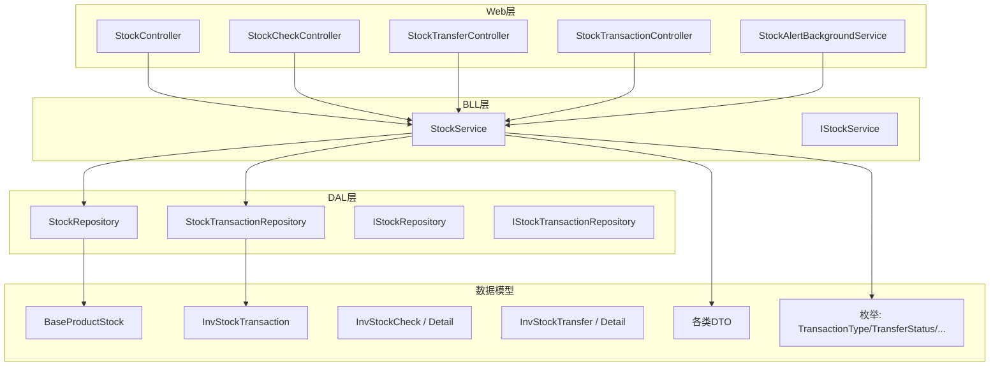
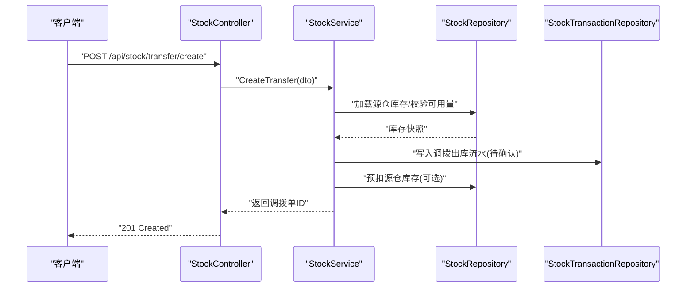
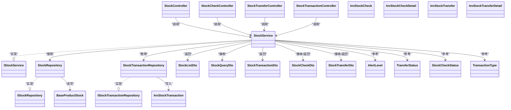

# 库存管理API

<cite>
**本文引用的文件**   
- [StockController.cs](file://EquipmentIMS.Web/Controllers/StockController.cs)
- [StockCheckController.cs](file://EquipmentIMS.Web/Controllers/StockCheckController.cs)
- [StockTransferController.cs](file://EquipmentIMS.Web/Controllers/StockTransferController.cs)
- [StockTransactionController.cs](file://EquipmentIMS.Web/Controllers/StockTransactionController.cs)
- [StockService.cs](file://EquipmentIMS.BLL/Services/StockService.cs)
- [IStockService.cs](file://EquipmentIMS.BLL/Interfaces/IStockService.cs)
- [StockRepository.cs](file://EquipmentIMS.DAL/Repositories/StockRepository.cs)
- [IStockRepository.cs](file://EquipmentIMS.DAL/Interfaces/IStockRepository.cs)
- [StockTransactionRepository.cs](file://EquipmentIMS.DAL/Repositories/StockTransactionRepository.cs)
- [IStockTransactionRepository.cs](file://EquipmentIMS.DAL/Interfaces/IStockTransactionRepository.cs)
- [BaseProductStock.cs](file://EquipmentIMS.Models/Entities/BaseProductStock.cs)
- [InvStockTransaction.cs](file://EquipmentIMS.Models/Entities/InvStockTransaction.cs)
- [InvStockCheck.cs](file://EquipmentIMS.Models/Entities/InvStockCheck.cs)
- [InvStockCheckDetail.cs](file://EquipmentIMS.Models/Entities/InvStockCheckDetail.cs)
- [InvStockTransfer.cs](file://EquipmentIMS.Models/Entities/InvStockTransfer.cs)
- [InvStockTransferDetail.cs](file://EquipmentIMS.Models/Entities/InvStockTransferDetail.cs)
- [StockListDto.cs](file://EquipmentIMS.Models/DTOs/StockListDto.cs)
- [StockQueryDto.cs](file://EquipmentIMS.Models/DTOs/StockQueryDto.cs)
- [StockTransactionDto.cs](file://EquipmentIMS.Models/DTOs/StockTransactionDto.cs)
- [StockTransactionQueryDto.cs](file://EquipmentIMS.Models/DTOs/StockTransactionQueryDto.cs)
- [StockCheckDto.cs](file://EquipmentIMS.Models/DTOs/StockCheckDto.cs)
- [StockTransferDto.cs](file://EquipmentIMS.Models/DTOs/StockTransferDto.cs)
- [StockAlertDto.cs](file://EquipmentIMS.Models/DTOs/StockAlertDto.cs)
- [ReportInventoryDtos.cs](file://EquipmentIMS.Models/DTOs/Reports/ReportInventoryDtos.cs)
- [TransactionType.cs](file://EquipmentIMS.Models/Enums/TransactionType.cs)
- [TransferStatus.cs](file://EquipmentIMS.Models/Enums/TransferStatus.cs)
- [StockCheckStatus.cs](file://EquipmentIMS.Models/Enums/StockCheckStatus.cs)
- [AlertLevel.cs](file://EquipmentIMS.Models/Enums/AlertLevel.cs)
- [StockAlertBackgroundService.cs](file://EquipmentIMS.Web/BackgroundServices/StockAlertBackgroundService.cs)
- [GlobalExceptionMiddleware.cs](file://EquipmentIMS.Web/Filters/GlobalExceptionMiddleware.cs)
</cite>

## 目录
1. [简介](#简介)
2. [项目结构](#项目结构)
3. [核心组件](#核心组件)
4. [架构总览](#架构总览)
5. [详细组件分析](#详细组件分析)
6. [依赖关系分析](#依赖关系分析)
7. [性能与并发建议](#性能与并发建议)
8. [故障排查指南](#故障排查指南)
9. [结论](#结论)
10. [附录：接口清单](#附录接口清单)

## 简介
本文件为库存管理模块的API接口文档，覆盖以下核心能力：
- 库存查询与实时库存计算
- 库存盘点（创建、记录、审核）
- 库存调拨（创建、出库、入库、完成）
- 库存预警（配置、扫描、通知）
- 库存变动流水（事务型明细）
- 批次管理与多仓库支持的数据模型
- 库存报表生成（导出任务）
- 并发控制、事务处理与性能优化建议

## 项目结构
库存相关代码遵循分层架构：Web层控制器暴露REST API，BLL层实现业务逻辑，DAL层通过仓储访问数据库，Models定义实体、DTO与枚举。

图表来源
- [StockController.cs](file://EquipmentIMS.Web/Controllers/StockController.cs)
- [StockCheckController.cs](file://EquipmentIMS.Web/Controllers/StockCheckController.cs)
- [StockTransferController.cs](file://EquipmentIMS.Web/Controllers/StockTransferController.cs)
- [StockTransactionController.cs](file://EquipmentIMS.Web/Controllers/StockTransactionController.cs)
- [StockService.cs](file://EquipmentIMS.BLL/Services/StockService.cs)
- [IStockService.cs](file://EquipmentIMS.BLL/Interfaces/IStockService.cs)
- [StockRepository.cs](file://EquipmentIMS.DAL/Repositories/StockRepository.cs)
- [IStockRepository.cs](file://EquipmentIMS.DAL/Interfaces/IStockRepository.cs)
- [StockTransactionRepository.cs](file://EquipmentIMS.DAL/Repositories/StockTransactionRepository.cs)
- [IStockTransactionRepository.cs](file://EquipmentIMS.DAL/Interfaces/IStockTransactionRepository.cs)
- [BaseProductStock.cs](file://EquipmentIMS.Models/Entities/BaseProductStock.cs)
- [InvStockTransaction.cs](file://EquipmentIMS.Models/Entities/InvStockTransaction.cs)
- [InvStockCheck.cs](file://EquipmentIMS.Models/Entities/InvStockCheck.cs)
- [InvStockCheckDetail.cs](file://EquipmentIMS.Models/Entities/InvStockCheckDetail.cs)
- [InvStockTransfer.cs](file://EquipmentIMS.Models/Entities/InvStockTransfer.cs)
- [InvStockTransferDetail.cs](file://EquipmentIMS.Models/Entities/InvStockTransferDetail.cs)
- [StockListDto.cs](file://EquipmentIMS.Models/DTOs/StockListDto.cs)
- [StockQueryDto.cs](file://EquipmentIMS.Models/DTOs/StockQueryDto.cs)
- [StockTransactionDto.cs](file://EquipmentIMS.Models/DTOs/StockTransactionDto.cs)
- [StockTransactionQueryDto.cs](file://EquipmentIMS.Models/DTOs/StockTransactionQueryDto.cs)
- [StockCheckDto.cs](file://EquipmentIMS.Models/DTOs/StockCheckDto.cs)
- [StockTransferDto.cs](file://EquipmentIMS.Models/DTOs/StockTransferDto.cs)
- [StockAlertDto.cs](file://EquipmentIMS.Models/DTOs/StockAlertDto.cs)
- [ReportInventoryDtos.cs](file://EquipmentIMS.Models/DTOs/Reports/ReportInventoryDtos.cs)
- [TransactionType.cs](file://EquipmentIMS.Models/Enums/TransactionType.cs)
- [TransferStatus.cs](file://EquipmentIMS.Models/Enums/TransferStatus.cs)
- [StockCheckStatus.cs](file://EquipmentIMS.Models/Enums/StockCheckStatus.cs)
- [AlertLevel.cs](file://EquipmentIMS.Models/Enums/AlertLevel.cs)
- [StockAlertBackgroundService.cs](file://EquipmentIMS.Web/BackgroundServices/StockAlertBackgroundService.cs)

章节来源
- [StockController.cs](file://EquipmentIMS.Web/Controllers/StockController.cs)
- [StockService.cs](file://EquipmentIMS.BLL/Services/StockService.cs)
- [StockRepository.cs](file://EquipmentIMS.DAL/Repositories/StockRepository.cs)
- [StockTransactionRepository.cs](file://EquipmentIMS.DAL/Repositories/StockTransactionRepository.cs)
- [BaseProductStock.cs](file://EquipmentIMS.Models/Entities/BaseProductStock.cs)
- [InvStockTransaction.cs](file://EquipmentIMS.Models/Entities/InvStockTransaction.cs)
- [StockCheckDto.cs](file://EquipmentIMS.Models/DTOs/StockCheckDto.cs)
- [StockTransferDto.cs](file://EquipmentIMS.Models/DTOs/StockTransferDto.cs)
- [StockAlertDto.cs](file://EquipmentIMS.Models/DTOs/StockAlertDto.cs)
- [ReportInventoryDtos.cs](file://EquipmentIMS.Models/DTOs/Reports/ReportInventoryDtos.cs)
- [StockAlertBackgroundService.cs](file://EquipmentIMS.Web/BackgroundServices/StockAlertBackgroundService.cs)

## 核心组件
- Web控制器
  - StockController：库存查询、实时库存计算、批量导入等
  - StockCheckController：盘点单创建、明细记录、状态流转
  - StockTransferController：调拨单创建、出库/入库、完成
  - StockTransactionController：库存变动流水查询
- BLL服务
  - StockService：统一编排库存读写、事务边界、并发控制、预警触发
- DAL仓储
  - StockRepository：库存主档与汇总读写
  - StockTransactionRepository：库存流水持久化
- 数据模型
  - BaseProductStock：按仓库+产品维度的库存快照
  - InvStockTransaction：不可变流水记录
  - InvStockCheck/Detail：盘点头表与明细
  - InvStockTransfer/Detail：调拨头表与明细
  - DTO与枚举：用于请求/响应与状态/类型定义

章节来源
- [StockController.cs](file://EquipmentIMS.Web/Controllers/StockController.cs)
- [StockCheckController.cs](file://EquipmentIMS.Web/Controllers/StockCheckController.cs)
- [StockTransferController.cs](file://EquipmentIMS.Web/Controllers/StockTransferController.cs)
- [StockTransactionController.cs](file://EquipmentIMS.Web/Controllers/StockTransactionController.cs)
- [StockService.cs](file://EquipmentIMS.BLL/Services/StockService.cs)
- [IStockService.cs](file://EquipmentIMS.BLL/Interfaces/IStockService.cs)
- [StockRepository.cs](file://EquipmentIMS.DAL/Repositories/StockRepository.cs)
- [IStockRepository.cs](file://EquipmentIMS.DAL/Interfaces/IStockRepository.cs)
- [StockTransactionRepository.cs](file://EquipmentIMS.DAL/Repositories/StockTransactionRepository.cs)
- [IStockTransactionRepository.cs](file://EquipmentIMS.DAL/Interfaces/IStockTransactionRepository.cs)
- [BaseProductStock.cs](file://EquipmentIMS.Models/Entities/BaseProductStock.cs)
- [InvStockTransaction.cs](file://EquipmentIMS.Models/Entities/InvStockTransaction.cs)
- [InvStockCheck.cs](file://EquipmentIMS.Models/Entities/InvStockCheck.cs)
- [InvStockCheckDetail.cs](file://EquipmentIMS.Models/Entities/InvStockCheckDetail.cs)
- [InvStockTransfer.cs](file://EquipmentIMS.Models/Entities/InvStockTransfer.cs)
- [InvStockTransferDetail.cs](file://EquipmentIMS.Models/Entities/InvStockTransferDetail.cs)
- [StockListDto.cs](file://EquipmentIMS.Models/DTOs/StockListDto.cs)
- [StockQueryDto.cs](file://EquipmentIMS.Models/DTOs/StockQueryDto.cs)
- [StockTransactionDto.cs](file://EquipmentIMS.Models/DTOs/StockTransactionDto.cs)
- [StockTransactionQueryDto.cs](file://EquipmentIMS.Models/DTOs/StockTransactionQueryDto.cs)
- [StockCheckDto.cs](file://EquipmentIMS.Models/DTOs/StockCheckDto.cs)
- [StockTransferDto.cs](file://EquipmentIMS.Models/DTOs/StockTransferDto.cs)
- [StockAlertDto.cs](file://EquipmentIMS.Models/DTOs/StockAlertDto.cs)
- [ReportInventoryDtos.cs](file://EquipmentIMS.Models/DTOs/Reports/ReportInventoryDtos.cs)
- [TransactionType.cs](file://EquipmentIMS.Models/Enums/TransactionType.cs)
- [TransferStatus.cs](file://EquipmentIMS.Models/Enums/TransferStatus.cs)
- [StockCheckStatus.cs](file://EquipmentIMS.Models/Enums/StockCheckStatus.cs)
- [AlertLevel.cs](file://EquipmentIMS.Models/Enums/AlertLevel.cs)

## 架构总览
库存API采用“控制器→服务→仓储→实体”的分层调用链，关键流程包括：
- 查询类接口：控制器接收参数，服务聚合查询条件，仓储执行分页/过滤，返回DTO列表
- 变更类接口：控制器校验并组装领域对象，服务在事务中更新库存与写入流水，必要时触发预警
- 背景任务：定时扫描低库存或超上限商品，生成预警记录并推送通知

图表来源
- [StockController.cs](file://EquipmentIMS.Web/Controllers/StockController.cs)
- [StockService.cs](file://EquipmentIMS.BLL/Services/StockService.cs)
- [StockRepository.cs](file://EquipmentIMS.DAL/Repositories/StockRepository.cs)
- [StockTransactionRepository.cs](file://EquipmentIMS.DAL/Repositories/StockTransactionRepository.cs)

## 详细组件分析

### 库存查询与实时库存计算
- 功能要点
  - 支持按仓库、产品、批次、供应商等多维度筛选
  - 提供“实时库存”视图，基于库存快照与未决流水计算
  - 支持分页、排序与导出
- 主要接口
  - GET /api/stock/list：库存列表查询
  - GET /api/stock/realtime/{warehouseId}/{productId}：实时库存
  - POST /api/stock/import：批量导入初始库存
- 输入输出
  - 输入：StockQueryDto（仓库、产品、批次、时间范围、关键字等）
  - 输出：PagedResult<StockListDto>
- 并发与一致性
  - 读路径无锁；实时库存计算需考虑未决流水，避免脏读
- 性能建议
  - 对常用查询字段建立复合索引（仓库、产品、批次）
  - 大数据量场景使用只读副本或缓存热点结果

章节来源
- [StockController.cs](file://EquipmentIMS.Web/Controllers/StockController.cs)
- [StockService.cs](file://EquipmentIMS.BLL/Services/StockService.cs)
- [StockRepository.cs](file://EquipmentIMS.DAL/Repositories/StockRepository.cs)
- [StockQueryDto.cs](file://EquipmentIMS.Models/DTOs/StockQueryDto.cs)
- [StockListDto.cs](file://EquipmentIMS.Models/DTOs/StockListDto.cs)

### 库存盘点
- 功能要点
  - 创建盘点单，录入实盘数量，差异自动计算
  - 支持草稿、已提交、已完成等状态流转
  - 完成后自动生成调整流水并更新库存
- 主要接口
  - POST /api/stock/check/create：创建盘点单
  - PUT /api/stock/check/{id}/record：记录明细
  - PUT /api/stock/check/{id}/submit：提交盘点
  - PUT /api/stock/check/{id}/complete：完成盘点并生效
- 数据模型
  - InvStockCheck：盘点头（仓库、日期、状态、备注）
  - InvStockCheckDetail：盘点明细（产品、批次、账面数、实盘数、差异）
- 并发与事务
  - 提交与完成需在事务内更新库存与流水，保证原子性
- 异常与回滚
  - 若某明细失败，整单回滚，保持账实一致

章节来源
- [StockCheckController.cs](file://EquipmentIMS.Web/Controllers/StockCheckController.cs)
- [StockService.cs](file://EquipmentIMS.BLL/Services/StockService.cs)
- [InvStockCheck.cs](file://EquipmentIMS.Models/Entities/InvStockCheck.cs)
- [InvStockCheckDetail.cs](file://EquipmentIMS.Models/Entities/InvStockCheckDetail.cs)
- [StockCheckDto.cs](file://EquipmentIMS.Models/DTOs/StockCheckDto.cs)
- [StockCheckStatus.cs](file://EquipmentIMS.Models/Enums/StockCheckStatus.cs)

### 库存调拨
- 功能要点
  - 创建调拨单，指定源仓库与目标仓库
  - 分阶段：出库确认、入库确认、完成
  - 每步均产生对应流水，支持撤销与冲销
- 主要接口
  - POST /api/stock/transfer/create：创建调拨单
  - PUT /api/stock/transfer/{id}/outbound：出库确认
  - PUT /api/stock/transfer/{id}/inbound：入库确认
  - PUT /api/stock/transfer/{id}/complete：完成调拨
- 数据模型
  - InvStockTransfer：调拨头（单号、源仓、目标仓、状态）
  - InvStockTransferDetail：调拨明细（产品、批次、数量）
- 并发与事务
  - 出库与入库分别锁定源/目标仓库存行，避免超卖
  - 完成时合并两笔流水，确保总量平衡

章节来源
- [StockTransferController.cs](file://EquipmentIMS.Web/Controllers/StockTransferController.cs)
- [StockService.cs](file://EquipmentIMS.BLL/Services/StockService.cs)
- [InvStockTransfer.cs](file://EquipmentIMS.Models/Entities/InvStockTransfer.cs)
- [InvStockTransferDetail.cs](file://EquipmentIMS.Models/Entities/InvStockTransferDetail.cs)
- [StockTransferDto.cs](file://EquipmentIMS.Models/DTOs/StockTransferDto.cs)
- [TransferStatus.cs](file://EquipmentIMS.Models/Enums/TransferStatus.cs)

### 库存变动流水
- 功能要点
  - 所有库存变更必须落库到流水表，具备不可变性
  - 支持按单号、类型、仓库、时间范围检索
- 主要接口
  - GET /api/stock/transactions：流水列表
  - GET /api/stock/transactions/{id}：流水详情
- 数据模型
  - InvStockTransaction：流水头（单号、类型、仓库、产品、批次、数量、方向、关联单号、操作人、时间）
- 审计与追溯
  - 流水作为唯一事实来源，报表与对账以流水为准

章节来源
- [StockTransactionController.cs](file://EquipmentIMS.Web/Controllers/StockTransactionController.cs)
- [StockService.cs](file://EquipmentIMS.BLL/Services/StockService.cs)
- [StockTransactionRepository.cs](file://EquipmentIMS.DAL/Repositories/StockTransactionRepository.cs)
- [InvStockTransaction.cs](file://EquipmentIMS.Models/Entities/InvStockTransaction.cs)
- [StockTransactionDto.cs](file://EquipmentIMS.Models/DTOs/StockTransactionDto.cs)
- [StockTransactionQueryDto.cs](file://EquipmentIMS.Models/DTOs/StockTransactionQueryDto.cs)
- [TransactionType.cs](file://EquipmentIMS.Models/Enums/TransactionType.cs)

### 库存预警
- 功能要点
  - 支持按产品/仓库设置上下限阈值与级别
  - 后台定时扫描，低于下限或高于上限时生成预警记录
  - 可对接通知渠道（站内信、邮件、短信等）
- 主要接口
  - GET /api/stock/alerts：预警列表
  - POST /api/stock/alerts/config：保存预警配置
  - GET /api/stock/alerts/scan：手动触发扫描
- 数据模型
  - 预警配置与预警记录（含级别、阈值、触发时间、状态）
- 后台任务
  - StockAlertBackgroundService：周期性扫描并生成预警

章节来源
- [StockAlertDto.cs](file://EquipmentIMS.Models/DTOs/StockAlertDto.cs)
- [StockAlertBackgroundService.cs](file://EquipmentIMS.Web/BackgroundServices/StockAlertBackgroundService.cs)
- [StockService.cs](file://EquipmentIMS.BLL/Services/StockService.cs)
- [AlertLevel.cs](file://EquipmentIMS.Models/Enums/AlertLevel.cs)

### 库存报表
- 功能要点
  - 库存汇总表、出入库汇总、周转率、滞销品等
  - 支持异步导出任务，完成后下载
- 主要接口
  - POST /api/report/inventory/export：创建导出任务
  - GET /api/report/inventory/export/status/{taskId}：查询任务状态
  - GET /api/report/inventory/export/download/{taskId}：下载文件
- 数据模型
  - ReportInventoryDtos：报表项DTO集合

章节来源
- [ReportInventoryDtos.cs](file://EquipmentIMS.Models/DTOs/Reports/ReportInventoryDtos.cs)
- [StockService.cs](file://EquipmentIMS.BLL/Services/StockService.cs)

## 依赖关系分析
- 控制器与服务解耦：控制器仅负责参数绑定与响应封装
- 服务编排仓储：StockService组合StockRepository与StockTransactionRepository
- 仓储与实体映射：仓储直接操作实体，DTO在服务层转换
- 枚举驱动状态机：TransferStatus、StockCheckStatus、TransactionType等约束业务流程

图表来源
- [StockController.cs](file://EquipmentIMS.Web/Controllers/StockController.cs)
- [StockCheckController.cs](file://EquipmentIMS.Web/Controllers/StockCheckController.cs)
- [StockTransferController.cs](file://EquipmentIMS.Web/Controllers/StockTransferController.cs)
- [StockTransactionController.cs](file://EquipmentIMS.Web/Controllers/StockTransactionController.cs)
- [StockService.cs](file://EquipmentIMS.BLL/Services/StockService.cs)
- [IStockService.cs](file://EquipmentIMS.BLL/Interfaces/IStockService.cs)
- [StockRepository.cs](file://EquipmentIMS.DAL/Repositories/StockRepository.cs)
- [IStockRepository.cs](file://EquipmentIMS.DAL/Interfaces/IStockRepository.cs)
- [StockTransactionRepository.cs](file://EquipmentIMS.DAL/Repositories/StockTransactionRepository.cs)
- [IStockTransactionRepository.cs](file://EquipmentIMS.DAL/Interfaces/IStockTransactionRepository.cs)
- [BaseProductStock.cs](file://EquipmentIMS.Models/Entities/BaseProductStock.cs)
- [InvStockTransaction.cs](file://EquipmentIMS.Models/Entities/InvStockTransaction.cs)
- [InvStockCheck.cs](file://EquipmentIMS.Models/Entities/InvStockCheck.cs)
- [InvStockCheckDetail.cs](file://EquipmentIMS.Models/Entities/InvStockCheckDetail.cs)
- [InvStockTransfer.cs](file://EquipmentIMS.Models/Entities/InvStockTransfer.cs)
- [InvStockTransferDetail.cs](file://EquipmentIMS.Models/Entities/InvStockTransferDetail.cs)
- [StockListDto.cs](file://EquipmentIMS.Models/DTOs/StockListDto.cs)
- [StockQueryDto.cs](file://EquipmentIMS.Models/DTOs/StockQueryDto.cs)
- [StockTransactionDto.cs](file://EquipmentIMS.Models/DTOs/StockTransactionDto.cs)
- [StockCheckDto.cs](file://EquipmentIMS.Models/DTOs/StockCheckDto.cs)
- [StockTransferDto.cs](file://EquipmentIMS.Models/DTOs/StockTransferDto.cs)
- [AlertLevel.cs](file://EquipmentIMS.Models/Enums/AlertLevel.cs)
- [TransferStatus.cs](file://EquipmentIMS.Models/Enums/TransferStatus.cs)
- [StockCheckStatus.cs](file://EquipmentIMS.Models/Enums/StockCheckStatus.cs)
- [TransactionType.cs](file://EquipmentIMS.Models/Enums/TransactionType.cs)

## 性能与并发建议
- 并发控制
  - 使用行级锁或乐观版本控制更新BaseProductStock，防止超卖
  - 调拨出库/入库分阶段加锁，减少锁粒度
- 事务处理
  - 将“库存更新+流水写入”置于同一事务，失败即回滚
  - 长事务拆分为短事务，降低锁持有时间
- 查询优化
  - 为高频查询列建立索引（仓库、产品、批次、时间）
  - 对报表类查询使用物化视图或离线聚合
- 缓存策略
  - 热点实时库存可短期缓存，设置合理失效策略
- 批处理
  - 批量导入与报表导出采用分批处理，避免内存峰值

[本节为通用指导，不直接分析具体文件]

## 故障排查指南
- 全局异常处理
  - GlobalExceptionMiddleware统一捕获异常，返回标准错误响应
- 常见问题
  - 库存不足：检查可用量与未决流水，确认是否被其他事务占用
  - 盘点差异过大：核对账面数与实盘数，查看是否有未生效流水
  - 调拨卡住：检查调拨单状态机，确认出库/入库是否重复提交
- 日志与追踪
  - 结合操作日志与流水单号定位问题链路

章节来源
- [GlobalExceptionMiddleware.cs](file://EquipmentIMS.Web/Filters/GlobalExceptionMiddleware.cs)
- [StockService.cs](file://EquipmentIMS.BLL/Services/StockService.cs)
- [InvStockTransaction.cs](file://EquipmentIMS.Models/Entities/InvStockTransaction.cs)

## 结论
本库存管理API以“流水为事实、事务保一致、分层解耦”为核心设计原则，覆盖查询、盘点、调拨、预警与报表等全链路能力。通过合理的并发控制与索引优化，可在高并发场景下保持稳定与高性能。

[本节为总结性内容，不直接分析具体文件]

## 附录：接口清单
- 库存查询
  - GET /api/stock/list
  - GET /api/stock/realtime/{warehouseId}/{productId}
  - POST /api/stock/import
- 库存盘点
  - POST /api/stock/check/create
  - PUT /api/stock/check/{id}/record
  - PUT /api/stock/check/{id}/submit
  - PUT /api/stock/check/{id}/complete
- 库存调拨
  - POST /api/stock/transfer/create
  - PUT /api/stock/transfer/{id}/outbound
  - PUT /api/stock/transfer/{id}/inbound
  - PUT /api/stock/transfer/{id}/complete
- 库存流水
  - GET /api/stock/transactions
  - GET /api/stock/transactions/{id}
- 库存预警
  - GET /api/stock/alerts
  - POST /api/stock/alerts/config
  - GET /api/stock/alerts/scan
- 库存报表
  - POST /api/report/inventory/export
  - GET /api/report/inventory/export/status/{taskId}
  - GET /api/report/inventory/export/download/{taskId}

章节来源
- [StockController.cs](file://EquipmentIMS.Web/Controllers/StockController.cs)
- [StockCheckController.cs](file://EquipmentIMS.Web/Controllers/StockCheckController.cs)
- [StockTransferController.cs](file://EquipmentIMS.Web/Controllers/StockTransferController.cs)
- [StockTransactionController.cs](file://EquipmentIMS.Web/Controllers/StockTransactionController.cs)