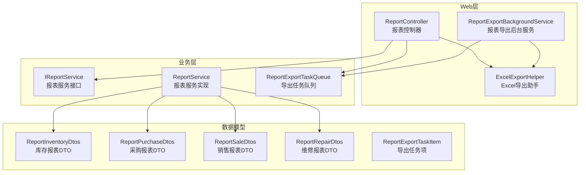
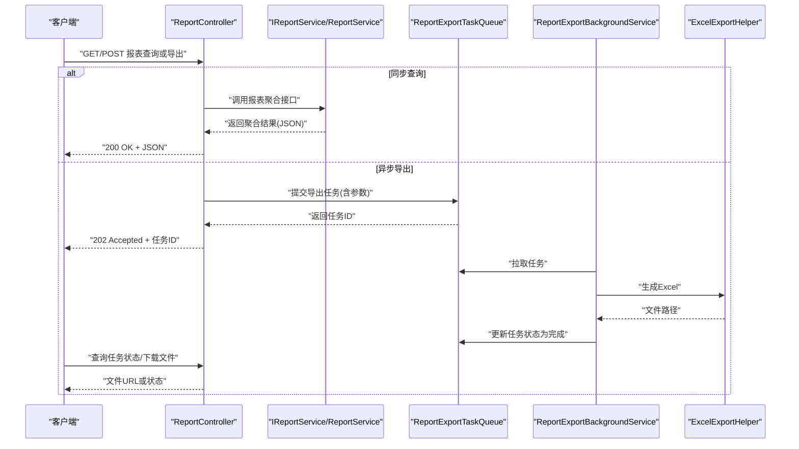
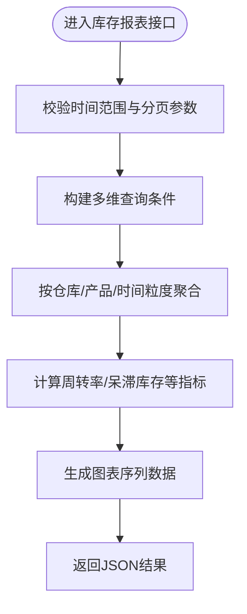
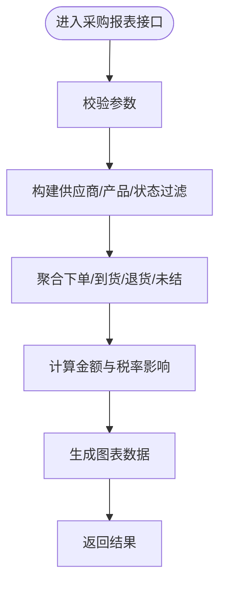
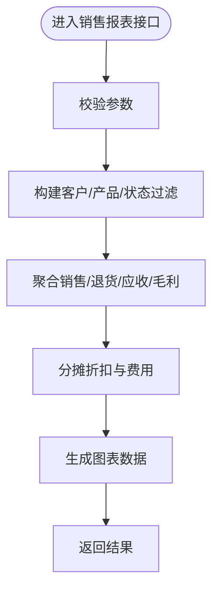
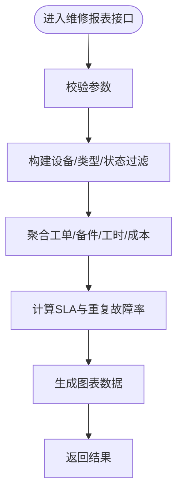
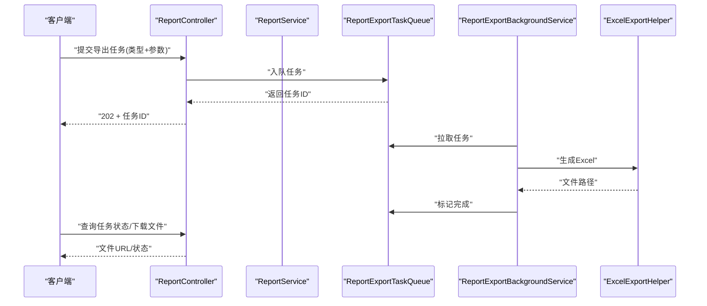
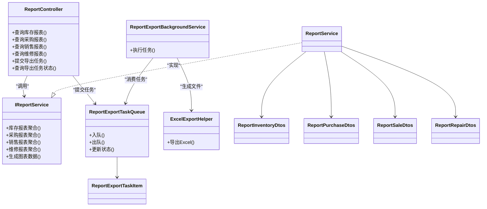

# 报表分析API

<cite>
**本文引用的文件**   
- [ReportController.cs](file://EquipmentIMS.Web/Controllers/ReportController.cs)
- [IReportService.cs](file://EquipmentIMS.BLL/Interfaces/IReportService.cs)
- [ReportService.cs](file://EquipmentIMS.BLL/Services/ReportService.cs)
- [ReportExportTaskQueue.cs](file://EquipmentIMS.BLL/Services/ReportExportTaskQueue.cs)
- [ReportInventoryDtos.cs](file://EquipmentIMS.Models/DTOs/Reports/ReportInventoryDtos.cs)
- [ReportPurchaseDtos.cs](file://EquipmentIMS.Models/DTOs/Reports/ReportPurchaseDtos.cs)
- [ReportSaleDtos.cs](file://EquipmentIMS.Models/DTOs/Reports/ReportSaleDtos.cs)
- [ReportRepairDtos.cs](file://EquipmentIMS.Models/DTOs/Reports/ReportRepairDtos.cs)
- [ReportExportTaskItem.cs](file://EquipmentIMS.Models/DTOs/Reports/ReportExportTaskItem.cs)
- [ReportExportBackgroundService.cs](file://EquipmentIMS.Web/BackgroundServices/ReportExportBackgroundService.cs)
- [ExcelExportHelper.cs](file://EquipmentIMS.Web/Helpers/ExcelExportHelper.cs)
</cite>

## 目录
1. [简介](#简介)
2. [项目结构](#项目结构)
3. [核心组件](#核心组件)
4. [架构总览](#架构总览)
5. [详细组件分析](#详细组件分析)
6. [依赖关系分析](#依赖关系分析)
7. [性能考虑](#性能考虑)
8. [故障排查指南](#故障排查指南)
9. [结论](#结论)
10. [附录：接口清单与数据模型](#附录接口清单与数据模型)

## 简介
本文件为“报表分析模块”的API接口文档，覆盖库存报表、采购报表、销售报表、维修报表等统计分析能力。内容包含：
- 多维度查询条件与时间范围筛选说明
- 数据聚合算法与统计口径
- 图表数据生成与导出接口
- 异步报表生成与任务管理
- 大数据量处理、缓存策略与性能优化建议

## 项目结构
报表相关代码主要分布在以下层次：
- Web层（控制器）：对外暴露REST API
- 业务层（服务）：实现报表聚合、计算与导出编排
- 数据模型（DTO）：定义查询参数与返回结果结构
- 后台服务：异步导出任务执行
- 工具类：Excel导出辅助

**图示来源**
- [ReportController.cs](file://EquipmentIMS.Web/Controllers/ReportController.cs)
- [IReportService.cs](file://EquipmentIMS.BLL/Interfaces/IReportService.cs)
- [ReportService.cs](file://EquipmentIMS.BLL/Services/ReportService.cs)
- [ReportExportTaskQueue.cs](file://EquipmentIMS.BLL/Services/ReportExportTaskQueue.cs)
- [ReportExportBackgroundService.cs](file://EquipmentIMS.Web/BackgroundServices/ReportExportBackgroundService.cs)
- [ExcelExportHelper.cs](file://EquipmentIMS.Web/Helpers/ExcelExportHelper.cs)
- [ReportInventoryDtos.cs](file://EquipmentIMS.Models/DTOs/Reports/ReportInventoryDtos.cs)
- [ReportPurchaseDtos.cs](file://EquipmentIMS.Models/DTOs/Reports/ReportPurchaseDtos.cs)
- [ReportSaleDtos.cs](file://EquipmentIMS.Models/DTOs/Reports/ReportSaleDtos.cs)
- [ReportRepairDtos.cs](file://EquipmentIMS.Models/DTOs/Reports/ReportRepairDtos.cs)
- [ReportExportTaskItem.cs](file://EquipmentIMS.Models/DTOs/Reports/ReportExportTaskItem.cs)

**章节来源**
- [ReportController.cs](file://EquipmentIMS.Web/Controllers/ReportController.cs)
- [IReportService.cs](file://EquipmentIMS.BLL/Interfaces/IReportService.cs)
- [ReportService.cs](file://EquipmentIMS.BLL/Services/ReportService.cs)
- [ReportExportTaskQueue.cs](file://EquipmentIMS.BLL/Services/ReportExportTaskQueue.cs)
- [ReportExportBackgroundService.cs](file://EquipmentIMS.Web/BackgroundServices/ReportExportBackgroundService.cs)
- [ExcelExportHelper.cs](file://EquipmentIMS.Web/Helpers/ExcelExportHelper.cs)
- [ReportInventoryDtos.cs](file://EquipmentIMS.Models/DTOs/Reports/ReportInventoryDtos.cs)
- [ReportPurchaseDtos.cs](file://EquipmentIMS.Models/DTOs/Reports/ReportPurchaseDtos.cs)
- [ReportSaleDtos.cs](file://EquipmentIMS.Models/DTOs/Reports/ReportSaleDtos.cs)
- [ReportRepairDtos.cs](file://EquipmentIMS.Models/DTOs/Reports/ReportRepairDtos.cs)
- [ReportExportTaskItem.cs](file://EquipmentIMS.Models/DTOs/Reports/ReportExportTaskItem.cs)

## 核心组件
- 报表控制器（ReportController）
  - 职责：接收前端请求，校验参数，调用服务层或导出队列，返回JSON或触发导出任务。
  - 关键能力：库存/采购/销售/维修报表查询、图表数据获取、导出任务创建与状态查询。
- 报表服务（ReportService / IReportService）
  - 职责：实现各维度聚合计算、时间窗口过滤、分组汇总、指标计算；协调导出流程。
  - 关键能力：按仓库、供应商、客户、产品、日期等多维聚合；支持分页与总量统计。
- 导出任务队列（ReportExportTaskQueue）
  - 职责：维护导出任务生命周期（入队、执行、完成、失败重试）。
  - 关键能力：并发控制、任务优先级、失败重试、进度回调。
- 后台导出服务（ReportExportBackgroundService）
  - 职责：持续消费导出任务，调用Excel导出助手生成文件并持久化。
- Excel导出助手（ExcelExportHelper）
  - 职责：将报表数据写入Excel工作簿，支持多Sheet、样式与分页。
- 报表DTO集合
  - 库存/采购/销售/维修报表DTO：统一描述查询输入与返回字段。
  - 导出任务项：描述任务类型、参数、状态、文件路径等。

**章节来源**
- [ReportController.cs](file://EquipmentIMS.Web/Controllers/ReportController.cs)
- [IReportService.cs](file://EquipmentIMS.BLL/Interfaces/IReportService.cs)
- [ReportService.cs](file://EquipmentIMS.BLL/Services/ReportService.cs)
- [ReportExportTaskQueue.cs](file://EquipmentIMS.BLL/Services/ReportExportTaskQueue.cs)
- [ReportExportBackgroundService.cs](file://EquipmentIMS.Web/BackgroundServices/ReportExportBackgroundService.cs)
- [ExcelExportHelper.cs](file://EquipmentIMS.Web/Helpers/ExcelExportHelper.cs)
- [ReportInventoryDtos.cs](file://EquipmentIMS.Models/DTOs/Reports/ReportInventoryDtos.cs)
- [ReportPurchaseDtos.cs](file://EquipmentIMS.Models/DTOs/Reports/ReportPurchaseDtos.cs)
- [ReportSaleDtos.cs](file://EquipmentIMS.Models/DTOs/Reports/ReportSaleDtos.cs)
- [ReportRepairDtos.cs](file://EquipmentIMS.Models/DTOs/Reports/ReportRepairDtos.cs)
- [ReportExportTaskItem.cs](file://EquipmentIMS.Models/DTOs/Reports/ReportExportTaskItem.cs)

## 架构总览
报表系统采用分层架构：控制器负责HTTP契约，服务层封装聚合逻辑，后台服务负责耗时导出，工具类提供通用能力。

**图示来源**
- [ReportController.cs](file://EquipmentIMS.Web/Controllers/ReportController.cs)
- [IReportService.cs](file://EquipmentIMS.BLL/Interfaces/IReportService.cs)
- [ReportService.cs](file://EquipmentIMS.BLL/Services/ReportService.cs)
- [ReportExportTaskQueue.cs](file://EquipmentIMS.BLL/Services/ReportExportTaskQueue.cs)
- [ReportExportBackgroundService.cs](file://EquipmentIMS.Web/BackgroundServices/ReportExportBackgroundService.cs)
- [ExcelExportHelper.cs](file://EquipmentIMS.Web/Helpers/ExcelExportHelper.cs)

## 详细组件分析

### 库存报表接口
- 功能概述
  - 支持按仓库、产品、时间范围、批次等多维度聚合，输出库存余额、出入库流水汇总、周转率等指标。
- 查询条件
  - 时间范围：开始时间、结束时间（必填）
  - 仓库：仓库ID列表（可选）
  - 产品：产品ID/编码/名称模糊匹配（可选）
  - 分类：产品分类（可选）
  - 分页：页码、每页条数（可选）
- 聚合算法要点
  - 以“仓库+产品+时间粒度”为分组键，累计期初、入库、出库、期末库存。
  - 支持日/周/月粒度聚合，自动对齐起止边界。
  - 异常交易（退货、调拨、盘点差异）按业务规则归集到对应方向。
- 图表数据
  - 提供趋势折线、堆叠柱状图、占比饼图等所需序列数据。
- 导出
  - 支持单表或多表导出，包含明细与汇总Sheet。

**图示来源**
- [ReportController.cs](file://EquipmentIMS.Web/Controllers/ReportController.cs)
- [IReportService.cs](file://EquipmentIMS.BLL/Interfaces/IReportService.cs)
- [ReportService.cs](file://EquipmentIMS.BLL/Services/ReportService.cs)
- [ReportInventoryDtos.cs](file://EquipmentIMS.Models/DTOs/Reports/ReportInventoryDtos.cs)

**章节来源**
- [ReportController.cs](file://EquipmentIMS.Web/Controllers/ReportController.cs)
- [IReportService.cs](file://EquipmentIMS.BLL/Interfaces/IReportService.cs)
- [ReportService.cs](file://EquipmentIMS.BLL/Services/ReportService.cs)
- [ReportInventoryDtos.cs](file://EquipmentIMS.Models/DTOs/Reports/ReportInventoryDtos.cs)

### 采购报表接口
- 功能概述
  - 统计采购订单、到货、退货、在途、应付等指标，支持供应商维度分析。
- 查询条件
  - 时间范围、供应商、产品、订单状态、仓库（到货入库）、分页。
- 聚合算法要点
  - 以“供应商+产品+时间粒度”分组，汇总下单数量、到货数量、退货数量、未结数量。
  - 金额聚合支持含税/不含税切换（由配置决定）。
- 图表数据
  - 供应商贡献度、月度采购趋势、品类分布。

**图示来源**
- [ReportController.cs](file://EquipmentIMS.Web/Controllers/ReportController.cs)
- [IReportService.cs](file://EquipmentIMS.BLL/Interfaces/IReportService.cs)
- [ReportService.cs](file://EquipmentIMS.BLL/Services/ReportService.cs)
- [ReportPurchaseDtos.cs](file://EquipmentIMS.Models/DTOs/Reports/ReportPurchaseDtos.cs)

**章节来源**
- [ReportController.cs](file://EquipmentIMS.Web/Controllers/ReportController.cs)
- [IReportService.cs](file://EquipmentIMS.BLL/Interfaces/IReportService.cs)
- [ReportService.cs](file://EquipmentIMS.BLL/Services/ReportService.cs)
- [ReportPurchaseDtos.cs](file://EquipmentIMS.Models/DTOs/Reports/ReportPurchaseDtos.cs)

### 销售报表接口
- 功能概述
  - 统计销售订单、出库、退货、应收、毛利等指标，支持客户与渠道维度。
- 查询条件
  - 时间范围、客户、产品、订单状态、仓库（出库）、分页。
- 聚合算法要点
  - 以“客户+产品+时间粒度”分组，汇总销售数量、退货数量、实收金额、成本与毛利。
  - 支持折扣、运费分摊至行级再汇总。
- 图表数据
  - 客户TopN、品类销售趋势、区域/渠道占比。

**图示来源**
- [ReportController.cs](file://EquipmentIMS.Web/Controllers/ReportController.cs)
- [IReportService.cs](file://EquipmentIMS.BLL/Interfaces/IReportService.cs)
- [ReportService.cs](file://EquipmentIMS.BLL/Services/ReportService.cs)
- [ReportSaleDtos.cs](file://EquipmentIMS.Models/DTOs/Reports/ReportSaleDtos.cs)

**章节来源**
- [ReportController.cs](file://EquipmentIMS.Web/Controllers/ReportController.cs)
- [IReportService.cs](file://EquipmentIMS.BLL/Interfaces/IReportService.cs)
- [ReportService.cs](file://EquipmentIMS.BLL/Services/ReportService.cs)
- [ReportSaleDtos.cs](file://EquipmentIMS.Models/DTOs/Reports/ReportSaleDtos.cs)

### 维修报表接口
- 功能概述
  - 统计维修工单、备件消耗、工时、成本、设备故障率等指标。
- 查询条件
  - 时间范围、设备/归档、维修类型、状态、责任人、分页。
- 聚合算法要点
  - 以“设备+维修类型+时间粒度”分组，汇总工单数、平均修复时长、备件成本、人工成本。
  - 支持SLA达成率与重复故障率计算。
- 图表数据
  - 故障趋势、备件消耗TopN、维修效率对比。

**图示来源**
- [ReportController.cs](file://EquipmentIMS.Web/Controllers/ReportController.cs)
- [IReportService.cs](file://EquipmentIMS.BLL/Interfaces/IReportService.cs)
- [ReportService.cs](file://EquipmentIMS.BLL/Services/ReportService.cs)
- [ReportRepairDtos.cs](file://EquipmentIMS.Models/DTOs/Reports/ReportRepairDtos.cs)

**章节来源**
- [ReportController.cs](file://EquipmentIMS.Web/Controllers/ReportController.cs)
- [IReportService.cs](file://EquipmentIMS.BLL/Interfaces/IReportService.cs)
- [ReportService.cs](file://EquipmentIMS.BLL/Services/ReportService.cs)
- [ReportRepairDtos.cs](file://EquipmentIMS.Models/DTOs/Reports/ReportRepairDtos.cs)

### 导出与图表数据接口
- 导出接口
  - 同步导出：适用于小数据集，直接返回Excel流。
  - 异步导出：提交任务后轮询任务状态，完成后下载文件。
- 图表数据接口
  - 返回前端图表所需的序列数据（如折线、柱状、饼图），便于动态渲染。
- 自定义报表开发
  - 通过新增DTO与服务方法扩展新报表，复用导出与图表数据生成能力。

**图示来源**
- [ReportController.cs](file://EquipmentIMS.Web/Controllers/ReportController.cs)
- [ReportExportTaskQueue.cs](file://EquipmentIMS.BLL/Services/ReportExportTaskQueue.cs)
- [ReportExportBackgroundService.cs](file://EquipmentIMS.Web/BackgroundServices/ReportExportBackgroundService.cs)
- [ExcelExportHelper.cs](file://EquipmentIMS.Web/Helpers/ExcelExportHelper.cs)
- [ReportExportTaskItem.cs](file://EquipmentIMS.Models/DTOs/Reports/ReportExportTaskItem.cs)

**章节来源**
- [ReportController.cs](file://EquipmentIMS.Web/Controllers/ReportController.cs)
- [ReportExportTaskQueue.cs](file://EquipmentIMS.BLL/Services/ReportExportTaskQueue.cs)
- [ReportExportBackgroundService.cs](file://EquipmentIMS.Web/BackgroundServices/ReportExportBackgroundService.cs)
- [ExcelExportHelper.cs](file://EquipmentIMS.Web/Helpers/ExcelExportHelper.cs)
- [ReportExportTaskItem.cs](file://EquipmentIMS.Models/DTOs/Reports/ReportExportTaskItem.cs)

## 依赖关系分析
- 控制器依赖服务接口与导出队列，避免直接耦合具体实现。
- 服务实现依赖报表DTO，保证输入输出稳定。
- 后台服务依赖导出队列与Excel导出助手，解耦文件生成逻辑。

**图示来源**
- [ReportController.cs](file://EquipmentIMS.Web/Controllers/ReportController.cs)
- [IReportService.cs](file://EquipmentIMS.BLL/Interfaces/IReportService.cs)
- [ReportService.cs](file://EquipmentIMS.BLL/Services/ReportService.cs)
- [ReportExportTaskQueue.cs](file://EquipmentIMS.BLL/Services/ReportExportTaskQueue.cs)
- [ReportExportBackgroundService.cs](file://EquipmentIMS.Web/BackgroundServices/ReportExportBackgroundService.cs)
- [ExcelExportHelper.cs](file://EquipmentIMS.Web/Helpers/ExcelExportHelper.cs)
- [ReportInventoryDtos.cs](file://EquipmentIMS.Models/DTOs/Reports/ReportInventoryDtos.cs)
- [ReportPurchaseDtos.cs](file://EquipmentIMS.Models/DTOs/Reports/ReportPurchaseDtos.cs)
- [ReportSaleDtos.cs](file://EquipmentIMS.Models/DTOs/Reports/ReportSaleDtos.cs)
- [ReportRepairDtos.cs](file://EquipmentIMS.Models/DTOs/Reports/ReportRepairDtos.cs)
- [ReportExportTaskItem.cs](file://EquipmentIMS.Models/DTOs/Reports/ReportExportTaskItem.cs)

**章节来源**
- [ReportController.cs](file://EquipmentIMS.Web/Controllers/ReportController.cs)
- [IReportService.cs](file://EquipmentIMS.BLL/Interfaces/IReportService.cs)
- [ReportService.cs](file://EquipmentIMS.BLL/Services/ReportService.cs)
- [ReportExportTaskQueue.cs](file://EquipmentIMS.BLL/Services/ReportExportTaskQueue.cs)
- [ReportExportBackgroundService.cs](file://EquipmentIMS.Web/BackgroundServices/ReportExportBackgroundService.cs)
- [ExcelExportHelper.cs](file://EquipmentIMS.Web/Helpers/ExcelExportHelper.cs)
- [ReportInventoryDtos.cs](file://EquipmentIMS.Models/DTOs/Reports/ReportInventoryDtos.cs)
- [ReportPurchaseDtos.cs](file://EquipmentIMS.Models/DTOs/Reports/ReportPurchaseDtos.cs)
- [ReportSaleDtos.cs](file://EquipmentIMS.Models/DTOs/Reports/ReportSaleDtos.cs)
- [ReportRepairDtos.cs](file://EquipmentIMS.Models/DTOs/Reports/ReportRepairDtos.cs)
- [ReportExportTaskItem.cs](file://EquipmentIMS.Models/DTOs/Reports/ReportExportTaskItem.cs)

## 性能考虑
- 大数据量处理
  - 使用分页与游标式查询，避免一次性加载全量数据。
  - 对高频聚合维度建立索引（仓库、产品、时间戳、状态）。
  - 复杂聚合尽量下推到数据库层，减少内存占用。
- 缓存策略
  - 对热点报表（如当日汇总）启用短期缓存，设置合理过期时间。
  - 缓存键包含所有查询条件哈希，确保隔离性。
- 异步导出
  - 大报表一律走异步导出，降低请求超时风险。
  - 导出任务可拆分Sheet或分片写入，提升吞吐。
- 并发与限流
  - 限制同时执行的导出任务数，防止资源耗尽。
  - 对频繁查询进行去抖与合并，减少重复计算。
- 图表数据优化
  - 仅返回必要字段，按需降采样（如按月聚合替代逐日）。
  - 前端按需渲染，避免一次性绘制过多节点。

[本节为通用性能指导，不直接分析具体文件]

## 故障排查指南
- 常见问题
  - 导出任务无响应：检查后台服务是否运行、队列是否堆积、任务是否被错误标记为失败。
  - 报表数据不一致：核对时间范围边界、时区设置、汇率/税率配置。
  - 导出文件损坏：确认Excel导出助手版本与依赖，检查内存溢出日志。
- 定位步骤
  - 查看任务状态与错误信息，必要时重试。
  - 缩小时间范围与维度，逐步复现问题。
  - 开启详细日志，关注聚合SQL与内存峰值。
- 恢复措施
  - 清理失败任务并重试。
  - 调整分页大小与并发度。
  - 扩容后台服务实例。

**章节来源**
- [ReportExportTaskQueue.cs](file://EquipmentIMS.BLL/Services/ReportExportTaskQueue.cs)
- [ReportExportBackgroundService.cs](file://EquipmentIMS.Web/BackgroundServices/ReportExportBackgroundService.cs)
- [ExcelExportHelper.cs](file://EquipmentIMS.Web/Helpers/ExcelExportHelper.cs)

## 结论
报表分析模块通过清晰的层次划分与稳定的DTO契约，提供了库存、采购、销售、维修四类核心报表能力，并配套图表数据与导出功能。借助异步导出、缓存与索引优化，可在大数据量场景下保持良好性能与用户体验。后续可按需扩展新报表类型，复用现有导出与图表数据生成机制。

[本节为总结性内容，不直接分析具体文件]

## 附录：接口清单与数据模型

### 接口清单（示例）
- 库存报表
  - GET /api/report/inventory
  - 参数：时间范围、仓库、产品、分类、分页
  - 返回：聚合结果与图表数据
- 采购报表
  - GET /api/report/purchase
  - 参数：时间范围、供应商、产品、状态、分页
  - 返回：聚合结果与图表数据
- 销售报表
  - GET /api/report/sale
  - 参数：时间范围、客户、产品、状态、分页
  - 返回：聚合结果与图表数据
- 维修报表
  - GET /api/report/maintenance
  - 参数：时间范围、设备、类型、状态、分页
  - 返回：聚合结果与图表数据
- 导出任务
  - POST /api/report/export
  - 参数：报表类型、查询条件
  - 返回：任务ID
  - GET /api/report/export/status/{taskId}
  - 返回：任务状态与文件URL

[本节为概念性接口清单，不直接分析具体文件]

### 数据模型概览
- 库存报表DTO
  - 输入：时间范围、仓库、产品、分类、分页
  - 输出：库存余额、出入库汇总、周转率、图表序列
- 采购报表DTO
  - 输入：时间范围、供应商、产品、状态、分页
  - 输出：下单/到货/退货/未结、金额、图表序列
- 销售报表DTO
  - 输入：时间范围、客户、产品、状态、分页
  - 输出：销售/退货/应收/毛利、图表序列
- 维修报表DTO
  - 输入：时间范围、设备、类型、状态、分页
  - 输出：工单/备件/工时/成本、SLA与重复故障率、图表序列
- 导出任务项
  - 字段：任务ID、类型、参数、状态、文件路径、创建时间、完成时间

**章节来源**
- [ReportInventoryDtos.cs](file://EquipmentIMS.Models/DTOs/Reports/ReportInventoryDtos.cs)
- [ReportPurchaseDtos.cs](file://EquipmentIMS.Models/DTOs/Reports/ReportPurchaseDtos.cs)
- [ReportSaleDtos.cs](file://EquipmentIMS.Models/DTOs/Reports/ReportSaleDtos.cs)
- [ReportRepairDtos.cs](file://EquipmentIMS.Models/DTOs/Reports/ReportRepairDtos.cs)
- [ReportExportTaskItem.cs](file://EquipmentIMS.Models/DTOs/Reports/ReportExportTaskItem.cs)