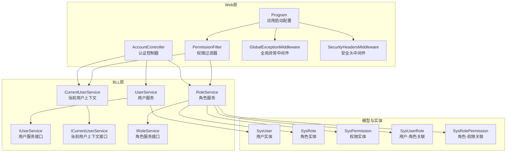
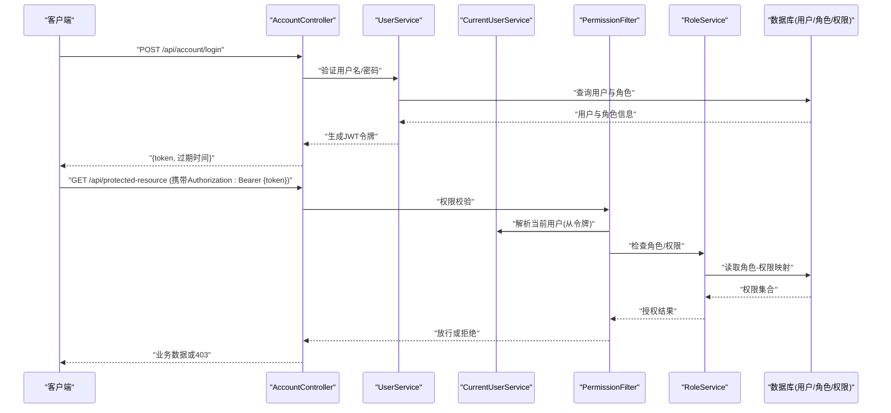
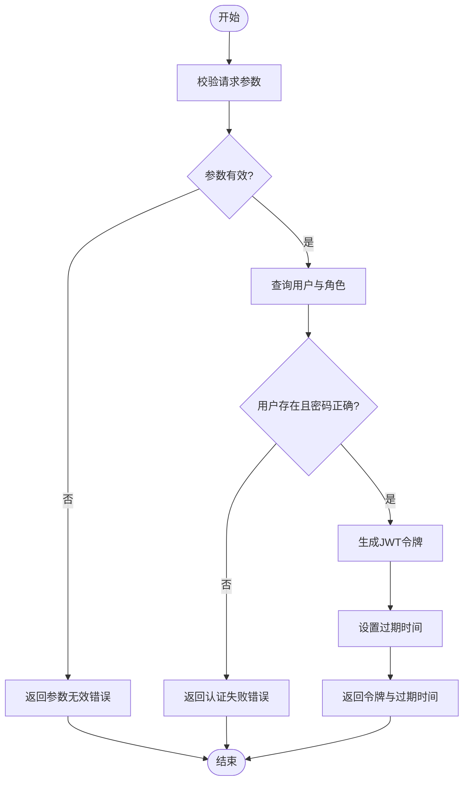
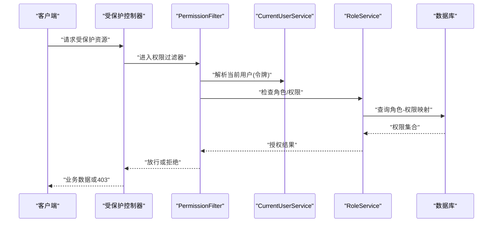
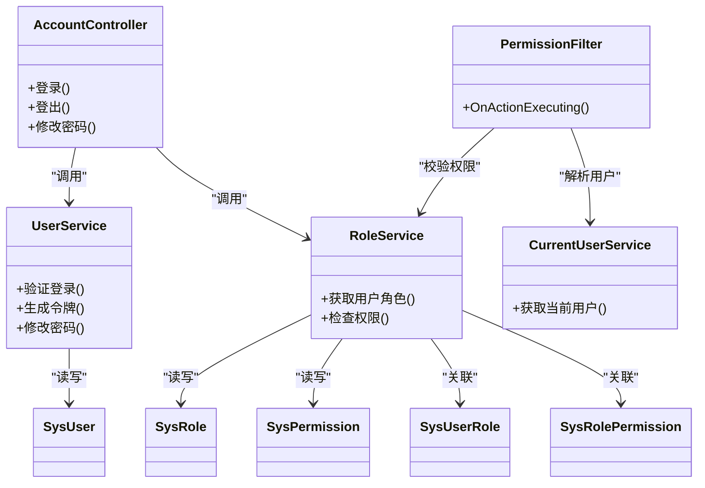

# 用户认证API

<cite>
**本文引用的文件**   
- [AccountController.cs](file://EquipmentIMS.Web/Controllers/AccountController.cs)
- [PermissionFilter.cs](file://EquipmentIMS.Web/Filters/PermissionFilter.cs)
- [GlobalExceptionMiddleware.cs](file://EquipmentIMS.Web/Filters/GlobalExceptionMiddleware.cs)
- [SecurityHeadersMiddleware.cs](file://EquipmentIMS.Web/Filters/SecurityHeadersMiddleware.cs)
- [UserService.cs](file://EquipmentIMS.BLL/Services/UserService.cs)
- [IUserService.cs](file://EquipmentIMS.BLL/Interfaces/IUserService.cs)
- [CurrentUserService.cs](file://EquipmentIMS.BLL/Services/CurrentUserService.cs)
- [ICurrentUserService.cs](file://EquipmentIMS.BLL/Interfaces/ICurrentUserService.cs)
- [RoleService.cs](file://EquipmentIMS.BLL/Services/RoleService.cs)
- [IRoleService.cs](file://EquipmentIMS.BLL/Interfaces/IRoleService.cs)
- [SysUser.cs](file://EquipmentIMS.Models/Entities/SysUser.cs)
- [SysRole.cs](file://EquipmentIMS.Models/Entities/SysRole.cs)
- [SysPermission.cs](file://EquipmentIMS.Models/Entities/SysPermission.cs)
- [SysUserRole.cs](file://EquipmentIMS.Models/Entities/SysUserRole.cs)
- [SysRolePermission.cs](file://EquipmentIMS.Models/Entities/SysRolePermission.cs)
- [LoginViewModel.cs](file://EquipmentIMS.Web/Models/LoginViewModel.cs)
- [ChangePasswordViewModel.cs](file://EquipmentIMS.Web/Models/ChangePasswordViewModel.cs)
- [ApiResponse.cs](file://EquipmentIMS.Models/DTOs/ApiResponse.cs)
- [Program.cs](file://EquipmentIMS.Web/Program.cs)
</cite>

## 目录
1. [简介](#简介)
2. [项目结构](#项目结构)
3. [核心组件](#核心组件)
4. [架构总览](#架构总览)
5. [详细组件分析](#详细组件分析)
6. [依赖关系分析](#依赖关系分析)
7. [性能考虑](#性能考虑)
8. [故障排查指南](#故障排查指南)
9. [结论](#结论)
10. [附录](#附录) 

## 简介
本文件为用户认证模块的API接口文档，覆盖登录、登出、密码修改、权限验证等关键能力。文档同时说明JWT令牌机制、会话管理、多角色权限控制与超时策略，并提供请求参数、响应格式示例及错误处理规范与安全最佳实践建议。

## 项目结构
认证相关代码分布在Web层控制器、过滤器、BLL服务层、模型与实体中：
- Web层：提供HTTP端点（登录、登出、改密）与全局异常处理、安全头中间件、基于策略的权限过滤。
- BLL层：封装用户、角色、权限等业务逻辑，以及当前用户上下文获取。
- 数据模型：用户、角色、权限及其关联实体定义。

图表来源
- [AccountController.cs](file://EquipmentIMS.Web/Controllers/AccountController.cs)
- [PermissionFilter.cs](file://EquipmentIMS.Web/Filters/PermissionFilter.cs)
- [GlobalExceptionMiddleware.cs](file://EquipmentIMS.Web/Filters/GlobalExceptionMiddleware.cs)
- [SecurityHeadersMiddleware.cs](file://EquipmentIMS.Web/Filters/SecurityHeadersMiddleware.cs)
- [Program.cs](file://EquipmentIMS.Web/Program.cs)
- [UserService.cs](file://EquipmentIMS.BLL/Services/UserService.cs)
- [IUserService.cs](file://EquipmentIMS.BLL/Interfaces/IUserService.cs)
- [CurrentUserService.cs](file://EquipmentIMS.BLL/Services/CurrentUserService.cs)
- [ICurrentUserService.cs](file://EquipmentIMS.BLL/Interfaces/ICurrentUserService.cs)
- [RoleService.cs](file://EquipmentIMS.BLL/Services/RoleService.cs)
- [IRoleService.cs](file://EquipmentIMS.BLL/Interfaces/IRoleService.cs)
- [SysUser.cs](file://EquipmentIMS.Models/Entities/SysUser.cs)
- [SysRole.cs](file://EquipmentIMS.Models/Entities/SysRole.cs)
- [SysPermission.cs](file://EquipmentIMS.Models/Entities/SysPermission.cs)
- [SysUserRole.cs](file://EquipmentIMS.Models/Entities/SysUserRole.cs)
- [SysRolePermission.cs](file://EquipmentIMS.Models/Entities/SysRolePermission.cs)

章节来源
- [AccountController.cs](file://EquipmentIMS.Web/Controllers/AccountController.cs)
- [PermissionFilter.cs](file://EquipmentIMS.Web/Filters/PermissionFilter.cs)
- [GlobalExceptionMiddleware.cs](file://EquipmentIMS.Web/Filters/GlobalExceptionMiddleware.cs)
- [SecurityHeadersMiddleware.cs](file://EquipmentIMS.Web/Filters/SecurityHeadersMiddleware.cs)
- [Program.cs](file://EquipmentIMS.Web/Program.cs)
- [UserService.cs](file://EquipmentIMS.BLL/Services/UserService.cs)
- [IUserService.cs](file://EquipmentIMS.BLL/Interfaces/IUserService.cs)
- [CurrentUserService.cs](file://EquipmentIMS.BLL/Services/CurrentUserService.cs)
- [ICurrentUserService.cs](file://EquipmentIMS.BLL/Interfaces/ICurrentUserService.cs)
- [RoleService.cs](file://EquipmentIMS.BLL/Services/RoleService.cs)
- [IRoleService.cs](file://EquipmentIMS.BLL/Interfaces/IRoleService.cs)
- [SysUser.cs](file://EquipmentIMS.Models/Entities/SysUser.cs)
- [SysRole.cs](file://EquipmentIMS.Models/Entities/SysRole.cs)
- [SysPermission.cs](file://EquipmentIMS.Models/Entities/SysPermission.cs)
- [SysUserRole.cs](file://EquipmentIMS.Models/Entities/SysUserRole.cs)
- [SysRolePermission.cs](file://EquipmentIMS.Models/Entities/SysRolePermission.cs)

## 核心组件
- 认证控制器：对外暴露登录、登出、密码修改等接口；负责接收请求、调用服务层、返回统一响应。
- 权限过滤器：在请求进入业务前进行鉴权，校验用户是否具备所需权限或角色。
- 用户服务：实现用户登录、登出、密码修改、用户信息查询等核心流程。
- 当前用户上下文：从请求上下文中解析并缓存当前登录用户信息（如用户ID、角色、权限）。
- 角色与权限服务：维护角色、权限及其关联关系，支撑RBAC授权。
- 全局异常中间件与安全头中间件：统一错误响应格式与基础安全头设置。

章节来源
- [AccountController.cs](file://EquipmentIMS.Web/Controllers/AccountController.cs)
- [PermissionFilter.cs](file://EquipmentIMS.Web/Filters/PermissionFilter.cs)
- [UserService.cs](file://EquipmentIMS.BLL/Services/UserService.cs)
- [IUserService.cs](file://EquipmentIMS.BLL/Interfaces/IUserService.cs)
- [CurrentUserService.cs](file://EquipmentIMS.BLL/Services/CurrentUserService.cs)
- [ICurrentUserService.cs](file://EquipmentIMS.BLL/Interfaces/ICurrentUserService.cs)
- [RoleService.cs](file://EquipmentIMS.BLL/Services/RoleService.cs)
- [IRoleService.cs](file://EquipmentIMS.BLL/Interfaces/IRoleService.cs)
- [GlobalExceptionMiddleware.cs](file://EquipmentIMS.Web/Filters/GlobalExceptionMiddleware.cs)
- [SecurityHeadersMiddleware.cs](file://EquipmentIMS.Web/Filters/SecurityHeadersMiddleware.cs)

## 架构总览
认证流程采用“无状态JWT + 可选服务端会话”的组合模式：
- 登录成功后签发JWT令牌，客户端后续请求携带令牌进行身份识别。
- 通过权限过滤器对受保护资源进行RBAC校验。
- 全局异常中间件将业务异常转换为标准错误响应。
- 安全头中间件为所有响应附加基础安全头。

图表来源
- [AccountController.cs](file://EquipmentIMS.Web/Controllers/AccountController.cs)
- [UserService.cs](file://EquipmentIMS.BLL/Services/UserService.cs)
- [CurrentUserService.cs](file://EquipmentIMS.BLL/Services/CurrentUserService.cs)
- [PermissionFilter.cs](file://EquipmentIMS.Web/Filters/PermissionFilter.cs)
- [RoleService.cs](file://EquipmentIMS.BLL/Services/RoleService.cs)
- [SysUser.cs](file://EquipmentIMS.Models/Entities/SysUser.cs)
- [SysRole.cs](file://EquipmentIMS.Models/Entities/SysRole.cs)
- [SysPermission.cs](file://EquipmentIMS.Models/Entities/SysPermission.cs)
- [SysUserRole.cs](file://EquipmentIMS.Models/Entities/SysUserRole.cs)
- [SysRolePermission.cs](file://EquipmentIMS.Models/Entities/SysRolePermission.cs)

## 详细组件分析

### 登录接口
- 功能：验证用户名与密码，成功则签发JWT令牌并返回给客户端。
- 请求路径与方法：POST /api/account/login
- 请求体字段：
  - 用户名：字符串，必填
  - 密码：字符串，必填
- 响应体：
  - 成功：包含访问令牌与过期时间
  - 失败：统一错误响应，包含错误码与消息
- 错误处理：
  - 用户名不存在或密码错误：返回未授权或参数无效
  - 系统异常：由全局异常中间件捕获并返回标准错误格式

图表来源
- [AccountController.cs](file://EquipmentIMS.Web/Controllers/AccountController.cs)
- [UserService.cs](file://EquipmentIMS.BLL/Services/UserService.cs)
- [SysUser.cs](file://EquipmentIMS.Models/Entities/SysUser.cs)
- [SysRole.cs](file://EquipmentIMS.Models/Entities/SysRole.cs)

章节来源
- [AccountController.cs](file://EquipmentIMS.Web/Controllers/AccountController.cs)
- [UserService.cs](file://EquipmentIMS.BLL/Services/UserService.cs)
- [SysUser.cs](file://EquipmentIMS.Models/Entities/SysUser.cs)
- [SysRole.cs](file://EquipmentIMS.Models/Entities/SysRole.cs)

### 登出接口
- 功能：使当前令牌失效或清理本地会话（若启用服务端会话）。
- 请求路径与方法：POST /api/account/logout
- 请求头：需携带有效的Authorization令牌
- 响应体：
  - 成功：空体或确认消息
  - 失败：统一错误响应
- 注意：
  - 若使用无状态JWT，登出通常由客户端删除本地令牌；服务端可维护黑名单以实现强制失效。

章节来源
- [AccountController.cs](file://EquipmentIMS.Web/Controllers/AccountController.cs)
- [UserService.cs](file://EquipmentIMS.BLL/Services/UserService.cs)

### 修改密码接口
- 功能：已登录用户修改自身密码。
- 请求路径与方法：POST /api/account/change-password
- 请求体字段：
  - 旧密码：字符串，必填
  - 新密码：字符串，必填（满足复杂度要求）
- 响应体：
  - 成功：空体或确认消息
  - 失败：统一错误响应（如旧密码不正确、新密码不合规）
- 安全建议：
  - 记录密码历史，禁止重复使用最近若干次密码
  - 强制复杂度与最小长度

章节来源
- [AccountController.cs](file://EquipmentIMS.Web/Controllers/AccountController.cs)
- [UserService.cs](file://EquipmentIMS.BLL/Services/UserService.cs)
- [ChangePasswordViewModel.cs](file://EquipmentIMS.Web/Models/ChangePasswordViewModel.cs)

### 权限验证流程
- 功能：在访问受保护资源前，校验当前用户是否具备所需权限或角色。
- 触发方式：通过权限过滤器在控制器方法或区域上声明式启用。
- 校验依据：
  - 从JWT令牌解析当前用户标识
  - 根据用户-角色、角色-权限映射判断是否允许访问
- 失败处理：返回403禁止访问或统一错误响应

图表来源
- [PermissionFilter.cs](file://EquipmentIMS.Web/Filters/PermissionFilter.cs)
- [CurrentUserService.cs](file://EquipmentIMS.BLL/Services/CurrentUserService.cs)
- [RoleService.cs](file://EquipmentIMS.BLL/Services/RoleService.cs)
- [SysUserRole.cs](file://EquipmentIMS.Models/Entities/SysUserRole.cs)
- [SysRolePermission.cs](file://EquipmentIMS.Models/Entities/SysRolePermission.cs)

章节来源
- [PermissionFilter.cs](file://EquipmentIMS.Web/Filters/PermissionFilter.cs)
- [CurrentUserService.cs](file://EquipmentIMS.BLL/Services/CurrentUserService.cs)
- [RoleService.cs](file://EquipmentIMS.BLL/Services/RoleService.cs)
- [SysUserRole.cs](file://EquipmentIMS.Models/Entities/SysUserRole.cs)
- [SysRolePermission.cs](file://EquipmentIMS.Models/Entities/SysRolePermission.cs)

### JWT令牌机制与会话管理
- 令牌签发：登录成功后生成JWT，包含用户标识、角色与必要声明。
- 令牌传输：客户端在后续请求的Authorization头中携带Bearer令牌。
- 令牌校验：权限过滤器或中间件解析并验证签名与有效期。
- 会话管理：
  - 无状态方案：仅依赖JWT，服务端不保存会话；登出由客户端删除令牌或维护令牌黑名单。
  - 有状态方案：结合服务端会话存储，支持集中式登出与更细粒度控制。
- 过期与刷新：
  - 短生命周期访问令牌配合刷新令牌可实现更好的安全性与用户体验。
  - 建议在令牌中包含过期时间并在前端提示重新登录。

章节来源
- [AccountController.cs](file://EquipmentIMS.Web/Controllers/AccountController.cs)
- [PermissionFilter.cs](file://EquipmentIMS.Web/Filters/PermissionFilter.cs)
- [CurrentUserService.cs](file://EquipmentIMS.BLL/Services/CurrentUserService.cs)
- [Program.cs](file://EquipmentIMS.Web/Program.cs)

### 多角色权限控制
- 模型关系：
  - 用户与角色多对多
  - 角色与权限多对多
- 授权策略：
  - 基于角色的访问控制（RBAC）
  - 可在控制器或方法级别声明所需角色或权限
- 扩展性：
  - 新增角色与权限无需改动核心流程
  - 可通过策略或标签辅助器在前端渲染时按权限显示菜单与按钮

章节来源
- [SysUser.cs](file://EquipmentIMS.Models/Entities/SysUser.cs)
- [SysRole.cs](file://EquipmentIMS.Models/Entities/SysRole.cs)
- [SysPermission.cs](file://EquipmentIMS.Models/Entities/SysPermission.cs)
- [SysUserRole.cs](file://EquipmentIMS.Models/Entities/SysUserRole.cs)
- [SysRolePermission.cs](file://EquipmentIMS.Models/Entities/SysRolePermission.cs)
- [RoleService.cs](file://EquipmentIMS.BLL/Services/RoleService.cs)
- [IRoleService.cs](file://EquipmentIMS.BLL/Interfaces/IRoleService.cs)

### 统一响应格式
- 成功响应：
  - 数据字段：业务数据对象或列表
  - 状态码：200
- 错误响应：
  - 错误码：数字或字符串
  - 错误消息：人类可读的错误描述
  - 状态码：400/401/403/404/500等
- 全局异常中间件会将未捕获异常转换为统一错误格式，便于前端一致处理。

章节来源
- [ApiResponse.cs](file://EquipmentIMS.Models/DTOs/ApiResponse.cs)
- [GlobalExceptionMiddleware.cs](file://EquipmentIMS.Web/Filters/GlobalExceptionMiddleware.cs)

## 依赖关系分析
- 控制器依赖服务层：AccountController依赖UserService与RoleService。
- 过滤器依赖上下文与角色服务：PermissionFilter依赖CurrentUserService与RoleService。
- 服务层依赖实体与仓储：UserService与RoleService依赖用户、角色、权限实体。
- 启动配置注册中间件与过滤器：Program中注册全局异常中间件、安全头中间件与权限过滤器。

图表来源
- [AccountController.cs](file://EquipmentIMS.Web/Controllers/AccountController.cs)
- [UserService.cs](file://EquipmentIMS.BLL/Services/UserService.cs)
- [RoleService.cs](file://EquipmentIMS.BLL/Services/RoleService.cs)
- [CurrentUserService.cs](file://EquipmentIMS.BLL/Services/CurrentUserService.cs)
- [PermissionFilter.cs](file://EquipmentIMS.Web/Filters/PermissionFilter.cs)
- [SysUser.cs](file://EquipmentIMS.Models/Entities/SysUser.cs)
- [SysRole.cs](file://EquipmentIMS.Models/Entities/SysRole.cs)
- [SysPermission.cs](file://EquipmentIMS.Models/Entities/SysPermission.cs)
- [SysUserRole.cs](file://EquipmentIMS.Models/Entities/SysUserRole.cs)
- [SysRolePermission.cs](file://EquipmentIMS.Models/Entities/SysRolePermission.cs)

章节来源
- [AccountController.cs](file://EquipmentIMS.Web/Controllers/AccountController.cs)
- [UserService.cs](file://EquipmentIMS.BLL/Services/UserService.cs)
- [RoleService.cs](file://EquipmentIMS.BLL/Services/RoleService.cs)
- [CurrentUserService.cs](file://EquipmentIMS.BLL/Services/CurrentUserService.cs)
- [PermissionFilter.cs](file://EquipmentIMS.Web/Filters/PermissionFilter.cs)
- [SysUser.cs](file://EquipmentIMS.Models/Entities/SysUser.cs)
- [SysRole.cs](file://EquipmentIMS.Models/Entities/SysRole.cs)
- [SysPermission.cs](file://EquipmentIMS.Models/Entities/SysPermission.cs)
- [SysUserRole.cs](file://EquipmentIMS.Models/Entities/SysUserRole.cs)
- [SysRolePermission.cs](file://EquipmentIMS.Models/Entities/SysRolePermission.cs)

## 性能考虑
- 令牌校验开销：尽量将用户基本信息放入JWT以减少每次请求的数据库查询；敏感信息不要放入令牌。
- 权限缓存：角色-权限映射可缓存以提升高频访问的性能。
- 密码哈希：使用安全的哈希算法（如bcrypt/argon2），避免明文存储。
- 并发与限流：对登录接口实施速率限制，防止暴力破解。
- 连接池与异步：确保数据库连接池合理配置，服务层使用异步IO提升吞吐。

[本节为通用指导，不涉及具体文件分析]

## 故障排查指南
- 登录失败：
  - 检查用户名与密码是否正确
  - 查看全局异常中间件输出的错误日志
- 权限不足：
  - 确认用户是否被分配相应角色
  - 检查角色-权限映射是否完整
- 令牌问题：
  - 确认Authorization头格式正确
  - 检查令牌是否过期或签名无效
- 安全头缺失：
  - 确认安全头中间件已在管道中注册

章节来源
- [GlobalExceptionMiddleware.cs](file://EquipmentIMS.Web/Filters/GlobalExceptionMiddleware.cs)
- [SecurityHeadersMiddleware.cs](file://EquipmentIMS.Web/Filters/SecurityHeadersMiddleware.cs)
- [PermissionFilter.cs](file://EquipmentIMS.Web/Filters/PermissionFilter.cs)

## 结论
本认证模块以JWT为核心，结合RBAC权限模型与过滤器实现细粒度授权。通过统一响应与全局异常处理提升可观测性与一致性。建议在生产环境启用HTTPS、严格的安全头、令牌黑名单与刷新令牌机制，并结合监控与审计日志保障安全与可追溯性。

[本节为总结性内容，不涉及具体文件分析]

## 附录

### 安全最佳实践
- 强制HTTPS传输
- 设置安全响应头（如HSTS、X-Content-Type-Options、X-Frame-Options、CSP）
- 密码复杂度与历史策略
- 登录失败次数限制与账户锁定
- 令牌最小化原则与短期过期
- 审计日志记录关键操作

章节来源
- [SecurityHeadersMiddleware.cs](file://EquipmentIMS.Web/Filters/SecurityHeadersMiddleware.cs)
- [Program.cs](file://EquipmentIMS.Web/Program.cs)