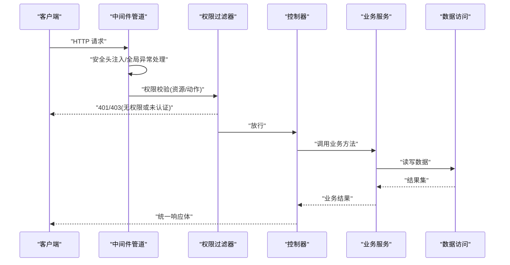
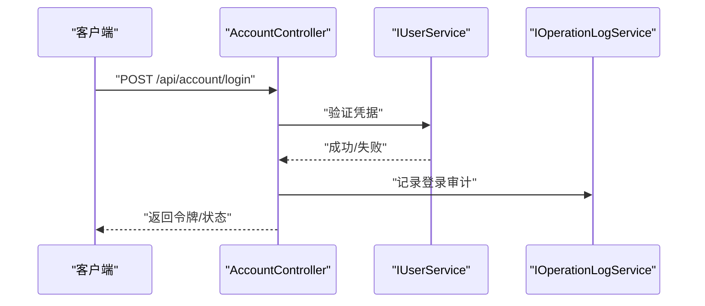
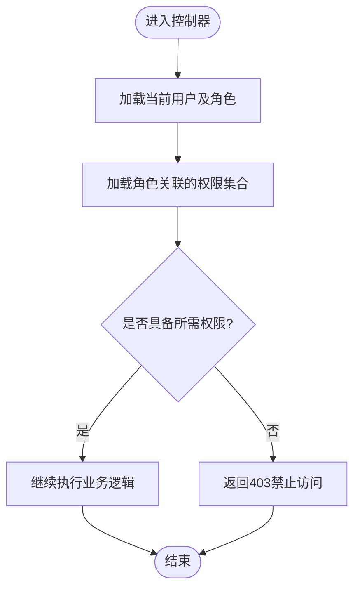
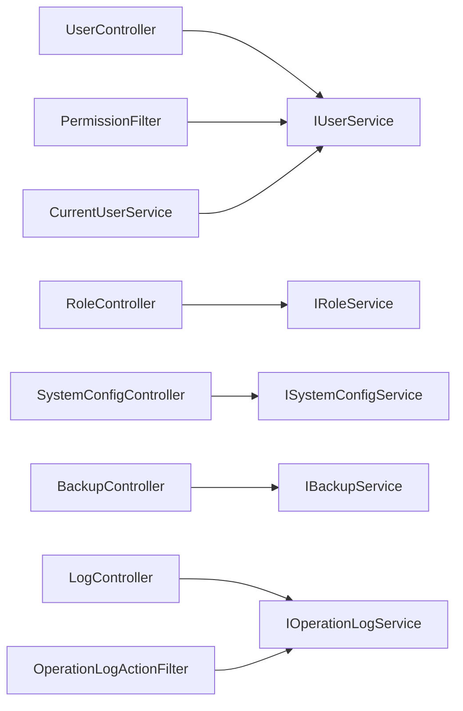
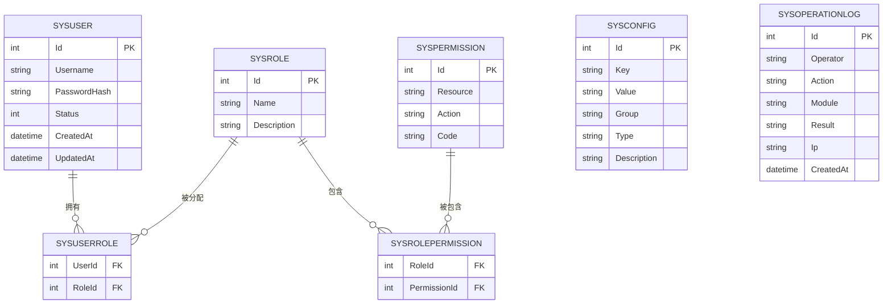

# 系统管理API

<cite>
**本文引用的文件**   
- [Program.cs](file://EquipmentIMS.Web/Program.cs)
- [PermissionFilter.cs](file://EquipmentIMS.Web/Filters/PermissionFilter.cs)
- [OperationLogActionFilter.cs](file://EquipmentIMS.Web/Filters/OperationLogActionFilter.cs)
- [GlobalExceptionMiddleware.cs](file://EquipmentIMS.Web/Filters/GlobalExceptionMiddleware.cs)
- [SecurityHeadersMiddleware.cs](file://EquipmentIMS.Web/Filters/SecurityHeadersMiddleware.cs)
- [AccountController.cs](file://EquipmentIMS.Web/Controllers/AccountController.cs)
- [UserController.cs](file://EquipmentIMS.Web/Controllers/UserController.cs)
- [RoleController.cs](file://EquipmentIMS.Web/Controllers/RoleController.cs)
- [SystemConfigController.cs](file://EquipmentIMS.Web/Controllers/SystemConfigController.cs)
- [BackupController.cs](file://EquipmentIMS.Web/Controllers/BackupController.cs)
- [LogController.cs](file://EquipmentIMS.Web/Controllers/LogController.cs)
- [IUserService.cs](file://EquipmentIMS.BLL/Interfaces/IUserService.cs)
- [IRoleService.cs](file://EquipmentIMS.BLL/Interfaces/IRoleService.cs)
- [ISystemConfigService.cs](file://EquipmentIMS.BLL/Interfaces/ISystemConfigService.cs)
- [IBackupService.cs](file://EquipmentIMS.BLL/Interfaces/IBackupService.cs)
- [IOperationLogService.cs](file://EquipmentIMS.BLL/Interfaces/IOperationLogService.cs)
- [IMenuService.cs](file://EquipmentIMS.BLL/Interfaces/IMenuService.cs)
- [CurrentUserService.cs](file://EquipmentIMS.BLL/Services/CurrentUserService.cs)
- [UserService.cs](file://EquipmentIMS.BLL/Services/UserService.cs)
- [RoleService.cs](file://EquipmentIMS.BLL/Services/RoleService.cs)
- [SystemConfigService.cs](file://EquipmentIMS.BLL/Services/SystemConfigService.cs)
- [BackupService.cs](file://EquipmentIMS.BLL/Services/BackupService.cs)
- [OperationLogService.cs](file://EquipmentIMS.BLL/Services/OperationLogService.cs)
- [MenuService.cs](file://EquipmentIMS.BLL/Services/MenuService.cs)
- [SysUser.cs](file://EquipmentIMS.Models/Entities/SysUser.cs)
- [SysRole.cs](file://EquipmentIMS.Models/Entities/SysRole.cs)
- [SysPermission.cs](file://EquipmentIMS.Models/Entities/SysPermission.cs)
- [SysUserRole.cs](file://EquipmentIMS.Models/Entities/SysUserRole.cs)
- [SysRolePermission.cs](file://EquipmentIMS.Models/Entities/SysRolePermission.cs)
- [SysConfig.cs](file://EquipmentIMS.Models/Entities/SysConfig.cs)
- [SysOperationLog.cs](file://EquipmentIMS.Models/Entities/SysOperationLog.cs)
- [PermissionType.cs](file://EquipmentIMS.Models/Enums/PermissionType.cs)
- [ApiResponse.cs](file://EquipmentIMS.Models/DTOs/ApiResponse.cs)
- [PagedResult.cs](file://EquipmentIMS.Models/DTOs/PagedResult.cs)
- [UserDto.cs](file://EquipmentIMS.Models/DTOs/UserDto.cs)
- [RoleDto.cs](file://EquipmentIMS.Models/DTOs/RoleDto.cs)
- [SystemConfigDto.cs](file://EquipmentIMS.Models/DTOs/SystemConfigDto.cs)
- [OperationLogDto.cs](file://EquipmentIMS.Models/DTOs/OperationLogDto.cs)
- [MenuDto.cs](file://EquipmentIMS.Models/DTOs/MenuDto.cs)
</cite>

## 目录
1. [简介](#简介)
2. [项目结构](#项目结构)
3. [核心组件](#核心组件)
4. [架构总览](#架构总览)
5. [详细组件分析](#详细组件分析)
6. [依赖关系分析](#依赖关系分析)
7. [性能考虑](#性能考虑)
8. [故障排查指南](#故障排查指南)
9. [结论](#结论)
10. [附录](#附录)

## 简介
本文件为“系统管理模块”的API接口文档，覆盖用户管理、角色与权限（RBAC）管理、菜单管理、系统配置、操作日志、备份恢复、安全策略与健康检查等运维能力。文档同时说明RBAC权限模型的实现细节、动态权限验证流程以及配置热更新机制，帮助开发者快速集成与扩展。

## 项目结构
系统采用分层架构：Web层控制器负责HTTP请求路由与参数校验；BLL业务层封装领域逻辑与跨切面关注点；DAL数据访问层通过仓储与上下文持久化；Models定义实体、枚举与DTO。

```mermaid
graph TB
subgraph "Web层"
AC["AccountController"]
UC["UserController"]
RC["RoleController"]
SC["SystemConfigController"]
BK["BackupController"]
LG["LogController"]
PF["PermissionFilter"]
OLF["OperationLogActionFilter"]
GEM["GlobalExceptionMiddleware"]
SHM["SecurityHeadersMiddleware"]
end
subgraph "BLL层"
IUS["IUserService"]
IRS["IRoleService"]
ISCS["ISystemConfigService"]
IBS["IBackupService"]
IOLS["IOperationLogService"]
IMS["IMenuService"]
CUS["CurrentUserService"]
US["UserService"]
RS["RoleService"]
SCS["SystemConfigService"]
BS["BackupService"]
OLS["OperationLogService"]
MS["MenuService"]
end
subgraph "模型层"
ENT["实体: SysUser/SysRole/SysPermission/SysUserRole/SysRolePermission/SysConfig/SysOperationLog"]
DTO["DTO: UserDto/RoleDto/SystemConfigDto/OperationLogDto/MenuDto"]
ENUM["枚举: PermissionType"]
APIR["通用响应: ApiResponse/PagedResult"]
end
AC --> IUS
UC --> IUS
RC --> IRS
SC --> ISCS
BK --> IBS
LG --> IOLS
PF --> IUS
OLF --> IOLS
CUS --> IUS
US --> ENT
RS --> ENT
SCS --> ENT
BS --> ENT
OLS --> ENT
MS --> ENT
DTO --> AC
DTO --> UC
DTO --> RC
DTO --> SC
DTO --> BK
DTO --> LG
ENUM --> PF
APIR --> AC
```



图表来源
- [Program.cs](file://EquipmentIMS.Web/Program.cs)
- [PermissionFilter.cs](file://EquipmentIMS.Web/Filters/PermissionFilter.cs)
- [OperationLogActionFilter.cs](file://EquipmentIMS.Web/Filters/OperationLogActionFilter.cs)
- [AccountController.cs](file://EquipmentIMS.Web/Controllers/AccountController.cs)
- [UserController.cs](file://EquipmentIMS.Web/Controllers/UserController.cs)
- [RoleController.cs](file://EquipmentIMS.Web/Controllers/RoleController.cs)
- [SystemConfigController.cs](file://EquipmentIMS.Web/Controllers/SystemConfigController.cs)
- [BackupController.cs](file://EquipmentIMS.Web/Controllers/BackupController.cs)
- [LogController.cs](file://EquipmentIMS.Web/Controllers/LogController.cs)
- [IUserService.cs](file://EquipmentIMS.BLL/Interfaces/IUserService.cs)
- [IRoleService.cs](file://EquipmentIMS.BLL/Interfaces/IRoleService.cs)
- [ISystemConfigService.cs](file://EquipmentIMS.BLL/Interfaces/ISystemConfigService.cs)
- [IBackupService.cs](file://EquipmentIMS.BLL/Interfaces/IBackupService.cs)
- [IOperationLogService.cs](file://EquipmentIMS.BLL/Interfaces/IOperationLogService.cs)
- [IMenuService.cs](file://EquipmentIMS.BLL/Interfaces/IMenuService.cs)
- [CurrentUserService.cs](file://EquipmentIMS.BLL/Services/CurrentUserService.cs)
- [SysUser.cs](file://EquipmentIMS.Models/Entities/SysUser.cs)
- [SysRole.cs](file://EquipmentIMS.Models/Entities/SysRole.cs)
- [SysPermission.cs](file://EquipmentIMS.Models/Entities/SysPermission.cs)
- [SysUserRole.cs](file://EquipmentIMS.Models/Entities/SysUserRole.cs)
- [SysRolePermission.cs](file://EquipmentIMS.Models/Entities/SysRolePermission.cs)
- [SysConfig.cs](file://EquipmentIMS.Models/Entities/SysConfig.cs)
- [SysOperationLog.cs](file://EquipmentIMS.Models/Entities/SysOperationLog.cs)
- [PermissionType.cs](file://EquipmentIMS.Models/Enums/PermissionType.cs)
- [ApiResponse.cs](file://EquipmentIMS.Models/DTOs/ApiResponse.cs)
- [PagedResult.cs](file://EquipmentIMS.Models/DTOs/PagedResult.cs)

章节来源
- [Program.cs](file://EquipmentIMS.Web/Program.cs)

## 核心组件
- 认证与会话：登录、登出、修改密码、获取当前用户信息。
- 用户管理：用户的增删改查、分页查询、批量启用/禁用、重置密码、分配角色。
- 角色与权限（RBAC）：角色的CRUD、权限分配与回收、基于权限的动态授权。
- 菜单管理：菜单树构建、按用户可见性过滤、缓存刷新。
- 系统配置：键值对配置项的CRUD、分组与类型、热更新生效。
- 操作日志：审计日志记录、检索与导出。
- 备份恢复：数据库备份、历史列表、恢复执行。
- 安全策略与健康检查：全局异常处理、安全头注入、健康探针。

章节来源
- [AccountController.cs](file://EquipmentIMS.Web/Controllers/AccountController.cs)
- [UserController.cs](file://EquipmentIMS.Web/Controllers/UserController.cs)
- [RoleController.cs](file://EquipmentIMS.Web/Controllers/RoleController.cs)
- [SystemConfigController.cs](file://EquipmentIMS.Web/Controllers/SystemConfigController.cs)
- [BackupController.cs](file://EquipmentIMS.Web/Controllers/BackupController.cs)
- [LogController.cs](file://EquipmentIMS.Web/Controllers/LogController.cs)
- [PermissionFilter.cs](file://EquipmentIMS.Web/Filters/PermissionFilter.cs)
- [OperationLogActionFilter.cs](file://EquipmentIMS.Web/Filters/OperationLogActionFilter.cs)
- [GlobalExceptionMiddleware.cs](file://EquipmentIMS.Web/Filters/GlobalExceptionMiddleware.cs)
- [SecurityHeadersMiddleware.cs](file://EquipmentIMS.Web/Filters/SecurityHeadersMiddleware.cs)

## 架构总览
下图展示一次受控API请求从进入管道到返回响应的完整链路，包括鉴权、审计与安全头注入。



图表来源
- [Program.cs](file://EquipmentIMS.Web/Program.cs)
- [PermissionFilter.cs](file://EquipmentIMS.Web/Filters/PermissionFilter.cs)
- [GlobalExceptionMiddleware.cs](file://EquipmentIMS.Web/Filters/GlobalExceptionMiddleware.cs)
- [SecurityHeadersMiddleware.cs](file://EquipmentIMS.Web/Filters/SecurityHeadersMiddleware.cs)

## 详细组件分析

### 认证与会话接口
- 登录：提交用户名与密码，成功后返回会话令牌或Cookie标识。
- 登出：销毁会话或令牌。
- 修改密码：验证旧密码后设置新密码并记录审计日志。
- 获取当前用户：返回当前登录用户基本信息与角色集合。

典型调用序列：


图表来源
- [AccountController.cs](file://EquipmentIMS.Web/Controllers/AccountController.cs)
- [IUserService.cs](file://EquipmentIMS.BLL/Interfaces/IUserService.cs)
- [IOperationLogService.cs](file://EquipmentIMS.BLL/Interfaces/IOperationLogService.cs)

章节来源
- [AccountController.cs](file://EquipmentIMS.Web/Controllers/AccountController.cs)
- [IUserService.cs](file://EquipmentIMS.BLL/Interfaces/IUserService.cs)
- [IOperationLogService.cs](file://EquipmentIMS.BLL/Interfaces/IOperationLogService.cs)

### 用户管理接口
- 新增/编辑/删除用户：支持基础信息与状态控制。
- 分页查询：支持关键字、状态、角色筛选。
- 批量启用/禁用：按ID集合批量更新状态。
- 重置密码：管理员强制重置并触发审计。
- 分配角色：为用户绑定一个或多个角色。

关键数据结构与关系：
```mermaid
classDiagram
class SysUser {
+Id
+Username
+PasswordHash
+Status
+CreatedAt
+UpdatedAt
}
class SysRole {
+Id
+Name
+Description
}
class SysUserRole {
+UserId
+RoleId
}
SysUser ||--o{ SysUserRole : "拥有"
SysRole ||--o{ SysUserRole : "被分配"
```

图表来源
- [SysUser.cs](file://EquipmentIMS.Models/Entities/SysUser.cs)
- [SysRole.cs](file://EquipmentIMS.Models/Entities/SysRole.cs)
- [SysUserRole.cs](file://EquipmentIMS.Models/Entities/SysUserRole.cs)

章节来源
- [UserController.cs](file://EquipmentIMS.Web/Controllers/UserController.cs)
- [IUserService.cs](file://EquipmentIMS.BLL/Interfaces/IUserService.cs)
- [SysUser.cs](file://EquipmentIMS.Models/Entities/SysUser.cs)
- [SysRole.cs](file://EquipmentIMS.Models/Entities/SysRole.cs)
- [SysUserRole.cs](file://EquipmentIMS.Models/Entities/SysUserRole.cs)

### 角色与权限管理（RBAC）
- 角色CRUD：创建、编辑、删除角色。
- 权限分配：为角色授予或撤销权限。
- 动态权限验证：在请求到达控制器前，根据当前用户角色与其权限集合进行匹配。
- 权限模型：
  - 用户-角色多对多
  - 角色-权限多对多
  - 权限包含资源与动作维度

```mermaid
classDiagram
class SysPermission {
+Id
+Resource
+Action
+Code
}
class SysRolePermission {
+RoleId
+PermissionId
}
class SysRole {
+Id
+Name
}
SysRole ||--o{ SysRolePermission : "包含"
SysPermission ||--o{ SysRolePermission : "被包含"
```

动态权限验证流程：


图表来源
- [PermissionFilter.cs](file://EquipmentIMS.Web/Filters/PermissionFilter.cs)
- [SysPermission.cs](file://EquipmentIMS.Models/Entities/SysPermission.cs)
- [SysRolePermission.cs](file://EquipmentIMS.Models/Entities/SysRolePermission.cs)
- [SysRole.cs](file://EquipmentIMS.Models/Entities/SysRole.cs)
- [PermissionType.cs](file://EquipmentIMS.Models/Enums/PermissionType.cs)

章节来源
- [RoleController.cs](file://EquipmentIMS.Web/Controllers/RoleController.cs)
- [IRoleService.cs](file://EquipmentIMS.BLL/Interfaces/IRoleService.cs)
- [PermissionFilter.cs](file://EquipmentIMS.Web/Filters/PermissionFilter.cs)
- [SysPermission.cs](file://EquipmentIMS.Models/Entities/SysPermission.cs)
- [SysRolePermission.cs](file://EquipmentIMS.Models/Entities/SysRolePermission.cs)
- [PermissionType.cs](file://EquipmentIMS.Models/Enums/PermissionType.cs)

### 菜单管理接口
- 获取菜单树：按当前用户权限过滤生成可见菜单。
- 刷新菜单缓存：当权限变更后主动刷新。
- 菜单结构：支持多级嵌套，节点包含标识、标题、路径与图标等信息。

章节来源
- [IMenuService.cs](file://EquipmentIMS.BLL/Interfaces/IMenuService.cs)
- [MenuService.cs](file://EquipmentIMS.BLL/Services/MenuService.cs)
- [MenuDto.cs](file://EquipmentIMS.Models/DTOs/MenuDto.cs)

### 系统配置接口
- 配置项CRUD：支持键值对、分组、类型与描述。
- 读取配置：提供按Key或分组批量读取。
- 热更新：修改配置后即时生效，无需重启服务。
- 配置实体：
  - Key：唯一标识
  - Value：字符串值
  - Group：分组
  - Type：数据类型
  - Description：说明

章节来源
- [SystemConfigController.cs](file://EquipmentIMS.Web/Controllers/SystemConfigController.cs)
- [ISystemConfigService.cs](file://EquipmentIMS.BLL/Interfaces/ISystemConfigService.cs)
- [SystemConfigService.cs](file://EquipmentIMS.BLL/Services/SystemConfigService.cs)
- [SysConfig.cs](file://EquipmentIMS.Models/Entities/SysConfig.cs)
- [SystemConfigDto.cs](file://EquipmentIMS.Models/DTOs/SystemConfigDto.cs)

### 操作日志接口
- 自动审计：通过ActionFilter拦截写操作，记录操作人、时间、IP、动作与结果。
- 查询与导出：支持按时间范围、操作人、模块、结果筛选，支持分页与导出。
- 审计实体：
  - Operator：操作人
  - Action：动作
  - Module：模块
  - Result：结果
  - Ip：来源IP
  - CreatedAt：时间戳

章节来源
- [LogController.cs](file://EquipmentIMS.Web/Controllers/LogController.cs)
- [IOperationLogService.cs](file://EquipmentIMS.BLL/Interfaces/IOperationLogService.cs)
- [OperationLogService.cs](file://EquipmentIMS.BLL/Services/OperationLogService.cs)
- [OperationLogActionFilter.cs](file://EquipmentIMS.Web/Filters/OperationLogActionFilter.cs)
- [SysOperationLog.cs](file://EquipmentIMS.Models/Entities/SysOperationLog.cs)
- [OperationLogDto.cs](file://EquipmentIMS.Models/DTOs/OperationLogDto.cs)

### 备份与恢复接口
- 创建备份：触发数据库备份任务，返回任务ID。
- 备份历史：列出所有备份快照，支持分页与删除。
- 恢复执行：选择备份点进行恢复，需二次确认与审计。
- 备份DTO：包含备份名称、大小、时间与状态。

章节来源
- [BackupController.cs](file://EquipmentIMS.Web/Controllers/BackupController.cs)
- [IBackupService.cs](file://EquipmentIMS.BLL/Interfaces/IBackupService.cs)
- [BackupService.cs](file://EquipmentIMS.BLL/Services/BackupService.cs)

### 安全策略与健康检查
- 全局异常处理：统一捕获未处理异常，返回标准化错误响应。
- 安全头注入：添加X-Frame-Options、Content-Security-Policy等响应头。
- 健康检查：提供健康探针端点，用于负载均衡与监控告警。

章节来源
- [GlobalExceptionMiddleware.cs](file://EquipmentIMS.Web/Filters/GlobalExceptionMiddleware.cs)
- [SecurityHeadersMiddleware.cs](file://EquipmentIMS.Web/Filters/SecurityHeadersMiddleware.cs)
- [Program.cs](file://EquipmentIMS.Web/Program.cs)

## 依赖关系分析
- 控制器依赖BLL接口，便于替换实现与单元测试。
- 过滤器依赖当前用户上下文与权限服务，实现横切关注点解耦。
- 模型层实体与DTO分离，保证API契约稳定与内部实现可演进。



图表来源
- [UserController.cs](file://EquipmentIMS.Web/Controllers/UserController.cs)
- [RoleController.cs](file://EquipmentIMS.Web/Controllers/RoleController.cs)
- [SystemConfigController.cs](file://EquipmentIMS.Web/Controllers/SystemConfigController.cs)
- [BackupController.cs](file://EquipmentIMS.Web/Controllers/BackupController.cs)
- [LogController.cs](file://EquipmentIMS.Web/Controllers/LogController.cs)
- [PermissionFilter.cs](file://EquipmentIMS.Web/Filters/PermissionFilter.cs)
- [OperationLogActionFilter.cs](file://EquipmentIMS.Web/Filters/OperationLogActionFilter.cs)
- [CurrentUserService.cs](file://EquipmentIMS.BLL/Services/CurrentUserService.cs)
- [IUserService.cs](file://EquipmentIMS.BLL/Interfaces/IUserService.cs)
- [IRoleService.cs](file://EquipmentIMS.BLL/Interfaces/IRoleService.cs)
- [ISystemConfigService.cs](file://EquipmentIMS.BLL/Interfaces/ISystemConfigService.cs)
- [IBackupService.cs](file://EquipmentIMS.BLL/Interfaces/IBackupService.cs)
- [IOperationLogService.cs](file://EquipmentIMS.BLL/Interfaces/IOperationLogService.cs)

## 性能考虑
- 权限缓存：将用户-角色-权限映射缓存至内存，减少频繁查询。
- 分页与投影：列表接口默认分页，按需投影字段，避免全表扫描。
- 异步与批处理：备份与导出任务使用后台服务，避免阻塞主线程。
- 连接池与超时：合理配置数据库连接池与命令超时，防止雪崩。

[本节为通用指导，不直接分析具体文件]

## 故障排查指南
- 401未认证：检查登录流程与会话/令牌是否正确传递。
- 403无权限：核对用户角色与权限分配，确认权限代码与资源匹配。
- 500服务器错误：查看全局异常中间件记录的堆栈与上下文。
- 配置未生效：确认热更新是否触发，必要时刷新菜单缓存。
- 备份失败：检查存储路径权限与磁盘空间，查看备份任务日志。

章节来源
- [GlobalExceptionMiddleware.cs](file://EquipmentIMS.Web/Filters/GlobalExceptionMiddleware.cs)
- [PermissionFilter.cs](file://EquipmentIMS.Web/Filters/PermissionFilter.cs)
- [OperationLogActionFilter.cs](file://EquipmentIMS.Web/Filters/OperationLogActionFilter.cs)

## 结论
系统管理模块以清晰的层次结构与RBAC权限模型为基础，提供了完整的用户、角色、权限、菜单、配置、日志、备份与安全能力。通过过滤器与中间件实现横切关注点解耦，结合DTO与实体分离保障API稳定性。建议在生产环境开启权限缓存与审计日志归档，并建立健康检查与告警机制以提升可观测性与可靠性。

## 附录

### 统一响应与分页
- 统一响应体：包含状态码、消息与数据载荷。
- 分页结果：包含总数、页码、每页条数与数据列表。

章节来源
- [ApiResponse.cs](file://EquipmentIMS.Models/DTOs/ApiResponse.cs)
- [PagedResult.cs](file://EquipmentIMS.Models/DTOs/PagedResult.cs)

### RBAC权限模型实体关系


图表来源
- [SysUser.cs](file://EquipmentIMS.Models/Entities/SysUser.cs)
- [SysRole.cs](file://EquipmentIMS.Models/Entities/SysRole.cs)
- [SysPermission.cs](file://EquipmentIMS.Models/Entities/SysPermission.cs)
- [SysUserRole.cs](file://EquipmentIMS.Models/Entities/SysUserRole.cs)
- [SysRolePermission.cs](file://EquipmentIMS.Models/Entities/SysRolePermission.cs)
- [SysConfig.cs](file://EquipmentIMS.Models/Entities/SysConfig.cs)
- [SysOperationLog.cs](file://EquipmentIMS.Models/Entities/SysOperationLog.cs)