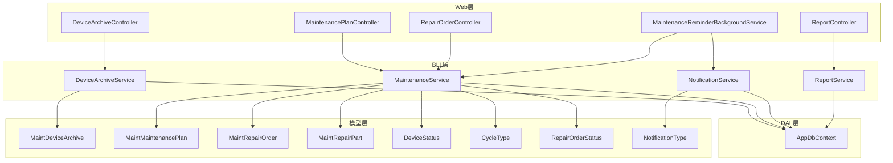
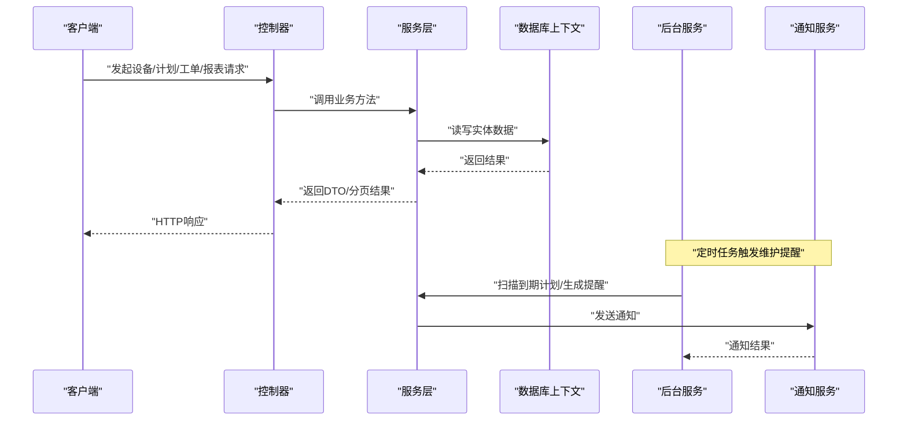
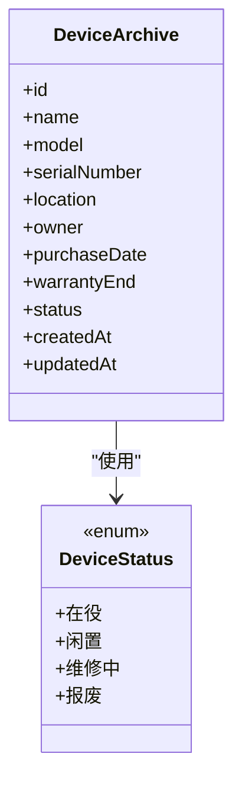
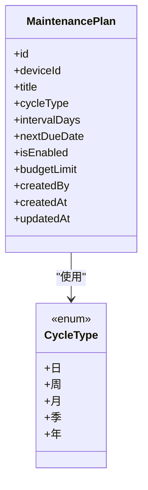
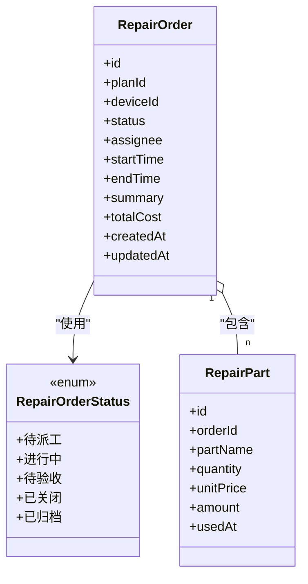
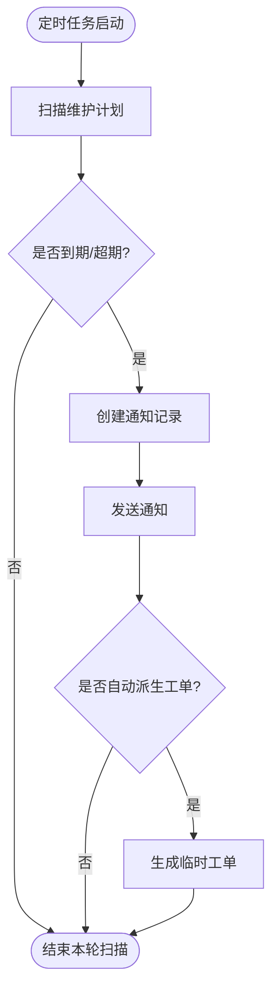
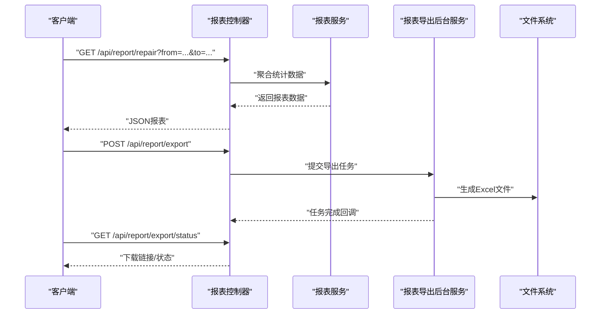
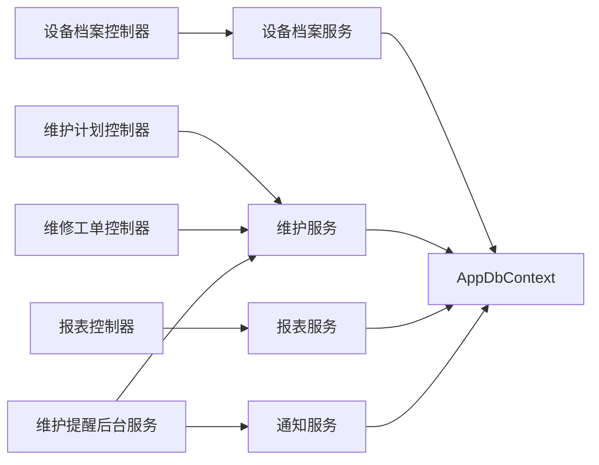

# 设备维护API

<cite>
**本文引用的文件**   
- [DeviceArchiveController.cs](file://EquipmentIMS.Web/Controllers/DeviceArchiveController.cs)
- [MaintenancePlanController.cs](file://EquipmentIMS.Web/Controllers/MaintenancePlanController.cs)
- [RepairOrderController.cs](file://EquipmentIMS.Web/Controllers/RepairOrderController.cs)
- [ReportController.cs](file://EquipmentIMS.Web/Controllers/ReportController.cs)
- [DeviceArchiveService.cs](file://EquipmentIMS.BLL/Services/DeviceArchiveService.cs)
- [MaintenanceService.cs](file://EquipmentIMS.BLL/Services/MaintenanceService.cs)
- [NotificationService.cs](file://EquipmentIMS.BLL/Services/NotificationService.cs)
- [ReportService.cs](file://EquipmentIMS.BLL/Services/ReportService.cs)
- [IDeviceArchiveService.cs](file://EquipmentIMS.BLL/Interfaces/IDeviceArchiveService.cs)
- [IMaintenanceService.cs](file://EquipmentIMS.BLL/Interfaces/IMaintenanceService.cs)
- [INotificationService.cs](file://EquipmentIMS.BLL/Interfaces/INotificationService.cs)
- [IReportService.cs](file://EquipmentIMS.BLL/Interfaces/IReportService.cs)
- [MaintDeviceArchive.cs](file://EquipmentIMS.Models/Entities/MaintDeviceArchive.cs)
- [MaintMaintenancePlan.cs](file://EquipmentIMS.Models/Entities/MaintMaintenancePlan.cs)
- [MaintRepairOrder.cs](file://EquipmentIMS.Models/Entities/MaintRepairOrder.cs)
- [MaintRepairPart.cs](file://EquipmentIMS.Models/Entities/MaintRepairPart.cs)
- [DeviceStatus.cs](file://EquipmentIMS.Models/Enums/DeviceStatus.cs)
- [CycleType.cs](file://EquipmentIMS.Models/Enums/CycleType.cs)
- [RepairOrderStatus.cs](file://EquipmentIMS.Models/Enums/RepairOrderStatus.cs)
- [NotificationType.cs](file://EquipmentIMS.Models/Enums/NotificationType.cs)
- [DeviceArchiveDto.cs](file://EquipmentIMS.Models/DTOs/DeviceArchiveDto.cs)
- [DeviceArchiveListDto.cs](file://EquipmentIMS.Models/DTOs/DeviceArchiveListDto.cs)
- [MaintenancePlanDto.cs](file://EquipmentIMS.Models/DTOs/MaintenancePlanDto.cs)
- [MaintenancePlanListDto.cs](file://EquipmentIMS.Models/DTOs/MaintenancePlanListDto.cs)
- [RepairOrderDto.cs](file://EquipmentIMS.Models/DTOs/RepairOrderDto.cs)
- [RepairOrderListDto.cs](file://EquipmentIMS.Models/DTOs/RepairOrderListDto.cs)
- [RepairPartDto.cs](file://EquipmentIMS.Models/DTOs/RepairPartDto.cs)
- [ReportRepairDtos.cs](file://EquipmentIMS.Models/DTOs/Reports/ReportRepairDtos.cs)
- [PagedResult.cs](file://EquipmentIMS.Models/DTOs/PagedResult.cs)
- [ApiResponse.cs](file://EquipmentIMS.Models/DTOs/ApiResponse.cs)
- [MaintenanceReminderBackgroundService.cs](file://EquipmentIMS.Web/BackgroundServices/MaintenanceReminderBackgroundService.cs)
- [GlobalExceptionMiddleware.cs](file://EquipmentIMS.Web/Filters/GlobalExceptionMiddleware.cs)
- [AppDbContext.cs](file://EquipmentIMS.DAL/AppDbContext.cs)
</cite>

## 目录
1. [简介](#简介)
2. [项目结构](#项目结构)
3. [核心组件](#核心组件)
4. [架构总览](#架构总览)
5. [详细组件分析](#详细组件分析)
6. [依赖分析](#依赖分析)
7. [性能考虑](#性能考虑)
8. [故障排查指南](#故障排查指南)
9. [结论](#结论)
10. [附录](#附录)

## 简介
本文件为“设备维护模块”的API接口文档，覆盖以下能力：
- 设备档案管理：设备的增删改查、状态跟踪与生命周期管理。
- 维护计划制定：周期性/事件驱动型维护计划的创建、查询与执行触发。
- 维修工单处理：从派工、领料、维修到验收的全流程工单管理。
- 维护提醒机制：基于定时任务的到期提醒与通知推送。
- 维修成本统计与报表：按时间范围、设备、供应商等维度统计维修费用与备件消耗。
- 集成说明：定时任务触发、通知推送与报表生成的端到端流程。

## 项目结构
设备维护相关代码分布在Web层（控制器）、BLL层（服务与接口）、Models层（实体、枚举、DTO）以及后台服务中。整体采用分层架构，控制器仅负责HTTP契约与参数校验，业务逻辑下沉至服务层，数据访问由EF Core上下文统一管理。

图表来源
- [DeviceArchiveController.cs](file://EquipmentIMS.Web/Controllers/DeviceArchiveController.cs)
- [MaintenancePlanController.cs](file://EquipmentIMS.Web/Controllers/MaintenancePlanController.cs)
- [RepairOrderController.cs](file://EquipmentIMS.Web/Controllers/RepairOrderController.cs)
- [ReportController.cs](file://EquipmentIMS.Web/Controllers/ReportController.cs)
- [DeviceArchiveService.cs](file://EquipmentIMS.BLL/Services/DeviceArchiveService.cs)
- [MaintenanceService.cs](file://EquipmentIMS.BLL/Services/MaintenanceService.cs)
- [NotificationService.cs](file://EquipmentIMS.BLL/Services/NotificationService.cs)
- [ReportService.cs](file://EquipmentIMS.BLL/Services/ReportService.cs)
- [AppDbContext.cs](file://EquipmentIMS.DAL/AppDbContext.cs)
- [MaintDeviceArchive.cs](file://EquipmentIMS.Models/Entities/MaintDeviceArchive.cs)
- [MaintMaintenancePlan.cs](file://EquipmentIMS.Models/Entities/MaintMaintenancePlan.cs)
- [MaintRepairOrder.cs](file://EquipmentIMS.Models/Entities/MaintRepairOrder.cs)
- [MaintRepairPart.cs](file://EquipmentIMS.Models/Entities/MaintRepairPart.cs)
- [DeviceStatus.cs](file://EquipmentIMS.Models/Enums/DeviceStatus.cs)
- [CycleType.cs](file://EquipmentIMS.Models/Enums/CycleType.cs)
- [RepairOrderStatus.cs](file://EquipmentIMS.Models/Enums/RepairOrderStatus.cs)
- [NotificationType.cs](file://EquipmentIMS.Models/Enums/NotificationType.cs)

章节来源
- [DeviceArchiveController.cs](file://EquipmentIMS.Web/Controllers/DeviceArchiveController.cs)
- [MaintenancePlanController.cs](file://EquipmentIMS.Web/Controllers/MaintenancePlanController.cs)
- [RepairOrderController.cs](file://EquipmentIMS.Web/Controllers/RepairOrderController.cs)
- [ReportController.cs](file://EquipmentIMS.Web/Controllers/ReportController.cs)
- [DeviceArchiveService.cs](file://EquipmentIMS.BLL/Services/DeviceArchiveService.cs)
- [MaintenanceService.cs](file://EquipmentIMS.BLL/Services/MaintenanceService.cs)
- [NotificationService.cs](file://EquipmentIMS.BLL/Services/NotificationService.cs)
- [ReportService.cs](file://EquipmentIMS.BLL/Services/ReportService.cs)
- [AppDbContext.cs](file://EquipmentIMS.DAL/AppDbContext.cs)

## 核心组件
- 控制器层
  - 设备档案控制器：提供设备CRUD、分页列表、详情、状态更新等接口。
  - 维护计划控制器：提供维护计划CRUD、周期类型配置、启用/停用、到期检查等接口。
  - 维修工单控制器：提供工单创建、派工、领料记录、进度更新、关闭与归档等接口。
  - 报表控制器：提供维修成本、备件消耗、工单效率等报表查询接口。
- 服务层
  - 设备档案服务：封装设备生命周期操作、状态机流转、审计日志写入。
  - 维护服务：维护计划生成、到期计算、自动派生工单、提醒触发。
  - 通知服务：统一消息通道，支持站内信、邮件或外部系统对接。
  - 报表服务：聚合维修费用、备件消耗、停机时长等指标。
- 后台服务
  - 维护提醒后台服务：定时扫描即将到期/超期的维护计划，生成提醒并触发后续动作。
- 数据访问
  - EF Core上下文：集中管理设备、计划、工单、备件等实体的持久化。

章节来源
- [DeviceArchiveController.cs](file://EquipmentIMS.Web/Controllers/DeviceArchiveController.cs)
- [MaintenancePlanController.cs](file://EquipmentIMS.Web/Controllers/MaintenancePlanController.cs)
- [RepairOrderController.cs](file://EquipmentIMS.Web/Controllers/RepairOrderController.cs)
- [ReportController.cs](file://EquipmentIMS.Web/Controllers/ReportController.cs)
- [DeviceArchiveService.cs](file://EquipmentIMS.BLL/Services/DeviceArchiveService.cs)
- [MaintenanceService.cs](file://EquipmentIMS.BLL/Services/MaintenanceService.cs)
- [NotificationService.cs](file://EquipmentIMS.BLL/Services/NotificationService.cs)
- [ReportService.cs](file://EquipmentIMS.BLL/Services/ReportService.cs)
- [MaintenanceReminderBackgroundService.cs](file://EquipmentIMS.Web/BackgroundServices/MaintenanceReminderBackgroundService.cs)
- [AppDbContext.cs](file://EquipmentIMS.DAL/AppDbContext.cs)

## 架构总览
设备维护API遵循“控制器→服务→仓储/上下文”的分层调用链，并通过后台服务实现定时任务与通知推送。

图表来源
- [DeviceArchiveController.cs](file://EquipmentIMS.Web/Controllers/DeviceArchiveController.cs)
- [MaintenancePlanController.cs](file://EquipmentIMS.Web/Controllers/MaintenancePlanController.cs)
- [RepairOrderController.cs](file://EquipmentIMS.Web/Controllers/RepairOrderController.cs)
- [ReportController.cs](file://EquipmentIMS.Web/Controllers/ReportController.cs)
- [DeviceArchiveService.cs](file://EquipmentIMS.BLL/Services/DeviceArchiveService.cs)
- [MaintenanceService.cs](file://EquipmentIMS.BLL/Services/MaintenanceService.cs)
- [NotificationService.cs](file://EquipmentIMS.BLL/Services/NotificationService.cs)
- [MaintenanceReminderBackgroundService.cs](file://EquipmentIMS.Web/BackgroundServices/MaintenanceReminderBackgroundService.cs)
- [AppDbContext.cs](file://EquipmentIMS.DAL/AppDbContext.cs)

## 详细组件分析

### 设备档案管理接口
- 功能要点
  - 设备基础信息维护：名称、型号、序列号、位置、责任人、采购日期、保修期等。
  - 状态跟踪：在役、闲置、维修中、报废等状态流转；支持批量更新。
  - 生命周期管理：入库登记、启用、停用、报废归档；记录关键节点时间与备注。
  - 列表与检索：分页、多条件筛选（类别、状态、位置、责任人等）。
- 典型接口
  - 获取设备列表（分页）
  - 获取设备详情
  - 新增设备
  - 更新设备信息
  - 删除设备（软删除）
  - 更新设备状态
- 数据模型关系
  - 设备实体与状态枚举关联，确保状态值合法。
- 错误处理
  - 非法状态、重复编号、必填字段缺失时返回统一错误格式。

图表来源
- [MaintDeviceArchive.cs](file://EquipmentIMS.Models/Entities/MaintDeviceArchive.cs)
- [DeviceStatus.cs](file://EquipmentIMS.Models/Enums/DeviceStatus.cs)

章节来源
- [DeviceArchiveController.cs](file://EquipmentIMS.Web/Controllers/DeviceArchiveController.cs)
- [DeviceArchiveService.cs](file://EquipmentIMS.BLL/Services/DeviceArchiveService.cs)
- [IDeviceArchiveService.cs](file://EquipmentIMS.BLL/Interfaces/IDeviceArchiveService.cs)
- [MaintDeviceArchive.cs](file://EquipmentIMS.Models/Entities/MaintDeviceArchive.cs)
- [DeviceStatus.cs](file://EquipmentIMS.Models/Enums/DeviceStatus.cs)
- [DeviceArchiveDto.cs](file://EquipmentIMS.Models/DTOs/DeviceArchiveDto.cs)
- [DeviceArchiveListDto.cs](file://EquipmentIMS.Models/DTOs/DeviceArchiveListDto.cs)
- [PagedResult.cs](file://EquipmentIMS.Models/DTOs/PagedResult.cs)
- [ApiResponse.cs](file://EquipmentIMS.Models/DTOs/ApiResponse.cs)

### 维护计划制定接口
- 功能要点
  - 计划类型：按周期（日/周/月/季/年）或事件驱动（如运行小时数阈值）。
  - 计划内容：维护项、标准工时、所需备件清单、负责人、预算上限。
  - 计划执行：到期自动生成工单或提醒人工确认；支持手动触发。
  - 启停控制：启用/停用计划，历史版本保留。
- 典型接口
  - 获取维护计划列表（分页）
  - 获取维护计划详情
  - 新增维护计划
  - 更新维护计划
  - 删除维护计划
  - 启用/停用维护计划
  - 手动触发一次维护（生成临时工单）
- 数据模型关系
  - 维护计划实体与周期类型枚举关联；可关联设备与备件。

图表来源
- [MaintMaintenancePlan.cs](file://EquipmentIMS.Models/Entities/MaintMaintenancePlan.cs)
- [CycleType.cs](file://EquipmentIMS.Models/Enums/CycleType.cs)

章节来源
- [MaintenancePlanController.cs](file://EquipmentIMS.Web/Controllers/MaintenancePlanController.cs)
- [MaintenanceService.cs](file://EquipmentIMS.BLL/Services/MaintenanceService.cs)
- [IMaintenanceService.cs](file://EquipmentIMS.BLL/Interfaces/IMaintenanceService.cs)
- [MaintMaintenancePlan.cs](file://EquipmentIMS.Models/Entities/MaintMaintenancePlan.cs)
- [CycleType.cs](file://EquipmentIMS.Models/Enums/CycleType.cs)
- [MaintenancePlanDto.cs](file://EquipmentIMS.Models/DTOs/MaintenancePlanDto.cs)
- [MaintenancePlanListDto.cs](file://EquipmentIMS.Models/DTOs/MaintenancePlanListDto.cs)
- [PagedResult.cs](file://EquipmentIMS.Models/DTOs/PagedResult.cs)
- [ApiResponse.cs](file://EquipmentIMS.Models/DTOs/ApiResponse.cs)

### 维修工单处理接口
- 功能要点
  - 工单生命周期：待派工→进行中→待验收→已关闭→已归档。
  - 派工与进度：指派维修人员、记录开始/结束时间、填写维修摘要。
  - 备件消耗：领用备件明细、数量、单价、总金额；支持退料与替换。
  - 成本统计：人工费、备件费、外包费等汇总；支持导出。
- 典型接口
  - 获取工单列表（分页）
  - 获取工单详情
  - 创建工单（可来自计划自动派生或手工创建）
  - 更新工单状态（派工、开始、完成、关闭）
  - 记录备件消耗
  - 删除工单（受限权限）
- 数据模型关系
  - 工单实体与状态枚举关联；备件明细独立表，便于统计与分析。

图表来源
- [MaintRepairOrder.cs](file://EquipmentIMS.Models/Entities/MaintRepairOrder.cs)
- [MaintRepairPart.cs](file://EquipmentIMS.Models/Entities/MaintRepairPart.cs)
- [RepairOrderStatus.cs](file://EquipmentIMS.Models/Enums/RepairOrderStatus.cs)

章节来源
- [RepairOrderController.cs](file://EquipmentIMS.Web/Controllers/RepairOrderController.cs)
- [MaintenanceService.cs](file://EquipmentIMS.BLL/Services/MaintenanceService.cs)
- [IMaintenanceService.cs](file://EquipmentIMS.BLL/Interfaces/IMaintenanceService.cs)
- [MaintRepairOrder.cs](file://EquipmentIMS.Models/Entities/MaintRepairOrder.cs)
- [MaintRepairPart.cs](file://EquipmentIMS.Models/Entities/MaintRepairPart.cs)
- [RepairOrderStatus.cs](file://EquipmentIMS.Models/Enums/RepairOrderStatus.cs)
- [RepairOrderDto.cs](file://EquipmentIMS.Models/DTOs/RepairOrderDto.cs)
- [RepairOrderListDto.cs](file://EquipmentIMS.Models/DTOs/RepairOrderListDto.cs)
- [RepairPartDto.cs](file://EquipmentIMS.Models/DTOs/RepairPartDto.cs)
- [PagedResult.cs](file://EquipmentIMS.Models/DTOs/PagedResult.cs)
- [ApiResponse.cs](file://EquipmentIMS.Models/DTOs/ApiResponse.cs)

### 维护提醒机制与通知推送
- 触发方式
  - 定时任务：后台服务定期扫描即将到期/超期的维护计划。
  - 手动触发：通过计划接口手动触发一次提醒或生成临时工单。
- 通知渠道
  - 站内通知、邮件、企业微信/钉钉（可扩展）。
- 业务流程
  - 扫描计划→判断是否到期→生成提醒记录→发送通知→可选自动派生工单。

图表来源
- [MaintenanceReminderBackgroundService.cs](file://EquipmentIMS.Web/BackgroundServices/MaintenanceReminderBackgroundService.cs)
- [MaintenanceService.cs](file://EquipmentIMS.BLL/Services/MaintenanceService.cs)
- [NotificationService.cs](file://EquipmentIMS.BLL/Services/NotificationService.cs)
- [NotificationType.cs](file://EquipmentIMS.Models/Enums/NotificationType.cs)

章节来源
- [MaintenanceReminderBackgroundService.cs](file://EquipmentIMS.Web/BackgroundServices/MaintenanceReminderBackgroundService.cs)
- [MaintenanceService.cs](file://EquipmentIMS.BLL/Services/MaintenanceService.cs)
- [NotificationService.cs](file://EquipmentIMS.BLL/Services/NotificationService.cs)
- [INotificationService.cs](file://EquipmentIMS.BLL/Interfaces/INotificationService.cs)
- [NotificationType.cs](file://EquipmentIMS.Models/Enums/NotificationType.cs)

### 维修成本统计与报表生成
- 统计维度
  - 时间范围、设备、维护计划、维修人员、供应商、备件类别。
- 指标项
  - 维修总费用、备件费用、人工费用、外包费用、平均修复时长、重复维修率。
- 输出形式
  - JSON报表数据、Excel导出（通过后台任务异步生成）。
- 典型接口
  - 获取维修报表（JSON）
  - 提交报表导出任务（异步）
  - 查询导出任务状态与下载链接

图表来源
- [ReportController.cs](file://EquipmentIMS.Web/Controllers/ReportController.cs)
- [ReportService.cs](file://EquipmentIMS.BLL/Services/ReportService.cs)
- [IReportService.cs](file://EquipmentIMS.BLL/Interfaces/IReportService.cs)
- [ReportRepairDtos.cs](file://EquipmentIMS.Models/DTOs/Reports/ReportRepairDtos.cs)

章节来源
- [ReportController.cs](file://EquipmentIMS.Web/Controllers/ReportController.cs)
- [ReportService.cs](file://EquipmentIMS.BLL/Services/ReportService.cs)
- [IReportService.cs](file://EquipmentIMS.BLL/Interfaces/IReportService.cs)
- [ReportRepairDtos.cs](file://EquipmentIMS.Models/DTOs/Reports/ReportRepairDtos.cs)
- [PagedResult.cs](file://EquipmentIMS.Models/DTOs/PagedResult.cs)
- [ApiResponse.cs](file://EquipmentIMS.Models/DTOs/ApiResponse.cs)

## 依赖分析
- 控制器与服务解耦：控制器仅做参数绑定与响应包装，业务规则集中在服务层。
- 服务与数据访问解耦：服务通过EF Core上下文访问数据库，避免直接耦合仓储细节。
- 枚举与DTO约束：通过枚举限制状态取值，通过DTO规范输入输出结构。
- 后台服务与通知服务协作：定时任务触发提醒，通知服务统一对外通道。

图表来源
- [DeviceArchiveController.cs](file://EquipmentIMS.Web/Controllers/DeviceArchiveController.cs)
- [MaintenancePlanController.cs](file://EquipmentIMS.Web/Controllers/MaintenancePlanController.cs)
- [RepairOrderController.cs](file://EquipmentIMS.Web/Controllers/RepairOrderController.cs)
- [ReportController.cs](file://EquipmentIMS.Web/Controllers/ReportController.cs)
- [DeviceArchiveService.cs](file://EquipmentIMS.BLL/Services/DeviceArchiveService.cs)
- [MaintenanceService.cs](file://EquipmentIMS.BLL/Services/MaintenanceService.cs)
- [NotificationService.cs](file://EquipmentIMS.BLL/Services/NotificationService.cs)
- [ReportService.cs](file://EquipmentIMS.BLL/Services/ReportService.cs)
- [MaintenanceReminderBackgroundService.cs](file://EquipmentIMS.Web/BackgroundServices/MaintenanceReminderBackgroundService.cs)
- [AppDbContext.cs](file://EquipmentIMS.DAL/AppDbContext.cs)

章节来源
- [DeviceArchiveController.cs](file://EquipmentIMS.Web/Controllers/DeviceArchiveController.cs)
- [MaintenancePlanController.cs](file://EquipmentIMS.Web/Controllers/MaintenancePlanController.cs)
- [RepairOrderController.cs](file://EquipmentIMS.Web/Controllers/RepairOrderController.cs)
- [ReportController.cs](file://EquipmentIMS.Web/Controllers/ReportController.cs)
- [DeviceArchiveService.cs](file://EquipmentIMS.BLL/Services/DeviceArchiveService.cs)
- [MaintenanceService.cs](file://EquipmentIMS.BLL/Services/MaintenanceService.cs)
- [NotificationService.cs](file://EquipmentIMS.BLL/Services/NotificationService.cs)
- [ReportService.cs](file://EquipmentIMS.BLL/Services/ReportService.cs)
- [MaintenanceReminderBackgroundService.cs](file://EquipmentIMS.Web/BackgroundServices/MaintenanceReminderBackgroundService.cs)
- [AppDbContext.cs](file://EquipmentIMS.DAL/AppDbContext.cs)

## 性能考虑
- 分页与索引：列表接口默认分页，建议对常用筛选字段建立索引（如设备状态、计划到期时间、工单状态）。
- 批量操作：状态更新、批量导入尽量使用批量接口，减少往返次数。
- 异步导出：报表导出采用后台任务，避免阻塞主线程。
- 缓存策略：字典类数据（状态、周期类型）可短期缓存，降低枚举查询开销。
- 事务边界：涉及多表写操作（工单+备件）应置于同一事务，保证一致性。

[本节为通用指导，不直接分析具体文件]

## 故障排查指南
- 全局异常中间件
  - 捕获未处理异常，返回统一错误格式，便于前端提示与日志追踪。
- 常见错误
  - 参数校验失败：检查必填字段、枚举值合法性、日期范围。
  - 状态流转非法：确认当前状态允许的目标状态集合。
  - 并发冲突：同一资源同时修改导致乐观锁失败，需重试或提示用户刷新。
- 定位手段
  - 查看全局异常日志，结合请求ID与用户上下文快速定位问题。
  - 核对后台服务日志，确认定时任务是否正常运行。

章节来源
- [GlobalExceptionMiddleware.cs](file://EquipmentIMS.Web/Filters/GlobalExceptionMiddleware.cs)
- [ApiResponse.cs](file://EquipmentIMS.Models/DTOs/ApiResponse.cs)

## 结论
设备维护API以清晰的分层架构与严格的枚举约束，实现了设备档案、维护计划、维修工单、提醒通知与报表统计的完整闭环。通过后台服务与通知服务的协同，系统具备自动化运维能力；通过统一的错误与分页模型，提升了前后端协作效率。建议在上线前完善索引与监控告警，保障高并发场景下的稳定性与可观测性。

[本节为总结性内容，不直接分析具体文件]

## 附录
- 统一响应模型
  - ApiResponse：统一成功/失败结构与消息体。
  - PagedResult：分页结果封装，包含数据与总数。
- 枚举参考
  - DeviceStatus：设备状态。
  - CycleType：维护周期类型。
  - RepairOrderStatus：维修工单状态。
  - NotificationType：通知类型。

章节来源
- [ApiResponse.cs](file://EquipmentIMS.Models/DTOs/ApiResponse.cs)
- [PagedResult.cs](file://EquipmentIMS.Models/DTOs/PagedResult.cs)
- [DeviceStatus.cs](file://EquipmentIMS.Models/Enums/DeviceStatus.cs)
- [CycleType.cs](file://EquipmentIMS.Models/Enums/CycleType.cs)
- [RepairOrderStatus.cs](file://EquipmentIMS.Models/Enums/RepairOrderStatus.cs)
- [NotificationType.cs](file://EquipmentIMS.Models/Enums/NotificationType.cs)