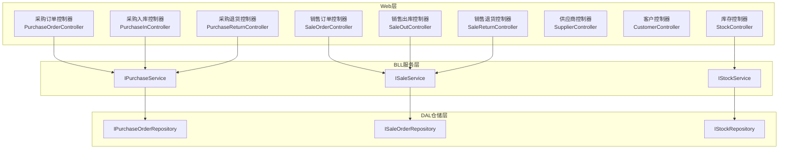
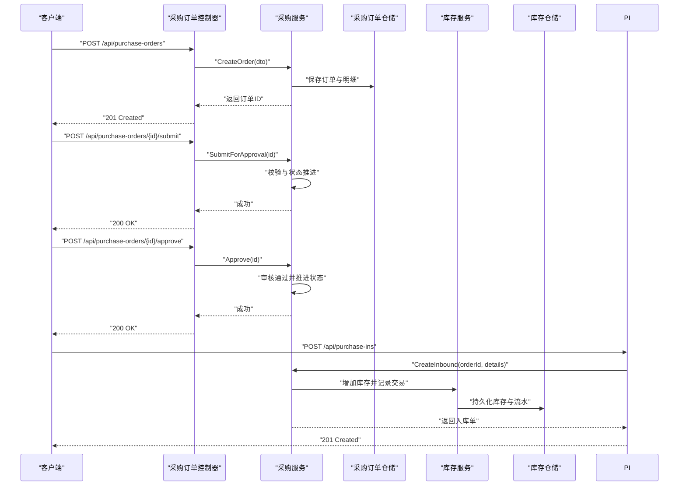
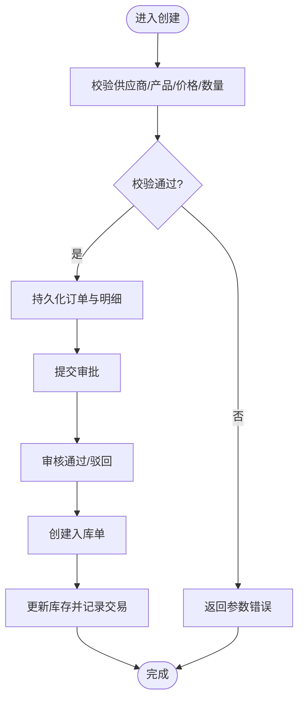
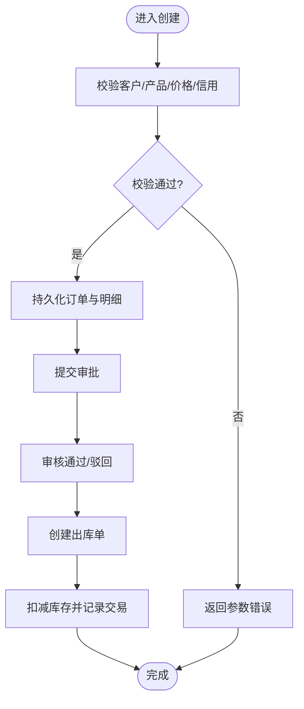
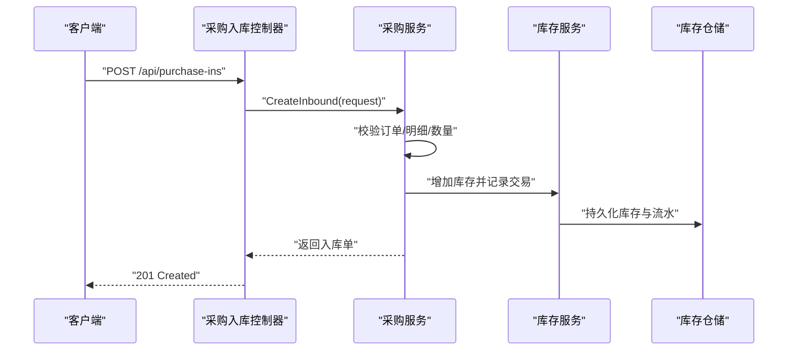
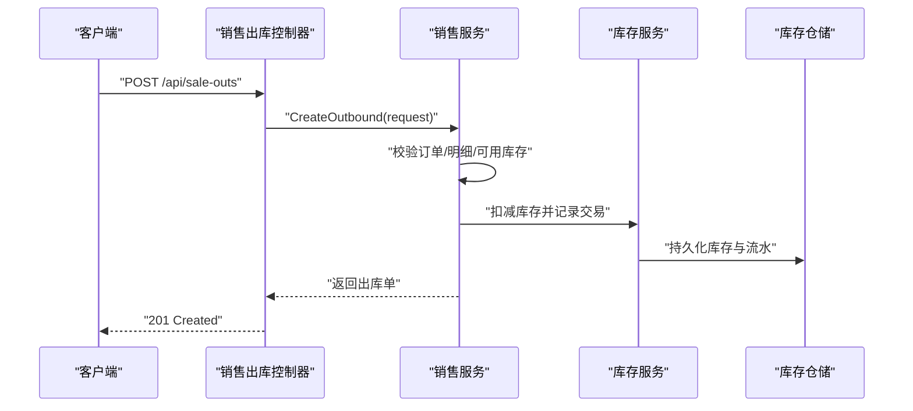
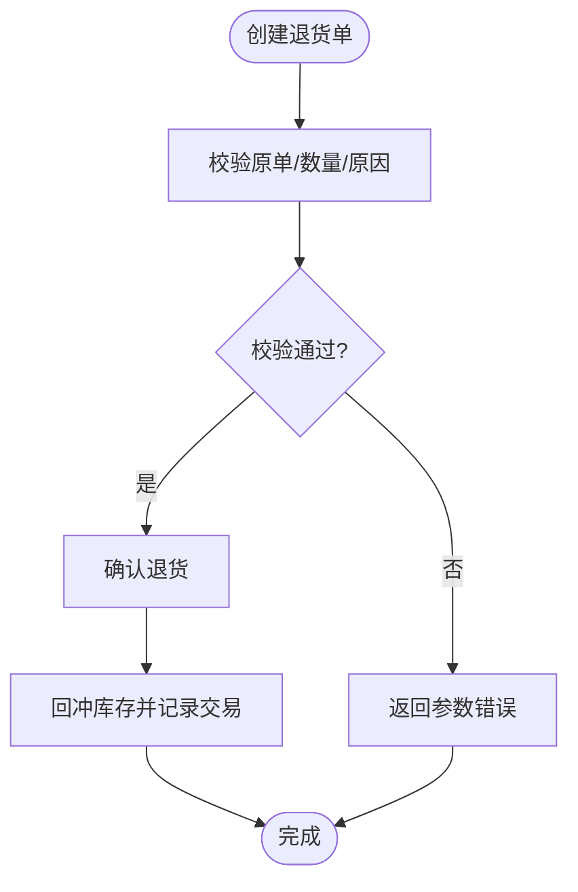
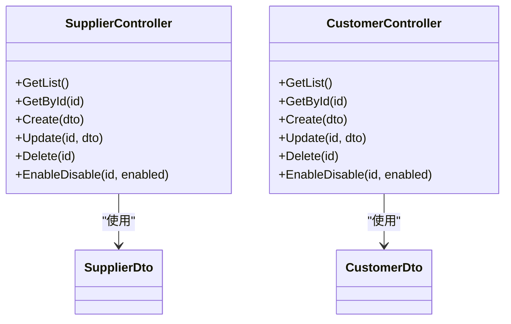
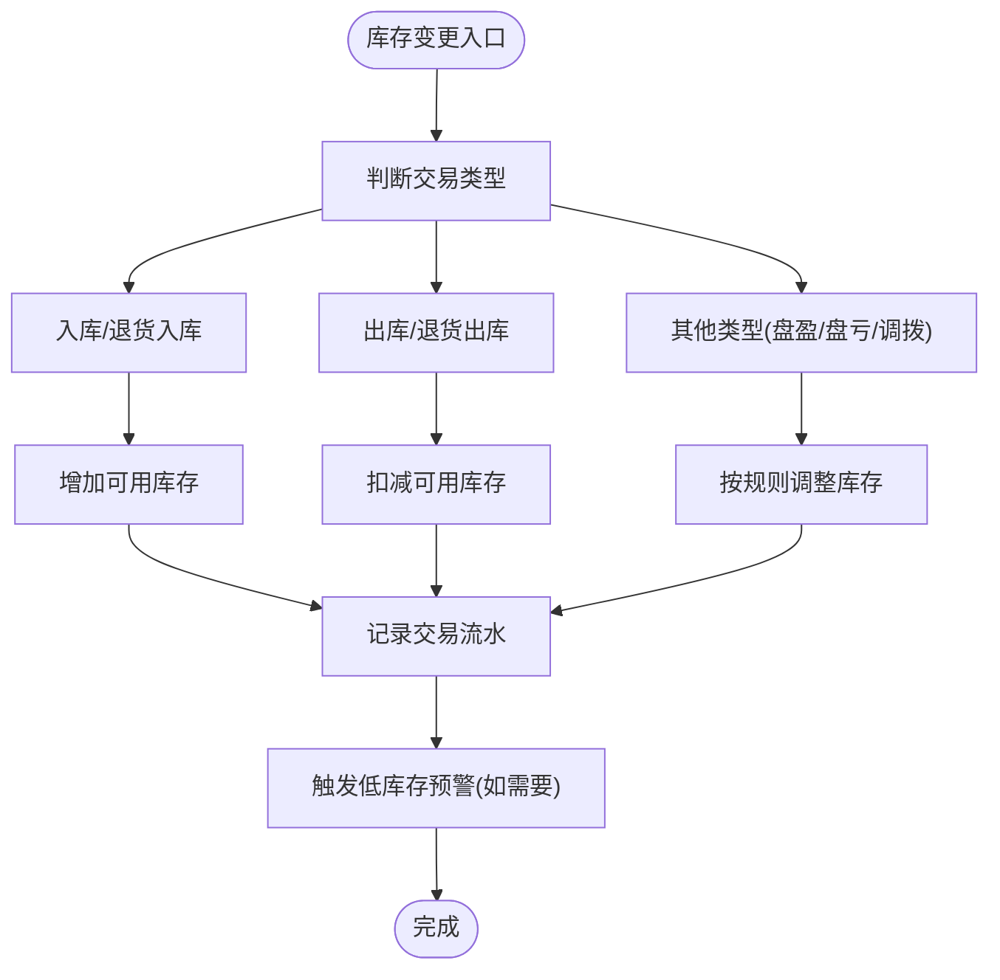
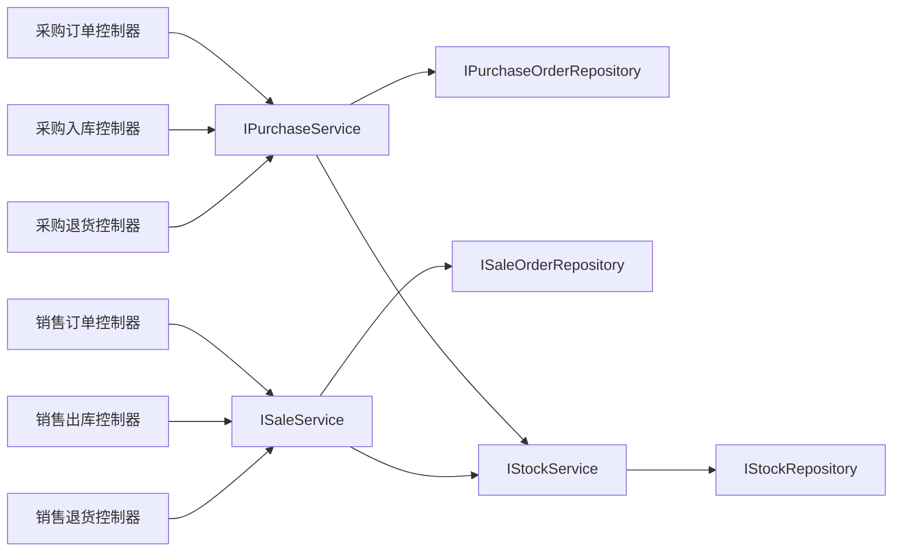

# 采购销售API

<cite>
**本文引用的文件**   
- [PurchaseOrderController.cs](file://EquipmentIMS.Web/Controllers/PurchaseOrderController.cs)
- [SaleOrderController.cs](file://EquipmentIMS.Web/Controllers/SaleOrderController.cs)
- [PurchaseInController.cs](file://EquipmentIMS.Web/Controllers/PurchaseInController.cs)
- [SaleOutController.cs](file://EquipmentIMS.Web/Controllers/SaleOutController.cs)
- [PurchaseReturnController.cs](file://EquipmentIMS.Web/Controllers/PurchaseReturnController.cs)
- [SaleReturnController.cs](file://EquipmentIMS.Web/Controllers/SaleReturnController.cs)
- [SupplierController.cs](file://EquipmentIMS.Web/Controllers/SupplierController.cs)
- [CustomerController.cs](file://EquipmentIMS.Web/Controllers/CustomerController.cs)
- [StockController.cs](file://EquipmentIMS.Web/Controllers/StockController.cs)
- [IPurchaseService.cs](file://EquipmentIMS.BLL/Interfaces/IPurchaseService.cs)
- [ISaleService.cs](file://EquipmentIMS.BLL/Interfaces/ISaleService.cs)
- [IStockService.cs](file://EquipmentIMS.BLL/Interfaces/IStockService.cs)
- [IPurchaseOrderRepository.cs](file://EquipmentIMS.DAL/Interfaces/IPurchaseOrderRepository.cs)
- [ISaleOrderRepository.cs](file://EquipmentIMS.DAL/Interfaces/ISaleOrderRepository.cs)
- [IStockRepository.cs](file://EquipmentIMS.DAL/Interfaces/IStockRepository.cs)
- [PurchaseOrderDto.cs](file://EquipmentIMS.Models/DTOs/PurchaseOrderDto.cs)
- [PurchaseOrderDetailDto.cs](file://EquipmentIMS.Models/DTOs/PurchaseOrderDetailDto.cs)
- [PurchaseInDto.cs](file://EquipmentIMS.Models/DTOs/PurchaseInDto.cs)
- [PurchaseInDetailDto.cs](file://EquipmentIMS.Models/DTOs/PurchaseInDetailDto.cs)
- [PurchaseInRequestDto.cs](file://EquipmentIMS.Models/DTOs/PurchaseInRequestDto.cs)
- [PurchaseReturnDto.cs](file://EquipmentIMS.Models/DTOs/PurchaseReturnDto.cs)
- [SaleOrderDto.cs](file://EquipmentIMS.Models/DTOs/SaleOrderDto.cs)
- [SaleOrderDetailDto.cs](file://EquipmentIMS.Models/DTOs/SaleOrderDetailDto.cs)
- [SaleOutDto.cs](file://EquipmentIMS.Models/DTOs/SaleOutDto.cs)
- [SaleOutDetailDto.cs](file://EquipmentIMS.Models/DTOs/SaleOutDetailDto.cs)
- [SaleReturnDto.cs](file://EquipmentIMS.Models/DTOs/SaleReturnDto.cs)
- [SupplierDto.cs](file://EquipmentIMS.Models/DTOs/SupplierDto.cs)
- [CustomerDto.cs](file://EquipmentIMS.Models/DTOs/CustomerDto.cs)
- [PurchaseOrderStatus.cs](file://EquipmentIMS.Models/Enums/PurchaseOrderStatus.cs)
- [PurchaseInStatus.cs](file://EquipmentIMS.Models/Enums/PurchaseInStatus.cs)
- [PurchaseReturnStatus.cs](file://EquipmentIMS.Models/Enums/PurchaseReturnStatus.cs)
- [SaleOrderStatus.cs](file://EquipmentIMS.Models/Enums/SaleOrderStatus.cs)
- [SaleOutStatus.cs](file://EquipmentIMS.Models/Enums/SaleOutStatus.cs)
- [SaleReturnStatus.cs](file://EquipmentIMS.Models/Enums/SaleReturnStatus.cs)
- [TransactionType.cs](file://EquipmentIMS.Models/Enums/TransactionType.cs)
- [GlobalExceptionMiddleware.cs](file://EquipmentIMS.Web/Filters/GlobalExceptionMiddleware.cs)
</cite>

## 目录
1. [简介](#简介)
2. [项目结构](#项目结构)
3. [核心组件](#核心组件)
4. [架构总览](#架构总览)
5. [详细组件分析](#详细组件分析)
6. [依赖关系分析](#依赖关系分析)
7. [性能考虑](#性能考虑)
8. [故障排查指南](#故障排查指南)
9. [结论](#结论)
10. [附录](#附录)

## 简介
本文件为采购与销售模块的API接口文档，覆盖以下范围：
- 采购订单、销售订单的创建、审批与执行流程接口
- 采购入库、销售出库、退货处理的业务逻辑与数据流转
- 供应商管理、客户管理的CRUD接口
- 订单状态机、业务流程控制与库存联动更新机制

目标读者包括前端开发者、后端集成方与测试人员。文档以“分层架构”视角组织，从控制器到服务层再到仓储层，逐步展开接口定义、参数约束、返回结构与异常处理策略。

## 项目结构
系统采用典型的三层架构：Web控制器层（Controllers）负责HTTP请求路由与参数校验；BLL服务层（Services/Interfaces）承载业务规则与事务编排；DAL仓储层（Repositories/Interfaces）负责数据访问。模型与枚举位于Models中，DTO用于跨层数据传输。

图表来源
- [PurchaseOrderController.cs](file://EquipmentIMS.Web/Controllers/PurchaseOrderController.cs)
- [SaleOrderController.cs](file://EquipmentIMS.Web/Controllers/SaleOrderController.cs)
- [PurchaseInController.cs](file://EquipmentIMS.Web/Controllers/PurchaseInController.cs)
- [SaleOutController.cs](file://EquipmentIMS.Web/Controllers/SaleOutController.cs)
- [PurchaseReturnController.cs](file://EquipmentIMS.Web/Controllers/PurchaseReturnController.cs)
- [SaleReturnController.cs](file://EquipmentIMS.Web/Controllers/SaleReturnController.cs)
- [SupplierController.cs](file://EquipmentIMS.Web/Controllers/SupplierController.cs)
- [CustomerController.cs](file://EquipmentIMS.Web/Controllers/CustomerController.cs)
- [StockController.cs](file://EquipmentIMS.Web/Controllers/StockController.cs)
- [IPurchaseService.cs](file://EquipmentIMS.BLL/Interfaces/IPurchaseService.cs)
- [ISaleService.cs](file://EquipmentIMS.BLL/Interfaces/ISaleService.cs)
- [IStockService.cs](file://EquipmentIMS.BLL/Interfaces/IStockService.cs)
- [IPurchaseOrderRepository.cs](file://EquipmentIMS.DAL/Interfaces/IPurchaseOrderRepository.cs)
- [ISaleOrderRepository.cs](file://EquipmentIMS.DAL/Interfaces/ISaleOrderRepository.cs)
- [IStockRepository.cs](file://EquipmentIMS.DAL/Interfaces/IStockRepository.cs)

章节来源
- [PurchaseOrderController.cs](file://EquipmentIMS.Web/Controllers/PurchaseOrderController.cs)
- [SaleOrderController.cs](file://EquipmentIMS.Web/Controllers/SaleOrderController.cs)
- [PurchaseInController.cs](file://EquipmentIMS.Web/Controllers/PurchaseInController.cs)
- [SaleOutController.cs](file://EquipmentIMS.Web/Controllers/SaleOutController.cs)
- [PurchaseReturnController.cs](file://EquipmentIMS.Web/Controllers/PurchaseReturnController.cs)
- [SaleReturnController.cs](file://EquipmentIMS.Web/Controllers/SaleReturnController.cs)
- [SupplierController.cs](file://EquipmentIMS.Web/Controllers/SupplierController.cs)
- [CustomerController.cs](file://EquipmentIMS.Web/Controllers/CustomerController.cs)
- [StockController.cs](file://EquipmentIMS.Web/Controllers/StockController.cs)
- [IPurchaseService.cs](file://EquipmentIMS.BLL/Interfaces/IPurchaseService.cs)
- [ISaleService.cs](file://EquipmentIMS.BLL/Interfaces/ISaleService.cs)
- [IStockService.cs](file://EquipmentIMS.BLL/Interfaces/IStockService.cs)
- [IPurchaseOrderRepository.cs](file://EquipmentIMS.DAL/Interfaces/IPurchaseOrderRepository.cs)
- [ISaleOrderRepository.cs](file://EquipmentIMS.DAL/Interfaces/ISaleOrderRepository.cs)
- [IStockRepository.cs](file://EquipmentIMS.DAL/Interfaces/IStockRepository.cs)

## 核心组件
本节聚焦于采购与销售主流程的关键接口与领域对象，说明职责边界与交互方式。

- 采购订单
  - 控制器：提供创建、查询、提交审批、审核通过/驳回、作废等能力
  - 服务：封装订单生命周期、明细校验、库存预占/释放、状态机推进
  - 仓储：持久化订单及明细、查询历史与统计
- 销售订单
  - 控制器：提供创建、查询、提交审批、审核通过/驳回、作废等能力
  - 服务：封装订单生命周期、价格与信用校验、库存预占/释放、状态机推进
  - 仓储：持久化订单及明细、查询历史与统计
- 采购入库
  - 控制器：按订单或自由单创建入库单，支持分批入库
  - 服务：校验到货数量、生成入库明细、更新库存、记录交易流水
- 销售出库
  - 控制器：按订单或自由单创建出库单，支持分批出库
  - 服务：校验可用库存、扣减库存、生成出库明细、记录交易流水
- 退货处理
  - 采购退货：回冲入库与库存，生成退货明细与交易流水
  - 销售退货：回冲出库与库存，生成退货明细与交易流水
- 基础资料
  - 供应商管理：增删改查、启用禁用、联系人信息维护
  - 客户管理：增删改查、信用额度、结算方式维护
- 库存联动
  - 统一通过库存服务进行增减、冻结/解冻、交易流水记录与预警触发

章节来源
- [PurchaseOrderController.cs](file://EquipmentIMS.Web/Controllers/PurchaseOrderController.cs)
- [SaleOrderController.cs](file://EquipmentIMS.Web/Controllers/SaleOrderController.cs)
- [PurchaseInController.cs](file://EquipmentIMS.Web/Controllers/PurchaseInController.cs)
- [SaleOutController.cs](file://EquipmentIMS.Web/Controllers/SaleOutController.cs)
- [PurchaseReturnController.cs](file://EquipmentIMS.Web/Controllers/PurchaseReturnController.cs)
- [SaleReturnController.cs](file://EquipmentIMS.Web/Controllers/SaleReturnController.cs)
- [SupplierController.cs](file://EquipmentIMS.Web/Controllers/SupplierController.cs)
- [CustomerController.cs](file://EquipmentIMS.Web/Controllers/CustomerController.cs)
- [StockController.cs](file://EquipmentIMS.Web/Controllers/StockController.cs)
- [IPurchaseService.cs](file://EquipmentIMS.BLL/Interfaces/IPurchaseService.cs)
- [ISaleService.cs](file://EquipmentIMS.BLL/Interfaces/ISaleService.cs)
- [IStockService.cs](file://EquipmentIMS.BLL/Interfaces/IStockService.cs)

## 架构总览
下图展示一次“采购订单创建→审批→入库→库存更新”的端到端调用链。

图表来源
- [PurchaseOrderController.cs](file://EquipmentIMS.Web/Controllers/PurchaseOrderController.cs)
- [PurchaseInController.cs](file://EquipmentIMS.Web/Controllers/PurchaseInController.cs)
- [IPurchaseService.cs](file://EquipmentIMS.BLL/Interfaces/IPurchaseService.cs)
- [IPurchaseOrderRepository.cs](file://EquipmentIMS.DAL/Interfaces/IPurchaseOrderRepository.cs)
- [IStockService.cs](file://EquipmentIMS.BLL/Interfaces/IStockService.cs)
- [IStockRepository.cs](file://EquipmentIMS.DAL/Interfaces/IStockRepository.cs)

## 详细组件分析

### 采购订单API
- 主要动作
  - 创建采购订单：接收订单头与明细，校验供应商、产品、价格与数量，落库后返回订单标识
  - 提交审批：将订单状态推进至待审，锁定后续修改
  - 审核通过/驳回：根据权限与规则推进状态，必要时触发库存预占或释放
  - 作废：在允许状态下终止订单并清理相关占用
- 关键DTO
  - 订单头与明细：[PurchaseOrderDto](file://EquipmentIMS.Models/DTOs/PurchaseOrderDto.cs)、[PurchaseOrderDetailDto](file://EquipmentIMS.Models/DTOs/PurchaseOrderDetailDto.cs)
- 状态机要点
  - 参考枚举：[PurchaseOrderStatus](file://EquipmentIMS.Models/Enums/PurchaseOrderStatus.cs)
  - 典型流转：草稿→待审→已批准→部分入库→已完成；异常路径可作废或退回草稿
- 错误与约束
  - 重复提交防护、超量下单校验、供应商/产品有效性校验
  - 全局异常由中间件统一捕获并返回标准响应

图表来源
- [PurchaseOrderController.cs](file://EquipmentIMS.Web/Controllers/PurchaseOrderController.cs)
- [PurchaseOrderDto.cs](file://EquipmentIMS.Models/DTOs/PurchaseOrderDto.cs)
- [PurchaseOrderDetailDto.cs](file://EquipmentIMS.Models/DTOs/PurchaseOrderDetailDto.cs)
- [PurchaseOrderStatus.cs](file://EquipmentIMS.Models/Enums/PurchaseOrderStatus.cs)

章节来源
- [PurchaseOrderController.cs](file://EquipmentIMS.Web/Controllers/PurchaseOrderController.cs)
- [PurchaseOrderDto.cs](file://EquipmentIMS.Models/DTOs/PurchaseOrderDto.cs)
- [PurchaseOrderDetailDto.cs](file://EquipmentIMS.Models/DTOs/PurchaseOrderDetailDto.cs)
- [PurchaseOrderStatus.cs](file://EquipmentIMS.Models/Enums/PurchaseOrderStatus.cs)

### 销售订单API
- 主要动作
  - 创建销售订单：校验客户、产品、价格与信用额度，落库后返回订单标识
  - 提交审批：推进至待审，锁定修改
  - 审核通过/驳回：根据权限与规则推进状态，必要时触发库存预占
  - 作废：在允许状态下终止订单并清理占用
- 关键DTO
  - 订单头与明细：[SaleOrderDto](file://EquipmentIMS.Models/DTOs/SaleOrderDto.cs)、[SaleOrderDetailDto](file://EquipmentIMS.Models/DTOs/SaleOrderDetailDto.cs)
- 状态机要点
  - 参考枚举：[SaleOrderStatus](file://EquipmentIMS.Models/Enums/SaleOrderStatus.cs)
  - 典型流转：草稿→待审→已批准→部分出库→已完成；异常路径可作废或退回草稿
- 错误与约束
  - 信用额度不足、超量发货、客户/产品有效性校验
  - 全局异常由中间件统一捕获并返回标准响应

图表来源
- [SaleOrderController.cs](file://EquipmentIMS.Web/Controllers/SaleOrderController.cs)
- [SaleOrderDto.cs](file://EquipmentIMS.Models/DTOs/SaleOrderDto.cs)
- [SaleOrderDetailDto.cs](file://EquipmentIMS.Models/DTOs/SaleOrderDetailDto.cs)
- [SaleOrderStatus.cs](file://EquipmentIMS.Models/Enums/SaleOrderStatus.cs)

章节来源
- [SaleOrderController.cs](file://EquipmentIMS.Web/Controllers/SaleOrderController.cs)
- [SaleOrderDto.cs](file://EquipmentIMS.Models/DTOs/SaleOrderDto.cs)
- [SaleOrderDetailDto.cs](file://EquipmentIMS.Models/DTOs/SaleOrderDetailDto.cs)
- [SaleOrderStatus.cs](file://EquipmentIMS.Models/Enums/SaleOrderStatus.cs)

### 采购入库API
- 主要动作
  - 按订单入库：选择关联采购订单，填写到货明细，支持分批入库
  - 自由入库：不关联订单直接入库（适用于无单到货场景）
  - 入库确认：校验数量与质量，更新库存并生成交易流水
- 关键DTO
  - 入库头与明细：[PurchaseInDto](file://EquipmentIMS.Models/DTOs/PurchaseInDto.cs)、[PurchaseInDetailDto](file://EquipmentIMS.Models/DTOs/PurchaseInDetailDto.cs)
  - 入库请求体：[PurchaseInRequestDto](file://EquipmentIMS.Models/DTOs/PurchaseInRequestDto.cs)
- 状态机要点
  - 参考枚举：[PurchaseInStatus](file://EquipmentIMS.Models/Enums/PurchaseInStatus.cs)
  - 典型流转：草稿→已确认→已完成；异常路径可取消
- 库存联动
  - 入库确认后增加对应仓库的可用库存，并记录交易类型为入库

图表来源
- [PurchaseInController.cs](file://EquipmentIMS.Web/Controllers/PurchaseInController.cs)
- [PurchaseInDto.cs](file://EquipmentIMS.Models/DTOs/PurchaseInDto.cs)
- [PurchaseInDetailDto.cs](file://EquipmentIMS.Models/DTOs/PurchaseInDetailDto.cs)
- [PurchaseInRequestDto.cs](file://EquipmentIMS.Models/DTOs/PurchaseInRequestDto.cs)
- [PurchaseInStatus.cs](file://EquipmentIMS.Models/Enums/PurchaseInStatus.cs)

章节来源
- [PurchaseInController.cs](file://EquipmentIMS.Web/Controllers/PurchaseInController.cs)
- [PurchaseInDto.cs](file://EquipmentIMS.Models/DTOs/PurchaseInDto.cs)
- [PurchaseInDetailDto.cs](file://EquipmentIMS.Models/DTOs/PurchaseInDetailDto.cs)
- [PurchaseInRequestDto.cs](file://EquipmentIMS.Models/DTOs/PurchaseInRequestDto.cs)
- [PurchaseInStatus.cs](file://EquipmentIMS.Models/Enums/PurchaseInStatus.cs)

### 销售出库API
- 主要动作
  - 按订单出库：选择关联销售订单，填写发货明细，支持分批出库
  - 自由出库：不关联订单直接出库（适用于样品/调拨等场景）
  - 出库确认：校验可用库存，扣减库存并生成交易流水
- 关键DTO
  - 出库头与明细：[SaleOutDto](file://EquipmentIMS.Models/DTOs/SaleOutDto.cs)、[SaleOutDetailDto](file://EquipmentIMS.Models/DTOs/SaleOutDetailDto.cs)
- 状态机要点
  - 参考枚举：[SaleOutStatus](file://EquipmentIMS.Models/Enums/SaleOutStatus.cs)
  - 典型流转：草稿→已确认→已完成；异常路径可取消
- 库存联动
  - 出库确认后扣减对应仓库的可用库存，并记录交易类型为出库

图表来源
- [SaleOutController.cs](file://EquipmentIMS.Web/Controllers/SaleOutController.cs)
- [SaleOutDto.cs](file://EquipmentIMS.Models/DTOs/SaleOutDto.cs)
- [SaleOutDetailDto.cs](file://EquipmentIMS.Models/DTOs/SaleOutDetailDto.cs)
- [SaleOutStatus.cs](file://EquipmentIMS.Models/Enums/SaleOutStatus.cs)

章节来源
- [SaleOutController.cs](file://EquipmentIMS.Web/Controllers/SaleOutController.cs)
- [SaleOutDto.cs](file://EquipmentIMS.Models/DTOs/SaleOutDto.cs)
- [SaleOutDetailDto.cs](file://EquipmentIMS.Models/DTOs/SaleOutDetailDto.cs)
- [SaleOutStatus.cs](file://EquipmentIMS.Models/Enums/SaleOutStatus.cs)

### 退货处理API
- 采购退货
  - 动作：创建退货单，关联原入库单或订单，回冲库存并记录交易类型为退货入库
  - DTO：[PurchaseReturnDto](file://EquipmentIMS.Models/DTOs/PurchaseReturnDto.cs)
  - 状态：参考[PurchaseReturnStatus](file://EquipmentIMS.Models/Enums/PurchaseReturnStatus.cs)
- 销售退货
  - 动作：创建退货单，关联原出库单或订单，回冲库存并记录交易类型为退货出库
  - DTO：[SaleReturnDto](file://EquipmentIMS.Models/DTOs/SaleReturnDto.cs)
  - 状态：参考[SaleReturnStatus](file://EquipmentIMS.Models/Enums/SaleReturnStatus.cs)
- 库存联动
  - 退货确认后反向调整库存，确保账实一致

图表来源
- [PurchaseReturnController.cs](file://EquipmentIMS.Web/Controllers/PurchaseReturnController.cs)
- [SaleReturnController.cs](file://EquipmentIMS.Web/Controllers/SaleReturnController.cs)
- [PurchaseReturnDto.cs](file://EquipmentIMS.Models/DTOs/PurchaseReturnDto.cs)
- [SaleReturnDto.cs](file://EquipmentIMS.Models/DTOs/SaleReturnDto.cs)
- [PurchaseReturnStatus.cs](file://EquipmentIMS.Models/Enums/PurchaseReturnStatus.cs)
- [SaleReturnStatus.cs](file://EquipmentIMS.Models/Enums/SaleReturnStatus.cs)

章节来源
- [PurchaseReturnController.cs](file://EquipmentIMS.Web/Controllers/PurchaseReturnController.cs)
- [SaleReturnController.cs](file://EquipmentIMS.Web/Controllers/SaleReturnController.cs)
- [PurchaseReturnDto.cs](file://EquipmentIMS.Models/DTOs/PurchaseReturnDto.cs)
- [SaleReturnDto.cs](file://EquipmentIMS.Models/DTOs/SaleReturnDto.cs)
- [PurchaseReturnStatus.cs](file://EquipmentIMS.Models/Enums/PurchaseReturnStatus.cs)
- [SaleReturnStatus.cs](file://EquipmentIMS.Models/Enums/SaleReturnStatus.cs)

### 供应商与客户管理API
- 供应商管理
  - 动作：增删改查、启用/禁用、联系人与结算信息维护
  - DTO：[SupplierDto](file://EquipmentIMS.Models/DTOs/SupplierDto.cs)
  - 控制器：[SupplierController](file://EquipmentIMS.Web/Controllers/SupplierController.cs)
- 客户管理
  - 动作：增删改查、启用/禁用、信用额度与结算方式维护
  - DTO：[CustomerDto](file://EquipmentIMS.Models/DTOs/CustomerDto.cs)
  - 控制器：[CustomerController](file://EquipmentIMS.Web/Controllers/CustomerController.cs)
- 一致性要求
  - 删除前需检查是否被订单引用
  - 启用/禁用影响订单创建与审批流程

图表来源
- [SupplierController.cs](file://EquipmentIMS.Web/Controllers/SupplierController.cs)
- [CustomerController.cs](file://EquipmentIMS.Web/Controllers/CustomerController.cs)
- [SupplierDto.cs](file://EquipmentIMS.Models/DTOs/SupplierDto.cs)
- [CustomerDto.cs](file://EquipmentIMS.Models/DTOs/CustomerDto.cs)

章节来源
- [SupplierController.cs](file://EquipmentIMS.Web/Controllers/SupplierController.cs)
- [CustomerController.cs](file://EquipmentIMS.Web/Controllers/CustomerController.cs)
- [SupplierDto.cs](file://EquipmentIMS.Models/DTOs/SupplierDto.cs)
- [CustomerDto.cs](file://EquipmentIMS.Models/DTOs/CustomerDto.cs)

### 库存联动与交易流水
- 库存服务
  - 职责：统一处理库存增减、冻结/解冻、交易流水记录、低库存预警触发
  - 接口：[IStockService](file://EquipmentIMS.BLL/Interfaces/IStockService.cs)
  - 仓储：[IStockRepository](file://EquipmentIMS.DAL/Interfaces/IStockRepository.cs)
- 交易类型
  - 参考枚举：[TransactionType](file://EquipmentIMS.Models/Enums/TransactionType.cs)
  - 常见类型：入库、出库、退货入库、退货出库、盘盈、盘亏、调拨入/出
- 一致性保障
  - 所有库存变更必须伴随交易流水记录，便于对账与审计
  - 批量操作建议在同一事务内完成，避免中间态不一致

图表来源
- [IStockService.cs](file://EquipmentIMS.BLL/Interfaces/IStockService.cs)
- [IStockRepository.cs](file://EquipmentIMS.DAL/Interfaces/IStockRepository.cs)
- [TransactionType.cs](file://EquipmentIMS.Models/Enums/TransactionType.cs)

章节来源
- [IStockService.cs](file://EquipmentIMS.BLL/Interfaces/IStockService.cs)
- [IStockRepository.cs](file://EquipmentIMS.DAL/Interfaces/IStockRepository.cs)
- [TransactionType.cs](file://EquipmentIMS.Models/Enums/TransactionType.cs)

## 依赖关系分析
- 控制器与服务层解耦：控制器仅负责HTTP契约与参数映射，业务规则下沉至服务层
- 服务与仓储解耦：服务层通过接口依赖仓储，便于替换实现与单元测试
- 状态机与枚举：各业务域的状态机由独立枚举定义，降低耦合度
- 库存联动：采购/销售/退货均通过库存服务统一变更，保证一致性

图表来源
- [PurchaseOrderController.cs](file://EquipmentIMS.Web/Controllers/PurchaseOrderController.cs)
- [SaleOrderController.cs](file://EquipmentIMS.Web/Controllers/SaleOrderController.cs)
- [PurchaseInController.cs](file://EquipmentIMS.Web/Controllers/PurchaseInController.cs)
- [SaleOutController.cs](file://EquipmentIMS.Web/Controllers/SaleOutController.cs)
- [PurchaseReturnController.cs](file://EquipmentIMS.Web/Controllers/PurchaseReturnController.cs)
- [SaleReturnController.cs](file://EquipmentIMS.Web/Controllers/SaleReturnController.cs)
- [IPurchaseService.cs](file://EquipmentIMS.BLL/Interfaces/IPurchaseService.cs)
- [ISaleService.cs](file://EquipmentIMS.BLL/Interfaces/ISaleService.cs)
- [IStockService.cs](file://EquipmentIMS.BLL/Interfaces/IStockService.cs)
- [IPurchaseOrderRepository.cs](file://EquipmentIMS.DAL/Interfaces/IPurchaseOrderRepository.cs)
- [ISaleOrderRepository.cs](file://EquipmentIMS.DAL/Interfaces/ISaleOrderRepository.cs)
- [IStockRepository.cs](file://EquipmentIMS.DAL/Interfaces/IStockRepository.cs)

章节来源
- [PurchaseOrderController.cs](file://EquipmentIMS.Web/Controllers/PurchaseOrderController.cs)
- [SaleOrderController.cs](file://EquipmentIMS.Web/Controllers/SaleOrderController.cs)
- [PurchaseInController.cs](file://EquipmentIMS.Web/Controllers/PurchaseInController.cs)
- [SaleOutController.cs](file://EquipmentIMS.Web/Controllers/SaleOutController.cs)
- [PurchaseReturnController.cs](file://EquipmentIMS.Web/Controllers/PurchaseReturnController.cs)
- [SaleReturnController.cs](file://EquipmentIMS.Web/Controllers/SaleReturnController.cs)
- [IPurchaseService.cs](file://EquipmentIMS.BLL/Interfaces/IPurchaseService.cs)
- [ISaleService.cs](file://EquipmentIMS.BLL/Interfaces/ISaleService.cs)
- [IStockService.cs](file://EquipmentIMS.BLL/Interfaces/IStockService.cs)
- [IPurchaseOrderRepository.cs](file://EquipmentIMS.DAL/Interfaces/IPurchaseOrderRepository.cs)
- [ISaleOrderRepository.cs](file://EquipmentIMS.DAL/Interfaces/ISaleOrderRepository.cs)
- [IStockRepository.cs](file://EquipmentIMS.DAL/Interfaces/IStockRepository.cs)

## 性能考虑
- 批量操作：入库/出库与退货建议在事务内批量处理，减少往返数据库次数
- 索引优化：订单号、供应商/客户ID、产品ID、仓库ID、时间戳字段应建立合适索引
- 分页与过滤：列表接口默认分页，避免一次性加载大量数据
- 并发控制：审批与确认类接口需防重放与幂等设计，防止重复提交导致库存不一致
- 缓存策略：基础资料（供应商/客户/产品）可短期缓存，注意失效策略

## 故障排查指南
- 全局异常处理
  - 统一异常中间件：[GlobalExceptionMiddleware](file://EquipmentIMS.Web/Filters/GlobalExceptionMiddleware.cs)
  - 行为：捕获未处理异常，转换为标准响应结构，记录日志，避免泄露堆栈
- 常见问题定位
  - 参数校验失败：检查DTO必填项、取值范围与格式
  - 状态机非法转换：核对当前状态与目标状态是否允许
  - 库存不足：查看可用库存与冻结库存，确认是否存在并发抢占
  - 重复提交：检查幂等键与唯一约束
- 日志与追踪
  - 结合操作日志与交易流水，回溯问题发生时的上下文

章节来源
- [GlobalExceptionMiddleware.cs](file://EquipmentIMS.Web/Filters/GlobalExceptionMiddleware.cs)

## 结论
本API文档围绕采购与销售两大主线，覆盖了订单全生命周期、出入库与退货处理、基础资料管理与库存联动机制。通过清晰的分层架构与统一的状态机设计，系统在可扩展性与一致性方面具备良好基础。建议在实际集成中严格遵循幂等与事务边界，配合完善的日志与监控，保障业务稳定运行。

## 附录
- 术语表
  - 订单：采购订单/销售订单
  - 入库：采购入库
  - 出库：销售出库
  - 退货：采购退货/销售退货
  - 库存：可用库存、冻结库存、在途库存
- 参考枚举
  - 采购订单状态：[PurchaseOrderStatus](file://EquipmentIMS.Models/Enums/PurchaseOrderStatus.cs)
  - 采购入库状态：[PurchaseInStatus](file://EquipmentIMS.Models/Enums/PurchaseInStatus.cs)
  - 采购退货状态：[PurchaseReturnStatus](file://EquipmentIMS.Models/Enums/PurchaseReturnStatus.cs)
  - 销售订单状态：[SaleOrderStatus](file://EquipmentIMS.Models/Enums/SaleOrderStatus.cs)
  - 销售出库状态：[SaleOutStatus](file://EquipmentIMS.Models/Enums/SaleOutStatus.cs)
  - 销售退货状态：[SaleReturnStatus](file://EquipmentIMS.Models/Enums/SaleReturnStatus.cs)
  - 交易类型：[TransactionType](file://EquipmentIMS.Models/Enums/TransactionType.cs)