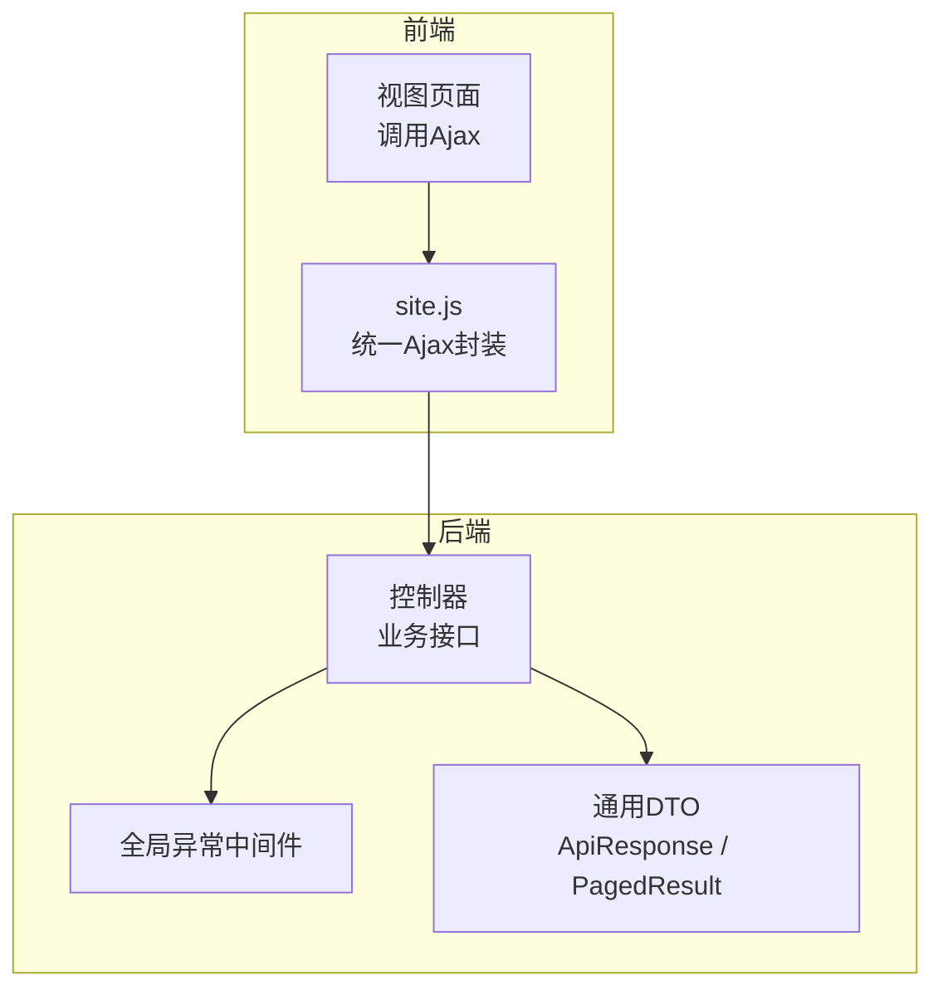
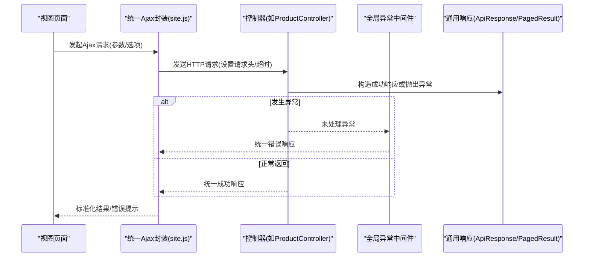
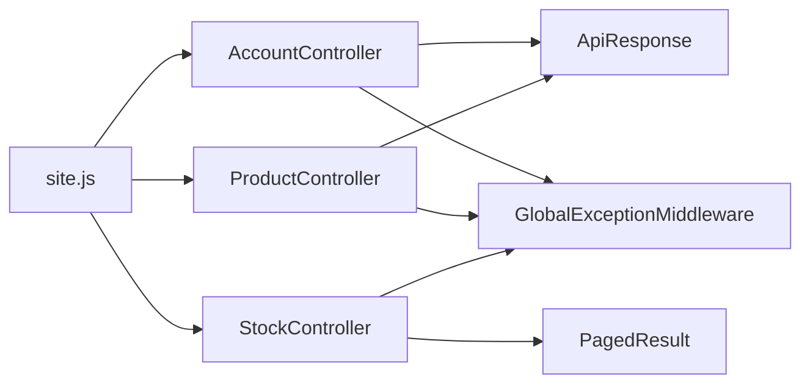

# Ajax异步请求处理

<cite>
**本文引用的文件**   
- [EquipmentIMS.Web/wwwroot/js/site.js](file://EquipmentIMS.Web/wwwroot/js/site.js)
- [EquipmentIMS.Web/Controllers/AccountController.cs](file://EquipmentIMS.Web/Controllers/AccountController.cs)
- [EquipmentIMS.Web/Controllers/ProductController.cs](file://EquipmentIMS.Web/Controllers/ProductController.cs)
- [EquipmentIMS.Web/Controllers/StockController.cs](file://EquipmentIMS.Web/Controllers/StockController.cs)
- [EquipmentIMS.Web/Filters/GlobalExceptionMiddleware.cs](file://EquipmentIMS.Web/Filters/GlobalExceptionMiddleware.cs)
- [EquipmentIMS.Models/DTOs/PagedResult.cs](file://EquipmentIMS.Models/DTOs/PagedResult.cs)
- [EquipmentIMS.Models/DTOs/ApiResponse.cs](file://EquipmentIMS.Models/DTOs/ApiResponse.cs)
</cite>

## 目录
1. [简介](#简介)
2. [项目结构](#项目结构)
3. [核心组件](#核心组件)
4. [架构总览](#架构总览)
5. [详细组件分析](#详细组件分析)
6. [依赖关系分析](#依赖关系分析)
7. [性能考虑](#性能考虑)
8. [故障排查指南](#故障排查指南)
9. [结论](#结论)
10. [附录](#附录)

## 简介
本文件聚焦于THMS系统的前端Ajax异步请求处理机制，围绕统一的请求封装、错误处理、响应解析、文件上传下载、分页与批量操作等复杂场景进行系统化说明。文档同时覆盖后端统一异常处理与通用返回模型，帮助读者从前后端整体视角理解并正确使用系统的Ajax能力。

## 项目结构
前端Ajax相关代码主要集中在Web层的静态资源脚本中；后端通过控制器暴露REST接口，并使用全局异常中间件与通用DTO进行统一响应与错误处理。

图表来源
- [EquipmentIMS.Web/wwwroot/js/site.js](file://EquipmentIMS.Web/wwwroot/js/site.js)
- [EquipmentIMS.Web/Controllers/AccountController.cs](file://EquipmentIMS.Web/Controllers/AccountController.cs)
- [EquipmentIMS.Web/Controllers/ProductController.cs](file://EquipmentIMS.Web/Controllers/ProductController.cs)
- [EquipmentIMS.Web/Controllers/StockController.cs](file://EquipmentIMS.Web/Controllers/StockController.cs)
- [EquipmentIMS.Web/Filters/GlobalExceptionMiddleware.cs](file://EquipmentIMS.Web/Filters/GlobalExceptionMiddleware.cs)
- [EquipmentIMS.Models/DTOs/ApiResponse.cs](file://EquipmentIMS.Models/DTOs/ApiResponse.cs)
- [EquipmentIMS.Models/DTOs/PagedResult.cs](file://EquipmentIMS.Models/DTOs/PagedResult.cs)

章节来源
- [EquipmentIMS.Web/wwwroot/js/site.js](file://EquipmentIMS.Web/wwwroot/js/site.js)
- [EquipmentIMS.Web/Controllers/AccountController.cs](file://EquipmentIMS.Web/Controllers/AccountController.cs)
- [EquipmentIMS.Web/Controllers/ProductController.cs](file://EquipmentIMS.Web/Controllers/ProductController.cs)
- [EquipmentIMS.Web/Controllers/StockController.cs](file://EquipmentIMS.Web/Controllers/StockController.cs)
- [EquipmentIMS.Web/Filters/GlobalExceptionMiddleware.cs](file://EquipmentIMS.Web/Filters/GlobalExceptionMiddleware.cs)
- [EquipmentIMS.Models/DTOs/ApiResponse.cs](file://EquipmentIMS.Models/DTOs/ApiResponse.cs)
- [EquipmentIMS.Models/DTOs/PagedResult.cs](file://EquipmentIMS.Models/DTOs/PagedResult.cs)

## 核心组件
- 统一Ajax封装：提供集中化的请求发送、默认配置（如请求头、超时）、错误拦截与结果标准化处理。
- 通用响应模型：后端使用统一数据结构承载成功数据与错误信息，便于前端一致化处理。
- 分页模型：为列表查询提供标准分页字段与数据容器，配合前端表格渲染。
- 全局异常中间件：捕获未处理异常，转换为统一错误响应，避免泄露内部细节。

章节来源
- [EquipmentIMS.Web/wwwroot/js/site.js](file://EquipmentIMS.Web/wwwroot/js/site.js)
- [EquipmentIMS.Models/DTOs/ApiResponse.cs](file://EquipmentIMS.Models/DTOs/ApiResponse.cs)
- [EquipmentIMS.Models/DTOs/PagedResult.cs](file://EquipmentIMS.Models/DTOs/PagedResult.cs)
- [EquipmentIMS.Web/Filters/GlobalExceptionMiddleware.cs](file://EquipmentIMS.Web/Filters/GlobalExceptionMiddleware.cs)

## 架构总览
下图展示一次典型Ajax请求从前端到后端的完整流程，包括统一封装、控制器处理、异常中间件与统一响应返回。

图表来源
- [EquipmentIMS.Web/wwwroot/js/site.js](file://EquipmentIMS.Web/wwwroot/js/site.js)
- [EquipmentIMS.Web/Controllers/ProductController.cs](file://EquipmentIMS.Web/Controllers/ProductController.cs)
- [EquipmentIMS.Web/Filters/GlobalExceptionMiddleware.cs](file://EquipmentIMS.Web/Filters/GlobalExceptionMiddleware.cs)
- [EquipmentIMS.Models/DTOs/ApiResponse.cs](file://EquipmentIMS.Models/DTOs/ApiResponse.cs)
- [EquipmentIMS.Models/DTOs/PagedResult.cs](file://EquipmentIMS.Models/DTOs/PagedResult.cs)

## 详细组件分析

### 统一Ajax封装与错误处理
- 职责
  - 集中管理请求基础配置（如Content-Type、认证头、超时）。
  - 统一错误拦截：网络错误、超时、服务端错误码与业务错误。
  - 标准化结果：将后端统一响应转换为前端可用的对象。
- 关键流程
  - 构建请求：合并用户传入的选项与默认配置。
  - 发送请求：根据方法(GET/POST/PUT/DELETE)与内容类型选择合适API。
  - 错误处理：区分HTTP状态码与业务错误，给出友好提示。
  - 结果返回：对成功响应进行JSON解析与字段校验，再回调上层。
- 适用场景
  - 表单提交、列表查询、详情获取、删除确认、批量操作等。

章节来源
- [EquipmentIMS.Web/wwwroot/js/site.js](file://EquipmentIMS.Web/wwwroot/js/site.js)

### HTTP请求配置项
- 请求头设置
  - 常见头部：Content-Type、Accept、Authorization等。
  - 建议：在统一封装中注入默认头，并在需要时按请求覆盖。
- 超时处理
  - 为长耗时操作设置合理超时时间，避免长时间阻塞。
  - 超时错误应明确提示并重试策略（可选）。
- 重试机制
  - 针对幂等请求（GET）可实施有限次数的自动重试。
  - 非幂等请求不建议自动重试，需由用户显式触发。
- 取消与并发控制
  - 支持取消长时间运行的请求。
  - 对高频重复请求进行去抖或节流，减少无效请求。

章节来源
- [EquipmentIMS.Web/wwwroot/js/site.js](file://EquipmentIMS.Web/wwwroot/js/site.js)

### 响应数据解析与状态码判断
- 统一响应模型
  - ApiResponse：承载通用成功/失败标志、消息与数据体。
  - PagedResult：承载分页数据集合与分页元信息（页码、总数、每页大小等）。
- 解析流程
  - 先判断HTTP状态码是否为成功范围。
  - 再解析JSON，校验业务成功标志与必要字段。
  - 对错误分支提取错误消息，统一提示。
- 状态码约定
  - 2xx：成功，进入业务成功分支。
  - 4xx：客户端错误（如权限不足、参数错误），提示用户修正。
  - 5xx：服务端错误，记录日志并提示稍后重试。

章节来源
- [EquipmentIMS.Models/DTOs/ApiResponse.cs](file://EquipmentIMS.Models/DTOs/ApiResponse.cs)
- [EquipmentIMS.Models/DTOs/PagedResult.cs](file://EquipmentIMS.Models/DTOs/PagedResult.cs)
- [EquipmentIMS.Web/Filters/GlobalExceptionMiddleware.cs](file://EquipmentIMS.Web/Filters/GlobalExceptionMiddleware.cs)

### 文件上传与下载
- 上传实现要点
  - 使用FormData组织文件与表单字段。
  - 设置正确的Content-Type（通常为multipart/form-data）。
  - 进度显示：监听上传进度事件，更新UI进度条。
  - 错误处理：网络错误、文件大小限制、类型校验、服务端错误。
- 下载实现要点
  - 以Blob形式接收二进制流，生成下载链接触发浏览器下载。
  - 文件名可从响应头或URL参数获取。
  - 大文件下载需考虑断点续传与分片（可选）。
- 安全与体验
  - 限制文件类型与大小。
  - 上传前预览与压缩（图片）。
  - 失败重试与断点恢复（可选）。

章节来源
- [EquipmentIMS.Web/wwwroot/js/site.js](file://EquipmentIMS.Web/wwwroot/js/site.js)

### 分页查询与批量操作示例
- 分页查询
  - 前端传递页码、每页大小、排序与筛选条件。
  - 后端返回PagedResult，包含数据集合与分页元信息。
  - 前端渲染表格并绑定分页控件。
- 批量操作
  - 收集选中项ID数组，一次性提交。
  - 对大批量操作增加确认提示与进度反馈。
  - 失败时仅回滚受影响部分，保证一致性。

章节来源
- [EquipmentIMS.Web/Controllers/ProductController.cs](file://EquipmentIMS.Web/Controllers/ProductController.cs)
- [EquipmentIMS.Web/Controllers/StockController.cs](file://EquipmentIMS.Web/Controllers/StockController.cs)
- [EquipmentIMS.Models/DTOs/PagedResult.cs](file://EquipmentIMS.Models/DTOs/PagedResult.cs)

### 登录与鉴权相关Ajax
- 登录流程
  - 前端提交用户名与密码至登录接口。
  - 成功后保存令牌或会话标识，后续请求携带认证头。
  - 失败时根据错误码提示不同原因（账号不存在、密码错误、锁定等）。
- 鉴权拦截
  - 前端在请求头附加认证信息。
  - 后端校验失败返回401/403，前端跳转登录或提示无权限。

章节来源
- [EquipmentIMS.Web/Controllers/AccountController.cs](file://EquipmentIMS.Web/Controllers/AccountController.cs)
- [EquipmentIMS.Web/wwwroot/js/site.js](file://EquipmentIMS.Web/wwwroot/js/site.js)

### 请求拦截器与缓存策略
- 请求拦截器
  - 统一添加认证头、追踪ID、语言偏好等。
  - 对敏感信息进行脱敏或加密（可选）。
- 缓存策略
  - 对只读且变化不频繁的数据启用短期缓存（内存或浏览器缓存）。
  - 缓存键设计包含查询参数与版本，避免脏读。
  - 失效策略：写操作后主动清除相关缓存。
- 性能优化
  - 合并小请求为大请求（批量接口）。
  - 使用防抖/节流减少重复请求。
  - 懒加载与按需加载数据。

章节来源
- [EquipmentIMS.Web/wwwroot/js/site.js](file://EquipmentIMS.Web/wwwroot/js/site.js)

## 依赖关系分析
前端Ajax封装依赖后端控制器提供的REST接口，并通过统一DTO进行数据契约约束；全局异常中间件确保错误路径的一致性。

图表来源
- [EquipmentIMS.Web/wwwroot/js/site.js](file://EquipmentIMS.Web/wwwroot/js/site.js)
- [EquipmentIMS.Web/Controllers/AccountController.cs](file://EquipmentIMS.Web/Controllers/AccountController.cs)
- [EquipmentIMS.Web/Controllers/ProductController.cs](file://EquipmentIMS.Web/Controllers/ProductController.cs)
- [EquipmentIMS.Web/Controllers/StockController.cs](file://EquipmentIMS.Web/Controllers/StockController.cs)
- [EquipmentIMS.Web/Filters/GlobalExceptionMiddleware.cs](file://EquipmentIMS.Web/Filters/GlobalExceptionMiddleware.cs)
- [EquipmentIMS.Models/DTOs/ApiResponse.cs](file://EquipmentIMS.Models/DTOs/ApiResponse.cs)
- [EquipmentIMS.Models/DTOs/PagedResult.cs](file://EquipmentIMS.Models/DTOs/PagedResult.cs)

## 性能考虑
- 减少不必要请求：合并接口、分页加载、虚拟滚动。
- 合理超时与重试：避免雪崩与级联失败。
- 缓存热点数据：缩短响应时间，降低服务器压力。
- 前端渲染优化：增量更新、避免重排重绘。
- 传输优化：Gzip压缩、图片与资源CDN加速。

## 故障排查指南
- 常见问题定位
  - 网络层错误：检查连接、代理、跨域配置。
  - 超时问题：评估接口耗时与超时阈值是否匹配。
  - 认证失败：确认令牌有效性及刷新逻辑。
  - 业务错误：查看统一错误消息与日志。
- 调试建议
  - 打开浏览器开发者工具的网络面板，观察请求与响应。
  - 在后端日志中检索对应追踪ID，定位具体异常堆栈。
  - 对复现率高的问题增加更详细的上下文日志。

章节来源
- [EquipmentIMS.Web/Filters/GlobalExceptionMiddleware.cs](file://EquipmentIMS.Web/Filters/GlobalExceptionMiddleware.cs)

## 结论
通过统一的Ajax封装与后端统一响应/异常处理，THMS系统在易用性、一致性与可维护性方面得到显著提升。结合合理的缓存与性能优化策略，可在复杂业务场景下保持稳定的用户体验。

## 附录
- 最佳实践清单
  - 始终使用统一封装发起请求。
  - 对幂等请求谨慎使用重试。
  - 对敏感操作增加二次确认与进度反馈。
  - 严格遵循统一响应模型，避免前端硬编码字段名。
  - 定期审查接口耗时与错误率，持续优化。