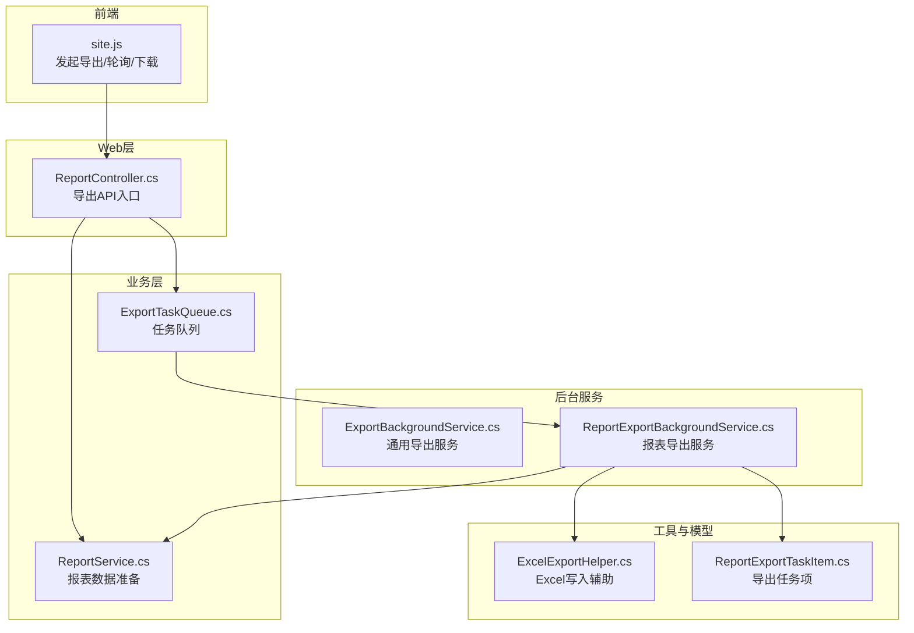
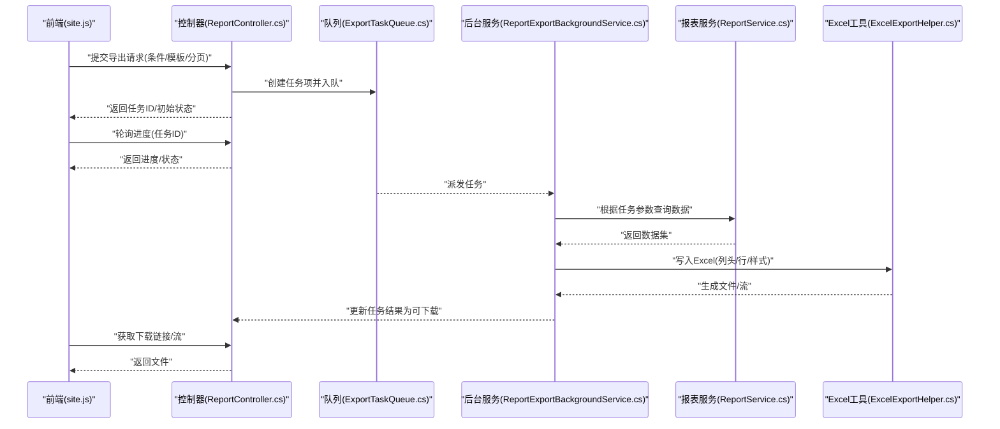
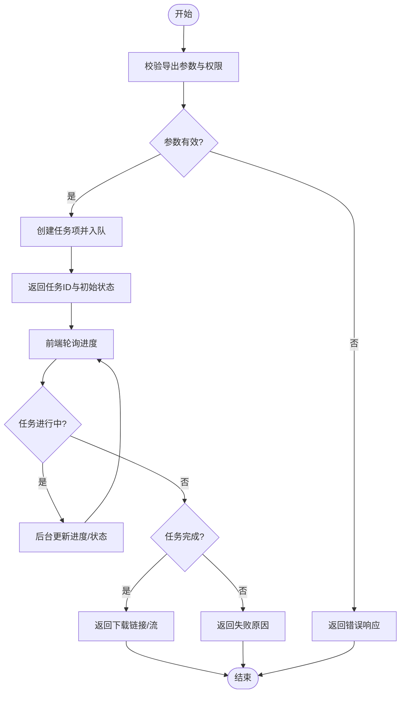
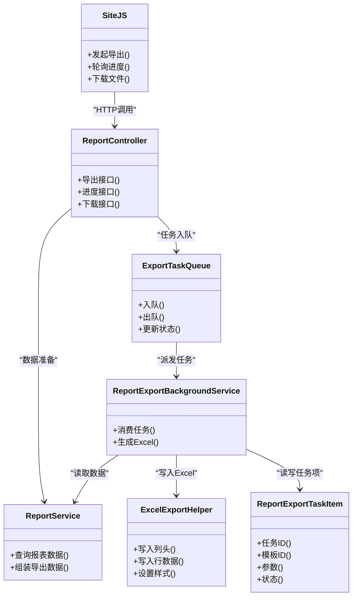

# Excel导出客户端实现

<cite>
**本文引用的文件**   
- [ExportBackgroundService.cs](file://EquipmentIMS.Web/BackgroundServices/ExportBackgroundService.cs)
- [ReportExportBackgroundService.cs](file://EquipmentIMS.Web/BackgroundServices/ReportExportBackgroundService.cs)
- [ExcelExportHelper.cs](file://EquipmentIMS.Web/Helpers/ExcelExportHelper.cs)
- [ReportController.cs](file://EquipmentIMS.Web/Controllers/ReportController.cs)
- [ReportService.cs](file://EquipmentIMS.BLL/Services/ReportService.cs)
- [ExportTaskQueue.cs](file://EquipmentIMS.BLL/Services/ExportTaskQueue.cs)
- [ReportExportTaskItem.cs](file://EquipmentIMS.Models/DTOs/Reports/ReportExportTaskItem.cs)
- [site.js](file://EquipmentIMS.Web/wwwroot/js/site.js)
</cite>

## 目录
1. [简介](#简介)
2. [项目结构](#项目结构)
3. [核心组件](#核心组件)
4. [架构总览](#架构总览)
5. [详细组件分析](#详细组件分析)
6. [依赖关系分析](#依赖关系分析)
7. [性能考虑](#性能考虑)
8. [故障排查指南](#故障排查指南)
9. [结论](#结论)
10. [附录](#附录)

## 简介
本文件面向THMS系统的Excel导出客户端实现，聚焦前端触发机制、数据传递方式、大文件导出策略（进度显示与断点续传）、导出格式定制与模板配置、异步任务处理与结果通知机制，并提供多种导出场景的实现示例与最佳实践。文档基于仓库中现有代码进行梳理与归纳，确保内容与实际实现一致。

## 项目结构
围绕Excel导出功能，系统采用“前端页面 + Web API控制器 + 后台服务 + 队列 + 辅助工具”的分层组织方式：
- 前端脚本负责发起导出请求、轮询进度、下载完成文件
- 控制器暴露导出API，接收参数并投递任务到队列
- 后台服务消费队列，执行生成Excel逻辑
- 辅助工具提供通用的Excel写入能力
- 模型定义导出任务项的结构

图表来源
- [site.js](file://EquipmentIMS.Web/wwwroot/js/site.js)
- [ReportController.cs](file://EquipmentIMS.Web/Controllers/ReportController.cs)
- [ReportService.cs](file://EquipmentIMS.BLL/Services/ReportService.cs)
- [ExportTaskQueue.cs](file://EquipmentIMS.BLL/Services/ExportTaskQueue.cs)
- [ExportBackgroundService.cs](file://EquipmentIMS.Web/BackgroundServices/ExportBackgroundService.cs)
- [ReportExportBackgroundService.cs](file://EquipmentIMS.Web/BackgroundServices/ReportExportBackgroundService.cs)
- [ExcelExportHelper.cs](file://EquipmentIMS.Web/Helpers/ExcelExportHelper.cs)
- [ReportExportTaskItem.cs](file://EquipmentIMS.Models/DTOs/Reports/ReportExportTaskItem.cs)

章节来源
- [ReportController.cs](file://EquipmentIMS.Web/Controllers/ReportController.cs)
- [ReportService.cs](file://EquipmentIMS.BLL/Services/ReportService.cs)
- [ExportTaskQueue.cs](file://EquipmentIMS.BLL/Services/ExportTaskQueue.cs)
- [ExportBackgroundService.cs](file://EquipmentIMS.Web/BackgroundServices/ExportBackgroundService.cs)
- [ReportExportBackgroundService.cs](file://EquipmentIMS.Web/BackgroundServices/ReportExportBackgroundService.cs)
- [ExcelExportHelper.cs](file://EquipmentIMS.Web/Helpers/ExcelExportHelper.cs)
- [ReportExportTaskItem.cs](file://EquipmentIMS.Models/DTOs/Reports/ReportExportTaskItem.cs)
- [site.js](file://EquipmentIMS.Web/wwwroot/js/site.js)

## 核心组件
- 前端脚本 site.js：封装导出调用、进度轮询、文件下载与错误提示
- 控制器 ReportController.cs：提供导出接口，校验参数、构造任务项、入队
- 任务队列 ExportTaskQueue.cs：承载导出任务的持久化或内存队列
- 后台服务 ReportExportBackgroundService.cs：消费报表导出任务，组装数据并生成Excel
- 通用后台服务 ExportBackgroundService.cs：提供通用导出能力（如单表导出）
- 辅助工具 ExcelExportHelper.cs：统一的Excel写入方法（列头、行数据、样式等）
- 模型 ReportExportTaskItem.cs：导出任务项的数据结构（类型、参数、状态等）

章节来源
- [site.js](file://EquipmentIMS.Web/wwwroot/js/site.js)
- [ReportController.cs](file://EquipmentIMS.Web/Controllers/ReportController.cs)
- [ExportTaskQueue.cs](file://EquipmentIMS.BLL/Services/ExportTaskQueue.cs)
- [ReportExportBackgroundService.cs](file://EquipmentIMS.Web/BackgroundServices/ReportExportBackgroundService.cs)
- [ExportBackgroundService.cs](file://EquipmentIMS.Web/BackgroundServices/ExportBackgroundService.cs)
- [ExcelExportHelper.cs](file://EquipmentIMS.Web/Helpers/ExcelExportHelper.cs)
- [ReportExportTaskItem.cs](file://EquipmentIMS.Models/DTOs/Reports/ReportExportTaskItem.cs)

## 架构总览
整体流程为“前端触发 → 控制器接收 → 任务入队 → 后台服务消费 → 生成Excel → 返回下载链接/流”。

图表来源
- [site.js](file://EquipmentIMS.Web/wwwroot/js/site.js)
- [ReportController.cs](file://EquipmentIMS.Web/Controllers/ReportController.cs)
- [ExportTaskQueue.cs](file://EquipmentIMS.BLL/Services/ExportTaskQueue.cs)
- [ReportExportBackgroundService.cs](file://EquipmentIMS.Web/BackgroundServices/ReportExportBackgroundService.cs)
- [ReportService.cs](file://EquipmentIMS.BLL/Services/ReportService.cs)
- [ExcelExportHelper.cs](file://EquipmentIMS.Web/Helpers/ExcelExportHelper.cs)

## 详细组件分析

### 前端触发机制与数据传递
- 触发入口：在列表页或报表页通过按钮或表单提交触发导出
- 数据传递：将筛选条件、分页参数、模板标识、输出格式等作为请求体或查询参数传递给控制器
- 进度展示：前端使用任务ID轮询进度接口，更新UI进度条与状态文案
- 下载行为：任务完成后，前端根据返回的下载URL或流直接触发浏览器下载

章节来源
- [site.js](file://EquipmentIMS.Web/wwwroot/js/site.js)
- [ReportController.cs](file://EquipmentIMS.Web/Controllers/ReportController.cs)

### 大文件导出策略（进度显示与断点续传）
- 进度显示：后台服务在处理过程中周期性更新任务进度（例如已处理行数/总行数），前端轮询并渲染
- 分块生成：对超大报表，后台可按批次读取数据并追加写入Excel，避免一次性加载全部数据到内存
- 断点续传：当任务失败或中断时，记录已生成的部分文件位置或偏移量；恢复后从断点继续写入，直至完成
- 资源控制：限制并发任务数，防止内存溢出；必要时启用临时文件存储而非内存流

章节来源
- [ReportExportBackgroundService.cs](file://EquipmentIMS.Web/BackgroundServices/ReportExportBackgroundService.cs)
- [ExportBackgroundService.cs](file://EquipmentIMS.Web/BackgroundServices/ExportBackgroundService.cs)
- [ExcelExportHelper.cs](file://EquipmentIMS.Web/Helpers/ExcelExportHelper.cs)

### 导出格式定制与模板配置
- 模板标识：通过模板ID或名称选择不同列集、标题、样式与排序规则
- 列头映射：由ExcelExportHelper统一处理列头生成与对齐、冻结、自动宽度等
- 样式配置：支持主题色、边框、数字格式、日期格式等
- 多Sheet：复杂报表可在同一工作簿中生成多个Sheet，并按模板配置命名与顺序

章节来源
- [ExcelExportHelper.cs](file://EquipmentIMS.Web/Helpers/ExcelExportHelper.cs)
- [ReportExportTaskItem.cs](file://EquipmentIMS.Models/DTOs/Reports/ReportExportTaskItem.cs)

### 异步处理与结果通知
- 任务入队：控制器接收到导出请求后，构造任务项并投递至队列
- 后台消费：后台服务监听队列，按优先级与资源情况调度执行
- 状态更新：任务状态包括排队中、进行中、已完成、失败等，供前端轮询
- 结果通知：完成后提供下载链接或直接返回文件流；失败时返回错误码与原因

章节来源
- [ReportController.cs](file://EquipmentIMS.Web/Controllers/ReportController.cs)
- [ExportTaskQueue.cs](file://EquipmentIMS.BLL/Services/ExportTaskQueue.cs)
- [ReportExportBackgroundService.cs](file://EquipmentIMS.Web/BackgroundServices/ReportExportBackgroundService.cs)

### 导出场景示例
- 单表导出：选择单一实体（如库存、采购入库）并应用基础模板，快速生成标准报表
- 多表关联导出：跨表聚合（如订单+明细+客户信息），由报表服务组装后再写入Excel
- 条件筛选导出：按时间范围、供应商、仓库、状态等多维度筛选，减少数据量提升性能
- 自定义列导出：用户勾选所需列，前端传递列配置，后端按配置动态生成列头与数据

章节来源
- [ReportService.cs](file://EquipmentIMS.BLL/Services/ReportService.cs)
- [ReportExportTaskItem.cs](file://EquipmentIMS.Models/DTOs/Reports/ReportExportTaskItem.cs)
- [ExcelExportHelper.cs](file://EquipmentIMS.Web/Helpers/ExcelExportHelper.cs)

### 关键流程图（算法与处理逻辑）

图表来源
- [ReportController.cs](file://EquipmentIMS.Web/Controllers/ReportController.cs)
- [ExportTaskQueue.cs](file://EquipmentIMS.BLL/Services/ExportTaskQueue.cs)
- [ReportExportBackgroundService.cs](file://EquipmentIMS.Web/BackgroundServices/ReportExportBackgroundService.cs)

## 依赖关系分析
- 前端依赖控制器提供的导出与进度接口
- 控制器依赖报表服务与任务队列
- 后台服务依赖报表服务与Excel工具
- 任务项模型贯穿前后端，用于传递导出上下文

图表来源
- [site.js](file://EquipmentIMS.Web/wwwroot/js/site.js)
- [ReportController.cs](file://EquipmentIMS.Web/Controllers/ReportController.cs)
- [ReportService.cs](file://EquipmentIMS.BLL/Services/ReportService.cs)
- [ExportTaskQueue.cs](file://EquipmentIMS.BLL/Services/ExportTaskQueue.cs)
- [ReportExportBackgroundService.cs](file://EquipmentIMS.Web/BackgroundServices/ReportExportBackgroundService.cs)
- [ExcelExportHelper.cs](file://EquipmentIMS.Web/Helpers/ExcelExportHelper.cs)
- [ReportExportTaskItem.cs](file://EquipmentIMS.Models/DTOs/Reports/ReportExportTaskItem.cs)

章节来源
- [site.js](file://EquipmentIMS.Web/wwwroot/js/site.js)
- [ReportController.cs](file://EquipmentIMS.Web/Controllers/ReportController.cs)
- [ReportService.cs](file://EquipmentIMS.BLL/Services/ReportService.cs)
- [ExportTaskQueue.cs](file://EquipmentIMS.BLL/Services/ExportTaskQueue.cs)
- [ReportExportBackgroundService.cs](file://EquipmentIMS.Web/BackgroundServices/ReportExportBackgroundService.cs)
- [ExcelExportHelper.cs](file://EquipmentIMS.Web/Helpers/ExcelExportHelper.cs)
- [ReportExportTaskItem.cs](file://EquipmentIMS.Models/DTOs/Reports/ReportExportTaskItem.cs)

## 性能考虑
- 分批读取与增量写入：避免一次性加载大量数据到内存，降低峰值内存占用
- 索引优化：为常用筛选字段建立数据库索引，缩短查询时间
- 并行与限流：合理设置后台服务并发度，避免资源争用
- 压缩传输：对超大文件启用GZIP压缩，减少带宽占用
- 缓存热点数据：对频繁导出的报表结果进行短期缓存，提高重复导出效率

[本节为通用指导，不直接分析具体文件]

## 故障排查指南
- 常见错误
  - 参数无效：检查前端传递的筛选条件与模板ID是否正确
  - 权限不足：确认当前用户具备导出权限
  - 任务失败：查看后台日志与任务状态，定位异常堆栈
- 调试建议
  - 增加导出步骤日志（数据量、耗时、异常信息）
  - 监控队列长度与任务执行时长
  - 对Excel写入过程增加边界检查（空数据、列名冲突）
- 恢复策略
  - 失败任务允许重试，结合断点续传减少重复计算
  - 清理过期任务与临时文件，释放磁盘空间

章节来源
- [ReportExportBackgroundService.cs](file://EquipmentIMS.Web/BackgroundServices/ReportExportBackgroundService.cs)
- [ExportBackgroundService.cs](file://EquipmentIMS.Web/BackgroundServices/ExportBackgroundService.cs)
- [ExcelExportHelper.cs](file://EquipmentIMS.Web/Helpers/ExcelExportHelper.cs)

## 结论
THMS系统的Excel导出客户端实现以“前端触发 + 控制器协调 + 队列驱动 + 后台服务执行 + 工具类写入”的架构为核心，兼顾了大文件处理的稳定性与用户体验。通过模板化配置与灵活的筛选条件，系统能够覆盖单表、多表关联与复杂报表等多种导出场景。配合合理的性能优化与完善的错误处理机制，能够在高负载环境下保持稳定的导出能力。

[本节为总结性内容，不直接分析具体文件]

## 附录
- 术语说明
  - 任务项：描述一次导出请求的上下文与状态
  - 模板：定义列集、样式与布局的配置
  - 断点续传：任务中断后可从上次位置继续生成
- 参考路径
  - 前端脚本：[site.js](file://EquipmentIMS.Web/wwwroot/js/site.js)
  - 控制器入口：[ReportController.cs](file://EquipmentIMS.Web/Controllers/ReportController.cs)
  - 报表服务：[ReportService.cs](file://EquipmentIMS.BLL/Services/ReportService.cs)
  - 任务队列：[ExportTaskQueue.cs](file://EquipmentIMS.BLL/Services/ExportTaskQueue.cs)
  - 后台服务：[ReportExportBackgroundService.cs](file://EquipmentIMS.Web/BackgroundServices/ReportExportBackgroundService.cs)、[ExportBackgroundService.cs](file://EquipmentIMS.Web/BackgroundServices/ExportBackgroundService.cs)
  - Excel工具：[ExcelExportHelper.cs](file://EquipmentIMS.Web/Helpers/ExcelExportHelper.cs)
  - 任务模型：[ReportExportTaskItem.cs](file://EquipmentIMS.Models/DTOs/Reports/ReportExportTaskItem.cs)