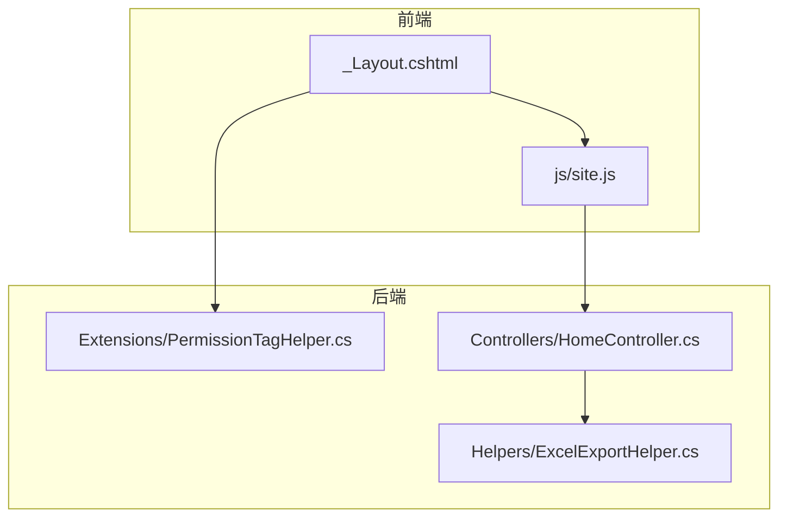
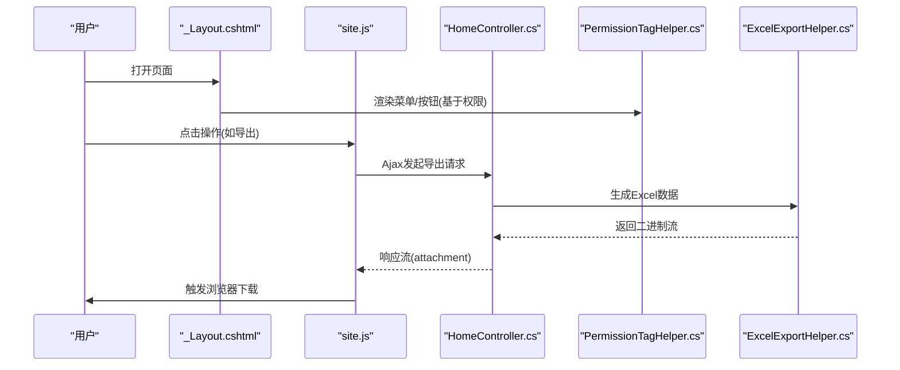
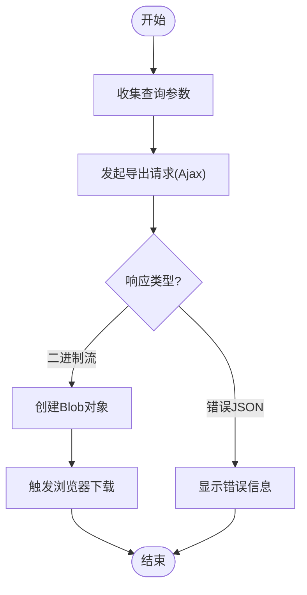
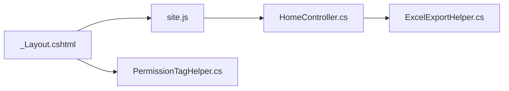

# JavaScript交互开发

<cite>
**本文引用的文件**   
- [site.js](file://EquipmentIMS.Web/wwwroot/js/site.js)
- [PermissionTagHelper.cs](file://EquipmentIMS.Web/Extensions/PermissionTagHelper.cs)
- [ExcelExportHelper.cs](file://EquipmentIMS.Web/Helpers/ExcelExportHelper.cs)
- [_Layout.cshtml](file://EquipmentIMS.Web/Views/Shared/_Layout.cshtml)
- [HomeController.cs](file://EquipmentIMS.Web/Controllers/HomeController.cs)
</cite>

## 目录
1. [简介](#简介)
2. [项目结构](#项目结构)
3. [核心组件](#核心组件)
4. [架构总览](#架构总览)
5. [详细组件分析](#详细组件分析)
6. [依赖关系分析](#依赖关系分析)
7. [性能考虑](#性能考虑)
8. [故障排查指南](#故障排查指南)
9. [结论](#结论)
10. [附录](#附录)

## 简介
本文件面向THMS系统的前端JavaScript交互开发，聚焦以下目标：
- jQuery使用模式与异步请求处理（Ajax）
- site.js中的全局函数封装与业务逻辑组织方式
- 权限标签助手（PermissionTagHelper）在前端的实现原理
- Excel导出功能的客户端实现流程
- 表单验证、动态DOM操作、事件处理的最佳实践
- JavaScript模块化开发规范与性能优化技巧

## 项目结构
前端资源位于Web项目的wwwroot目录下，其中：
- js/site.js：全局脚本入口，集中封装通用工具、Ajax调用、UI交互等
- Views/Shared/_Layout.cshtml：布局视图，负责引入公共脚本与样式
- Extensions/PermissionTagHelper.cs：服务端权限标签助手，控制菜单/按钮的可见性
- Helpers/ExcelExportHelper.cs：服务端Excel导出辅助类
- Controllers/HomeController.cs：示例控制器，提供页面渲染与基础接口

图表来源
- [_Layout.cshtml](file://EquipmentIMS.Web/Views/Shared/_Layout.cshtml)
- [site.js](file://EquipmentIMS.Web/wwwroot/js/site.js)
- [PermissionTagHelper.cs](file://EquipmentIMS.Web/Extensions/PermissionTagHelper.cs)
- [ExcelExportHelper.cs](file://EquipmentIMS.Web/Helpers/ExcelExportHelper.cs)
- [HomeController.cs](file://EquipmentIMS.Web/Controllers/HomeController.cs)

章节来源
- [site.js](file://EquipmentIMS.Web/wwwroot/js/site.js)
- [_Layout.cshtml](file://EquipmentIMS.Web/Views/Shared/_Layout.cshtml)
- [PermissionTagHelper.cs](file://EquipmentIMS.Web/Extensions/PermissionTagHelper.cs)
- [ExcelExportHelper.cs](file://EquipmentIMS.Web/Helpers/ExcelExportHelper.cs)
- [HomeController.cs](file://EquipmentIMS.Web/Controllers/HomeController.cs)

## 核心组件
本节概述前端交互的核心职责与协作关系：
- site.js：统一封装Ajax请求、错误提示、加载状态、弹窗确认、表格刷新、导出触发等；作为全局交互层，避免在各页面重复实现。
- PermissionTagHelper：在服务端根据当前用户角色/权限决定菜单项或操作按钮是否渲染，从而在前端“所见即所得”地体现权限控制。
- Excel导出：前端通过Ajax发起导出请求，后端生成Excel并返回二进制流，前端接收后触发浏览器下载。

章节来源
- [site.js](file://EquipmentIMS.Web/wwwroot/js/site.js)
- [PermissionTagHelper.cs](file://EquipmentIMS.Web/Extensions/PermissionTagHelper.cs)
- [ExcelExportHelper.cs](file://EquipmentIMS.Web/Helpers/ExcelExportHelper.cs)

## 架构总览
下图展示了从页面到服务端的典型交互路径，包括权限控制与导出流程。

图表来源
- [_Layout.cshtml](file://EquipmentIMS.Web/Views/Shared/_Layout.cshtml)
- [site.js](file://EquipmentIMS.Web/wwwroot/js/site.js)
- [PermissionTagHelper.cs](file://EquipmentIMS.Web/Extensions/PermissionTagHelper.cs)
- [ExcelExportHelper.cs](file://EquipmentIMS.Web/Helpers/ExcelExportHelper.cs)
- [HomeController.cs](file://EquipmentIMS.Web/Controllers/HomeController.cs)

## 详细组件分析

### site.js：全局函数封装与业务逻辑组织
- 设计原则
  - 单一职责：将Ajax封装、错误提示、加载遮罩、确认弹窗、表格刷新、导出触发等拆分为独立方法，便于复用与维护。
  - 低耦合：页面仅调用site.js暴露的全局API，不直接操作底层网络细节。
  - 一致性：统一的请求头、错误码处理、成功/失败回调约定，降低各页面差异。
- 关键能力
  - Ajax封装：统一设置超时、错误重试、JSON解析、异常捕获与友好提示。
  - 表单提交：自动序列化表单、禁用提交按钮防重复提交、成功后刷新列表或跳转。
  - 动态DOM：按需插入/移除节点、更新表格行、切换显示状态。
  - 事件处理：委托绑定、一次性事件、防抖节流（大数据量场景）。
  - 导出触发：构造查询参数、发起导出请求、处理Blob下载。
- 最佳实践
  - 使用命名空间或IIFE避免污染全局作用域。
  - 对频繁触发的操作进行防抖/节流。
  - 对长耗时任务提供进度反馈与取消机制。
  - 统一错误码映射与国际化提示文案。

章节来源
- [site.js](file://EquipmentIMS.Web/wwwroot/js/site.js)

### 权限标签助手（PermissionTagHelper）的前端实现原理
- 工作原理
  - 服务端在渲染视图时读取当前登录用户的角色/权限集合。
  - 根据标签属性（如权限标识）判断是否输出对应HTML元素。
  - 前端无需额外校验，未授权元素不会出现在DOM中，达到“默认拒绝”的效果。
- 前端配合要点
  - 若存在动态加载的菜单或按钮，需确保服务端渲染阶段已应用权限过滤。
  - 对于AJAX返回的片段，应同样在服务端进行权限过滤后再返回。
- 安全建议
  - 前端隐藏不等于后端放行，所有敏感操作必须在后端再次校验权限。

章节来源
- [PermissionTagHelper.cs](file://EquipmentIMS.Web/Extensions/PermissionTagHelper.cs)
- [_Layout.cshtml](file://EquipmentIMS.Web/Views/Shared/_Layout.cshtml)

### Excel导出功能的客户端实现
- 整体流程
  - 前端收集查询条件，构造请求参数。
  - 通过Ajax发起导出请求，指定响应类型为二进制流。
  - 后端使用Excel导出辅助类生成数据并返回附件流。
  - 前端创建Blob对象并触发浏览器下载。
- 关键点
  - 请求头与超时：大报表需要更长的超时时间。
  - 响应类型：明确指定为blob/arraybuffer，避免被当作文本解析。
  - 文件名：优先使用服务端Content-Disposition中的文件名。
  - 错误处理：当返回非200或错误JSON时，给出清晰提示。
- 流程图

图表来源
- [site.js](file://EquipmentIMS.Web/wwwroot/js/site.js)
- [ExcelExportHelper.cs](file://EquipmentIMS.Web/Helpers/ExcelExportHelper.cs)
- [HomeController.cs](file://EquipmentIMS.Web/Controllers/HomeController.cs)

章节来源
- [site.js](file://EquipmentIMS.Web/wwwroot/js/site.js)
- [ExcelExportHelper.cs](file://EquipmentIMS.Web/Helpers/ExcelExportHelper.cs)
- [HomeController.cs](file://EquipmentIMS.Web/Controllers/HomeController.cs)

### 表单验证、动态DOM操作、事件处理最佳实践
- 表单验证
  - 使用服务端模型验证与客户端验证双保险。
  - 统一错误消息展示位置，避免分散提示。
  - 提交前做轻量级前置校验，减少无效请求。
- 动态DOM操作
  - 批量更新时使用DocumentFragment或innerHTML拼接，减少重排重绘。
  - 对复杂模板采用预编译模板引擎或局部视图片段。
- 事件处理
  - 使用事件委托绑定到静态父容器，提升性能与可维护性。
  - 对高频事件（滚动、输入）使用防抖/节流。
  - 及时解绑不再使用的事件监听器，防止内存泄漏。

[本节为通用实践说明，不直接分析具体文件]

## 依赖关系分析
- 前端依赖
  - _Layout.cshtml负责引入site.js与第三方库（jQuery、Bootstrap等）。
  - site.js依赖jQuery与页面DOM结构约定。
- 前后端契约
  - 导出接口：请求参数约定、响应类型（二进制流）、错误格式。
  - 权限控制：服务端渲染阶段完成，前端只消费结果。

图表来源
- [_Layout.cshtml](file://EquipmentIMS.Web/Views/Shared/_Layout.cshtml)
- [site.js](file://EquipmentIMS.Web/wwwroot/js/site.js)
- [HomeController.cs](file://EquipmentIMS.Web/Controllers/HomeController.cs)
- [ExcelExportHelper.cs](file://EquipmentIMS.Web/Helpers/ExcelExportHelper.cs)
- [PermissionTagHelper.cs](file://EquipmentIMS.Web/Extensions/PermissionTagHelper.cs)

章节来源
- [_Layout.cshtml](file://EquipmentIMS.Web/Views/Shared/_Layout.cshtml)
- [site.js](file://EquipmentIMS.Web/wwwroot/js/site.js)
- [HomeController.cs](file://EquipmentIMS.Web/Controllers/HomeController.cs)
- [ExcelExportHelper.cs](file://EquipmentIMS.Web/Helpers/ExcelExportHelper.cs)
- [PermissionTagHelper.cs](file://EquipmentIMS.Web/Extensions/PermissionTagHelper.cs)

## 性能考虑
- 脚本加载
  - 将site.js置于页面底部或使用defer/async策略，避免阻塞首屏渲染。
  - 合并与压缩静态资源，启用浏览器缓存与CDN。
- DOM与事件
  - 减少不必要的重排重绘，批量更新DOM。
  - 使用事件委托与去抖节流降低CPU占用。
- 网络请求
  - 合理设置超时与重试策略，避免雪崩。
  - 对导出等大响应使用流式下载，避免内存峰值过高。
- 缓存策略
  - 对不变的数据使用HTTP缓存或本地缓存。
  - 分页与增量更新减少全量刷新。

[本节为通用指导，不直接分析具体文件]

## 故障排查指南
- 常见问题
  - 导出无响应：检查响应类型是否为二进制流、超时是否足够、后端是否正确设置Content-Disposition。
  - 权限按钮仍可见：确认服务端渲染阶段是否应用了权限标签助手，以及是否存在动态注入未过滤的元素。
  - 表单重复提交：确保提交按钮在请求期间禁用，并在成功/失败回调中恢复。
  - 事件失效：检查是否使用了事件委托，是否在动态插入后重新绑定。
- 定位步骤
  - 打开浏览器开发者工具，查看Network面板的请求与响应。
  - 在Console中查看是否有JavaScript错误或跨域问题。
  - 核对前后端约定的参数名、数据类型与错误码。

章节来源
- [site.js](file://EquipmentIMS.Web/wwwroot/js/site.js)
- [PermissionTagHelper.cs](file://EquipmentIMS.Web/Extensions/PermissionTagHelper.cs)
- [ExcelExportHelper.cs](file://EquipmentIMS.Web/Helpers/ExcelExportHelper.cs)

## 结论
THMS系统的前端交互以site.js为核心，结合服务端权限标签助手与Excel导出辅助类，形成清晰的职责边界与稳定的交互契约。遵循本文的模块化规范与性能优化建议，可显著提升可维护性与用户体验。

[本节为总结性内容，不直接分析具体文件]

## 附录
- 术语
  - Ajax：异步JavaScript与XML，现多用于泛指异步HTTP请求。
  - Blob：二进制大对象，常用于处理文件下载。
  - Content-Disposition：HTTP响应头，指示浏览器如何处理响应体（如下载）。
- 参考路径
  - 全局脚本：[site.js](file://EquipmentIMS.Web/wwwroot/js/site.js)
  - 布局视图：[_Layout.cshtml](file://EquipmentIMS.Web/Views/Shared/_Layout.cshtml)
  - 权限标签助手：[PermissionTagHelper.cs](file://EquipmentIMS.Web/Extensions/PermissionTagHelper.cs)
  - Excel导出辅助：[ExcelExportHelper.cs](file://EquipmentIMS.Web/Helpers/ExcelExportHelper.cs)
  - 示例控制器：[HomeController.cs](file://EquipmentIMS.Web/Controllers/HomeController.cs)