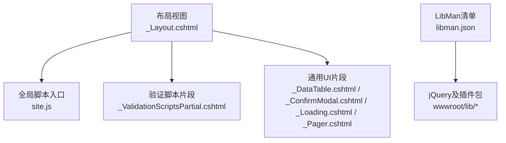
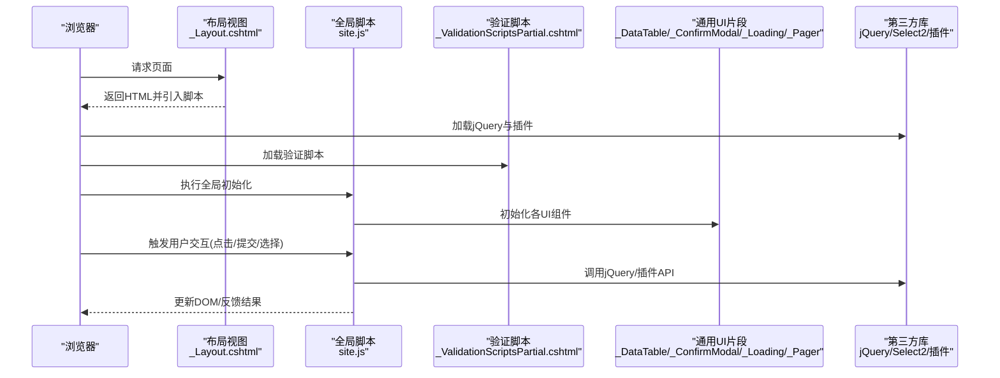
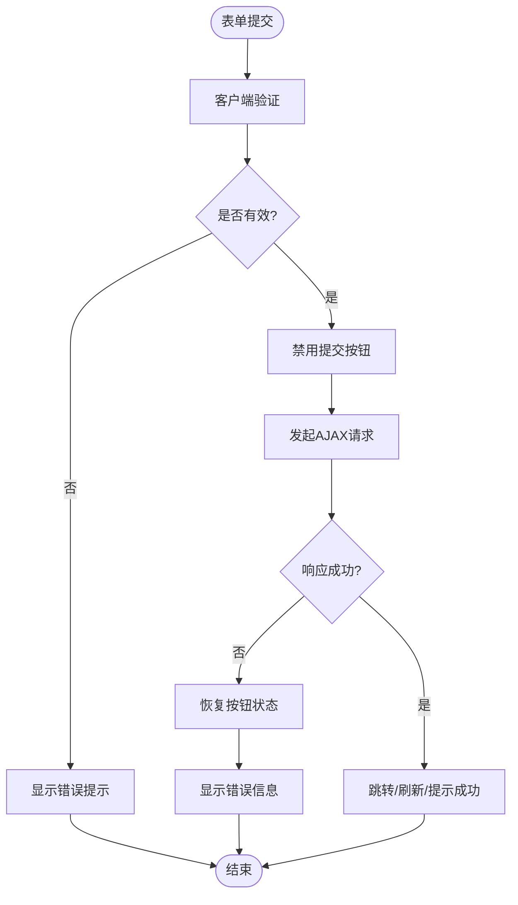
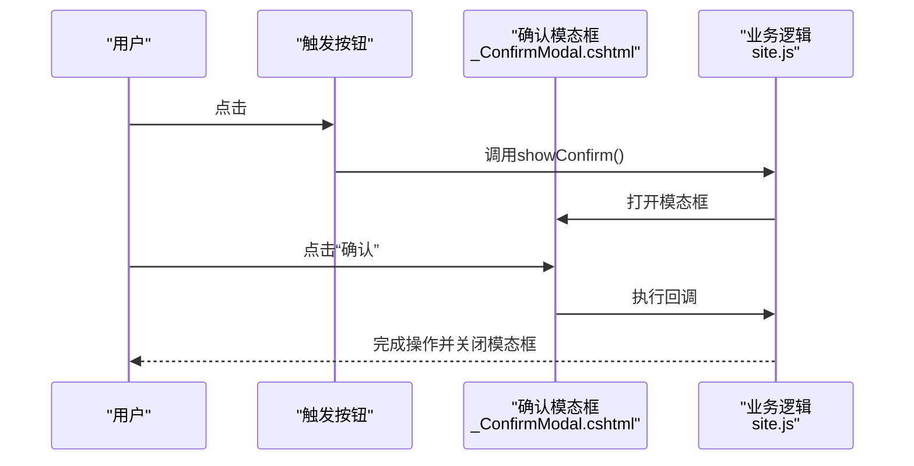
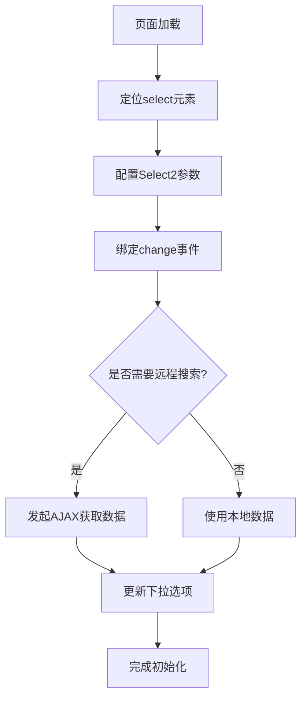
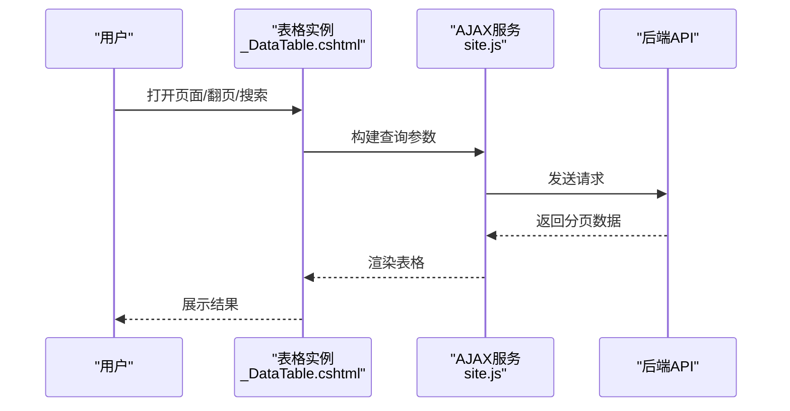
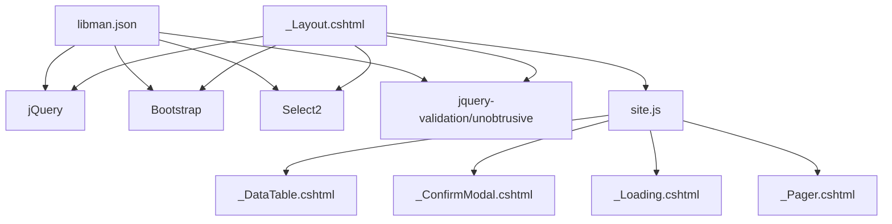

# jQuery使用模式

<cite>
**本文引用的文件**   
- [site.js](file://EquipmentIMS.Web/wwwroot/js/site.js)
- [_Layout.cshtml](file://EquipmentIMS.Web/Views/Shared/_Layout.cshtml)
- [_ValidationScriptsPartial.cshtml](file://EquipmentIMS.Web/Views/Shared/_ValidationScriptsPartial.cshtml)
- [_DataTable.cshtml](file://EquipmentIMS.Web/Views/Shared/_DataTable.cshtml)
- [_ConfirmModal.cshtml](file://EquipmentIMS.Web/Views/Shared/_ConfirmModal.cshtml)
- [_Loading.cshtml](file://EquipmentIMS.Web/Views/Shared/_Loading.cshtml)
- [_Pager.cshtml](file://EquipmentIMS.Web/Views/Shared/_Pager.cshtml)
- [libman.json](file://EquipmentIMS.Web/libman.json)
</cite>

## 目录
1. [简介](#简介)
2. [项目结构](#项目结构)
3. [核心组件](#核心组件)
4. [架构总览](#架构总览)
5. [详细组件分析](#详细组件分析)
6. [依赖关系分析](#依赖关系分析)
7. [性能考虑](#性能考虑)
8. [故障排查指南](#故障排查指南)
9. [结论](#结论)
10. [附录](#附录)

## 简介
本文件聚焦THMS系统中jQuery的使用模式，覆盖以下主题：
- jQuery初始化配置与全局函数封装
- DOM操作最佳实践（选择器、事件绑定、动态内容更新）
- 表单验证实现（客户端规则与错误提示）
- UI组件集成（模态框、Select2下拉框、数据表格）
- 常见操作模式与性能优化技巧

目标是帮助开发者在现有MVC+Razor项目中统一前端交互风格，提升可维护性与性能。

## 项目结构
THMS为ASP.NET Core MVC应用，前端资源位于wwwroot下，jQuery及相关库通过LibMan管理，页面脚本通过布局视图引入。

图表来源
- [_Layout.cshtml](file://EquipmentIMS.Web/Views/Shared/_Layout.cshtml)
- [site.js](file://EquipmentIMS.Web/wwwroot/js/site.js)
- [_ValidationScriptsPartial.cshtml](file://EquipmentIMS.Web/Views/Shared/_ValidationScriptsPartial.cshtml)
- [_DataTable.cshtml](file://EquipmentIMS.Web/Views/Shared/_DataTable.cshtml)
- [_ConfirmModal.cshtml](file://EquipmentIMS.Web/Views/Shared/_ConfirmModal.cshtml)
- [_Loading.cshtml](file://EquipmentIMS.Web/Views/Shared/_Loading.cshtml)
- [_Pager.cshtml](file://EquipmentIMS.Web/Views/Shared/_Pager.cshtml)
- [libman.json](file://EquipmentIMS.Web/libman.json)

章节来源
- [libman.json](file://EquipmentIMS.Web/libman.json)
- [_Layout.cshtml](file://EquipmentIMS.Web/Views/Shared/_Layout.cshtml)

## 核心组件
- 全局脚本入口 site.js：集中初始化jQuery行为、封装常用工具方法、注册全局事件与组件初始化逻辑。
- 布局视图 _Layout.cshtml：统一引入jQuery、Bootstrap、Select2等静态资源，并注入验证脚本与业务脚本。
- 验证脚本片段 _ValidationScriptsPartial.cshtml：按需引入jquery-validation与unobtrusive，配合服务端模型注解实现客户端校验。
- 通用UI片段：
  - _DataTable.cshtml：封装数据表格的初始化与分页、搜索、排序等交互。
  - _ConfirmModal.cshtml：统一的确认对话框，用于危险操作的二次确认。
  - _Loading.cshtml：全局加载遮罩，避免重复显示与闪烁。
  - _Pager.cshtml：分页控件的渲染与事件处理。

章节来源
- [site.js](file://EquipmentIMS.Web/wwwroot/js/site.js)
- [_Layout.cshtml](file://EquipmentIMS.Web/Views/Shared/_Layout.cshtml)
- [_ValidationScriptsPartial.cshtml](file://EquipmentIMS.Web/Views/Shared/_ValidationScriptsPartial.cshtml)
- [_DataTable.cshtml](file://EquipmentIMS.Web/Views/Shared/_DataTable.cshtml)
- [_ConfirmModal.cshtml](file://EquipmentIMS.Web/Views/Shared/_ConfirmModal.cshtml)
- [_Loading.cshtml](file://EquipmentIMS.Web/Views/Shared/_Loading.cshtml)
- [_Pager.cshtml](file://EquipmentIMS.Web/Views/Shared/_Pager.cshtml)

## 架构总览
下图展示从页面加载到jQuery初始化、组件装配与用户交互的整体流程。

图表来源
- [_Layout.cshtml](file://EquipmentIMS.Web/Views/Shared/_Layout.cshtml)
- [site.js](file://EquipmentIMS.Web/wwwroot/js/site.js)
- [_ValidationScriptsPartial.cshtml](file://EquipmentIMS.Web/Views/Shared/_ValidationScriptsPartial.cshtml)
- [_DataTable.cshtml](file://EquipmentIMS.Web/Views/Shared/_DataTable.cshtml)
- [_ConfirmModal.cshtml](file://EquipmentIMS.Web/Views/Shared/_ConfirmModal.cshtml)
- [_Loading.cshtml](file://EquipmentIMS.Web/Views/Shared/_Loading.cshtml)
- [_Pager.cshtml](file://EquipmentIMS.Web/Views/Shared/_Pager.cshtml)

## 详细组件分析

### jQuery初始化与全局函数封装
- 初始化时机
  - 在文档就绪后执行全局初始化，确保DOM可用后再绑定事件与初始化组件。
  - 将初始化逻辑集中在site.js中，便于统一管理与调试。
- 全局函数封装
  - 提供统一的工具方法，如：
    - 显示/隐藏全局加载遮罩
    - 显示成功/失败提示
    - 安全获取元素引用（避免空引用）
    - 防抖/节流包装器
  - 将易错或重复的逻辑抽象为公共函数，减少在各页面中的重复代码。
- 命名空间与冲突规避
  - 通过自执行函数或模块组织方式，避免污染全局作用域。
  - 对第三方插件进行最小化暴露，仅导出必要接口。

章节来源
- [site.js](file://EquipmentIMS.Web/wwwroot/js/site.js)

### DOM操作最佳实践
- 元素选择
  - 优先使用稳定的ID或data-*属性选择器，避免深层层级选择。
  - 对列表项使用类名选择器，结合上下文容器限定范围，降低误匹配。
- 事件绑定
  - 使用事件委托绑定到最近的稳定父节点，提高动态内容的兼容性。
  - 解绑旧事件后再绑定新事件，防止重复触发。
- 动态内容更新
  - 批量更新时先缓存DOM引用，最后一次性插入，减少重排重绘。
  - 使用模板字符串或局部视图渲染大块HTML，避免多次拼接。
- 样式与状态
  - 通过切换class控制显隐与状态，而非直接修改style属性。
  - 对动画使用队列控制，避免并发动画导致卡顿。

章节来源
- [site.js](file://EquipmentIMS.Web/wwwroot/js/site.js)

### 表单验证（客户端规则与错误提示）
- 验证脚本引入
  - 通过布局视图按需引入jquery-validation与unobtrusive脚本，确保与服务端注解一致。
- 规则声明
  - 在服务端模型上使用DataAnnotations，自动生成客户端验证规则。
  - 在需要时通过$.validator.unobtrusive.parse动态解析新增字段。
- 错误提示
  - 统一错误消息样式与位置，避免分散在各页面。
  - 提交前拦截无效表单，阻止默认提交行为。
- 异步验证
  - 对唯一性检查等场景，使用远程验证或自定义验证器。
  - 在验证过程中禁用提交按钮，防止重复提交。

图表来源
- [_ValidationScriptsPartial.cshtml](file://EquipmentIMS.Web/Views/Shared/_ValidationScriptsPartial.cshtml)
- [site.js](file://EquipmentIMS.Web/wwwroot/js/site.js)

章节来源
- [_ValidationScriptsPartial.cshtml](file://EquipmentIMS.Web/Views/Shared/_ValidationScriptsPartial.cshtml)
- [site.js](file://EquipmentIMS.Web/wwwroot/js/site.js)

### UI组件集成

#### 模态框（确认对话框）
- 统一入口
  - 通过_confirmModal片段提供统一的确认对话框，支持标题、正文、回调函数。
- 交互流程
  - 触发按钮点击 -> 打开模态框 -> 用户确认/取消 -> 执行回调或中止。
- 注意事项
  - 避免嵌套模态框；必要时关闭上层再打开下层。
  - 在回调中处理异步任务，并在完成后关闭模态框。

图表来源
- [_ConfirmModal.cshtml](file://EquipmentIMS.Web/Views/Shared/_ConfirmModal.cshtml)
- [site.js](file://EquipmentIMS.Web/wwwroot/js/site.js)

章节来源
- [_ConfirmModal.cshtml](file://EquipmentIMS.Web/Views/Shared/_ConfirmModal.cshtml)
- [site.js](file://EquipmentIMS.Web/wwwroot/js/site.js)

#### 下拉框（Select2）
- 初始化
  - 在页面加载后对目标select元素调用Select2初始化方法。
  - 支持远程搜索、多选、占位符、禁用状态等配置。
- 数据源
  - 本地数组或远程API返回JSON格式数据。
- 事件处理
  - 监听change事件，根据选中值联动其他控件。
  - 在动态添加选项后重新初始化或调用destroy再重建。

图表来源
- [site.js](file://EquipmentIMS.Web/wwwroot/js/site.js)

章节来源
- [site.js](file://EquipmentIMS.Web/wwwroot/js/site.js)

#### 数据表格
- 初始化
  - 通过_table片段统一初始化表格，设置列定义、分页、排序、搜索等。
- 数据加载
  - 使用AJAX拉取后端分页数据，填充表格行。
- 交互
  - 行内编辑、批量删除、导出等功能通过按钮或菜单触发。
- 性能
  - 大数据量时使用虚拟滚动或延迟加载。
  - 合并重复请求，避免频繁刷新。

图表来源
- [_DataTable.cshtml](file://EquipmentIMS.Web/Views/Shared/_DataTable.cshtml)
- [site.js](file://EquipmentIMS.Web/wwwroot/js/site.js)

章节来源
- [_DataTable.cshtml](file://EquipmentIMS.Web/Views/Shared/_DataTable.cshtml)
- [site.js](file://EquipmentIMS.Web/wwwroot/js/site.js)

#### 分页控件
- 渲染
  - 根据后端返回的分页信息生成页码按钮。
- 事件
  - 点击页码时触发表格刷新，保持筛选条件不变。
- 体验
  - 当前页高亮，禁用不可达页码。

章节来源
- [_Pager.cshtml](file://EquipmentIMS.Web/Views/Shared/_Pager.cshtml)
- [site.js](file://EquipmentIMS.Web/wwwroot/js/site.js)

#### 全局加载遮罩
- 显示/隐藏
  - 在AJAX请求前后统一控制遮罩显示与隐藏。
- 防抖
  - 快速连续请求只保留最后一次，避免闪烁。

章节来源
- [_Loading.cshtml](file://EquipmentIMS.Web/Views/Shared/_Loading.cshtml)
- [site.js](file://EquipmentIMS.Web/wwwroot/js/site.js)

## 依赖关系分析
- 资源引入顺序
  - 布局视图中按依赖顺序引入jQuery、Bootstrap、Select2、验证脚本与业务脚本。
- LibMan管理
  - 通过libman.json统一管理第三方库版本与路径，确保一致性。
- 耦合与内聚
  - site.js作为全局入口，内聚所有初始化与工具方法，降低页面级脚本耦合。
  - 通用UI片段以局部视图形式复用，提高内聚度。

图表来源
- [_Layout.cshtml](file://EquipmentIMS.Web/Views/Shared/_Layout.cshtml)
- [site.js](file://EquipmentIMS.Web/wwwroot/js/site.js)
- [_DataTable.cshtml](file://EquipmentIMS.Web/Views/Shared/_DataTable.cshtml)
- [_ConfirmModal.cshtml](file://EquipmentIMS.Web/Views/Shared/_ConfirmModal.cshtml)
- [_Loading.cshtml](file://EquipmentIMS.Web/Views/Shared/_Loading.cshtml)
- [_Pager.cshtml](file://EquipmentIMS.Web/Views/Shared/_Pager.cshtml)
- [libman.json](file://EquipmentIMS.Web/libman.json)

章节来源
- [libman.json](file://EquipmentIMS.Web/libman.json)
- [_Layout.cshtml](file://EquipmentIMS.Web/Views/Shared/_Layout.cshtml)
- [site.js](file://EquipmentIMS.Web/wwwroot/js/site.js)

## 性能考虑
- 选择器优化
  - 优先使用ID与data-*选择器，避免复杂层级与通配符。
- 事件委托
  - 对动态内容使用事件委托，减少重复绑定。
- DOM批处理
  - 批量更新时先构建文档片段，再一次性插入。
- 去抖与节流
  - 对输入框搜索、窗口resize等高频事件使用去抖/节流。
- 资源加载
  - 合理拆分脚本，按需加载；利用浏览器缓存与CDN。
- 表格性能
  - 大数据量采用分页、懒加载与虚拟滚动。
- 动画与渲染
  - 避免并发动画，减少重排重绘。

[本节为通用指导，不直接分析具体文件]

## 故障排查指南
- 常见问题
  - jQuery未加载或版本冲突：检查布局视图引入顺序与libman清单。
  - 事件重复绑定：在绑定前解绑旧事件或使用事件委托。
  - 动态元素无响应：确认元素已存在且正确绑定事件。
  - 表单验证不生效：确认unobtrusive脚本已加载且字段name/id与服务端一致。
  - Select2无法显示：检查数据格式与远程接口返回结构。
  - 表格数据不刷新：检查AJAX参数与后端分页字段映射。
- 调试建议
  - 在关键路径增加日志输出，记录请求参数与响应。
  - 使用浏览器开发者工具断点调试，观察DOM变化与网络请求。
  - 对复杂交互绘制流程图，逐步定位问题。

章节来源
- [site.js](file://EquipmentIMS.Web/wwwroot/js/site.js)
- [_Layout.cshtml](file://EquipmentIMS.Web/Views/Shared/_Layout.cshtml)
- [_ValidationScriptsPartial.cshtml](file://EquipmentIMS.Web/Views/Shared/_ValidationScriptsPartial.cshtml)

## 结论
通过在site.js中集中初始化与封装全局函数，结合布局视图统一引入资源与验证脚本，以及将通用UI能力下沉到局部视图片段，THMS实现了清晰、可复用、高性能的jQuery使用模式。遵循本文的最佳实践与优化建议，可在保证用户体验的同时提升可维护性与开发效率。

[本节为总结，不直接分析具体文件]

## 附录
- 参考文件路径
  - 全局脚本入口：[site.js](file://EquipmentIMS.Web/wwwroot/js/site.js)
  - 布局视图：[_Layout.cshtml](file://EquipmentIMS.Web/Views/Shared/_Layout.cshtml)
  - 验证脚本片段：[_ValidationScriptsPartial.cshtml](file://EquipmentIMS.Web/Views/Shared/_ValidationScriptsPartial.cshtml)
  - 数据表格片段：[_DataTable.cshtml](file://EquipmentIMS.Web/Views/Shared/_DataTable.cshtml)
  - 确认模态框片段：[_ConfirmModal.cshtml](file://EquipmentIMS.Web/Views/Shared/_ConfirmModal.cshtml)
  - 加载遮罩片段：[_Loading.cshtml](file://EquipmentIMS.Web/Views/Shared/_Loading.cshtml)
  - 分页控件片段：[_Pager.cshtml](file://EquipmentIMS.Web/Views/Shared/_Pager.cshtml)
  - 资源清单：[libman.json](file://EquipmentIMS.Web/libman.json)

[本节为索引，不直接分析具体文件]