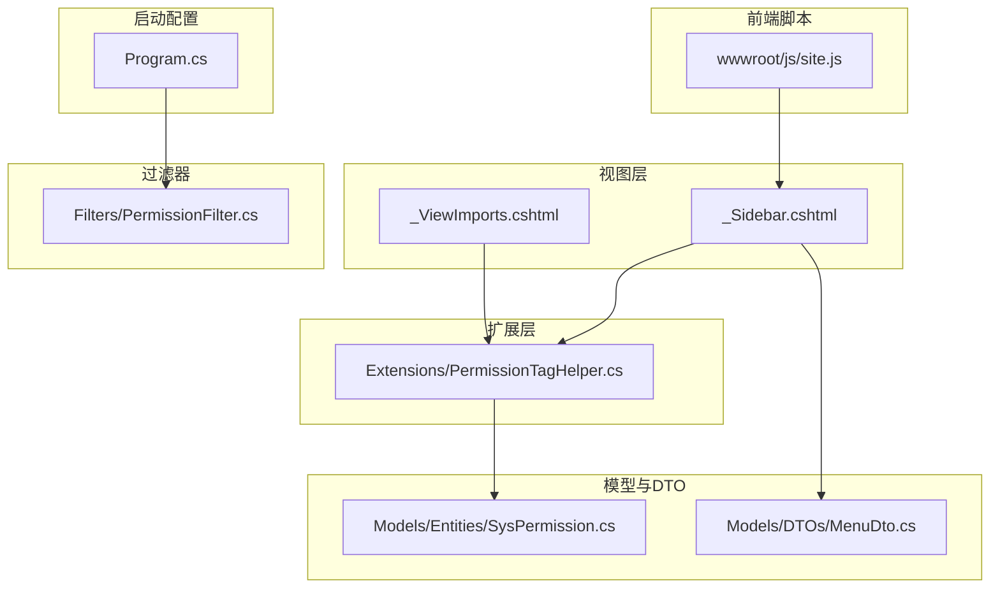
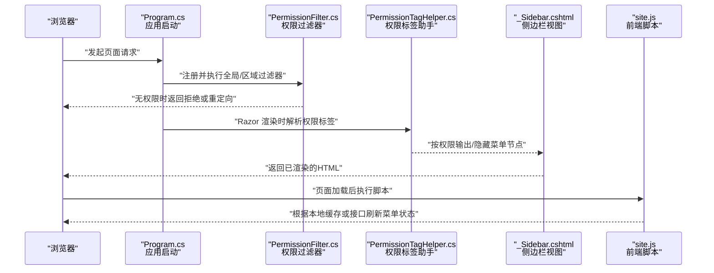
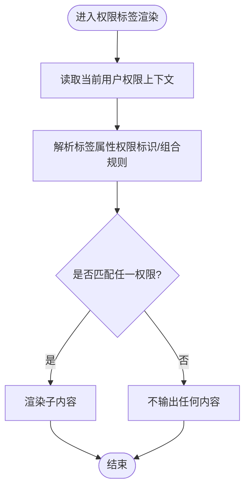
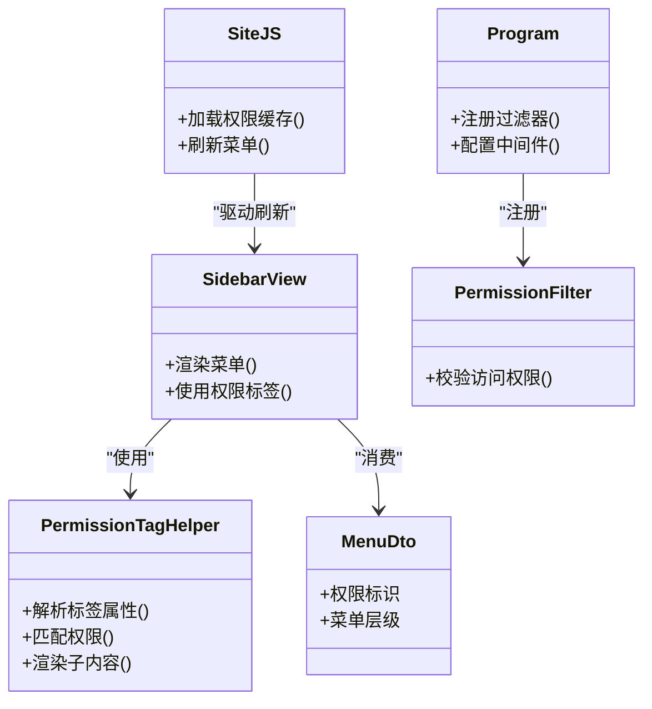

# 权限标签助手前端实现

<cite>
**本文引用的文件**   
- [PermissionTagHelper.cs](file://EquipmentIMS.Web/Extensions/PermissionTagHelper.cs)
- [_ViewImports.cshtml](file://EquipmentIMS.Web/Views/_ViewImports.cshtml)
- [_Sidebar.cshtml](file://EquipmentIMS.Web/Views/Shared/_Sidebar.cshtml)
- [Program.cs](file://EquipmentIMS.Web/Program.cs)
- [PermissionFilter.cs](file://EquipmentIMS.Web/Filters/PermissionFilter.cs)
- [SysPermission.cs](file://EquipmentIMS.Models/Entities/SysPermission.cs)
- [MenuDto.cs](file://EquipmentIMS.Models/DTOs/MenuDto.cs)
- [site.js](file://EquipmentIMS.Web/wwwroot/js/site.js)
</cite>

## 目录
1. [简介](#简介)
2. [项目结构](#项目结构)
3. [核心组件](#核心组件)
4. [架构总览](#架构总览)
5. [详细组件分析](#详细组件分析)
6. [依赖关系分析](#依赖关系分析)
7. [性能考虑](#性能考虑)
8. [故障排查指南](#故障排查指南)
9. [结论](#结论)
10. [附录](#附录)

## 简介
本文件聚焦于 THMS 系统中“权限标签助手”的前端实现与前后端协作机制，重点说明：
- PermissionTagHelper 的工作原理与渲染流程
- 菜单项的动态显示/隐藏策略
- 用户权限信息的获取、缓存与刷新
- 权限变更时的界面实时更新机制
- 自定义权限标签的开发指南与最佳实践
- 调试方法与常见问题解决方案

## 项目结构
与权限标签助手相关的关键位置如下：
- 视图层：_ViewImports.cshtml 引入 Tag Helper；_Sidebar.cshtml 使用权限标签控制菜单可见性
- 扩展层：Extensions/PermissionTagHelper.cs 提供服务端渲染的权限判断逻辑
- 过滤器：Filters/PermissionFilter.cs 用于控制器方法级别的权限校验
- 模型与 DTO：Models/Entities/SysPermission.cs、Models/DTOs/MenuDto.cs 定义权限与菜单数据结构
- 启动配置：Program.cs 注册服务与中间件（含权限相关）
- 前端脚本：wwwroot/js/site.js 处理客户端侧的权限展示与交互

图表来源
- [_ViewImports.cshtml](file://EquipmentIMS.Web/Views/_ViewImports.cshtml)
- [_Sidebar.cshtml](file://EquipmentIMS.Web/Views/Shared/_Sidebar.cshtml)
- [PermissionTagHelper.cs](file://EquipmentIMS.Web/Extensions/PermissionTagHelper.cs)
- [PermissionFilter.cs](file://EquipmentIMS.Web/Filters/PermissionFilter.cs)
- [SysPermission.cs](file://EquipmentIMS.Models/Entities/SysPermission.cs)
- [MenuDto.cs](file://EquipmentIMS.Models/DTOs/MenuDto.cs)
- [Program.cs](file://EquipmentIMS.Web/Program.cs)
- [site.js](file://EquipmentIMS.Web/wwwroot/js/site.js)

章节来源
- [PermissionTagHelper.cs](file://EquipmentIMS.Web/Extensions/PermissionTagHelper.cs)
- [_ViewImports.cshtml](file://EquipmentIMS.Web/Views/_ViewImports.cshtml)
- [_Sidebar.cshtml](file://EquipmentIMS.Web/Views/Shared/_Sidebar.cshtml)
- [Program.cs](file://EquipmentIMS.Web/Program.cs)
- [PermissionFilter.cs](file://EquipmentIMS.Web/Filters/PermissionFilter.cs)
- [SysPermission.cs](file://EquipmentIMS.Models/Entities/SysPermission.cs)
- [MenuDto.cs](file://EquipmentIMS.Models/DTOs/MenuDto.cs)
- [site.js](file://EquipmentIMS.Web/wwwroot/js/site.js)

## 核心组件
- 权限标签助手（服务端）：在 Razor 视图渲染阶段根据当前用户权限决定是否输出目标 HTML 片段。
- 视图导入与注册：通过 _ViewImports.cshtml 将自定义 Tag Helper 注入到所有视图中。
- 菜单侧边栏：_Sidebar.cshtml 使用权限标签动态控制菜单项的显示/隐藏。
- 权限过滤器：对控制器方法进行权限校验，确保后端访问安全。
- 权限数据模型：SysPermission.cs 定义权限实体；MenuDto.cs 定义菜单数据传输对象。
- 前端脚本：site.js 负责页面加载后的权限相关交互与局部刷新。

章节来源
- [PermissionTagHelper.cs](file://EquipmentIMS.Web/Extensions/PermissionTagHelper.cs)
- [_ViewImports.cshtml](file://EquipmentIMS.Web/Views/_ViewImports.cshtml)
- [_Sidebar.cshtml](file://EquipmentIMS.Web/Views/Shared/_Sidebar.cshtml)
- [PermissionFilter.cs](file://EquipmentIMS.Web/Filters/PermissionFilter.cs)
- [SysPermission.cs](file://EquipmentIMS.Models/Entities/SysPermission.cs)
- [MenuDto.cs](file://EquipmentIMS.Models/DTOs/MenuDto.cs)
- [site.js](file://EquipmentIMS.Web/wwwroot/js/site.js)

## 架构总览
下图展示了从请求进入、服务端权限判定、视图渲染到前端交互的整体流程。

图表来源
- [Program.cs](file://EquipmentIMS.Web/Program.cs)
- [PermissionFilter.cs](file://EquipmentIMS.Web/Filters/PermissionFilter.cs)
- [PermissionTagHelper.cs](file://EquipmentIMS.Web/Extensions/PermissionTagHelper.cs)
- [_Sidebar.cshtml](file://EquipmentIMS.Web/Views/Shared/_Sidebar.cshtml)
- [site.js](file://EquipmentIMS.Web/wwwroot/js/site.js)

## 详细组件分析

### 权限标签助手（PermissionTagHelper）
- 职责
  - 在 Razor 视图渲染期间解析自定义权限标签
  - 读取当前用户上下文中的权限集合
  - 根据标签属性（如权限标识）进行匹配，决定是否渲染子内容
- 关键设计点
  - 与服务端权限模型 SysPermission.cs 保持一致的权限标识约定
  - 支持组合条件（例如 AND/OR），便于复杂场景下的细粒度控制
  - 与菜单 DTO MenuDto.cs 协同，为菜单项提供统一的权限标记方式
- 典型用法
  - 在 _Sidebar.cshtml 中围绕菜单项包裹权限标签，仅当用户具备相应权限时才输出该菜单节点
- 错误处理
  - 未识别的权限标识应记录日志并默认不输出，避免越权暴露
  - 上下文缺失时回退为最小权限集，保证系统可用性

图表来源
- [PermissionTagHelper.cs](file://EquipmentIMS.Web/Extensions/PermissionTagHelper.cs)
- [SysPermission.cs](file://EquipmentIMS.Models/Entities/SysPermission.cs)
- [MenuDto.cs](file://EquipmentIMS.Models/DTOs/MenuDto.cs)

章节来源
- [PermissionTagHelper.cs](file://EquipmentIMS.Web/Extensions/PermissionTagHelper.cs)
- [SysPermission.cs](file://EquipmentIMS.Models/Entities/SysPermission.cs)
- [MenuDto.cs](file://EquipmentIMS.Models/DTOs/MenuDto.cs)

### 视图导入与注册（_ViewImports.cshtml）
- 作用
  - 将自定义 Tag Helper 注入到所有视图中，使 _Sidebar.cshtml 等可直接使用权限标签
- 关键点
  - 命名空间引用需与 PermissionTagHelper 所在命名空间一致
  - 建议集中管理，避免重复声明

章节来源
- [_ViewImports.cshtml](file://EquipmentIMS.Web/Views/_ViewImports.cshtml)
- [PermissionTagHelper.cs](file://EquipmentIMS.Web/Extensions/PermissionTagHelper.cs)

### 菜单侧边栏（_Sidebar.cshtml）
- 作用
  - 基于权限标签动态渲染菜单树
  - 结合 MenuDto.cs 的结构，为每个菜单项绑定权限标识
- 渲染策略
  - 外层容器包裹权限标签，内部包含菜单链接与图标
  - 对于多级菜单，可在父级与子级分别设置权限，实现更精细的控制
- 与前端脚本联动
  - site.js 可在页面加载后根据本地缓存或接口响应更新菜单可见性

章节来源
- [_Sidebar.cshtml](file://EquipmentIMS.Web/Views/Shared/_Sidebar.cshtml)
- [MenuDto.cs](file://EquipmentIMS.Models/DTOs/MenuDto.cs)
- [site.js](file://EquipmentIMS.Web/wwwroot/js/site.js)

### 权限过滤器（PermissionFilter.cs）
- 作用
  - 在控制器方法执行前进行权限校验，防止未授权访问
- 与标签助手的关系
  - 过滤器保障后端接口安全；标签助手保障前端 UI 可见性，二者互补
- 常见策略
  - 基于角色或权限标识进行判定
  - 未通过时返回 403 或重定向至访问拒绝页

章节来源
- [PermissionFilter.cs](file://EquipmentIMS.Web/Filters/PermissionFilter.cs)

### 权限数据模型（SysPermission.cs）与菜单 DTO（MenuDto.cs）
- SysPermission.cs
  - 定义权限实体的基本字段（如标识、名称、类型等）
  - 作为服务端权限判定的权威来源
- MenuDto.cs
  - 定义菜单项的数据结构，包括权限标识字段
  - 供视图渲染与前端脚本共同消费

章节来源
- [SysPermission.cs](file://EquipmentIMS.Models/Entities/SysPermission.cs)
- [MenuDto.cs](file://EquipmentIMS.Models/DTOs/MenuDto.cs)

### 前端脚本（site.js）
- 职责
  - 页面加载完成后，根据本地缓存或接口返回的权限信息，动态调整菜单可见性
  - 监听权限变更事件，触发局部刷新（如重新渲染侧边栏）
- 缓存策略
  - 首次加载时拉取权限列表并缓存到本地存储
  - 在会话有效期内复用缓存，减少网络开销
- 实时更新
  - 当后台完成权限分配或角色变更后，前端主动刷新缓存并重新渲染受影响区域

章节来源
- [site.js](file://EquipmentIMS.Web/wwwroot/js/site.js)

## 依赖关系分析
- 组件耦合
  - PermissionTagHelper 依赖当前用户上下文与权限模型
  - _Sidebar.cshtml 依赖 PermissionTagHelper 与 MenuDto
  - site.js 依赖本地缓存与可能的权限接口
- 外部集成点
  - Program.cs 注册过滤器与中间件，影响整体权限流程
  - 数据库层（非本文重点）提供权限与角色的持久化数据

图表来源
- [PermissionTagHelper.cs](file://EquipmentIMS.Web/Extensions/PermissionTagHelper.cs)
- [_Sidebar.cshtml](file://EquipmentIMS.Web/Views/Shared/_Sidebar.cshtml)
- [MenuDto.cs](file://EquipmentIMS.Models/DTOs/MenuDto.cs)
- [site.js](file://EquipmentIMS.Web/wwwroot/js/site.js)
- [PermissionFilter.cs](file://EquipmentIMS.Web/Filters/PermissionFilter.cs)
- [Program.cs](file://EquipmentIMS.Web/Program.cs)

章节来源
- [PermissionTagHelper.cs](file://EquipmentIMS.Web/Extensions/PermissionTagHelper.cs)
- [_Sidebar.cshtml](file://EquipmentIMS.Web/Views/Shared/_Sidebar.cshtml)
- [MenuDto.cs](file://EquipmentIMS.Models/DTOs/MenuDto.cs)
- [site.js](file://EquipmentIMS.Web/wwwroot/js/site.js)
- [PermissionFilter.cs](file://EquipmentIMS.Web/Filters/PermissionFilter.cs)
- [Program.cs](file://EquipmentIMS.Web/Program.cs)

## 性能考虑
- 服务端渲染优化
  - 权限判定尽量使用内存缓存，避免每次请求都查询数据库
  - 对复杂权限组合进行预计算，降低渲染时的 CPU 消耗
- 前端缓存策略
  - 使用本地存储缓存权限列表，设置合理过期时间
  - 仅在必要时触发全量刷新，其余采用增量更新
- 网络开销控制
  - 合并权限接口调用，减少多次往返
  - 对静态菜单结构进行缓存，避免重复构建 DOM

## 故障排查指南
- 现象：菜单项不显示
  - 检查 _ViewImports.cshtml 是否正确引入权限标签助手的命名空间
  - 确认 _Sidebar.cshtml 中权限标签的属性值与 SysPermission.cs 中的标识一致
  - 查看服务器日志，确认 PermissionTagHelper 的匹配逻辑是否命中
- 现象：后端接口被拒绝
  - 检查 PermissionFilter.cs 的校验规则是否与业务需求一致
  - 确认 Program.cs 中过滤器的注册顺序与作用域
- 现象：权限变更后界面未更新
  - 检查 site.js 是否在权限变更后触发刷新逻辑
  - 确认本地缓存是否被正确清除并重新拉取
- 调试建议
  - 在 PermissionTagHelper 中添加日志输出，记录匹配过程
  - 在 _Sidebar.cshtml 中临时打印菜单数据，验证结构与权限字段
  - 使用浏览器开发者工具监控网络请求与本地存储

章节来源
- [_ViewImports.cshtml](file://EquipmentIMS.Web/Views/_ViewImports.cshtml)
- [_Sidebar.cshtml](file://EquipmentIMS.Web/Views/Shared/_Sidebar.cshtml)
- [PermissionTagHelper.cs](file://EquipmentIMS.Web/Extensions/PermissionTagHelper.cs)
- [PermissionFilter.cs](file://EquipmentIMS.Web/Filters/PermissionFilter.cs)
- [Program.cs](file://EquipmentIMS.Web/Program.cs)
- [site.js](file://EquipmentIMS.Web/wwwroot/js/site.js)

## 结论
通过 PermissionTagHelper 在服务端渲染阶段进行权限判定，并结合前端脚本的缓存与刷新机制，THMS 实现了高效且安全的权限控制方案。服务端过滤器与前端标签助手形成双重保障，既保证了接口访问安全，也提升了用户体验。建议在后续迭代中持续优化权限缓存策略与渲染性能，并完善自定义权限标签的可扩展性与可观测性。

## 附录

### 自定义权限标签开发指南
- 步骤
  - 在 Extensions 目录下新增自定义 Tag Helper 类，继承框架提供的基类
  - 定义标签属性（如权限标识、组合规则）
  - 在 _ViewImports.cshtml 中注册新标签助手的命名空间
  - 在视图中使用新标签，并在 site.js 中增加对应的客户端处理逻辑
- 最佳实践
  - 保持权限标识命名规范，与 SysPermission.cs 保持一致
  - 为复杂组合规则提供清晰的文档与示例
  - 增加单元测试覆盖边界情况（空权限、非法标识、组合冲突等）

### 权限变更时的界面实时更新机制
- 触发时机
  - 管理员完成角色/权限分配后，前端收到通知或主动轮询
- 刷新流程
  - 清除本地权限缓存
  - 重新拉取最新权限列表
  - 重新渲染受影响的菜单与按钮区域
- 注意事项
  - 避免频繁刷新导致性能问题
  - 提供用户反馈（如提示“权限已更新，正在刷新”）