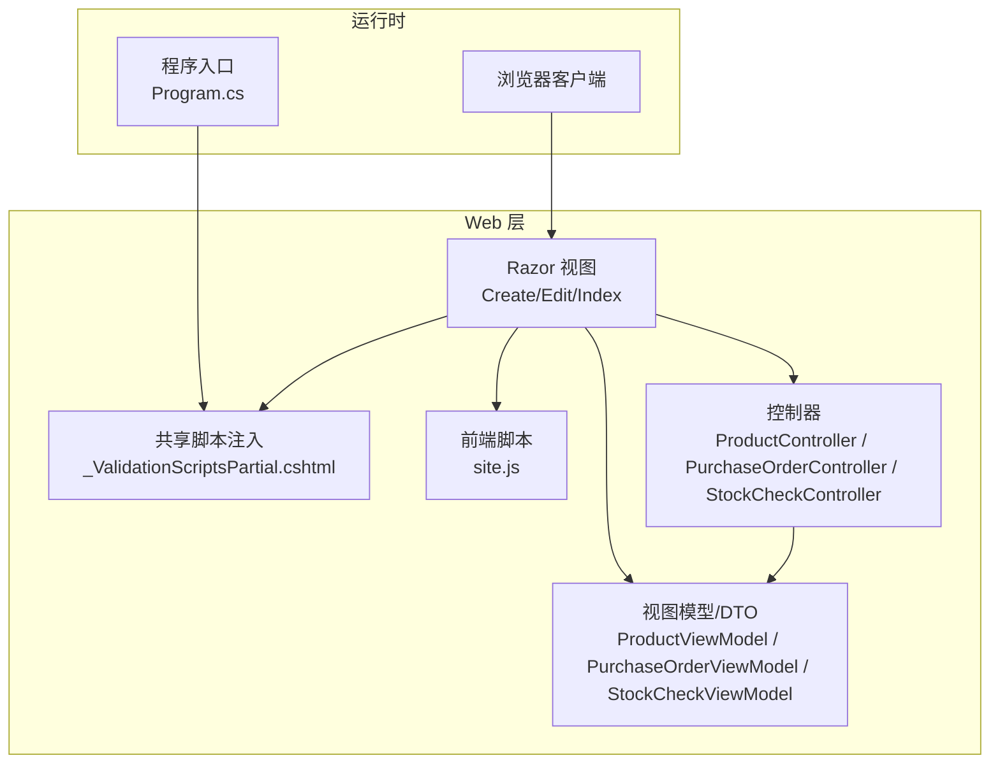
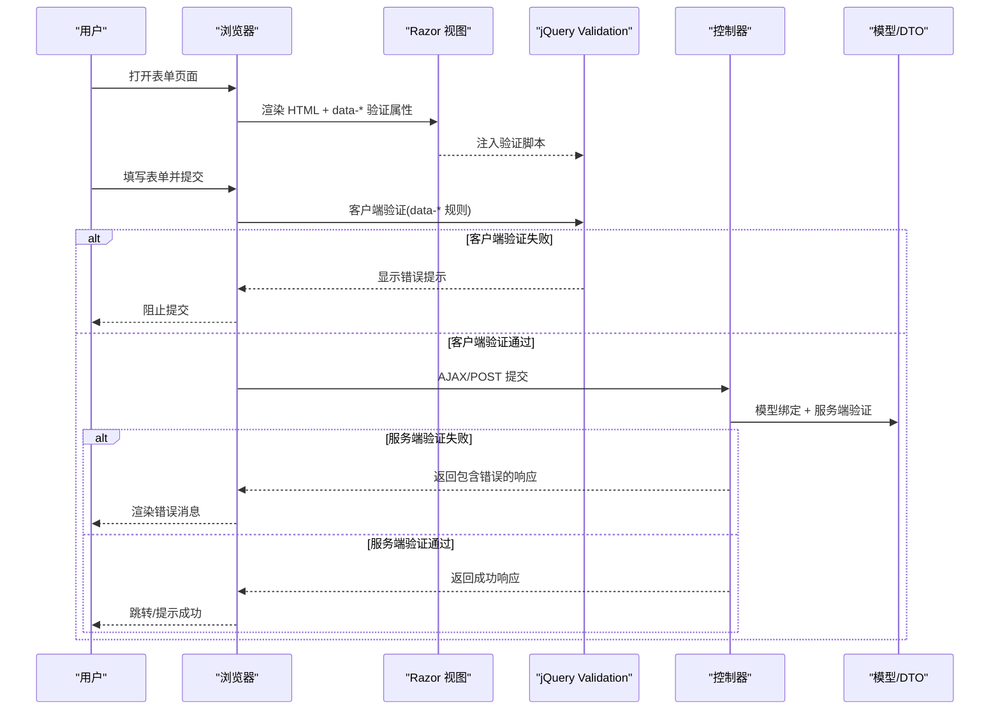
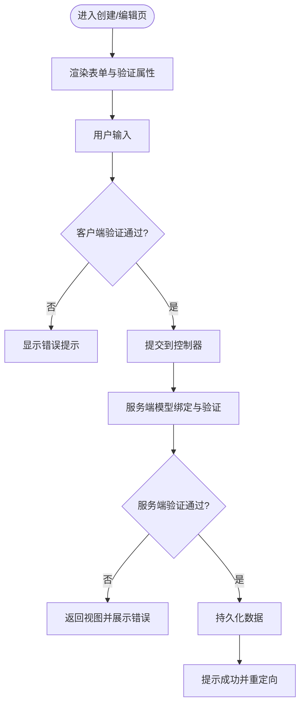
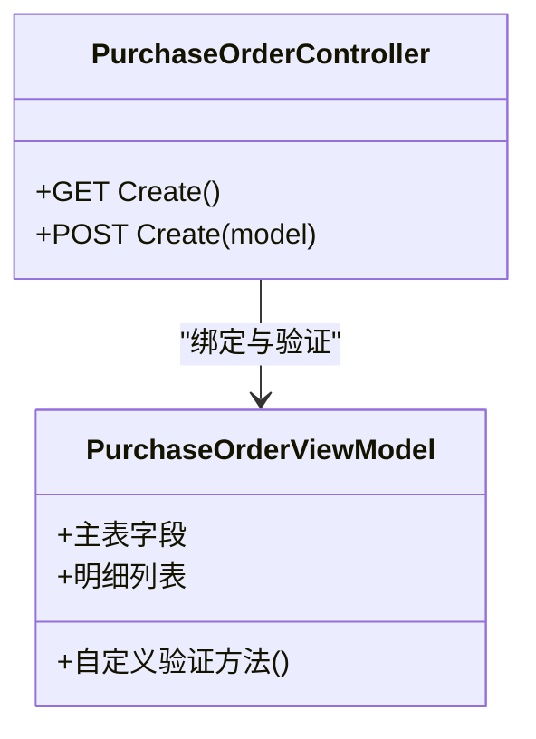
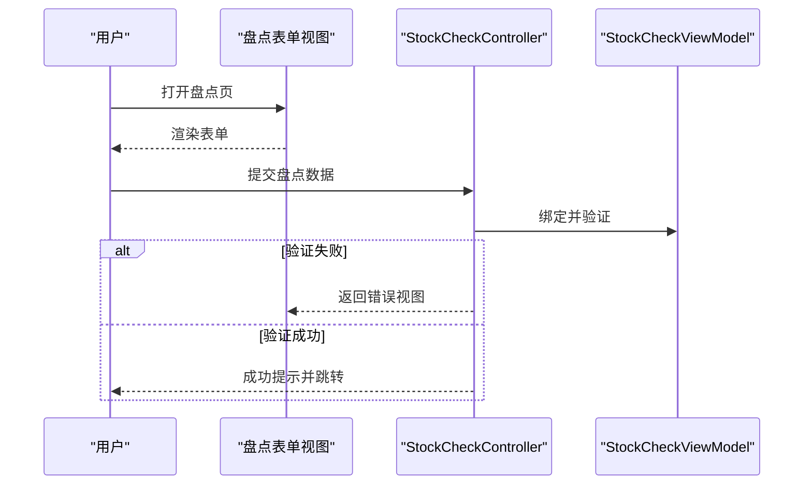
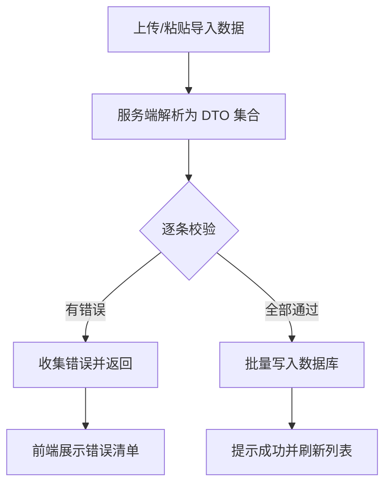
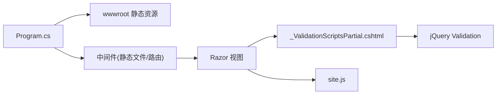

# 表单验证与交互

<cite>
**本文引用的文件**   
- [Program.cs](file://EquipmentIMS.Web/Program.cs)
- [_ValidationScriptsPartial.cshtml](file://EquipmentIMS.Web/Views/Shared/_ValidationScriptsPartial.cshtml)
- [site.js](file://EquipmentIMS.Web/wwwroot/js/site.js)
- [Create.cshtml](file://EquipmentIMS.Web/Views/Product/Create.cshtml)
- [Edit.cshtml](file://EquipmentIMS.Web/Views/Product/Edit.cshtml)
- [ProductViewModel.cs](file://EquipmentIMS.Web/Models/ProductViewModel.cs)
- [ProductController.cs](file://EquipmentIMS.Web/Controllers/ProductController.cs)
- [PurchaseOrderViewModel.cs](file://EquipmentIMS.Web/Models/PurchaseOrderViewModel.cs)
- [PurchaseOrderController.cs](file://EquipmentIMS.Web/Controllers/PurchaseOrderController.cs)
- [StockCheckViewModel.cs](file://EquipmentIMS.Web/Models/StockCheckViewModel.cs)
- [StockCheckController.cs](file://EquipmentIMS.Web/Controllers/StockCheckController.cs)
- [InitialImportDto.cs](file://EquipmentIMS.Models/DTOs/InitialImportDto.cs)
- [UserCreateEditDto.cs](file://EquipmentIMS.Models/DTOs/UserCreateEditDto.cs)
</cite>

## 目录
1. [简介](#简介)
2. [项目结构](#项目结构)
3. [核心组件](#核心组件)
4. [架构总览](#架构总览)
5. [详细组件分析](#详细组件分析)
6. [依赖关系分析](#依赖关系分析)
7. [性能考虑](#性能考虑)
8. [故障排查指南](#故障排查指南)
9. [结论](#结论)
10. [附录](#附录)

## 简介
本章节聚焦 THMS 系统的客户端表单验证与交互，覆盖以下主题：
- 客户端验证实现方式（内置规则与自定义逻辑）
- 动态表单元素的生成与验证规则绑定
- 实时验证与用户反馈（错误提示、成功确认）
- 复杂表单处理（级联选择、动态字段、批量编辑）
- 表单数据序列化与提交最佳实践
- 表单性能优化与无障碍访问支持

## 项目结构
THMS 采用 ASP.NET Core MVC 分层架构。与表单验证与交互直接相关的代码主要位于 Web 层：
- 视图模型与 DTO：定义服务端校验规则与数据结构
- Razor 视图：承载表单 UI、引入验证脚本、渲染错误信息
- 控制器：接收并验证模型，返回结果或错误
- 前端脚本：增强交互体验（如 Select2、AJAX 提交等）
- 全局配置：注册中间件与服务，确保验证脚本正确加载

图表来源
- [Program.cs](file://EquipmentIMS.Web/Program.cs)
- [_ValidationScriptsPartial.cshtml](file://EquipmentIMS.Web/Views/Shared/_ValidationScriptsPartial.cshtml)
- [site.js](file://EquipmentIMS.Web/wwwroot/js/site.js)
- [Create.cshtml](file://EquipmentIMS.Web/Views/Product/Create.cshtml)
- [Edit.cshtml](file://EquipmentIMS.Web/Views/Product/Edit.cshtml)
- [ProductViewModel.cs](file://EquipmentIMS.Web/Models/ProductViewModel.cs)
- [ProductController.cs](file://EquipmentIMS.Web/Controllers/ProductController.cs)
- [PurchaseOrderViewModel.cs](file://EquipmentIMS.Web/Models/PurchaseOrderViewModel.cs)
- [PurchaseOrderController.cs](file://EquipmentIMS.Web/Controllers/PurchaseOrderController.cs)
- [StockCheckViewModel.cs](file://EquipmentIMS.Web/Models/StockCheckViewModel.cs)
- [StockCheckController.cs](file://EquipmentIMS.Web/Controllers/StockCheckController.cs)

章节来源
- [Program.cs](file://EquipmentIMS.Web/Program.cs)
- [_ValidationScriptsPartial.cshtml](file://EquipmentIMS.Web/Views/Shared/_ValidationScriptsPartial.cshtml)
- [site.js](file://EquipmentIMS.Web/wwwroot/js/site.js)
- [Create.cshtml](file://EquipmentIMS.Web/Views/Product/Create.cshtml)
- [Edit.cshtml](file://EquipmentIMS.Web/Views/Product/Edit.cshtml)
- [ProductViewModel.cs](file://EquipmentIMS.Web/Models/ProductViewModel.cs)
- [ProductController.cs](file://EquipmentIMS.Web/Controllers/ProductController.cs)
- [PurchaseOrderViewModel.cs](file://EquipmentIMS.Web/Models/PurchaseOrderViewModel.cs)
- [PurchaseOrderController.cs](file://EquipmentIMS.Web/Controllers/PurchaseOrderController.cs)
- [StockCheckViewModel.cs](file://EquipmentIMS.Web/Models/StockCheckViewModel.cs)
- [StockCheckController.cs](file://EquipmentIMS.Web/Controllers/StockCheckController.cs)

## 核心组件
- 服务端校验规则
  - 通过视图模型与 DTO 的注解属性声明必填、长度、范围、正则等规则，由 MVC 在模型绑定阶段自动执行。
  - 典型示例路径：[ProductViewModel.cs](file://EquipmentIMS.Web/Models/ProductViewModel.cs)、[PurchaseOrderViewModel.cs](file://EquipmentIMS.Web/Models/PurchaseOrderViewModel.cs)、[StockCheckViewModel.cs](file://EquipmentIMS.Web/Models/StockCheckViewModel.cs)、[InitialImportDto.cs](file://EquipmentIMS.Models/DTOs/InitialImportDto.cs)、[UserCreateEditDto.cs](file://EquipmentIMS.Models/DTOs/UserCreateEditDto.cs)。
- 客户端验证脚本
  - 通过共享部分视图统一注入 jQuery Validation 与 unobtrusive 脚本，使 Razor 生成的 data-* 属性驱动客户端验证。
  - 参考路径：[_ValidationScriptsPartial.cshtml](file://EquipmentIMS.Web/Views/Shared/_ValidationScriptsPartial.cshtml)。
- 控制器模型状态处理
  - 控制器在 POST 动作中检查 ModelState.IsValid，结合服务端校验结果返回错误或重定向到成功页面。
  - 参考路径：[ProductController.cs](file://EquipmentIMS.Web/Controllers/ProductController.cs)、[PurchaseOrderController.cs](file://EquipmentIMS.Web/Controllers/PurchaseOrderController.cs)、[StockCheckController.cs](file://EquipmentIMS.Web/Controllers/StockCheckController.cs)。
- 前端增强脚本
  - site.js 提供通用交互能力（例如初始化第三方控件、AJAX 提交、错误提示等）。
  - 参考路径：[site.js](file://EquipmentIMS.Web/wwwroot/js/site.js)。

章节来源
- [ProductViewModel.cs](file://EquipmentIMS.Web/Models/ProductViewModel.cs)
- [PurchaseOrderViewModel.cs](file://EquipmentIMS.Web/Models/PurchaseOrderViewModel.cs)
- [StockCheckViewModel.cs](file://EquipmentIMS.Web/Models/StockCheckViewModel.cs)
- [InitialImportDto.cs](file://EquipmentIMS.Models/DTOs/InitialImportDto.cs)
- [UserCreateEditDto.cs](file://EquipmentIMS.Models/DTOs/UserCreateEditDto.cs)
- [_ValidationScriptsPartial.cshtml](file://EquipmentIMS.Web/Views/Shared/_ValidationScriptsPartial.cshtml)
- [ProductController.cs](file://EquipmentIMS.Web/Controllers/ProductController.cs)
- [PurchaseOrderController.cs](file://EquipmentIMS.Web/Controllers/PurchaseOrderController.cs)
- [StockCheckController.cs](file://EquipmentIMS.Web/Controllers/StockCheckController.cs)
- [site.js](file://EquipmentIMS.Web/wwwroot/js/site.js)

## 架构总览
下图展示了从浏览器到控制器的完整请求流程，以及服务端与客户端验证的协作点。

图表来源
- [_ValidationScriptsPartial.cshtml](file://EquipmentIMS.Web/Views/Shared/_ValidationScriptsPartial.cshtml)
- [site.js](file://EquipmentIMS.Web/wwwroot/js/site.js)
- [ProductController.cs](file://EquipmentIMS.Web/Controllers/ProductController.cs)
- [ProductViewModel.cs](file://EquipmentIMS.Web/Models/ProductViewModel.cs)

## 详细组件分析

### 产品管理表单（创建/编辑）
- 服务端规则
  - 使用视图模型上的注解定义字段约束（如必填、长度、数值范围等），在服务端进行强校验。
  - 参考路径：[ProductViewModel.cs](file://EquipmentIMS.Web/Models/ProductViewModel.cs)
- 客户端行为
  - 视图引用共享验证脚本，自动生成 data-* 属性；jQuery Validation 基于这些属性进行即时校验。
  - 参考路径：[Create.cshtml](file://EquipmentIMS.Web/Views/Product/Create.cshtml)、[Edit.cshtml](file://EquipmentIMS.Web/Views/Product/Edit.cshtml)、[_ValidationScriptsPartial.cshtml](file://EquipmentIMS.Web/Views/Shared/_ValidationScriptsPartial.cshtml)
- 控制器处理
  - 在 POST 动作中检查 ModelState，若无效则返回视图并携带错误信息；有效则保存并跳转。
  - 参考路径：[ProductController.cs](file://EquipmentIMS.Web/Controllers/ProductController.cs)

图表来源
- [Create.cshtml](file://EquipmentIMS.Web/Views/Product/Create.cshtml)
- [Edit.cshtml](file://EquipmentIMS.Web/Views/Product/Edit.cshtml)
- [_ValidationScriptsPartial.cshtml](file://EquipmentIMS.Web/Views/Shared/_ValidationScriptsPartial.cshtml)
- [ProductController.cs](file://EquipmentIMS.Web/Controllers/ProductController.cs)
- [ProductViewModel.cs](file://EquipmentIMS.Web/Models/ProductViewModel.cs)

章节来源
- [Create.cshtml](file://EquipmentIMS.Web/Views/Product/Create.cshtml)
- [Edit.cshtml](file://EquipmentIMS.Web/Views/Product/Edit.cshtml)
- [_ValidationScriptsPartial.cshtml](file://EquipmentIMS.Web/Views/Shared/_ValidationScriptsPartial.cshtml)
- [ProductController.cs](file://EquipmentIMS.Web/Controllers/ProductController.cs)
- [ProductViewModel.cs](file://EquipmentIMS.Web/Models/ProductViewModel.cs)

### 采购订单表单（含明细行）
- 复杂表单特征
  - 主表+明细行的组合表单，通常涉及动态添加/删除明细行、整体验证（如至少一行明细、金额合计校验等）。
- 服务端规则
  - 使用嵌套集合类型的视图模型表达明细行，并在模型上定义集合级验证逻辑。
  - 参考路径：[PurchaseOrderViewModel.cs](file://EquipmentIMS.Web/Models/PurchaseOrderViewModel.cs)
- 控制器处理
  - 在 POST 中校验主从模型状态，必要时返回带错误的视图或 JSON 响应。
  - 参考路径：[PurchaseOrderController.cs](file://EquipmentIMS.Web/Controllers/PurchaseOrderController.cs)

图表来源
- [PurchaseOrderViewModel.cs](file://EquipmentIMS.Web/Models/PurchaseOrderViewModel.cs)
- [PurchaseOrderController.cs](file://EquipmentIMS.Web/Controllers/PurchaseOrderController.cs)

章节来源
- [PurchaseOrderViewModel.cs](file://EquipmentIMS.Web/Models/PurchaseOrderViewModel.cs)
- [PurchaseOrderController.cs](file://EquipmentIMS.Web/Controllers/PurchaseOrderController.cs)

### 盘点录入表单（库存盘点）
- 业务特性
  - 盘点场景常包含大量明细行与汇总计算，需要保证数据一致性与完整性。
- 服务端规则
  - 使用专门的视图模型组织盘点数据，并在服务端进行一致性校验。
  - 参考路径：[StockCheckViewModel.cs](file://EquipmentIMS.Web/Models/StockCheckViewModel.cs)
- 控制器处理
  - 在 POST 中完成校验与持久化，返回相应结果。
  - 参考路径：[StockCheckController.cs](file://EquipmentIMS.Web/Controllers/StockCheckController.cs)

图表来源
- [StockCheckViewModel.cs](file://EquipmentIMS.Web/Models/StockCheckViewModel.cs)
- [StockCheckController.cs](file://EquipmentIMS.Web/Controllers/StockCheckController.cs)

章节来源
- [StockCheckViewModel.cs](file://EquipmentIMS.Web/Models/StockCheckViewModel.cs)
- [StockCheckController.cs](file://EquipmentIMS.Web/Controllers/StockCheckController.cs)

### 导入与批量操作（初始库存导入）
- 批量数据导入
  - 通过 DTO 定义导入数据的结构与约束，服务端对每条记录进行校验并汇总错误。
  - 参考路径：[InitialImportDto.cs](file://EquipmentIMS.Models/DTOs/InitialImportDto.cs)
- 用户反馈
  - 将服务端错误聚合后返回给前端，便于用户定位问题并修正。

图表来源
- [InitialImportDto.cs](file://EquipmentIMS.Models/DTOs/InitialImportDto.cs)

章节来源
- [InitialImportDto.cs](file://EquipmentIMS.Models/DTOs/InitialImportDto.cs)

### 用户管理（密码修改）
- 安全相关字段
  - 密码类字段通常需要额外校验（如复杂度、新旧密码一致性等）。
  - 参考路径：[UserCreateEditDto.cs](file://EquipmentIMS.Models/DTOs/UserCreateEditDto.cs)
- 控制器处理
  - 在对应控制器中执行服务端验证并给出明确反馈。

章节来源
- [UserCreateEditDto.cs](file://EquipmentIMS.Models/DTOs/UserCreateEditDto.cs)

## 依赖关系分析
- 全局脚本注入
  - 程序入口负责启用静态文件与中间件，确保验证脚本可被正确访问。
  - 参考路径：[Program.cs](file://EquipmentIMS.Web/Program.cs)
- 验证脚本加载
  - 共享部分视图统一引入 jQuery Validation 与 unobtrusive 脚本，供各表单复用。
  - 参考路径：[_ValidationScriptsPartial.cshtml](file://EquipmentIMS.Web/Views/Shared/_ValidationScriptsPartial.cshtml)
- 前端增强
  - site.js 提供通用交互逻辑，避免在各视图中重复编写。
  - 参考路径：[site.js](file://EquipmentIMS.Web/wwwroot/js/site.js)

图表来源
- [Program.cs](file://EquipmentIMS.Web/Program.cs)
- [_ValidationScriptsPartial.cshtml](file://EquipmentIMS.Web/Views/Shared/_ValidationScriptsPartial.cshtml)
- [site.js](file://EquipmentIMS.Web/wwwroot/js/site.js)

章节来源
- [Program.cs](file://EquipmentIMS.Web/Program.cs)
- [_ValidationScriptsPartial.cshtml](file://EquipmentIMS.Web/Views/Shared/_ValidationScriptsPartial.cshtml)
- [site.js](file://EquipmentIMS.Web/wwwroot/js/site.js)

## 性能考虑
- 减少不必要的脚本加载
  - 仅在需要的视图中引入验证脚本，避免全局重复加载。
- 延迟与按需验证
  - 对大型表单可采用分步验证或懒加载明细行，降低首屏压力。
- 缓存与预取
  - 对下拉选项等静态数据做缓存，减少重复请求。
- 提交节流与去抖
  - 对高频输入（搜索、筛选）使用去抖策略，避免频繁触发验证或网络请求。
- 服务端批量校验优化
  - 对导入等批量场景，尽量并行化校验逻辑并尽早短路失败项，减少整体耗时。

## 故障排查指南
- 客户端验证不生效
  - 检查是否已引入共享验证脚本与 jQuery Validation 库。
  - 确认 Razor 生成的 data-* 属性是否存在且格式正确。
  - 参考路径：[_ValidationScriptsPartial.cshtml](file://EquipmentIMS.Web/Views/Shared/_ValidationScriptsPartial.cshtml)
- 服务端验证未触发
  - 确认控制器 POST 动作是否正确检查 ModelState。
  - 检查视图模型/DTO 上的校验注解是否齐全。
  - 参考路径：[ProductController.cs](file://EquipmentIMS.Web/Controllers/ProductController.cs)、[ProductViewModel.cs](file://EquipmentIMS.Web/Models/ProductViewModel.cs)
- 动态表单元素未绑定验证
  - 对于动态插入的 DOM，需重新初始化验证器或调用其更新方法以识别新元素。
  - 参考路径：[site.js](file://EquipmentIMS.Web/wwwroot/js/site.js)
- 批量导入错误定位困难
  - 确保服务端返回结构化错误信息（按行/字段），前端清晰展示。
  - 参考路径：[InitialImportDto.cs](file://EquipmentIMS.Models/DTOs/InitialImportDto.cs)

章节来源
- [_ValidationScriptsPartial.cshtml](file://EquipmentIMS.Web/Views/Shared/_ValidationScriptsPartial.cshtml)
- [ProductController.cs](file://EquipmentIMS.Web/Controllers/ProductController.cs)
- [ProductViewModel.cs](file://EquipmentIMS.Web/Models/ProductViewModel.cs)
- [site.js](file://EquipmentIMS.Web/wwwroot/js/site.js)
- [InitialImportDto.cs](file://EquipmentIMS.Models/DTOs/InitialImportDto.cs)

## 结论
THMS 的表单验证与交互遵循“服务端强校验 + 客户端友好反馈”的原则：
- 服务端通过视图模型/DTO 的注解与自定义逻辑保障数据正确性
- 客户端借助 jQuery Validation 与 unobtrusive 脚本提升用户体验
- 复杂表单通过视图模型组织主从关系，控制器集中处理校验与持久化
- 批量导入与复杂场景通过 DTO 与结构化错误反馈提高可维护性与可诊断性

## 附录
- 最佳实践建议
  - 始终在服务端进行最终校验，客户端仅用于提升体验
  - 为所有关键字段提供清晰的错误提示与帮助文本
  - 对动态表单元素，确保在插入后重新绑定验证
  - 对批量操作，提供进度反馈与错误摘要
  - 关注无障碍访问：为错误区域设置 aria-live，为必填字段标注 required 与 aria-required