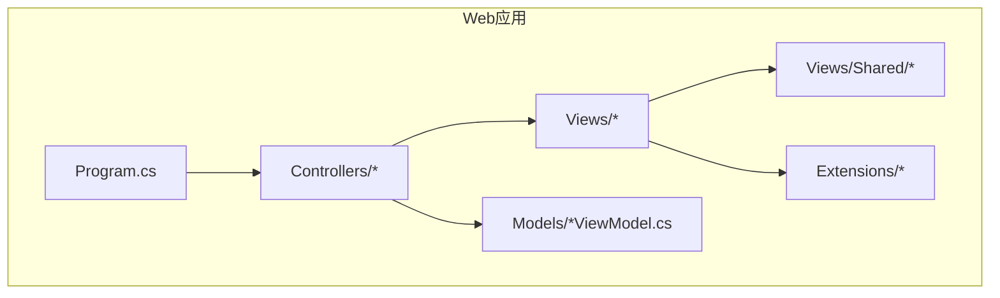
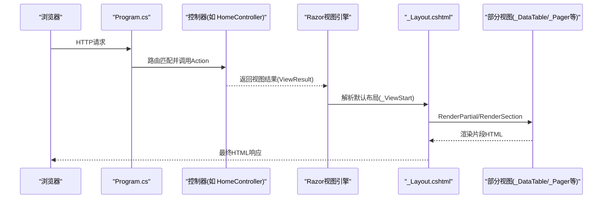
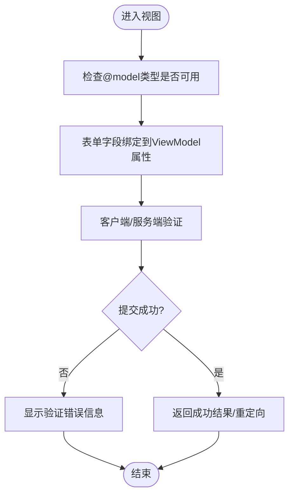
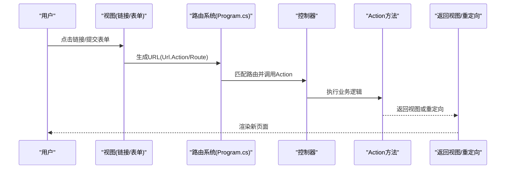
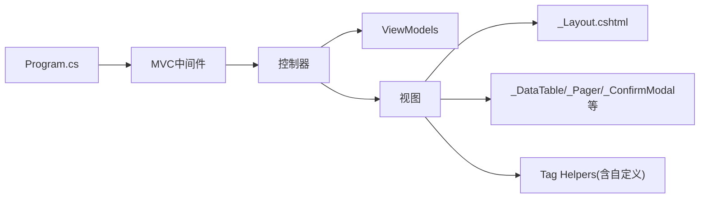

# MVC视图开发

<cite>
**本文引用的文件**   
- [Program.cs](file://EquipmentIMS.Web/Program.cs)
- [_ViewStart.cshtml](file://EquipmentIMS.Web/Views/_ViewStart.cshtml)
- [_ViewImports.cshtml](file://EquipmentIMS.Web/Views/_ViewImports.cshtml)
- [_Layout.cshtml](file://EquipmentIMS.Web/Views/Shared/_Layout.cshtml)
- [_LoginLayout.cshtml](file://EquipmentIMS.Web/Views/Shared/_LoginLayout.cshtml)
- [_DataTable.cshtml](file://EquipmentIMS.Web/Views/Shared/_DataTable.cshtml)
- [_Pager.cshtml](file://EquipmentIMS.Web/Views/Shared/_Pager.cshtml)
- [_ConfirmModal.cshtml](file://EquipmentIMS.Web/Views/Shared/_ConfirmModal.cshtml)
- [_Loading.cshtml](file://EquipmentIMS.Web/Views/Shared/_Loading.cshtml)
- [_EmptyState.cshtml](file://EquipmentIMS.Web/Views/Shared/_EmptyState.cshtml)
- [_ValidationScriptsPartial.cshtml](file://EquipmentIMS.Web/Views/Shared/_ValidationScriptsPartial.cshtml)
- [HomeController.cs](file://EquipmentIMS.Web/Controllers/HomeController.cs)
- [CategoryController.cs](file://EquipmentIMS.Web/Controllers/CategoryController.cs)
- [ProductViewModel.cs](file://EquipmentIMS.Web/Models/ProductViewModel.cs)
- [CategoryViewModel.cs](file://EquipmentIMS.Web/Models/CategoryViewModel.cs)
- [Index.cshtml](file://EquipmentIMS.Web/Views/Home/Index.cshtml)
- [Create.cshtml](file://EquipmentIMS.Web/Views/Category/Create.cshtml)
- [Edit.cshtml](file://EquipmentIMS.Web/Views/Category/Edit.cshtml)
- [PermissionTagHelper.cs](file://EquipmentIMS.Web/Extensions/PermissionTagHelper.cs)
</cite>

## 目录
1. [简介](#简介)
2. [项目结构](#项目结构)
3. [核心组件](#核心组件)
4. [架构总览](#架构总览)
5. [详细组件分析](#详细组件分析)
6. [依赖关系分析](#依赖关系分析)
7. [性能考虑](#性能考虑)
8. [故障排查指南](#故障排查指南)
9. [结论](#结论)
10. [附录](#附录)

## 简介
本文件面向THMS系统的MVC视图开发，聚焦Razor视图引擎的使用与最佳实践。内容涵盖：
- 视图结构与布局模板设计模式（_Layout.cshtml）
- 部分视图的创建与复用机制
- _ViewStart.cshtml与_ViewImports.cshtml的配置作用
- ViewModel与视图的数据绑定、强类型视图规范
- 页面导航、路由配置与URL生成
- 视图优化技巧与工程化建议

目标是帮助开发者快速理解并高质量地实现THMS的Web界面层。

## 项目结构
THMS采用分层架构，Web层位于EquipmentIMS.Web中，视图统一放置在Views目录下，按控制器命名空间组织；共享布局与通用UI片段放在Views/Shared下。

图表来源
- [Program.cs](file://EquipmentIMS.Web/Program.cs)
- [HomeController.cs](file://EquipmentIMS.Web/Controllers/HomeController.cs)
- [_Layout.cshtml](file://EquipmentIMS.Web/Views/Shared/_Layout.cshtml)
- [ProductViewModel.cs](file://EquipmentIMS.Web/Models/ProductViewModel.cs)
- [PermissionTagHelper.cs](file://EquipmentIMS.Web/Extensions/PermissionTagHelper.cs)

章节来源
- [Program.cs](file://EquipmentIMS.Web/Program.cs)

## 核心组件
- 全局启动与中间件注册：在Program.cs中完成MVC、静态文件、异常处理等基础服务注册与管道配置，为视图渲染提供运行环境。
- 视图入口与默认布局：_ViewStart.cshtml决定每个视图的默认布局；_ViewImports.cshtml集中声明命名空间、Tag Helper、Tag Helper包等，减少重复引用。
- 布局模板：_Layout.cshtml定义站点级HTML骨架、头部、侧边栏、页脚与主内容区；_LoginLayout.cshtml用于登录等独立页面。
- 部分视图：_DataTable.cshtml、_Pager.cshtml、_ConfirmModal.cshtml、_Loading.cshtml、_EmptyState.cshtml、_ValidationScriptsPartial.cshtml等，封装可复用的UI片段。
- 强类型视图与数据绑定：通过控制器返回具体ViewModel，视图中使用@model声明类型，结合表单标签助手进行双向绑定与验证。
- 权限辅助：自定义Tag Helper（如PermissionTagHelper）在视图中以声明式方式控制菜单或按钮的可见性。

章节来源
- [Program.cs](file://EquipmentIMS.Web/Program.cs)
- [_ViewStart.cshtml](file://EquipmentIMS.Web/Views/_ViewStart.cshtml)
- [_ViewImports.cshtml](file://EquipmentIMS.Web/Views/_ViewImports.cshtml)
- [_Layout.cshtml](file://EquipmentIMS.Web/Views/Shared/_Layout.cshtml)
- [_LoginLayout.cshtml](file://EquipmentIMS.Web/Views/Shared/_LoginLayout.cshtml)
- [_DataTable.cshtml](file://EquipmentIMS.Web/Views/Shared/_DataTable.cshtml)
- [_Pager.cshtml](file://EquipmentIMS.Web/Views/Shared/_Pager.cshtml)
- [_ConfirmModal.cshtml](file://EquipmentIMS.Web/Views/Shared/_ConfirmModal.cshtml)
- [_Loading.cshtml](file://EquipmentIMS.Web/Views/Shared/_Loading.cshtml)
- [_EmptyState.cshtml](file://EquipmentIMS.Web/Views/Shared/_EmptyState.cshtml)
- [_ValidationScriptsPartial.cshtml](file://EquipmentIMS.Web/Views/Shared/_ValidationScriptsPartial.cshtml)
- [PermissionTagHelper.cs](file://EquipmentIMS.Web/Extensions/PermissionTagHelper.cs)

## 架构总览
下图展示从请求到视图渲染的关键路径，以及布局与部分视图的组合关系。

图表来源
- [Program.cs](file://EquipmentIMS.Web/Program.cs)
- [HomeController.cs](file://EquipmentIMS.Web/Controllers/HomeController.cs)
- [_ViewStart.cshtml](file://EquipmentIMS.Web/Views/_ViewStart.cshtml)
- [_Layout.cshtml](file://EquipmentIMS.Web/Views/Shared/_Layout.cshtml)
- [_DataTable.cshtml](file://EquipmentIMS.Web/Views/Shared/_DataTable.cshtml)
- [_Pager.cshtml](file://EquipmentIMS.Web/Views/Shared/_Pager.cshtml)

## 详细组件分析

### 视图引擎与全局配置
- _ViewStart.cshtml：设置所有视图的默认布局，避免在每个视图中重复指定。
- _ViewImports.cshtml：集中引入命名空间、Tag Helper、Tag Helper包，提升视图可读性与一致性。
- Program.cs：启用MVC、静态文件、错误页、认证授权等中间件，确保视图能正确渲染与资源访问。

章节来源
- [_ViewStart.cshtml](file://EquipmentIMS.Web/Views/_ViewStart.cshtml)
- [_ViewImports.cshtml](file://EquipmentIMS.Web/Views/_ViewImports.cshtml)
- [Program.cs](file://EquipmentIMS.Web/Program.cs)

### 布局模板设计模式
- _Layout.cshtml：定义站点级HTML骨架，包含公共CSS/JS、导航、侧边栏、页脚与主内容区。子视图通过@section注入特定脚本或样式。
- _LoginLayout.cshtml：针对登录等独立页面的简化布局，不包含业务侧边栏与复杂导航。
- 推荐做法：将通用UI元素（如分页、表格、确认弹窗、加载遮罩、空状态提示）抽离为部分视图，由布局或页面按需组合。

章节来源
- [_Layout.cshtml](file://EquipmentIMS.Web/Views/Shared/_Layout.cshtml)
- [_LoginLayout.cshtml](file://EquipmentIMS.Web/Views/Shared/_LoginLayout.cshtml)

### 部分视图的创建与复用
- 常用部分视图：
  - _DataTable.cshtml：封装表格渲染逻辑，支持列定义、排序、筛选等。
  - _Pager.cshtml：分页控件，接收页码、总数、每页条数等参数。
  - _ConfirmModal.cshtml：统一的确认弹窗，便于跨页面复用。
  - _Loading.cshtml：异步操作时的加载遮罩。
  - _EmptyState.cshtml：无数据时的友好提示。
  - _ValidationScriptsPartial.cshtml：统一引入客户端验证脚本。
- 使用方式：在布局或页面中使用局部渲染指令引入，并传入所需模型或参数。

章节来源
- [_DataTable.cshtml](file://EquipmentIMS.Web/Views/Shared/_DataTable.cshtml)
- [_Pager.cshtml](file://EquipmentIMS.Web/Views/Shared/_Pager.cshtml)
- [_ConfirmModal.cshtml](file://EquipmentIMS.Web/Views/Shared/_ConfirmModal.cshtml)
- [_Loading.cshtml](file://EquipmentIMS.Web/Views/Shared/_Loading.cshtml)
- [_EmptyState.cshtml](file://EquipmentIMS.Web/Views/Shared/_EmptyState.cshtml)
- [_ValidationScriptsPartial.cshtml](file://EquipmentIMS.Web/Views/Shared/_ValidationScriptsPartial.cshtml)

### 强类型视图与数据绑定
- 控制器返回强类型ViewModel，例如ProductViewModel、CategoryViewModel等。
- 视图顶部使用@model声明类型，配合表单标签助手实现属性绑定与验证显示。
- 示例参考：
  - 首页视图：[Index.cshtml](file://EquipmentIMS.Web/Views/Home/Index.cshtml)
  - 分类创建/编辑视图：[Create.cshtml](file://EquipmentIMS.Web/Views/Category/Create.cshtml)、[Edit.cshtml](file://EquipmentIMS.Web/Views/Category/Edit.cshtml)
  - 相关ViewModel：[ProductViewModel.cs](file://EquipmentIMS.Web/Models/ProductViewModel.cs)、[CategoryViewModel.cs](file://EquipmentIMS.Web/Models/CategoryViewModel.cs)

图表来源
- [Create.cshtml](file://EquipmentIMS.Web/Views/Category/Create.cshtml)
- [Edit.cshtml](file://EquipmentIMS.Web/Views/Category/Edit.cshtml)
- [CategoryViewModel.cs](file://EquipmentIMS.Web/Models/CategoryViewModel.cs)

章节来源
- [Index.cshtml](file://EquipmentIMS.Web/Views/Home/Index.cshtml)
- [Create.cshtml](file://EquipmentIMS.Web/Views/Category/Create.cshtml)
- [Edit.cshtml](file://EquipmentIMS.Web/Views/Category/Edit.cshtml)
- [ProductViewModel.cs](file://EquipmentIMS.Web/Models/ProductViewModel.cs)
- [CategoryViewModel.cs](file://EquipmentIMS.Web/Models/CategoryViewModel.cs)

### 页面导航、路由配置与URL生成
- 路由配置：在Program.cs中注册MVC与默认路由规则，使控制器Action映射到URL。
- 页面导航：在视图中使用链接生成器或标签助手生成URL，避免硬编码路径。
- URL生成：推荐使用Url.Action、Url.RouteUrl或带名称的路由，保证重构安全与一致性。
- 参考位置：
  - 路由与中间件注册：[Program.cs](file://EquipmentIMS.Web/Program.cs)
  - 控制器示例：[HomeController.cs](file://EquipmentIMS.Web/Controllers/HomeController.cs)、[CategoryController.cs](file://EquipmentIMS.Web/Controllers/CategoryController.cs)

图表来源
- [Program.cs](file://EquipmentIMS.Web/Program.cs)
- [HomeController.cs](file://EquipmentIMS.Web/Controllers/HomeController.cs)
- [CategoryController.cs](file://EquipmentIMS.Web/Controllers/CategoryController.cs)

章节来源
- [Program.cs](file://EquipmentIMS.Web/Program.cs)
- [HomeController.cs](file://EquipmentIMS.Web/Controllers/HomeController.cs)
- [CategoryController.cs](file://EquipmentIMS.Web/Controllers/CategoryController.cs)

### 权限控制与Tag Helper
- 自定义Tag Helper（如PermissionTagHelper）可在视图中以声明式方式控制菜单项或按钮的可见性，降低视图与权限逻辑的耦合。
- 典型用法：在视图中使用自定义标签包裹需要权限控制的元素，运行时根据当前用户权限决定是否渲染。

章节来源
- [PermissionTagHelper.cs](file://EquipmentIMS.Web/Extensions/PermissionTagHelper.cs)

## 依赖关系分析
- 视图对布局与部分视图存在组合依赖，布局负责整体结构，部分视图负责功能片段。
- 控制器与ViewModel之间为数据契约关系，视图仅消费ViewModel，不直接依赖领域模型或服务。
- Program.cs作为入口，串联MVC、静态资源、中间件，影响视图渲染与资源访问。

图表来源
- [Program.cs](file://EquipmentIMS.Web/Program.cs)
- [_Layout.cshtml](file://EquipmentIMS.Web/Views/Shared/_Layout.cshtml)
- [_DataTable.cshtml](file://EquipmentIMS.Web/Views/Shared/_DataTable.cshtml)
- [_Pager.cshtml](file://EquipmentIMS.Web/Views/Shared/_Pager.cshtml)
- [_ConfirmModal.cshtml](file://EquipmentIMS.Web/Views/Shared/_ConfirmModal.cshtml)

章节来源
- [Program.cs](file://EquipmentIMS.Web/Program.cs)

## 性能考虑
- 减少不必要的DOM与脚本：仅在需要的@section中引入页面专属脚本，避免全局重复加载。
- 缓存静态资源：合理设置浏览器缓存策略，利用版本化文件名提升缓存命中率。
- 分页与懒加载：列表页使用分页与虚拟滚动，避免一次性渲染大量数据。
- 部分视图拆分：将复杂页面拆分为多个部分视图，按需渲染，降低首屏压力。
- 避免在视图中执行重型计算：将数据处理下沉至控制器或服务层，视图只做展示。

## 故障排查指南
- 视图未找到：检查控制器返回的视图名与Views目录下的文件是否一致，确认命名空间与区域划分。
- 布局未生效：确认_ViewStart.cshtml是否正确设置默认布局，且布局文件路径有效。
- 命名空间缺失：若视图中出现类型未识别，检查_ViewImports.cshtml是否引入对应命名空间。
- 静态资源404：确认Program.cs中静态文件中间件已启用，且资源路径正确。
- 权限标签无效：检查自定义Tag Helper是否注册，以及当前用户权限上下文是否正确。

章节来源
- [_ViewStart.cshtml](file://EquipmentIMS.Web/Views/_ViewStart.cshtml)
- [_ViewImports.cshtml](file://EquipmentIMS.Web/Views/_ViewImports.cshtml)
- [Program.cs](file://EquipmentIMS.Web/Program.cs)
- [PermissionTagHelper.cs](file://EquipmentIMS.Web/Extensions/PermissionTagHelper.cs)

## 结论
THMS的MVC视图层遵循清晰的职责分离与复用原则：通过布局模板统一站点外观，通过部分视图封装通用UI，通过强类型视图与ViewModel保障数据绑定的安全性与可维护性。结合合理的路由与URL生成策略，以及自定义Tag Helper的权限控制，能够高效构建可扩展、易维护的Web界面。

## 附录
- 视图开发最佳实践清单：
  - 使用强类型视图与ViewModel，避免在视图中直接访问领域模型或服务。
  - 将通用UI片段抽取为部分视图，保持视图简洁。
  - 在_ViewImports.cshtml集中管理命名空间与Tag Helper，提升一致性。
  - 使用Url.Action/RouteUrl生成链接，避免硬编码路径。
  - 合理使用@section注入页面专属脚本与样式。
  - 对列表页实施分页与懒加载，提升用户体验。
  - 使用自定义Tag Helper进行权限控制，降低视图与权限逻辑耦合。