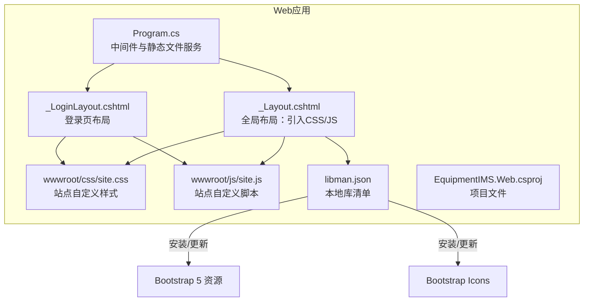
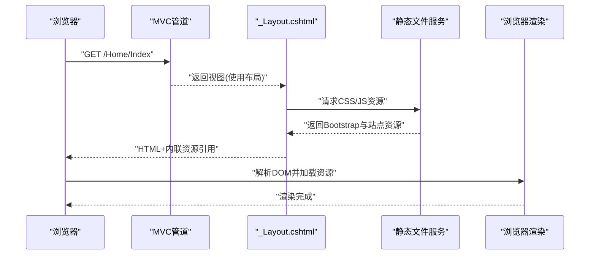
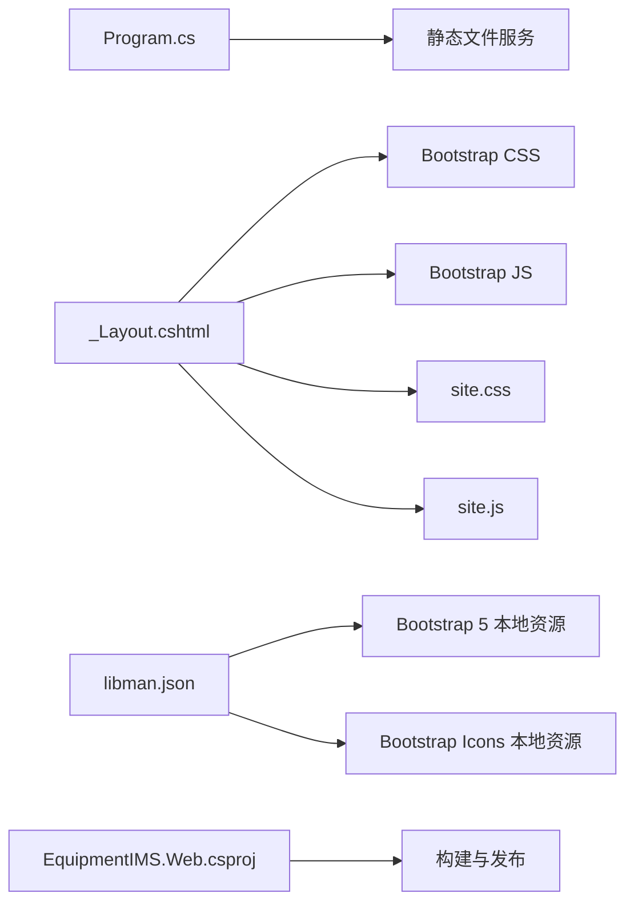

# Bootstrap框架集成

<cite>
**本文引用的文件**   
- [Program.cs](file://EquipmentIMS.Web/Program.cs)
- [_Layout.cshtml](file://EquipmentIMS.Web/Views/Shared/_Layout.cshtml)
- [_LoginLayout.cshtml](file://EquipmentIMS.Web/Views/Shared/_LoginLayout.cshtml)
- [site.css](file://EquipmentIMS.Web/wwwroot/css/site.css)
- [site.js](file://EquipmentIMS.Web/wwwroot/js/site.js)
- [libman.json](file://EquipmentIMS.Web/libman.json)
- [EquipmentIMS.Web.csproj](file://EquipmentIMS.Web/EquipmentIMS.Web.csproj)
</cite>

## 目录
1. [简介](#简介)
2. [项目结构](#项目结构)
3. [核心组件](#核心组件)
4. [架构总览](#架构总览)
5. [详细组件分析](#详细组件分析)
6. [依赖分析](#依赖分析)
7. [性能考虑](#性能考虑)
8. [故障排查指南](#故障排查指南)
9. [结论](#结论)
10. [附录](#附录)

## 简介
本文件面向THMS（设备库存管理系统）前端，系统性说明Bootstrap 5的引入方式、版本管理、CSS与JS加载顺序、网格系统与响应式布局实践、常用组件的定制与扩展、主题变量与字体配置、移动端适配最佳实践以及性能优化建议。文档以仓库中Web层实际文件为依据，确保内容可落地执行。

## 项目结构
THMS采用ASP.NET Core MVC，前端资源位于wwwroot目录，页面通过共享布局视图统一引入样式与脚本。Bootstrap相关资源通过本地库管理器（libman）进行版本管理与分发。

图表来源
- [Program.cs](file://EquipmentIMS.Web/Program.cs)
- [_Layout.cshtml](file://EquipmentIMS.Web/Views/Shared/_Layout.cshtml)
- [_LoginLayout.cshtml](file://EquipmentIMS.Web/Views/Shared/_LoginLayout.cshtml)
- [site.css](file://EquipmentIMS.Web/wwwroot/css/site.css)
- [site.js](file://EquipmentIMS.Web/wwwroot/js/site.js)
- [libman.json](file://EquipmentIMS.Web/libman.json)
- [EquipmentIMS.Web.csproj](file://EquipmentIMS.Web/EquipmentIMS.Web.csproj)

章节来源
- [Program.cs](file://EquipmentIMS.Web/Program.cs)
- [_Layout.cshtml](file://EquipmentIMS.Web/Views/Shared/_Layout.cshtml)
- [_LoginLayout.cshtml](file://EquipmentIMS.Web/Views/Shared/_LoginLayout.cshtml)
- [site.css](file://EquipmentIMS.Web/wwwroot/css/site.css)
- [site.js](file://EquipmentIMS.Web/wwwroot/js/site.js)
- [libman.json](file://EquipmentIMS.Web/libman.json)
- [EquipmentIMS.Web.csproj](file://EquipmentIMS.Web/EquipmentIMS.Web.csproj)

## 核心组件
- 静态资源托管与中间件：由程序入口启用静态文件服务，使wwwroot下的CSS/JS可被浏览器访问。
- 全局布局：_Layout.cshtml作为主布局，集中引入Bootstrap CSS/JS与站点自定义资源；_LoginLayout.cshtml用于登录页独立布局。
- 本地库管理：libman.json声明Bootstrap与图标等第三方库的版本与目标路径，便于团队一致化维护。
- 站点样式与脚本：site.css与site.js承载业务定制逻辑与覆盖样式。

章节来源
- [Program.cs](file://EquipmentIMS.Web/Program.cs)
- [_Layout.cshtml](file://EquipmentIMS.Web/Views/Shared/_Layout.cshtml)
- [_LoginLayout.cshtml](file://EquipmentIMS.Web/Views/Shared/_LoginLayout.cshtml)
- [site.css](file://EquipmentIMS.Web/wwwroot/css/site.css)
- [site.js](file://EquipmentIMS.Web/wwwroot/js/site.js)
- [libman.json](file://EquipmentIMS.Web/libman.json)

## 架构总览
下图展示从请求到渲染的关键链路：客户端请求页面，MVC路由到控制器并返回视图，视图基于布局注入Bootstrap与站点资源，最终在浏览器中渲染。

图表来源
- [Program.cs](file://EquipmentIMS.Web/Program.cs)
- [_Layout.cshtml](file://EquipmentIMS.Web/Views/Shared/_Layout.cshtml)

## 详细组件分析

### Bootstrap引入与版本管理
- 引入位置
  - 全局样式与脚本通常在布局视图中引入，确保所有页面统一生效。
  - 登录页可使用独立布局，按需引入最小化资源。
- 版本管理
  - 使用libman.json声明Bootstrap与图标库的目标版本与本地路径，保证团队成员与CI环境一致。
  - 通过命令行或IDE操作更新版本，避免手动复制文件导致不一致。
- 关键文件
  - 布局视图：_Layout.cshtml、_LoginLayout.cshtml
  - 本地库清单：libman.json
  - 静态资源：wwwroot/css/site.css、wwwroot/js/site.js

章节来源
- [_Layout.cshtml](file://EquipmentIMS.Web/Views/Shared/_Layout.cshtml)
- [_LoginLayout.cshtml](file://EquipmentIMS.Web/Views/Shared/_LoginLayout.cshtml)
- [libman.json](file://EquipmentIMS.Web/libman.json)
- [site.css](file://EquipmentIMS.Web/wwwroot/css/site.css)
- [site.js](file://EquipmentIMS.Web/wwwroot/js/site.js)

### CSS与JS加载顺序
- 推荐顺序
  - 先引入Bootstrap CSS，再引入站点自定义CSS，以便覆盖默认样式。
  - JS方面，优先引入jQuery（如需要）、Bootstrap JS，最后引入站点自定义脚本。
- 原因
  - 样式覆盖需遵循“后定义覆盖前定义”的级联规则。
  - 脚本依赖关系需满足“依赖在前、实现在后”。
- 参考位置
  - 布局视图中按顺序引入CSS/JS。

章节来源
- [_Layout.cshtml](file://EquipmentIMS.Web/Views/Shared/_Layout.cshtml)
- [_LoginLayout.cshtml](file://EquipmentIMS.Web/Views/Shared/_LoginLayout.cshtml)

### 网格系统与响应式布局
- 网格系统
  - 使用容器、行与列构建布局，列宽按断点控制。
  - 常用类包括容器、行、列及偏移、排序、对齐等辅助类。
- 响应式断点
  - 针对手机、平板、桌面等不同屏幕尺寸设置不同列数与间距。
  - 结合工具类实现显示/隐藏、边距调整等。
- 实践建议
  - 在小屏优先策略下，先写移动端样式，再通过断点逐步增强。
  - 表格、卡片、导航等在窄屏下应自动折叠或堆叠，提升可用性。

章节来源
- [_Layout.cshtml](file://EquipmentIMS.Web/Views/Shared/_Layout.cshtml)

### 常用组件定制与扩展
- 按钮
  - 使用主题色与状态类快速生成按钮，必要时在站点样式中覆盖颜色与圆角。
- 表单
  - 使用内置表单控件与验证提示类，结合自定义样式保持品牌一致性。
- 导航栏
  - 使用响应式导航栏组件，配合折叠菜单与搜索框，适配移动端。
- 模态框与提示
  - 使用模态框承载确认与详情，结合站点脚本统一交互体验。
- 覆盖与扩展
  - 在站点样式文件中定义主题变量与组件覆盖，避免直接修改Bootstrap源码。

章节来源
- [site.css](file://EquipmentIMS.Web/wwwroot/css/site.css)
- [_Layout.cshtml](file://EquipmentIMS.Web/Views/Shared/_Layout.cshtml)

### 主题定制指南
- 颜色变量
  - 通过站点样式中的变量或自定义CSS变量统一管理主色、辅色与语义色。
- 字体配置
  - 在全局样式中设置字体族、字号与行高，确保可读性与一致性。
- 间距调整
  - 使用统一的间距比例，避免随意像素值，便于后期维护。
- 组件风格
  - 对按钮、输入框、卡片等组件进行统一风格覆盖，形成企业级视觉规范。

章节来源
- [site.css](file://EquipmentIMS.Web/wwwroot/css/site.css)

### 移动端适配最佳实践
- 视口设置
  - 在布局头部设置合适的视口元标签，确保缩放与触摸行为正常。
- 触控友好
  - 增大点击区域，合理设置行高与间距，提升移动端易用性。
- 图片与媒体
  - 使用响应式图片与自适应容器，避免溢出与错位。
- 性能
  - 减少不必要的动画与重绘，优先使用CSS变换与硬件加速。

章节来源
- [_Layout.cshtml](file://EquipmentIMS.Web/Views/Shared/_Layout.cshtml)

## 依赖分析
- 运行时依赖
  - 静态文件中间件负责提供wwwroot下的资源。
  - 布局视图依赖Bootstrap CSS/JS与站点自定义资源。
- 开发期依赖
  - libman.json管理Bootstrap与图标库版本，确保本地与团队一致。
- 项目文件
  - csproj文件包含项目元数据与包引用，影响构建与发布流程。

图表来源
- [Program.cs](file://EquipmentIMS.Web/Program.cs)
- [_Layout.cshtml](file://EquipmentIMS.Web/Views/Shared/_Layout.cshtml)
- [site.css](file://EquipmentIMS.Web/wwwroot/css/site.css)
- [site.js](file://EquipmentIMS.Web/wwwroot/js/site.js)
- [libman.json](file://EquipmentIMS.Web/libman.json)
- [EquipmentIMS.Web.csproj](file://EquipmentIMS.Web/EquipmentIMS.Web.csproj)

章节来源
- [Program.cs](file://EquipmentIMS.Web/Program.cs)
- [libman.json](file://EquipmentIMS.Web/libman.json)
- [EquipmentIMS.Web.csproj](file://EquipmentIMS.Web/EquipmentIMS.Web.csproj)

## 性能考虑
- 资源压缩与缓存
  - 启用Gzip/Brotli压缩与浏览器缓存头，减少带宽与重复下载。
- 按需加载
  - 仅在需要的页面引入必要组件，避免全量加载。
- 合并与去重
  - 合并CSS/JS以减少请求数，避免重复引入相同库。
- 懒加载与预加载
  - 对非首屏资源使用懒加载，对关键资源使用预加载。
- 字体与图标
  - 使用子集字体与SVG图标，减少体积与渲染开销。

[本节为通用指导，不直接分析具体文件]

## 故障排查指南
- 资源404
  - 检查静态文件中间件是否启用，确认路径与文件名正确。
- 样式未生效
  - 检查CSS加载顺序，确保站点样式在Bootstrap之后引入。
- 交互异常
  - 检查JS加载顺序，确保依赖库先于实现脚本加载。
- 版本不一致
  - 核对libman.json与实际本地资源版本，重新安装或更新。
- 移动端错乱
  - 检查视口设置与响应式类使用，确认断点与容器宽度。

章节来源
- [Program.cs](file://EquipmentIMS.Web/Program.cs)
- [_Layout.cshtml](file://EquipmentIMS.Web/Views/Shared/_Layout.cshtml)
- [libman.json](file://EquipmentIMS.Web/libman.json)

## 结论
通过在布局视图中统一引入Bootstrap并与libman.json协同管理版本，THMS实现了稳定、可维护的前端基础能力。结合站点样式与脚本的覆盖与扩展，可在不侵入Bootstrap源码的前提下达成品牌化与业务化需求。遵循加载顺序、响应式与性能最佳实践，可进一步提升用户体验与系统稳定性。

[本节为总结性内容，不直接分析具体文件]

## 附录
- 关键文件定位
  - 布局与引入：_Layout.cshtml、_LoginLayout.cshtml
  - 静态资源：wwwroot/css/site.css、wwwroot/js/site.js
  - 版本管理：libman.json
  - 运行入口：Program.cs
  - 项目文件：EquipmentIMS.Web.csproj

章节来源
- [_Layout.cshtml](file://EquipmentIMS.Web/Views/Shared/_Layout.cshtml)
- [_LoginLayout.cshtml](file://EquipmentIMS.Web/Views/Shared/_LoginLayout.cshtml)
- [site.css](file://EquipmentIMS.Web/wwwroot/css/site.css)
- [site.js](file://EquipmentIMS.Web/wwwroot/js/site.js)
- [libman.json](file://EquipmentIMS.Web/libman.json)
- [Program.cs](file://EquipmentIMS.Web/Program.cs)
- [EquipmentIMS.Web.csproj](file://EquipmentIMS.Web/EquipmentIMS.Web.csproj)