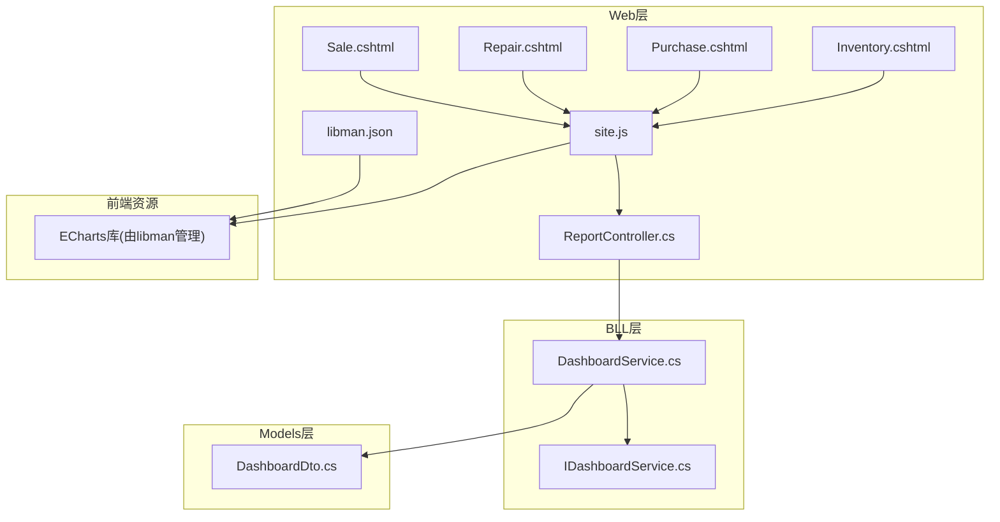
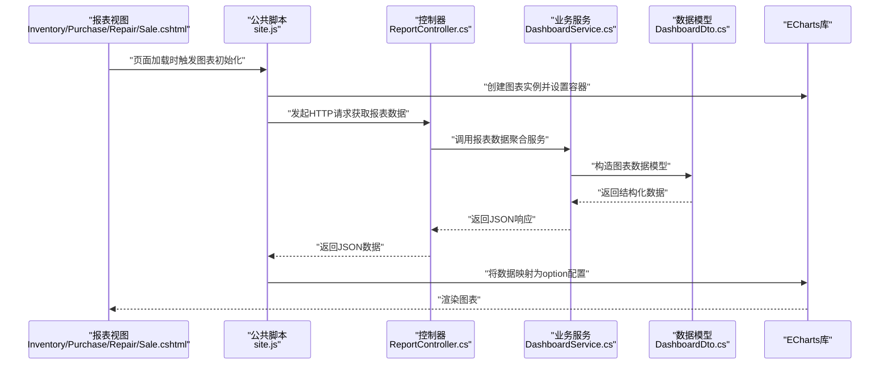
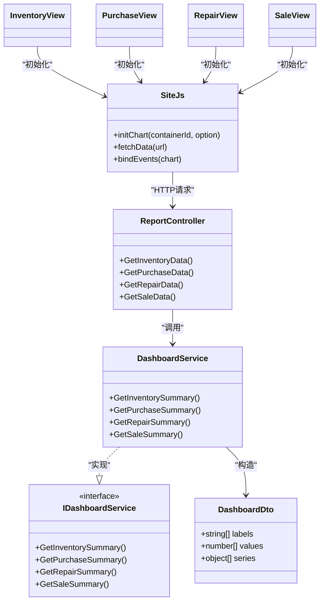

# ECharts图表组件

<cite>
**本文引用的文件**   
- [Program.cs](file://EquipmentIMS.Web/Program.cs)
- [libman.json](file://EquipmentIMS.Web/libman.json)
- [site.js](file://EquipmentIMS.Web/wwwroot/js/site.js)
- [Inventory.cshtml](file://EquipmentIMS.Web/Views/Report/Inventory.cshtml)
- [Purchase.cshtml](file://EquipmentIMS.Web/Views/Report/Purchase.cshtml)
- [Repair.cshtml](file://EquipmentIMS.Web/Views/Report/Repair.cshtml)
- [Sale.cshtml](file://EquipmentIMS.Web/Views/Report/Sale.cshtml)
- [ReportController.cs](file://EquipmentIMS.Web/Controllers/ReportController.cs)
- [DashboardService.cs](file://EquipmentIMS.BLL/Services/DashboardService.cs)
- [IDashboardService.cs](file://EquipmentIMS.BLL/Interfaces/IDashboardService.cs)
- [DashboardDto.cs](file://EquipmentIMS.Models/DTOs/DashboardDto.cs)
</cite>

## 目录
1. [简介](#简介)
2. [项目结构](#项目结构)
3. [核心组件](#核心组件)
4. [架构总览](#架构总览)
5. [详细组件分析](#详细组件分析)
6. [依赖关系分析](#依赖关系分析)
7. [性能考虑](#性能考虑)
8. [故障排查指南](#故障排查指南)
9. [结论](#结论)
10. [附录](#附录)

## 简介
本文件面向THMS系统中的ECharts图表组件，提供从引入、基础配置到多类型图表实现与交互的完整使用指南。文档覆盖：
- ECharts库的引入与基本配置方法
- 折线图、柱状图、饼图、雷达图等常见图表类型的实现要点
- 报表页面中图表的实际应用示例（数据绑定与选项配置）
- 图表交互功能（缩放、平移、图例切换等）
- 响应式图表的实现方法与性能优化技巧
- 自定义主题与样式的配置方法

## 项目结构
THMS采用前后端分离风格的前端渲染方式：后端通过控制器暴露数据接口，前端在报表视图中加载ECharts并调用接口获取数据后渲染图表。关键位置如下：
- 静态资源与第三方库管理：libman.json用于声明和管理前端库（如ECharts）
- 全局脚本入口：site.js作为公共JS逻辑入口，可统一初始化或复用图表工具函数
- 报表视图：Report下的Inventory.cshtml、Purchase.cshtml、Repair.cshtml、Sale.cshtml为具体报表页面
- 控制器：ReportController.cs提供报表数据接口
- 业务层：DashboardService.cs与IDashboardService.cs定义仪表盘/报表相关服务契约与实现
- 模型：DashboardDto.cs定义返回给前端的图表数据结构

**图示来源**
- [Program.cs:1-200](file://EquipmentIMS.Web/Program.cs#L1-L200)
- [libman.json:1-200](file://EquipmentIMS.Web/libman.json#L1-L200)
- [site.js:1-200](file://EquipmentIMS.Web/wwwroot/js/site.js#L1-L200)
- [Inventory.cshtml:1-200](file://EquipmentIMS.Web/Views/Report/Inventory.cshtml#L1-L200)
- [Purchase.cshtml:1-200](file://EquipmentIMS.Web/Views/Report/Purchase.cshtml#L1-L200)
- [Repair.cshtml:1-200](file://EquipmentIMS.Web/Views/Report/Repair.cshtml#L1-L200)
- [Sale.cshtml:1-200](file://EquipmentIMS.Web/Views/Report/Sale.cshtml#L1-L200)
- [ReportController.cs:1-200](file://EquipmentIMS.Web/Controllers/ReportController.cs#L1-L200)
- [DashboardService.cs:1-200](file://EquipmentIMS.BLL/Services/DashboardService.cs#L1-L200)
- [IDashboardService.cs:1-200](file://EquipmentIMS.BLL/Interfaces/IDashboardService.cs#L1-L200)
- [DashboardDto.cs:1-200](file://EquipmentIMS.Models/DTOs/DashboardDto.cs#L1-L200)

**章节来源**
- [Program.cs:1-200](file://EquipmentIMS.Web/Program.cs#L1-L200)
- [libman.json:1-200](file://EquipmentIMS.Web/libman.json#L1-L200)
- [site.js:1-200](file://EquipmentIMS.Web/wwwroot/js/site.js#L1-L200)
- [Inventory.cshtml:1-200](file://EquipmentIMS.Web/Views/Report/Inventory.cshtml#L1-L200)
- [Purchase.cshtml:1-200](file://EquipmentIMS.Web/Views/Report/Purchase.cshtml#L1-L200)
- [Repair.cshtml:1-200](file://EquipmentIMS.Web/Views/Report/Repair.cshtml#L1-L200)
- [Sale.cshtml:1-200](file://EquipmentIMS.Web/Views/Report/Sale.cshtml#L1-L200)
- [ReportController.cs:1-200](file://EquipmentIMS.Web/Controllers/ReportController.cs#L1-L200)
- [DashboardService.cs:1-200](file://EquipmentIMS.BLL/Services/DashboardService.cs#L1-L200)
- [IDashboardService.cs:1-200](file://EquipmentIMS.BLL/Interfaces/IDashboardService.cs#L1-L200)
- [DashboardDto.cs:1-200](file://EquipmentIMS.Models/DTOs/DashboardDto.cs#L1-L200)

## 核心组件
- 前端资源管理：通过libman.json集中管理ECharts版本与路径，确保各报表页面一致引用
- 公共脚本：site.js封装图表初始化、数据请求、事件绑定等通用逻辑，减少重复代码
- 报表视图：Inventory.cshtml、Purchase.cshtml、Repair.cshtml、Sale.cshtml分别承载库存、采购、维修、销售四类报表的图表展示
- 控制器：ReportController.cs提供RESTful接口，接收查询参数并返回JSON数据
- 业务服务：DashboardService.cs实现报表数据的聚合与转换，遵循IDashboardService.cs契约
- 数据模型：DashboardDto.cs定义图表所需的数据结构，便于前后端契约稳定

**章节来源**
- [libman.json:1-200](file://EquipmentIMS.Web/libman.json#L1-L200)
- [site.js:1-200](file://EquipmentIMS.Web/wwwroot/js/site.js#L1-L200)
- [Inventory.cshtml:1-200](file://EquipmentIMS.Web/Views/Report/Inventory.cshtml#L1-L200)
- [Purchase.cshtml:1-200](file://EquipmentIMS.Web/Views/Report/Purchase.cshtml#L1-L200)
- [Repair.cshtml:1-200](file://EquipmentIMS.Web/Views/Report/Repair.cshtml#L1-L200)
- [Sale.cshtml:1-200](file://EquipmentIMS.Web/Views/Report/Sale.cshtml#L1-L200)
- [ReportController.cs:1-200](file://EquipmentIMS.Web/Controllers/ReportController.cs#L1-L200)
- [DashboardService.cs:1-200](file://EquipmentIMS.BLL/Services/DashboardService.cs#L1-L200)
- [IDashboardService.cs:1-200](file://EquipmentIMS.BLL/Interfaces/IDashboardService.cs#L1-L200)
- [DashboardDto.cs:1-200](file://EquipmentIMS.Models/DTOs/DashboardDto.cs#L1-L200)

## 架构总览
下图展示了从报表页面到后端服务的完整数据流与组件交互关系。

**图示来源**
- [Inventory.cshtml:1-200](file://EquipmentIMS.Web/Views/Report/Inventory.cshtml#L1-L200)
- [Purchase.cshtml:1-200](file://EquipmentIMS.Web/Views/Report/Purchase.cshtml#L1-L200)
- [Repair.cshtml:1-200](file://EquipmentIMS.Web/Views/Report/Repair.cshtml#L1-L200)
- [Sale.cshtml:1-200](file://EquipmentIMS.Web/Views/Report/Sale.cshtml#L1-L200)
- [site.js:1-200](file://EquipmentIMS.Web/wwwroot/js/site.js#L1-L200)
- [ReportController.cs:1-200](file://EquipmentIMS.Web/Controllers/ReportController.cs#L1-L200)
- [DashboardService.cs:1-200](file://EquipmentIMS.BLL/Services/DashboardService.cs#L1-L200)
- [DashboardDto.cs:1-200](file://EquipmentIMS.Models/DTOs/DashboardDto.cs#L1-L200)

## 详细组件分析

### ECharts库引入与基本配置
- 引入方式：通过libman.json声明ECharts库，确保版本与路径一致；在报表视图中按顺序引入jQuery与ECharts
- 基本配置：在site.js中统一初始化ECharts实例，设置容器尺寸、主题、提示框、图例、坐标轴等基础项
- 最佳实践：
  - 将图表容器设置为响应式尺寸，避免固定宽高导致显示异常
  - 对option对象进行深拷贝，避免多次渲染相互污染
  - 在页面卸载时销毁图表实例，释放内存

**章节来源**
- [libman.json:1-200](file://EquipmentIMS.Web/libman.json#L1-L200)
- [site.js:1-200](file://EquipmentIMS.Web/wwwroot/js/site.js#L1-L200)

### 折线图实现要点
- 适用场景：时间序列趋势、指标变化对比
- 关键配置：xAxis为时间或分类轴，yAxis为数值轴，series为多条折线；启用dataZoom实现缩放与平移
- 数据绑定：后端返回的时间点与对应值数组，前端映射为series.data
- 交互增强：tooltip格式化显示单位与时间格式；legend控制系列可见性

**章节来源**
- [Inventory.cshtml:1-200](file://EquipmentIMS.Web/Views/Report/Inventory.cshtml#L1-L200)
- [Purchase.cshtml:1-200](file://EquipmentIMS.Web/Views/Report/Purchase.cshtml#L1-L200)
- [Repair.cshtml:1-200](file://EquipmentIMS.Web/Views/Report/Repair.cshtml#L1-L200)
- [Sale.cshtml:1-200](file://EquipmentIMS.Web/Views/Report/Sale.cshtml#L1-L200)
- [site.js:1-200](file://EquipmentIMS.Web/wwwroot/js/site.js#L1-L200)

### 柱状图实现要点
- 适用场景：类别对比、数量统计
- 关键配置：xAxis为分类轴，yAxis为数值轴，series.type为bar；可启用stacking实现堆叠效果
- 数据绑定：后端返回分类标签与对应数值数组，前端映射为xAxis.data与series.data
- 交互增强：tooltip显示精确数值；legend控制系列显示；dataZoom支持横向滚动查看

**章节来源**
- [Inventory.cshtml:1-200](file://EquipmentIMS.Web/Views/Report/Inventory.cshtml#L1-L200)
- [Purchase.cshtml:1-200](file://EquipmentIMS.Web/Views/Report/Purchase.cshtml#L1-L200)
- [Repair.cshtml:1-200](file://EquipmentIMS.Web/Views/Report/Repair.cshtml#L1-L200)
- [Sale.cshtml:1-200](file://EquipmentIMS.Web/Views/Report/Sale.cshtml#L1-L200)
- [site.js:1-200](file://EquipmentIMS.Web/wwwroot/js/site.js#L1-L200)

### 饼图实现要点
- 适用场景：占比分析、构成分布
- 关键配置：series.type为pie，radius或roseType控制样式；label显示百分比
- 数据绑定：后端返回名称与数值数组，前端映射为series.data
- 交互增强：tooltip显示占比与绝对值；legend控制扇区显示；点击扇区高亮

**章节来源**
- [Inventory.cshtml:1-200](file://EquipmentIMS.Web/Views/Report/Inventory.cshtml#L1-L200)
- [Purchase.cshtml:1-200](file://EquipmentIMS.Web/Views/Report/Purchase.cshtml#L1-L200)
- [Repair.cshtml:1-200](file://EquipmentIMS.Web/Views/Report/Repair.cshtml#L1-L200)
- [Sale.cshtml:1-200](file://EquipmentIMS.Web/Views/Report/Sale.cshtml#L1-L200)
- [site.js:1-200](file://EquipmentIMS.Web/wwwroot/js/site.js#L1-L200)

### 雷达图实现要点
- 适用场景：多维度能力评估、综合指标对比
- 关键配置：radar指示器维度与最大值；series.type为radar，data为多维数组
- 数据绑定：后端返回维度列表与各对象的多维评分，前端映射为indicator与series.data
- 交互增强：tooltip显示各维度详情；legend控制系列显示；areaStyle填充区域

**章节来源**
- [Inventory.cshtml:1-200](file://EquipmentIMS.Web/Views/Report/Inventory.cshtml#L1-L200)
- [Purchase.cshtml:1-200](file://EquipmentIMS.Web/Views/Report/Purchase.cshtml#L1-L200)
- [Repair.cshtml:1-200](file://EquipmentIMS.Web/Views/Report/Repair.cshtml#L1-L200)
- [Sale.cshtml:1-200](file://EquipmentIMS.Web/Views/Report/Sale.cshtml#L1-L200)
- [site.js:1-200](file://EquipmentIMS.Web/wwwroot/js/site.js#L1-L200)

### 报表页面中的实际应用示例
- 库存报表（Inventory.cshtml）：以折线图展示库存趋势，以饼图展示品类占比
- 采购报表（Purchase.cshtml）：以柱状图展示月度采购量，以折线图展示成本走势
- 维修报表（Repair.cshtml）：以雷达图展示设备健康度，以柱状图展示工单状态分布
- 销售报表（Sale.cshtml）：以折线图展示销售额趋势，以饼图展示渠道占比

上述页面均通过site.js统一初始化图表，调用ReportController提供的接口获取数据，并将结果映射为ECharts option配置。

**章节来源**
- [Inventory.cshtml:1-200](file://EquipmentIMS.Web/Views/Report/Inventory.cshtml#L1-L200)
- [Purchase.cshtml:1-200](file://EquipmentIMS.Web/Views/Report/Purchase.cshtml#L1-L200)
- [Repair.cshtml:1-200](file://EquipmentIMS.Web/Views/Report/Repair.cshtml#L1-L200)
- [Sale.cshtml:1-200](file://EquipmentIMS.Web/Views/Report/Sale.cshtml#L1-L200)
- [site.js:1-200](file://EquipmentIMS.Web/wwwroot/js/site.js#L1-L200)
- [ReportController.cs:1-200](file://EquipmentIMS.Web/Controllers/ReportController.cs#L1-L200)

### 图表交互功能
- 缩放与平移：通过dataZoom组件实现，支持滑块与内置滚轮；适用于折线图与柱状图的时间或分类轴
- 图例切换：legend.enable=true，点击图例项可显示/隐藏对应系列
- 提示框：tooltip.formatter自定义显示内容，提升可读性
- 数据视图：dataView允许用户导出当前图表数据（可选）

**章节来源**
- [site.js:1-200](file://EquipmentIMS.Web/wwwroot/js/site.js#L1-L200)
- [Inventory.cshtml:1-200](file://EquipmentIMS.Web/Views/Report/Inventory.cshtml#L1-L200)
- [Purchase.cshtml:1-200](file://EquipmentIMS.Web/Views/Report/Purchase.cshtml#L1-L200)
- [Repair.cshtml:1-200](file://EquipmentIMS.Web/Views/Report/Repair.cshtml#L1-L200)
- [Sale.cshtml:1-200](file://EquipmentIMS.Web/Views/Report/Sale.cshtml#L1-L200)

### 响应式图表实现方法
- 容器尺寸：使用CSS使图表容器自适应父元素宽度与高度
- 监听窗口变化：在window.resize事件中调用chart.resize()重绘
- 断点适配：针对不同屏幕尺寸调整字体大小、图例布局与tooltip定位
- 懒加载：仅在可视区域内初始化图表，减少首屏渲染压力

**章节来源**
- [site.js:1-200](file://EquipmentIMS.Web/wwwroot/js/site.js#L1-L200)
- [Inventory.cshtml:1-200](file://EquipmentIMS.Web/Views/Report/Inventory.cshtml#L1-L200)
- [Purchase.cshtml:1-200](file://EquipmentIMS.Web/Views/Report/Purchase.cshtml#L1-L200)
- [Repair.cshtml:1-200](file://EquipmentIMS.Web/Views/Report/Repair.cshtml#L1-L200)
- [Sale.cshtml:1-200](file://EquipmentIMS.Web/Views/Report/Sale.cshtml#L1-L200)

### 性能优化技巧
- 数据分页与增量更新：大数据集采用分页加载，定时刷新仅更新变化部分
- 缓存策略：对不频繁变化的数据做本地缓存，减少重复请求
- 渲染优化：合并多次setOption调用，避免频繁重绘；按需启用动画
- 内存管理：页面切换或关闭时销毁图表实例，防止内存泄漏

**章节来源**
- [site.js:1-200](file://EquipmentIMS.Web/wwwroot/js/site.js#L1-L200)
- [ReportController.cs:1-200](file://EquipmentIMS.Web/Controllers/ReportController.cs#L1-L200)

### 自定义主题与样式配置
- 主题注册：在site.js中定义主题对象，包含颜色、背景、字体等属性
- 动态切换：根据用户偏好或系统主题切换不同主题配置
- 局部样式：针对特定图表覆盖默认样式，如series.itemStyle、axisLabel等
- 一致性规范：通过全局主题保证品牌色与视觉风格统一

**章节来源**
- [site.js:1-200](file://EquipmentIMS.Web/wwwroot/js/site.js#L1-L200)

## 依赖关系分析
下图展示了报表模块的关键依赖关系，包括控制器、服务、模型与前端脚本之间的调用链。

**图示来源**
- [ReportController.cs:1-200](file://EquipmentIMS.Web/Controllers/ReportController.cs#L1-L200)
- [DashboardService.cs:1-200](file://EquipmentIMS.BLL/Services/DashboardService.cs#L1-L200)
- [IDashboardService.cs:1-200](file://EquipmentIMS.BLL/Interfaces/IDashboardService.cs#L1-L200)
- [DashboardDto.cs:1-200](file://EquipmentIMS.Models/DTOs/DashboardDto.cs#L1-L200)
- [site.js:1-200](file://EquipmentIMS.Web/wwwroot/js/site.js#L1-L200)
- [Inventory.cshtml:1-200](file://EquipmentIMS.Web/Views/Report/Inventory.cshtml#L1-L200)
- [Purchase.cshtml:1-200](file://EquipmentIMS.Web/Views/Report/Purchase.cshtml#L1-L200)
- [Repair.cshtml:1-200](file://EquipmentIMS.Web/Views/Report/Repair.cshtml#L1-L200)
- [Sale.cshtml:1-200](file://EquipmentIMS.Web/Views/Report/Sale.cshtml#L1-L200)

**章节来源**
- [ReportController.cs:1-200](file://EquipmentIMS.Web/Controllers/ReportController.cs#L1-L200)
- [DashboardService.cs:1-200](file://EquipmentIMS.BLL/Services/DashboardService.cs#L1-L200)
- [IDashboardService.cs:1-200](file://EquipmentIMS.BLL/Interfaces/IDashboardService.cs#L1-L200)
- [DashboardDto.cs:1-200](file://EquipmentIMS.Models/DTOs/DashboardDto.cs#L1-L200)
- [site.js:1-200](file://EquipmentIMS.Web/wwwroot/js/site.js#L1-L200)
- [Inventory.cshtml:1-200](file://EquipmentIMS.Web/Views/Report/Inventory.cshtml#L1-L200)
- [Purchase.cshtml:1-200](file://EquipmentIMS.Web/Views/Report/Purchase.cshtml#L1-L200)
- [Repair.cshtml:1-200](file://EquipmentIMS.Web/Views/Report/Repair.cshtml#L1-L200)
- [Sale.cshtml:1-200](file://EquipmentIMS.Web/Views/Report/Sale.cshtml#L1-L200)

## 性能考虑
- 首屏加载：按需引入ECharts，避免全量打包；对大型数据集采用分页与增量更新
- 渲染频率：合并多次setOption调用，减少重绘次数；必要时禁用动画以提升性能
- 内存占用：及时销毁图表实例，避免内存泄漏；对频繁切换的页面使用懒加载
- 网络开销：对热点数据进行缓存；合理设置请求间隔与重试策略

[本节为通用指导，无需列出具体文件来源]

## 故障排查指南
- 图表未显示：检查容器是否存在且尺寸有效；确认ECharts库已正确引入；查看控制台是否有报错
- 数据为空：验证后端接口是否返回预期结构；检查前端数据映射逻辑是否正确
- 交互失效：确认事件绑定是否在图表初始化之后执行；检查dataZoom与legend配置是否冲突
- 性能问题：观察浏览器性能面板，定位重绘瓶颈；减少不必要的动画与复杂样式

**章节来源**
- [site.js:1-200](file://EquipmentIMS.Web/wwwroot/js/site.js#L1-L200)
- [ReportController.cs:1-200](file://EquipmentIMS.Web/Controllers/ReportController.cs#L1-L200)

## 结论
通过在THMS系统中统一引入ECharts并在报表页面中标准化实现，我们获得了良好的可视化体验与可维护性。借助统一的site.js与清晰的控制器-服务-模型分层，图表的数据流与交互逻辑清晰可控。后续可在主题定制、数据缓存与渲染优化方面持续改进，进一步提升用户体验与系统性能。

[本节为总结性内容，无需列出具体文件来源]

## 附录
- 常用ECharts配置键说明：
  - xAxis/yAxis：坐标轴配置，支持时间轴、分类轴与数值轴
  - series：数据系列，支持line/bar/pie/radar等多种类型
  - tooltip：提示框，支持格式化与触发方式
  - legend：图例，支持多选与排序
  - dataZoom：缩放与平移，支持滑块与内置滚轮
  - theme：主题配置，支持全局与局部覆盖

[本节为概念性说明，无需列出具体文件来源]