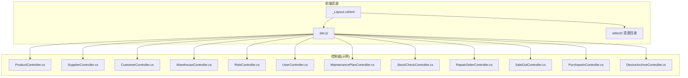
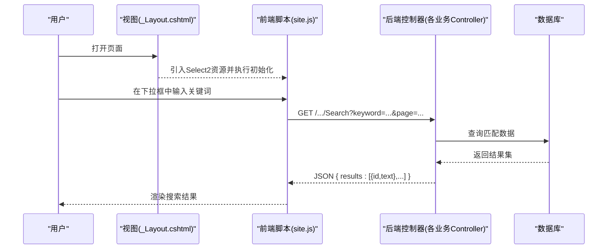
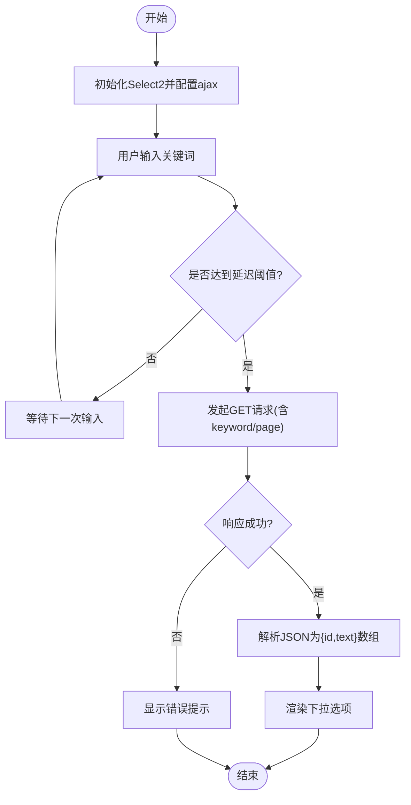
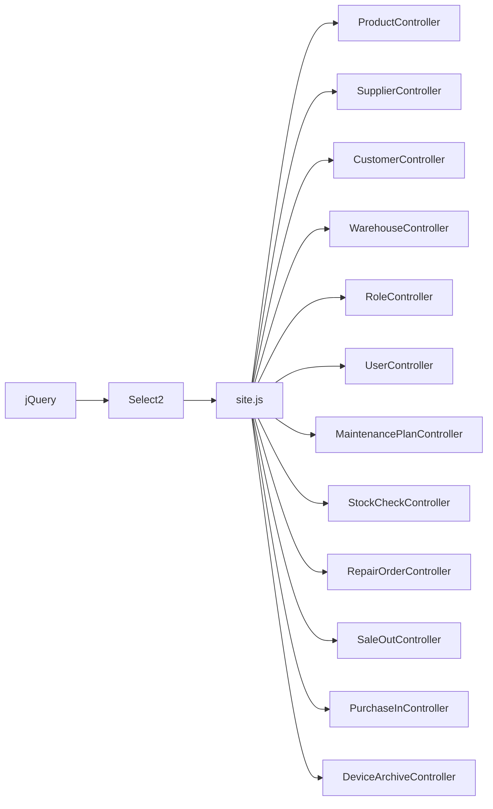

# Select2增强下拉框

<cite>
**本文引用的文件**   
- [EquipmentIMS.Web/wwwroot/lib/select2](file://EquipmentIMS.Web/wwwroot/lib/select2)
- [EquipmentIMS.Web/wwwroot/js/site.js](file://EquipmentIMS.Web/wwwroot/js/site.js)
- [EquipmentIMS.Web/Views/Shared/_Layout.cshtml](file://EquipmentIMS.Web/Views/Shared/_Layout.cshtml)
- [EquipmentIMS.Web/Controllers/ProductController.cs](file://EquipmentIMS.Web/Controllers/ProductController.cs)
- [EquipmentIMS.Web/Controllers/SupplierController.cs](file://EquipmentIMS.Web/Controllers/SupplierController.cs)
- [EquipmentIMS.Web/Controllers/CustomerController.cs](file://EquipmentIMS.Web/Controllers/CustomerController.cs)
- [EquipmentIMS.Web/Controllers/WarehouseController.cs](file://EquipmentIMS.Web/Controllers/WarehouseController.cs)
- [EquipmentIMS.Web/Controllers/RoleController.cs](file://EquipmentIMS.Web/Controllers/RoleController.cs)
- [EquipmentIMS.Web/Controllers/UserController.cs](file://EquipmentIMS.Web/Controllers/UserController.cs)
- [EquipmentIMS.Web/Controllers/MaintenancePlanController.cs](file://EquipmentIMS.Web/Controllers/MaintenancePlanController.cs)
- [EquipmentIMS.Web/Controllers/StockCheckController.cs](file://EquipmentIMS.Web/Controllers/StockCheckController.cs)
- [EquipmentIMS.Web/Controllers/RepairOrderController.cs](file://EquipmentIMS.Web/Controllers/RepairOrderController.cs)
- [EquipmentIMS.Web/Controllers/SaleOutController.cs](file://EquipmentIMS.Web/Controllers/SaleOutController.cs)
- [EquipmentIMS.Web/Controllers/PurchaseInController.cs](file://EquipmentIMS.Web/Controllers/PurchaseInController.cs)
- [EquipmentIMS.Web/Controllers/DeviceArchiveController.cs](file://EquipmentIMS.Web/Controllers/DeviceArchiveController.cs)
</cite>

## 目录
1. [简介](#简介)
2. [项目结构](#项目结构)
3. [核心组件](#核心组件)
4. [架构总览](#架构总览)
5. [详细组件分析](#详细组件分析)
6. [依赖关系分析](#依赖关系分析)
7. [性能考虑](#性能考虑)
8. [故障排查指南](#故障排查指南)
9. [结论](#结论)
10. [附录](#附录)

## 简介
本文件面向THMS系统中的Select2增强下拉框组件，提供从集成、初始化到高级特性的完整使用指南。内容覆盖：
- Select2库的引入与全局初始化配置
- 搜索过滤、多选支持、标签模式等常用特性
- 远程数据加载（异步）与缓存策略
- 自定义模板与渲染器实现方法
- 与后端API的对接方式及最佳实践
- 样式定制与主题适配建议

## 项目结构
THMS前端资源位于Web层wwwroot下，Select2静态资源已托管在lib/select2目录中；通用脚本入口为site.js；布局视图负责统一引入CSS/JS资源。

图表来源
- [EquipmentIMS.Web/Views/Shared/_Layout.cshtml](file://EquipmentIMS.Web/Views/Shared/_Layout.cshtml)
- [EquipmentIMS.Web/wwwroot/js/site.js](file://EquipmentIMS.Web/wwwroot/js/site.js)
- [EquipmentIMS.Web/wwwroot/lib/select2](file://EquipmentIMS.Web/wwwroot/lib/select2)
- [EquipmentIMS.Web/Controllers/ProductController.cs](file://EquipmentIMS.Web/Controllers/ProductController.cs)
- [EquipmentIMS.Web/Controllers/SupplierController.cs](file://EquipmentIMS.Web/Controllers/SupplierController.cs)
- [EquipmentIMS.Web/Controllers/CustomerController.cs](file://EquipmentIMS.Web/Controllers/CustomerController.cs)
- [EquipmentIMS.Web/Controllers/WarehouseController.cs](file://EquipmentIMS.Web/Controllers/WarehouseController.cs)
- [EquipmentIMS.Web/Controllers/RoleController.cs](file://EquipmentIMS.Web/Controllers/RoleController.cs)
- [EquipmentIMS.Web/Controllers/UserController.cs](file://EquipmentIMS.Web/Controllers/UserController.cs)
- [EquipmentIMS.Web/Controllers/MaintenancePlanController.cs](file://EquipmentIMS.Web/Controllers/MaintenancePlanController.cs)
- [EquipmentIMS.Web/Controllers/StockCheckController.cs](file://EquipmentIMS.Web/Controllers/StockCheckController.cs)
- [EquipmentIMS.Web/Controllers/RepairOrderController.cs](file://EquipmentIMS.Web/Controllers/RepairOrderController.cs)
- [EquipmentIMS.Web/Controllers/SaleOutController.cs](file://EquipmentIMS.Web/Controllers/SaleOutController.cs)
- [EquipmentIMS.Web/Controllers/PurchaseInController.cs](file://EquipmentIMS.Web/Controllers/PurchaseInController.cs)
- [EquipmentIMS.Web/Controllers/DeviceArchiveController.cs](file://EquipmentIMS.Web/Controllers/DeviceArchiveController.cs)

章节来源
- [EquipmentIMS.Web/Views/Shared/_Layout.cshtml](file://EquipmentIMS.Web/Views/Shared/_Layout.cshtml)
- [EquipmentIMS.Web/wwwroot/js/site.js](file://EquipmentIMS.Web/wwwroot/js/site.js)
- [EquipmentIMS.Web/wwwroot/lib/select2](file://EquipmentIMS.Web/wwwroot/lib/select2)

## 核心组件
- Select2资源包：包含CSS与JS，用于替换原生select并提供增强能力。
- 全局初始化脚本：在页面加载后对具备特定class或data属性的select元素进行统一初始化。
- 业务控制器：提供远程查询接口，供Select2通过AJAX获取数据。

章节来源
- [EquipmentIMS.Web/wwwroot/lib/select2](file://EquipmentIMS.Web/wwwroot/lib/select2)
- [EquipmentIMS.Web/wwwroot/js/site.js](file://EquipmentIMS.Web/wwwroot/js/site.js)
- [EquipmentIMS.Web/Controllers/ProductController.cs](file://EquipmentIMS.Web/Controllers/ProductController.cs)
- [EquipmentIMS.Web/Controllers/SupplierController.cs](file://EquipmentIMS.Web/Controllers/SupplierController.cs)
- [EquipmentIMS.Web/Controllers/CustomerController.cs](file://EquipmentIMS.Web/Controllers/CustomerController.cs)
- [EquipmentIMS.Web/Controllers/WarehouseController.cs](file://EquipmentIMS.Web/Controllers/WarehouseController.cs)
- [EquipmentIMS.Web/Controllers/RoleController.cs](file://EquipmentIMS.Web/Controllers/RoleController.cs)
- [EquipmentIMS.Web/Controllers/UserController.cs](file://EquipmentIMS.Web/Controllers/UserController.cs)
- [EquipmentIMS.Web/Controllers/MaintenancePlanController.cs](file://EquipmentIMS.Web/Controllers/MaintenancePlanController.cs)
- [EquipmentIMS.Web/Controllers/StockCheckController.cs](file://EquipmentIMS.Web/Controllers/StockCheckController.cs)
- [EquipmentIMS.Web/Controllers/RepairOrderController.cs](file://EquipmentIMS.Web/Controllers/RepairOrderController.cs)
- [EquipmentIMS.Web/Controllers/SaleOutController.cs](file://EquipmentIMS.Web/Controllers/SaleOutController.cs)
- [EquipmentIMS.Web/Controllers/PurchaseInController.cs](file://EquipmentIMS.Web/Controllers/PurchaseInController.cs)
- [EquipmentIMS.Web/Controllers/DeviceArchiveController.cs](file://EquipmentIMS.Web/Controllers/DeviceArchiveController.cs)

## 架构总览
Select2在前端通过AJAX调用后端控制器提供的查询接口，返回标准格式的数据集合，再由Select2渲染为可搜索、可选的下拉列表。

图表来源
- [EquipmentIMS.Web/Views/Shared/_Layout.cshtml](file://EquipmentIMS.Web/Views/Shared/_Layout.cshtml)
- [EquipmentIMS.Web/wwwroot/js/site.js](file://EquipmentIMS.Web/wwwroot/js/site.js)
- [EquipmentIMS.Web/Controllers/ProductController.cs](file://EquipmentIMS.Web/Controllers/ProductController.cs)
- [EquipmentIMS.Web/Controllers/SupplierController.cs](file://EquipmentIMS.Web/Controllers/SupplierController.cs)
- [EquipmentIMS.Web/Controllers/CustomerController.cs](file://EquipmentIMS.Web/Controllers/CustomerController.cs)
- [EquipmentIMS.Web/Controllers/WarehouseController.cs](file://EquipmentIMS.Web/Controllers/WarehouseController.cs)
- [EquipmentIMS.Web/Controllers/RoleController.cs](file://EquipmentIMS.Web/Controllers/RoleController.cs)
- [EquipmentIMS.Web/Controllers/UserController.cs](file://EquipmentIMS.Web/Controllers/UserController.cs)
- [EquipmentIMS.Web/Controllers/MaintenancePlanController.cs](file://EquipmentIMS.Web/Controllers/MaintenancePlanController.cs)
- [EquipmentIMS.Web/Controllers/StockCheckController.cs](file://EquipmentIMS.Web/Controllers/StockCheckController.cs)
- [EquipmentIMS.Web/Controllers/RepairOrderController.cs](file://EquipmentIMS.Web/Controllers/RepairOrderController.cs)
- [EquipmentIMS.Web/Controllers/SaleOutController.cs](file://EquipmentIMS.Web/Controllers/SaleOutController.cs)
- [EquipmentIMS.Web/Controllers/PurchaseInController.cs](file://EquipmentIMS.Web/Controllers/PurchaseInController.cs)
- [EquipmentIMS.Web/Controllers/DeviceArchiveController.cs](file://EquipmentIMS.Web/Controllers/DeviceArchiveController.cs)

## 详细组件分析

### 集成与初始化
- 资源引入：在布局视图中引入Select2的CSS与JS，确保jQuery可用。
- 初始化时机：在DOM就绪后，针对目标select元素调用Select2初始化方法。
- 选择范围：可通过class或data属性限定需要初始化的元素，避免全局影响。

章节来源
- [EquipmentIMS.Web/Views/Shared/_Layout.cshtml](file://EquipmentIMS.Web/Views/Shared/_Layout.cshtml)
- [EquipmentIMS.Web/wwwroot/js/site.js](file://EquipmentIMS.Web/wwwroot/js/site.js)

### 基础功能
- 搜索过滤：启用searchable后，输入关键字即可实时过滤选项。
- 多选支持：设置multiple属性，允许一次选择多个值。
- 占位符与提示：可配置placeholder以改善交互体验。
- 禁用状态：支持disabled，便于表单条件控制。

章节来源
- [EquipmentIMS.Web/wwwroot/js/site.js](file://EquipmentIMS.Web/wwwroot/js/site.js)

### 远程数据加载
- 触发方式：将ajax.url指向后端查询接口，并在参数中传递当前输入文本与分页信息。
- 返回格式：Select2期望JSON数组，每项包含id与text字段。
- 分页与节流：结合page/pageSize参数实现分页；利用delay减少频繁请求。
- 错误处理：当请求失败时显示友好提示，避免界面卡死。

图表来源
- [EquipmentIMS.Web/wwwroot/js/site.js](file://EquipmentIMS.Web/wwwroot/js/site.js)
- [EquipmentIMS.Web/Controllers/ProductController.cs](file://EquipmentIMS.Web/Controllers/ProductController.cs)
- [EquipmentIMS.Web/Controllers/SupplierController.cs](file://EquipmentIMS.Web/Controllers/SupplierController.cs)
- [EquipmentIMS.Web/Controllers/CustomerController.cs](file://EquipmentIMS.Web/Controllers/CustomerController.cs)
- [EquipmentIMS.Web/Controllers/WarehouseController.cs](file://EquipmentIMS.Web/Controllers/WarehouseController.cs)
- [EquipmentIMS.Web/Controllers/RoleController.cs](file://EquipmentIMS.Web/Controllers/RoleController.cs)
- [EquipmentIMS.Web/Controllers/UserController.cs](file://EquipmentIMS.Web/Controllers/UserController.cs)
- [EquipmentIMS.Web/Controllers/MaintenancePlanController.cs](file://EquipmentIMS.Web/Controllers/MaintenancePlanController.cs)
- [EquipmentIMS.Web/Controllers/StockCheckController.cs](file://EquipmentIMS.Web/Controllers/StockCheckController.cs)
- [EquipmentIMS.Web/Controllers/RepairOrderController.cs](file://EquipmentIMS.Web/Controllers/RepairOrderController.cs)
- [EquipmentIMS.Web/Controllers/SaleOutController.cs](file://EquipmentIMS.Web/Controllers/SaleOutController.cs)
- [EquipmentIMS.Web/Controllers/PurchaseInController.cs](file://EquipmentIMS.Web/Controllers/PurchaseInController.cs)
- [EquipmentIMS.Web/Controllers/DeviceArchiveController.cs](file://EquipmentIMS.Web/Controllers/DeviceArchiveController.cs)

### 标签模式
- 适用场景：需要用户自由输入新值，同时保留历史选项。
- 行为特征：支持回车添加标签，支持删除操作，可与搜索共存。
- 数据提交：表单提交时将标签值作为普通值序列提交。

章节来源
- [EquipmentIMS.Web/wwwroot/js/site.js](file://EquipmentIMS.Web/wwwroot/js/site.js)

### 自定义模板与渲染器
- 列表项模板：通过templateResult自定义每个选项的展示（如图标+名称）。
- 选中项模板：通过templateSelection定义选中后的显示内容。
- 占位模板：通过placeholder配合templateResult实现更丰富的提示文案。
- 注意事项：模板函数需保证返回值安全，避免XSS风险。

章节来源
- [EquipmentIMS.Web/wwwroot/js/site.js](file://EquipmentIMS.Web/wwwroot/js/site.js)

### 与后端API集成
- 接口约定：
  - 查询参数：keyword、page、pageSize等
  - 返回结构：JSON数组，每项包含id与text
- 典型控制器：
  - 产品、供应商、客户、仓库、角色、用户、维修计划、盘点、维修单、销售出库、采购入库、设备档案等
- 安全与权限：
  - 控制器应校验访问权限，防止未授权数据泄露
  - 对输入参数进行长度与合法性校验

章节来源
- [EquipmentIMS.Web/Controllers/ProductController.cs](file://EquipmentIMS.Web/Controllers/ProductController.cs)
- [EquipmentIMS.Web/Controllers/SupplierController.cs](file://EquipmentIMS.Web/Controllers/SupplierController.cs)
- [EquipmentIMS.Web/Controllers/CustomerController.cs](file://EquipmentIMS.Web/Controllers/CustomerController.cs)
- [EquipmentIMS.Web/Controllers/WarehouseController.cs](file://EquipmentIMS.Web/Controllers/WarehouseController.cs)
- [EquipmentIMS.Web/Controllers/RoleController.cs](file://EquipmentIMS.Web/Controllers/RoleController.cs)
- [EquipmentIMS.Web/Controllers/UserController.cs](file://EquipmentIMS.Web/Controllers/UserController.cs)
- [EquipmentIMS.Web/Controllers/MaintenancePlanController.cs](file://EquipmentIMS.Web/Controllers/MaintenancePlanController.cs)
- [EquipmentIMS.Web/Controllers/StockCheckController.cs](file://EquipmentIMS.Web/Controllers/StockCheckController.cs)
- [EquipmentIMS.Web/Controllers/RepairOrderController.cs](file://EquipmentIMS.Web/Controllers/RepairOrderController.cs)
- [EquipmentIMS.Web/Controllers/SaleOutController.cs](file://EquipmentIMS.Web/Controllers/SaleOutController.cs)
- [EquipmentIMS.Web/Controllers/PurchaseInController.cs](file://EquipmentIMS.Web/Controllers/PurchaseInController.cs)
- [EquipmentIMS.Web/Controllers/DeviceArchiveController.cs](file://EquipmentIMS.Web/Controllers/DeviceArchiveController.cs)

### 样式定制与主题适配
- 主题切换：通过引入不同主题的CSS文件实现深色/浅色风格。
- 局部覆盖：在站点样式文件中覆盖Select2默认样式，保持与系统UI一致。
- 尺寸与间距：调整高度、内边距与字体大小，适配不同屏幕密度。
- 无障碍：确保键盘导航与屏幕阅读器友好。

章节来源
- [EquipmentIMS.Web/wwwroot/css/site.css](file://EquipmentIMS.Web/wwwroot/css/site.css)
- [EquipmentIMS.Web/Views/Shared/_Layout.cshtml](file://EquipmentIMS.Web/Views/Shared/_Layout.cshtml)

## 依赖关系分析
- 前端依赖：
  - jQuery：Select2运行必需
  - Select2 CSS/JS：提供下拉增强能力
  - 站点脚本site.js：集中初始化与业务逻辑
- 后端依赖：
  - 各业务控制器：提供数据查询接口
  - 数据库：持久化存储业务数据

图表来源
- [EquipmentIMS.Web/wwwroot/js/site.js](file://EquipmentIMS.Web/wwwroot/js/site.js)
- [EquipmentIMS.Web/Controllers/ProductController.cs](file://EquipmentIMS.Web/Controllers/ProductController.cs)
- [EquipmentIMS.Web/Controllers/SupplierController.cs](file://EquipmentIMS.Web/Controllers/SupplierController.cs)
- [EquipmentIMS.Web/Controllers/CustomerController.cs](file://EquipmentIMS.Web/Controllers/CustomerController.cs)
- [EquipmentIMS.Web/Controllers/WarehouseController.cs](file://EquipmentIMS.Web/Controllers/WarehouseController.cs)
- [EquipmentIMS.Web/Controllers/RoleController.cs](file://EquipmentIMS.Web/Controllers/RoleController.cs)
- [EquipmentIMS.Web/Controllers/UserController.cs](file://EquipmentIMS.Web/Controllers/UserController.cs)
- [EquipmentIMS.Web/Controllers/MaintenancePlanController.cs](file://EquipmentIMS.Web/Controllers/MaintenancePlanController.cs)
- [EquipmentIMS.Web/Controllers/StockCheckController.cs](file://EquipmentIMS.Web/Controllers/StockCheckController.cs)
- [EquipmentIMS.Web/Controllers/RepairOrderController.cs](file://EquipmentIMS.Web/Controllers/RepairOrderController.cs)
- [EquipmentIMS.Web/Controllers/SaleOutController.cs](file://EquipmentIMS.Web/Controllers/SaleOutController.cs)
- [EquipmentIMS.Web/Controllers/PurchaseInController.cs](file://EquipmentIMS.Web/Controllers/PurchaseInController.cs)
- [EquipmentIMS.Web/Controllers/DeviceArchiveController.cs](file://EquipmentIMS.Web/Controllers/DeviceArchiveController.cs)

## 性能考虑
- 请求节流：合理设置delay，避免高频输入导致过多请求。
- 分页加载：后端按page/pageSize返回，前端按需加载更多。
- 结果缓存：对热点查询结果进行短期缓存，降低重复请求压力。
- 最小化DOM：仅渲染可见范围内的选项，避免长列表卡顿。
- 网络优化：启用Gzip/Brotli压缩，减少传输体积。

[本节为通用指导，不直接分析具体文件]

## 故障排查指南
- 无法加载资源：检查布局视图是否正确引入Select2的CSS/JS路径。
- 初始化无效：确认DOM就绪后再执行初始化，且目标元素存在对应class或data属性。
- 远程数据为空：核对后端接口返回格式是否为{id,text}数组，检查路由与权限。
- 搜索无响应：检查请求参数名是否与后端一致，确认节流时间是否过长。
- 样式错乱：检查主题CSS引入顺序与站点样式覆盖规则。

章节来源
- [EquipmentIMS.Web/Views/Shared/_Layout.cshtml](file://EquipmentIMS.Web/Views/Shared/_Layout.cshtml)
- [EquipmentIMS.Web/wwwroot/js/site.js](file://EquipmentIMS.Web/wwwroot/js/site.js)
- [EquipmentIMS.Web/Controllers/ProductController.cs](file://EquipmentIMS.Web/Controllers/ProductController.cs)
- [EquipmentIMS.Web/Controllers/SupplierController.cs](file://EquipmentIMS.Web/Controllers/SupplierController.cs)
- [EquipmentIMS.Web/Controllers/CustomerController.cs](file://EquipmentIMS.Web/Controllers/CustomerController.cs)
- [EquipmentIMS.Web/Controllers/WarehouseController.cs](file://EquipmentIMS.Web/Controllers/WarehouseController.cs)
- [EquipmentIMS.Web/Controllers/RoleController.cs](file://EquipmentIMS.Web/Controllers/RoleController.cs)
- [EquipmentIMS.Web/Controllers/UserController.cs](file://EquipmentIMS.Web/Controllers/UserController.cs)
- [EquipmentIMS.Web/Controllers/MaintenancePlanController.cs](file://EquipmentIMS.Web/Controllers/MaintenancePlanController.cs)
- [EquipmentIMS.Web/Controllers/StockCheckController.cs](file://EquipmentIMS.Web/Controllers/StockCheckController.cs)
- [EquipmentIMS.Web/Controllers/RepairOrderController.cs](file://EquipmentIMS.Web/Controllers/RepairOrderController.cs)
- [EquipmentIMS.Web/Controllers/SaleOutController.cs](file://EquipmentIMS.Web/Controllers/SaleOutController.cs)
- [EquipmentIMS.Web/Controllers/PurchaseInController.cs](file://EquipmentIMS.Web/Controllers/PurchaseInController.cs)
- [EquipmentIMS.Web/Controllers/DeviceArchiveController.cs](file://EquipmentIMS.Web/Controllers/DeviceArchiveController.cs)

## 结论
通过在THMS系统中统一引入Select2并进行集中初始化，可在多业务场景中快速构建高性能、易用的增强下拉框。结合远程数据加载、分页与缓存策略，以及模板与样式的灵活定制，能够显著提升用户体验与开发效率。

[本节为总结性内容，不直接分析具体文件]

## 附录
- 常见用法清单
  - 单选+搜索：适用于大多数下拉选择场景
  - 多选+搜索：适用于批量选择与筛选
  - 标签模式：适用于自由输入与历史记录并存
  - 远程分页：适用于大数据量下拉
  - 自定义模板：适用于复杂展示需求（图标、描述等）
- 参考路径
  - 资源目录：EquipmentIMS.Web/wwwroot/lib/select2
  - 初始化脚本：EquipmentIMS.Web/wwwroot/js/site.js
  - 布局视图：EquipmentIMS.Web/Views/Shared/_Layout.cshtml
  - 示例控制器：见“与后端API集成”章节所列控制器

[本节为补充说明，不直接分析具体文件]