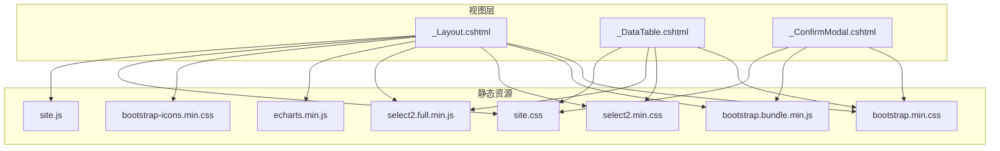
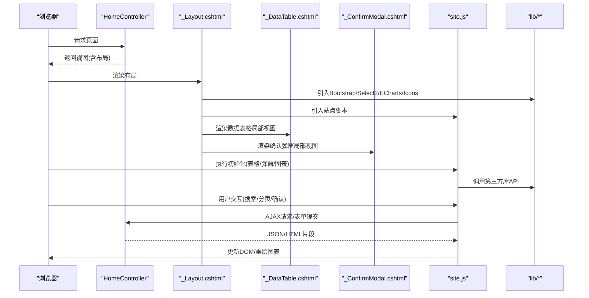
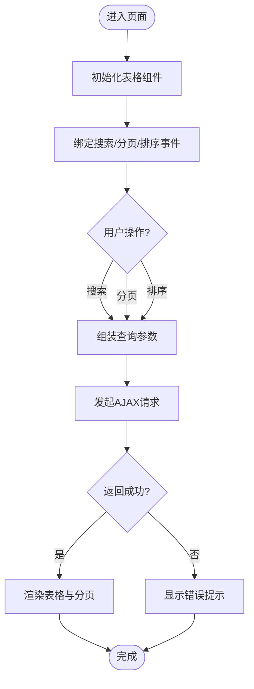
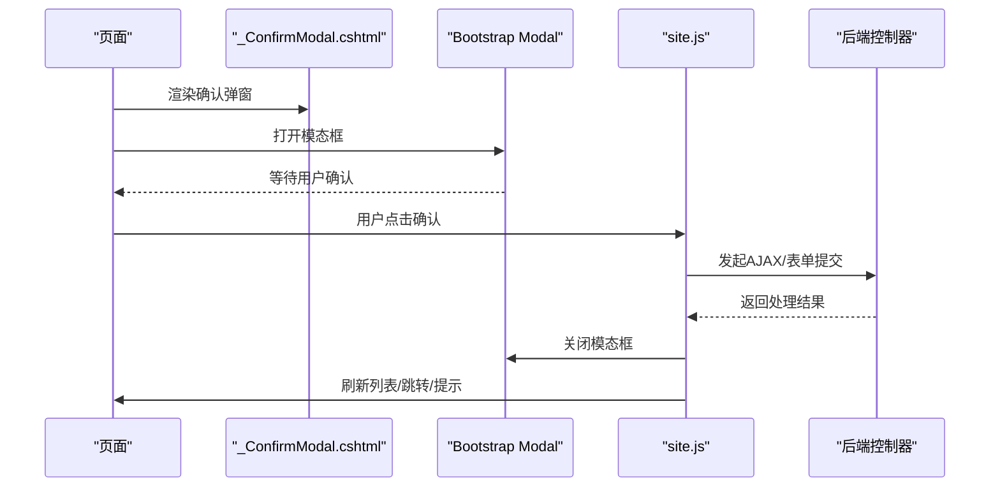
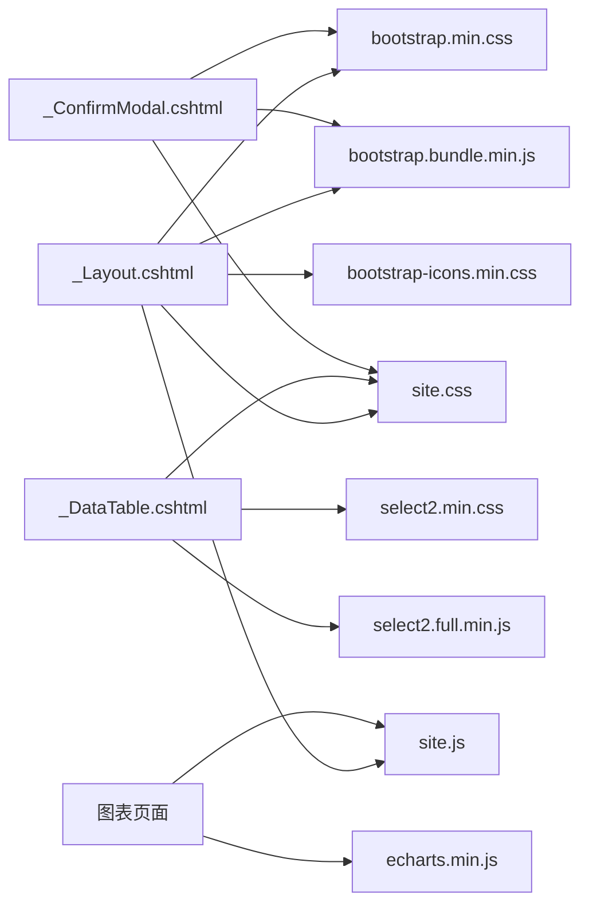

# UI组件设计

<cite>
**本文引用的文件**   
- [EquipmentIMS.Web/Views/Shared/_Layout.cshtml](file://EquipmentIMS.Web/Views/Shared/_Layout.cshtml)
- [EquipmentIMS.Web/Views/Shared/_DataTable.cshtml](file://EquipmentIMS.Web/Views/Shared/_DataTable.cshtml)
- [EquipmentIMS.Web/Views/Shared/_ConfirmModal.cshtml](file://EquipmentIMS.Web/Views/Shared/_ConfirmModal.cshtml)
- [EquipmentIMS.Web/wwwroot/lib/select2/css/select2.min.css](file://EquipmentIMS.Web/wwwroot/lib/select2/css/select2.min.css)
- [EquipmentIMS.Web/wwwroot/lib/select2/js/select2.full.min.js](file://EquipmentIMS.Web/wwwroot/lib/select2/js/select2.full.min.js)
- [EquipmentIMS.Web/wwwroot/lib/bootstrap/css/bootstrap.min.css](file://EquipmentIMS.Web/wwwroot/lib/bootstrap/css/bootstrap.min.css)
- [EquipmentIMS.Web/wwwroot/lib/bootstrap/js/bootstrap.bundle.min.js](file://EquipmentIMS.Web/wwwroot/lib/bootstrap/js/bootstrap.bundle.min.js)
- [EquipmentIMS.Web/wwwroot/lib/echarts/echarts.min.js](file://EquipmentIMS.Web/wwwroot/lib/echarts/echarts.min.js)
- [EquipmentIMS.Web/wwwroot/lib/bootstrap-icons/font/bootstrap-icons.min.css](file://EquipmentIMS.Web/wwwroot/lib/bootstrap-icons/font/bootstrap-icons.min.css)
- [EquipmentIMS.Web/wwwroot/css/site.css](file://EquipmentIMS.Web/wwwroot/css/site.css)
- [EquipmentIMS.Web/wwwroot/js/site.js](file://EquipmentIMS.Web/wwwroot/js/site.js)
- [EquipmentIMS.Web/Controllers/HomeController.cs](file://EquipmentIMS.Web/Controllers/HomeController.cs)
</cite>

## 目录
1. [简介](#简介)
2. [项目结构](#项目结构)
3. [核心组件](#核心组件)
4. [架构总览](#架构总览)
5. [详细组件分析](#详细组件分析)
6. [依赖关系分析](#依赖关系分析)
7. [性能考虑](#性能考虑)
8. [故障排查指南](#故障排查指南)
9. [结论](#结论)
10. [附录](#附录)

## 简介
本指南面向THMS系统的UI层，聚焦于Bootstrap 5框架的集成与主题定制、Select2增强下拉框、ECharts图表等第三方库的集成方法，并深入解析通用视图组件_DataTable.cshtml与_ConfirmModal.cshtml的实现原理与使用方式。同时提供响应式设计与移动端适配策略、图标使用、表单控件增强、组件复用模式与开发规范，帮助团队在统一风格下高效构建一致的用户体验。

## 项目结构
THMS采用ASP.NET Core MVC分层架构，前端资源位于Web项目的wwwroot目录，共享布局与通用组件集中于Views/Shared目录。关键UI相关路径如下：
- 共享布局与通用组件：Views/Shared
- 静态资源（CSS/JS/字体）：wwwroot/lib 与 wwwroot/css、wwwroot/js
- 页面控制器：Controllers

图示来源
- [EquipmentIMS.Web/Views/Shared/_Layout.cshtml](file://EquipmentIMS.Web/Views/Shared/_Layout.cshtml)
- [EquipmentIMS.Web/Views/Shared/_DataTable.cshtml](file://EquipmentIMS.Web/Views/Shared/_DataTable.cshtml)
- [EquipmentIMS.Web/Views/Shared/_ConfirmModal.cshtml](file://EquipmentIMS.Web/Views/Shared/_ConfirmModal.cshtml)
- [EquipmentIMS.Web/wwwroot/lib/bootstrap/css/bootstrap.min.css](file://EquipmentIMS.Web/wwwroot/lib/bootstrap/css/bootstrap.min.css)
- [EquipmentIMS.Web/wwwroot/lib/bootstrap/js/bootstrap.bundle.min.js](file://EquipmentIMS.Web/wwwroot/lib/bootstrap/js/bootstrap.bundle.min.js)
- [EquipmentIMS.Web/wwwroot/lib/select2/css/select2.min.css](file://EquipmentIMS.Web/wwwroot/lib/select2/css/select2.min.css)
- [EquipmentIMS.Web/wwwroot/lib/select2/js/select2.full.min.js](file://EquipmentIMS.Web/wwwroot/lib/select2/js/select2.full.min.js)
- [EquipmentIMS.Web/wwwroot/lib/echarts/echarts.min.js](file://EquipmentIMS.Web/wwwroot/lib/echarts/echarts.min.js)
- [EquipmentIMS.Web/wwwroot/lib/bootstrap-icons/font/bootstrap-icons.min.css](file://EquipmentIMS.Web/wwwroot/lib/bootstrap-icons/font/bootstrap-icons.min.css)
- [EquipmentIMS.Web/wwwroot/css/site.css](file://EquipmentIMS.Web/wwwroot/css/site.css)
- [EquipmentIMS.Web/wwwroot/js/site.js](file://EquipmentIMS.Web/wwwroot/js/site.js)

章节来源
- [EquipmentIMS.Web/Views/Shared/_Layout.cshtml](file://EquipmentIMS.Web/Views/Shared/_Layout.cshtml)
- [EquipmentIMS.Web/Views/Shared/_DataTable.cshtml](file://EquipmentIMS.Web/Views/Shared/_DataTable.cshtml)
- [EquipmentIMS.Web/Views/Shared/_ConfirmModal.cshtml](file://EquipmentIMS.Web/Views/Shared/_ConfirmModal.cshtml)
- [EquipmentIMS.Web/wwwroot/css/site.css](file://EquipmentIMS.Web/wwwroot/css/site.css)
- [EquipmentIMS.Web/wwwroot/js/site.js](file://EquipmentIMS.Web/wwwroot/js/site.js)

## 核心组件
本节聚焦两个通用视图组件：数据表格与确认弹窗。它们通过局部视图被业务页面复用，减少重复代码并保持交互一致性。

- _DataTable.cshtml
  - 职责：封装分页、搜索、排序、批量操作等常见列表能力；支持动态列渲染与工具栏扩展点。
  - 输入参数：模型集合、分页信息、查询条件、列定义、回调函数名等。
  - 输出：标准表格HTML片段，附带必要的脚本初始化调用。
  - 可配置项：每页条数、是否启用多选、是否显示导出按钮、自定义工具栏插槽等。
  - 事件钩子：行点击、选择变更、搜索提交、分页切换等，便于页面侧注入业务逻辑。

- _ConfirmModal.cshtml
  - 职责：统一的二次确认弹窗，用于删除、禁用、批量操作等高风险动作。
  - 输入参数：标题、提示文本、确认按钮文案、取消按钮文案、回调函数名、目标元素ID等。
  - 行为：打开模态框 -> 用户确认 -> 触发回调（AJAX或表单提交）-> 关闭模态框 -> 刷新列表或跳转。
  - 可访问性：键盘导航、焦点管理、ARIA属性完善。

章节来源
- [EquipmentIMS.Web/Views/Shared/_DataTable.cshtml](file://EquipmentIMS.Web/Views/Shared/_DataTable.cshtml)
- [EquipmentIMS.Web/Views/Shared/_ConfirmModal.cshtml](file://EquipmentIMS.Web/Views/Shared/_ConfirmModal.cshtml)

## 架构总览
整体UI架构以MVC视图为中心，通过共享布局引入基础样式与脚本，再按需加载第三方库与业务脚本。通用组件作为局部视图被页面引用，实现“一次定义、多处复用”。

图示来源
- [EquipmentIMS.Web/Controllers/HomeController.cs](file://EquipmentIMS.Web/Controllers/HomeController.cs)
- [EquipmentIMS.Web/Views/Shared/_Layout.cshtml](file://EquipmentIMS.Web/Views/Shared/_Layout.cshtml)
- [EquipmentIMS.Web/Views/Shared/_DataTable.cshtml](file://EquipmentIMS.Web/Views/Shared/_DataTable.cshtml)
- [EquipmentIMS.Web/Views/Shared/_ConfirmModal.cshtml](file://EquipmentIMS.Web/Views/Shared/_ConfirmModal.cshtml)
- [EquipmentIMS.Web/wwwroot/js/site.js](file://EquipmentIMS.Web/wwwroot/js/site.js)
- [EquipmentIMS.Web/wwwroot/lib/bootstrap/css/bootstrap.min.css](file://EquipmentIMS.Web/wwwroot/lib/bootstrap/css/bootstrap.min.css)
- [EquipmentIMS.Web/wwwroot/lib/bootstrap/js/bootstrap.bundle.min.js](file://EquipmentIMS.Web/wwwroot/lib/bootstrap/js/bootstrap.bundle.min.js)
- [EquipmentIMS.Web/wwwroot/lib/select2/css/select2.min.css](file://EquipmentIMS.Web/wwwroot/lib/select2/css/select2.min.css)
- [EquipmentIMS.Web/wwwroot/lib/select2/js/select2.full.min.js](file://EquipmentIMS.Web/wwwroot/lib/select2/js/select2.full.min.js)
- [EquipmentIMS.Web/wwwroot/lib/echarts/echarts.min.js](file://EquipmentIMS.Web/wwwroot/lib/echarts/echarts.min.js)

## 详细组件分析

### 数据表格组件 _DataTable.cshtml
- 设计要点
  - 将分页、筛选、排序、导出等能力抽象为可配置项，降低页面复杂度。
  - 通过模板化列定义，支持不同实体的差异化展示。
  - 与Select2联动，实现复杂筛选场景（如多值选择、远程搜索）。
- 交互流程
  - 页面加载时初始化表格实例，绑定事件。
  - 用户触发搜索/翻页/排序时，按约定参数发起AJAX请求。
  - 服务端返回JSON后，客户端渲染表格并更新分页状态。
- 可复用模式
  - 定义统一的查询DTO与分页结果DTO，前后端契约清晰。
  - 通过插槽机制插入自定义工具栏按钮与操作列。

图示来源
- [EquipmentIMS.Web/Views/Shared/_DataTable.cshtml](file://EquipmentIMS.Web/Views/Shared/_DataTable.cshtml)
- [EquipmentIMS.Web/wwwroot/js/site.js](file://EquipmentIMS.Web/wwwroot/js/site.js)

章节来源
- [EquipmentIMS.Web/Views/Shared/_DataTable.cshtml](file://EquipmentIMS.Web/Views/Shared/_DataTable.cshtml)
- [EquipmentIMS.Web/wwwroot/js/site.js](file://EquipmentIMS.Web/wwwroot/js/site.js)

### 确认弹窗组件 _ConfirmModal.cshtml
- 设计要点
  - 基于Bootstrap模态框封装，统一文案与交互。
  - 支持传入回调函数名，避免内联脚本污染。
  - 提供键盘与焦点管理，提升可访问性。
- 使用方式
  - 在页面中引入局部视图，并通过data-*属性或初始化函数传递参数。
  - 点击确认后，执行回调进行AJAX提交或表单提交，成功后刷新列表或跳转。
- 典型场景
  - 删除单条记录、批量启用/禁用、导入前二次确认等。

图示来源
- [EquipmentIMS.Web/Views/Shared/_ConfirmModal.cshtml](file://EquipmentIMS.Web/Views/Shared/_ConfirmModal.cshtml)
- [EquipmentIMS.Web/wwwroot/lib/bootstrap/js/bootstrap.bundle.min.js](file://EquipmentIMS.Web/wwwroot/lib/bootstrap/js/bootstrap.bundle.min.js)
- [EquipmentIMS.Web/wwwroot/js/site.js](file://EquipmentIMS.Web/wwwroot/js/site.js)

章节来源
- [EquipmentIMS.Web/Views/Shared/_ConfirmModal.cshtml](file://EquipmentIMS.Web/Views/Shared/_ConfirmModal.cshtml)
- [EquipmentIMS.Web/wwwroot/js/site.js](file://EquipmentIMS.Web/wwwroot/js/site.js)

### Bootstrap 5集成与主题定制
- 集成方式
  - 在共享布局中引入Bootstrap CSS与Bundle JS，确保全局可用。
  - 引入Bootstrap Icons，统一图标风格。
- 主题定制
  - 通过自定义CSS覆盖默认变量与组件样式，保持品牌一致性。
  - 利用CSS变量与媒体查询实现暗色模式与断点适配。
- 实用技巧
  - 使用Utility类快速布局，减少自定义样式。
  - 结合表单验证插件，提升用户体验。

章节来源
- [EquipmentIMS.Web/Views/Shared/_Layout.cshtml](file://EquipmentIMS.Web/Views/Shared/_Layout.cshtml)
- [EquipmentIMS.Web/wwwroot/lib/bootstrap/css/bootstrap.min.css](file://EquipmentIMS.Web/wwwroot/lib/bootstrap/css/bootstrap.min.css)
- [EquipmentIMS.Web/wwwroot/lib/bootstrap/js/bootstrap.bundle.min.js](file://EquipmentIMS.Web/wwwroot/lib/bootstrap/js/bootstrap.bundle.min.js)
- [EquipmentIMS.Web/wwwroot/lib/bootstrap-icons/font/bootstrap-icons.min.css](file://EquipmentIMS.Web/wwwroot/lib/bootstrap-icons/font/bootstrap-icons.min.css)
- [EquipmentIMS.Web/wwwroot/css/site.css](file://EquipmentIMS.Web/wwwroot/css/site.css)

### Select2增强下拉框集成
- 集成方式
  - 引入Select2的CSS与JS，并在需要增强的<select>上初始化。
  - 支持本地数据源与远程搜索，适合大数据量场景。
- 使用建议
  - 对长列表使用远程搜索，减少首屏负载。
  - 设置placeholder、allowClear、language等选项提升可用性。
  - 与表单验证集成，确保必填校验生效。

章节来源
- [EquipmentIMS.Web/Views/Shared/_DataTable.cshtml](file://EquipmentIMS.Web/Views/Shared/_DataTable.cshtml)
- [EquipmentIMS.Web/wwwroot/lib/select2/css/select2.min.css](file://EquipmentIMS.Web/wwwroot/lib/select2/css/select2.min.css)
- [EquipmentIMS.Web/wwwroot/lib/select2/js/select2.full.min.js](file://EquipmentIMS.Web/wwwroot/lib/select2/js/select2.full.min.js)
- [EquipmentIMS.Web/wwwroot/js/site.js](file://EquipmentIMS.Web/wwwroot/js/site.js)

### ECharts图表集成
- 集成方式
  - 在布局或页面中引入echarts.min.js。
  - 准备容器元素，创建实例并配置option。
- 最佳实践
  - 根据容器尺寸自适应，监听resize事件重绘。
  - 大数据集使用数据采样或分页加载。
  - 合理设置主题与配色，保证可读性与美观度。

章节来源
- [EquipmentIMS.Web/Views/Shared/_Layout.cshtml](file://EquipmentIMS.Web/Views/Shared/_Layout.cshtml)
- [EquipmentIMS.Web/wwwroot/lib/echarts/echarts.min.js](file://EquipmentIMS.Web/wwwroot/lib/echarts/echarts.min.js)
- [EquipmentIMS.Web/wwwroot/js/site.js](file://EquipmentIMS.Web/wwwroot/js/site.js)

### 响应式设计与移动端适配
- 策略
  - 基于Bootstrap栅格系统，使用col-*类实现弹性布局。
  - 针对小屏幕优化表格：横向滚动、折叠列、简化操作区。
  - 触控友好：增大点击区域、避免悬停交互。
- 实践
  - 使用媒体查询调整字号、间距与图标大小。
  - 移动端优先加载轻量脚本，按需加载重型组件。

章节来源
- [EquipmentIMS.Web/wwwroot/css/site.css](file://EquipmentIMS.Web/wwwroot/css/site.css)
- [EquipmentIMS.Web/wwwroot/lib/bootstrap/css/bootstrap.min.css](file://EquipmentIMS.Web/wwwroot/lib/bootstrap/css/bootstrap.min.css)

### 表单控件增强与图标使用
- 表单增强
  - 使用Select2替代原生下拉，提升选择效率。
  - 结合验证插件，提供即时反馈与错误定位。
- 图标使用
  - 通过Bootstrap Icons类名插入图标，保持风格统一。
  - 在按钮、标签、导航中使用图标提升识别度。

章节来源
- [EquipmentIMS.Web/wwwroot/lib/bootstrap-icons/font/bootstrap-icons.min.css](file://EquipmentIMS.Web/wwwroot/lib/bootstrap-icons/font/bootstrap-icons.min.css)
- [EquipmentIMS.Web/wwwroot/lib/select2/css/select2.min.css](file://EquipmentIMS.Web/wwwroot/lib/select2/css/select2.min.css)
- [EquipmentIMS.Web/wwwroot/lib/select2/js/select2.full.min.js](file://EquipmentIMS.Web/wwwroot/lib/select2/js/select2.full.min.js)

### 组件复用模式与开发规范
- 复用模式
  - 局部视图+参数化：将通用UI抽离为局部视图，通过参数控制行为。
  - 事件驱动：通过回调函数名或data-*属性解耦页面逻辑。
  - 约定优于配置：统一命名与数据结构，减少样板代码。
- 开发规范
  - 样式组织：优先使用Bootstrap Utility，其次site.css覆盖。
  - 脚本组织：公共逻辑放入site.js，页面特定逻辑就近维护。
  - 可访问性：为交互元素添加aria属性，确保键盘可达。

章节来源
- [EquipmentIMS.Web/Views/Shared/_DataTable.cshtml](file://EquipmentIMS.Web/Views/Shared/_DataTable.cshtml)
- [EquipmentIMS.Web/Views/Shared/_ConfirmModal.cshtml](file://EquipmentIMS.Web/Views/Shared/_ConfirmModal.cshtml)
- [EquipmentIMS.Web/wwwroot/js/site.js](file://EquipmentIMS.Web/wwwroot/js/site.js)
- [EquipmentIMS.Web/wwwroot/css/site.css](file://EquipmentIMS.Web/wwwroot/css/site.css)

## 依赖关系分析
- 组件耦合
  - 布局负责引入基础依赖，页面按需引入业务脚本。
  - 通用组件仅依赖Bootstrap与少量站点脚本，保持低耦合。
- 外部依赖
  - Bootstrap提供UI基础能力与响应式网格。
  - Select2增强表单选择体验。
  - ECharts提供可视化能力。
  - Bootstrap Icons提供统一图标集。

图示来源
- [EquipmentIMS.Web/Views/Shared/_Layout.cshtml](file://EquipmentIMS.Web/Views/Shared/_Layout.cshtml)
- [EquipmentIMS.Web/Views/Shared/_DataTable.cshtml](file://EquipmentIMS.Web/Views/Shared/_DataTable.cshtml)
- [EquipmentIMS.Web/Views/Shared/_ConfirmModal.cshtml](file://EquipmentIMS.Web/Views/Shared/_ConfirmModal.cshtml)
- [EquipmentIMS.Web/wwwroot/lib/bootstrap/css/bootstrap.min.css](file://EquipmentIMS.Web/wwwroot/lib/bootstrap/css/bootstrap.min.css)
- [EquipmentIMS.Web/wwwroot/lib/bootstrap/js/bootstrap.bundle.min.js](file://EquipmentIMS.Web/wwwroot/lib/bootstrap/js/bootstrap.bundle.min.js)
- [EquipmentIMS.Web/wwwroot/lib/select2/css/select2.min.css](file://EquipmentIMS.Web/wwwroot/lib/select2/css/select2.min.css)
- [EquipmentIMS.Web/wwwroot/lib/select2/js/select2.full.min.js](file://EquipmentIMS.Web/wwwroot/lib/select2/js/select2.full.min.js)
- [EquipmentIMS.Web/wwwroot/lib/echarts/echarts.min.js](file://EquipmentIMS.Web/wwwroot/lib/echarts/echarts.min.js)
- [EquipmentIMS.Web/wwwroot/lib/bootstrap-icons/font/bootstrap-icons.min.css](file://EquipmentIMS.Web/wwwroot/lib/bootstrap-icons/font/bootstrap-icons.min.css)
- [EquipmentIMS.Web/wwwroot/css/site.css](file://EquipmentIMS.Web/wwwroot/css/site.css)
- [EquipmentIMS.Web/wwwroot/js/site.js](file://EquipmentIMS.Web/wwwroot/js/site.js)

章节来源
- [EquipmentIMS.Web/Views/Shared/_Layout.cshtml](file://EquipmentIMS.Web/Views/Shared/_Layout.cshtml)
- [EquipmentIMS.Web/Views/Shared/_DataTable.cshtml](file://EquipmentIMS.Web/Views/Shared/_DataTable.cshtml)
- [EquipmentIMS.Web/Views/Shared/_ConfirmModal.cshtml](file://EquipmentIMS.Web/Views/Shared/_ConfirmModal.cshtml)
- [EquipmentIMS.Web/wwwroot/css/site.css](file://EquipmentIMS.Web/wwwroot/css/site.css)
- [EquipmentIMS.Web/wwwroot/js/site.js](file://EquipmentIMS.Web/wwwroot/js/site.js)

## 性能考虑
- 资源加载
  - 合并与压缩CSS/JS，按需加载，避免阻塞首屏。
  - 使用CDN或缓存策略提升加载速度。
- 渲染优化
  - 大数据表格采用虚拟滚动或分页加载。
  - 图表按需初始化，避免重复创建实例。
- 交互优化
  - 防抖与节流搜索与滚动事件。
  - 异步操作提供加载反馈，避免重复提交。

[本节为通用指导，不直接分析具体文件]

## 故障排查指南
- 常见问题
  - 样式冲突：检查引入顺序与自定义覆盖优先级。
  - 脚本未执行：确认DOMContentLoaded或jQuery ready时机。
  - 图表不显示：检查容器尺寸与实例销毁重建。
  - 弹窗无法关闭：核对回调函数名与事件绑定。
- 调试建议
  - 使用浏览器开发者工具查看网络与控制台日志。
  - 逐步注释引入的资源，定位问题来源。
  - 最小化复现场景，隔离第三方库影响。

章节来源
- [EquipmentIMS.Web/wwwroot/js/site.js](file://EquipmentIMS.Web/wwwroot/js/site.js)
- [EquipmentIMS.Web/wwwroot/css/site.css](file://EquipmentIMS.Web/wwwroot/css/site.css)

## 结论
通过统一的布局与通用组件，THMS实现了高内聚、低耦合的前端架构。Bootstrap 5提供稳定基础，Select2与ECharts分别增强表单与可视化能力。遵循本文的集成方法与开发规范，可在保证一致性的前提下快速迭代与扩展。

[本节为总结性内容，不直接分析具体文件]

## 附录
- 参考路径
  - 布局入口：[EquipmentIMS.Web/Views/Shared/_Layout.cshtml](file://EquipmentIMS.Web/Views/Shared/_Layout.cshtml)
  - 通用组件：[EquipmentIMS.Web/Views/Shared/_DataTable.cshtml](file://EquipmentIMS.Web/Views/Shared/_DataTable.cshtml)、[EquipmentIMS.Web/Views/Shared/_ConfirmModal.cshtml](file://EquipmentIMS.Web/Views/Shared/_ConfirmModal.cshtml)
  - 静态资源：[EquipmentIMS.Web/wwwroot/lib](file://EquipmentIMS.Web/wwwroot/lib)、[EquipmentIMS.Web/wwwroot/css/site.css](file://EquipmentIMS.Web/wwwroot/css/site.css)、[EquipmentIMS.Web/wwwroot/js/site.js](file://EquipmentIMS.Web/wwwroot/js/site.js)
  - 示例控制器：[EquipmentIMS.Web/Controllers/HomeController.cs](file://EquipmentIMS.Web/Controllers/HomeController.cs)

[本节为索引性内容，不直接分析具体文件]