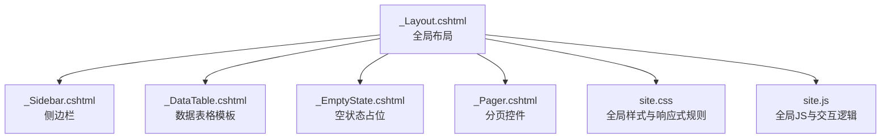
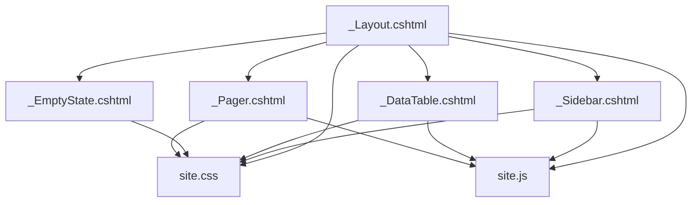
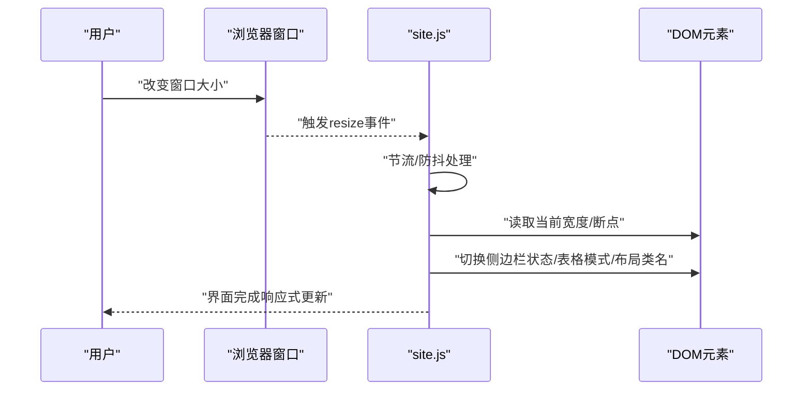
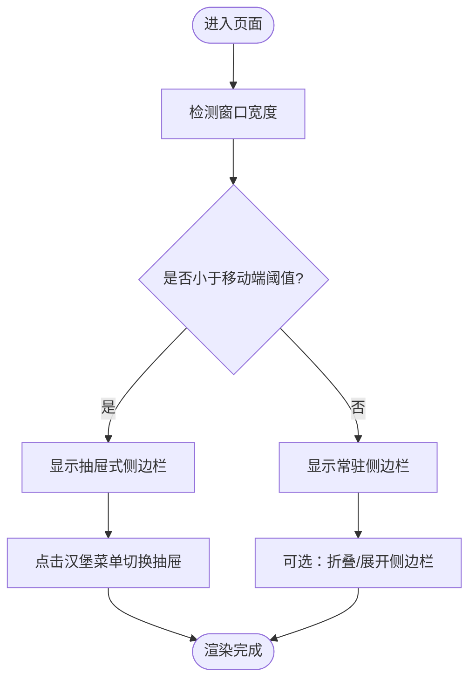
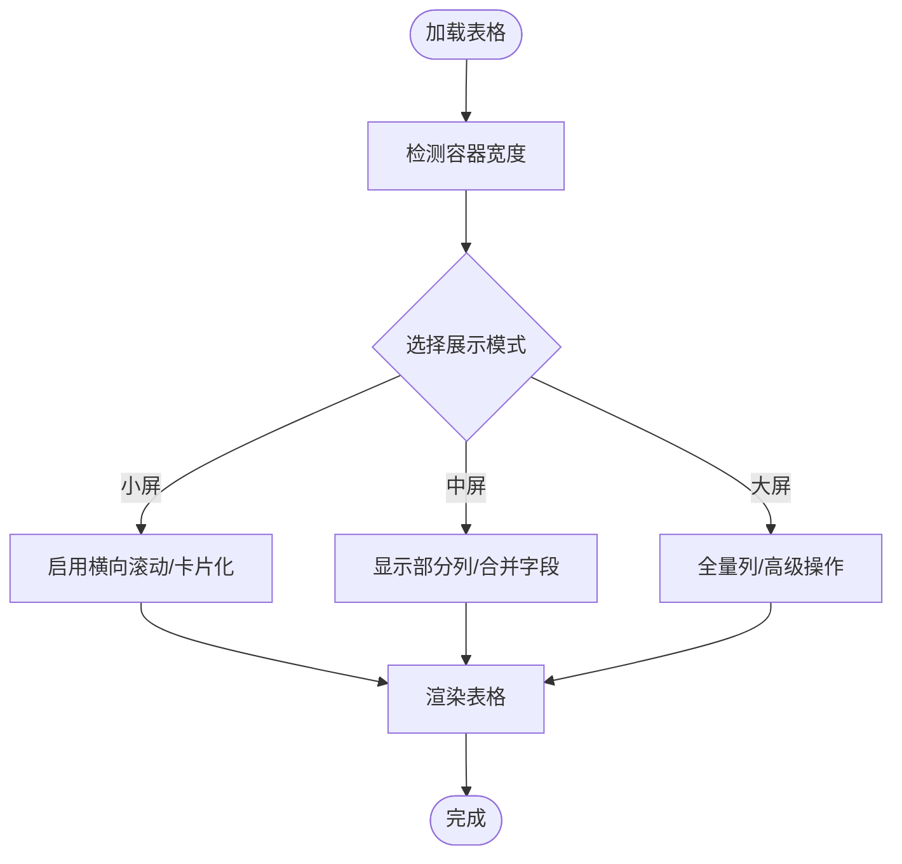
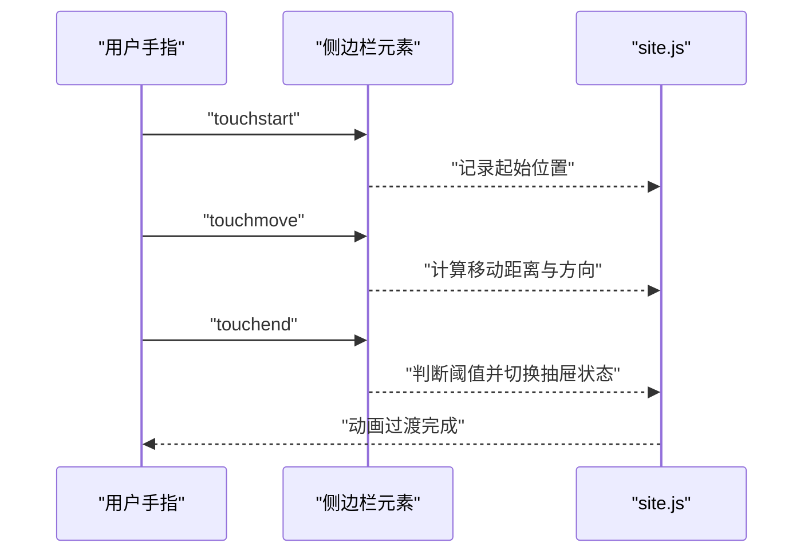
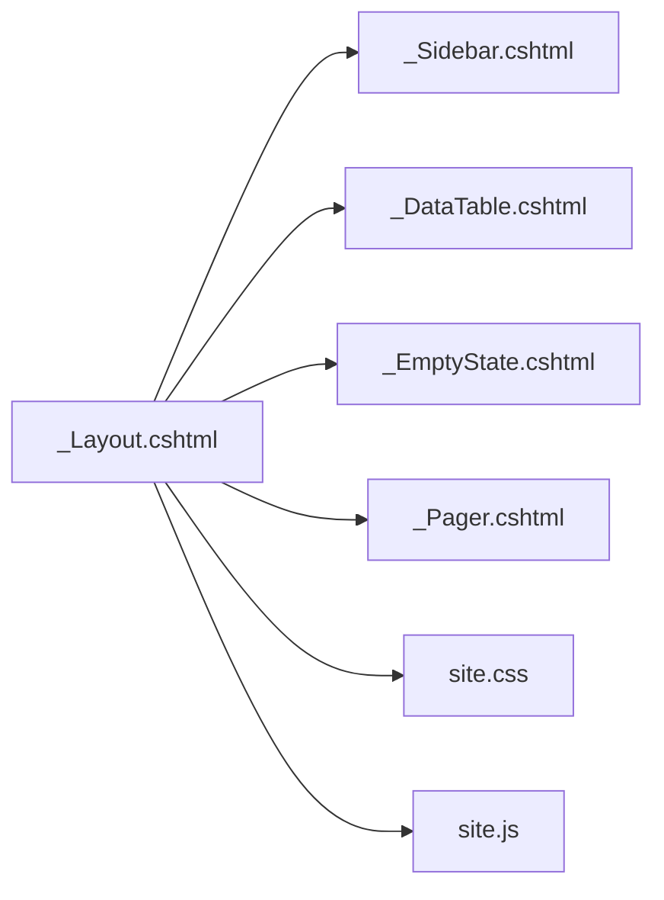

# 响应式设计

<cite>
**本文引用的文件**   
- [site.css](file://EquipmentIMS.Web/wwwroot/css/site.css)
- [site.js](file://EquipmentIMS.Web/wwwroot/js/site.js)
- [_Layout.cshtml](file://EquipmentIMS.Web/Views/Shared/_Layout.cshtml)
- [_Sidebar.cshtml](file://EquipmentIMS.Web/Views/Shared/_Sidebar.cshtml)
- [_DataTable.cshtml](file://EquipmentIMS.Web/Views/Shared/_DataTable.cshtml)
- [_EmptyState.cshtml](file://EquipmentIMS.Web/Views/Shared/_EmptyState.cshtml)
- [_Pager.cshtml](file://EquipmentIMS.Web/Views/Shared/_Pager.cshtml)
</cite>

## 目录
1. [简介](#简介)
2. [项目结构](#项目结构)
3. [核心组件](#核心组件)
4. [架构总览](#架构总览)
5. [详细组件分析](#详细组件分析)
6. [依赖关系分析](#依赖关系分析)
7. [性能考虑](#性能考虑)
8. [故障排查指南](#故障排查指南)
9. [结论](#结论)
10. [附录](#附录)

## 简介
本指南聚焦THMS系统的响应式设计实现，围绕Bootstrap栅格系统、移动端优先策略、媒体查询与CSS变量、JavaScript层面的窗口监听与动态布局调整，以及导航栏、表格、表单等关键界面的移动端优化进行系统化说明。文档同时提供触摸交互与手势支持的实践建议，帮助在不同屏幕尺寸下获得一致且流畅的用户体验。

## 项目结构
THMS的前端资源位于Web层，其中样式与脚本分别存放于wwwroot/css与wwwroot/js；视图层通过共享布局与局部视图组织页面结构与通用组件。

**图表来源**
- [_Layout.cshtml](file://EquipmentIMS.Web/Views/Shared/_Layout.cshtml)
- [_Sidebar.cshtml](file://EquipmentIMS.Web/Views/Shared/_Sidebar.cshtml)
- [_DataTable.cshtml](file://EquipmentIMS.Web/Views/Shared/_DataTable.cshtml)
- [_EmptyState.cshtml](file://EquipmentIMS.Web/Views/Shared/_EmptyState.cshtml)
- [_Pager.cshtml](file://EquipmentIMS.Web/Views/Shared/_Pager.cshtml)
- [site.css](file://EquipmentIMS.Web/wwwroot/css/site.css)
- [site.js](file://EquipmentIMS.Web/wwwroot/js/site.js)

**章节来源**
- [_Layout.cshtml](file://EquipmentIMS.Web/Views/Shared/_Layout.cshtml)
- [_Sidebar.cshtml](file://EquipmentIMS.Web/Views/Shared/_Sidebar.cshtml)
- [_DataTable.cshtml](file://EquipmentIMS.Web/Views/Shared/_DataTable.cshtml)
- [_EmptyState.cshtml](file://EquipmentIMS.Web/Views/Shared/_EmptyState.cshtml)
- [_Pager.cshtml](file://EquipmentIMS.Web/Views/Shared/_Pager.cshtml)
- [site.css](file://EquipmentIMS.Web/wwwroot/css/site.css)
- [site.js](file://EquipmentIMS.Web/wwwroot/js/site.js)

## 核心组件
- 全局布局：负责引入Bootstrap、图标库、主样式与脚本，并承载头部、侧边栏与主体内容区域。
- 侧边栏：在桌面端常驻显示，在移动端可折叠为抽屉式或顶部菜单。
- 数据表格：基于Bootstrap栅格与表格类名，在小屏下启用横向滚动或卡片化展示。
- 空状态与分页：在小屏下优化间距与字号，保证可读性与触控友好。
- 全局样式：集中定义断点、容器宽度、间距、颜色与字体等CSS变量，统一响应式行为。
- 全局脚本：处理窗口大小变化、侧边栏开关、表格自适应与触摸事件。

**章节来源**
- [_Layout.cshtml](file://EquipmentIMS.Web/Views/Shared/_Layout.cshtml)
- [_Sidebar.cshtml](file://EquipmentIMS.Web/Views/Shared/_Sidebar.cshtml)
- [_DataTable.cshtml](file://EquipmentIMS.Web/Views/Shared/_DataTable.cshtml)
- [_EmptyState.cshtml](file://EquipmentIMS.Web/Views/Shared/_EmptyState.cshtml)
- [_Pager.cshtml](file://EquipmentIMS.Web/Views/Shared/_Pager.cshtml)
- [site.css](file://EquipmentIMS.Web/wwwroot/css/site.css)
- [site.js](file://EquipmentIMS.Web/wwwroot/js/site.js)

## 架构总览
下图展示了THMS响应式前端的关键模块及其交互关系。布局作为入口，组合侧边栏、表格、空状态与分页等组件，并通过全局样式与脚本驱动响应式行为。

**图表来源**
- [_Layout.cshtml](file://EquipmentIMS.Web/Views/Shared/_Layout.cshtml)
- [_Sidebar.cshtml](file://EquipmentIMS.Web/Views/Shared/_Sidebar.cshtml)
- [_DataTable.cshtml](file://EquipmentIMS.Web/Views/Shared/_DataTable.cshtml)
- [_EmptyState.cshtml](file://EquipmentIMS.Web/Views/Shared/_EmptyState.cshtml)
- [_Pager.cshtml](file://EquipmentIMS.Web/Views/Shared/_Pager.cshtml)
- [site.css](file://EquipmentIMS.Web/wwwroot/css/site.css)
- [site.js](file://EquipmentIMS.Web/wwwroot/js/site.js)

## 详细组件分析

### Bootstrap栅格系统与断点设置
- 使用Bootstrap提供的行与列类构建响应式布局，遵循“先小后大”的断点顺序（如xs、sm、md、lg、xl），确保默认样式针对移动端，再在大屏上逐步展开。
- 在布局中合理划分主内容区与侧边栏，利用列偏移、嵌套列与对齐工具提升适配效果。
- 对复杂页面采用“单列堆叠 + 多列并排”的组合策略，避免在小屏出现拥挤或溢出。

**章节来源**
- [_Layout.cshtml](file://EquipmentIMS.Web/Views/Shared/_Layout.cshtml)
- [site.css](file://EquipmentIMS.Web/wwwroot/css/site.css)

### 移动端优先的设计原则与实现方法
- 默认样式面向移动端：基础排版、间距、按钮尺寸与输入框高度均按小屏设计，再通过媒体查询放大到平板与桌面。
- 渐进增强：在小屏提供必要的功能与提示，在大屏补充更多操作入口与可视化信息。
- 触控友好：增大点击区域、减少密集操作、提供清晰的反馈与错误提示。

**章节来源**
- [site.css](file://EquipmentIMS.Web/wwwroot/css/site.css)

### 媒体查询与CSS变量的响应式配置
- 将主题色、字体大小、间距、圆角等抽取为CSS变量，便于在断点处统一切换。
- 使用媒体查询覆盖变量值或应用特定样式，保持代码集中与可维护性。
- 针对表格、表单、导航等组件建立独立的响应式规则块，避免相互影响。

**章节来源**
- [site.css](file://EquipmentIMS.Web/wwwroot/css/site.css)

### JavaScript层面的响应式处理
- 窗口大小监听：在resize事件中检测当前断点，动态切换侧边栏状态、表格模式与布局类名。
- 防抖与节流：对频繁触发的事件进行节流，降低重排与重绘开销。
- 动态布局调整：根据容器宽度计算列数、是否启用横向滚动或卡片化展示。
- 触摸事件：为滑动关闭侧边栏、拖拽排序等场景添加touchstart/touchmove/touchend处理。

**图表来源**
- [site.js](file://EquipmentIMS.Web/wwwroot/js/site.js)

**章节来源**
- [site.js](file://EquipmentIMS.Web/wwwroot/js/site.js)

### 不同屏幕尺寸的界面适配方案

#### 导航栏与侧边栏
- 桌面端：侧边栏常驻显示，导航项完整呈现。
- 平板端：侧边栏可折叠，保留主要导航，次要项收起至二级菜单。
- 移动端：侧边栏以抽屉形式从左侧滑出，顶部提供汉堡菜单按钮；重要操作置顶。

**图表来源**
- [_Sidebar.cshtml](file://EquipmentIMS.Web/Views/Shared/_Sidebar.cshtml)
- [site.js](file://EquipmentIMS.Web/wwwroot/js/site.js)

**章节来源**
- [_Sidebar.cshtml](file://EquipmentIMS.Web/Views/Shared/_Sidebar.cshtml)
- [site.js](file://EquipmentIMS.Web/wwwroot/js/site.js)

#### 表格
- 小屏：启用横向滚动或卡片化展示，隐藏非关键列，突出核心字段。
- 中屏：适度显示列，合并相关字段，提高可读性。
- 大屏：全量展示列，支持排序、筛选与批量操作。

**图表来源**
- [_DataTable.cshtml](file://EquipmentIMS.Web/Views/Shared/_DataTable.cshtml)
- [site.js](file://EquipmentIMS.Web/wwwroot/js/site.js)

**章节来源**
- [_DataTable.cshtml](file://EquipmentIMS.Web/Views/Shared/_DataTable.cshtml)
- [site.js](file://EquipmentIMS.Web/wwwroot/js/site.js)

#### 表单
- 小屏：单列布局，标签置于输入框上方，增大输入区域与按钮尺寸。
- 中屏：两列布局，相关字段分组显示。
- 大屏：三列或四列布局，充分利用空间，提供辅助说明与校验提示。

**章节来源**
- [site.css](file://EquipmentIMS.Web/wwwroot/css/site.css)

#### 空状态与分页
- 空状态：在小屏下居中显示，简化文案与图标，提供明确的操作引导。
- 分页：在小屏下仅显示必要页码与跳转，增大点击区域，避免拥挤。

**章节来源**
- [_EmptyState.cshtml](file://EquipmentIMS.Web/Views/Shared/_EmptyState.cshtml)
- [_Pager.cshtml](file://EquipmentIMS.Web/Views/Shared/_Pager.cshtml)

### 触摸交互与手势支持
- 侧边栏滑动：监听touchstart/touchmove/touchend，计算滑动距离与方向，实现左滑打开、右滑关闭。
- 列表项操作：支持长按弹出操作菜单，左右滑动显示删除/编辑等操作按钮。
- 缩放与双击：禁用不必要的缩放，避免误触；对需要放大的图表或图片提供双击放大。

**图表来源**
- [_Sidebar.cshtml](file://EquipmentIMS.Web/Views/Shared/_Sidebar.cshtml)
- [site.js](file://EquipmentIMS.Web/wwwroot/js/site.js)

**章节来源**
- [_Sidebar.cshtml](file://EquipmentIMS.Web/Views/Shared/_Sidebar.cshtml)
- [site.js](file://EquipmentIMS.Web/wwwroot/js/site.js)

## 依赖关系分析
- 布局依赖侧边栏、表格、空状态与分页等局部视图，形成稳定的组合关系。
- 全局样式与脚本被布局引入，为各组件提供统一的响应式能力。
- 组件之间尽量低耦合，通过类名与事件机制通信，避免直接引用彼此内部实现。

**图表来源**
- [_Layout.cshtml](file://EquipmentIMS.Web/Views/Shared/_Layout.cshtml)
- [_Sidebar.cshtml](file://EquipmentIMS.Web/Views/Shared/_Sidebar.cshtml)
- [_DataTable.cshtml](file://EquipmentIMS.Web/Views/Shared/_DataTable.cshtml)
- [_EmptyState.cshtml](file://EquipmentIMS.Web/Views/Shared/_EmptyState.cshtml)
- [_Pager.cshtml](file://EquipmentIMS.Web/Views/Shared/_Pager.cshtml)
- [site.css](file://EquipmentIMS.Web/wwwroot/css/site.css)
- [site.js](file://EquipmentIMS.Web/wwwroot/js/site.js)

**章节来源**
- [_Layout.cshtml](file://EquipmentIMS.Web/Views/Shared/_Layout.cshtml)
- [_Sidebar.cshtml](file://EquipmentIMS.Web/Views/Shared/_Sidebar.cshtml)
- [_DataTable.cshtml](file://EquipmentIMS.Web/Views/Shared/_DataTable.cshtml)
- [_EmptyState.cshtml](file://EquipmentIMS.Web/Views/Shared/_EmptyState.cshtml)
- [_Pager.cshtml](file://EquipmentIMS.Web/Views/Shared/_Pager.cshtml)
- [site.css](file://EquipmentIMS.Web/wwwroot/css/site.css)
- [site.js](file://EquipmentIMS.Web/wwwroot/js/site.js)

## 性能考虑
- 减少重排与重绘：在resize事件中采用节流，批量更新DOM类名与样式。
- 懒加载与按需渲染：对小屏隐藏不重要的列或组件，待交互时再加载。
- 图片与图标优化：使用矢量图标与合适的分辨率图片，避免大图阻塞渲染。
- 缓存与复用：对计算结果（如断点判定、列可见性）进行缓存，避免重复计算。

[本节为通用指导，不涉及具体文件分析]

## 故障排查指南
- 侧边栏无法打开或关闭：检查触摸事件绑定是否正确，确认touchstart/touchmove/touchend监听器未被移除。
- 表格在小屏错位：确认是否启用了横向滚动或卡片化模式，检查列宽与容器宽度约束。
- 表单在小屏拥挤：检查是否应用了单列布局与合适的间距，确认输入框与按钮的最小触控尺寸。
- 样式未生效：确认全局样式与组件样式加载顺序，检查媒体查询条件与CSS变量覆盖范围。

**章节来源**
- [_Sidebar.cshtml](file://EquipmentIMS.Web/Views/Shared/_Sidebar.cshtml)
- [_DataTable.cshtml](file://EquipmentIMS.Web/Views/Shared/_DataTable.cshtml)
- [site.css](file://EquipmentIMS.Web/wwwroot/css/site.css)
- [site.js](file://EquipmentIMS.Web/wwwroot/js/site.js)

## 结论
通过Bootstrap栅格系统、移动端优先策略、媒体查询与CSS变量、以及JavaScript层面的窗口监听与触摸事件处理，THMS能够在不同屏幕尺寸下提供一致的响应式体验。建议在后续迭代中持续优化表格与表单在小屏的可读性与可操作性，完善手势交互与性能优化，进一步提升用户体验。

[本节为总结性内容，不涉及具体文件分析]

## 附录
- 最佳实践清单
  - 始终从移动端开始设计，再逐步增强到大屏。
  - 将主题与布局参数抽象为CSS变量，集中管理断点与样式。
  - 对高频事件进行节流/防抖，避免性能问题。
  - 为关键交互提供明确的视觉反馈与错误提示。
  - 定期在不同设备与浏览器上进行兼容性测试。

[本节为通用指导，不涉及具体文件分析]