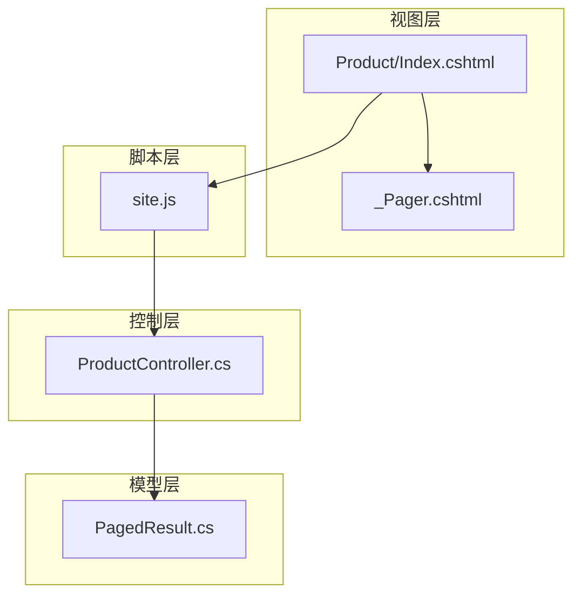
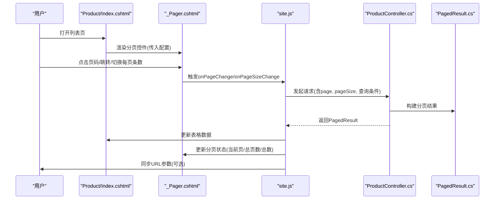
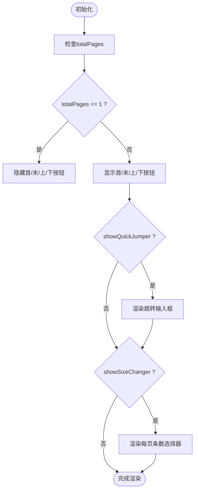
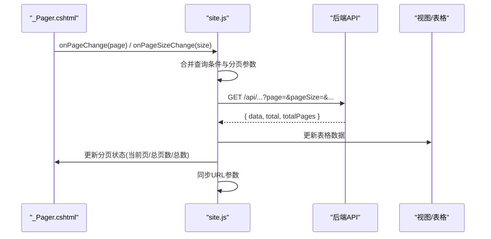

# 分页组件

<cite>
**本文引用的文件**   
- [_Pager.cshtml](file://EquipmentIMS.Web/Views/Shared/_Pager.cshtml)
- [site.js](file://EquipmentIMS.Web/wwwroot/js/site.js)
- [Index.cshtml](file://EquipmentIMS.Web/Views/Product/Index.cshtml)
- [ProductController.cs](file://EquipmentIMS.Web/Controllers/ProductController.cs)
- [PagedResult.cs](file://EquipmentIMS.Models/DTOs/PagedResult.cs)
</cite>

## 目录
1. [简介](#简介)
2. [项目结构](#项目结构)
3. [核心组件](#核心组件)
4. [架构总览](#架构总览)
5. [详细组件分析](#详细组件分析)
6. [依赖分析](#依赖分析)
7. [性能考虑](#性能考虑)
8. [故障排查指南](#故障排查指南)
9. [结论](#结论)
10. [附录](#附录)

## 简介
本文件面向THMS系统中的_Pager.cshtml分页组件，提供从实现逻辑、配置参数、事件机制到与后端API集成的完整开发文档。内容覆盖页码计算、边界处理、跳转功能、每页条数设置、回调触发、URL参数传递、查询条件保持、页面状态同步以及大数据量场景下的优化策略等。

## 项目结构
_ Pager.cshtml位于共享视图目录中，作为通用分页UI被各列表页复用；前端交互由全局脚本site.js驱动；控制器层通过统一的PagedResult返回分页数据；典型使用示例见Product/Index.cshtml与ProductController.cs。

图表来源
- [_Pager.cshtml](file://EquipmentIMS.Web/Views/Shared/_Pager.cshtml)
- [site.js](file://EquipmentIMS.Web/wwwroot/js/site.js)
- [Index.cshtml](file://EquipmentIMS.Web/Views/Product/Index.cshtml)
- [ProductController.cs](file://EquipmentIMS.Web/Controllers/ProductController.cs)
- [PagedResult.cs](file://EquipmentIMS.Models/DTOs/PagedResult.cs)

章节来源
- [_Pager.cshtml](file://EquipmentIMS.Web/Views/Shared/_Pager.cshtml)
- [site.js](file://EquipmentIMS.Web/wwwroot/js/site.js)
- [Index.cshtml](file://EquipmentIMS.Web/Views/Product/Index.cshtml)
- [ProductController.cs](file://EquipmentIMS.Web/Controllers/ProductController.cs)
- [PagedResult.cs](file://EquipmentIMS.Models/DTOs/PagedResult.cs)

## 核心组件
本节聚焦_Pager.cshtml的分页能力与行为约定：
- 页码计算与渲染：根据当前页、总页数、是否显示首页/末页/上下页按钮进行渲染，并处理边界情况（如只有一页或总页数为零）。
- 跳转与每页条数：支持快速跳转到指定页码，支持切换每页条数（当启用showSizeChanger时）。
- 事件回调：在页码变化、每页条数变化、总数变化时触发对应回调，供上层业务更新数据与URL。
- 可配置项：currentPage、totalPages、pageSize、showSizeChanger、showQuickJumper、onPageChange、onPageSizeChange、onTotalChange等。

章节来源
- [_Pager.cshtml](file://EquipmentIMS.Web/Views/Shared/_Pager.cshtml)

## 架构总览
分页交互的整体流程如下：
- 视图层渲染_Pager.cshtml，传入分页配置与初始数据。
- 用户操作（点击页码、输入跳转页码、切换每页条数）触发site.js中的事件处理。
- site.js调用后端API，携带当前页、每页条数及查询条件。
- 控制器解析请求，查询数据并封装为PagedResult返回。
- 前端接收响应后更新表格数据与分页组件状态，必要时同步URL参数。

图表来源
- [Index.cshtml](file://EquipmentIMS.Web/Views/Product/Index.cshtml)
- [_Pager.cshtml](file://EquipmentIMS.Web/Views/Shared/_Pager.cshtml)
- [site.js](file://EquipmentIMS.Web/wwwroot/js/site.js)
- [ProductController.cs](file://EquipmentIMS.Web/Controllers/ProductController.cs)
- [PagedResult.cs](file://EquipmentIMS.Models/DTOs/PagedResult.cs)

## 详细组件分析

### _Pager.cshtml 组件分析
- 渲染逻辑
  - 根据totalPages决定显示“首页/上一页/下一页/末页”的可用状态。
  - 当totalPages较大时，采用区间显示策略，避免过多页码按钮影响体验。
  - 当启用showQuickJumper时，渲染输入框与确认按钮，用于快速跳转。
  - 当启用showSizeChanger时，渲染下拉选择器，用于切换每页条数。
- 事件绑定
  - 页码点击：调用onPageChange(page)。
  - 跳转输入：校验输入范围后调用onPageChange(page)。
  - 每页条数变更：调用onPageSizeChange(newPageSize)。
  - 总数变更：若外部传入onTotalChange(total)，则触发以允许上层更新统计信息。
- 边界处理
  - totalPages<=1时隐藏不必要的导航按钮。
  - 输入页码越界时自动修正为有效范围。
  - pageSize变更时重新计算totalPages并刷新UI。

图表来源
- [_Pager.cshtml](file://EquipmentIMS.Web/Views/Shared/_Pager.cshtml)

章节来源
- [_Pager.cshtml](file://EquipmentIMS.Web/Views/Shared/_Pager.cshtml)

### site.js 交互逻辑
- 事件代理与分发
  - 监听分页容器内的页码点击、跳转确认、每页条数变更事件。
  - 将事件转发给对应的回调函数（onPageChange、onPageSizeChange）。
- URL同步
  - 在页码或每页条数变更后，更新URL查询参数（如page、pageSize），便于分享与刷新保持状态。
- 数据刷新
  - 根据当前查询条件与分页参数调用后端接口，成功后更新表格与分页状态。

图表来源
- [site.js](file://EquipmentIMS.Web/wwwroot/js/site.js)
- [_Pager.cshtml](file://EquipmentIMS.Web/Views/Shared/_Pager.cshtml)

章节来源
- [site.js](file://EquipmentIMS.Web/wwwroot/js/site.js)

### Product/Index.cshtml 使用示例
- 引入_Pager.cshtml并传入初始配置（如currentPage、totalPages、pageSize等）。
- 定义onPageChange与onPageSizeChange回调，负责刷新数据与更新URL。
- 在页面加载时读取URL参数，恢复分页状态。

章节来源
- [Index.cshtml](file://EquipmentIMS.Web/Views/Product/Index.cshtml)

### ProductController.cs 后端集成
- 接收分页参数（page、pageSize）与查询条件。
- 执行分页查询，返回PagedResult对象，包含数据集合、总数与总页数。
- 对非法参数进行校验与默认值处理。

章节来源
- [ProductController.cs](file://EquipmentIMS.Web/Controllers/ProductController.cs)

### PagedResult.cs 数据结构
- 字段说明
  - data：当前页数据集合。
  - total：总记录数。
  - totalPages：总页数。
- 用途
  - 统一前后端分页契约，便于前端稳定渲染与计算。

章节来源
- [PagedResult.cs](file://EquipmentIMS.Models/DTOs/PagedResult.cs)

## 依赖分析
- 组件耦合关系
  - _Pager.cshtml仅负责UI渲染与事件派发，不直接访问后端。
  - site.js承担事件分发、URL同步与数据刷新，是连接视图与控制的桥梁。
  - 控制器与PagedResult构成稳定的数据契约。
- 外部依赖
  - 前端脚本依赖jQuery与Bootstrap（项目中已引入）。
  - 控制器依赖仓储与服务层进行数据查询。

图表来源
- [_Pager.cshtml](file://EquipmentIMS.Web/Views/Shared/_Pager.cshtml)
- [site.js](file://EquipmentIMS.Web/wwwroot/js/site.js)
- [ProductController.cs](file://EquipmentIMS.Web/Controllers/ProductController.cs)
- [PagedResult.cs](file://EquipmentIMS.Models/DTOs/PagedResult.cs)

章节来源
- [_Pager.cshtml](file://EquipmentIMS.Web/Views/Shared/_Pager.cshtml)
- [site.js](file://EquipmentIMS.Web/wwwroot/js/site.js)
- [ProductController.cs](file://EquipmentIMS.Web/Controllers/ProductController.cs)
- [PagedResult.cs](file://EquipmentIMS.Models/DTOs/PagedResult.cs)

## 性能考虑
- 大数据量分页
  - 始终使用服务端分页，避免一次性加载全部数据。
  - 合理设置pageSize，平衡用户体验与服务器压力。
- 预加载下一页
  - 在滚动到底部前N条时，提前触发下一页请求，提升浏览流畅度。
- 去抖与节流
  - 对快速连续点击页码或频繁切换pageSize进行防抖/节流，减少重复请求。
- 缓存策略
  - 对相同查询条件的分页结果进行短期缓存，避免重复查询。
- 渲染优化
  - 对超长页码列表采用区间显示，减少DOM节点数量。
  - 仅在必要时更新DOM，避免整表重绘。

[本节为通用指导，不涉及具体文件分析]

## 故障排查指南
- 常见问题
  - 页码未更新：检查onPageChange是否正确调用并更新分页状态。
  - 跳转无效：确认输入页码是否在1~totalPages范围内。
  - 每页条数不生效：确认onPageSizeChange是否触发了数据刷新与URL同步。
  - 总数不一致：核对后端返回的total与前端计算的totalPages是否匹配。
- 调试建议
  - 在site.js中添加日志输出，跟踪事件触发与请求参数。
  - 使用浏览器网络面板查看请求与响应，验证PagedResult结构。
  - 检查URL参数是否与预期一致，确保刷新后状态可恢复。

章节来源
- [site.js](file://EquipmentIMS.Web/wwwroot/js/site.js)
- [PagedResult.cs](file://EquipmentIMS.Models/DTOs/PagedResult.cs)

## 结论
_Pager.cshtml作为通用分页组件，提供了灵活的配置项与清晰的事件机制，配合site.js可实现完整的分页交互与URL同步。通过合理的后端分页设计与前端优化策略，可在大数据量场景下保持良好的用户体验。

[本节为总结性内容，不涉及具体文件分析]

## 附录

### 配置参数清单
- currentPage：当前页码（从1开始）
- totalPages：总页数
- pageSize：每页条数
- showSizeChanger：是否显示每页条数切换器
- showQuickJumper：是否显示快速跳转输入框
- onPageChange(page)：页码变化回调
- onPageSizeChange(newPageSize)：每页条数变化回调
- onTotalChange(total)：总数变化回调（可选）

章节来源
- [_Pager.cshtml](file://EquipmentIMS.Web/Views/Shared/_Pager.cshtml)

### 与后端API集成要点
- URL参数
  - page：当前页码
  - pageSize：每页条数
  - 其他查询条件：按业务需要追加
- 查询条件保持
  - 将查询条件与分页参数一并持久化到URL，保证刷新与分享一致性。
- 页面状态同步
  - 在数据刷新成功后，更新分页组件状态与表格数据。
- 错误处理
  - 对网络异常与后端错误进行友好提示，并回滚到上一个有效状态。

章节来源
- [site.js](file://EquipmentIMS.Web/wwwroot/js/site.js)
- [ProductController.cs](file://EquipmentIMS.Web/Controllers/ProductController.cs)
- [PagedResult.cs](file://EquipmentIMS.Models/DTOs/PagedResult.cs)