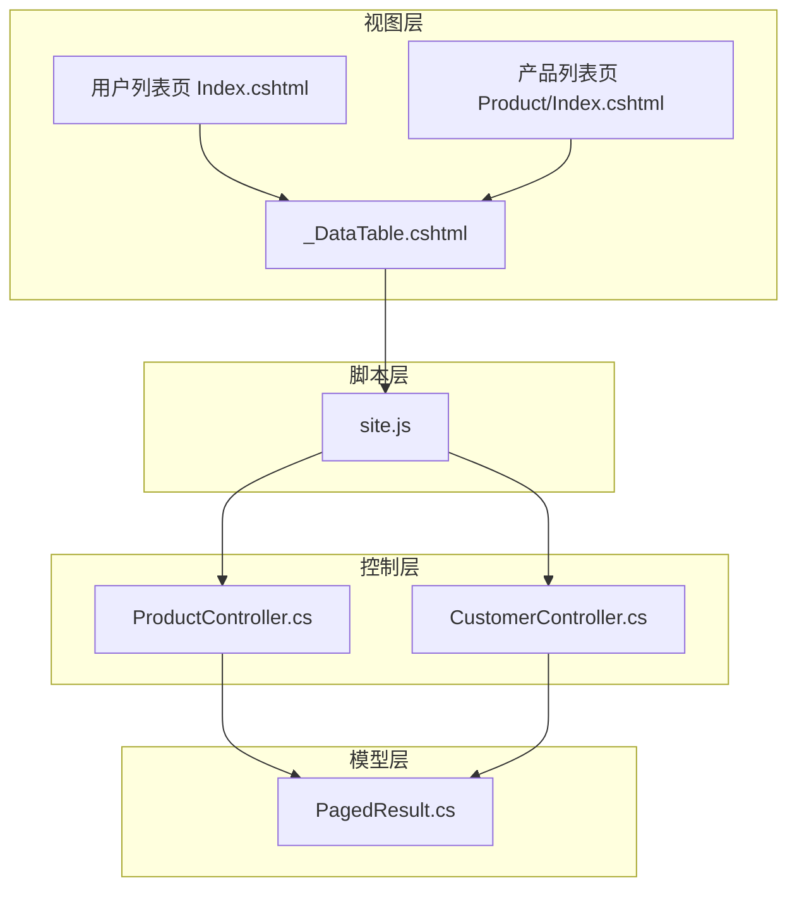
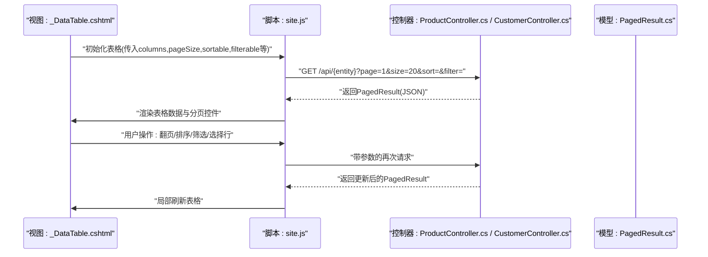
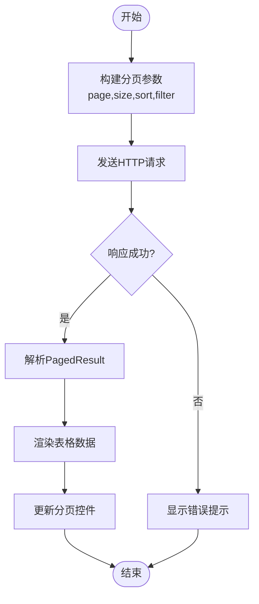
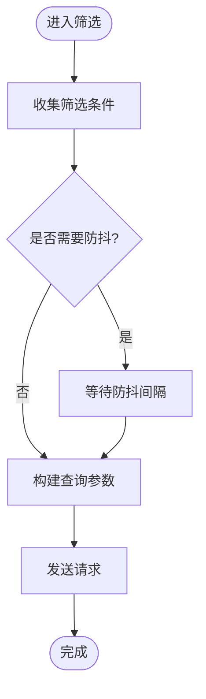
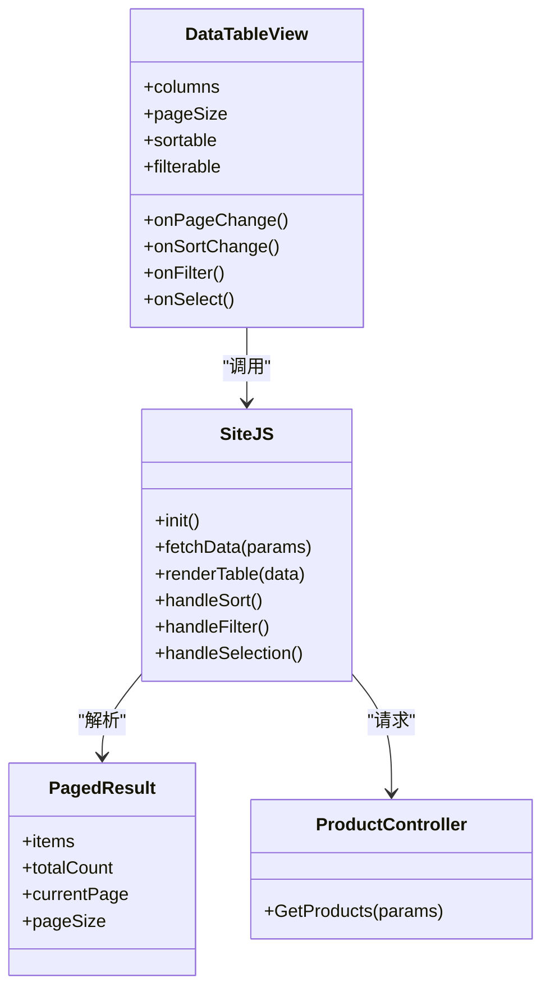

# 数据表格组件

<cite>
**本文引用的文件**   
- [Shared/_DataTable.cshtml](file://EquipmentIMS.Web/Views/Shared/_DataTable.cshtml)
- [site.js](file://EquipmentIMS.Web/wwwroot/js/site.js)
- [PagedResult.cs](file://EquipmentIMS.Models/DTOs/PagedResult.cs)
- [ProductController.cs](file://EquipmentIMS.Web/Controllers/ProductController.cs)
- [CustomerController.cs](file://EquipmentIMS.Web/Controllers/CustomerController.cs)
- [UserIndex.cshtml](file://EquipmentIMS.Web/Views/User/Index.cshtml)
- [ProductIndex.cshtml](file://EquipmentIMS.Web/Views/Product/Index.cshtml)
</cite>

## 目录
1. [简介](#简介)
2. [项目结构](#项目结构)
3. [核心组件](#核心组件)
4. [架构总览](#架构总览)
5. [详细组件分析](#详细组件分析)
6. [依赖分析](#依赖分析)
7. [性能考虑](#性能考虑)
8. [故障排查指南](#故障排查指南)
9. [结论](#结论)
10. [附录](#附录)

## 简介
本文件面向 THMS 系统中的 _DataTable.cshtml 数据表格组件，提供从架构到实现、从配置到事件、从使用示例到性能优化的完整开发文档。该组件用于在 Razor 视图中以声明式方式渲染可分页、可排序、可筛选、可选行的通用数据表格，并通过 JavaScript 与后端 API 协作完成数据加载与交互。

## 项目结构
_ DataTable 组件位于共享视图目录中，供各业务页面复用；其前端交互逻辑集中在站点级脚本文件中；后端通过控制器返回分页结果 DTO，供视图渲染。

图表来源
- [Shared/_DataTable.cshtml](file://EquipmentIMS.Web/Views/Shared/_DataTable.cshtml)
- [site.js](file://EquipmentIMS.Web/wwwroot/js/site.js)
- [PagedResult.cs](file://EquipmentIMS.Models/DTOs/PagedResult.cs)
- [ProductController.cs](file://EquipmentIMS.Web/Controllers/ProductController.cs)
- [CustomerController.cs](file://EquipmentIMS.Web/Controllers/CustomerController.cs)

章节来源
- [Shared/_DataTable.cshtml](file://EquipmentIMS.Web/Views/Shared/_DataTable.cshtml)
- [site.js](file://EquipmentIMS.Web/wwwroot/js/site.js)
- [PagedResult.cs](file://EquipmentIMS.Models/DTOs/PagedResult.cs)
- [ProductController.cs](file://EquipmentIMS.Web/Controllers/ProductController.cs)
- [CustomerController.cs](file://EquipmentIMS.Web/Controllers/CustomerController.cs)

## 核心组件
本节聚焦 _DataTable.cshtml 的核心能力：动态列配置、分页、排序、筛选过滤、行选择等，并说明其与 site.js 的协作方式以及后端 PagedResult 的数据契约。

- 动态列配置
  - 通过 columns 参数定义列集合，支持列标题、字段映射、格式化函数、是否显示、宽度、对齐等属性。
  - 支持自定义单元格渲染（例如状态标签、操作按钮），便于在不同业务场景下灵活展示。
- 分页处理
  - 支持 pageSize 设置与页码切换，内部维护当前页码与每页条数，向服务端请求对应页数据。
  - 与后端 PagedResult 约定数据结构，包含数据集合、总记录数、当前页、每页大小等。
- 排序功能
  - 支持单列或多列排序，点击列头触发 onSortChange 回调，携带排序字段与方向信息。
  - 将排序参数附加到查询字符串或请求体，由后端统一解析。
- 筛选过滤
  - 支持全局搜索与列级筛选，onFilter 回调收集筛选条件并刷新数据。
  - 支持多条件组合，避免重复请求，具备防抖机制以减少频繁网络调用。
- 行选择
  - 支持单选/多选模式，选中行集合可通过事件回调获取，便于批量操作。
  - 提供全选/反选、清空选择等辅助方法。

章节来源
- [Shared/_DataTable.cshtml](file://EquipmentIMS.Web/Views/Shared/_DataTable.cshtml)
- [site.js](file://EquipmentIMS.Web/wwwroot/js/site.js)
- [PagedResult.cs](file://EquipmentIMS.Models/DTOs/PagedResult.cs)

## 架构总览
下图展示了数据表格组件在前端视图、脚本、后端控制器与模型之间的交互关系。

图表来源
- [Shared/_DataTable.cshtml](file://EquipmentIMS.Web/Views/Shared/_DataTable.cshtml)
- [site.js](file://EquipmentIMS.Web/wwwroot/js/site.js)
- [ProductController.cs](file://EquipmentIMS.Web/Controllers/ProductController.cs)
- [CustomerController.cs](file://EquipmentIMS.Web/Controllers/CustomerController.cs)
- [PagedResult.cs](file://EquipmentIMS.Models/DTOs/PagedResult.cs)

## 详细组件分析

### 组件参数与配置
- columns
  - 描述：定义表格列集合，包括列名、绑定字段、是否可排序、是否可筛选、格式化函数、宽度、对齐方式等。
  - 典型用法：在视图中声明列数组，传递给组件初始化。
- pageSize
  - 描述：每页显示条数，默认值可由组件设定，也可在初始化时覆盖。
- sortable
  - 描述：是否启用列头排序，支持单列/多列排序策略。
- filterable
  - 描述：是否启用筛选，支持全局搜索框与列级筛选器。
- onSelect/onSelectAll
  - 描述：行选择事件回调，返回选中行集合或全选状态变化。
- onPageChange
  - 描述：页码变更回调，接收新页码与每页大小，常用于联动其他面板或保存状态。
- onSortChange
  - 描述：排序变更回调，接收排序字段与方向，用于构建查询参数。
- onFilter
  - 描述：筛选变更回调，接收筛选条件对象，用于构建查询参数。
- renderCell
  - 描述：列级自定义渲染函数，用于复杂展示（如状态徽章、操作链接）。

章节来源
- [Shared/_DataTable.cshtml](file://EquipmentIMS.Web/Views/Shared/_DataTable.cshtml)
- [site.js](file://EquipmentIMS.Web/wwwroot/js/site.js)

### 事件处理机制
- 事件生命周期
  - 初始化：读取配置项，注册事件监听，首次加载数据。
  - 交互：响应翻页、排序、筛选、选择等操作，触发相应回调并重新拉取数据。
  - 销毁：清理定时器、事件监听与缓存，防止内存泄漏。
- 关键回调
  - onPageChange(page, size)：页码或每页大小变化时触发。
  - onSortChange(field, direction)：排序字段与方向变化时触发。
  - onFilter(filters)：筛选条件变化时触发。
  - onSelect(rows)：行选择状态变化时触发。
- 防抖与节流
  - 对筛选输入进行防抖，减少高频请求。
  - 对滚动加载（若启用）进行节流，提升性能。

章节来源
- [site.js](file://EquipmentIMS.Web/wwwroot/js/site.js)
- [Shared/_DataTable.cshtml](file://EquipmentIMS.Web/Views/Shared/_DataTable.cshtml)

### 分页流程与数据契约
- 分页流程
  - 前端维护当前页码与每页大小，构造查询参数。
  - 向后端发起请求，后端根据参数查询数据库并返回分页结果。
  - 前端解析 PagedResult，渲染表格与分页控件。
- 数据契约（PagedResult）
  - 字段建议：数据集合、总记录数、当前页、每页大小、是否有下一页等。
  - 错误处理：当返回异常或空数据时，组件应给出友好提示。

图表来源
- [site.js](file://EquipmentIMS.Web/wwwroot/js/site.js)
- [PagedResult.cs](file://EquipmentIMS.Models/DTOs/PagedResult.cs)

章节来源
- [site.js](file://EquipmentIMS.Web/wwwroot/js/site.js)
- [PagedResult.cs](file://EquipmentIMS.Models/DTOs/PagedResult.cs)

### 排序与筛选算法
- 排序
  - 前端支持按列头点击切换升序/降序，维护排序状态。
  - 将排序字段与方向附加到请求参数，后端执行 SQL 排序。
- 筛选
  - 全局搜索：对关键字段进行模糊匹配。
  - 列级筛选：下拉框、日期范围、数值区间等，组合为筛选条件对象。
  - 防抖：对输入事件进行延迟处理，避免频繁请求。

图表来源
- [site.js](file://EquipmentIMS.Web/wwwroot/js/site.js)

章节来源
- [site.js](file://EquipmentIMS.Web/wwwroot/js/site.js)

### 行选择与批量操作
- 选择模式
  - 单选：每次仅选中一行。
  - 多选：支持 Ctrl/Cmd 多选与 Shift 区间选择。
- 全选/反选
  - 表头复选框控制全选状态。
- 批量操作
  - 基于选中行集合，提供删除、导出、状态变更等批量操作入口。

章节来源
- [Shared/_DataTable.cshtml](file://EquipmentIMS.Web/Views/Shared/_DataTable.cshtml)
- [site.js](file://EquipmentIMS.Web/wwwroot/js/site.js)

### 在不同业务场景中的复用示例
- 用户管理列表
  - 页面引入 _DataTable.cshtml，配置 columns 为姓名、邮箱、角色、状态等。
  - 启用 sortable 与 filterable，提供按用户名搜索与角色筛选。
  - 使用 onSortChange 与 onFilter 回调构建查询参数，调用后端接口。
- 产品库存列表
  - 配置列包含产品名称、规格、库存数量、仓库、更新时间等。
  - 启用分页与排序，支持按库存数量排序与按仓库筛选。
  - 使用 onSelect 获取选中产品，进行批量导入或导出。

章节来源
- [UserIndex.cshtml](file://EquipmentIMS.Web/Views/User/Index.cshtml)
- [ProductIndex.cshtml](file://EquipmentIMS.Web/Views/Product/Index.cshtml)
- [Shared/_DataTable.cshtml](file://EquipmentIMS.Web/Views/Shared/_DataTable.cshtml)
- [site.js](file://EquipmentIMS.Web/wwwroot/js/site.js)

## 依赖分析
- 组件与脚本
  - _DataTable.cshtml 负责模板渲染与事件绑定，site.js 负责数据请求与交互逻辑。
- 组件与模型
  - 前后端通过 PagedResult 约定数据格式，确保分页、排序、筛选的一致性。
- 组件与控制器
  - 控制器负责解析查询参数、执行查询、组装 PagedResult 并返回 JSON。

图表来源
- [Shared/_DataTable.cshtml](file://EquipmentIMS.Web/Views/Shared/_DataTable.cshtml)
- [site.js](file://EquipmentIMS.Web/wwwroot/js/site.js)
- [PagedResult.cs](file://EquipmentIMS.Models/DTOs/PagedResult.cs)
- [ProductController.cs](file://EquipmentIMS.Web/Controllers/ProductController.cs)

章节来源
- [Shared/_DataTable.cshtml](file://EquipmentIMS.Web/Views/Shared/_DataTable.cshtml)
- [site.js](file://EquipmentIMS.Web/wwwroot/js/site.js)
- [PagedResult.cs](file://EquipmentIMS.Models/DTOs/PagedResult.cs)
- [ProductController.cs](file://EquipmentIMS.Web/Controllers/ProductController.cs)

## 性能考虑
- 虚拟滚动
  - 对于超大数据集，可集成虚拟滚动库，仅渲染可视区域行，降低 DOM 节点数量。
  - 在 site.js 中监听滚动事件，按需加载与卸载行片段。
- 懒加载
  - 结合分页与无限滚动，当用户滚动到底部时自动加载下一页。
  - 注意去重与合并数据，避免重复渲染。
- 防抖与节流
  - 对筛选输入进行防抖，减少请求频率。
  - 对滚动加载进行节流，避免频繁计算。
- 缓存
  - 对相同查询参数结果进行短期缓存，提高二次访问速度。
- 后端优化
  - 使用索引与投影查询，减少不必要字段传输。
  - 合理设置 pageSize，避免过大导致渲染缓慢。

[本节为通用性能指导，不直接分析具体文件]

## 故障排查指南
- 常见问题
  - 数据未加载：检查后端接口路径与参数是否正确，确认 PagedResult 结构是否符合约定。
  - 排序无效：确认 onSortChange 回调是否正确传递排序字段与方向。
  - 筛选无效果：检查 onFilter 回调是否收集了所有筛选条件，是否存在防抖时间过长。
  - 行选择丢失：确认 onSelect 回调是否被正确触发，是否在数据刷新后重置选择状态。
- 调试技巧
  - 在 site.js 中添加日志输出，打印请求参数与响应数据。
  - 使用浏览器开发者工具的网络面板查看请求与响应。
  - 在 _DataTable.cshtml 中增加控制台输出，验证模板渲染是否正确。

章节来源
- [site.js](file://EquipmentIMS.Web/wwwroot/js/site.js)
- [Shared/_DataTable.cshtml](file://EquipmentIMS.Web/Views/Shared/_DataTable.cshtml)

## 结论
_ DataTable.cshtml 组件通过声明式配置与事件驱动机制，提供了强大的数据表格能力。配合 site.js 的前端交互与后端 PagedResult 的数据契约，能够在多种业务场景中高效复用。通过虚拟滚动、懒加载、防抖节流等优化手段，可进一步提升用户体验与系统性能。

[本节为总结性内容，不直接分析具体文件]

## 附录
- 最佳实践
  - 明确定义 columns 与字段映射，避免歧义。
  - 合理使用 pageSize，平衡性能与体验。
  - 在 onSortChange 与 onFilter 中集中构建查询参数，保持前后端一致。
  - 对敏感操作（如批量删除）增加确认弹窗与权限校验。
- 参考页面
  - 用户列表页：[UserIndex.cshtml](file://EquipmentIMS.Web/Views/User/Index.cshtml)
  - 产品列表页：[ProductIndex.cshtml](file://EquipmentIMS.Web/Views/Product/Index.cshtml)
  - 控制器示例：[ProductController.cs](file://EquipmentIMS.Web/Controllers/ProductController.cs)、[CustomerController.cs](file://EquipmentIMS.Web/Controllers/CustomerController.cs)

章节来源
- [UserIndex.cshtml](file://EquipmentIMS.Web/Views/User/Index.cshtml)
- [ProductIndex.cshtml](file://EquipmentIMS.Web/Views/Product/Index.cshtml)
- [ProductController.cs](file://EquipmentIMS.Web/Controllers/ProductController.cs)
- [CustomerController.cs](file://EquipmentIMS.Web/Controllers/CustomerController.cs)