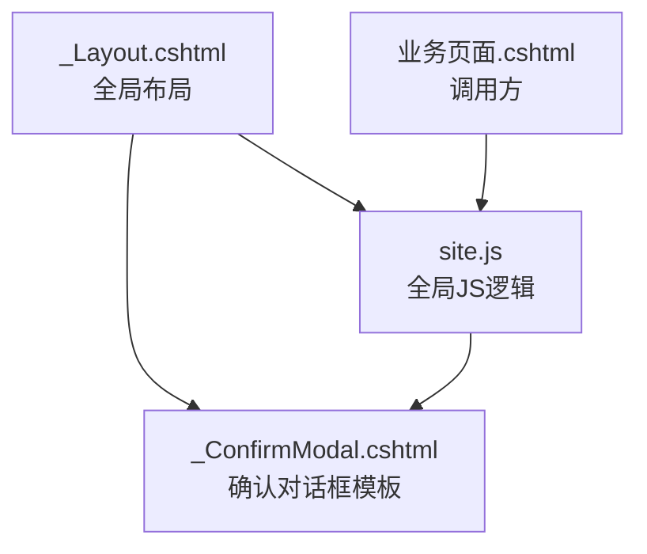
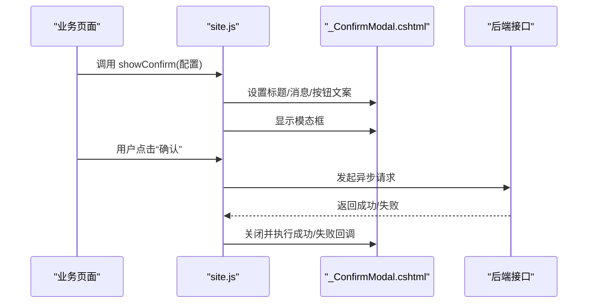
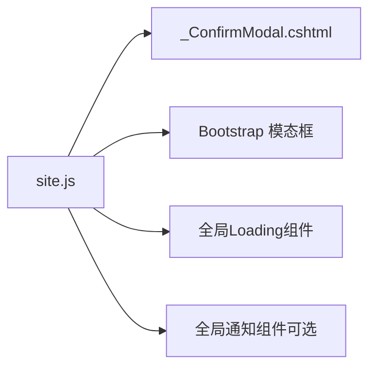

# 确认对话框组件

<cite>
**本文引用的文件**   
- [Views/Shared/_ConfirmModal.cshtml](file://EquipmentIMS.Web/Views/Shared/_ConfirmModal.cshtml)
- [wwwroot/js/site.js](file://EquipmentIMS.Web/wwwroot/js/site.js)
- [Views/Shared/_Layout.cshtml](file://EquipmentIMS.Web/Views/Shared/_Layout.cshtml)
</cite>

## 目录
1. [简介](#简介)
2. [项目结构](#项目结构)
3. [核心组件](#核心组件)
4. [架构总览](#架构总览)
5. [详细组件分析](#详细组件分析)
6. [依赖分析](#依赖分析)
7. [性能考虑](#性能考虑)
8. [故障排查指南](#故障排查指南)
9. [结论](#结论)
10. [附录](#附录)

## 简介
本文件面向THMS系统中的前端确认对话框组件 _ConfirmModal.cshtml，提供从封装设计、配置参数、异步处理到使用示例与样式定制的系统化文档。该组件基于Bootstrap模态框实现，通过统一的JavaScript API在页面中动态显示、隐藏并渲染内容，支持标题、消息、按钮文案、回调函数等配置项，并提供loading状态管理与错误处理机制，适用于删除确认、批量操作确认、表单提交确认等多种场景。

## 项目结构
确认对话框组件位于共享视图目录中，并在布局文件中引入，以便全局可用。其交互逻辑由站点级脚本统一管理。

图表来源
- [Views/Shared/_Layout.cshtml](file://EquipmentIMS.Web/Views/Shared/_Layout.cshtml)
- [Views/Shared/_ConfirmModal.cshtml](file://EquipmentIMS.Web/Views/Shared/_ConfirmModal.cshtml)
- [wwwroot/js/site.js](file://EquipmentIMS.Web/wwwroot/js/site.js)

章节来源
- [Views/Shared/_Layout.cshtml](file://EquipmentIMS.Web/Views/Shared/_Layout.cshtml)
- [Views/Shared/_ConfirmModal.cshtml](file://EquipmentIMS.Web/Views/Shared/_ConfirmModal.cshtml)
- [wwwroot/js/site.js](file://EquipmentIMS.Web/wwwroot/js/site.js)

## 核心组件
- 组件位置：Views/Shared/_ConfirmModal.cshtml
- 功能职责：
  - 提供Bootstrap模态框的HTML骨架
  - 暴露统一的前端API用于显示/隐藏、设置标题与消息、绑定按钮事件
  - 管理异步操作的loading状态与结果回调
- 关键能力：
  - 动态内容渲染（支持纯文本或HTML片段）
  - 按钮文案可配置（确认/取消）
  - 回调函数支持Promise风格，便于链式处理与错误捕获
  - 与全局加载指示器联动，避免重复触发

章节来源
- [Views/Shared/_ConfirmModal.cshtml](file://EquipmentIMS.Web/Views/Shared/_ConfirmModal.cshtml)
- [wwwroot/js/site.js](file://EquipmentIMS.Web/wwwroot/js/site.js)

## 架构总览
确认对话框采用“模板 + 全局JS”的轻量封装模式，不依赖第三方UI库，仅使用Bootstrap提供的模态框能力。调用方通过全局方法传入配置对象，组件负责渲染与生命周期管理。

图表来源
- [Views/Shared/_ConfirmModal.cshtml](file://EquipmentIMS.Web/Views/Shared/_ConfirmModal.cshtml)
- [wwwroot/js/site.js](file://EquipmentIMS.Web/wwwroot/js/site.js)

## 详细组件分析

### 组件结构与职责
- HTML模板层（_ConfirmModal.cshtml）
  - 定义模态框容器、标题区、消息区、按钮区
  - 为按钮预留数据属性或ID，便于JS绑定事件
- JavaScript层（site.js）
  - 提供 showConfirm(options) 入口
  - 内部维护模态实例、当前配置、回调队列
  - 处理显示/隐藏、内容注入、按钮事件绑定、异步流程控制
  - 与全局loading组件协作，保证用户体验一致

章节来源
- [Views/Shared/_ConfirmModal.cshtml](file://EquipmentIMS.Web/Views/Shared/_ConfirmModal.cshtml)
- [wwwroot/js/site.js](file://EquipmentIMS.Web/wwwroot/js/site.js)

### 配置参数说明
以下为 showConfirm 的典型配置项（以字段名描述，非代码）：
- title：字符串，模态框标题
- message：字符串或HTML片段，正文内容
- confirmText：字符串，确认按钮文案
- cancelText：字符串，取消按钮文案
- onConfirm：函数，点击确认时的回调；可返回Promise以表示异步操作
- onCancel：函数，点击取消时的回调
- loading：布尔或对象，是否显示loading或自定义加载提示
- errorCallback：函数，异步失败时的回调
- successCallback：函数，异步成功时的回调
- backdrop：布尔，是否允许点击背景关闭
- keyboard：布尔，是否允许ESC关闭

章节来源
- [wwwroot/js/site.js](file://EquipmentIMS.Web/wwwroot/js/site.js)
- [Views/Shared/_ConfirmModal.cshtml](file://EquipmentIMS.Web/Views/Shared/_ConfirmModal.cshtml)

### 显示与隐藏控制
- 显示流程
  - 校验配置项
  - 更新标题与消息区域
  - 更新按钮文案
  - 绑定确认/取消事件
  - 调用Bootstrap显示模态框
- 隐藏流程
  - 清理事件绑定
  - 重置loading状态
  - 销毁或复用模态实例（视实现而定）

章节来源
- [wwwroot/js/site.js](file://EquipmentIMS.Web/wwwroot/js/site.js)
- [Views/Shared/_ConfirmModal.cshtml](file://EquipmentIMS.Web/Views/Shared/_ConfirmModal.cshtml)

### 动态内容渲染
- 支持纯文本与HTML两种模式
- 若包含敏感内容，应进行转义或使用安全的渲染方式
- 长文本建议启用滚动或自适应高度

章节来源
- [Views/Shared/_ConfirmModal.cshtml](file://EquipmentIMS.Web/Views/Shared/_ConfirmModal.cshtml)
- [wwwroot/js/site.js](file://EquipmentIMS.Web/wwwroot/js/site.js)

### 按钮事件绑定与回调
- 确认按钮
  - 若 onConfirm 返回Promise，则进入loading状态
  - 成功时执行 successCallback 并关闭模态
  - 失败时执行 errorCallback 并保留模态，展示错误信息
- 取消按钮
  - 执行 onCancel 后直接关闭模态

章节来源
- [wwwroot/js/site.js](file://EquipmentIMS.Web/wwwroot/js/site.js)

### 异步操作与错误处理
- 统一loading状态管理，避免重复触发
- 网络异常、服务端错误、业务校验失败均走errorCallback
- 成功路径统一走successCallback，便于后续刷新列表或跳转

章节来源
- [wwwroot/js/site.js](file://EquipmentIMS.Web/wwwroot/js/site.js)

### 使用场景示例（概念性）
- 删除确认
  - 传入title为“确认删除”，message为“确定要删除该记录吗？”
  - onConfirm中调用删除接口，成功后刷新列表
- 批量操作确认
  - message展示选中数量与风险提示
  - onConfirm中调用批量接口，完成后给出汇总结果
- 表单提交确认
  - 在提交前弹出确认，防止误操作
  - 成功后关闭模态并提示提交成功

[本节为概念性说明，未直接分析具体文件]

### 样式定制与主题适配
- 尺寸与对齐
  - 通过Bootstrap类或自定义CSS调整模态宽度、内边距
- 按钮样式
  - 覆盖确认/取消按钮的颜色与圆角
- 深色模式
  - 根据根节点主题切换变量，适配暗色背景与文字对比度
- 响应式
  - 在小屏设备上自动调整弹窗宽度与按钮排列

章节来源
- [Views/Shared/_ConfirmModal.cshtml](file://EquipmentIMS.Web/Views/Shared/_ConfirmModal.cshtml)
- [wwwroot/css/site.css](file://EquipmentIMS.Web/wwwroot/css/site.css)

## 依赖分析
- 外部依赖
  - Bootstrap模态框（CSS/JS）
  - jQuery（如使用）
- 内部依赖
  - 全局加载指示器（如有）
  - 站点级通知组件（可选）

图表来源
- [wwwroot/js/site.js](file://EquipmentIMS.Web/wwwroot/js/site.js)
- [Views/Shared/_ConfirmModal.cshtml](file://EquipmentIMS.Web/Views/Shared/_ConfirmModal.cshtml)

章节来源
- [wwwroot/js/site.js](file://EquipmentIMS.Web/wwwroot/js/site.js)
- [Views/Shared/_ConfirmModal.cshtml](file://EquipmentIMS.Web/Views/Shared/_ConfirmModal.cshtml)

## 性能考虑
- 避免频繁创建/销毁模态实例，尽量复用同一实例
- 长文本渲染时注意DOM重排，必要时延迟渲染
- 异步请求去抖/节流，防止用户快速多次点击导致重复请求
- 图片与富文本按需加载，减少首屏开销

[本节为通用指导，未直接分析具体文件]

## 故障排查指南
- 模态框无法显示
  - 检查是否在布局中引入了必要的CSS/JS
  - 确认元素ID未被其他脚本覆盖
- 按钮无响应
  - 检查事件绑定是否被重复覆盖
  - 确认onConfirm/onCancel是否正确注册
- 异步状态异常
  - 检查Promise是否正确resolve/reject
  - 确认loading开关逻辑是否成对出现
- 样式错乱
  - 检查自定义CSS优先级
  - 确认主题变量是否生效

章节来源
- [Views/Shared/_Layout.cshtml](file://EquipmentIMS.Web/Views/Shared/_Layout.cshtml)
- [wwwroot/js/site.js](file://EquipmentIMS.Web/wwwroot/js/site.js)
- [Views/Shared/_ConfirmModal.cshtml](file://EquipmentIMS.Web/Views/Shared/_ConfirmModal.cshtml)

## 结论
_ConfirmModal.cshtml通过简洁的模板与统一的全局JS封装，提供了稳定易用的确认对话框能力。配合合理的配置与异步处理策略，可在多种业务场景中保持一致的用户体验。建议在项目中集中维护该组件，并通过文档与示例规范各页面的调用方式。

[本节为总结性内容，未直接分析具体文件]

## 附录
- 最佳实践清单
  - 始终提供明确的标题与消息，避免歧义
  - 对危险操作增加二次确认与风险提示
  - 使用Promise风格回调，统一错误处理
  - 保持按钮文案简短明确
  - 在移动端优化交互与可读性

[本节为补充说明，未直接分析具体文件]