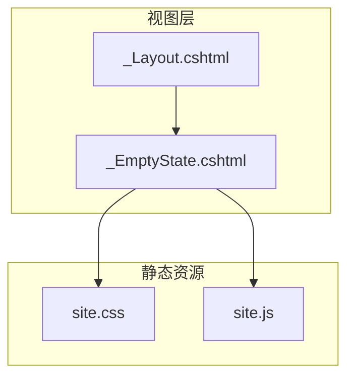
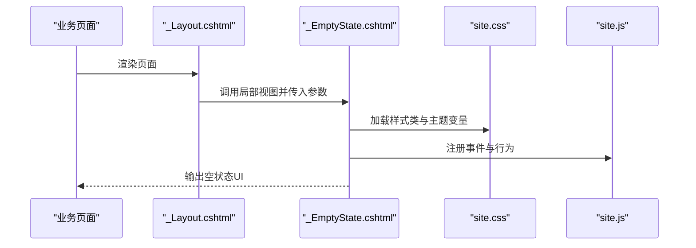
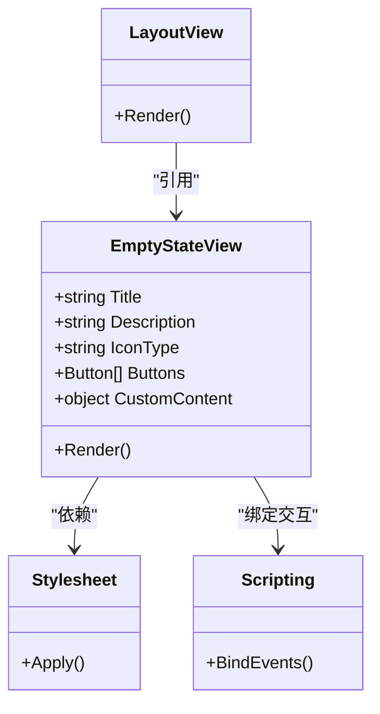
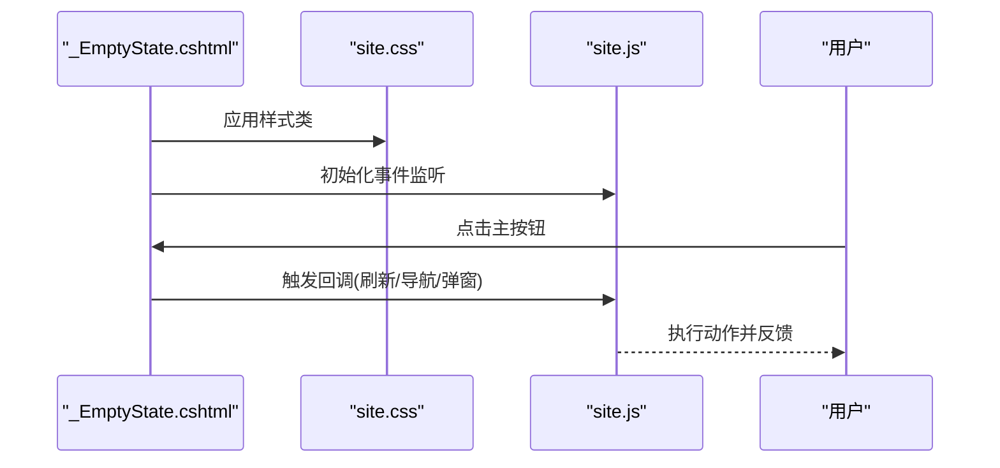
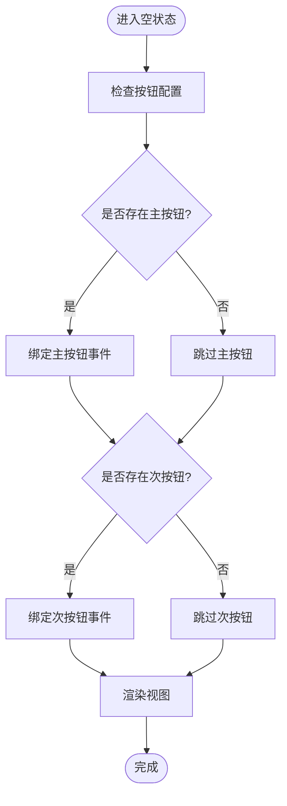
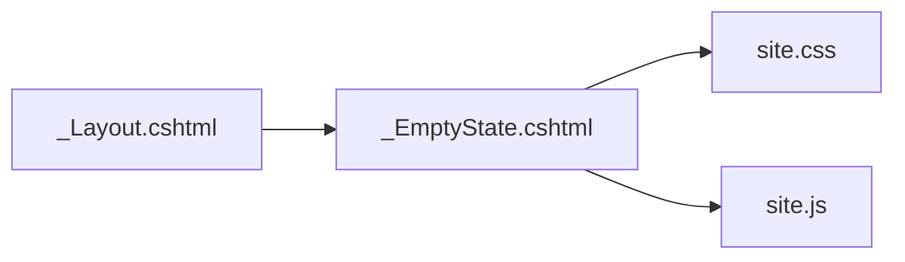

# 空状态组件

<cite>
**本文引用的文件**   
- [Views/Shared/_EmptyState.cshtml](file://EquipmentIMS.Web/Views/Shared/_EmptyState.cshtml)
- [Views/Shared/_Layout.cshtml](file://EquipmentIMS.Web/Views/Shared/_Layout.cshtml)
- [wwwroot/css/site.css](file://EquipmentIMS.Web/wwwroot/css/site.css)
- [wwwroot/js/site.js](file://EquipmentIMS.Web/wwwroot/js/site.js)
</cite>

## 目录
1. [简介](#简介)
2. [项目结构](#项目结构)
3. [核心组件](#核心组件)
4. [架构总览](#架构总览)
5. [详细组件分析](#详细组件分析)
6. [依赖分析](#依赖分析)
7. [性能考虑](#性能考虑)
8. [故障排查指南](#故障排查指南)
9. [结论](#结论)
10. [附录](#附录)

## 简介
本文件面向THMS系统中的空状态组件_EmptyState.cshtml，提供从设计理念、实现原理到配置与使用的全栈开发文档。重点覆盖：
- 无数据状态的友好提示与引导交互设计
- 组件配置项（提示信息文案、图标选择、操作按钮、自定义内容）
- 多业务场景应用模式（列表为空、搜索无结果、权限不足等）
- 响应式设计与无障碍访问支持
- 国际化多语言适配最佳实践

## 项目结构
空状态组件位于共享视图目录中，便于在多个页面复用；样式与脚本通过站点资源统一管理。

图表来源
- [Views/Shared/_EmptyState.cshtml](file://EquipmentIMS.Web/Views/Shared/_EmptyState.cshtml)
- [Views/Shared/_Layout.cshtml](file://EquipmentIMS.Web/Views/Shared/_Layout.cshtml)
- [wwwroot/css/site.css](file://EquipmentIMS.Web/wwwroot/css/site.css)
- [wwwroot/js/site.js](file://EquipmentIMS.Web/wwwroot/js/site.js)

章节来源
- [Views/Shared/_EmptyState.cshtml](file://EquipmentIMS.Web/Views/Shared/_EmptyState.cshtml)
- [Views/Shared/_Layout.cshtml](file://EquipmentIMS.Web/Views/Shared/_Layout.cshtml)
- [wwwroot/css/site.css](file://EquipmentIMS.Web/wwwroot/css/site.css)
- [wwwroot/js/site.js](file://EquipmentIMS.Web/wwwroot/js/site.js)

## 核心组件
空状态组件用于在“无数据”或“不可用”时展示统一的占位界面，包含以下能力：
- 可配置的标题与说明文案
- 可选的图标（如默认图标或业务图标）
- 一个或多个操作按钮（如“新建”、“刷新”、“返回”）
- 自定义插槽（允许插入额外内容）
- 语义化结构与无障碍属性
- 响应式布局与主题适配

章节来源
- [Views/Shared/_EmptyState.cshtml](file://EquipmentIMS.Web/Views/Shared/_EmptyState.cshtml)

## 架构总览
空状态组件作为局部视图被主布局引入并在具体页面渲染。其样式与交互由全局CSS与JS支撑。

图表来源
- [Views/Shared/_Layout.cshtml](file://EquipmentIMS.Web/Views/Shared/_Layout.cshtml)
- [Views/Shared/_EmptyState.cshtml](file://EquipmentIMS.Web/Views/Shared/_EmptyState.cshtml)
- [wwwroot/css/site.css](file://EquipmentIMS.Web/wwwroot/css/site.css)
- [wwwroot/js/site.js](file://EquipmentIMS.Web/wwwroot/js/site.js)

## 详细组件分析

### 设计理念与交互原则
- 明确传达当前状态：清晰表达“暂无数据/无结果/无权限”的原因
- 提供下一步行动：至少一个高可见度的主操作按钮
- 保持视觉层级：图标、标题、说明、按钮层次分明
- 可访问性优先：语义标签、ARIA属性、键盘可达
- 可扩展与可配置：通过参数与插槽满足多样场景

### 配置选项
以下为组件对外暴露的配置维度（以参数形式传递）：
- 标题与说明
  - 标题：简短明确的空状态描述
  - 说明：补充解释原因或建议
- 图标
  - 图标类型：内置图标集或自定义SVG
  - 尺寸与颜色：跟随主题或显式指定
- 操作按钮
  - 数量：单按钮或双按钮
  - 类型：主按钮、次按钮、链接按钮
  - 行为：跳转路由、触发刷新、打开弹窗等
- 自定义内容
  - 插槽：允许插入富文本、图片、表单片段等
- 无障碍与国际化
  - aria-*属性：role、aria-label、aria-describedby
  - 文案来源：本地化键值映射

章节来源
- [Views/Shared/_EmptyState.cshtml](file://EquipmentIMS.Web/Views/Shared/_EmptyState.cshtml)

### 在不同业务场景中的应用模式
- 列表为空
  - 标题示例：暂无数据
  - 说明示例：点击“新建”创建第一条记录
  - 按钮：新建
- 搜索无结果
  - 标题示例：未找到匹配结果
  - 说明示例：尝试调整筛选条件或关键词
  - 按钮：重置筛选、重新搜索
- 权限不足
  - 标题示例：无权访问
  - 说明示例：请联系管理员授予相应权限
  - 按钮：返回首页、联系管理员

章节来源
- [Views/Shared/_EmptyState.cshtml](file://EquipmentIMS.Web/Views/Shared/_EmptyState.cshtml)

### 响应式设计实现方法
- 容器宽度自适应：在小屏下自动换行与居中
- 图标与文字间距：根据视口缩放
- 按钮堆叠：移动端纵向排列，桌面端横向排列
- 字体与留白：遵循可读性与触控目标最小尺寸

章节来源
- [Views/Shared/_EmptyState.cshtml](file://EquipmentIMS.Web/Views/Shared/_EmptyState.cshtml)
- [wwwroot/css/site.css](file://EquipmentIMS.Web/wwwroot/css/site.css)

### 无障碍访问支持
- 语义化结构：使用合适的标题与段落标签
- 角色与描述：为容器设置适当的role与aria-label
- 关联关系：将说明文本与按钮通过ID关联
- 键盘可达：确保Tab顺序合理，Enter/Space可触发主操作

章节来源
- [Views/Shared/_EmptyState.cshtml](file://EquipmentIMS.Web/Views/Shared/_EmptyState.cshtml)

### 国际化多语言适配
- 文案集中管理：所有显示文本通过本地化键获取
- 运行时切换：根据用户语言环境动态渲染
- 扩展性：新增语言只需添加对应键值

章节来源
- [Views/Shared/_EmptyState.cshtml](file://EquipmentIMS.Web/Views/Shared/_EmptyState.cshtml)

### 代码级架构图（类/视图关系）

图表来源
- [Views/Shared/_EmptyState.cshtml](file://EquipmentIMS.Web/Views/Shared/_EmptyState.cshtml)
- [Views/Shared/_Layout.cshtml](file://EquipmentIMS.Web/Views/Shared/_Layout.cshtml)
- [wwwroot/css/site.css](file://EquipmentIMS.Web/wwwroot/css/site.css)
- [wwwroot/js/site.js](file://EquipmentIMS.Web/wwwroot/js/site.js)

### 关键流程时序图（渲染与交互）

图表来源
- [Views/Shared/_EmptyState.cshtml](file://EquipmentIMS.Web/Views/Shared/_EmptyState.cshtml)
- [wwwroot/css/site.css](file://EquipmentIMS.Web/wwwroot/css/site.css)
- [wwwroot/js/site.js](file://EquipmentIMS.Web/wwwroot/js/site.js)

### 复杂逻辑流程图（按钮行为决策）

图表来源
- [Views/Shared/_EmptyState.cshtml](file://EquipmentIMS.Web/Views/Shared/_EmptyState.cshtml)

## 依赖分析
- 视图依赖
  - _EmptyState.cshtml 依赖 _Layout.cshtml 的上下文与布局注入
- 样式依赖
  - site.css 提供通用样式与响应式断点
- 脚本依赖
  - site.js 提供事件绑定与交互增强

图表来源
- [Views/Shared/_Layout.cshtml](file://EquipmentIMS.Web/Views/Shared/_Layout.cshtml)
- [Views/Shared/_EmptyState.cshtml](file://EquipmentIMS.Web/Views/Shared/_EmptyState.cshtml)
- [wwwroot/css/site.css](file://EquipmentIMS.Web/wwwroot/css/site.css)
- [wwwroot/js/site.js](file://EquipmentIMS.Web/wwwroot/js/site.js)

章节来源
- [Views/Shared/_Layout.cshtml](file://EquipmentIMS.Web/Views/Shared/_Layout.cshtml)
- [Views/Shared/_EmptyState.cshtml](file://EquipmentIMS.Web/Views/Shared/_EmptyState.cshtml)
- [wwwroot/css/site.css](file://EquipmentIMS.Web/wwwroot/css/site.css)
- [wwwroot/js/site.js](file://EquipmentIMS.Web/wwwroot/js/site.js)

## 性能考虑
- 避免重复渲染：仅在真正需要时渲染空状态
- 减少DOM操作：批量更新节点，避免频繁重排
- 懒加载资源：图标与图片按需加载
- 事件委托：对动态元素使用事件委托降低内存占用

[本节为通用指导，不直接分析具体文件]

## 故障排查指南
- 文案未显示
  - 检查本地化键是否缺失或键名不一致
  - 确认视图是否正确接收参数
- 按钮无响应
  - 检查脚本是否加载成功
  - 确认事件绑定是否被其他脚本覆盖
- 样式错乱
  - 检查CSS类名是否与样式表一致
  - 确认媒体查询断点是否符合预期
- 无障碍问题
  - 验证aria-*属性是否完整
  - 使用屏幕阅读器进行基本测试

章节来源
- [Views/Shared/_EmptyState.cshtml](file://EquipmentIMS.Web/Views/Shared/_EmptyState.cshtml)
- [wwwroot/css/site.css](file://EquipmentIMS.Web/wwwroot/css/site.css)
- [wwwroot/js/site.js](file://EquipmentIMS.Web/wwwroot/js/site.js)

## 结论
空状态组件通过清晰的配置与良好的交互设计，有效提升了系统在“无数据/无结果/无权限”等场景下的用户体验。结合响应式、无障碍与国际化策略，可在多终端与多语言环境下保持一致的表现与可用性。

[本节为总结性内容，不直接分析具体文件]

## 附录
- 使用建议
  - 始终提供至少一个明确的操作入口
  - 文案简洁明了，避免技术术语
  - 图标与颜色需符合品牌规范
- 扩展方向
  - 增加更多预设图标与主题色
  - 支持更丰富的插槽内容（如图表、表单）
  - 集成统一的事件总线以便跨组件通信

[本节为概念性内容，不直接分析具体文件]