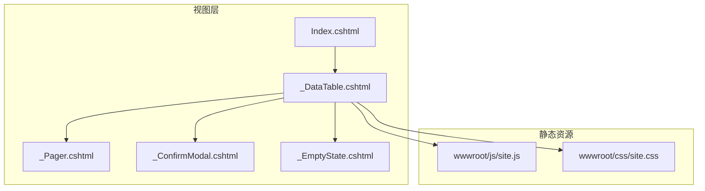
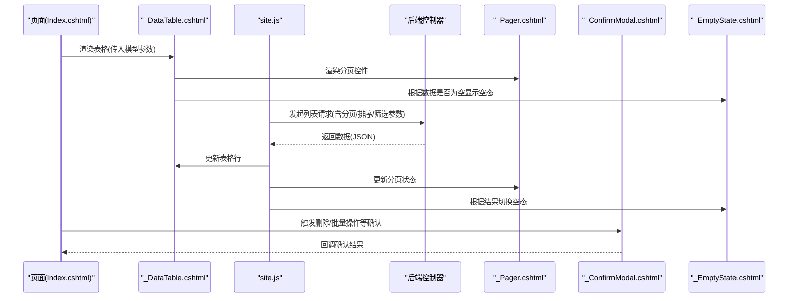
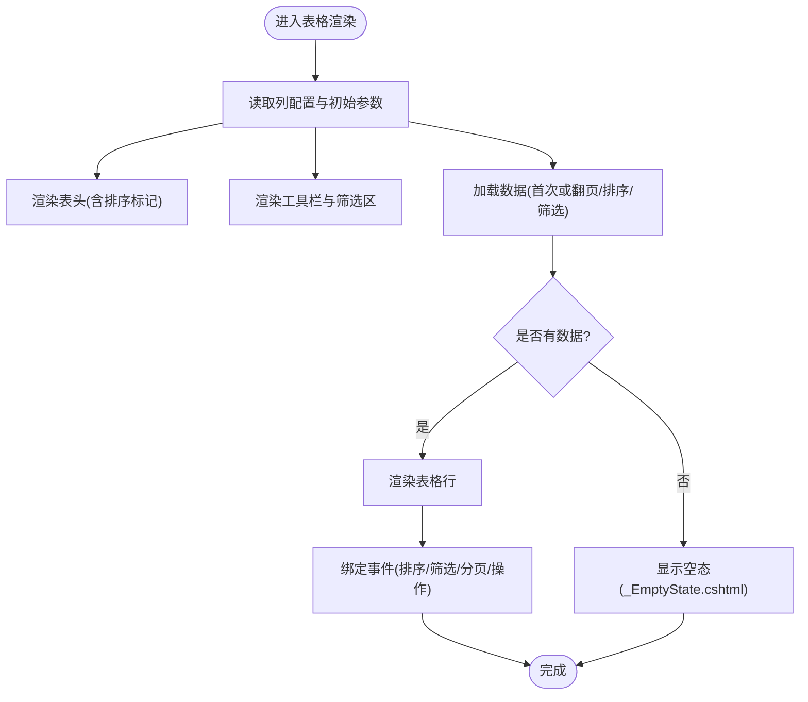
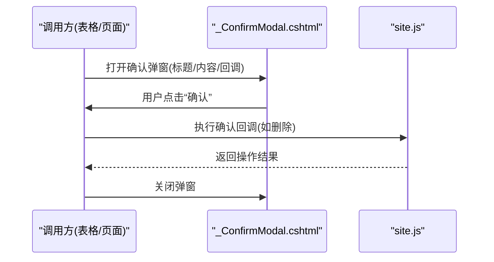
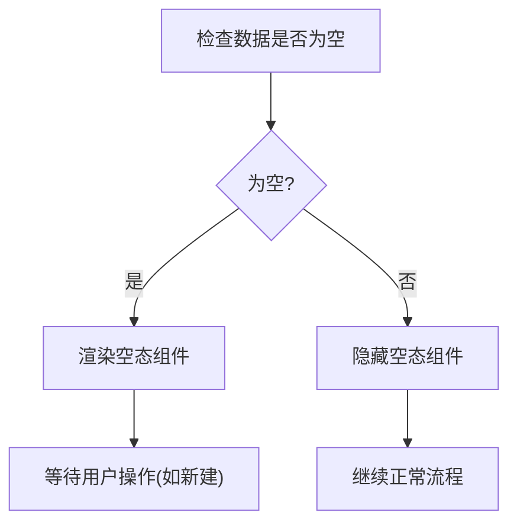
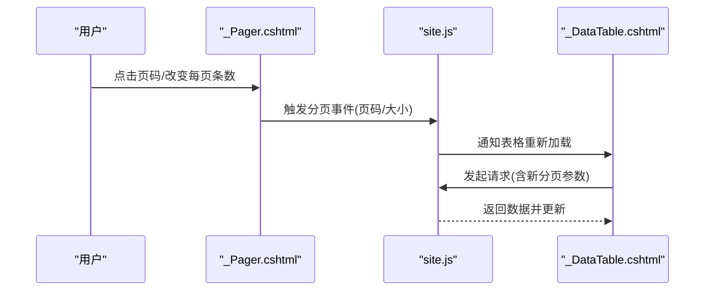
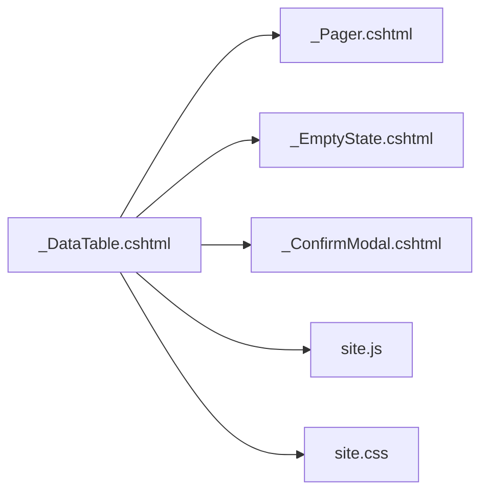

# 通用组件开发

<cite>
**本文引用的文件**   
- [_DataTable.cshtml](file://EquipmentIMS.Web/Views/Shared/_DataTable.cshtml)
- [_ConfirmModal.cshtml](file://EquipmentIMS.Web/Views/Shared/_ConfirmModal.cshtml)
- [_EmptyState.cshtml](file://EquipmentIMS.Web/Views/Shared/_EmptyState.cshtml)
- [_Pager.cshtml](file://EquipmentIMS.Web/Views/Shared/_Pager.cshtml)
- [site.js](file://EquipmentIMS.Web/wwwroot/js/site.js)
- [site.css](file://EquipmentIMS.Web/wwwroot/css/site.css)
</cite>

## 目录
1. [简介](#简介)
2. [项目结构](#项目结构)
3. [核心组件](#核心组件)
4. [架构总览](#架构总览)
5. [详细组件分析](#详细组件分析)
6. [依赖分析](#依赖分析)
7. [性能考虑](#性能考虑)
8. [故障排查指南](#故障排查指南)
9. [结论](#结论)
10. [附录](#附录)

## 简介
本指南面向THMS系统的通用前端组件开发与使用，聚焦以下共享视图组件：
- _DataTable.cshtml：数据表格组件（分页、排序、筛选）
- _ConfirmModal.cshtml：确认对话框组件
- _EmptyState.cshtml：空状态展示组件
- _Pager.cshtml：分页导航组件

文档将深入解析这些组件的实现原理、配置选项、事件处理与复用方式，并提供自定义通用组件的开发规范、测试与调试方法。

## 项目结构
通用组件位于 Views/Shared 目录下，配套的前端脚本与样式位于 wwwroot 下。典型调用方为各业务模块的 Index 页面，通过局部视图渲染并注入模型参数。

图表来源
- [_DataTable.cshtml](file://EquipmentIMS.Web/Views/Shared/_DataTable.cshtml)
- [_Pager.cshtml](file://EquipmentIMS.Web/Views/Shared/_Pager.cshtml)
- [_ConfirmModal.cshtml](file://EquipmentIMS.Web/Views/Shared/_ConfirmModal.cshtml)
- [_EmptyState.cshtml](file://EquipmentIMS.Web/Views/Shared/_EmptyState.cshtml)
- [site.js](file://EquipmentIMS.Web/wwwroot/js/site.js)
- [site.css](file://EquipmentIMS.Web/wwwroot/css/site.css)

章节来源
- [_DataTable.cshtml](file://EquipmentIMS.Web/Views/Shared/_DataTable.cshtml)
- [_Pager.cshtml](file://EquipmentIMS.Web/Views/Shared/_Pager.cshtml)
- [_ConfirmModal.cshtml](file://EquipmentIMS.Web/Views/Shared/_ConfirmModal.cshtml)
- [_EmptyState.cshtml](file://EquipmentIMS.Web/Views/Shared/_EmptyState.cshtml)
- [site.js](file://EquipmentIMS.Web/wwwroot/js/site.js)
- [site.css](file://EquipmentIMS.Web/wwwroot/css/site.css)

## 核心组件
本节概述四个通用组件的职责与交互关系：
- _DataTable.cshtml：负责表格渲染、列定义、工具栏、筛选区、分页条、加载态与空态；通过JS发起请求并更新DOM。
- _Pager.cshtml：渲染页码控件，支持跳转与每页条数切换，触发分页事件。
- _ConfirmModal.cshtml：封装Bootstrap模态框，提供统一确认/取消回调接口。
- _EmptyState.cshtml：当无数据时展示占位图与提示文案，可带操作按钮。

章节来源
- [_DataTable.cshtml](file://EquipmentIMS.Web/Views/Shared/_DataTable.cshtml)
- [_Pager.cshtml](file://EquipmentIMS.Web/Views/Shared/_Pager.cshtml)
- [_ConfirmModal.cshtml](file://EquipmentIMS.Web/Views/Shared/_ConfirmModal.cshtml)
- [_EmptyState.cshtml](file://EquipmentIMS.Web/Views/Shared/_EmptyState.cshtml)

## 架构总览
下图展示了数据表格组件在页面中的整体交互流程：页面初始化时渲染表格与分页，用户进行筛选/排序/翻页时由JS收集查询条件，向控制器发起请求，返回数据后刷新表格与分页。

图表来源
- [_DataTable.cshtml](file://EquipmentIMS.Web/Views/Shared/_DataTable.cshtml)
- [_Pager.cshtml](file://EquipmentIMS.Web/Views/Shared/_Pager.cshtml)
- [_ConfirmModal.cshtml](file://EquipmentIMS.Web/Views/Shared/_ConfirmModal.cshtml)
- [_EmptyState.cshtml](file://EquipmentIMS.Web/Views/Shared/_EmptyState.cshtml)
- [site.js](file://EquipmentIMS.Web/wwwroot/js/site.js)

## 详细组件分析

### _DataTable.cshtml 数据表格组件
职责与能力
- 表格渲染：基于列配置动态生成表头与行数据。
- 分页：集成 _Pager.cshtml，支持页码切换与每页条数调整。
- 排序：点击列头触发排序，传递排序字段与方向。
- 筛选：顶部筛选区收集表单值，组合到查询参数中。
- 空态：当数据为空时自动切换 _EmptyState.cshtml。
- 确认操作：对危险操作（如删除）弹出 _ConfirmModal.cshtml。

关键实现要点
- 列定义：通过模型或配置对象声明列键、标题、是否可排序、格式化函数名等。
- 查询参数：统一构建包含当前页、每页条数、排序字段、排序方向与筛选条件的查询对象。
- 事件绑定：为表头、分页、筛选输入、操作按钮注册事件，避免重复绑定。
- DOM更新：采用最小化变更策略，仅替换表格主体区域，保留筛选区状态。
- 错误处理：网络异常或服务器错误时显示友好提示，必要时回退到上一页。

图表来源
- [_DataTable.cshtml](file://EquipmentIMS.Web/Views/Shared/_DataTable.cshtml)
- [_Pager.cshtml](file://EquipmentIMS.Web/Views/Shared/_Pager.cshtml)
- [_EmptyState.cshtml](file://EquipmentIMS.Web/Views/Shared/_EmptyState.cshtml)
- [site.js](file://EquipmentIMS.Web/wwwroot/js/site.js)

章节来源
- [_DataTable.cshtml](file://EquipmentIMS.Web/Views/Shared/_DataTable.cshtml)
- [site.js](file://EquipmentIMS.Web/wwwroot/js/site.js)

### _ConfirmModal.cshtml 确认对话框组件
职责与能力
- 统一外观与行为：基于Bootstrap模态框封装，提供标题、正文、确认/取消按钮。
- 回调机制：暴露统一的确认/取消回调接口，便于调用方执行后续逻辑。
- 可配置性：支持按钮文案、图标、尺寸、是否允许遮罩关闭等。

使用模式
- 在表格操作列或工具栏按钮上触发确认弹窗。
- 在确认回调中执行删除、批量操作等，完成后刷新表格。

图表来源
- [_ConfirmModal.cshtml](file://EquipmentIMS.Web/Views/Shared/_ConfirmModal.cshtml)
- [site.js](file://EquipmentIMS.Web/wwwroot/js/site.js)

章节来源
- [_ConfirmModal.cshtml](file://EquipmentIMS.Web/Views/Shared/_ConfirmModal.cshtml)
- [site.js](file://EquipmentIMS.Web/wwwroot/js/site.js)

### _EmptyState.cshtml 空状态组件
职责与能力
- 展示占位图与提示文案，可选操作按钮（如“新建”）。
- 与表格联动：当数据为空时自动显示，有数据时隐藏。
- 可定制：支持不同场景的图标、文案与按钮行为。

设计模式
- 作为独立局部视图被表格组件按需渲染。
- 通过CSS类控制显隐，避免频繁DOM重建。

图表来源
- [_EmptyState.cshtml](file://EquipmentIMS.Web/Views/Shared/_EmptyState.cshtml)

章节来源
- [_EmptyState.cshtml](file://EquipmentIMS.Web/Views/Shared/_EmptyState.cshtml)

### _Pager.cshtml 分页组件
职责与能力
- 渲染页码、上下页、首尾页、跳转输入框。
- 支持每页条数切换。
- 触发分页事件，携带当前页码与每页条数。

配置项建议
- 总记录数、当前页、每页条数、最大显示页码数、是否显示跳转等。
- 事件回调：onPageChanged(page, pageSize)、onPageSizeChanged(newSize)。

图表来源
- [_Pager.cshtml](file://EquipmentIMS.Web/Views/Shared/_Pager.cshtml)
- [site.js](file://EquipmentIMS.Web/wwwroot/js/site.js)
- [_DataTable.cshtml](file://EquipmentIMS.Web/Views/Shared/_DataTable.cshtml)

章节来源
- [_Pager.cshtml](file://EquipmentIMS.Web/Views/Shared/_Pager.cshtml)
- [site.js](file://EquipmentIMS.Web/wwwroot/js/site.js)

## 依赖分析
组件间依赖关系如下：
- _DataTable.cshtml 依赖 _Pager.cshtml、_EmptyState.cshtml、_ConfirmModal.cshtml。
- site.js 提供公共事件总线与AJAX封装，供上述组件调用。
- site.css 提供全局样式与组件样式隔离策略。

图表来源
- [_DataTable.cshtml](file://EquipmentIMS.Web/Views/Shared/_DataTable.cshtml)
- [_Pager.cshtml](file://EquipmentIMS.Web/Views/Shared/_Pager.cshtml)
- [_EmptyState.cshtml](file://EquipmentIMS.Web/Views/Shared/_EmptyState.cshtml)
- [_ConfirmModal.cshtml](file://EquipmentIMS.Web/Views/Shared/_ConfirmModal.cshtml)
- [site.js](file://EquipmentIMS.Web/wwwroot/js/site.js)
- [site.css](file://EquipmentIMS.Web/wwwroot/css/site.css)

章节来源
- [_DataTable.cshtml](file://EquipmentIMS.Web/Views/Shared/_DataTable.cshtml)
- [_Pager.cshtml](file://EquipmentIMS.Web/Views/Shared/_Pager.cshtml)
- [_EmptyState.cshtml](file://EquipmentIMS.Web/Views/Shared/_EmptyState.cshtml)
- [_ConfirmModal.cshtml](file://EquipmentIMS.Web/Views/Shared/_ConfirmModal.cshtml)
- [site.js](file://EquipmentIMS.Web/wwwroot/js/site.js)
- [site.css](file://EquipmentIMS.Web/wwwroot/css/site.css)

## 性能考虑
- 增量更新：仅替换表格主体区域，避免整页重绘。
- 防抖节流：对筛选输入与窗口resize进行防抖，减少请求频率。
- 懒加载：仅在需要时加载分页与筛选相关脚本片段。
- 缓存策略：对不常变化的字典数据做本地缓存。
- 大数据量：启用服务端分页与虚拟滚动（如需），限制单次渲染行数。

[本节为通用指导，无需源码引用]

## 故障排查指南
常见问题与定位步骤
- 表格不刷新：检查分页/排序/筛选事件是否正确绑定，确认AJAX请求参数是否完整。
- 空态不显示：核对数据是否为空的条件判断与DOM显隐逻辑。
- 确认弹窗无效：检查回调函数是否注册成功，是否存在同名事件覆盖。
- 样式冲突：确认组件内使用的CSS类是否唯一，避免与全局样式冲突。
- 控制台报错：查看浏览器开发者工具的Console与Network面板，定位具体失败点。

章节来源
- [site.js](file://EquipmentIMS.Web/wwwroot/js/site.js)
- [site.css](file://EquipmentIMS.Web/wwwroot/css/site.css)

## 结论
通过对 _DataTable.cshtml、_Pager.cshtml、_ConfirmModal.cshtml、_EmptyState.cshtml 的系统化分析与规范化使用，可在THMS项目中快速构建一致、可维护的数据展示与交互体验。遵循本文提供的开发规范与最佳实践，有助于提升组件复用率与团队协作效率。

[本节为总结，无需源码引用]

## 附录

### 自定义通用组件开发规范
- 命名约定
  - 视图文件：以 _ 前缀表示局部视图，如 _MyComponent.cshtml。
  - JS/CSS：按功能域划分文件，避免全局污染。
- 参数传递
  - 通过ViewBag/ViewModel/TagHelper等方式传递配置对象。
  - 明确必填与可选参数，提供默认值。
- 事件回调
  - 使用统一的事件命名空间，避免冲突。
  - 对外暴露清晰的回调接口，支持异步操作。
- 样式隔离
  - 使用BEM或类似命名规范，限定作用域。
  - 优先使用CSS变量管理主题色与间距。
- 可访问性
  - 提供aria属性与键盘导航支持。
  - 确保对比度与焦点可见性。
- 国际化
  - 文本走资源文件，避免硬编码。
- 版本兼容
  - 渐进增强，保证基础功能在无JS环境下可用。

[本节为通用指导，无需源码引用]

### 组件测试与调试方法
- 单元测试
  - 针对site.js中的公共函数编写断言，验证数据处理与事件触发。
- 集成测试
  - 模拟分页/排序/筛选请求，校验响应后的DOM更新。
- 端到端测试
  - 使用浏览器自动化框架，模拟用户操作并截图比对。
- 调试技巧
  - 在关键路径添加日志输出，区分环境级别。
  - 使用断点与网络面板跟踪请求与响应。
  - 对复杂状态变化绘制时序图辅助定位问题。

[本节为通用指导，无需源码引用]