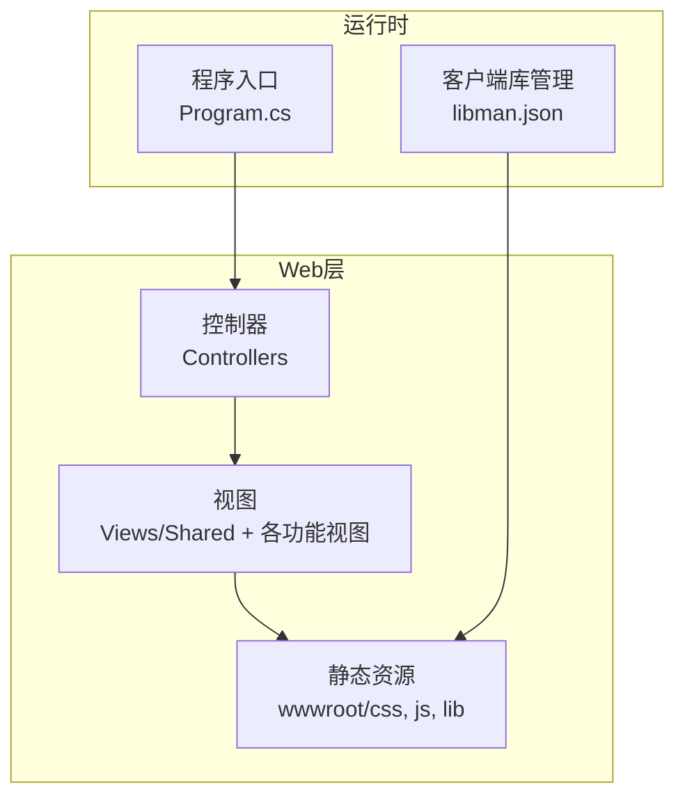
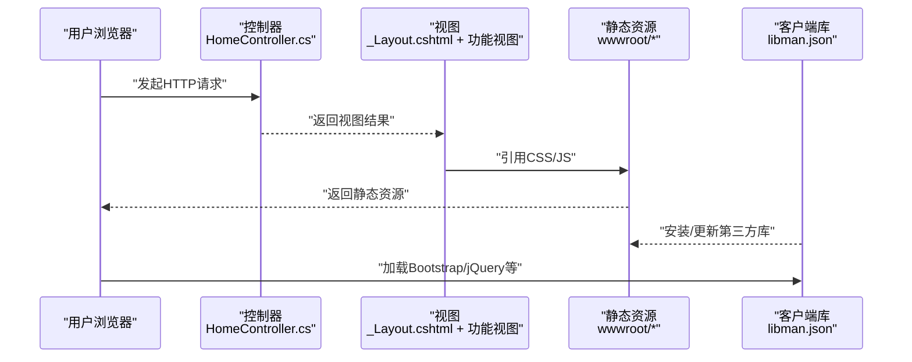
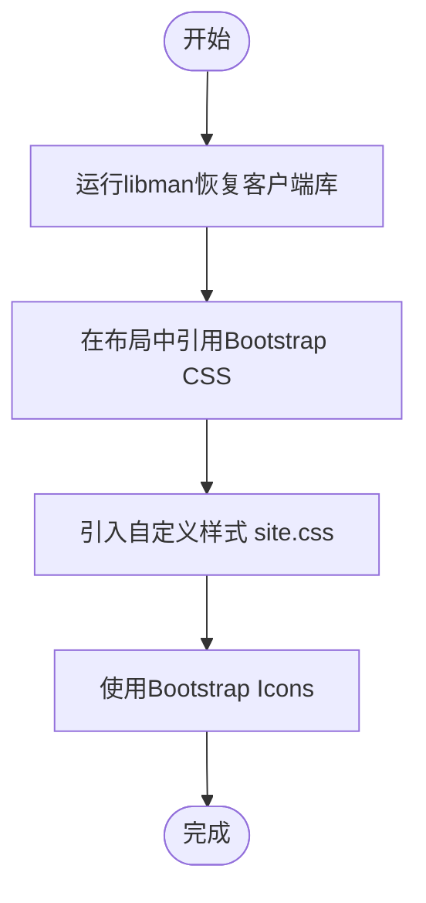
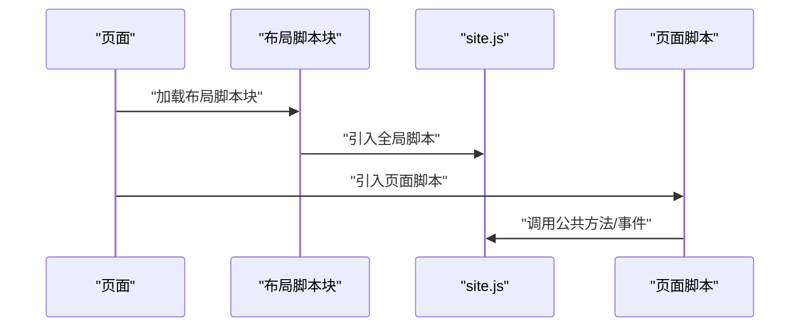
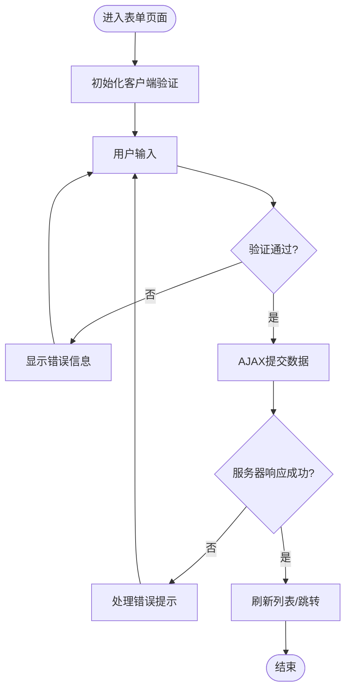
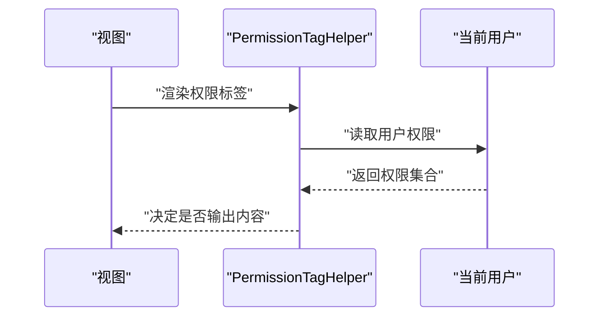
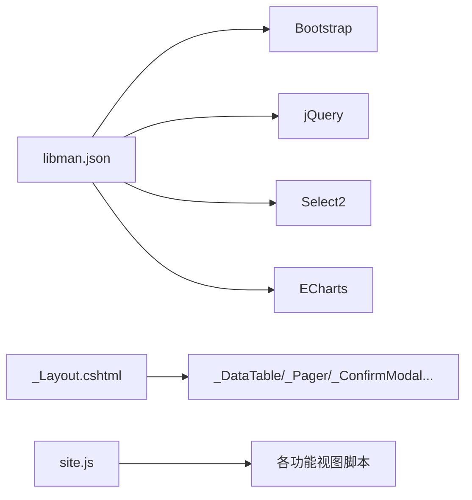

# 前端开发指南

<cite>
**本文引用的文件**   
- [Program.cs](file://EquipmentIMS.Web/Program.cs)
- [_ViewStart.cshtml](file://EquipmentIMS.Web/Views/_ViewStart.cshtml)
- [_ViewImports.cshtml](file://EquipmentIMS.Web/Views/_ViewImports.cshtml)
- [_Layout.cshtml](file://EquipmentIMS.Web/Views/Shared/_Layout.cshtml)
- [_LoginLayout.cshtml](file://EquipmentIMS.Web/Views/Shared/_LoginLayout.cshtml)
- [_Sidebar.cshtml](file://EquipmentIMS.Web/Views/Shared/_Sidebar.cshtml)
- [_DataTable.cshtml](file://EquipmentIMS.Web/Views/Shared/_DataTable.cshtml)
- [_Pager.cshtml](file://EquipmentIMS.Web/Views/Shared/_Pager.cshtml)
- [_ConfirmModal.cshtml](file://EquipmentIMS.Web/Views/Shared/_ConfirmModal.cshtml)
- [_Loading.cshtml](file://EquipmentIMS.Web/Views/Shared/_Loading.cshtml)
- [_EmptyState.cshtml](file://EquipmentIMS.Web/Views/Shared/_EmptyState.cshtml)
- [_ValidationScriptsPartial.cshtml](file://EquipmentIMS.Web/Views/Shared/_ValidationScriptsPartial.cshtml)
- [site.css](file://EquipmentIMS.Web/wwwroot/css/site.css)
- [site.js](file://EquipmentIMS.Web/wwwroot/js/site.js)
- [libman.json](file://EquipmentIMS.Web/libman.json)
- [HomeController.cs](file://EquipmentIMS.Web/Controllers/HomeController.cs)
- [PermissionTagHelper.cs](file://EquipmentIMS.Web/Extensions/PermissionTagHelper.cs)
</cite>

## 目录
1. [简介](#简介)
2. [项目结构](#项目结构)
3. [核心组件](#核心组件)
4. [架构总览](#架构总览)
5. [详细组件分析](#详细组件分析)
6. [依赖关系分析](#依赖关系分析)
7. [性能考虑](#性能考虑)
8. [故障排查指南](#故障排查指南)
9. [结论](#结论)
10. [附录](#附录)

## 简介
本指南面向THMS系统的前端开发者，聚焦于MVC视图结构、Razor语法与布局模板设计、Bootstrap 5集成与自定义样式、jQuery与JavaScript的模块化组织、表单验证与异步请求模式、数据绑定实践、UI组件复用、页面导航与响应式设计最佳实践，以及前端性能优化与浏览器兼容性处理。文档以仓库中的实际实现为依据，帮助你在现有工程规范下高效开发与维护前端代码。

## 项目结构
THMS采用ASP.NET Core MVC架构，前端资源位于Web项目的Views与wwwroot目录：
- Views：按控制器划分的Razor视图，共享布局与组件位于Shared子目录
- wwwroot：静态资源（CSS、JS、第三方库）
- Program.cs：应用启动配置，包含中间件与服务注册
- libman.json：管理客户端库（如Bootstrap、jQuery等）



图表来源
- [Program.cs](file://EquipmentIMS.Web/Program.cs)
- [libman.json](file://EquipmentIMS.Web/libman.json)

章节来源
- [Program.cs](file://EquipmentIMS.Web/Program.cs)
- [libman.json](file://EquipmentIMS.Web/libman.json)

## 核心组件
本节概述前端关键组件及其职责：
- 布局模板：统一页面骨架、头部、侧边栏、底部与脚本注入点
- 共享组件：表格、分页、确认弹窗、加载状态、空状态等可复用片段
- 表单验证：基于jQuery Validation与Unobtrusive的客户端校验
- 数据交互：通过AJAX调用后端API，结合ViewModel进行数据绑定
- 权限控制：通过自定义Tag Helper在视图中渲染权限相关元素

章节来源
- [_Layout.cshtml](file://EquipmentIMS.Web/Views/Shared/_Layout.cshtml)
- [_DataTable.cshtml](file://EquipmentIMS.Web/Views/Shared/_DataTable.cshtml)
- [_Pager.cshtml](file://EquipmentIMS.Web/Views/Shared/_Pager.cshtml)
- [_ConfirmModal.cshtml](file://EquipmentIMS.Web/Views/Shared/_ConfirmModal.cshtml)
- [_Loading.cshtml](file://EquipmentIMS.Web/Views/Shared/_Loading.cshtml)
- [_EmptyState.cshtml](file://EquipmentIMS.Web/Views/Shared/_EmptyState.cshtml)
- [_ValidationScriptsPartial.cshtml](file://EquipmentIMS.Web/Views/Shared/_ValidationScriptsPartial.cshtml)
- [PermissionTagHelper.cs](file://EquipmentIMS.Web/Extensions/PermissionTagHelper.cs)

## 架构总览
下图展示从浏览器到服务端再到视图渲染的整体流程，并标注关键文件位置。



图表来源
- [HomeController.cs](file://EquipmentIMS.Web/Controllers/HomeController.cs)
- [_Layout.cshtml](file://EquipmentIMS.Web/Views/Shared/_Layout.cshtml)
- [site.css](file://EquipmentIMS.Web/wwwroot/css/site.css)
- [site.js](file://EquipmentIMS.Web/wwwroot/js/site.js)
- [libman.json](file://EquipmentIMS.Web/libman.json)

## 详细组件分析

### 布局模板与Razor视图结构
- 根布局：定义页面整体结构、头部、侧边栏、主体内容与脚本块
- 登录布局：针对登录页的简化布局，不包含侧边栏与全局菜单
- 视图导入与起始：集中引入命名空间、Tag Helpers与默认布局
- 侧边栏：根据权限动态渲染菜单项

```mermaid
classDiagram
class Layout {
"+头部区域"
"+侧边栏区域"
"+主体内容区域"
"+脚本注入块"
}
class LoginLayout {
"+简化头部"
"+主体内容区域"
}
class ViewImports {
"+命名空间引入"
"+TagHelpers启用"
"+默认布局设置"
}
class Sidebar {
"+菜单渲染"
"+权限过滤"
}
Layout <|-- LoginLayout : "继承/复用"
Layout --> Sidebar : "包含"
ViewImports --> Layout : "指定默认布局"
```

图表来源
- [_Layout.cshtml](file://EquipmentIMS.Web/Views/Shared/_Layout.cshtml)
- [_LoginLayout.cshtml](file://EquipmentIMS.Web/Views/Shared/_LoginLayout.cshtml)
- [_ViewImports.cshtml](file://EquipmentIMS.Web/Views/_ViewImports.cshtml)
- [_Sidebar.cshtml](file://EquipmentIMS.Web/Views/Shared/_Sidebar.cshtml)

章节来源
- [_Layout.cshtml](file://EquipmentIMS.Web/Views/Shared/_Layout.cshtml)
- [_LoginLayout.cshtml](file://EquipmentIMS.Web/Views/Shared/_LoginLayout.cshtml)
- [_ViewStart.cshtml](file://EquipmentIMS.Web/Views/_ViewStart.cshtml)
- [_ViewImports.cshtml](file://EquipmentIMS.Web/Views/_ViewImports.cshtml)
- [_Sidebar.cshtml](file://EquipmentIMS.Web/Views/Shared/_Sidebar.cshtml)

### Bootstrap 5集成与自定义样式
- 客户端库管理：通过libman.json声明并安装Bootstrap、图标库等
- 样式覆盖：在site.css中扩展或覆盖Bootstrap默认样式，保持主题一致性
- 图标与组件：使用Bootstrap Icons与内置组件（卡片、模态框、表格等）



图表来源
- [libman.json](file://EquipmentIMS.Web/libman.json)
- [site.css](file://EquipmentIMS.Web/wwwroot/css/site.css)

章节来源
- [libman.json](file://EquipmentIMS.Web/libman.json)
- [site.css](file://EquipmentIMS.Web/wwwroot/css/site.css)

### jQuery与JavaScript模块化组织
- 主脚本：site.js作为全局入口，封装通用逻辑（如初始化插件、公共方法）
- 局部脚本：在各功能视图中按需引入页面级脚本，避免全局污染
- 插件初始化：在布局或页面脚本中初始化Select2、ECharts等第三方库



图表来源
- [_Layout.cshtml](file://EquipmentIMS.Web/Views/Shared/_Layout.cshtml)
- [site.js](file://EquipmentIMS.Web/wwwroot/js/site.js)

章节来源
- [site.js](file://EquipmentIMS.Web/wwwroot/js/site.js)
- [_Layout.cshtml](file://EquipmentIMS.Web/Views/Shared/_Layout.cshtml)

### 表单验证、异步请求与数据绑定
- 客户端验证：通过Validation Scripts Partial引入jQuery Validation与Unobtrusive，配合模型注解实现即时反馈
- 异步提交：使用AJAX提交表单，避免整页刷新；成功后刷新列表或跳转
- 数据绑定：将ViewModel字段映射到表单控件，提交时序列化为JSON



图表来源
- [_ValidationScriptsPartial.cshtml](file://EquipmentIMS.Web/Views/Shared/_ValidationScriptsPartial.cshtml)
- [site.js](file://EquipmentIMS.Web/wwwroot/js/site.js)

章节来源
- [_ValidationScriptsPartial.cshtml](file://EquipmentIMS.Web/Views/Shared/_ValidationScriptsPartial.cshtml)
- [site.js](file://EquipmentIMS.Web/wwwroot/js/site.js)

### UI组件复用与页面导航
- 表格组件：_DataTable.cshtml提供统一的表格渲染与操作按钮
- 分页组件：_Pager.cshtml支持分页参数传递与高亮当前页
- 确认弹窗：_ConfirmModal.cshtml用于删除等危险操作的二次确认
- 加载与空状态：_Loading.cshtml与_EmptyState.cshtml提升用户体验
- 导航：侧边栏与面包屑结合路由生成导航链接

```mermaid
classDiagram
class DataTable {
"+列定义"
"+行操作"
"+排序/筛选"
}
class Pager {
"+页码计算"
"+查询参数拼接"
}
class ConfirmModal {
"+标题/消息"
"+确认回调"
}
class Loading {
"+遮罩显示"
"+延迟隐藏"
}
class EmptyState {
"+占位图"
"+引导文案"
}
DataTable <.. Pager : "组合使用"
ConfirmModal <.. DataTable : "触发操作"
Loading <.. DataTable : "异步加载"
EmptyState <.. DataTable : "无数据展示"
```

图表来源
- [_DataTable.cshtml](file://EquipmentIMS.Web/Views/Shared/_DataTable.cshtml)
- [_Pager.cshtml](file://EquipmentIMS.Web/Views/Shared/_Pager.cshtml)
- [_ConfirmModal.cshtml](file://EquipmentIMS.Web/Views/Shared/_ConfirmModal.cshtml)
- [_Loading.cshtml](file://EquipmentIMS.Web/Views/Shared/_Loading.cshtml)
- [_EmptyState.cshtml](file://EquipmentIMS.Web/Views/Shared/_EmptyState.cshtml)

章节来源
- [_DataTable.cshtml](file://EquipmentIMS.Web/Views/Shared/_DataTable.cshtml)
- [_Pager.cshtml](file://EquipmentIMS.Web/Views/Shared/_Pager.cshtml)
- [_ConfirmModal.cshtml](file://EquipmentIMS.Web/Views/Shared/_ConfirmModal.cshtml)
- [_Loading.cshtml](file://EquipmentIMS.Web/Views/Shared/_Loading.cshtml)
- [_EmptyState.cshtml](file://EquipmentIMS.Web/Views/Shared/_EmptyState.cshtml)

### 权限控制与Tag Helper
- 自定义Tag Helper：在视图中根据当前用户权限渲染或隐藏特定元素
- 使用方式：在布局或页面中使用自定义标签包裹需要权限控制的区域



图表来源
- [PermissionTagHelper.cs](file://EquipmentIMS.Web/Extensions/PermissionTagHelper.cs)

章节来源
- [PermissionTagHelper.cs](file://EquipmentIMS.Web/Extensions/PermissionTagHelper.cs)

## 依赖关系分析
- 客户端库依赖：libman.json声明Bootstrap、jQuery、Select2、ECharts等
- 视图依赖：布局与共享组件被各功能视图引用
- 脚本依赖：site.js为全局脚本，页面脚本可依赖其提供的公共方法



图表来源
- [libman.json](file://EquipmentIMS.Web/libman.json)
- [_Layout.cshtml](file://EquipmentIMS.Web/Views/Shared/_Layout.cshtml)
- [site.js](file://EquipmentIMS.Web/wwwroot/js/site.js)

章节来源
- [libman.json](file://EquipmentIMS.Web/libman.json)
- [_Layout.cshtml](file://EquipmentIMS.Web/Views/Shared/_Layout.cshtml)
- [site.js](file://EquipmentIMS.Web/wwwroot/js/site.js)

## 性能考虑
- 资源合并与压缩：在生产环境启用静态资源压缩与缓存策略
- 按需加载：仅在需要的页面引入脚本与样式，减少首屏体积
- 懒加载与虚拟滚动：大数据表格场景下使用分页与懒加载
- 图片与图标优化：使用SVG图标与CDN加速
- 浏览器缓存：合理设置Cache-Control与ETag

[本节为通用建议，不直接分析具体文件]

## 故障排查指南
- 客户端库未加载：检查libman.json配置与恢复命令执行结果
- 样式冲突：审查site.css与Bootstrap默认样式的优先级
- 表单验证无效：确认Validation Scripts Partial已引入且模型注解正确
- AJAX失败：查看网络面板响应与错误处理逻辑
- 权限元素未显示：检查PermissionTagHelper实现与当前用户权限

章节来源
- [libman.json](file://EquipmentIMS.Web/libman.json)
- [site.css](file://EquipmentIMS.Web/wwwroot/css/site.css)
- [_ValidationScriptsPartial.cshtml](file://EquipmentIMS.Web/Views/Shared/_ValidationScriptsPartial.cshtml)
- [PermissionTagHelper.cs](file://EquipmentIMS.Web/Extensions/PermissionTagHelper.cs)

## 结论
本指南围绕THMS系统的前端架构与实践，梳理了布局模板、组件复用、表单验证、异步交互与权限控制等关键环节。遵循本文档的模式与最佳实践，可在保证一致性与可维护性的同时提升开发效率与用户体验。

[本节为总结性内容，不直接分析具体文件]

## 附录
- 常用路径参考：
  - 布局与共享组件：Views/Shared
  - 静态资源：wwwroot/css、wwwroot/js、wwwroot/lib
  - 客户端库管理：libman.json
  - 全局脚本：wwwroot/js/site.js
  - 自定义样式：wwwroot/css/site.css

[本节为补充信息，不直接分析具体文件]