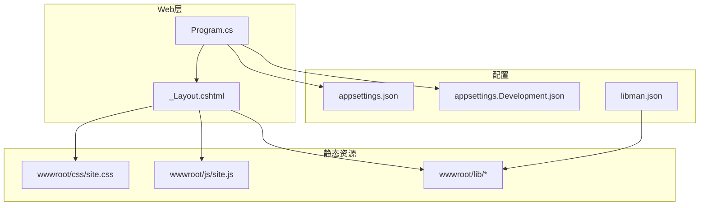
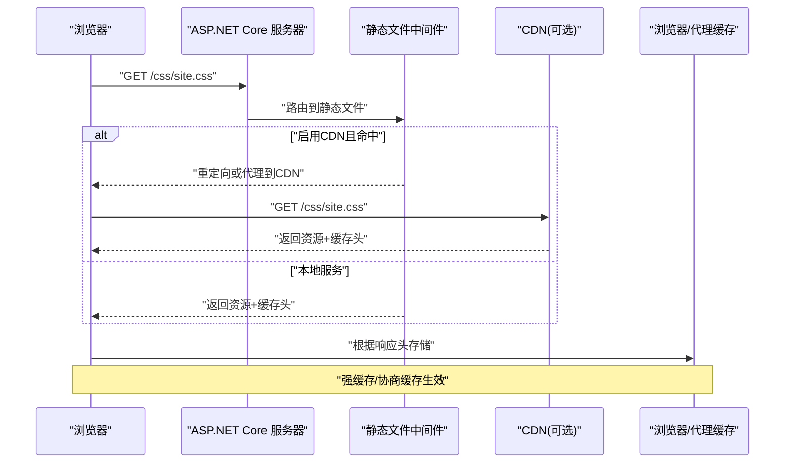
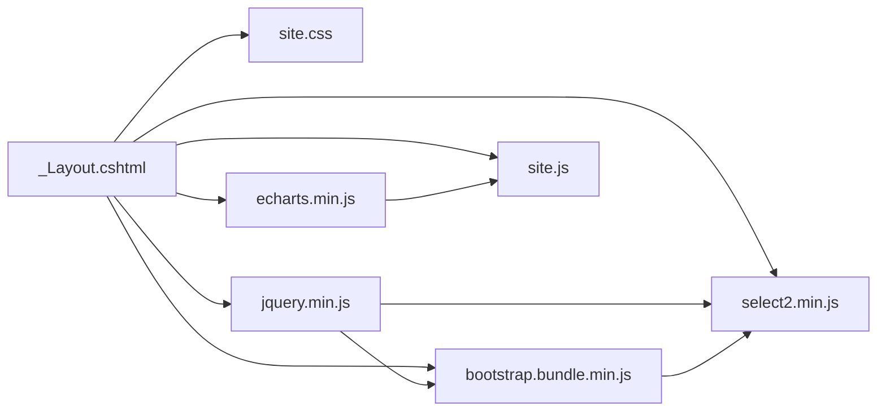

# 前端性能优化

<cite>
**本文引用的文件**   
- [libman.json](file://EquipmentIMS.Web/libman.json)
- [Program.cs](file://EquipmentIMS.Web/Program.cs)
- [appsettings.Development.json](file://EquipmentIMS.Web/appsettings.Development.json)
- [appsettings.json](file://EquipmentIMS.Web/appsettings.json)
- [_Layout.cshtml](file://EquipmentIMS.Web/Views/Shared/_Layout.cshtml)
- [site.css](file://EquipmentIMS.Web/wwwroot/css/site.css)
- [site.js](file://EquipmentIMS.Web/wwwroot/js/site.js)
</cite>

## 目录
1. [简介](#简介)
2. [项目结构](#项目结构)
3. [核心组件](#核心组件)
4. [架构总览](#架构总览)
5. [详细组件分析](#详细组件分析)
6. [依赖分析](#依赖分析)
7. [性能考量](#性能考量)
8. [故障排查指南](#故障排查指南)
9. [结论](#结论)
10. [附录](#附录)

## 简介
本指南面向THMS系统的前端性能优化，聚焦于以下目标：
- 使用 libman.json 管理第三方库并实施依赖优化策略
- 静态资源加载优化、CDN集成与缓存策略配置
- JavaScript/CSS压缩合并与版本化
- 图片优化、字体加载与首屏渲染提升
- 浏览器缓存控制、HTTP/2优化、资源预加载等高级技巧
- 性能监控工具与调试方法

## 项目结构
THMS采用ASP.NET Core MVC架构，前端资源位于wwwroot目录，布局视图在Views/Shared下，程序启动与中间件配置在Program.cs中。关键路径如下：
- 前端资源：wwwroot/css、wwwroot/js、wwwroot/lib（由libman管理）
- 布局与脚本注入点：Views/Shared/_Layout.cshtml
- 应用启动与中间件：Program.cs
- 环境配置：appsettings.json、appsettings.Development.json
- 库管理：libman.json

图表来源
- [Program.cs](file://EquipmentIMS.Web/Program.cs)
- [_Layout.cshtml](file://EquipmentIMS.Web/Views/Shared/_Layout.cshtml)
- [site.css](file://EquipmentIMS.Web/wwwroot/css/site.css)
- [site.js](file://EquipmentIMS.Web/wwwroot/js/site.js)
- [libman.json](file://EquipmentIMS.Web/libman.json)

章节来源
- [Program.cs](file://EquipmentIMS.Web/Program.cs)
- [_Layout.cshtml](file://EquipmentIMS.Web/Views/Shared/_Layout.cshtml)
- [site.css](file://EquipmentIMS.Web/wwwroot/css/site.css)
- [site.js](file://EquipmentIMS.Web/wwwroot/js/site.js)
- [libman.json](file://EquipmentIMS.Web/libman.json)

## 核心组件
- 库管理与依赖优化：通过libman.json声明第三方库（如Bootstrap、jQuery、ECharts、Select2等），统一下载到wwwroot/lib，便于后续压缩、合并与CDN替换。
- 静态资源服务与缓存：在Program.cs中启用静态文件中间件，结合环境配置设置缓存头与开发模式行为。
- 页面资源注入：_Layout.cshtml集中引入CSS/JS，是实施按需加载、延迟加载与预加载的关键入口。
- 应用配置：appsettings.json与appsettings.Development.json用于区分生产与开发环境的缓存策略、CDN开关等。

章节来源
- [libman.json](file://EquipmentIMS.Web/libman.json)
- [Program.cs](file://EquipmentIMS.Web/Program.cs)
- [appsettings.json](file://EquipmentIMS.Web/appsettings.json)
- [appsettings.Development.json](file://EquipmentIMS.Web/appsettings.Development.json)
- [_Layout.cshtml](file://EquipmentIMS.Web/Views/Shared/_Layout.cshtml)

## 架构总览
下图展示从请求到静态资源返回的链路，以及缓存与CDN集成的关键点。

图表来源
- [Program.cs](file://EquipmentIMS.Web/Program.cs)
- [appsettings.json](file://EquipmentIMS.Web/appsettings.json)
- [appsettings.Development.json](file://EquipmentIMS.Web/appsettings.Development.json)

## 详细组件分析

### libman.json 与依赖优化策略
- 作用：集中声明第三方库及其版本，自动下载至wwwroot/lib，避免手动维护。
- 优化建议：
  - 仅保留必要功能的最小包（例如只引入select2.min.js而非完整包）。
  - 为生产构建生成哈希文件名，配合CDN与强缓存。
  - 将常用库迁移到CDN以提升并发加载能力。
  - 对大型库（如ECharts）进行按需引入或分模块加载。

章节来源
- [libman.json](file://EquipmentIMS.Web/libman.json)

### 静态资源加载优化
- 集中注入：在布局视图中统一引入CSS/JS，减少重复引用。
- 顺序与优先级：
  - CSS优先加载，避免阻塞首屏渲染；关键CSS内联，非关键异步加载。
  - JS使用defer或async，避免阻塞解析。
- 按需加载：仅在需要时动态加载大型脚本（如报表页加载ECharts）。
- 资源去重：确保同一脚本不重复引入，减少冗余请求。

章节来源
- [_Layout.cshtml](file://EquipmentIMS.Web/Views/Shared/_Layout.cshtml)
- [site.css](file://EquipmentIMS.Web/wwwroot/css/site.css)
- [site.js](file://EquipmentIMS.Web/wwwroot/js/site.js)

### CDN集成与缓存策略
- CDN集成：
  - 在生产环境将静态资源指向CDN域名，利用边缘节点加速。
  - 使用版本号或哈希后缀实现缓存失效。
- 缓存策略：
  - 静态资源设置长期缓存（如一年）并开启ETag/Last-Modified协商缓存。
  - 开发环境禁用强缓存以便热更新。
- 安全与回退：
  - 配置HTTPS与CSP，防止资源劫持。
  - 提供本地回退路径，当CDN不可用时降级。

章节来源
- [Program.cs](file://EquipmentIMS.Web/Program.cs)
- [appsettings.json](file://EquipmentIMS.Web/appsettings.json)
- [appsettings.Development.json](file://EquipmentIMS.Web/appsettings.Development.json)

### JavaScript与CSS压缩合并
- 压缩：
  - 生产构建阶段压缩CSS/JS，移除注释与空白，减小体积。
  - 对图片进行无损或有损压缩，选择合适格式（WebP/AVIF）。
- 合并：
  - 将多个小文件合并为少量大文件，减少HTTP请求数（HTTP/2下适度合并即可）。
- 版本化：
  - 使用文件名哈希或查询参数实现缓存失效，避免用户持有旧资源。

章节来源
- [site.css](file://EquipmentIMS.Web/wwwroot/css/site.css)
- [site.js](file://EquipmentIMS.Web/wwwroot/js/site.js)

### 图片优化与字体加载
- 图片优化：
  - 使用现代格式（WebP/AVIF）、响应式srcset、懒加载。
  - 合理尺寸与压缩比，避免过大图片影响首屏。
- 字体加载：
  - 使用font-display: swap避免文字不可见。
  - 预加载关键字体，减少FOIT/FOUT闪烁。
  - 子集化字体，仅包含所需字符集。

章节来源
- [_Layout.cshtml](file://EquipmentIMS.Web/Views/Shared/_Layout.cshtml)

### 首屏渲染性能提升
- 关键渲染路径优化：
  - 内联关键CSS，减少样式阻塞。
  - 延迟非关键脚本执行，优先呈现内容。
- 资源优先级：
  - 使用preload/prefetch提示浏览器提前获取关键资源。
- 服务端渲染与缓存：
  - 对首屏HTML启用输出缓存，缩短TTFB。

章节来源
- [_Layout.cshtml](file://EquipmentIMS.Web/Views/Shared/_Layout.cshtml)
- [Program.cs](file://EquipmentIMS.Web/Program.cs)

### 浏览器缓存控制与HTTP/2优化
- 浏览器缓存：
  - 静态资源设置长缓存与协商缓存，提高命中率。
  - 开发环境关闭强缓存，便于调试。
- HTTP/2优化：
  - 启用HTTP/2，利用多路复用降低请求开销。
  - 适度合并资源，避免单文件过大导致队头阻塞。
- 连接优化：
  - 启用Keep-Alive，减少握手开销。
  - 合理设置最大并发连接数。

章节来源
- [Program.cs](file://EquipmentIMS.Web/Program.cs)
- [appsettings.json](file://EquipmentIMS.Web/appsettings.json)
- [appsettings.Development.json](file://EquipmentIMS.Web/appsettings.Development.json)

### 资源预加载与高级技巧
- 预加载：
  - 使用<link rel="preload">预取关键CSS/字体/脚本。
  - 使用<link rel="prefetch">预取下一页资源。
- 并行与优先级：
  - 使用fetchpriority与DNS预解析，提升关键资源获取速度。
- 错误处理与降级：
  - 为CDN资源设置onerror回退到本地路径。
  - 对失败资源进行重试与告警。

章节来源
- [_Layout.cshtml](file://EquipmentIMS.Web/Views/Shared/_Layout.cshtml)

### 性能监控与调试方法
- 浏览器开发者工具：
  - Network面板分析请求耗时、缓存命中与资源大小。
  - Performance面板识别主线程瓶颈与长任务。
  - Lighthouse进行端到端性能评分与建议。
- 指标关注：
  - TTFB、FCP、LCP、CLS、INP等核心指标。
- 日志与追踪：
  - 在关键路径添加时间戳与埋点，定位慢请求。
  - 结合NLog记录异常与性能事件。

章节来源
- [Program.cs](file://EquipmentIMS.Web/Program.cs)
- [nlog.config](file://EquipmentIMS.Web/nlog.config)

## 依赖分析
下图展示主要前端依赖关系与加载顺序，帮助识别潜在的性能瓶颈。

图表来源
- [_Layout.cshtml](file://EquipmentIMS.Web/Views/Shared/_Layout.cshtml)
- [site.js](file://EquipmentIMS.Web/wwwroot/js/site.js)
- [site.css](file://EquipmentIMS.Web/wwwroot/css/site.css)

章节来源
- [_Layout.cshtml](file://EquipmentIMS.Web/Views/Shared/_Layout.cshtml)
- [site.js](file://EquipmentIMS.Web/wwwroot/js/site.js)
- [site.css](file://EquipmentIMS.Web/wwwroot/css/site.css)

## 性能考量
- 资源体积：定期审计第三方库体积，剔除未使用功能。
- 网络往返：合并与压缩资源，减少请求数量与大小。
- 缓存命中：合理设置缓存头，提高命中率，降低带宽消耗。
- 首屏体验：优先加载关键资源，延迟非关键逻辑。
- 可观测性：建立性能基线与告警，持续跟踪改进效果。

## 故障排查指南
- 常见问题：
  - 资源404：检查静态文件路径与CDN域名是否正确。
  - 缓存未更新：确认文件名是否变更或缓存头是否被覆盖。
  - 跨域问题：核对CORS与CDN跨域策略。
  - 脚本冲突：检查jQuery与其他库的版本兼容性。
- 定位步骤：
  - 使用Network面板查看请求状态码与耗时。
  - 使用Performance面板分析渲染瓶颈。
  - 检查NLog日志中的异常与性能事件。

章节来源
- [Program.cs](file://EquipmentIMS.Web/Program.cs)
- [nlog.config](file://EquipmentIMS.Web/nlog.config)

## 结论
通过libman管理依赖、集中注入与按需加载、压缩合并与版本化、CDN与缓存策略、HTTP/2与预加载等综合手段，可显著提升THMS系统的前端性能。建议建立持续的性能监控与回归测试流程，确保优化效果稳定可靠。

## 附录
- 最佳实践清单：
  - 仅引入必要库的最小版本
  - 生产环境启用压缩与合并
  - 静态资源使用长缓存与协商缓存
  - 关键资源预加载，非关键资源延迟加载
  - 启用HTTP/2与Keep-Alive
  - 使用Lighthouse与性能面板持续评估