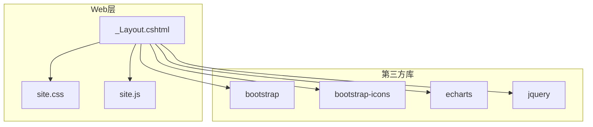
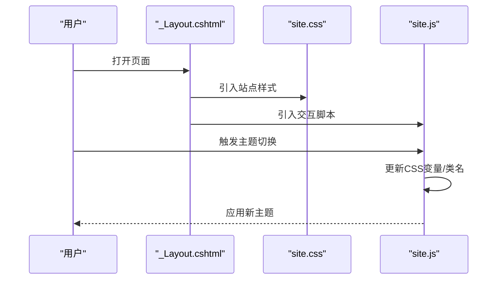
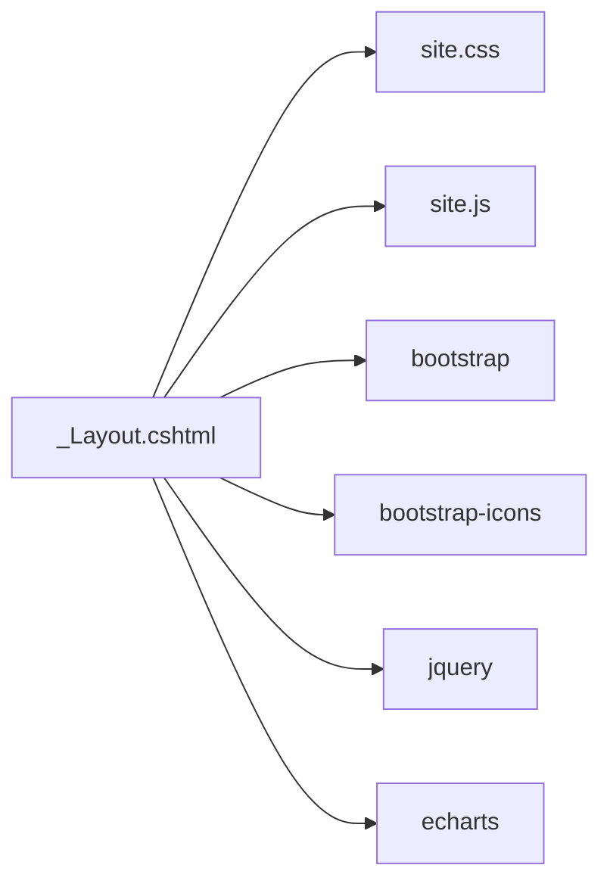

# 样式主题定制

<cite>
**本文引用的文件**   
- [site.css](file://EquipmentIMS.Web/wwwroot/css/site.css)
- [_Layout.cshtml](file://EquipmentIMS.Web/Views/Shared/_Layout.cshtml)
- [site.js](file://EquipmentIMS.Web/wwwroot/js/site.js)
</cite>

## 目录
1. [简介](#简介)
2. [项目结构](#项目结构)
3. [核心组件](#核心组件)
4. [架构总览](#架构总览)
5. [详细组件分析](#详细组件分析)
6. [依赖关系分析](#依赖关系分析)
7. [性能考虑](#性能考虑)
8. [故障排查指南](#故障排查指南)
9. [结论](#结论)
10. [附录](#附录)

## 简介
本指南面向THMS系统的样式与主题定制，聚焦于站点级样式文件 site.css 的组织与管理规范、CSS变量使用与主题切换机制、Bootstrap主题的自定义与扩展技巧、响应式断点与移动端适配策略，以及样式性能优化、压缩与浏览器兼容性处理。同时提供样式调试工具与开发工作流建议，帮助团队在保持可维护性的前提下快速实现多主题与一致的视觉体验。

## 项目结构
THMS采用ASP.NET Core MVC架构，前端静态资源位于 wwwroot 目录：
- CSS：wwwroot/css/site.css（站点主样式）
- JS：wwwroot/js/site.js（交互脚本）
- 第三方库：wwwroot/lib/bootstrap、bootstrap-icons、echarts、jquery 等
- 视图布局：Views/Shared/_Layout.cshtml（统一引入CSS/JS）

图表来源
- [_Layout.cshtml](file://EquipmentIMS.Web/Views/Shared/_Layout.cshtml)
- [site.css](file://EquipmentIMS.Web/wwwroot/css/site.css)
- [site.js](file://EquipmentIMS.Web/wwwroot/js/site.js)

章节来源
- [site.css](file://EquipmentIMS.Web/wwwroot/css/site.css)
- [_Layout.cshtml](file://EquipmentIMS.Web/Views/Shared/_Layout.cshtml)
- [site.js](file://EquipmentIMS.Web/wwwroot/js/site.js)

## 核心组件
- 站点样式入口：site.css
  - 负责全局基础样式、组件覆盖、主题变量与响应式规则。
- 布局模板：_Layout.cshtml
  - 统一引入CSS/JS资源，定义页面骨架与公共区域。
- 交互脚本：site.js
  - 承载主题切换、用户偏好持久化、动态样式控制等逻辑。

章节来源
- [site.css](file://EquipmentIMS.Web/wwwroot/css/site.css)
- [_Layout.cshtml](file://EquipmentIMS.Web/Views/Shared/_Layout.cshtml)
- [site.js](file://EquipmentIMS.Web/wwwroot/js/site.js)

## 架构总览
样式系统由“布局注入 + 全局样式 + 主题变量 + 交互脚本”构成，形成清晰的职责边界：
- 布局负责资源加载顺序与挂载点
- 全局样式提供基础UI与组件覆盖
- 主题变量集中管理色彩、字体、间距等设计令牌
- 交互脚本驱动主题切换与状态持久化

图表来源
- [_Layout.cshtml](file://EquipmentIMS.Web/Views/Shared/_Layout.cshtml)
- [site.css](file://EquipmentIMS.Web/wwwroot/css/site.css)
- [site.js](file://EquipmentIMS.Web/wwwroot/js/site.js)

## 详细组件分析

### site.css 样式组织与管理规范
- 分层组织建议
  - 基础层：重置、排版、颜色、阴影、圆角、过渡等基础样式
  - 组件层：按钮、卡片、表格、表单、导航等通用组件样式
  - 页面层：特定页面的布局与装饰性样式
  - 主题层：CSS变量、主题类、暗色模式开关
  - 响应式层：媒体查询、移动端适配、小屏优化
- 命名约定
  - 使用语义化类名，避免过度嵌套；优先使用BEM或类似约定
  - 主题相关变量以统一的命名空间前缀区分
- 优先级与覆盖
  - 通过变量与类名组合降低!important使用
  - 组件覆盖遵循“就近原则”，必要时提升选择器层级但保持可读性
- 可维护性
  - 将重复值抽取为CSS变量
  - 按模块拆分文件（如需要），并通过构建流程合并

章节来源
- [site.css](file://EquipmentIMS.Web/wwwroot/css/site.css)

### CSS变量与主题切换机制
- 变量定义位置
  - 在根节点或主题容器上声明变量，便于作用域隔离
- 变量分类
  - 色彩：主色、辅色、中性色、状态色
  - 尺寸：字号、行高、间距、圆角、阴影
  - 布局：网格列宽、侧边栏宽度、顶部高度
- 主题切换流程
  - 用户操作触发脚本更新变量或切换主题类
  - 脚本将当前主题写入本地存储，下次加载时恢复
  - 支持跟随系统明暗模式的检测与自动切换
- 最佳实践
  - 使用data属性或body类名作为主题标记
  - 对关键变量设置合理的默认值，确保降级兼容
  - 避免在动画中频繁变更复杂变量，减少重排重绘

章节来源
- [site.css](file://EquipmentIMS.Web/wwwroot/css/site.css)
- [site.js](file://EquipmentIMS.Web/wwwroot/js/site.js)

### Bootstrap主题自定义与扩展
- 自定义方式
  - 通过覆盖Bootstrap的SCSS变量进行主题定制（若使用源码编译）
  - 在site.css中对Bootstrap组件进行轻量覆盖，避免破坏框架语义
- 图标与字体
  - 使用bootstrap-icons并自定义图标颜色与大小
  - 统一字体栈，保证跨平台一致性
- 组件增强
  - 为常用组件添加主题友好的变体类
  - 利用CSS变量替换硬编码的颜色与尺寸，提高可配置性

章节来源
- [site.css](file://EquipmentIMS.Web/wwwroot/css/site.css)

### 响应式断点与移动端适配
- 断点策略
  - 基于Bootstrap断点体系，结合业务需求微调
  - 在小屏设备上优先保证可用性，其次才是视觉效果
- 适配要点
  - 列表与表格在小屏下采用横向滚动或折叠展示
  - 导航与侧边栏在小屏下改为抽屉式或底部导航
  - 图片与图表自适应缩放，避免溢出
- 测试方法
  - 使用浏览器开发者工具的响应式模式验证各断点表现
  - 真机测试关键路径，关注触摸交互与性能

章节来源
- [site.css](file://EquipmentIMS.Web/wwwroot/css/site.css)

### 样式调试工具与开发工作流
- 调试工具
  - 浏览器开发者工具：元素检查、计算样式、性能面板
  - 样式差异对比：使用Diff工具比较主题前后差异
- 工作流建议
  - 使用热重载提升迭代效率
  - 建立样式审查清单，确保变量一致性与命名规范
  - 将主题切换逻辑纳入单元测试或端到端测试用例

章节来源
- [site.js](file://EquipmentIMS.Web/wwwroot/js/site.js)

## 依赖关系分析
- 资源加载顺序
  - _Layout.cshtml 按序引入Bootstrap、图标库、jQuery、ECharts、site.js与site.css
  - 确保CSS先于JS加载，避免闪烁与样式未就绪问题
- 外部依赖
  - Bootstrap提供基础组件与栅格
  - bootstrap-icons提供图标资源
  - ECharts用于数据可视化
  - jQuery作为部分插件的基础依赖

图表来源
- [_Layout.cshtml](file://EquipmentIMS.Web/Views/Shared/_Layout.cshtml)
- [site.css](file://EquipmentIMS.Web/wwwroot/css/site.css)
- [site.js](file://EquipmentIMS.Web/wwwroot/js/site.js)

章节来源
- [_Layout.cshtml](file://EquipmentIMS.Web/Views/Shared/_Layout.cshtml)
- [site.css](file://EquipmentIMS.Web/wwwroot/css/site.css)
- [site.js](file://EquipmentIMS.Web/wwwroot/js/site.js)

## 性能考虑
- 资源优化
  - 启用Gzip/Brotli压缩，减小CSS体积
  - 合并与按需加载，减少请求数
  - 使用CDN缓存第三方库，提升首屏速度
- 渲染优化
  - 避免深层选择器与过度复杂的规则
  - 合理使用will-change与transform提升动画性能
  - 减少重排重绘，批量更新样式
- 兼容性处理
  - 针对旧版浏览器提供降级方案
  - 使用Autoprefixer自动补全前缀
  - 在关键特性上使用特性检测

[本节为通用指导，不直接分析具体文件]

## 故障排查指南
- 常见问题
  - 主题切换无效：检查脚本是否正确更新变量或类名，确认本地存储读取逻辑
  - 样式覆盖失效：检查选择器优先级与加载顺序，避免被后续样式覆盖
  - 移动端错位：检查媒体查询断点与布局约束，确认父容器尺寸
- 定位步骤
  - 使用开发者工具查看计算样式与继承链
  - 逐步注释样式块定位冲突源
  - 在控制台输出主题状态与变量值，验证脚本执行路径

章节来源
- [site.js](file://EquipmentIMS.Web/wwwroot/js/site.js)
- [site.css](file://EquipmentIMS.Web/wwwroot/css/site.css)

## 结论
通过规范的样式组织、完善的CSS变量体系、清晰的Bootstrap扩展策略与稳健的主题切换机制，THMS可实现高效、可维护且跨设备一致的视觉体验。配合性能优化与调试工具，团队可在保证质量的前提下快速迭代主题与界面。

[本节为总结性内容，不直接分析具体文件]

## 附录
- 术语表
  - CSS变量：用于统一管理设计令号的CSS自定义属性
  - 主题类：用于标识当前主题的类名或data属性
  - 响应式断点：在不同屏幕宽度下应用不同样式的阈值
- 参考路径
  - 站点样式入口：[site.css](file://EquipmentIMS.Web/wwwroot/css/site.css)
  - 布局模板：[_Layout.cshtml](file://EquipmentIMS.Web/Views/Shared/_Layout.cshtml)
  - 交互脚本：[site.js](file://EquipmentIMS.Web/wwwroot/js/site.js)