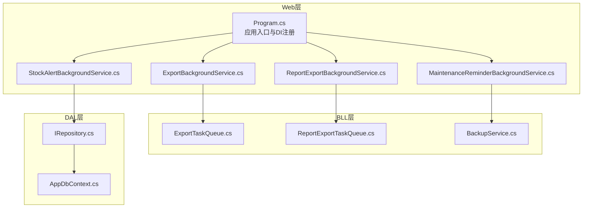
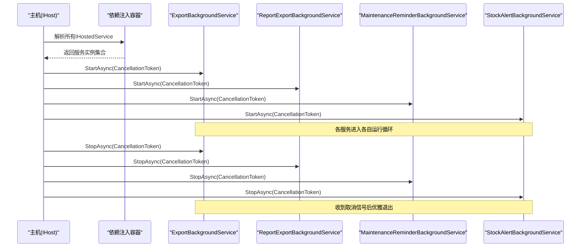
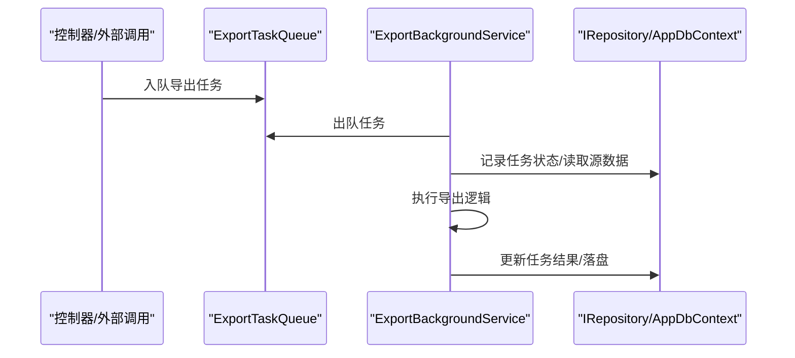
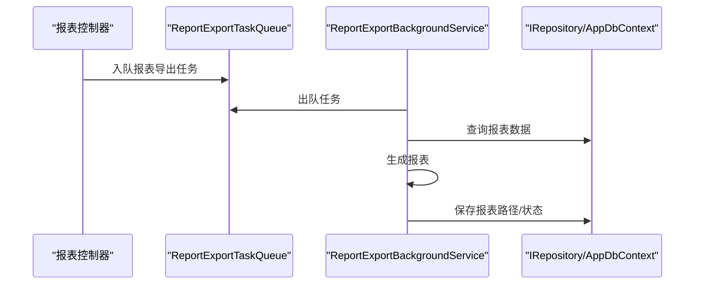
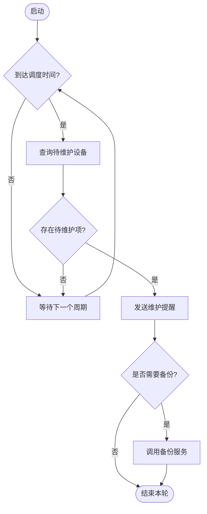
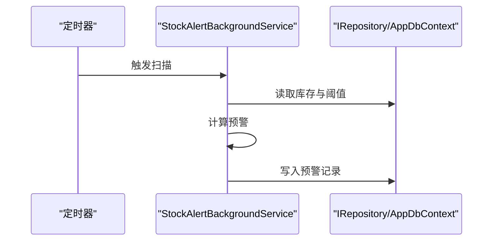
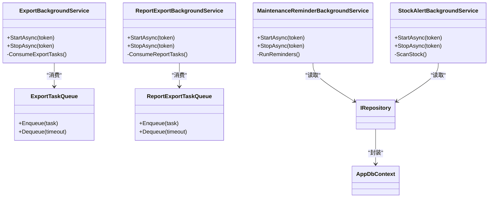

# 后台服务架构

<cite>
**本文引用的文件**   
- [Program.cs](file://EquipmentIMS.Web/Program.cs)
- [ExportBackgroundService.cs](file://EquipmentIMS.Web/BackgroundServices/ExportBackgroundService.cs)
- [MaintenanceReminderBackgroundService.cs](file://EquipmentIMS.Web/BackgroundServices/MaintenanceReminderBackgroundService.cs)
- [ReportExportBackgroundService.cs](file://EquipmentIMS.Web/BackgroundServices/ReportExportBackgroundService.cs)
- [StockAlertBackgroundService.cs](file://EquipmentIMS.Web/BackgroundServices/StockAlertBackgroundService.cs)
- [ExportTaskQueue.cs](file://EquipmentIMS.BLL/Services/ExportTaskQueue.cs)
- [ReportExportTaskQueue.cs](file://EquipmentIMS.BLL/Services/ReportExportTaskQueue.cs)
- [BackupService.cs](file://EquipmentIMS.BLL/Services/BackupService.cs)
- [IRepository.cs](file://EquipmentIMS.DAL/Interfaces/IRepository.cs)
- [AppDbContext.cs](file://EquipmentIMS.DAL/AppDbContext.cs)
</cite>

## 目录
1. [简介](#简介)
2. [项目结构](#项目结构)
3. [核心组件](#核心组件)
4. [架构总览](#架构总览)
5. [详细组件分析](#详细组件分析)
6. [依赖关系分析](#依赖关系分析)
7. [性能考虑](#性能考虑)
8. [故障排查指南](#故障排查指南)
9. [结论](#结论)
10. [附录](#附录)

## 简介
本文件面向THMS系统的后台服务架构，聚焦于基于 IHostedService 的后台任务实现模式。文档将系统阐述：
- 服务的生命周期管理、启动顺序与优雅关闭
- 依赖注入配置与服务注册机制
- 错误处理策略与重试/退避建议
- 服务间通信与消息传递（队列）模式
- 监控、健康检查与性能指标收集方案
- 自定义后台服务的开发模板与最佳实践

## 项目结构
THMS采用分层架构，Web层负责HTTP请求与后台服务编排；BLL层提供业务服务与队列；DAL层提供数据访问抽象与上下文；Models层定义实体、DTO与枚举。

图表来源
- [Program.cs](file://EquipmentIMS.Web/Program.cs)
- [ExportBackgroundService.cs](file://EquipmentIMS.Web/BackgroundServices/ExportBackgroundService.cs)
- [MaintenanceReminderBackgroundService.cs](file://EquipmentIMS.Web/BackgroundServices/MaintenanceReminderBackgroundService.cs)
- [ReportExportBackgroundService.cs](file://EquipmentIMS.Web/BackgroundServices/ReportExportBackgroundService.cs)
- [StockAlertBackgroundService.cs](file://EquipmentIMS.Web/BackgroundServices/StockAlertBackgroundService.cs)
- [ExportTaskQueue.cs](file://EquipmentIMS.BLL/Services/ExportTaskQueue.cs)
- [ReportExportTaskQueue.cs](file://EquipmentIMS.BLL/Services/ReportExportTaskQueue.cs)
- [BackupService.cs](file://EquipmentIMS.BLL/Services/BackupService.cs)
- [IRepository.cs](file://EquipmentIMS.DAL/Interfaces/IRepository.cs)
- [AppDbContext.cs](file://EquipmentIMS.DAL/AppDbContext.cs)

章节来源
- [Program.cs](file://EquipmentIMS.Web/Program.cs)
- [ExportBackgroundService.cs](file://EquipmentIMS.Web/BackgroundServices/ExportBackgroundService.cs)
- [MaintenanceReminderBackgroundService.cs](file://EquipmentIMS.Web/BackgroundServices/MaintenanceReminderBackgroundService.cs)
- [ReportExportBackgroundService.cs](file://EquipmentIMS.Web/BackgroundServices/ReportExportBackgroundService.cs)
- [StockAlertBackgroundService.cs](file://EquipmentIMS.Web/BackgroundServices/StockAlertBackgroundService.cs)
- [ExportTaskQueue.cs](file://EquipmentIMS.BLL/Services/ExportTaskQueue.cs)
- [ReportExportTaskQueue.cs](file://EquipmentIMS.BLL/Services/ReportExportTaskQueue.cs)
- [BackupService.cs](file://EquipmentIMS.BLL/Services/BackupService.cs)
- [IRepository.cs](file://EquipmentIMS.DAL/Interfaces/IRepository.cs)
- [AppDbContext.cs](file://EquipmentIMS.DAL/AppDbContext.cs)

## 核心组件
- 后台服务（IHostedService）
  - ExportBackgroundService：导出任务消费者，从导出队列拉取任务并执行导出流程。
  - MaintenanceReminderBackgroundService：定时维护提醒与备份协调者，按周期触发提醒或调用备份服务。
  - ReportExportBackgroundService：报表导出任务消费者，从报表导出队列拉取任务并生成报表。
  - StockAlertBackgroundService：库存预警扫描器，周期性检查库存阈值并产生告警。
- 任务队列（BLL Services）
  - ExportTaskQueue：导出任务队列，提供入队/出队能力，供控制器或API触发异步导出。
  - ReportExportTaskQueue：报表导出任务队列，用于批量报表导出任务的异步处理。
- 数据访问（DAL）
  - IRepository：通用仓储接口，为后台服务提供数据读取/写入能力。
  - AppDbContext：EF Core上下文，承载数据库连接与变更跟踪。

章节来源
- [ExportBackgroundService.cs](file://EquipmentIMS.Web/BackgroundServices/ExportBackgroundService.cs)
- [MaintenanceReminderBackgroundService.cs](file://EquipmentIMS.Web/BackgroundServices/MaintenanceReminderBackgroundService.cs)
- [ReportExportBackgroundService.cs](file://EquipmentIMS.Web/BackgroundServices/ReportExportBackgroundService.cs)
- [StockAlertBackgroundService.cs](file://EquipmentIMS.Web/BackgroundServices/StockAlertBackgroundService.cs)
- [ExportTaskQueue.cs](file://EquipmentIMS.BLL/Services/ExportTaskQueue.cs)
- [ReportExportTaskQueue.cs](file://EquipmentIMS.BLL/Services/ReportExportTaskQueue.cs)
- [IRepository.cs](file://EquipmentIMS.DAL/Interfaces/IRepository.cs)
- [AppDbContext.cs](file://EquipmentIMS.DAL/AppDbContext.cs)

## 架构总览
后台服务通过依赖注入容器统一注册，遵循IHostedService生命周期：
- 启动阶段：各服务在应用启动时并行初始化，按需延迟加载资源。
- 运行阶段：服务以独立循环方式工作，消费队列或执行定时任务。
- 关闭阶段：接收取消令牌，完成当前任务后退出，确保数据一致性。

图表来源
- [Program.cs](file://EquipmentIMS.Web/Program.cs)
- [ExportBackgroundService.cs](file://EquipmentIMS.Web/BackgroundServices/ExportBackgroundService.cs)
- [ReportExportBackgroundService.cs](file://EquipmentIMS.Web/BackgroundServices/ReportExportBackgroundService.cs)
- [MaintenanceReminderBackgroundService.cs](file://EquipmentIMS.Web/BackgroundServices/MaintenanceReminderBackgroundService.cs)
- [StockAlertBackgroundService.cs](file://EquipmentIMS.Web/BackgroundServices/StockAlertBackgroundService.cs)

## 详细组件分析

### 导出后台服务（ExportBackgroundService）
职责
- 作为导出任务消费者，持续从导出队列拉取任务。
- 协调导出逻辑（如Excel生成），并将结果持久化或通知前端。

关键交互
- 使用导出队列（ExportTaskQueue）进行任务入队与出队。
- 可能依赖仓储接口（IRepository）或上下文（AppDbContext）进行元数据记录。

图表来源
- [ExportBackgroundService.cs](file://EquipmentIMS.Web/BackgroundServices/ExportBackgroundService.cs)
- [ExportTaskQueue.cs](file://EquipmentIMS.BLL/Services/ExportTaskQueue.cs)
- [IRepository.cs](file://EquipmentIMS.DAL/Interfaces/IRepository.cs)
- [AppDbContext.cs](file://EquipmentIMS.DAL/AppDbContext.cs)

章节来源
- [ExportBackgroundService.cs](file://EquipmentIMS.Web/BackgroundServices/ExportBackgroundService.cs)
- [ExportTaskQueue.cs](file://EquipmentIMS.BLL/Services/ExportTaskQueue.cs)
- [IRepository.cs](file://EquipmentIMS.DAL/Interfaces/IRepository.cs)
- [AppDbContext.cs](file://EquipmentIMS.DAL/AppDbContext.cs)

### 报表导出后台服务（ReportExportBackgroundService）
职责
- 作为报表导出任务消费者，从报表导出队列拉取任务。
- 聚合多表数据，生成报表文件并存储。

关键交互
- 与报表导出队列（ReportExportTaskQueue）协作。
- 通过仓储接口查询报表所需数据。

图表来源
- [ReportExportBackgroundService.cs](file://EquipmentIMS.Web/BackgroundServices/ReportExportBackgroundService.cs)
- [ReportExportTaskQueue.cs](file://EquipmentIMS.BLL/Services/ReportExportTaskQueue.cs)
- [IRepository.cs](file://EquipmentIMS.DAL/Interfaces/IRepository.cs)
- [AppDbContext.cs](file://EquipmentIMS.DAL/AppDbContext.cs)

章节来源
- [ReportExportBackgroundService.cs](file://EquipmentIMS.Web/BackgroundServices/ReportExportBackgroundService.cs)
- [ReportExportTaskQueue.cs](file://EquipmentIMS.BLL/Services/ReportExportTaskQueue.cs)
- [IRepository.cs](file://EquipmentIMS.DAL/Interfaces/IRepository.cs)
- [AppDbContext.cs](file://EquipmentIMS.DAL/AppDbContext.cs)

### 维护提醒后台服务（MaintenanceReminderBackgroundService）
职责
- 定时扫描待维护设备，发送提醒。
- 可选协调备份任务（例如每日全量备份）。

关键交互
- 通过仓储接口查询维护计划与设备状态。
- 可调用备份服务（BackupService）执行备份。

图表来源
- [MaintenanceReminderBackgroundService.cs](file://EquipmentIMS.Web/BackgroundServices/MaintenanceReminderBackgroundService.cs)
- [BackupService.cs](file://EquipmentIMS.BLL/Services/BackupService.cs)
- [IRepository.cs](file://EquipmentIMS.DAL/Interfaces/IRepository.cs)

章节来源
- [MaintenanceReminderBackgroundService.cs](file://EquipmentIMS.Web/BackgroundServices/MaintenanceReminderBackgroundService.cs)
- [BackupService.cs](file://EquipmentIMS.BLL/Services/BackupService.cs)
- [IRepository.cs](file://EquipmentIMS.DAL/Interfaces/IRepository.cs)

### 库存预警后台服务（StockAlertBackgroundService）
职责
- 周期性扫描库存，对比阈值，生成预警记录。

关键交互
- 通过仓储接口读取库存数据。
- 写入预警实体或通知中心。

图表来源
- [StockAlertBackgroundService.cs](file://EquipmentIMS.Web/BackgroundServices/StockAlertBackgroundService.cs)
- [IRepository.cs](file://EquipmentIMS.DAL/Interfaces/IRepository.cs)
- [AppDbContext.cs](file://EquipmentIMS.DAL/AppDbContext.cs)

章节来源
- [StockAlertBackgroundService.cs](file://EquipmentIMS.Web/BackgroundServices/StockAlertBackgroundService.cs)
- [IRepository.cs](file://EquipmentIMS.DAL/Interfaces/IRepository.cs)
- [AppDbContext.cs](file://EquipmentIMS.DAL/AppDbContext.cs)

## 依赖关系分析
- 服务注册与生命周期
  - 所有后台服务均通过依赖注入容器注册为IHostedService，由主机在启动时解析并调用StartAsync/StopAsync。
- 服务间通信
  - 通过队列（ExportTaskQueue、ReportExportTaskQueue）解耦生产者与消费者，避免同步阻塞。
- 数据访问
  - 后台服务通过仓储接口与上下文访问数据库，保证事务边界清晰。

图表来源
- [ExportBackgroundService.cs](file://EquipmentIMS.Web/BackgroundServices/ExportBackgroundService.cs)
- [ReportExportBackgroundService.cs](file://EquipmentIMS.Web/BackgroundServices/ReportExportBackgroundService.cs)
- [MaintenanceReminderBackgroundService.cs](file://EquipmentIMS.Web/BackgroundServices/MaintenanceReminderBackgroundService.cs)
- [StockAlertBackgroundService.cs](file://EquipmentIMS.Web/BackgroundServices/StockAlertBackgroundService.cs)
- [ExportTaskQueue.cs](file://EquipmentIMS.BLL/Services/ExportTaskQueue.cs)
- [ReportExportTaskQueue.cs](file://EquipmentIMS.BLL/Services/ReportExportTaskQueue.cs)
- [IRepository.cs](file://EquipmentIMS.DAL/Interfaces/IRepository.cs)
- [AppDbContext.cs](file://EquipmentIMS.DAL/AppDbContext.cs)

章节来源
- [Program.cs](file://EquipmentIMS.Web/Program.cs)
- [ExportBackgroundService.cs](file://EquipmentIMS.Web/BackgroundServices/ExportBackgroundService.cs)
- [ReportExportBackgroundService.cs](file://EquipmentIMS.Web/BackgroundServices/ReportExportBackgroundService.cs)
- [MaintenanceReminderBackgroundService.cs](file://EquipmentIMS.Web/BackgroundServices/MaintenanceReminderBackgroundService.cs)
- [StockAlertBackgroundService.cs](file://EquipmentIMS.Web/BackgroundServices/StockAlertBackgroundService.cs)
- [ExportTaskQueue.cs](file://EquipmentIMS.BLL/Services/ExportTaskQueue.cs)
- [ReportExportTaskQueue.cs](file://EquipmentIMS.BLL/Services/ReportExportTaskQueue.cs)
- [IRepository.cs](file://EquipmentIMS.DAL/Interfaces/IRepository.cs)
- [AppDbContext.cs](file://EquipmentIMS.DAL/AppDbContext.cs)

## 性能考虑
- 并发与吞吐
  - 每个后台服务内部应控制并发度，避免对数据库造成压力峰值。
  - 队列消费者可采用批处理策略，减少IO次数。
- 超时与退避
  - 对外部依赖（如文件IO、网络）设置合理超时；失败时使用指数退避重试。
- 资源清理
  - 在StopAsync中释放临时文件、关闭流、清空缓存，避免内存泄漏。
- 日志与指标
  - 记录关键步骤耗时与异常堆栈；暴露CPU、内存、队列长度等指标以便监控。

[本节为通用指导，不直接分析具体文件]

## 故障排查指南
- 服务未启动
  - 确认后台服务已在Program中注册为IHostedService。
- 任务堆积
  - 检查队列容量与消费者并发度；观察是否有异常导致出队失败。
- 数据库连接问题
  - 验证连接字符串与上下文生命周期；确保事务提交成功。
- 优雅关闭失效
  - 检查是否正确使用取消令牌；长时间阻塞操作需支持中断。

章节来源
- [Program.cs](file://EquipmentIMS.Web/Program.cs)
- [ExportBackgroundService.cs](file://EquipmentIMS.Web/BackgroundServices/ExportBackgroundService.cs)
- [ReportExportBackgroundService.cs](file://EquipmentIMS.Web/BackgroundServices/ReportExportBackgroundService.cs)
- [MaintenanceReminderBackgroundService.cs](file://EquipmentIMS.Web/BackgroundServices/MaintenanceReminderBackgroundService.cs)
- [StockAlertBackgroundService.cs](file://EquipmentIMS.Web/BackgroundServices/StockAlertBackgroundService.cs)

## 结论
THMS的后台服务采用IHostedService标准模式，结合队列实现了解耦的异步处理架构。通过统一的依赖注入与生命周期管理，服务具备良好可观测性与可扩展性。建议在后续迭代中完善健康检查端点与指标采集，进一步提升运维能力。

[本节为总结性内容，不直接分析具体文件]

## 附录

### 服务生命周期与启动顺序
- 启动顺序
  - 主机解析所有IHostedService并按注册顺序调用StartAsync。
  - 若存在依赖关系，可通过构造器注入确保前置服务先启动。
- 优雅关闭
  - StopAsync应在取消令牌触发后尽快返回，完成当前批次任务后退出。

章节来源
- [Program.cs](file://EquipmentIMS.Web/Program.cs)
- [ExportBackgroundService.cs](file://EquipmentIMS.Web/BackgroundServices/ExportBackgroundService.cs)
- [ReportExportBackgroundService.cs](file://EquipmentIMS.Web/BackgroundServices/ReportExportBackgroundService.cs)
- [MaintenanceReminderBackgroundService.cs](file://EquipmentIMS.Web/BackgroundServices/MaintenanceReminderBackgroundService.cs)
- [StockAlertBackgroundService.cs](file://EquipmentIMS.Web/BackgroundServices/StockAlertBackgroundService.cs)

### 依赖注入与服务注册
- 注册方式
  - 在Program中将后台服务注册为IHostedService，使主机自动管理其生命周期。
- 作用域与单例
  - 后台服务通常为单例；数据访问对象按请求或短生命周期创建，避免跨请求共享。

章节来源
- [Program.cs](file://EquipmentIMS.Web/Program.cs)

### 错误处理策略
- 捕获异常并记录
  - 在消费者循环中捕获异常，记录上下文信息（任务ID、参数、堆栈）。
- 重试与死信
  - 对瞬时错误进行有限次重试；多次失败的任务转入死信队列以便人工干预。

章节来源
- [ExportBackgroundService.cs](file://EquipmentIMS.Web/BackgroundServices/ExportBackgroundService.cs)
- [ReportExportBackgroundService.cs](file://EquipmentIMS.Web/BackgroundServices/ReportExportBackgroundService.cs)
- [MaintenanceReminderBackgroundService.cs](file://EquipmentIMS.Web/BackgroundServices/MaintenanceReminderBackgroundService.cs)
- [StockAlertBackgroundService.cs](file://EquipmentIMS.Web/BackgroundServices/StockAlertBackgroundService.cs)

### 服务间通信与消息传递
- 队列模型
  - 使用ExportTaskQueue与ReportExportTaskQueue作为轻量级内存队列，解耦生产与消费。
- 扩展建议
  - 当需要持久化与高可用时，可替换为Redis/RabbitMQ等消息中间件。

章节来源
- [ExportTaskQueue.cs](file://EquipmentIMS.BLL/Services/ExportTaskQueue.cs)
- [ReportExportTaskQueue.cs](file://EquipmentIMS.BLL/Services/ReportExportTaskQueue.cs)

### 监控、健康检查与性能指标
- 健康检查
  - 提供健康检查端点，汇总各后台服务状态（就绪、运行中、错误）。
- 指标采集
  - 暴露队列长度、任务成功率、平均处理时长、数据库连接池状态等指标。
- 日志规范
  - 结构化日志包含服务名、任务ID、耗时、异常类型与消息。

[本节为通用指导，不直接分析具体文件]

### 自定义后台服务开发模板与最佳实践
- 模板要点
  - 继承IHostedService，实现StartAsync/StopAsync。
  - 使用取消令牌控制循环退出。
  - 通过构造器注入所需服务（队列、仓储、配置）。
- 最佳实践
  - 幂等处理：任务可重复执行而不影响结果。
  - 限流与批处理：控制并发与批次大小，保护下游资源。
  - 可观测性：记录关键指标与异常，便于定位问题。
  - 配置外置：将间隔时间、阈值等参数放入配置文件。

[本节为通用指导，不直接分析具体文件]