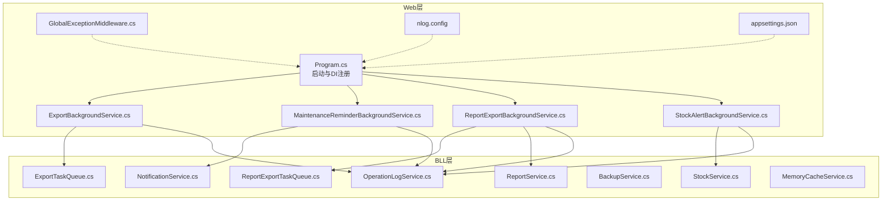
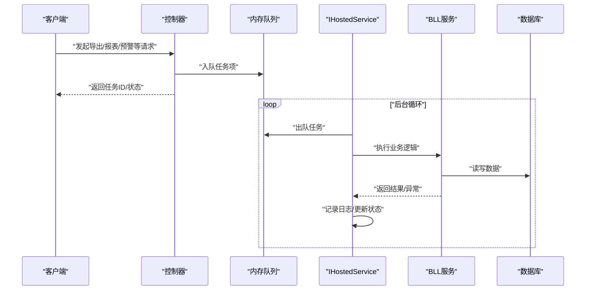
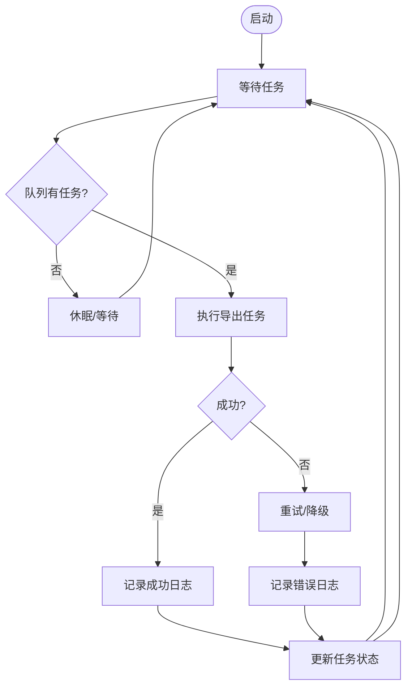
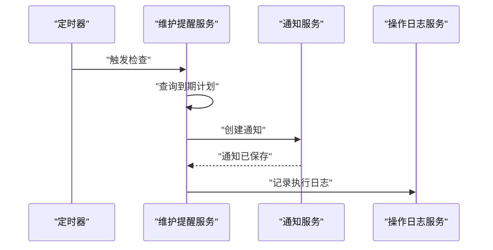
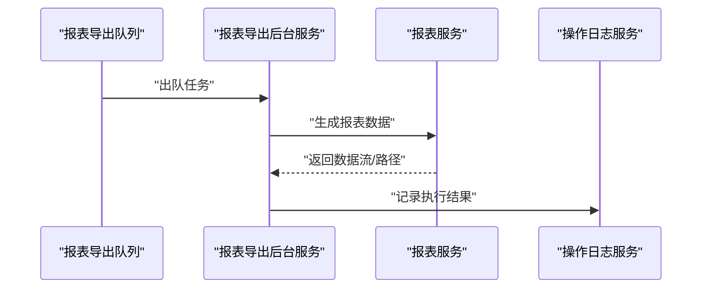
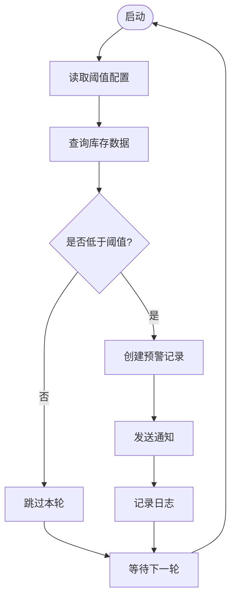
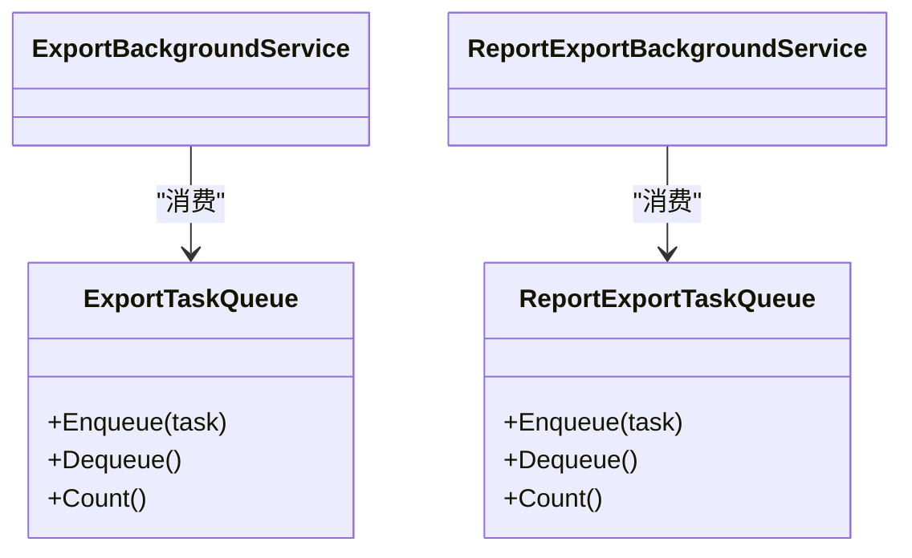
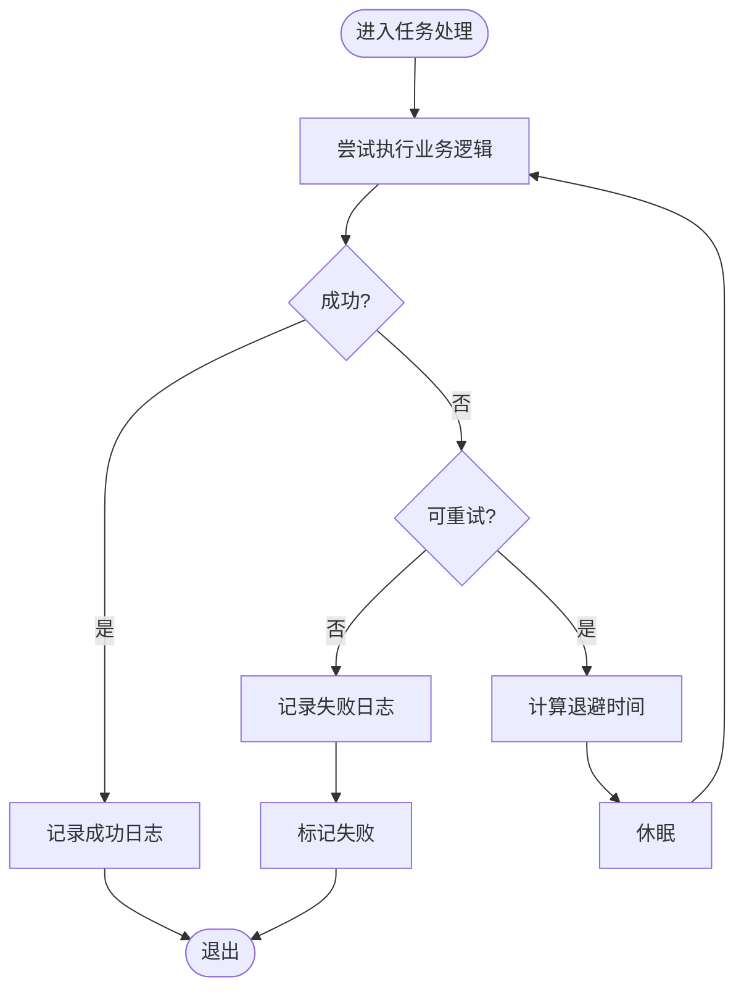
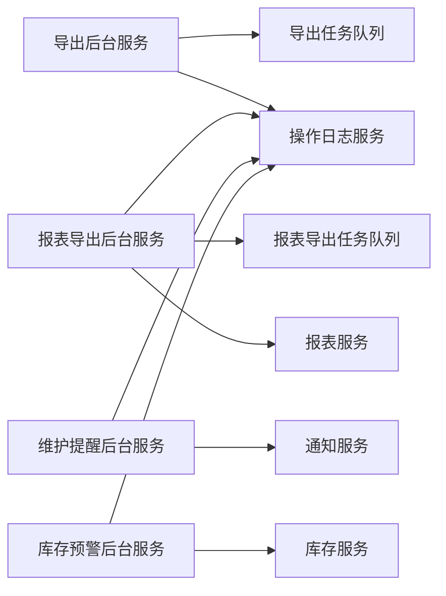

# 后台服务设计

<cite>
**本文引用的文件**   
- [Program.cs](file://EquipmentIMS.Web/Program.cs)
- [ExportBackgroundService.cs](file://EquipmentIMS.Web/BackgroundServices/ExportBackgroundService.cs)
- [MaintenanceReminderBackgroundService.cs](file://EquipmentIMS.Web/BackgroundServices/MaintenanceReminderBackgroundService.cs)
- [ReportExportBackgroundService.cs](file://EquipmentIMS.Web/BackgroundServices/ReportExportBackgroundService.cs)
- [StockAlertBackgroundService.cs](file://EquipmentIMS.Web/BackgroundServices/StockAlertBackgroundService.cs)
- [ExportTaskQueue.cs](file://EquipmentIMS.BLL/Services/ExportTaskQueue.cs)
- [ReportExportTaskQueue.cs](file://EquipmentIMS.BLL/Services/ReportExportTaskQueue.cs)
- [NotificationService.cs](file://EquipmentIMS.BLL/Services/NotificationService.cs)
- [ReportService.cs](file://EquipmentIMS.BLL/Services/ReportService.cs)
- [StockService.cs](file://EquipmentIMS.BLL/Services/StockService.cs)
- [BackupService.cs](file://EquipmentIMS.BLL/Services/BackupService.cs)
- [OperationLogService.cs](file://EquipmentIMS.BLL/Services/OperationLogService.cs)
- [MemoryCacheService.cs](file://EquipmentIMS.BLL/Services/MemoryCacheService.cs)
- [GlobalExceptionMiddleware.cs](file://EquipmentIMS.Web/Filters/GlobalExceptionMiddleware.cs)
- [nlog.config](file://EquipmentIMS.Web/nlog.config)
- [appsettings.json](file://EquipmentIMS.Web/appsettings.json)
</cite>

## 目录
1. [简介](#简介)
2. [项目结构](#项目结构)
3. [核心组件](#核心组件)
4. [架构总览](#架构总览)
5. [详细组件分析](#详细组件分析)
6. [依赖关系分析](#依赖关系分析)
7. [性能考虑](#性能考虑)
8. [故障排查指南](#故障排查指南)
9. [结论](#结论)
10. [附录](#附录)

## 简介
本设计文档面向THMS系统的后台服务，聚焦于基于IHostedService的后台任务实现模式。内容涵盖定时任务调度、异步消息处理与队列管理、导出服务、维护提醒服务、报表生成服务、库存预警服务等具体实现；并阐述任务监控、错误重试、日志记录机制，提供扩展点与自定义后台任务的开发指南，以及性能调优与资源管理建议。

## 项目结构
后台服务位于Web层的BackgroundServices目录，各服务通过依赖注入注册为IHostedService，由宿主生命周期统一管控。BLL层提供业务服务与队列（内存队列）支撑，DAL层负责数据访问，Models定义实体、DTO与枚举。

图表来源
- [Program.cs](file://EquipmentIMS.Web/Program.cs)
- [ExportBackgroundService.cs](file://EquipmentIMS.Web/BackgroundServices/ExportBackgroundService.cs)
- [MaintenanceReminderBackgroundService.cs](file://EquipmentIMS.Web/BackgroundServices/MaintenanceReminderBackgroundService.cs)
- [ReportExportBackgroundService.cs](file://EquipmentIMS.Web/BackgroundServices/ReportExportBackgroundService.cs)
- [StockAlertBackgroundService.cs](file://EquipmentIMS.Web/BackgroundServices/StockAlertBackgroundService.cs)
- [ExportTaskQueue.cs](file://EquipmentIMS.BLL/Services/ExportTaskQueue.cs)
- [ReportExportTaskQueue.cs](file://EquipmentIMS.BLL/Services/ReportExportTaskQueue.cs)
- [NotificationService.cs](file://EquipmentIMS.BLL/Services/NotificationService.cs)
- [ReportService.cs](file://EquipmentIMS.BLL/Services/ReportService.cs)
- [StockService.cs](file://EquipmentIMS.BLL/Services/StockService.cs)
- [BackupService.cs](file://EquipmentIMS.BLL/Services/BackupService.cs)
- [OperationLogService.cs](file://EquipmentIMS.BLL/Services/OperationLogService.cs)
- [MemoryCacheService.cs](file://EquipmentIMS.BLL/Services/MemoryCacheService.cs)
- [GlobalExceptionMiddleware.cs](file://EquipmentIMS.Web/Filters/GlobalExceptionMiddleware.cs)
- [nlog.config](file://EquipmentIMS.Web/nlog.config)
- [appsettings.json](file://EquipmentIMS.Web/appsettings.json)

章节来源
- [Program.cs](file://EquipmentIMS.Web/Program.cs)

## 核心组件
- IHostedService后台服务：导出、维护提醒、报表导出、库存预警四大服务，分别承担不同业务职责。
- 内存队列：导出任务队列与报表导出任务队列，用于解耦生产者与消费者，支持并发消费与背压控制。
- 业务服务：通知、报表、库存、备份、操作日志、缓存等，被后台服务组合调用完成复杂流程。
- 全局异常中间件与NLog：统一异常捕获与结构化日志输出。

章节来源
- [ExportBackgroundService.cs](file://EquipmentIMS.Web/BackgroundServices/ExportBackgroundService.cs)
- [MaintenanceReminderBackgroundService.cs](file://EquipmentIMS.Web/BackgroundServices/MaintenanceReminderBackgroundService.cs)
- [ReportExportBackgroundService.cs](file://EquipmentIMS.Web/BackgroundServices/ReportExportBackgroundService.cs)
- [StockAlertBackgroundService.cs](file://EquipmentIMS.Web/BackgroundServices/StockAlertBackgroundService.cs)
- [ExportTaskQueue.cs](file://EquipmentIMS.BLL/Services/ExportTaskQueue.cs)
- [ReportExportTaskQueue.cs](file://EquipmentIMS.BLL/Services/ReportExportTaskQueue.cs)
- [NotificationService.cs](file://EquipmentIMS.BLL/Services/NotificationService.cs)
- [ReportService.cs](file://EquipmentIMS.BLL/Services/ReportService.cs)
- [StockService.cs](file://EquipmentIMS.BLL/Services/StockService.cs)
- [BackupService.cs](file://EquipmentIMS.BLL/Services/BackupService.cs)
- [OperationLogService.cs](file://EquipmentIMS.BLL/Services/OperationLogService.cs)
- [MemoryCacheService.cs](file://EquipmentIMS.BLL/Services/MemoryCacheService.cs)
- [GlobalExceptionMiddleware.cs](file://EquipmentIMS.Web/Filters/GlobalExceptionMiddleware.cs)
- [nlog.config](file://EquipmentIMS.Web/nlog.config)

## 架构总览
系统采用“控制器/前端触发 -> BLL服务 -> 后台服务 -> 队列/外部存储”的分层架构。后台服务通过IHostedService在应用启动时运行，按周期或事件驱动执行任务。队列作为缓冲层，避免瞬时峰值对数据库造成压力。

图表来源
- [ExportBackgroundService.cs](file://EquipmentIMS.Web/BackgroundServices/ExportBackgroundService.cs)
- [ReportExportBackgroundService.cs](file://EquipmentIMS.Web/BackgroundServices/ReportExportBackgroundService.cs)
- [ExportTaskQueue.cs](file://EquipmentIMS.BLL/Services/ExportTaskQueue.cs)
- [ReportExportTaskQueue.cs](file://EquipmentIMS.BLL/Services/ReportExportTaskQueue.cs)
- [ReportService.cs](file://EquipmentIMS.BLL/Services/ReportService.cs)
- [StockService.cs](file://EquipmentIMS.BLL/Services/StockService.cs)

## 详细组件分析

### 导出后台服务（ExportBackgroundService）
- 职责：周期性从导出任务队列取任务，调用导出相关服务写入文件或对象存储，完成后持久化任务状态。
- 关键流程：
  - 启动后进入无限循环，使用取消令牌保证优雅退出。
  - 从队列中取出待处理任务，调用导出服务生成文件。
  - 记录操作日志与执行结果，失败时进行重试或告警。
- 并发与限流：可通过队列容量与消费者数量控制吞吐。

图表来源
- [ExportBackgroundService.cs](file://EquipmentIMS.Web/BackgroundServices/ExportBackgroundService.cs)
- [ExportTaskQueue.cs](file://EquipmentIMS.BLL/Services/ExportTaskQueue.cs)
- [OperationLogService.cs](file://EquipmentIMS.BLL/Services/OperationLogService.cs)

章节来源
- [ExportBackgroundService.cs](file://EquipmentIMS.Web/BackgroundServices/ExportBackgroundService.cs)
- [ExportTaskQueue.cs](file://EquipmentIMS.BLL/Services/ExportTaskQueue.cs)
- [OperationLogService.cs](file://EquipmentIMS.BLL/Services/OperationLogService.cs)

### 维护提醒后台服务（MaintenanceReminderBackgroundService）
- 职责：定期扫描维护计划，判断是否需要发送提醒，并通过通知服务推送。
- 关键流程：
  - 读取配置中的检查间隔。
  - 查询即将到期的维护计划。
  - 生成通知并落库，必要时触发邮件/站内信。
  - 记录操作日志。

图表来源
- [MaintenanceReminderBackgroundService.cs](file://EquipmentIMS.Web/BackgroundServices/MaintenanceReminderBackgroundService.cs)
- [NotificationService.cs](file://EquipmentIMS.BLL/Services/NotificationService.cs)
- [OperationLogService.cs](file://EquipmentIMS.BLL/Services/OperationLogService.cs)

章节来源
- [MaintenanceReminderBackgroundService.cs](file://EquipmentIMS.Web/BackgroundServices/MaintenanceReminderBackgroundService.cs)
- [NotificationService.cs](file://EquipmentIMS.BLL/Services/NotificationService.cs)
- [OperationLogService.cs](file://EquipmentIMS.BLL/Services/OperationLogService.cs)

### 报表导出后台服务（ReportExportBackgroundService）
- 职责：接收报表导出任务，聚合数据生成报表文件，持久化结果并提供下载。
- 关键流程：
  - 从报表导出队列取任务。
  - 调用报表服务组装数据。
  - 生成Excel/PDF等格式文件。
  - 记录日志并更新任务状态。

图表来源
- [ReportExportBackgroundService.cs](file://EquipmentIMS.Web/BackgroundServices/ReportExportBackgroundService.cs)
- [ReportExportTaskQueue.cs](file://EquipmentIMS.BLL/Services/ReportExportTaskQueue.cs)
- [ReportService.cs](file://EquipmentIMS.BLL/Services/ReportService.cs)
- [OperationLogService.cs](file://EquipmentIMS.BLL/Services/OperationLogService.cs)

章节来源
- [ReportExportBackgroundService.cs](file://EquipmentIMS.Web/BackgroundServices/ReportExportBackgroundService.cs)
- [ReportExportTaskQueue.cs](file://EquipmentIMS.BLL/Services/ReportExportTaskQueue.cs)
- [ReportService.cs](file://EquipmentIMS.BLL/Services/ReportService.cs)
- [OperationLogService.cs](file://EquipmentIMS.BLL/Services/OperationLogService.cs)

### 库存预警后台服务（StockAlertBackgroundService）
- 职责：周期性评估库存水平，当低于阈值时生成预警记录并通知相关人员。
- 关键流程：
  - 读取库存阈值配置。
  - 查询当前库存与交易趋势。
  - 生成预警记录并推送通知。
  - 记录操作日志。

图表来源
- [StockAlertBackgroundService.cs](file://EquipmentIMS.Web/BackgroundServices/StockAlertBackgroundService.cs)
- [StockService.cs](file://EquipmentIMS.BLL/Services/StockService.cs)
- [NotificationService.cs](file://EquipmentIMS.BLL/Services/NotificationService.cs)
- [OperationLogService.cs](file://EquipmentIMS.BLL/Services/OperationLogService.cs)

章节来源
- [StockAlertBackgroundService.cs](file://EquipmentIMS.Web/BackgroundServices/StockAlertBackgroundService.cs)
- [StockService.cs](file://EquipmentIMS.BLL/Services/StockService.cs)
- [NotificationService.cs](file://EquipmentIMS.BLL/Services/NotificationService.cs)
- [OperationLogService.cs](file://EquipmentIMS.BLL/Services/OperationLogService.cs)

### 队列管理与异步消息处理
- 导出任务队列（ExportTaskQueue）：用于导出类任务的缓冲与分发，支持生产者快速入队、消费者稳定出队。
- 报表导出任务队列（ReportExportTaskQueue）：针对报表导出的专用队列，便于隔离与独立扩缩容。
- 典型用法：控制器将任务项入队后立即返回任务ID；后台服务循环出队并处理；失败可重试或标记死信。

图表来源
- [ExportTaskQueue.cs](file://EquipmentIMS.BLL/Services/ExportTaskQueue.cs)
- [ReportExportTaskQueue.cs](file://EquipmentIMS.BLL/Services/ReportExportTaskQueue.cs)
- [ExportBackgroundService.cs](file://EquipmentIMS.Web/BackgroundServices/ExportBackgroundService.cs)
- [ReportExportBackgroundService.cs](file://EquipmentIMS.Web/BackgroundServices/ReportExportBackgroundService.cs)

章节来源
- [ExportTaskQueue.cs](file://EquipmentIMS.BLL/Services/ExportTaskQueue.cs)
- [ReportExportTaskQueue.cs](file://EquipmentIMS.BLL/Services/ReportExportTaskQueue.cs)
- [ExportBackgroundService.cs](file://EquipmentIMS.Web/BackgroundServices/ExportBackgroundService.cs)
- [ReportExportBackgroundService.cs](file://EquipmentIMS.Web/BackgroundServices/ReportExportBackgroundService.cs)

### 任务监控、错误重试与日志记录
- 任务监控：通过操作日志服务记录每个任务的开始、结束、耗时与异常信息；可在UI层展示任务列表与状态。
- 错误重试：对瞬时性错误（如网络抖动、临时锁冲突）实施指数退避重试；超过最大次数则标记失败并告警。
- 日志记录：使用NLog进行结构化日志输出，包含上下文（任务ID、用户、模块），便于追踪与审计。

图表来源
- [OperationLogService.cs](file://EquipmentIMS.BLL/Services/OperationLogService.cs)
- [GlobalExceptionMiddleware.cs](file://EquipmentIMS.Web/Filters/GlobalExceptionMiddleware.cs)
- [nlog.config](file://EquipmentIMS.Web/nlog.config)

章节来源
- [OperationLogService.cs](file://EquipmentIMS.BLL/Services/OperationLogService.cs)
- [GlobalExceptionMiddleware.cs](file://EquipmentIMS.Web/Filters/GlobalExceptionMiddleware.cs)
- [nlog.config](file://EquipmentIMS.Web/nlog.config)

### 服务扩展点与自定义后台任务开发指南
- 注册方式：在Program中将自定义IHostedService加入依赖注入容器，确保生命周期由宿主管理。
- 最佳实践：
  - 使用取消令牌实现优雅停止。
  - 合理设置循环间隔与超时，避免CPU空转。
  - 使用队列解耦生产与消费，限制并发度。
  - 所有异常必须捕获并记录，避免进程崩溃。
  - 配置项通过appsettings.json注入，支持环境差异化。
- 示例步骤：
  - 新建继承自IHostedService的实现类。
  - 在构造函数中注入所需服务（如队列、日志、业务服务）。
  - 在StartAsync中启动循环，在StopAsync中释放资源。
  - 在Program中注册该服务。

章节来源
- [Program.cs](file://EquipmentIMS.Web/Program.cs)
- [appsettings.json](file://EquipmentIMS.Web/appsettings.json)

## 依赖关系分析
后台服务与BLL服务之间的依赖清晰，遵循分层原则。队列作为横向基础设施，降低耦合度。

图表来源
- [ExportBackgroundService.cs](file://EquipmentIMS.Web/BackgroundServices/ExportBackgroundService.cs)
- [ReportExportBackgroundService.cs](file://EquipmentIMS.Web/BackgroundServices/ReportExportBackgroundService.cs)
- [MaintenanceReminderBackgroundService.cs](file://EquipmentIMS.Web/BackgroundServices/MaintenanceReminderBackgroundService.cs)
- [StockAlertBackgroundService.cs](file://EquipmentIMS.Web/BackgroundServices/StockAlertBackgroundService.cs)
- [ExportTaskQueue.cs](file://EquipmentIMS.BLL/Services/ExportTaskQueue.cs)
- [ReportExportTaskQueue.cs](file://EquipmentIMS.BLL/Services/ReportExportTaskQueue.cs)
- [NotificationService.cs](file://EquipmentIMS.BLL/Services/NotificationService.cs)
- [ReportService.cs](file://EquipmentIMS.BLL/Services/ReportService.cs)
- [StockService.cs](file://EquipmentIMS.BLL/Services/StockService.cs)
- [OperationLogService.cs](file://EquipmentIMS.BLL/Services/OperationLogService.cs)

章节来源
- [ExportBackgroundService.cs](file://EquipmentIMS.Web/BackgroundServices/ExportBackgroundService.cs)
- [ReportExportBackgroundService.cs](file://EquipmentIMS.Web/BackgroundServices/ReportExportBackgroundService.cs)
- [MaintenanceReminderBackgroundService.cs](file://EquipmentIMS.Web/BackgroundServices/MaintenanceReminderBackgroundService.cs)
- [StockAlertBackgroundService.cs](file://EquipmentIMS.Web/BackgroundServices/StockAlertBackgroundService.cs)
- [ExportTaskQueue.cs](file://EquipmentIMS.BLL/Services/ExportTaskQueue.cs)
- [ReportExportTaskQueue.cs](file://EquipmentIMS.BLL/Services/ReportExportTaskQueue.cs)
- [NotificationService.cs](file://EquipmentIMS.BLL/Services/NotificationService.cs)
- [ReportService.cs](file://EquipmentIMS.BLL/Services/ReportService.cs)
- [StockService.cs](file://EquipmentIMS.BLL/Services/StockService.cs)
- [OperationLogService.cs](file://EquipmentIMS.BLL/Services/OperationLogService.cs)

## 性能考虑
- 队列容量与并发度：根据硬件与业务峰值调整队列大小与消费者线程数，避免内存溢出与上下文切换开销过大。
- 批处理与分页：报表与库存预警应使用分页与批量聚合，减少数据库往返。
- 缓存策略：对热点配置与字典数据使用内存缓存，降低重复查询成本。
- I/O优化：导出文件尽量流式写入，避免一次性加载大对象到内存。
- 超时与熔断：对外部依赖设置合理超时与熔断策略，防止雪崩。
- 资源清理：及时释放文件句柄、连接池与临时资源，避免泄漏。

[本节为通用指导，不直接分析具体文件]

## 故障排查指南
- 日志定位：通过NLog查看任务执行日志，关注异常堆栈与上下文字段（任务ID、模块、用户）。
- 队列堆积：检查消费者是否卡住或阻塞，确认队列长度与出队速率。
- 重试风暴：观察重试次数与退避策略，避免对下游造成二次冲击。
- 内存增长：监控后台服务的内存占用，排查是否存在未释放的资源或大对象引用。
- 配置问题：核对appsettings.json中的间隔、阈值、路径等配置是否正确。

章节来源
- [nlog.config](file://EquipmentIMS.Web/nlog.config)
- [appsettings.json](file://EquipmentIMS.Web/appsettings.json)
- [GlobalExceptionMiddleware.cs](file://EquipmentIMS.Web/Filters/GlobalExceptionMiddleware.cs)

## 结论
THMS后台服务以IHostedService为核心，结合内存队列与BLL服务，实现了高内聚、低耦合的异步任务体系。通过统一的日志与异常处理机制，提升了可观测性与稳定性。按照本文档的扩展指南与性能建议，可安全地新增后台任务并持续优化系统表现。

[本节为总结性内容，不直接分析具体文件]

## 附录
- 常用配置项说明（示例）：
  - 后台任务间隔：用于控制各服务的检查频率。
  - 队列容量上限：限制内存队列的最大长度。
  - 重试次数与退避策略：控制失败任务的重试行为。
  - 导出路径与存储策略：指定本地或远程存储位置。
- 参考文件：
  - 后台服务实现：导出、维护提醒、报表导出、库存预警
  - 队列实现：导出任务队列、报表导出任务队列
  - 业务服务：通知、报表、库存、备份、操作日志、缓存
  - 日志与异常：NLog配置、全局异常中间件
  - 启动与配置：Program、appsettings.json

章节来源
- [ExportBackgroundService.cs](file://EquipmentIMS.Web/BackgroundServices/ExportBackgroundService.cs)
- [MaintenanceReminderBackgroundService.cs](file://EquipmentIMS.Web/BackgroundServices/MaintenanceReminderBackgroundService.cs)
- [ReportExportBackgroundService.cs](file://EquipmentIMS.Web/BackgroundServices/ReportExportBackgroundService.cs)
- [StockAlertBackgroundService.cs](file://EquipmentIMS.Web/BackgroundServices/StockAlertBackgroundService.cs)
- [ExportTaskQueue.cs](file://EquipmentIMS.BLL/Services/ExportTaskQueue.cs)
- [ReportExportTaskQueue.cs](file://EquipmentIMS.BLL/Services/ReportExportTaskQueue.cs)
- [NotificationService.cs](file://EquipmentIMS.BLL/Services/NotificationService.cs)
- [ReportService.cs](file://EquipmentIMS.BLL/Services/ReportService.cs)
- [StockService.cs](file://EquipmentIMS.BLL/Services/StockService.cs)
- [BackupService.cs](file://EquipmentIMS.BLL/Services/BackupService.cs)
- [OperationLogService.cs](file://EquipmentIMS.BLL/Services/OperationLogService.cs)
- [MemoryCacheService.cs](file://EquipmentIMS.BLL/Services/MemoryCacheService.cs)
- [GlobalExceptionMiddleware.cs](file://EquipmentIMS.Web/Filters/GlobalExceptionMiddleware.cs)
- [nlog.config](file://EquipmentIMS.Web/nlog.config)
- [appsettings.json](file://EquipmentIMS.Web/appsettings.json)
- [Program.cs](file://EquipmentIMS.Web/Program.cs)