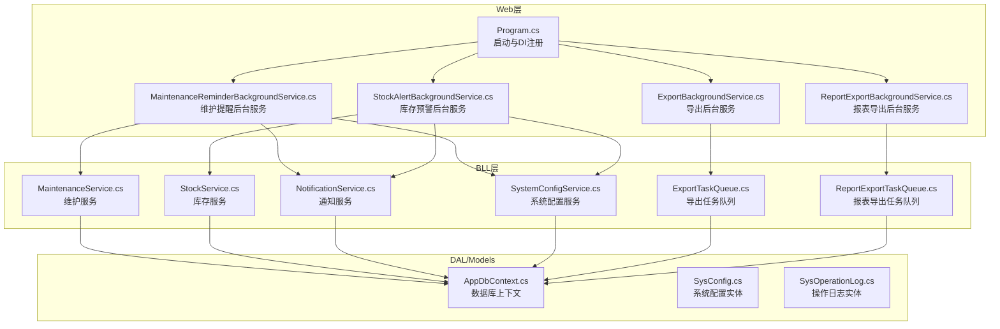
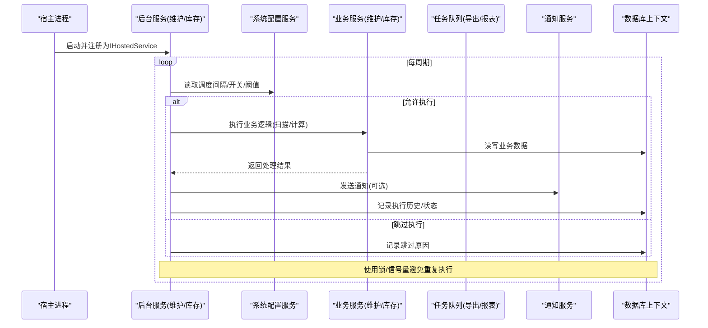
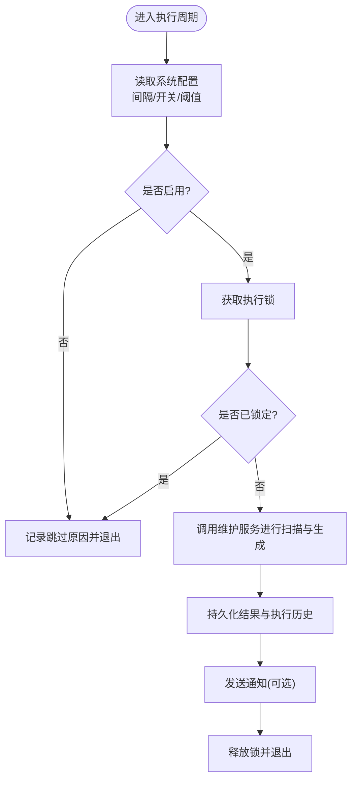
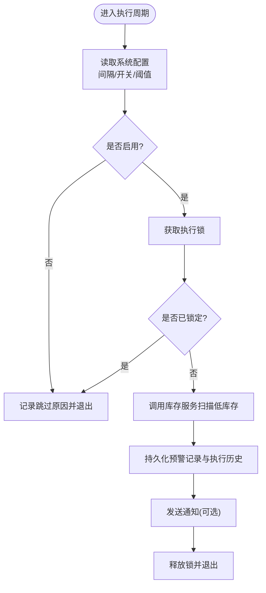
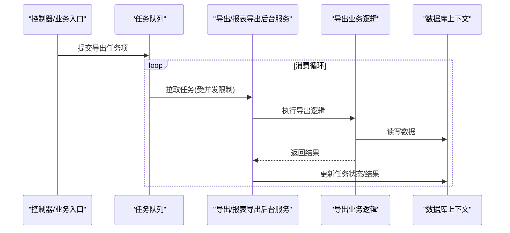
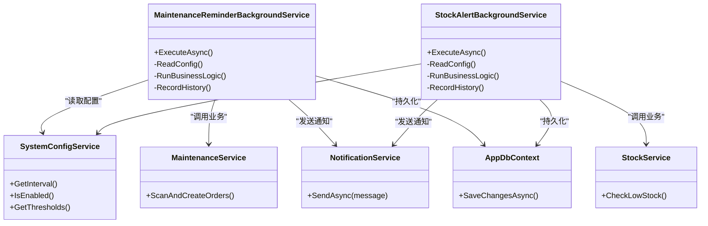

# 定时任务调度

<cite>
**本文引用的文件**   
- [Program.cs](file://EquipmentIMS.Web/Program.cs)
- [MaintenanceReminderBackgroundService.cs](file://EquipmentIMS.Web/BackgroundServices/MaintenanceReminderBackgroundService.cs)
- [StockAlertBackgroundService.cs](file://EquipmentIMS.Web/BackgroundServices/StockAlertBackgroundService.cs)
- [ExportBackgroundService.cs](file://EquipmentIMS.Web/BackgroundServices/ExportBackgroundService.cs)
- [ReportExportBackgroundService.cs](file://EquipmentIMS.Web/BackgroundServices/ReportExportBackgroundService.cs)
- [ExportTaskQueue.cs](file://EquipmentIMS.BLL/Services/ExportTaskQueue.cs)
- [ReportExportTaskQueue.cs](file://EquipmentIMS.BLL/Services/ReportExportTaskQueue.cs)
- [SystemConfigService.cs](file://EquipmentIMS.BLL/Services/SystemConfigService.cs)
- [NotificationService.cs](file://EquipmentIMS.BLL/Services/NotificationService.cs)
- [StockService.cs](file://EquipmentIMS.BLL/Services/StockService.cs)
- [MaintenanceService.cs](file://EquipmentIMS.BLL/Services/MaintenanceService.cs)
- [SysConfig.cs](file://EquipmentIMS.Models/Entities/SysConfig.cs)
- [SysOperationLog.cs](file://EquipmentIMS.Models/Entities/SysOperationLog.cs)
- [AppDbContext.cs](file://EquipmentIMS.DAL/AppDbContext.cs)
</cite>

## 目录
1. [简介](#简介)
2. [项目结构](#项目结构)
3. [核心组件](#核心组件)
4. [架构总览](#架构总览)
5. [详细组件分析](#详细组件分析)
6. [依赖关系分析](#依赖关系分析)
7. [性能考虑](#性能考虑)
8. [故障排查指南](#故障排查指南)
9. [结论](#结论)
10. [附录](#附录)

## 简介
本文件面向THMS系统的定时任务调度，聚焦于基于时间轮询的后台服务实现，覆盖维护提醒服务与库存预警服务的调度逻辑。文档将说明：
- 任务执行间隔配置、优先级管理、并发控制机制
- 任务状态跟踪、执行历史记录、失败重试策略
- 动态任务配置、任务暂停恢复、任务依赖管理方案
- 自定义定时任务的开发指南与性能优化建议

## 项目结构
THMS采用分层架构，定时任务以“后台服务”的形式运行在Web进程中，通过依赖注入注册并受生命周期管理。关键位置如下：
- Web层后台服务：位于 EquipmentIMS.Web/BackgroundServices
- 业务服务：位于 EquipmentIMS.BLL/Services
- 数据模型与上下文：位于 EquipmentIMS.Models/Entities 与 EquipmentIMS.DAL

图表来源
- [Program.cs](file://EquipmentIMS.Web/Program.cs)
- [MaintenanceReminderBackgroundService.cs](file://EquipmentIMS.Web/BackgroundServices/MaintenanceReminderBackgroundService.cs)
- [StockAlertBackgroundService.cs](file://EquipmentIMS.Web/BackgroundServices/StockAlertBackgroundService.cs)
- [ExportBackgroundService.cs](file://EquipmentIMS.Web/BackgroundServices/ExportBackgroundService.cs)
- [ReportExportBackgroundService.cs](file://EquipmentIMS.Web/BackgroundServices/ReportExportBackgroundService.cs)
- [ExportTaskQueue.cs](file://EquipmentIMS.BLL/Services/ExportTaskQueue.cs)
- [ReportExportTaskQueue.cs](file://EquipmentIMS.BLL/Services/ReportExportTaskQueue.cs)
- [SystemConfigService.cs](file://EquipmentIMS.BLL/Services/SystemConfigService.cs)
- [NotificationService.cs](file://EquipmentIMS.BLL/Services/NotificationService.cs)
- [StockService.cs](file://EquipmentIMS.BLL/Services/StockService.cs)
- [MaintenanceService.cs](file://EquipmentIMS.BLL/Services/MaintenanceService.cs)
- [AppDbContext.cs](file://EquipmentIMS.DAL/AppDbContext.cs)
- [SysConfig.cs](file://EquipmentIMS.Models/Entities/SysConfig.cs)
- [SysOperationLog.cs](file://EquipmentIMS.Models/Entities/SysOperationLog.cs)

章节来源
- [Program.cs](file://EquipmentIMS.Web/Program.cs)
- [MaintenanceReminderBackgroundService.cs](file://EquipmentIMS.Web/BackgroundServices/MaintenanceReminderBackgroundService.cs)
- [StockAlertBackgroundService.cs](file://EquipmentIMS.Web/BackgroundServices/StockAlertBackgroundService.cs)
- [ExportBackgroundService.cs](file://EquipmentIMS.Web/BackgroundServices/ExportBackgroundService.cs)
- [ReportExportBackgroundService.cs](file://EquipmentIMS.Web/BackgroundServices/ReportExportBackgroundService.cs)
- [ExportTaskQueue.cs](file://EquipmentIMS.BLL/Services/ExportTaskQueue.cs)
- [ReportExportTaskQueue.cs](file://EquipmentIMS.BLL/Services/ReportExportTaskQueue.cs)
- [SystemConfigService.cs](file://EquipmentIMS.BLL/Services/SystemConfigService.cs)
- [NotificationService.cs](file://EquipmentIMS.BLL/Services/NotificationService.cs)
- [StockService.cs](file://EquipmentIMS.BLL/Services/StockService.cs)
- [MaintenanceService.cs](file://EquipmentIMS.BLL/Services/MaintenanceService.cs)
- [AppDbContext.cs](file://EquipmentIMS.DAL/AppDbContext.cs)
- [SysConfig.cs](file://EquipmentIMS.Models/Entities/SysConfig.cs)
- [SysOperationLog.cs](file://EquipmentIMS.Models/Entities/SysOperationLog.cs)

## 核心组件
- 后台服务（Background Services）
  - 维护提醒后台服务：周期性扫描待执行的维护计划，生成维护工单或提醒，并通过通知服务推送。
  - 库存预警后台服务：周期性检查库存阈值，生成库存预警记录并发送通知。
  - 导出与报表导出后台服务：基于队列消费异步处理大批量导出任务。
- 任务队列（Queues）
  - 导出任务队列：承载导出任务项，支持并发消费与限流。
  - 报表导出任务队列：承载报表导出任务项，支持按类型路由与并发控制。
- 配置与服务
  - 系统配置服务：提供动态读取配置项（如调度间隔、开关、阈值等）。
  - 通知服务：统一封装消息发送（站内信、邮件等）。
  - 业务服务：维护服务与库存服务负责具体领域逻辑与数据访问。
- 数据持久化
  - 数据库上下文：统一数据访问入口。
  - 配置与日志实体：用于存储系统配置与任务执行历史。

章节来源
- [MaintenanceReminderBackgroundService.cs](file://EquipmentIMS.Web/BackgroundServices/MaintenanceReminderBackgroundService.cs)
- [StockAlertBackgroundService.cs](file://EquipmentIMS.Web/BackgroundServices/StockAlertBackgroundService.cs)
- [ExportBackgroundService.cs](file://EquipmentIMS.Web/BackgroundServices/ExportBackgroundService.cs)
- [ReportExportBackgroundService.cs](file://EquipmentIMS.Web/BackgroundServices/ReportExportBackgroundService.cs)
- [ExportTaskQueue.cs](file://EquipmentIMS.BLL/Services/ExportTaskQueue.cs)
- [ReportExportTaskQueue.cs](file://EquipmentIMS.BLL/Services/ReportExportTaskQueue.cs)
- [SystemConfigService.cs](file://EquipmentIMS.BLL/Services/SystemConfigService.cs)
- [NotificationService.cs](file://EquipmentIMS.BLL/Services/NotificationService.cs)
- [StockService.cs](file://EquipmentIMS.BLL/Services/StockService.cs)
- [MaintenanceService.cs](file://EquipmentIMS.BLL/Services/MaintenanceService.cs)
- [AppDbContext.cs](file://EquipmentIMS.DAL/AppDbContext.cs)
- [SysConfig.cs](file://EquipmentIMS.Models/Entities/SysConfig.cs)
- [SysOperationLog.cs](file://EquipmentIMS.Models/Entities/SysOperationLog.cs)

## 架构总览
下图展示了后台服务如何与业务服务、队列、配置与数据库交互，形成“轮询触发—业务处理—结果落库—通知输出”的闭环。

图表来源
- [Program.cs](file://EquipmentIMS.Web/Program.cs)
- [MaintenanceReminderBackgroundService.cs](file://EquipmentIMS.Web/BackgroundServices/MaintenanceReminderBackgroundService.cs)
- [StockAlertBackgroundService.cs](file://EquipmentIMS.Web/BackgroundServices/StockAlertBackgroundService.cs)
- [SystemConfigService.cs](file://EquipmentIMS.BLL/Services/SystemConfigService.cs)
- [MaintenanceService.cs](file://EquipmentIMS.BLL/Services/MaintenanceService.cs)
- [StockService.cs](file://EquipmentIMS.BLL/Services/StockService.cs)
- [NotificationService.cs](file://EquipmentIMS.BLL/Services/NotificationService.cs)
- [AppDbContext.cs](file://EquipmentIMS.DAL/AppDbContext.cs)

## 详细组件分析

### 维护提醒后台服务
职责与流程
- 周期性扫描维护计划，判断是否到期或即将到期。
- 生成维护工单或提醒记录，写入数据库。
- 通过通知服务向相关人员发送提醒。
- 记录每次执行的状态与耗时，便于审计与排障。

并发与互斥
- 同一时刻仅允许一个实例执行，防止多节点重复触发。
- 若上次执行尚未结束，则本次直接跳过并记录。

配置与动态性
- 从系统配置中读取调度间隔、是否启用、阈值等参数。
- 支持运行时调整，无需重启服务。

图表来源
- [MaintenanceReminderBackgroundService.cs](file://EquipmentIMS.Web/BackgroundServices/MaintenanceReminderBackgroundService.cs)
- [SystemConfigService.cs](file://EquipmentIMS.BLL/Services/SystemConfigService.cs)
- [MaintenanceService.cs](file://EquipmentIMS.BLL/Services/MaintenanceService.cs)
- [NotificationService.cs](file://EquipmentIMS.BLL/Services/NotificationService.cs)
- [AppDbContext.cs](file://EquipmentIMS.DAL/AppDbContext.cs)

章节来源
- [MaintenanceReminderBackgroundService.cs](file://EquipmentIMS.Web/BackgroundServices/MaintenanceReminderBackgroundService.cs)
- [SystemConfigService.cs](file://EquipmentIMS.BLL/Services/SystemConfigService.cs)
- [MaintenanceService.cs](file://EquipmentIMS.BLL/Services/MaintenanceService.cs)
- [NotificationService.cs](file://EquipmentIMS.BLL/Services/NotificationService.cs)
- [AppDbContext.cs](file://EquipmentIMS.DAL/AppDbContext.cs)

### 库存预警后台服务
职责与流程
- 周期性检查各产品库存是否低于安全阈值。
- 生成库存预警记录，必要时触发采购建议或告警。
- 通过通知服务推送预警信息。
- 记录执行历史与统计指标。

并发与互斥
- 与提醒服务类似，确保单次执行互斥，避免重复扫描。

配置与动态性
- 支持动态调整阈值、是否启用、扫描范围等。

图表来源
- [StockAlertBackgroundService.cs](file://EquipmentIMS.Web/BackgroundServices/StockAlertBackgroundService.cs)
- [SystemConfigService.cs](file://EquipmentIMS.BLL/Services/SystemConfigService.cs)
- [StockService.cs](file://EquipmentIMS.BLL/Services/StockService.cs)
- [NotificationService.cs](file://EquipmentIMS.BLL/Services/NotificationService.cs)
- [AppDbContext.cs](file://EquipmentIMS.DAL/AppDbContext.cs)

章节来源
- [StockAlertBackgroundService.cs](file://EquipmentIMS.Web/BackgroundServices/StockAlertBackgroundService.cs)
- [SystemConfigService.cs](file://EquipmentIMS.BLL/Services/SystemConfigService.cs)
- [StockService.cs](file://EquipmentIMS.BLL/Services/StockService.cs)
- [NotificationService.cs](file://EquipmentIMS.BLL/Services/NotificationService.cs)
- [AppDbContext.cs](file://EquipmentIMS.DAL/AppDbContext.cs)

### 导出与报表导出后台服务及队列
职责与流程
- 接收来自API或业务的导出请求，入队任务项。
- 后台服务循环拉取任务，按并发限制并行处理。
- 处理完成后更新任务状态，并将结果落库或回调通知。

并发与限流
- 使用队列内置的并发控制与背压机制，避免资源耗尽。
- 可配置最大并发度与重试次数。

图表来源
- [ExportBackgroundService.cs](file://EquipmentIMS.Web/BackgroundServices/ExportBackgroundService.cs)
- [ReportExportBackgroundService.cs](file://EquipmentIMS.Web/BackgroundServices/ReportExportBackgroundService.cs)
- [ExportTaskQueue.cs](file://EquipmentIMS.BLL/Services/ExportTaskQueue.cs)
- [ReportExportTaskQueue.cs](file://EquipmentIMS.BLL/Services/ReportExportTaskQueue.cs)
- [AppDbContext.cs](file://EquipmentIMS.DAL/AppDbContext.cs)

章节来源
- [ExportBackgroundService.cs](file://EquipmentIMS.Web/BackgroundServices/ExportBackgroundService.cs)
- [ReportExportBackgroundService.cs](file://EquipmentIMS.Web/BackgroundServices/ReportExportBackgroundService.cs)
- [ExportTaskQueue.cs](file://EquipmentIMS.BLL/Services/ExportTaskQueue.cs)
- [ReportExportTaskQueue.cs](file://EquipmentIMS.BLL/Services/ReportExportTaskQueue.cs)
- [AppDbContext.cs](file://EquipmentIMS.DAL/AppDbContext.cs)

### 任务状态跟踪与执行历史
- 状态字段：建议包含任务ID、状态码、开始时间、结束时间、耗时、错误信息、重试次数等。
- 历史记录：每次执行均写入日志表，便于审计与回溯。
- 可视化：可通过日志查询接口展示最近执行记录与成功率。

章节来源
- [SysOperationLog.cs](file://EquipmentIMS.Models/Entities/SysOperationLog.cs)
- [AppDbContext.cs](file://EquipmentIMS.DAL/AppDbContext.cs)

### 失败重试策略
- 指数退避：对瞬时失败采用指数退避重试，降低抖动影响。
- 最大重试次数：超过上限后标记失败并告警。
- 幂等性：确保重试不会导致重复数据或副作用。

章节来源
- [ExportTaskQueue.cs](file://EquipmentIMS.BLL/Services/ExportTaskQueue.cs)
- [ReportExportTaskQueue.cs](file://EquipmentIMS.BLL/Services/ReportExportTaskQueue.cs)

### 动态任务配置、暂停/恢复与依赖管理
- 动态配置：通过系统配置服务读取调度间隔、开关、阈值等，支持热更新。
- 暂停/恢复：在配置中增加“启用/禁用”标志，后台服务在每个周期开始时检查并决定是否跳过执行。
- 依赖管理：对于有先后顺序的任务，可在配置中声明依赖关系；被依赖任务完成后再允许下游任务执行，或在同一后台服务内串行编排。

章节来源
- [SystemConfigService.cs](file://EquipmentIMS.BLL/Services/SystemConfigService.cs)
- [SysConfig.cs](file://EquipmentIMS.Models/Entities/SysConfig.cs)

## 依赖关系分析
- 松耦合：后台服务仅依赖抽象的业务服务与通知服务，便于替换实现与测试。
- 集中配置：所有调度相关参数集中在系统配置服务，避免硬编码。
- 数据一致性：通过统一的数据库上下文访问数据，保证事务边界清晰。

图表来源
- [MaintenanceReminderBackgroundService.cs](file://EquipmentIMS.Web/BackgroundServices/MaintenanceReminderBackgroundService.cs)
- [StockAlertBackgroundService.cs](file://EquipmentIMS.Web/BackgroundServices/StockAlertBackgroundService.cs)
- [SystemConfigService.cs](file://EquipmentIMS.BLL/Services/SystemConfigService.cs)
- [NotificationService.cs](file://EquipmentIMS.BLL/Services/NotificationService.cs)
- [MaintenanceService.cs](file://EquipmentIMS.BLL/Services/MaintenanceService.cs)
- [StockService.cs](file://EquipmentIMS.BLL/Services/StockService.cs)
- [AppDbContext.cs](file://EquipmentIMS.DAL/AppDbContext.cs)

章节来源
- [MaintenanceReminderBackgroundService.cs](file://EquipmentIMS.Web/BackgroundServices/MaintenanceReminderBackgroundService.cs)
- [StockAlertBackgroundService.cs](file://EquipmentIMS.Web/BackgroundServices/StockAlertBackgroundService.cs)
- [SystemConfigService.cs](file://EquipmentIMS.BLL/Services/SystemConfigService.cs)
- [NotificationService.cs](file://EquipmentIMS.BLL/Services/NotificationService.cs)
- [MaintenanceService.cs](file://EquipmentIMS.BLL/Services/MaintenanceService.cs)
- [StockService.cs](file://EquipmentIMS.BLL/Services/StockService.cs)
- [AppDbContext.cs](file://EquipmentIMS.DAL/AppDbContext.cs)

## 性能考虑
- 合理设置调度间隔：根据数据规模与业务SLA调整，避免过于频繁导致数据库压力。
- 批处理与分页：大数据量场景下采用分批读取与处理，减少内存占用与长事务。
- 并发控制：对导出类任务使用队列并发限制，避免资源争用。
- 索引优化：为高频查询字段建立合适索引，缩短扫描时间。
- 幂等设计：确保重试与重复执行不会产生副作用。
- 监控与度量：记录执行耗时、成功率、失败原因，结合日志与告警快速定位问题。

[本节为通用指导，不直接分析具体文件]

## 故障排查指南
- 常见问题
  - 任务未执行：检查配置中的启用标志与调度间隔是否正确。
  - 重复执行：确认互斥锁是否生效，是否存在多实例竞争。
  - 执行缓慢：查看数据库慢查询与索引情况，评估批大小与并发度。
  - 通知未送达：检查通知服务配置与外部通道可用性。
- 定位方法
  - 查看执行历史与日志，关注异常堆栈与错误码。
  - 核对系统配置项，确认阈值与开关状态。
  - 观察队列积压与消费者健康状态。

章节来源
- [SysOperationLog.cs](file://EquipmentIMS.Models/Entities/SysOperationLog.cs)
- [SystemConfigService.cs](file://EquipmentIMS.BLL/Services/SystemConfigService.cs)
- [ExportTaskQueue.cs](file://EquipmentIMS.BLL/Services/ExportTaskQueue.cs)
- [ReportExportTaskQueue.cs](file://EquipmentIMS.BLL/Services/ReportExportTaskQueue.cs)

## 结论
THMS的定时任务调度基于时间轮询的后台服务实现，具备动态配置、互斥执行、状态跟踪与重试能力。通过队列化的导出与报表任务，系统在高负载下仍能保持稳定。建议在后续迭代中完善依赖管理与可视化监控，进一步提升可观测性与运维效率。

[本节为总结性内容，不直接分析具体文件]

## 附录

### 自定义定时任务开发指南
- 步骤
  - 新建后台服务类，继承宿主提供的后台服务基类。
  - 在启动文件中注册为托管服务。
  - 在构造函数中注入所需的服务（配置、业务、通知、上下文）。
  - 实现执行逻辑：读取配置、互斥检查、执行业务、持久化历史、发送通知。
  - 编写单元测试与集成测试，验证幂等性与异常路径。
- 最佳实践
  - 保持单次执行短小精悍，复杂逻辑下沉到业务服务。
  - 使用配置驱动，避免硬编码。
  - 记录详细的执行历史与错误信息。
  - 对可能失败的操作实现重试与幂等。

章节来源
- [Program.cs](file://EquipmentIMS.Web/Program.cs)
- [MaintenanceReminderBackgroundService.cs](file://EquipmentIMS.Web/BackgroundServices/MaintenanceReminderBackgroundService.cs)
- [StockAlertBackgroundService.cs](file://EquipmentIMS.Web/BackgroundServices/StockAlertBackgroundService.cs)
- [SystemConfigService.cs](file://EquipmentIMS.BLL/Services/SystemConfigService.cs)
- [NotificationService.cs](file://EquipmentIMS.BLL/Services/NotificationService.cs)
- [AppDbContext.cs](file://EquipmentIMS.DAL/AppDbContext.cs)