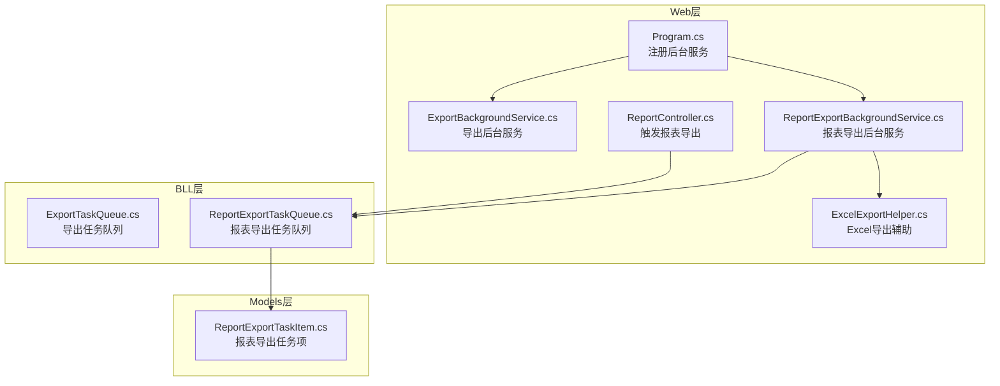
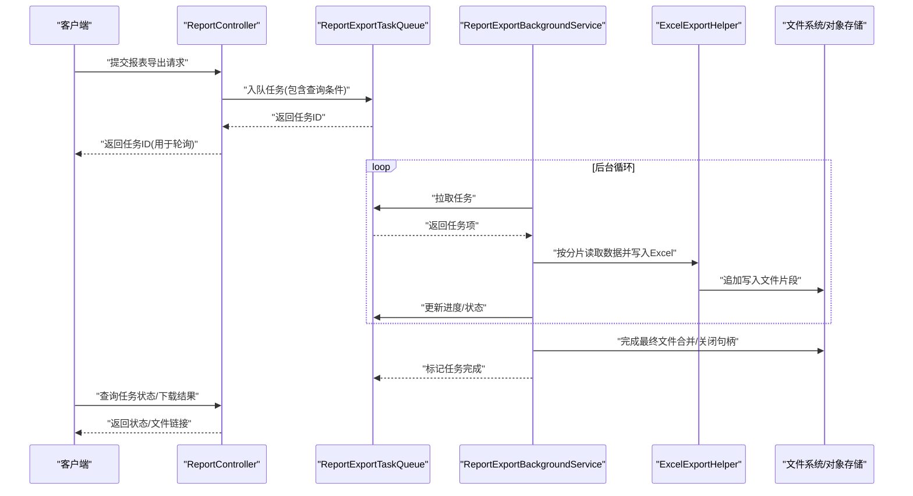
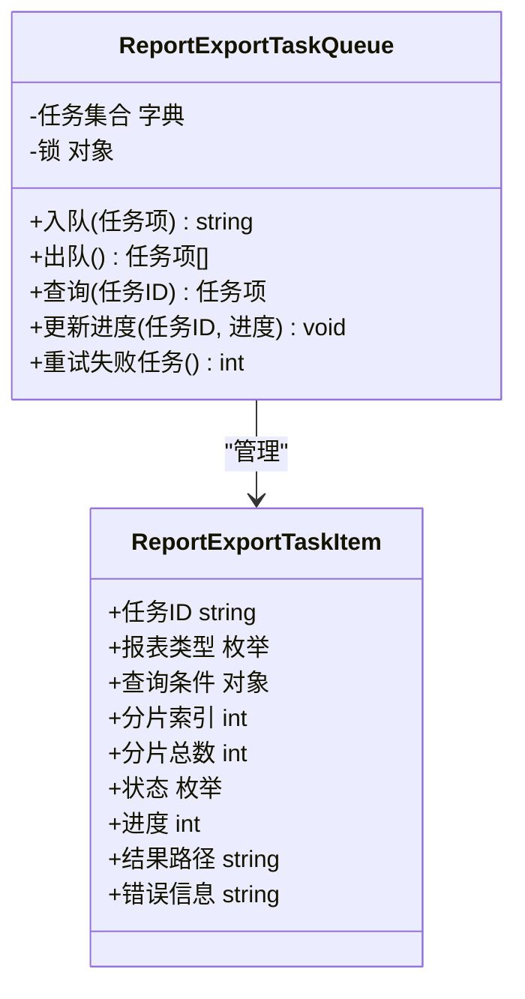
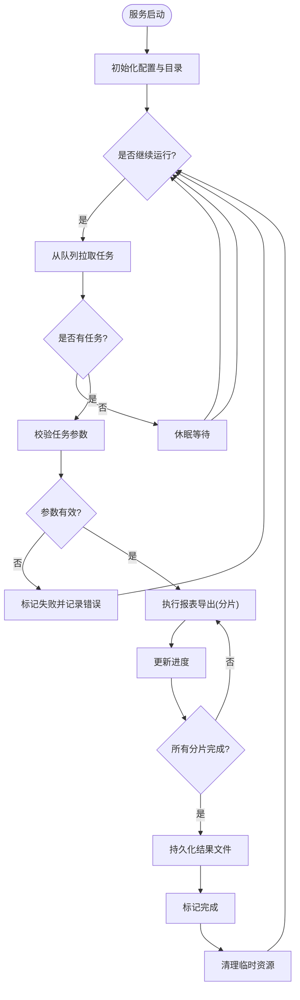
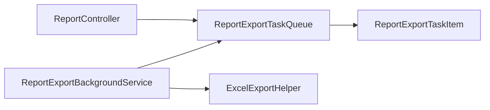

# 异步任务处理

<cite>
**本文引用的文件**   
- [ExportBackgroundService.cs](file://EquipmentIMS.Web/BackgroundServices/ExportBackgroundService.cs)
- [ReportExportBackgroundService.cs](file://EquipmentIMS.Web/BackgroundServices/ReportExportBackgroundService.cs)
- [ExportTaskQueue.cs](file://EquipmentIMS.BLL/Services/ExportTaskQueue.cs)
- [ReportExportTaskQueue.cs](file://EquipmentIMS.BLL/Services/ReportExportTaskQueue.cs)
- [ReportExportTaskItem.cs](file://EquipmentIMS.Models/DTOs/Reports/ReportExportTaskItem.cs)
- [Program.cs](file://EquipmentIMS.Web/Program.cs)
- [ReportController.cs](file://EquipmentIMS.Web/Controllers/ReportController.cs)
- [ExcelExportHelper.cs](file://EquipmentIMS.Web/Helpers/ExcelExportHelper.cs)
</cite>

## 目录
1. [简介](#简介)
2. [项目结构](#项目结构)
3. [核心组件](#核心组件)
4. [架构总览](#架构总览)
5. [详细组件分析](#详细组件分析)
6. [依赖关系分析](#依赖关系分析)
7. [性能考虑](#性能考虑)
8. [故障排查指南](#故障排查指南)
9. [结论](#结论)
10. [附录](#附录)

## 简介
本文件面向THMS系统的异步任务处理子系统，聚焦于基于队列的导出与报表生成任务。文档从系统架构、组件职责、数据流、状态管理、进度跟踪、结果回调、持久化与断点续传、错误补偿等维度进行系统化说明，并提供扩展开发与性能调优的最佳实践，帮助读者快速理解并高效使用该系统能力。

## 项目结构
异步任务相关代码主要分布在以下位置：
- Web层后台服务：负责启动与调度后台任务
- BLL层任务队列：封装任务入队、出队、执行与状态管理
- Models层DTO：定义报表导出任务项的数据结构
- Controllers层：提供触发任务的API入口
- Helpers层：提供通用导出工具（如Excel）

图表来源
- [Program.cs](file://EquipmentIMS.Web/Program.cs)
- [ExportBackgroundService.cs](file://EquipmentIMS.Web/BackgroundServices/ExportBackgroundService.cs)
- [ReportExportBackgroundService.cs](file://EquipmentIMS.Web/BackgroundServices/ReportExportBackgroundService.cs)
- [ExportTaskQueue.cs](file://EquipmentIMS.BLL/Services/ExportTaskQueue.cs)
- [ReportExportTaskQueue.cs](file://EquipmentIMS.BLL/Services/ReportExportTaskQueue.cs)
- [ReportExportTaskItem.cs](file://EquipmentIMS.Models/DTOs/Reports/ReportExportTaskItem.cs)
- [ReportController.cs](file://EquipmentIMS.Web/Controllers/ReportController.cs)
- [ExcelExportHelper.cs](file://EquipmentIMS.Web/Helpers/ExcelExportHelper.cs)

章节来源
- [Program.cs](file://EquipmentIMS.Web/Program.cs)
- [ExportBackgroundService.cs](file://EquipmentIMS.Web/BackgroundServices/ExportBackgroundService.cs)
- [ReportExportBackgroundService.cs](file://EquipmentIMS.Web/BackgroundServices/ReportExportBackgroundService.cs)
- [ExportTaskQueue.cs](file://EquipmentIMS.BLL/Services/ExportTaskQueue.cs)
- [ReportExportTaskQueue.cs](file://EquipmentIMS.BLL/Services/ReportExportTaskQueue.cs)
- [ReportExportTaskItem.cs](file://EquipmentIMS.Models/DTOs/Reports/ReportExportTaskItem.cs)
- [ReportController.cs](file://EquipmentIMS.Web/Controllers/ReportController.cs)
- [ExcelExportHelper.cs](file://EquipmentIMS.Web/Helpers/ExcelExportHelper.cs)

## 核心组件
- 后台服务
  - 导出后台服务：负责消费导出任务队列中的任务，驱动具体导出逻辑
  - 报表导出后台服务：负责消费报表导出任务队列中的任务，驱动报表数据聚合与文件生成
- 任务队列
  - 导出任务队列：封装导出任务的入队、出队、并发控制与重试策略
  - 报表导出任务队列：封装报表导出任务的入队、分片、进度更新与结果落盘
- 任务项模型
  - 报表导出任务项：承载报表类型、查询条件、分页参数、输出路径、进度等信息
- 控制器
  - 报表控制器：对外暴露创建报表导出任务的接口，返回任务ID供前端轮询
- 导出辅助
  - Excel导出辅助：提供通用的Excel写入、样式设置、流式输出等能力

章节来源
- [ExportBackgroundService.cs](file://EquipmentIMS.Web/BackgroundServices/ExportBackgroundService.cs)
- [ReportExportBackgroundService.cs](file://EquipmentIMS.Web/BackgroundServices/ReportExportBackgroundService.cs)
- [ExportTaskQueue.cs](file://EquipmentIMS.BLL/Services/ExportTaskQueue.cs)
- [ReportExportTaskQueue.cs](file://EquipmentIMS.BLL/Services/ReportExportTaskQueue.cs)
- [ReportExportTaskItem.cs](file://EquipmentIMS.Models/DTOs/Reports/ReportExportTaskItem.cs)
- [ReportController.cs](file://EquipmentIMS.Web/Controllers/ReportController.cs)
- [ExcelExportHelper.cs](file://EquipmentIMS.Web/Helpers/ExcelExportHelper.cs)

## 架构总览
整体采用“后台服务 + 内存队列”的轻量级异步任务架构。Web进程启动时注册后台服务；控制器接收请求后通过任务队列入队任务；后台服务循环拉取任务并执行；执行过程中更新任务状态与进度；完成后将结果持久化到文件系统或对象存储，并通过统一接口供前端查询。

图表来源
- [ReportController.cs](file://EquipmentIMS.Web/Controllers/ReportController.cs)
- [ReportExportTaskQueue.cs](file://EquipmentIMS.BLL/Services/ReportExportTaskQueue.cs)
- [ReportExportBackgroundService.cs](file://EquipmentIMS.Web/BackgroundServices/ReportExportBackgroundService.cs)
- [ExcelExportHelper.cs](file://EquipmentIMS.Web/Helpers/ExcelExportHelper.cs)

## 详细组件分析

### 报表导出任务队列（ReportExportTaskQueue）
- 职责
  - 维护任务集合与索引，支持按任务ID查询
  - 提供入队、出队、批量拉取接口
  - 维护任务状态（待处理、进行中、已完成、失败）与进度百分比
  - 支持任务重试与失败记录
- 设计要点
  - 线程安全：使用并发安全的集合与锁机制保护共享状态
  - 分片处理：将大数据集拆分为多个子任务，降低单次处理压力
  - 进度上报：每完成一个分片即更新进度，便于前端展示
  - 结果持久化：中间结果以临时文件形式落盘，最终合并为完整文件
- 复杂度
  - 入队/出队：O(1)
  - 按ID查询：O(1)
  - 进度更新：O(1)
  - 分片聚合：O(n)，n为分片数

图表来源
- [ReportExportTaskQueue.cs](file://EquipmentIMS.BLL/Services/ReportExportTaskQueue.cs)
- [ReportExportTaskItem.cs](file://EquipmentIMS.Models/DTOs/Reports/ReportExportTaskItem.cs)

章节来源
- [ReportExportTaskQueue.cs](file://EquipmentIMS.BLL/Services/ReportExportTaskQueue.cs)
- [ReportExportTaskItem.cs](file://EquipmentIMS.Models/DTOs/Reports/ReportExportTaskItem.cs)

### 报表导出后台服务（ReportExportBackgroundService）
- 职责
  - 作为Windows服务/托管服务运行，周期性从队列拉取任务
  - 协调报表数据获取、分片处理、Excel写入与进度上报
  - 异常捕获与重试，失败任务记录错误信息
- 关键流程
  - 初始化：加载配置、准备临时目录
  - 循环：拉取任务 -> 校验 -> 执行 -> 更新状态 -> 清理资源
  - 优雅停机：等待正在执行的任务完成后再退出
- 负载均衡
  - 单实例多工作协程：根据CPU核数与IO特性调整并发度
  - 多实例部署：每个实例独立队列副本，适合无外部消息队列场景

图表来源
- [ReportExportBackgroundService.cs](file://EquipmentIMS.Web/BackgroundServices/ReportExportBackgroundService.cs)
- [ReportExportTaskQueue.cs](file://EquipmentIMS.BLL/Services/ReportExportTaskQueue.cs)

章节来源
- [ReportExportBackgroundService.cs](file://EquipmentIMS.Web/BackgroundServices/ReportExportBackgroundService.cs)
- [ReportExportTaskQueue.cs](file://EquipmentIMS.BLL/Services/ReportExportTaskQueue.cs)

### 导出后台服务（ExportBackgroundService）
- 职责
  - 消费通用导出任务队列，驱动非报表类导出（如库存清单、采购单等）
  - 复用Excel导出辅助，保持统一的导出风格与性能优化
- 特点
  - 与报表导出服务类似，但业务逻辑更简单，通常不涉及复杂聚合
  - 可配置最大并发与重试次数

章节来源
- [ExportBackgroundService.cs](file://EquipmentIMS.Web/BackgroundServices/ExportBackgroundService.cs)
- [ExportTaskQueue.cs](file://EquipmentIMS.BLL/Services/ExportTaskQueue.cs)

### 控制器入口（ReportController）
- 职责
  - 接收前端报表导出请求，构造任务项并入队
  - 返回任务ID供前端轮询状态与下载结果
- 交互
  - POST /api/report/export：创建任务
  - GET /api/report/task/{id}：查询任务状态与结果

章节来源
- [ReportController.cs](file://EquipmentIMS.Web/Controllers/ReportController.cs)

### Excel导出辅助（ExcelExportHelper）
- 职责
  - 提供流式写入、分片追加、样式设置、列宽自适应等功能
  - 保证大文件导出的内存占用可控
- 优化
  - 使用缓冲写入减少磁盘IO次数
  - 按需生成列头与数据行，避免一次性加载全量数据

章节来源
- [ExcelExportHelper.cs](file://EquipmentIMS.Web/Helpers/ExcelExportHelper.cs)

## 依赖关系分析
- 组件耦合
  - 后台服务依赖任务队列接口，不直接访问数据库，解耦业务逻辑
  - 控制器仅负责入队与查询，不执行业务计算
- 外部依赖
  - 文件系统/对象存储：用于持久化导出结果
  - 可选：消息队列（未来升级方向），实现跨进程/跨实例任务分发

图表来源
- [ReportController.cs](file://EquipmentIMS.Web/Controllers/ReportController.cs)
- [ReportExportTaskQueue.cs](file://EquipmentIMS.BLL/Services/ReportExportTaskQueue.cs)
- [ReportExportBackgroundService.cs](file://EquipmentIMS.Web/BackgroundServices/ReportExportBackgroundService.cs)
- [ExcelExportHelper.cs](file://EquipmentIMS.Web/Helpers/ExcelExportHelper.cs)
- [ReportExportTaskItem.cs](file://EquipmentIMS.Models/DTOs/Reports/ReportExportTaskItem.cs)

章节来源
- [ReportController.cs](file://EquipmentIMS.Web/Controllers/ReportController.cs)
- [ReportExportTaskQueue.cs](file://EquipmentIMS.BLL/Services/ReportExportTaskQueue.cs)
- [ReportExportBackgroundService.cs](file://EquipmentIMS.Web/BackgroundServices/ReportExportBackgroundService.cs)
- [ExcelExportHelper.cs](file://EquipmentIMS.Web/Helpers/ExcelExportHelper.cs)
- [ReportExportTaskItem.cs](file://EquipmentIMS.Models/DTOs/Reports/ReportExportTaskItem.cs)

## 性能考虑
- 并发控制
  - 根据CPU与IO特性调整后台服务的工作协程数量，避免过度竞争
  - 对热点任务类型设置独立的队列或优先级，防止长尾任务阻塞
- 分片与批处理
  - 合理设置分片大小，平衡内存占用与IO开销
  - 使用流式写入，避免一次性构建超大对象
- 缓存与去重
  - 对相同查询条件的重复导出请求进行去重，复用已有结果
  - 对频繁访问的元数据（如字典表）进行缓存
- 资源清理
  - 及时释放文件句柄与临时文件，避免磁盘空间耗尽
  - 监控后台服务内存增长，定位潜在泄漏

[本节为通用性能建议，无需特定文件引用]

## 故障排查指南
- 常见问题
  - 任务长时间处于“进行中”：检查后台服务是否正常运行、队列是否被正确消费
  - 导出文件不完整：确认分片写入是否全部成功、是否存在异常中断
  - 进度不更新：检查进度上报逻辑是否被调用、是否存在锁竞争
- 日志与诊断
  - 在关键路径添加结构化日志，记录任务ID、分片索引、耗时与异常堆栈
  - 提供健康检查接口，暴露队列长度、活跃任务数、失败任务数
- 恢复策略
  - 失败任务自动重试，超过阈值转入死信队列人工干预
  - 支持断点续传：记录已完成的分片列表，重新执行时跳过已完成部分

章节来源
- [ReportExportBackgroundService.cs](file://EquipmentIMS.Web/BackgroundServices/ReportExportBackgroundService.cs)
- [ReportExportTaskQueue.cs](file://EquipmentIMS.BLL/Services/ReportExportTaskQueue.cs)

## 结论
THMS的异步任务处理采用轻量级的“后台服务 + 内存队列”模式，满足当前导出与报表生成的需求。通过分片处理、进度上报与结果持久化，实现了高可用与大文件导出的基本保障。后续可引入外部消息队列与分布式任务调度，进一步提升可扩展性与容错能力。

[本节为总结性内容，无需特定文件引用]

## 附录
- 扩展开发最佳实践
  - 新增任务类型时，优先复用现有队列与服务模板，减少重复代码
  - 明确任务幂等性，确保重试不会导致数据不一致
  - 为任务项增加版本字段，兼容历史数据结构变更
- 性能调优清单
  - 调整后台服务并发度与分片大小
  - 启用压缩传输与CDN加速下载
  - 对热点报表建立预生成与定时刷新机制

[本节为通用指导，无需特定文件引用]