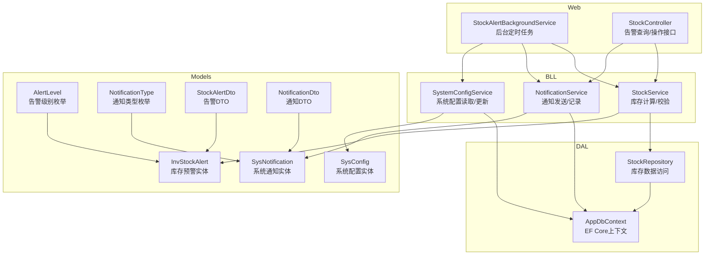
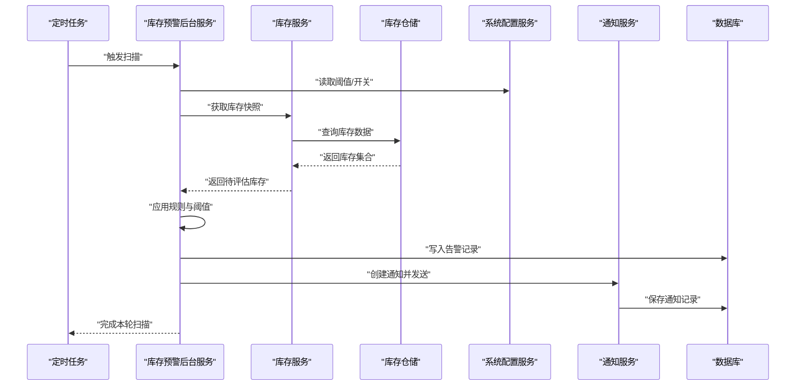
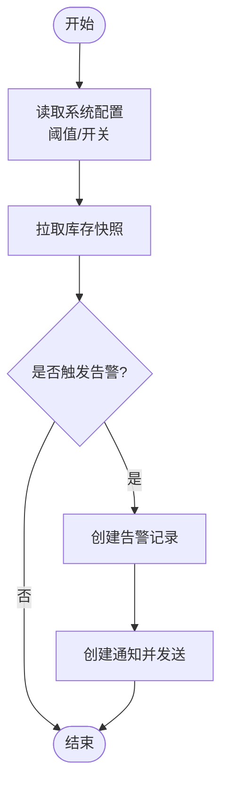
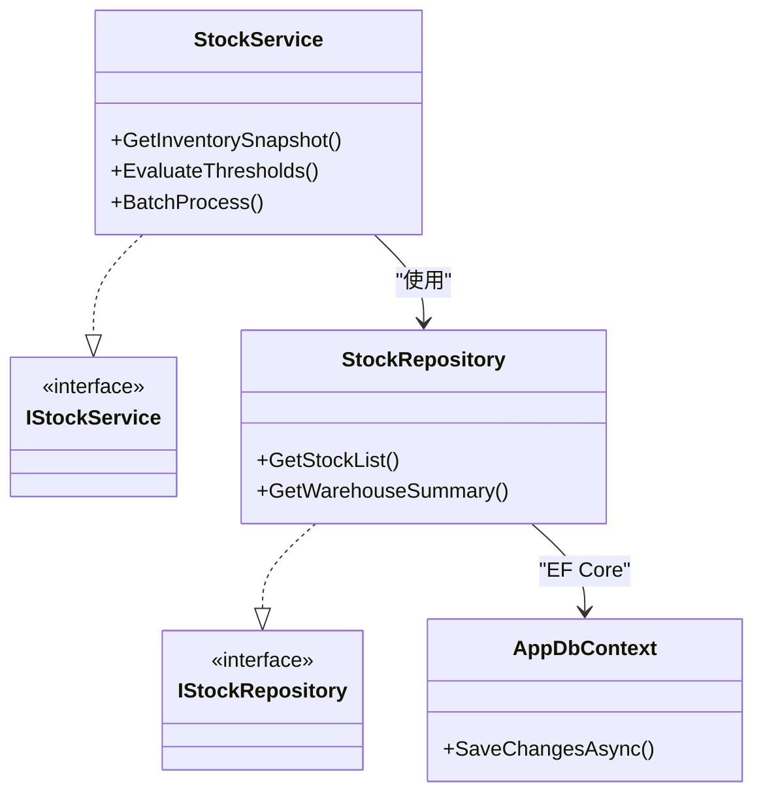
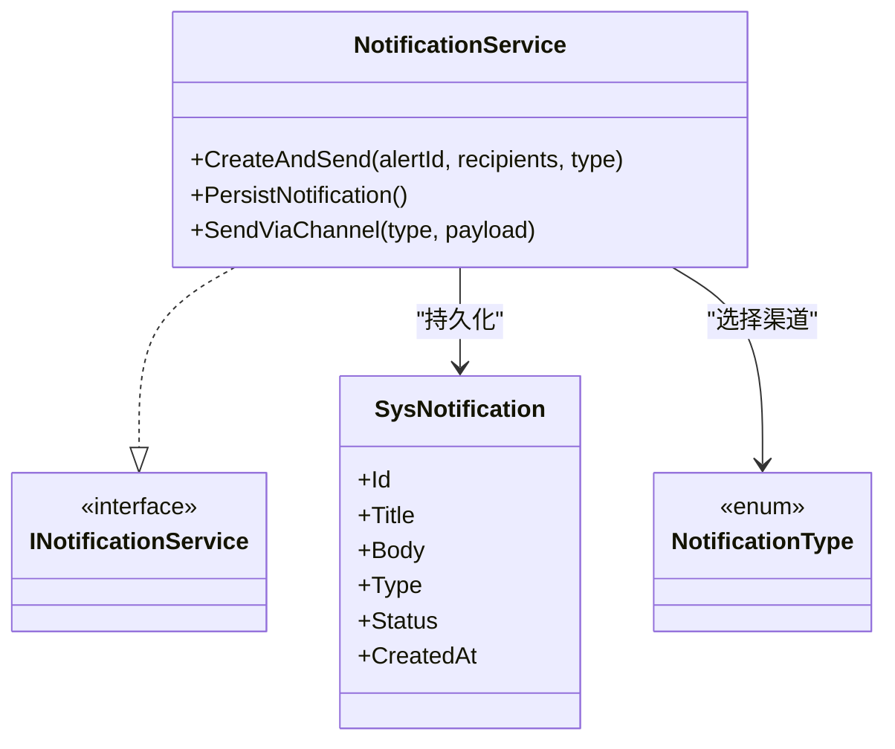
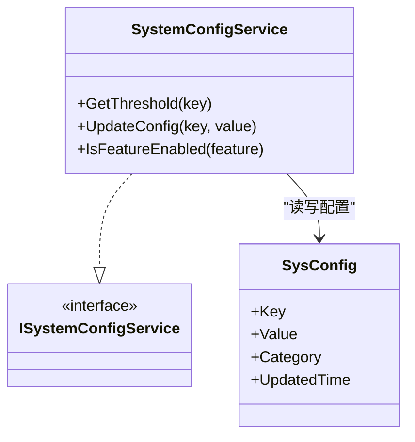
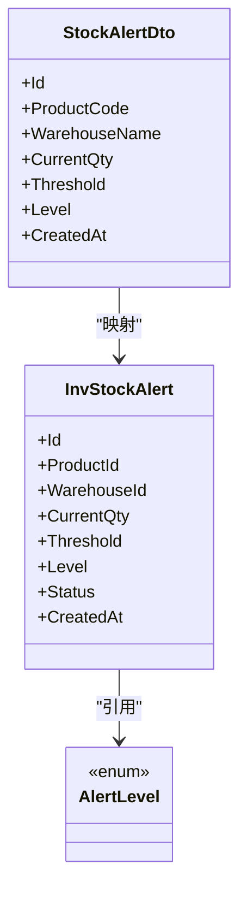
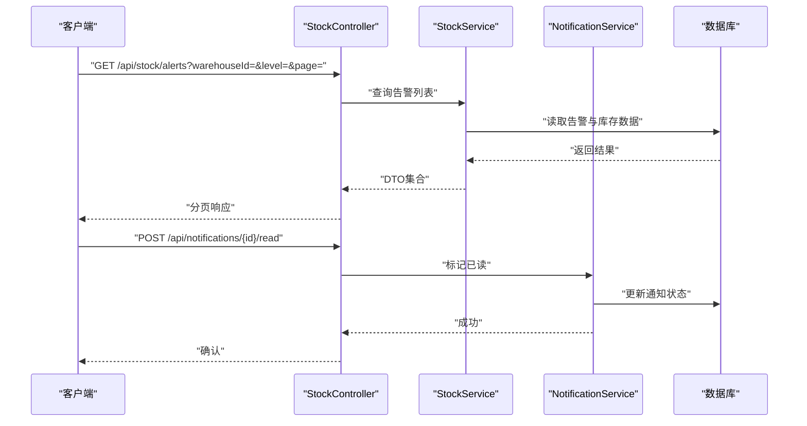
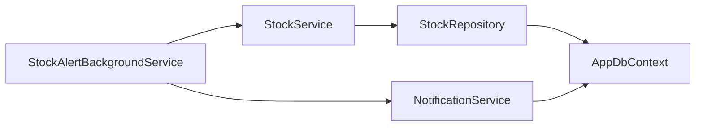

# 监控告警机制

<cite>
**本文引用的文件**   
- [StockAlertBackgroundService.cs](file://EquipmentIMS.Web/BackgroundServices/StockAlertBackgroundService.cs)
- [NotificationService.cs](file://EquipmentIMS.BLL/Services/NotificationService.cs)
- [INotificationService.cs](file://EquipmentIMS.BLL/Interfaces/INotificationService.cs)
- [StockService.cs](file://EquipmentIMS.BLL/Services/StockService.cs)
- [IStockService.cs](file://EquipmentIMS.BLL/Interfaces/IStockService.cs)
- [StockRepository.cs](file://EquipmentIMS.DAL/Repositories/StockRepository.cs)
- [IStockRepository.cs](file://EquipmentIMS.DAL/Interfaces/IStockRepository.cs)
- [InvStockAlert.cs](file://EquipmentIMS.Models/Entities/InvStockAlert.cs)
- [SysNotification.cs](file://EquipmentIMS.Models/Entities/SysNotification.cs)
- [AlertLevel.cs](file://EquipmentIMS.Models/Enums/AlertLevel.cs)
- [NotificationType.cs](file://EquipmentIMS.Models/Enums/NotificationType.cs)
- [StockAlertDto.cs](file://EquipmentIMS.Models/DTOs/StockAlertDto.cs)
- [NotificationDto.cs](file://EquipmentIMS.Models/DTOs/NotificationDto.cs)
- [StockController.cs](file://EquipmentIMS.Web/Controllers/StockController.cs)
- [SystemConfigService.cs](file://EquipmentIMS.BLL/Services/SystemConfigService.cs)
- [ISystemConfigService.cs](file://EquipmentIMS.BLL/Interfaces/ISystemConfigService.cs)
- [SysConfig.cs](file://EquipmentIMS.Models/Entities/SysConfig.cs)
- [AppDbContext.cs](file://EquipmentIMS.DAL/AppDbContext.cs)
</cite>

## 目录
1. [简介](#简介)
2. [项目结构](#项目结构)
3. [核心组件](#核心组件)
4. [架构总览](#架构总览)
5. [详细组件分析](#详细组件分析)
6. [依赖关系分析](#依赖关系分析)
7. [性能考虑](#性能考虑)
8. [故障排查指南](#故障排查指南)
9. [结论](#结论)
10. [附录](#附录)

## 简介
本文件面向THMS系统的“库存预警服务”的监控与告警机制，覆盖以下方面：
- 监控逻辑与触发条件（低库存、超储等）
- 告警规则配置与阈值管理（系统配置驱动）
- 告警级别定义与通知渠道集成（站内消息、邮件、短信等可扩展）
- 用户订阅管理与消息推送流程
- 告警历史查询、统计报表与趋势分析方案
- 自定义监控指标与告警规则的扩展开发指南

## 项目结构
围绕库存预警与告警的核心代码分布在以下层次：
- Web层：后台任务调度入口、控制器接口
- BLL层：业务服务（库存、通知、系统配置）
- DAL层：仓储访问与实体映射
- Models层：实体、枚举、DTO

图表来源
- [StockAlertBackgroundService.cs](file://EquipmentIMS.Web/BackgroundServices/StockAlertBackgroundService.cs)
- [StockController.cs](file://EquipmentIMS.Web/Controllers/StockController.cs)
- [StockService.cs](file://EquipmentIMS.BLL/Services/StockService.cs)
- [NotificationService.cs](file://EquipmentIMS.BLL/Services/NotificationService.cs)
- [SystemConfigService.cs](file://EquipmentIMS.BLL/Services/SystemConfigService.cs)
- [StockRepository.cs](file://EquipmentIMS.DAL/Repositories/StockRepository.cs)
- [AppDbContext.cs](file://EquipmentIMS.DAL/AppDbContext.cs)
- [InvStockAlert.cs](file://EquipmentIMS.Models/Entities/InvStockAlert.cs)
- [SysNotification.cs](file://EquipmentIMS.Models/Entities/SysNotification.cs)
- [AlertLevel.cs](file://EquipmentIMS.Models/Enums/AlertLevel.cs)
- [NotificationType.cs](file://EquipmentIMS.Models/Enums/NotificationType.cs)
- [StockAlertDto.cs](file://EquipmentIMS.Models/DTOs/StockAlertDto.cs)
- [NotificationDto.cs](file://EquipmentIMS.Models/DTOs/NotificationDto.cs)
- [SysConfig.cs](file://EquipmentIMS.Models/Entities/SysConfig.cs)

章节来源
- [StockAlertBackgroundService.cs](file://EquipmentIMS.Web/BackgroundServices/StockAlertBackgroundService.cs)
- [StockController.cs](file://EquipmentIMS.Web/Controllers/StockController.cs)
- [StockService.cs](file://EquipmentIMS.BLL/Services/StockService.cs)
- [NotificationService.cs](file://EquipmentIMS.BLL/Services/NotificationService.cs)
- [SystemConfigService.cs](file://EquipmentIMS.BLL/Services/SystemConfigService.cs)
- [StockRepository.cs](file://EquipmentIMS.DAL/Repositories/StockRepository.cs)
- [AppDbContext.cs](file://EquipmentIMS.DAL/AppDbContext.cs)
- [InvStockAlert.cs](file://EquipmentIMS.Models/Entities/InvStockAlert.cs)
- [SysNotification.cs](file://EquipmentIMS.Models/Entities/SysNotification.cs)
- [AlertLevel.cs](file://EquipmentIMS.Models/Enums/AlertLevel.cs)
- [NotificationType.cs](file://EquipmentIMS.Models/Enums/NotificationType.cs)
- [StockAlertDto.cs](file://EquipmentIMS.Models/DTOs/StockAlertDto.cs)
- [NotificationDto.cs](file://EquipmentIMS.Models/DTOs/NotificationDto.cs)
- [SysConfig.cs](file://EquipmentIMS.Models/Entities/SysConfig.cs)

## 核心组件
- 库存预警后台服务：周期性扫描库存，依据规则判断是否触发告警，并持久化告警记录。
- 库存服务：提供库存聚合、阈值比较、批量处理等能力。
- 通知服务：负责生成通知内容、选择渠道、发送消息、落库通知记录。
- 系统配置服务：提供动态阈值与开关的配置读取与更新。
- 仓储与上下文：封装对库存、告警、通知、配置的数据库访问。
- 模型与DTO：统一数据结构，支撑前端展示与API交互。

章节来源
- [StockAlertBackgroundService.cs](file://EquipmentIMS.Web/BackgroundServices/StockAlertBackgroundService.cs)
- [StockService.cs](file://EquipmentIMS.BLL/Services/StockService.cs)
- [NotificationService.cs](file://EquipmentIMS.BLL/Services/NotificationService.cs)
- [SystemConfigService.cs](file://EquipmentIMS.BLL/Services/SystemConfigService.cs)
- [StockRepository.cs](file://EquipmentIMS.DAL/Repositories/StockRepository.cs)
- [AppDbContext.cs](file://EquipmentIMS.DAL/AppDbContext.cs)
- [InvStockAlert.cs](file://EquipmentIMS.Models/Entities/InvStockAlert.cs)
- [SysNotification.cs](file://EquipmentIMS.Models/Entities/SysNotification.cs)
- [AlertLevel.cs](file://EquipmentIMS.Models/Enums/AlertLevel.cs)
- [NotificationType.cs](file://EquipmentIMS.Models/Enums/NotificationType.cs)
- [StockAlertDto.cs](file://EquipmentIMS.Models/DTOs/StockAlertDto.cs)
- [NotificationDto.cs](file://EquipmentIMS.Models/DTOs/NotificationDto.cs)
- [SysConfig.cs](file://EquipmentIMS.Models/Entities/SysConfig.cs)

## 架构总览
库存预警的整体流程如下：
- 定时任务触发：后台服务按周期执行扫描。
- 规则评估：从系统配置加载阈值与策略，结合库存数据进行判定。
- 告警生成：将触发的告警写入告警表，并生成通知记录。
- 通知分发：根据通知类型与用户订阅，通过多渠道推送。
- 查询与报表：控制器暴露查询接口，支持历史检索、统计与趋势分析。

图表来源
- [StockAlertBackgroundService.cs](file://EquipmentIMS.Web/BackgroundServices/StockAlertBackgroundService.cs)
- [StockService.cs](file://EquipmentIMS.BLL/Services/StockService.cs)
- [StockRepository.cs](file://EquipmentIMS.DAL/Repositories/StockRepository.cs)
- [SystemConfigService.cs](file://EquipmentIMS.BLL/Services/SystemConfigService.cs)
- [NotificationService.cs](file://EquipmentIMS.BLL/Services/NotificationService.cs)
- [AppDbContext.cs](file://EquipmentIMS.DAL/AppDbContext.cs)

## 详细组件分析

### 库存预警后台服务（定时扫描与触发）
- 职责
  - 周期性执行库存扫描
  - 调用库存服务进行阈值比对
  - 生成告警记录并触发通知
- 关键流程
  - 启动时注册为后台服务
  - 按配置间隔执行
  - 失败重试与异常隔离
- 输出
  - 告警实体写入
  - 通知实体写入与发送

图表来源
- [StockAlertBackgroundService.cs](file://EquipmentIMS.Web/BackgroundServices/StockAlertBackgroundService.cs)
- [SystemConfigService.cs](file://EquipmentIMS.BLL/Services/SystemConfigService.cs)
- [StockService.cs](file://EquipmentIMS.BLL/Services/StockService.cs)
- [NotificationService.cs](file://EquipmentIMS.BLL/Services/NotificationService.cs)

章节来源
- [StockAlertBackgroundService.cs](file://EquipmentIMS.Web/BackgroundServices/StockAlertBackgroundService.cs)

### 库存服务（阈值比较与批量处理）
- 职责
  - 汇总各仓库/产品维度库存
  - 对比安全库存、最大库存等阈值
  - 返回需要告警的库存项集合
- 关键点
  - 支持按仓库、类别、供应商等多维筛选
  - 批量处理提升吞吐
  - 可插拔的规则引擎扩展点

图表来源
- [StockService.cs](file://EquipmentIMS.BLL/Services/StockService.cs)
- [IStockService.cs](file://EquipmentIMS.BLL/Interfaces/IStockService.cs)
- [StockRepository.cs](file://EquipmentIMS.DAL/Repositories/StockRepository.cs)
- [IStockRepository.cs](file://EquipmentIMS.DAL/Interfaces/IStockRepository.cs)
- [AppDbContext.cs](file://EquipmentIMS.DAL/AppDbContext.cs)

章节来源
- [StockService.cs](file://EquipmentIMS.BLL/Services/StockService.cs)
- [IStockService.cs](file://EquipmentIMS.BLL/Interfaces/IStockService.cs)
- [StockRepository.cs](file://EquipmentIMS.DAL/Repositories/StockRepository.cs)
- [IStockRepository.cs](file://EquipmentIMS.DAL/Interfaces/IStockRepository.cs)
- [AppDbContext.cs](file://EquipmentIMS.DAL/AppDbContext.cs)

### 通知服务（消息推送与记录）
- 职责
  - 组装通知内容（标题、正文、关联告警ID）
  - 根据通知类型选择渠道（站内、邮件、短信等）
  - 持久化通知记录，支持已读状态与回执
- 关键点
  - 异步发送，避免阻塞主流程
  - 失败重试与幂等去重
  - 支持模板与多语言

图表来源
- [NotificationService.cs](file://EquipmentIMS.BLL/Services/NotificationService.cs)
- [INotificationService.cs](file://EquipmentIMS.BLL/Interfaces/INotificationService.cs)
- [SysNotification.cs](file://EquipmentIMS.Models/Entities/SysNotification.cs)
- [NotificationType.cs](file://EquipmentIMS.Models/Enums/NotificationType.cs)

章节来源
- [NotificationService.cs](file://EquipmentIMS.BLL/Services/NotificationService.cs)
- [INotificationService.cs](file://EquipmentIMS.BLL/Interfaces/INotificationService.cs)
- [SysNotification.cs](file://EquipmentIMS.Models/Entities/SysNotification.cs)
- [NotificationType.cs](file://EquipmentIMS.Models/Enums/NotificationType.cs)

### 系统配置服务（阈值与开关管理）
- 职责
  - 提供动态阈值（如安全库存、最大库存、冷却时间）
  - 控制功能开关（如是否启用某类告警）
  - 缓存热点配置，减少数据库压力
- 关键点
  - 配置变更即时生效或按策略刷新
  - 支持按仓库/产品维度覆盖默认值

图表来源
- [SystemConfigService.cs](file://EquipmentIMS.BLL/Services/SystemConfigService.cs)
- [ISystemConfigService.cs](file://EquipmentIMS.BLL/Interfaces/ISystemConfigService.cs)
- [SysConfig.cs](file://EquipmentIMS.Models/Entities/SysConfig.cs)

章节来源
- [SystemConfigService.cs](file://EquipmentIMS.BLL/Services/SystemConfigService.cs)
- [ISystemConfigService.cs](file://EquipmentIMS.BLL/Interfaces/ISystemConfigService.cs)
- [SysConfig.cs](file://EquipmentIMS.Models/Entities/SysConfig.cs)

### 告警实体与级别定义
- 告警实体
  - 包含产品、仓库、当前库存、阈值、级别、状态、时间戳等字段
- 告警级别
  - 使用枚举表示不同严重等级（如提示、警告、严重）
- DTO
  - 对外暴露简洁的数据结构，便于前端渲染与导出

图表来源
- [InvStockAlert.cs](file://EquipmentIMS.Models/Entities/InvStockAlert.cs)
- [AlertLevel.cs](file://EquipmentIMS.Models/Enums/AlertLevel.cs)
- [StockAlertDto.cs](file://EquipmentIMS.Models/DTOs/StockAlertDto.cs)

章节来源
- [InvStockAlert.cs](file://EquipmentIMS.Models/Entities/InvStockAlert.cs)
- [AlertLevel.cs](file://EquipmentIMS.Models/Enums/AlertLevel.cs)
- [StockAlertDto.cs](file://EquipmentIMS.Models/DTOs/StockAlertDto.cs)

### 控制器接口（查询与操作）
- 职责
  - 提供告警列表查询、详情查看、标记已处理等接口
  - 对接通知列表与已读状态同步
- 关键点
  - 分页与过滤（按仓库、级别、时间范围）
  - 权限控制与审计日志

图表来源
- [StockController.cs](file://EquipmentIMS.Web/Controllers/StockController.cs)
- [StockService.cs](file://EquipmentIMS.BLL/Services/StockService.cs)
- [NotificationService.cs](file://EquipmentIMS.BLL/Services/NotificationService.cs)
- [AppDbContext.cs](file://EquipmentIMS.DAL/AppDbContext.cs)

章节来源
- [StockController.cs](file://EquipmentIMS.Web/Controllers/StockController.cs)
- [StockService.cs](file://EquipmentIMS.BLL/Services/StockService.cs)
- [NotificationService.cs](file://EquipmentIMS.BLL/Services/NotificationService.cs)
- [AppDbContext.cs](file://EquipmentIMS.DAL/AppDbContext.cs)

## 依赖关系分析
- 组件耦合
  - 后台服务依赖库存服务与通知服务，解耦清晰
  - 库存服务依赖仓储与上下文，遵循分层原则
  - 通知服务独立于具体渠道，便于扩展
- 外部依赖
  - EF Core用于数据访问
  - 可选的消息队列或邮件/短信SDK（通过通知服务抽象）

图表来源
- [StockAlertBackgroundService.cs](file://EquipmentIMS.Web/BackgroundServices/StockAlertBackgroundService.cs)
- [StockService.cs](file://EquipmentIMS.BLL/Services/StockService.cs)
- [NotificationService.cs](file://EquipmentIMS.BLL/Services/NotificationService.cs)
- [StockRepository.cs](file://EquipmentIMS.DAL/Repositories/StockRepository.cs)
- [AppDbContext.cs](file://EquipmentIMS.DAL/AppDbContext.cs)

章节来源
- [StockAlertBackgroundService.cs](file://EquipmentIMS.Web/BackgroundServices/StockAlertBackgroundService.cs)
- [StockService.cs](file://EquipmentIMS.BLL/Services/StockService.cs)
- [NotificationService.cs](file://EquipmentIMS.BLL/Services/NotificationService.cs)
- [StockRepository.cs](file://EquipmentIMS.DAL/Repositories/StockRepository.cs)
- [AppDbContext.cs](file://EquipmentIMS.DAL/AppDbContext.cs)

## 性能考虑
- 批处理与分页
  - 库存快照与告警写入采用分批处理，降低单次事务压力
- 索引优化
  - 在仓库、产品、时间戳等常用查询列建立索引
- 缓存策略
  - 系统配置热路径加入内存缓存，定期刷新
- 异步与退避
  - 通知发送异步化，失败指数退避重试
- 限流与熔断
  - 对第三方渠道设置速率限制与熔断保护

[本节为通用指导，不直接分析具体文件]

## 故障排查指南
- 常见问题
  - 未收到通知：检查通知类型与渠道配置、用户订阅状态、发送失败重试次数
  - 告警风暴：调整阈值与冷却时间，增加去重与合并策略
  - 性能抖动：关注慢查询与锁竞争，优化SQL与索引
- 定位方法
  - 查看告警与通知记录的时间线与状态
  - 核对系统配置中的阈值与开关
  - 检查后台服务日志与异常堆栈

章节来源
- [NotificationService.cs](file://EquipmentIMS.BLL/Services/NotificationService.cs)
- [StockAlertBackgroundService.cs](file://EquipmentIMS.Web/BackgroundServices/StockAlertBackgroundService.cs)
- [SystemConfigService.cs](file://EquipmentIMS.BLL/Services/SystemConfigService.cs)

## 结论
THMS的库存预警与告警机制以分层架构为基础，通过后台服务驱动、服务间解耦、配置驱动与可扩展的通知渠道，实现了稳定可靠的监控与告警能力。配合完善的查询与报表接口，可满足日常运维与决策分析需求。未来可在规则引擎、指标采集与可视化方面进一步演进。

[本节为总结性内容，不直接分析具体文件]

## 附录

### 告警规则配置与阈值管理
- 配置项建议
  - 全局阈值：安全库存、最大库存、冷却时间
  - 维度覆盖：按仓库、产品类别、供应商覆盖默认值
  - 功能开关：启用/禁用特定告警类型
- 管理方式
  - 通过系统配置服务读写
  - 支持版本化与回滚

章节来源
- [SystemConfigService.cs](file://EquipmentIMS.BLL/Services/SystemConfigService.cs)
- [ISystemConfigService.cs](file://EquipmentIMS.BLL/Interfaces/ISystemConfigService.cs)
- [SysConfig.cs](file://EquipmentIMS.Models/Entities/SysConfig.cs)

### 告警级别定义
- 级别含义
  - 提示：轻微偏离，需关注
  - 警告：明显风险，需尽快处理
  - 严重：高风险，需立即处置
- 影响范围
  - 决定通知优先级与渠道选择

章节来源
- [AlertLevel.cs](file://EquipmentIMS.Models/Enums/AlertLevel.cs)
- [InvStockAlert.cs](file://EquipmentIMS.Models/Entities/InvStockAlert.cs)

### 通知渠道集成与用户订阅管理
- 渠道抽象
  - 站内消息、邮件、短信、企业IM等
- 订阅管理
  - 用户角色/岗位订阅策略
  - 按仓库/产品维度订阅
- 发送流程
  - 生成消息体 -> 选择渠道 -> 异步发送 -> 记录回执

章节来源
- [NotificationService.cs](file://EquipmentIMS.BLL/Services/NotificationService.cs)
- [INotificationService.cs](file://EquipmentIMS.BLL/Interfaces/INotificationService.cs)
- [SysNotification.cs](file://EquipmentIMS.Models/Entities/SysNotification.cs)
- [NotificationType.cs](file://EquipmentIMS.Models/Enums/NotificationType.cs)

### 告警历史查询、统计报表与趋势分析
- 查询能力
  - 按仓库、产品、级别、时间范围分页查询
  - 详情查看与导出
- 统计报表
  - 告警数量趋势、级别分布、仓库排名
- 趋势分析
  - 基于时间序列的同比/环比分析
  - 预测与阈值自适应（可选）

章节来源
- [StockController.cs](file://EquipmentIMS.Web/Controllers/StockController.cs)
- [StockAlertDto.cs](file://EquipmentIMS.Models/DTOs/StockAlertDto.cs)
- [NotificationDto.cs](file://EquipmentIMS.Models/DTOs/NotificationDto.cs)

### 自定义监控指标与告警规则扩展指南
- 新增指标
  - 在库存服务中扩展聚合维度与计算逻辑
  - 在告警实体中补充必要字段
- 新增规则
  - 通过系统配置注入新规则参数
  - 在后台服务中注册新的评估分支
- 新增渠道
  - 实现通知服务的渠道接口
  - 在通知类型枚举中登记新类型
- 测试与发布
  - 单元测试覆盖规则与渠道
  - 灰度发布与回滚预案

章节来源
- [StockService.cs](file://EquipmentIMS.BLL/Services/StockService.cs)
- [IStockService.cs](file://EquipmentIMS.BLL/Interfaces/IStockService.cs)
- [InvStockAlert.cs](file://EquipmentIMS.Models/Entities/InvStockAlert.cs)
- [NotificationService.cs](file://EquipmentIMS.BLL/Services/NotificationService.cs)
- [INotificationService.cs](file://EquipmentIMS.BLL/Interfaces/INotificationService.cs)
- [NotificationType.cs](file://EquipmentIMS.Models/Enums/NotificationType.cs)