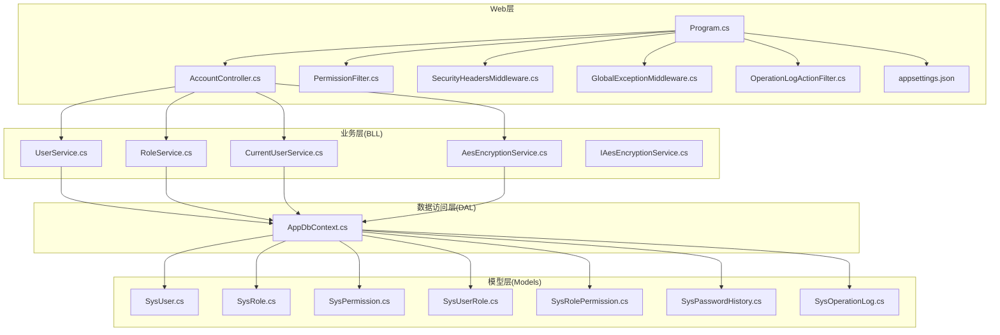
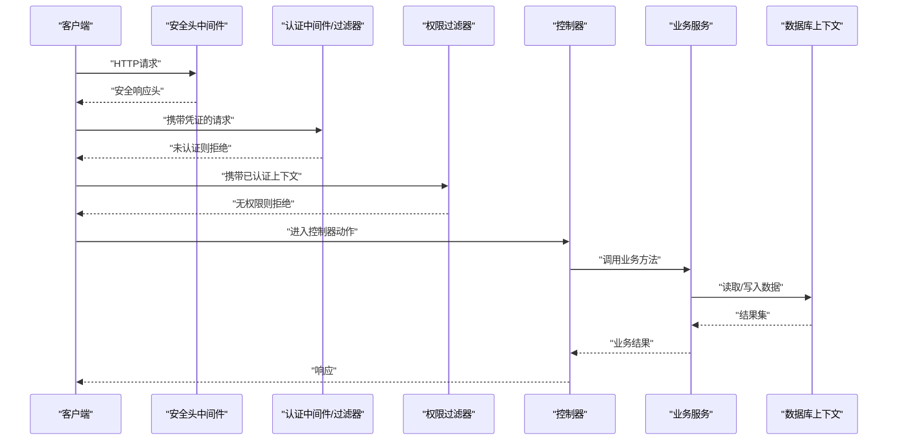
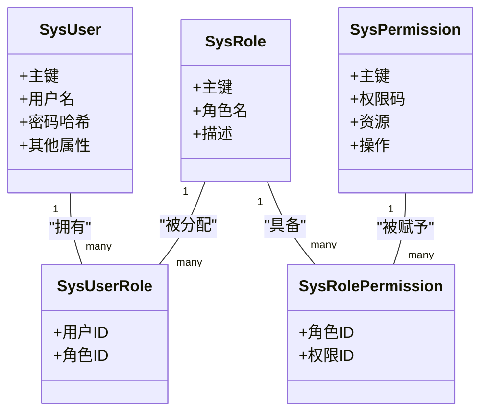
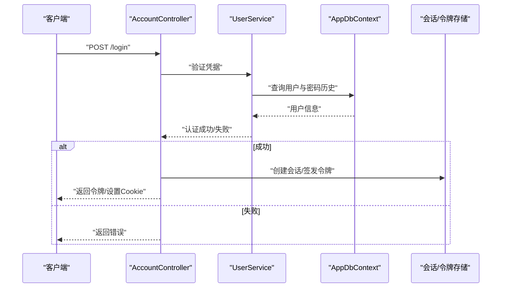
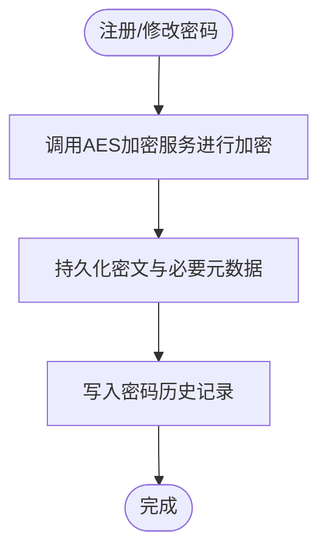
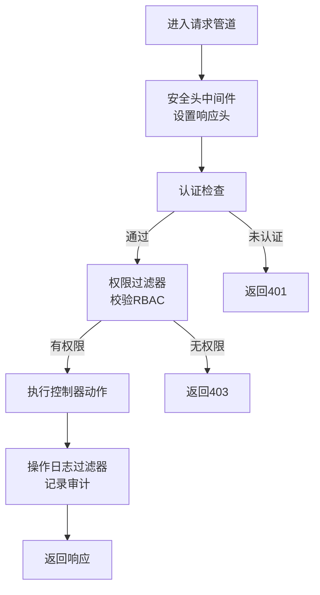
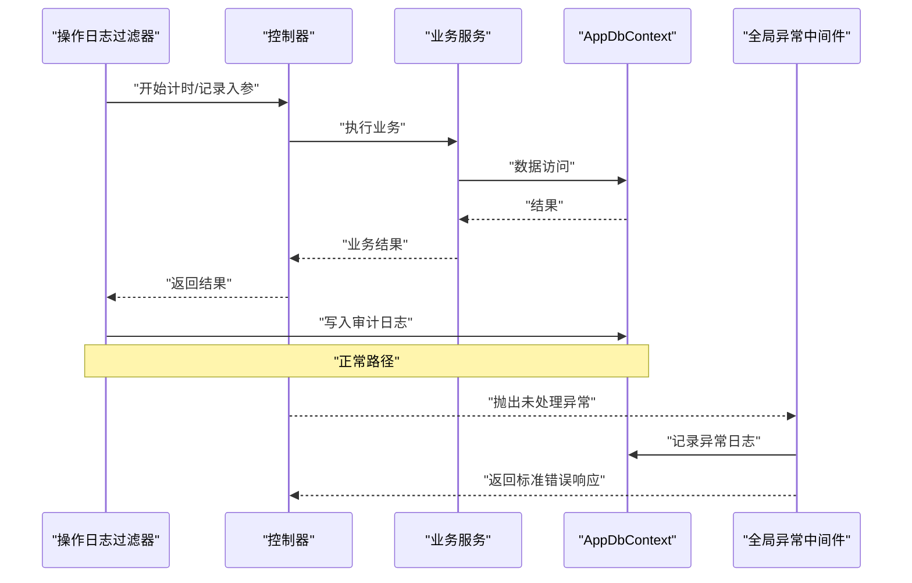
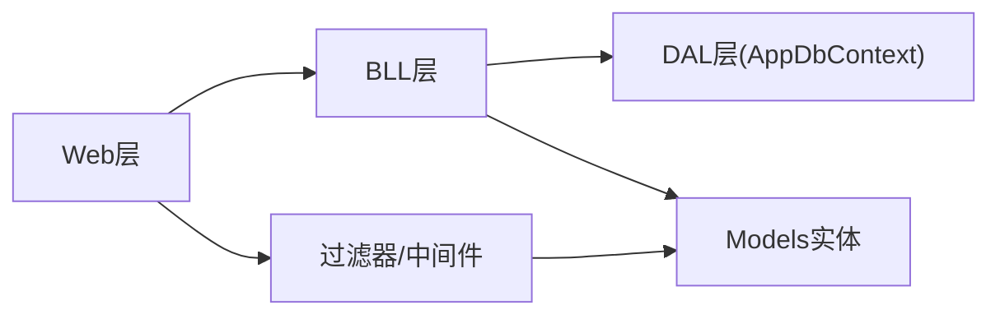

# 安全与认证

<cite>
**本文引用的文件**   
- [Program.cs](file://EquipmentIMS.Web/Program.cs)
- [AccountController.cs](file://EquipmentIMS.Web/Controllers/AccountController.cs)
- [PermissionFilter.cs](file://EquipmentIMS.Web/Filters/PermissionFilter.cs)
- [SecurityHeadersMiddleware.cs](file://EquipmentIMS.Web/Filters/SecurityHeadersMiddleware.cs)
- [GlobalExceptionMiddleware.cs](file://EquipmentIMS.Web/Filters/GlobalExceptionMiddleware.cs)
- [OperationLogActionFilter.cs](file://EquipmentIMS.Web/Filters/OperationLogActionFilter.cs)
- [UserService.cs](file://EquipmentIMS.BLL/Services/UserService.cs)
- [RoleService.cs](file://EquipmentIMS.BLL/Services/RoleService.cs)
- [CurrentUserService.cs](file://EquipmentIMS.BLL/Services/CurrentUserService.cs)
- [AesEncryptionService.cs](file://EquipmentIMS.BLL/Services/AesEncryptionService.cs)
- [IAesEncryptionService.cs](file://EquipmentIMS.BLL/Interfaces/IAesEncryptionService.cs)
- [SysUser.cs](file://EquipmentIMS.Models/Entities/SysUser.cs)
- [SysRole.cs](file://EquipmentIMS.Models/Entities/SysRole.cs)
- [SysPermission.cs](file://EquipmentIMS.Models/Entities/SysPermission.cs)
- [SysUserRole.cs](file://EquipmentIMS.Models/Entities/SysUserRole.cs)
- [SysRolePermission.cs](file://EquipmentIMS.Models/Entities/SysRolePermission.cs)
- [SysPasswordHistory.cs](file://EquipmentIMS.Models/Entities/SysPasswordHistory.cs)
- [SysOperationLog.cs](file://EquipmentIMS.Models/Entities/SysOperationLog.cs)
- [AppDbContext.cs](file://EquipmentIMS.DAL/AppDbContext.cs)
- [appsettings.json](file://EquipmentIMS.Web/appsettings.json)
</cite>

## 目录
1. [简介](#简介)
2. [项目结构](#项目结构)
3. [核心组件](#核心组件)
4. [架构总览](#架构总览)
5. [详细组件分析](#详细组件分析)
6. [依赖关系分析](#依赖关系分析)
7. [性能考虑](#性能考虑)
8. [故障排查指南](#故障排查指南)
9. [结论](#结论)
10. [附录](#附录)

## 简介
本章节面向THMS系统的安全与认证设计，围绕基于角色的访问控制（RBAC）、身份认证流程、会话管理、密码加密存储、权限过滤器与中间件、常见攻击防护（SQL注入、XSS、CSRF）、安全头配置、HTTPS强制、输入验证以及安全审计日志与异常处理进行系统性说明。文档旨在帮助开发者与安全工程师快速理解并落地相关能力。

## 项目结构
从安全视角看，Web层负责请求接入、认证与会话、全局安全中间件与过滤器；BLL层提供用户、角色、权限、加密等业务能力；DAL层通过EF Core进行数据访问；Models层定义实体与DTO。

图表来源
- [Program.cs](file://EquipmentIMS.Web/Program.cs)
- [AccountController.cs](file://EquipmentIMS.Web/Controllers/AccountController.cs)
- [PermissionFilter.cs](file://EquipmentIMS.Web/Filters/PermissionFilter.cs)
- [SecurityHeadersMiddleware.cs](file://EquipmentIMS.Web/Filters/SecurityHeadersMiddleware.cs)
- [GlobalExceptionMiddleware.cs](file://EquipmentIMS.Web/Filters/GlobalExceptionMiddleware.cs)
- [OperationLogActionFilter.cs](file://EquipmentIMS.Web/Filters/OperationLogActionFilter.cs)
- [UserService.cs](file://EquipmentIMS.BLL/Services/UserService.cs)
- [RoleService.cs](file://EquipmentIMS.BLL/Services/RoleService.cs)
- [CurrentUserService.cs](file://EquipmentIMS.BLL/Services/CurrentUserService.cs)
- [AesEncryptionService.cs](file://EquipmentIMS.BLL/Services/AesEncryptionService.cs)
- [IAesEncryptionService.cs](file://EquipmentIMS.BLL/Interfaces/IAesEncryptionService.cs)
- [AppDbContext.cs](file://EquipmentIMS.DAL/AppDbContext.cs)
- [SysUser.cs](file://EquipmentIMS.Models/Entities/SysUser.cs)
- [SysRole.cs](file://EquipmentIMS.Models/Entities/SysRole.cs)
- [SysPermission.cs](file://EquipmentIMS.Models/Entities/SysPermission.cs)
- [SysUserRole.cs](file://EquipmentIMS.Models/Entities/SysUserRole.cs)
- [SysRolePermission.cs](file://EquipmentIMS.Models/Entities/SysRolePermission.cs)
- [SysPasswordHistory.cs](file://EquipmentIMS.Models/Entities/SysPasswordHistory.cs)
- [SysOperationLog.cs](file://EquipmentIMS.Models/Entities/SysOperationLog.cs)
- [appsettings.json](file://EquipmentIMS.Web/appsettings.json)

章节来源
- [Program.cs](file://EquipmentIMS.Web/Program.cs)
- [appsettings.json](file://EquipmentIMS.Web/appsettings.json)

## 核心组件
- 身份认证与会话：登录入口由账户控制器实现，结合服务层完成凭据校验与令牌签发，使用Cookie或无状态Token维持会话。
- RBAC权限模型：以用户-角色-权限三元组为核心，支持角色分配与权限校验。
- 密码安全：采用AES对称加密服务对敏感字段进行加解密，并提供历史密码记录用于防重用策略。
- 权限过滤与中间件：在控制器方法或全局管道中执行权限检查与安全头设置。
- 安全审计与异常：操作日志过滤器记录关键行为，全局异常中间件统一捕获与返回。

章节来源
- [AccountController.cs](file://EquipmentIMS.Web/Controllers/AccountController.cs)
- [PermissionFilter.cs](file://EquipmentIMS.Web/Filters/PermissionFilter.cs)
- [SecurityHeadersMiddleware.cs](file://EquipmentIMS.Web/Filters/SecurityHeadersMiddleware.cs)
- [GlobalExceptionMiddleware.cs](file://EquipmentIMS.Web/Filters/GlobalExceptionMiddleware.cs)
- [OperationLogActionFilter.cs](file://EquipmentIMS.Web/Filters/OperationLogActionFilter.cs)
- [UserService.cs](file://EquipmentIMS.BLL/Services/UserService.cs)
- [RoleService.cs](file://EquipmentIMS.BLL/Services/RoleService.cs)
- [CurrentUserService.cs](file://EquipmentIMS.BLL/Services/CurrentUserService.cs)
- [AesEncryptionService.cs](file://EquipmentIMS.BLL/Services/AesEncryptionService.cs)
- [IAesEncryptionService.cs](file://EquipmentIMS.BLL/Interfaces/IAesEncryptionService.cs)
- [SysUser.cs](file://EquipmentIMS.Models/Entities/SysUser.cs)
- [SysRole.cs](file://EquipmentIMS.Models/Entities/SysRole.cs)
- [SysPermission.cs](file://EquipmentIMS.Models/Entities/SysPermission.cs)
- [SysUserRole.cs](file://EquipmentIMS.Models/Entities/SysUserRole.cs)
- [SysRolePermission.cs](file://EquipmentIMS.Models/Entities/SysRolePermission.cs)
- [SysPasswordHistory.cs](file://EquipmentIMS.Models/Entities/SysPasswordHistory.cs)
- [SysOperationLog.cs](file://EquipmentIMS.Models/Entities/SysOperationLog.cs)

## 架构总览
下图展示一次受保护的API请求从进入管道到鉴权、授权、执行业务逻辑与记录审计的完整路径。

图表来源
- [SecurityHeadersMiddleware.cs](file://EquipmentIMS.Web/Filters/SecurityHeadersMiddleware.cs)
- [PermissionFilter.cs](file://EquipmentIMS.Web/Filters/PermissionFilter.cs)
- [AccountController.cs](file://EquipmentIMS.Web/Controllers/AccountController.cs)
- [UserService.cs](file://EquipmentIMS.BLL/Services/UserService.cs)
- [AppDbContext.cs](file://EquipmentIMS.DAL/AppDbContext.cs)

## 详细组件分析

### 基于角色的访问控制（RBAC）设计与实现
- 模型关系
  - 用户与角色多对多：通过关联表建立用户-角色映射。
  - 角色与权限多对多：通过关联表建立角色-权限映射。
  - 权限为最小粒度资源与操作的组合。
- 运行时权限判定
  - 当前用户上下文在服务层维护，包含用户标识、角色集合与权限集合。
  - 权限过滤器在执行控制器动作前，依据目标资源的权限要求与当前用户权限集合进行匹配。
- 典型流程
  - 登录成功后，加载用户角色与角色对应权限，缓存至会话或内存缓存。
  - 每次请求经权限过滤器时，比对所需权限是否命中。

图表来源
- [SysUser.cs](file://EquipmentIMS.Models/Entities/SysUser.cs)
- [SysRole.cs](file://EquipmentIMS.Models/Entities/SysRole.cs)
- [SysPermission.cs](file://EquipmentIMS.Models/Entities/SysPermission.cs)
- [SysUserRole.cs](file://EquipmentIMS.Models/Entities/SysUserRole.cs)
- [SysRolePermission.cs](file://EquipmentIMS.Models/Entities/SysRolePermission.cs)

章节来源
- [SysUser.cs](file://EquipmentIMS.Models/Entities/SysUser.cs)
- [SysRole.cs](file://EquipmentIMS.Models/Entities/SysRole.cs)
- [SysPermission.cs](file://EquipmentIMS.Models/Entities/SysPermission.cs)
- [SysUserRole.cs](file://EquipmentIMS.Models/Entities/SysUserRole.cs)
- [SysRolePermission.cs](file://EquipmentIMS.Models/Entities/SysRolePermission.cs)
- [PermissionFilter.cs](file://EquipmentIMS.Web/Filters/PermissionFilter.cs)
- [CurrentUserService.cs](file://EquipmentIMS.BLL/Services/CurrentUserService.cs)
- [RoleService.cs](file://EquipmentIMS.BLL/Services/RoleService.cs)

### 身份认证流程与会话管理
- 登录流程
  - 客户端提交用户名与密码。
  - 控制器调用用户服务进行凭据校验。
  - 校验通过后生成令牌或创建会话，并返回给客户端。
- 会话保持
  - 可选方案一：基于Cookie的会话，服务端维护会话状态。
  - 可选方案二：无状态JWT，客户端保存并在后续请求中携带。
- 登出与刷新
  - 登出应使会话失效或撤销令牌。
  - 长生命周期令牌需配合刷新机制与过期策略。

图表来源
- [AccountController.cs](file://EquipmentIMS.Web/Controllers/AccountController.cs)
- [UserService.cs](file://EquipmentIMS.BLL/Services/UserService.cs)
- [AppDbContext.cs](file://EquipmentIMS.DAL/AppDbContext.cs)

章节来源
- [AccountController.cs](file://EquipmentIMS.Web/Controllers/AccountController.cs)
- [UserService.cs](file://EquipmentIMS.BLL/Services/UserService.cs)
- [SysPasswordHistory.cs](file://EquipmentIMS.Models/Entities/SysPasswordHistory.cs)

### 密码加密存储机制
- 加密服务
  - 通过AES对称加密服务对敏感数据进行加解密，接口抽象便于替换与测试。
- 历史密码
  - 维护密码历史表，防止重复使用旧密码。
- 最佳实践
  - 密钥与IV应来自安全配置，避免硬编码。
  - 定期轮换密钥，并对密文进行完整性校验。

图表来源
- [AesEncryptionService.cs](file://EquipmentIMS.BLL/Services/AesEncryptionService.cs)
- [IAesEncryptionService.cs](file://EquipmentIMS.BLL/Interfaces/IAesEncryptionService.cs)
- [SysPasswordHistory.cs](file://EquipmentIMS.Models/Entities/SysPasswordHistory.cs)

章节来源
- [AesEncryptionService.cs](file://EquipmentIMS.BLL/Services/AesEncryptionService.cs)
- [IAesEncryptionService.cs](file://EquipmentIMS.BLL/Interfaces/IAesEncryptionService.cs)
- [SysPasswordHistory.cs](file://EquipmentIMS.Models/Entities/SysPasswordHistory.cs)

### 权限过滤器与中间件的安全防护策略
- 权限过滤器
  - 在控制器动作执行前校验当前用户是否具备所需权限。
  - 可结合路由、控制器与方法级注解或约定进行声明式授权。
- 安全头中间件
  - 统一添加安全相关的响应头，如内容类型嗅探保护、点击劫持防护、XSS过滤提示等。
- 全局异常中间件
  - 捕获未处理异常，记录日志并返回标准化错误响应，避免泄露堆栈细节。

图表来源
- [PermissionFilter.cs](file://EquipmentIMS.Web/Filters/PermissionFilter.cs)
- [SecurityHeadersMiddleware.cs](file://EquipmentIMS.Web/Filters/SecurityHeadersMiddleware.cs)
- [GlobalExceptionMiddleware.cs](file://EquipmentIMS.Web/Filters/GlobalExceptionMiddleware.cs)
- [OperationLogActionFilter.cs](file://EquipmentIMS.Web/Filters/OperationLogActionFilter.cs)

章节来源
- [PermissionFilter.cs](file://EquipmentIMS.Web/Filters/PermissionFilter.cs)
- [SecurityHeadersMiddleware.cs](file://EquipmentIMS.Web/Filters/SecurityHeadersMiddleware.cs)
- [GlobalExceptionMiddleware.cs](file://EquipmentIMS.Web/Filters/GlobalExceptionMiddleware.cs)
- [OperationLogActionFilter.cs](file://EquipmentIMS.Web/Filters/OperationLogActionFilter.cs)

### SQL注入、XSS与CSRF防护
- SQL注入防护
  - 使用参数化查询与ORM（EF Core）避免拼接SQL。
  - 对复杂查询条件进行白名单与范围校验。
- XSS防护
  - 启用安全头中间件设置相关头部。
  - 视图渲染时对输出进行转义，避免直接输出原始用户输入。
- CSRF防护
  - 表单提交引入反CSRF令牌，AJAX请求携带自定义头并在服务端校验。
  - 跨域场景严格配置CORS策略。

章节来源
- [SecurityHeadersMiddleware.cs](file://EquipmentIMS.Web/Filters/SecurityHeadersMiddleware.cs)
- [AppDbContext.cs](file://EquipmentIMS.DAL/AppDbContext.cs)

### 安全头配置、HTTPS强制与输入验证
- 安全头
  - 通过中间件统一设置安全相关响应头，减少浏览器侧风险。
- HTTPS强制
  - 在应用启动阶段配置重定向中间件，将HTTP请求强制跳转到HTTPS。
- 输入验证
  - 控制器动作参数使用模型绑定与验证特性，服务端二次校验业务规则。

章节来源
- [Program.cs](file://EquipmentIMS.Web/Program.cs)
- [SecurityHeadersMiddleware.cs](file://EquipmentIMS.Web/Filters/SecurityHeadersMiddleware.cs)

### 安全审计日志与异常处理
- 审计日志
  - 操作日志过滤器在动作执行前后收集上下文信息（用户、IP、动作、耗时等），持久化到日志表。
- 异常处理
  - 全局异常中间件捕获未处理异常，记录结构化日志，返回统一错误格式，避免敏感信息泄露。

图表来源
- [OperationLogActionFilter.cs](file://EquipmentIMS.Web/Filters/OperationLogActionFilter.cs)
- [GlobalExceptionMiddleware.cs](file://EquipmentIMS.Web/Filters/GlobalExceptionMiddleware.cs)
- [SysOperationLog.cs](file://EquipmentIMS.Models/Entities/SysOperationLog.cs)
- [AppDbContext.cs](file://EquipmentIMS.DAL/AppDbContext.cs)

章节来源
- [OperationLogActionFilter.cs](file://EquipmentIMS.Web/Filters/OperationLogActionFilter.cs)
- [GlobalExceptionMiddleware.cs](file://EquipmentIMS.Web/Filters/GlobalExceptionMiddleware.cs)
- [SysOperationLog.cs](file://EquipmentIMS.Models/Entities/SysOperationLog.cs)

## 依赖关系分析
- 松耦合与分层
  - Web层仅依赖BLL接口与服务，不直接感知DAL实现细节。
  - BLL通过DAL提供的上下文访问数据，保证职责清晰。
- 外部依赖
  - EF Core作为ORM，提供参数化查询与变更跟踪。
  - 配置文件集中管理密钥与开关项。

图表来源
- [Program.cs](file://EquipmentIMS.Web/Program.cs)
- [AppDbContext.cs](file://EquipmentIMS.DAL/AppDbContext.cs)

章节来源
- [Program.cs](file://EquipmentIMS.Web/Program.cs)
- [AppDbContext.cs](file://EquipmentIMS.DAL/AppDbContext.cs)

## 性能考虑
- 权限缓存
  - 将用户角色与权限集合缓存于内存或分布式缓存，降低频繁查询开销。
- 会话优化
  - 合理设置会话/令牌过期时间，避免过长导致安全风险。
- 日志与异常
  - 审计日志异步落库，避免阻塞主流程；异常日志分级与采样，控制存储成本。

[本节为通用指导，无需代码来源]

## 故障排查指南
- 常见问题
  - 登录失败：检查凭据校验逻辑、密码历史策略与加密服务配置。
  - 权限不足：确认用户-角色-权限映射是否正确，权限过滤器匹配规则是否符合预期。
  - 安全头缺失：检查安全头中间件注册顺序与生效范围。
  - 审计日志缺失：确认过滤器注册位置与异常路径是否记录。
- 定位手段
  - 查看全局异常中间件记录的错误详情。
  - 核对操作日志过滤器输出的审计条目。
  - 检查配置文件中的密钥与开关项。

章节来源
- [GlobalExceptionMiddleware.cs](file://EquipmentIMS.Web/Filters/GlobalExceptionMiddleware.cs)
- [OperationLogActionFilter.cs](file://EquipmentIMS.Web/Filters/OperationLogActionFilter.cs)
- [appsettings.json](file://EquipmentIMS.Web/appsettings.json)

## 结论
THMS系统在安全与认证方面采用了分层清晰的架构与多种防护手段：RBAC模型确保细粒度授权，认证与会话机制保障身份可信，AES加密与密码历史提升密码安全性，过滤器与中间件提供统一的权限校验、安全头与异常处理能力。建议在生产环境持续完善密钥管理、日志审计与监控告警，形成闭环的安全运营体系。

[本节为总结性内容，无需代码来源]

## 附录
- 术语
  - RBAC：基于角色的访问控制
  - JWT：JSON Web Token
  - CORS：跨域资源共享
  - CSP：内容安全策略
- 参考配置项
  - 安全头开关、HTTPS重定向、密钥与盐值等应在配置文件中管理，并通过环境变量覆盖。

章节来源
- [appsettings.json](file://EquipmentIMS.Web/appsettings.json)