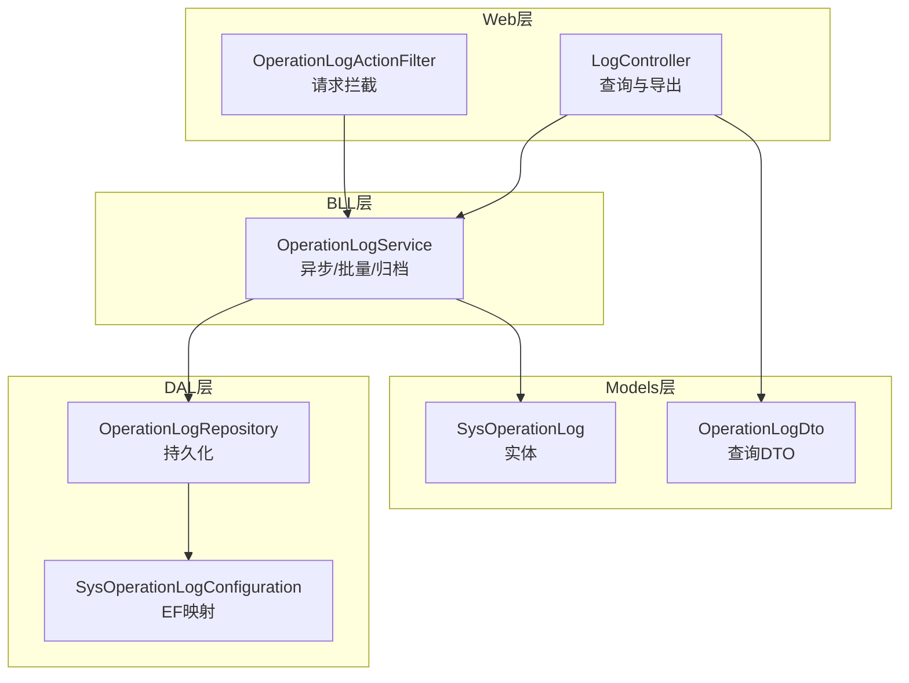
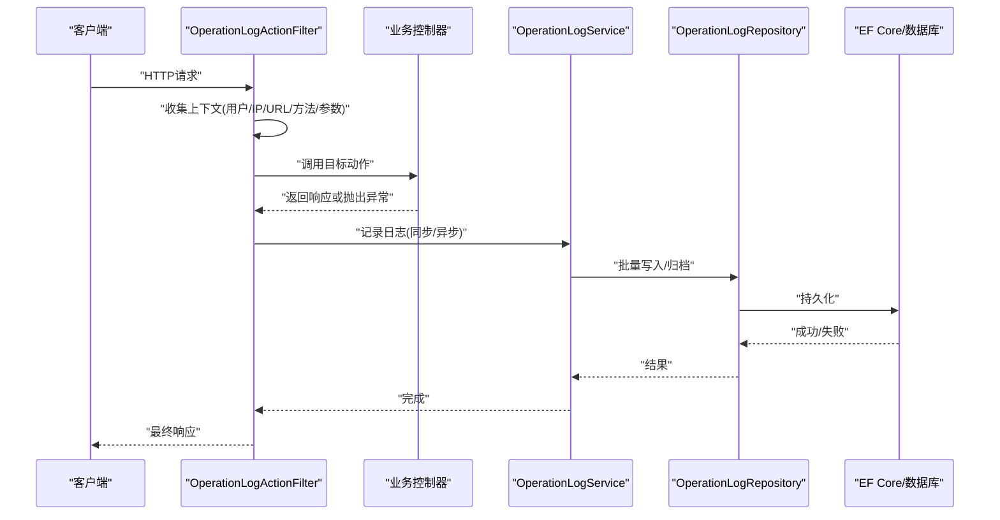
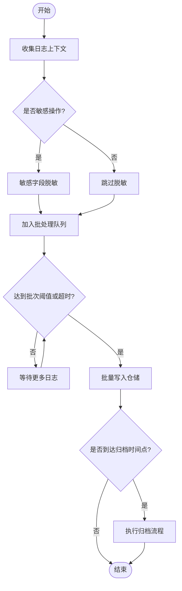
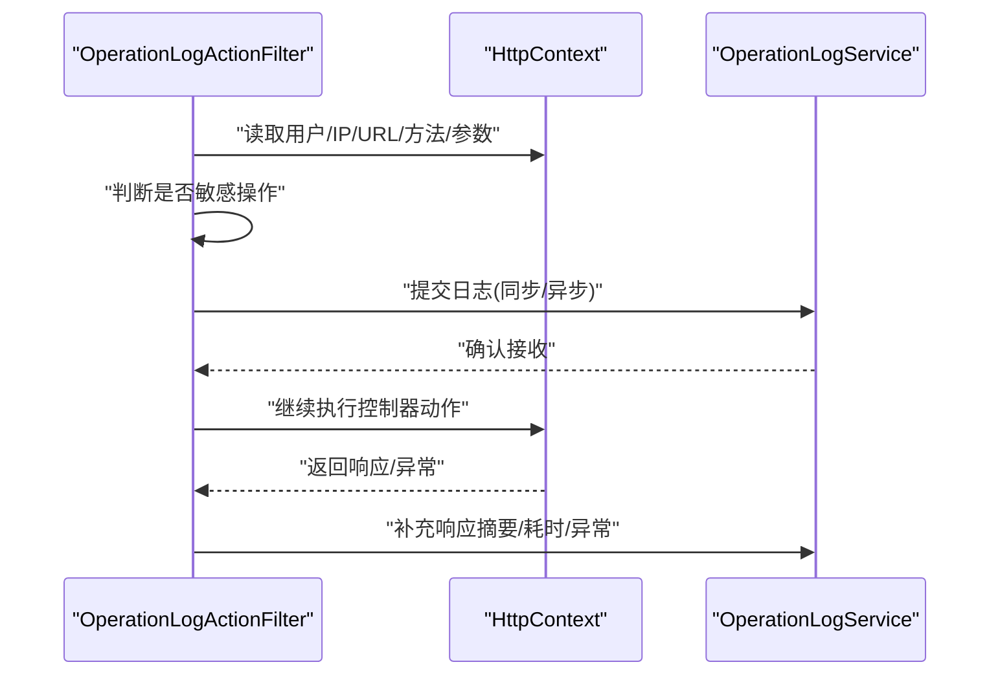
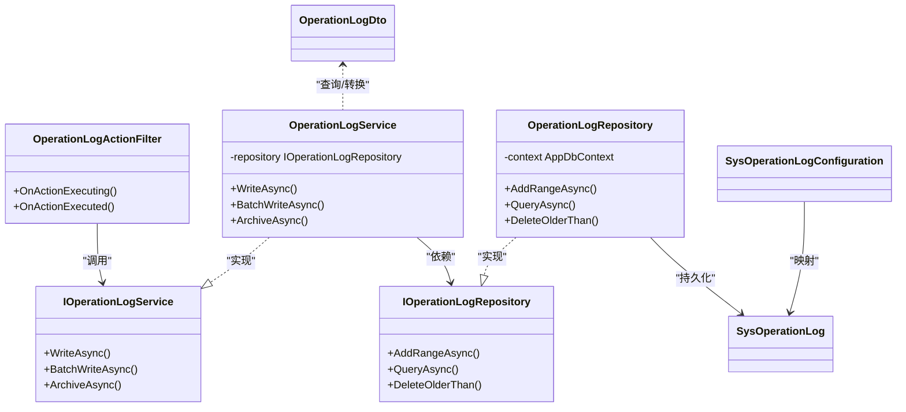

# 安全审计日志

<cite>
**本文引用的文件**   
- [SysOperationLog.cs](file://EquipmentIMS.Models/Entities/SysOperationLog.cs)
- [SysOperationLogConfiguration.cs](file://EquipmentIMS.DAL/Configurations/SysOperationLogConfiguration.cs)
- [OperationLogDto.cs](file://EquipmentIMS.Models/DTOs/OperationLogDto.cs)
- [IOperationLogService.cs](file://EquipmentIMS.BLL/Interfaces/IOperationLogService.cs)
- [OperationLogService.cs](file://EquipmentIMS.BLL/Services/OperationLogService.cs)
- [IOperationLogRepository.cs](file://EquipmentIMS.DAL/Interfaces/IOperationLogRepository.cs)
- [OperationLogRepository.cs](file://EquipmentIMS.DAL/Repositories/OperationLogRepository.cs)
- [OperationLogActionFilter.cs](file://EquipmentIMS.Web/Filters/OperationLogActionFilter.cs)
- [LogController.cs](file://EquipmentIMS.Web/Controllers/LogController.cs)
</cite>

## 目录
1. [简介](#简介)
2. [项目结构](#项目结构)
3. [核心组件](#核心组件)
4. [架构总览](#架构总览)
5. [详细组件分析](#详细组件分析)
6. [依赖关系分析](#依赖关系分析)
7. [性能与存储优化](#性能与存储优化)
8. [隐私保护与合规](#隐私保护与合规)
9. [故障排查指南](#故障排查指南)
10. [结论](#结论)

## 简介
本文件面向THMS系统的安全审计日志子系统，围绕操作日志的数据模型、服务层业务逻辑、过滤器拦截机制以及查询分析与归档策略进行系统化说明。重点覆盖以下方面：
- 数据模型设计：SysOperationLog实体字段与配置映射，涵盖用户行为记录、IP地址追踪、请求参数快照、响应结果摘要等。
- 服务层实现：OperationLogService的异步写入、批量写入优化与日志归档策略。
- 拦截器机制：OperationLogActionFilter对API调用的审计、敏感操作标记与异常事件记录。
- 查询与分析：基于LogController的查询接口能力，支持分页、筛选与导出。
- 企业级方案：日志存储优化、隐私脱敏、长期归档与合规报告生成建议。

## 项目结构
与安全审计日志相关的代码分布在Models、DAL、BLL与Web四层中，遵循分层架构与关注点分离原则：
- Models层定义实体与DTO，承载数据契约与传输对象。
- DAL层提供仓储实现与EF Core配置映射。
- BLL层封装业务逻辑与服务编排。
- Web层通过过滤器拦截请求并暴露查询API。

图表来源
- [OperationLogActionFilter.cs](file://EquipmentIMS.Web/Filters/OperationLogActionFilter.cs)
- [LogController.cs](file://EquipmentIMS.Web/Controllers/LogController.cs)
- [OperationLogService.cs](file://EquipmentIMS.BLL/Services/OperationLogService.cs)
- [IOperationLogService.cs](file://EquipmentIMS.BLL/Interfaces/IOperationLogService.cs)
- [OperationLogRepository.cs](file://EquipmentIMS.DAL/Repositories/OperationLogRepository.cs)
- [IOperationLogRepository.cs](file://EquipmentIMS.DAL/Interfaces/IOperationLogRepository.cs)
- [SysOperationLogConfiguration.cs](file://EquipmentIMS.DAL/Configurations/SysOperationLogConfiguration.cs)
- [SysOperationLog.cs](file://EquipmentIMS.Models/Entities/SysOperationLog.cs)
- [OperationLogDto.cs](file://EquipmentIMS.Models/DTOs/OperationLogDto.cs)

章节来源
- [SysOperationLog.cs](file://EquipmentIMS.Models/Entities/SysOperationLog.cs)
- [SysOperationLogConfiguration.cs](file://EquipmentIMS.DAL/Configurations/SysOperationLogConfiguration.cs)
- [OperationLogDto.cs](file://EquipmentIMS.Models/DTOs/OperationLogDto.cs)
- [IOperationLogService.cs](file://EquipmentIMS.BLL/Interfaces/IOperationLogService.cs)
- [OperationLogService.cs](file://EquipmentIMS.BLL/Services/OperationLogService.cs)
- [IOperationLogRepository.cs](file://EquipmentIMS.DAL/Interfaces/IOperationLogRepository.cs)
- [OperationLogRepository.cs](file://EquipmentIMS.DAL/Repositories/OperationLogRepository.cs)
- [OperationLogActionFilter.cs](file://EquipmentIMS.Web/Filters/OperationLogActionFilter.cs)
- [LogController.cs](file://EquipmentIMS.Web/Controllers/LogController.cs)

## 核心组件
- 数据模型（SysOperationLog）：用于持久化审计日志，包含用户标识、操作描述、HTTP方法、URL、客户端IP、请求头/参数快照、响应状态码、耗时、异常信息、是否敏感操作等字段。
- 配置映射（SysOperationLogConfiguration）：定义表名、主键、索引与列约束，确保查询性能与数据完整性。
- DTO（OperationLogDto）：面向查询与展示的数据传输对象，支持分页、时间范围、关键字、操作类型等筛选条件。
- 服务接口（IOperationLogService）：声明日志写入、批量写入、查询、归档等能力。
- 服务实现（OperationLogService）：封装异步写入、批量入库、归档策略与敏感操作标记等核心业务。
- 仓储接口与实现（IOperationLogRepository / OperationLogRepository）：抽象数据库访问，提供增删改查与批量插入。
- 过滤器（OperationLogActionFilter）：在控制器动作执行前后收集上下文信息，构造日志条目并触发写入。
- 控制器（LogController）：对外暴露日志查询、统计与导出接口，支撑审计与分析。

章节来源
- [SysOperationLog.cs](file://EquipmentIMS.Models/Entities/SysOperationLog.cs)
- [SysOperationLogConfiguration.cs](file://EquipmentIMS.DAL/Configurations/SysOperationLogConfiguration.cs)
- [OperationLogDto.cs](file://EquipmentIMS.Models/DTOs/OperationLogDto.cs)
- [IOperationLogService.cs](file://EquipmentIMS.BLL/Interfaces/IOperationLogService.cs)
- [OperationLogService.cs](file://EquipmentIMS.BLL/Services/OperationLogService.cs)
- [IOperationLogRepository.cs](file://EquipmentIMS.DAL/Interfaces/IOperationLogRepository.cs)
- [OperationLogRepository.cs](file://EquipmentIMS.DAL/Repositories/OperationLogRepository.cs)
- [OperationLogActionFilter.cs](file://EquipmentIMS.Web/Filters/OperationLogActionFilter.cs)
- [LogController.cs](file://EquipmentIMS.Web/Controllers/LogController.cs)

## 架构总览
下图展示了从请求进入Web层到持久化的完整链路，包括过滤器拦截、服务编排、仓储持久化与EF映射。

图表来源
- [OperationLogActionFilter.cs](file://EquipmentIMS.Web/Filters/OperationLogActionFilter.cs)
- [OperationLogService.cs](file://EquipmentIMS.BLL/Services/OperationLogService.cs)
- [OperationLogRepository.cs](file://EquipmentIMS.DAL/Repositories/OperationLogRepository.cs)
- [SysOperationLogConfiguration.cs](file://EquipmentIMS.DAL/Configurations/SysOperationLogConfiguration.cs)

## 详细组件分析

### 数据模型 SysOperationLog
- 设计要点
  - 用户行为记录：用户ID、用户名、操作名称、模块、操作类型（增删改查等）。
  - IP地址追踪：客户端IP、代理链解析、地理位置可选。
  - 请求参数快照：请求方法、URL、查询字符串、表单/JSON体摘要、请求头关键项。
  - 响应结果摘要：状态码、响应时长、错误消息摘要、堆栈哈希。
  - 敏感标记：是否敏感操作、敏感字段掩码标志位。
  - 审计元数据：创建时间、租户/环境标识、批次号（用于批量写入）。
- 复杂度与索引
  - 高频查询字段（如时间、用户、模块、操作类型）建立索引以提升检索性能。
  - 大文本字段（请求体/响应体）采用压缩或分片存储策略以降低I/O压力。
- 扩展性
  - 预留扩展字段以支持多租户、多环境、多应用域的统一审计。

章节来源
- [SysOperationLog.cs](file://EquipmentIMS.Models/Entities/SysOperationLog.cs)
- [SysOperationLogConfiguration.cs](file://EquipmentIMS.DAL/Configurations/SysOperationLogConfiguration.cs)

### 服务层 OperationLogService
- 异步日志记录
  - 使用后台任务或消息队列将日志写入解耦于主请求路径，降低延迟。
  - 支持重试与死信队列，保证可靠性。
- 批量写入优化
  - 聚合多条日志为批次，减少事务开销与网络往返。
  - 控制批次大小与超时阈值，平衡吞吐与实时性。
- 日志归档策略
  - 按时间窗口（日/周/月）归档历史日志至冷存储或独立库。
  - 保留策略与生命周期管理，满足合规要求。
- 敏感操作标记
  - 根据路由、动作名或权限标签识别敏感操作，自动打标。
  - 对敏感字段进行脱敏处理后再落盘。

图表来源
- [OperationLogService.cs](file://EquipmentIMS.BLL/Services/OperationLogService.cs)
- [IOperationLogService.cs](file://EquipmentIMS.BLL/Interfaces/IOperationLogService.cs)
- [OperationLogRepository.cs](file://EquipmentIMS.DAL/Repositories/OperationLogRepository.cs)

章节来源
- [OperationLogService.cs](file://EquipmentIMS.BLL/Services/OperationLogService.cs)
- [IOperationLogService.cs](file://EquipmentIMS.BLL/Interfaces/IOperationLogService.cs)
- [OperationLogRepository.cs](file://EquipmentIMS.DAL/Repositories/OperationLogRepository.cs)

### 过滤器 OperationLogActionFilter
- 拦截机制
  - OnActionExecuting：捕获请求前上下文（用户、IP、URL、方法、参数摘要）。
  - OnActionExecuted：捕获响应后上下文（状态码、耗时、异常信息）。
- API调用审计
  - 统一记录所有受控API的访问轨迹，形成可追溯链条。
- 敏感操作标记
  - 基于特性或白名单规则识别敏感操作，自动设置敏感标记。
- 异常事件记录
  - 捕获未处理异常，记录错误摘要与堆栈哈希，避免泄露敏感细节。

图表来源
- [OperationLogActionFilter.cs](file://EquipmentIMS.Web/Filters/OperationLogActionFilter.cs)
- [OperationLogService.cs](file://EquipmentIMS.BLL/Services/OperationLogService.cs)

章节来源
- [OperationLogActionFilter.cs](file://EquipmentIMS.Web/Filters/OperationLogActionFilter.cs)

### 查询与分析 LogController
- 查询能力
  - 支持按时间范围、用户、模块、操作类型、IP、关键字等多维度筛选。
  - 分页与排序，适配大数据量场景。
- 统计与告警
  - 提供基础统计接口（如按天/小时计数），便于前端可视化。
  - 结合外部告警系统，对异常峰值与敏感操作进行预警。
- 导出与报告
  - 支持CSV/Excel导出，便于离线分析与合规报告生成。

章节来源
- [LogController.cs](file://EquipmentIMS.Web/Controllers/LogController.cs)
- [OperationLogDto.cs](file://EquipmentIMS.Models/DTOs/OperationLogDto.cs)

## 依赖关系分析
- 组件耦合
  - Web层仅依赖服务接口，保持低耦合。
  - 服务层依赖仓储接口，屏蔽具体持久化实现。
  - 仓储层直接依赖EF Core配置与实体模型。
- 外部依赖
  - EF Core用于ORM映射与事务管理。
  - 可选消息队列/后台服务用于异步与批量写入。
- 潜在循环依赖
  - 当前分层清晰，未见循环引用；需确保过滤器不直接访问仓储或服务实现类。

图表来源
- [OperationLogActionFilter.cs](file://EquipmentIMS.Web/Filters/OperationLogActionFilter.cs)
- [IOperationLogService.cs](file://EquipmentIMS.BLL/Interfaces/IOperationLogService.cs)
- [OperationLogService.cs](file://EquipmentIMS.BLL/Services/OperationLogService.cs)
- [IOperationLogRepository.cs](file://EquipmentIMS.DAL/Interfaces/IOperationLogRepository.cs)
- [OperationLogRepository.cs](file://EquipmentIMS.DAL/Repositories/OperationLogRepository.cs)
- [SysOperationLog.cs](file://EquipmentIMS.Models/Entities/SysOperationLog.cs)
- [SysOperationLogConfiguration.cs](file://EquipmentIMS.DAL/Configurations/SysOperationLogConfiguration.cs)
- [OperationLogDto.cs](file://EquipmentIMS.Models/DTOs/OperationLogDto.cs)

章节来源
- [OperationLogActionFilter.cs](file://EquipmentIMS.Web/Filters/OperationLogActionFilter.cs)
- [IOperationLogService.cs](file://EquipmentIMS.BLL/Interfaces/IOperationLogService.cs)
- [OperationLogService.cs](file://EquipmentIMS.BLL/Services/OperationLogService.cs)
- [IOperationLogRepository.cs](file://EquipmentIMS.DAL/Interfaces/IOperationLogRepository.cs)
- [OperationLogRepository.cs](file://EquipmentIMS.DAL/Repositories/OperationLogRepository.cs)
- [SysOperationLog.cs](file://EquipmentIMS.Models/Entities/SysOperationLog.cs)
- [SysOperationLogConfiguration.cs](file://EquipmentIMS.DAL/Configurations/SysOperationLogConfiguration.cs)
- [OperationLogDto.cs](file://EquipmentIMS.Models/DTOs/OperationLogDto.cs)

## 性能与存储优化
- 异步与批量
  - 使用后台任务或消息队列解耦写入，避免阻塞主线程。
  - 合理设置批次大小与刷新间隔，平衡吞吐与延迟。
- 索引与查询
  - 针对常用筛选字段建立复合索引，提升查询效率。
  - 限制大字段长度或使用压缩存储，减少磁盘占用。
- 归档与冷热分离
  - 热数据保留短期（如30天），冷数据归档至低成本存储。
  - 定期清理过期数据，控制表膨胀。
- 监控与限流
  - 监控写入延迟与队列积压，动态调整批次与并发度。
  - 对高频率操作进行采样或降采样，避免风暴。

[本节为通用指导，无需特定文件来源]

## 隐私保护与合规
- 敏感字段脱敏
  - 对密码、身份证号、银行卡号等进行掩码或哈希处理。
  - 禁止记录明文敏感内容，必要时拒绝记录或替换为占位符。
- 最小化采集
  - 仅记录必要字段，避免过度采集导致隐私风险。
- 访问控制与审计
  - 对日志查询与导出实施严格的权限控制与二次审计。
- 合规报告
  - 生成符合监管要求的报表（如操作轨迹、异常汇总、敏感操作清单）。
  - 支持导出与签名校验，确保报告不可篡改。

[本节为通用指导，无需特定文件来源]

## 故障排查指南
- 常见问题
  - 日志丢失：检查异步队列堆积、批量写入失败与重试策略。
  - 性能抖动：评估批次大小、索引命中与锁竞争情况。
  - 敏感信息泄露：审查脱敏规则与过滤器的参数采集逻辑。
- 定位步骤
  - 查看过滤器上下文收集是否完整。
  - 验证服务层批量写入与归档流程是否按预期执行。
  - 检查仓储层SQL与EF映射是否正确。
- 恢复措施
  - 重放失败批次、修复脏数据、重建索引。
  - 临时降级为同步写入以保证一致性。

章节来源
- [OperationLogActionFilter.cs](file://EquipmentIMS.Web/Filters/OperationLogActionFilter.cs)
- [OperationLogService.cs](file://EquipmentIMS.BLL/Services/OperationLogService.cs)
- [OperationLogRepository.cs](file://EquipmentIMS.DAL/Repositories/OperationLogRepository.cs)

## 结论
THMS安全审计日志子系统通过分层设计与关注点分离，实现了可靠的API调用审计、敏感操作标记与异常事件记录。借助异步与批量写入、索引优化与归档策略，系统在性能与合规之间取得良好平衡。建议在现有基础上进一步完善隐私脱敏、告警联动与合规报告自动化，以满足企业级安全审计需求。