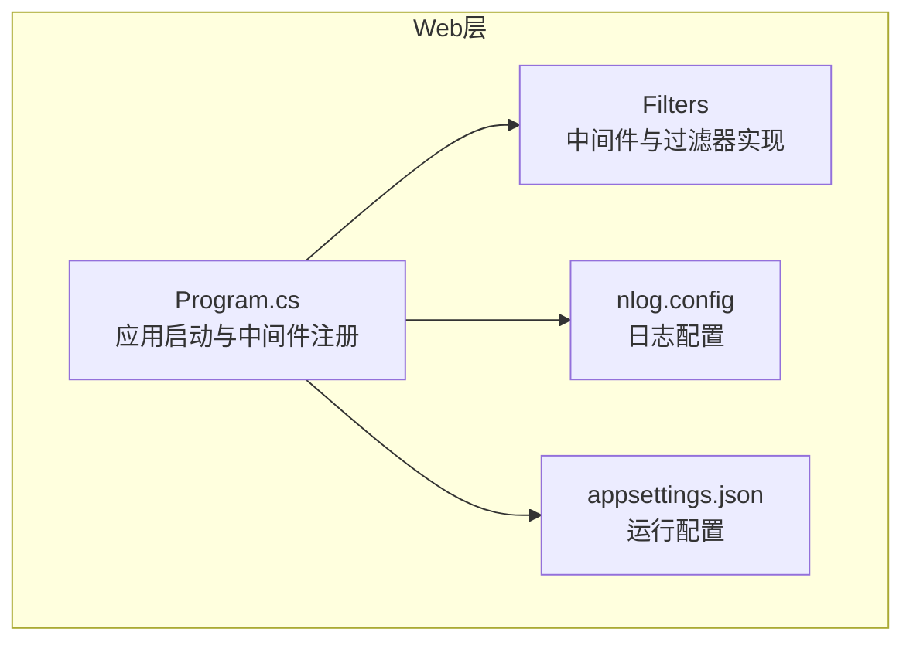
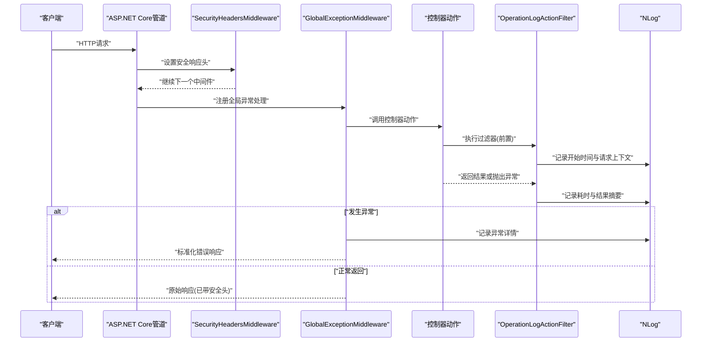
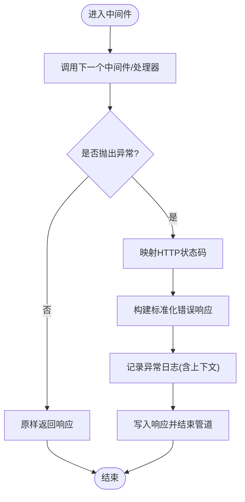
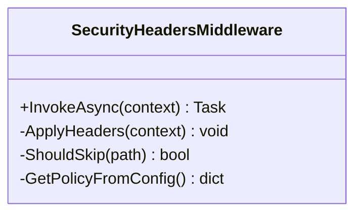
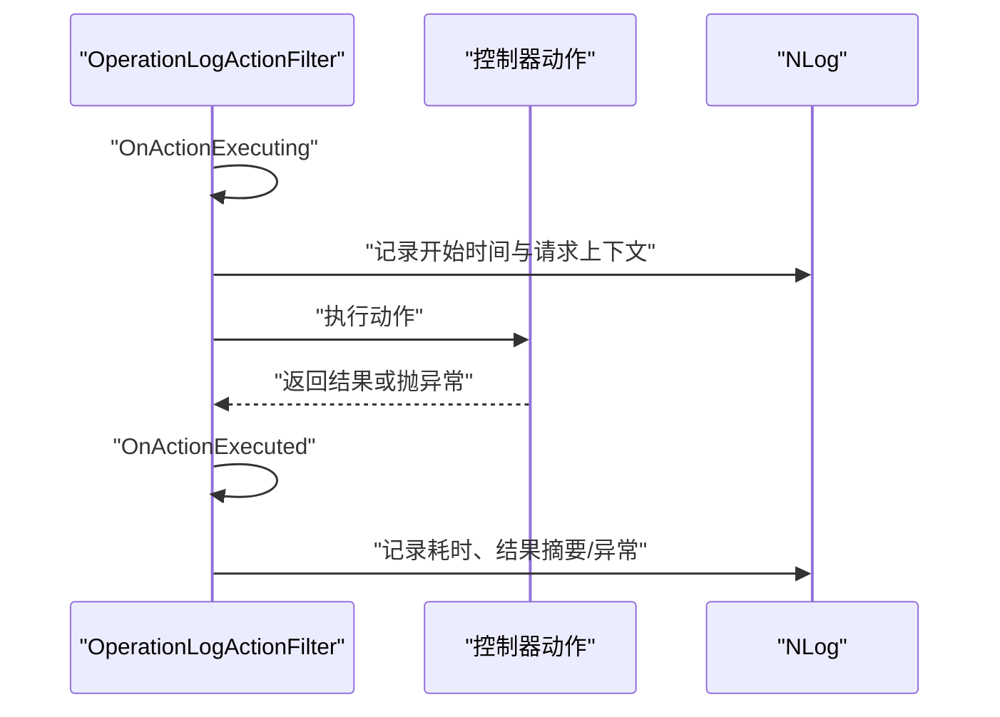
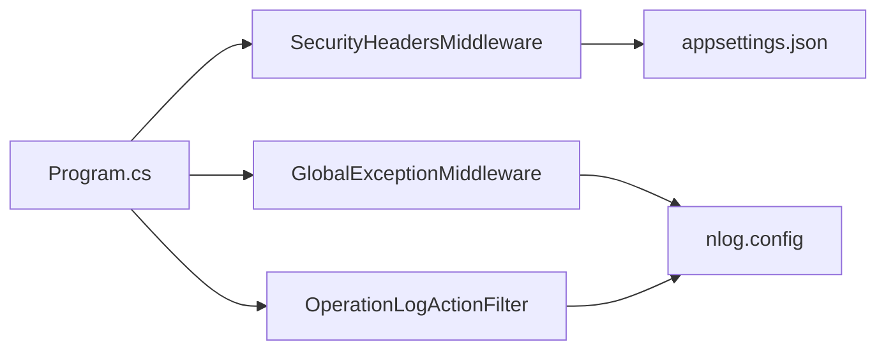

# 安全防护中间件

<cite>
**本文引用的文件**   
- [Program.cs](file://EquipmentIMS.Web/Program.cs)
- [GlobalExceptionMiddleware.cs](file://EquipmentIMS.Web/Filters/GlobalExceptionMiddleware.cs)
- [SecurityHeadersMiddleware.cs](file://EquipmentIMS.Web/Filters/SecurityHeadersMiddleware.cs)
- [OperationLogActionFilter.cs](file://EquipmentIMS.Web/Filters/OperationLogActionFilter.cs)
- [nlog.config](file://EquipmentIMS.Web/nlog.config)
- [appsettings.json](file://EquipmentIMS.Web/appsettings.json)
</cite>

## 目录
1. [简介](#简介)
2. [项目结构](#项目结构)
3. [核心组件](#核心组件)
4. [架构总览](#架构总览)
5. [详细组件分析](#详细组件分析)
6. [依赖关系分析](#依赖关系分析)
7. [性能考虑](#性能考虑)
8. [故障排查指南](#故障排查指南)
9. [结论](#结论)
10. [附录](#附录)

## 简介
本文件聚焦于THMS系统的安全防护中间件，围绕以下目标展开：
- 全局异常处理中间件（GlobalExceptionMiddleware）：异常捕获、错误响应格式化、异常日志记录。
- 安全头中间件（SecurityHeadersMiddleware）：CSP、HSTS、X-Frame-Options等安全HTTP头的配置与注入。
- 操作日志过滤器（OperationLogActionFilter）：请求拦截、参数记录、执行时间统计。
- 自定义中间件开发模式、中间件管道配置、性能监控集成等最佳实践。

## 项目结构
与安全相关的代码主要位于Web层的Filters目录，并在Program.cs中完成注册与管道编排。日志框架采用NLog，配置文件位于根目录。

图表来源
- [Program.cs](file://EquipmentIMS.Web/Program.cs)
- [nlog.config](file://EquipmentIMS.Web/nlog.config)
- [appsettings.json](file://EquipmentIMS.Web/appsettings.json)

章节来源
- [Program.cs](file://EquipmentIMS.Web/Program.cs)
- [nlog.config](file://EquipmentIMS.Web/nlog.config)
- [appsettings.json](file://EquipmentIMS.Web/appsettings.json)

## 核心组件
- 全局异常处理中间件（GlobalExceptionMiddleware）
  - 职责：统一捕获未处理异常，标准化错误响应体，记录结构化异常日志，避免将内部细节泄露给客户端。
  - 关键点：区分业务异常与未知异常；为不同状态码返回一致的JSON结构；在写入响应前确保内容长度与编码正确。
- 安全头中间件（SecurityHeadersMiddleware）
  - 职责：为所有响应注入安全相关HTTP头，如Content-Security-Policy、Strict-Transport-Security、X-Frame-Options、X-Content-Type-Options、Referrer-Policy等。
  - 关键点：支持可配置策略；对静态资源或特定路径进行白名单豁免；避免重复设置。
- 操作日志过滤器（OperationLogActionFilter）
  - 职责：在控制器动作执行前后进行拦截，记录请求信息、入参、耗时、结果摘要与异常信息。
  - 关键点：异步执行、避免阻塞主流程；敏感字段脱敏；按级别输出到日志系统。

章节来源
- [GlobalExceptionMiddleware.cs](file://EquipmentIMS.Web/Filters/GlobalExceptionMiddleware.cs)
- [SecurityHeadersMiddleware.cs](file://EquipmentIMS.Web/Filters/SecurityHeadersMiddleware.cs)
- [OperationLogActionFilter.cs](file://EquipmentIMS.Web/Filters/OperationLogActionFilter.cs)

## 架构总览
下图展示了请求进入ASP.NET Core管道后，经过安全头注入、全局异常处理、控制器动作执行以及操作日志记录的完整链路。

图表来源
- [Program.cs](file://EquipmentIMS.Web/Program.cs)
- [SecurityHeadersMiddleware.cs](file://EquipmentIMS.Web/Filters/SecurityHeadersMiddleware.cs)
- [GlobalExceptionMiddleware.cs](file://EquipmentIMS.Web/Filters/GlobalExceptionMiddleware.cs)
- [OperationLogActionFilter.cs](file://EquipmentIMS.Web/Filters/OperationLogActionFilter.cs)
- [nlog.config](file://EquipmentIMS.Web/nlog.config)

## 详细组件分析

### 全局异常处理中间件（GlobalExceptionMiddleware）
- 设计要点
  - 使用Try/Catch包裹后续管道调用，捕获所有未处理异常。
  - 根据异常类型映射HTTP状态码（例如业务异常、验证异常、未找到异常等）。
  - 构造统一的错误响应对象，包含错误码、消息、追踪ID等字段。
  - 通过日志框架记录异常堆栈、请求上下文、用户标识等关键信息。
- 错误响应格式
  - 建议采用固定结构的JSON，便于前端统一处理。
  - 包含：code、message、traceId、timestamp等字段。
- 日志记录
  - 使用NLog记录Error级别日志，附带Request Id、Path、Method、User-Agent、IP等上下文。
  - 对敏感数据（密码、令牌、卡号等）进行脱敏后再落盘。
- 边界情况
  - 响应已提交时跳过写入。
  - 对已知业务异常不返回500，而是对应业务状态码。
  - 避免在调试环境泄露敏感堆栈到客户端。

图表来源
- [GlobalExceptionMiddleware.cs](file://EquipmentIMS.Web/Filters/GlobalExceptionMiddleware.cs)
- [nlog.config](file://EquipmentIMS.Web/nlog.config)

章节来源
- [GlobalExceptionMiddleware.cs](file://EquipmentIMS.Web/Filters/GlobalExceptionMiddleware.cs)
- [nlog.config](file://EquipmentIMS.Web/nlog.config)

### 安全头中间件（SecurityHeadersMiddleware）
- 设计要点
  - 在响应阶段注入安全相关HTTP头，确保每个响应都具备基础安全能力。
  - 支持通过配置项控制策略强度与豁免路径。
- 常用安全头说明
  - Content-Security-Policy（CSP）：限制资源加载来源，降低XSS风险。
  - Strict-Transport-Security（HSTS）：强制HTTPS访问，防止降级攻击。
  - X-Frame-Options：禁止被嵌入iframe，缓解点击劫持。
  - X-Content-Type-Options：禁止MIME嗅探。
  - Referrer-Policy：控制Referer信息泄露范围。
  - Permissions-Policy：限制浏览器特性使用（可选）。
- 配置方式
  - 从配置源读取策略值，合并默认策略。
  - 针对静态资源或API路径进行豁免，避免破坏功能。
- 幂等性与覆盖
  - 若上层已设置相同头部，可选择保留上层策略或覆盖，需明确策略。

图表来源
- [SecurityHeadersMiddleware.cs](file://EquipmentIMS.Web/Filters/SecurityHeadersMiddleware.cs)
- [appsettings.json](file://EquipmentIMS.Web/appsettings.json)

章节来源
- [SecurityHeadersMiddleware.cs](file://EquipmentIMS.Web/Filters/SecurityHeadersMiddleware.cs)
- [appsettings.json](file://EquipmentIMS.Web/appsettings.json)

### 操作日志过滤器（OperationLogActionFilter）
- 设计要点
  - 作为Action过滤器，在控制器动作执行前后进行拦截。
  - 记录请求方法、URL、查询字符串、路由参数、表单/JSON入参摘要、执行耗时、返回状态码与异常信息。
  - 对敏感字段进行脱敏处理，避免泄露隐私。
- 执行时序
  - OnActionExecuting：记录开始时间、请求上下文、入参摘要。
  - OnActionExecuted：记录结束时间、耗时、返回摘要或异常。
- 性能考量
  - 仅记录必要字段，避免大对象序列化开销。
  - 异步写入日志，减少IO阻塞。
  - 提供采样开关，在高并发场景下按需降采样。

图表来源
- [OperationLogActionFilter.cs](file://EquipmentIMS.Web/Filters/OperationLogActionFilter.cs)
- [nlog.config](file://EquipmentIMS.Web/nlog.config)

章节来源
- [OperationLogActionFilter.cs](file://EquipmentIMS.Web/Filters/OperationLogActionFilter.cs)
- [nlog.config](file://EquipmentIMS.Web/nlog.config)

## 依赖关系分析
- 中间件注册顺序
  - 安全头中间件应尽早注册，确保所有响应均携带安全头。
  - 全局异常处理中间件应在大多数业务中间件之前，以便捕获后续异常。
  - 操作日志过滤器作用于控制器动作层面，与中间件并行生效。
- 外部依赖
  - 日志框架：NLog，通过nlog.config定义目标与规则。
  - 配置系统：appsettings.json用于读取安全头策略与过滤开关。

图表来源
- [Program.cs](file://EquipmentIMS.Web/Program.cs)
- [SecurityHeadersMiddleware.cs](file://EquipmentIMS.Web/Filters/SecurityHeadersMiddleware.cs)
- [GlobalExceptionMiddleware.cs](file://EquipmentIMS.Web/Filters/GlobalExceptionMiddleware.cs)
- [OperationLogActionFilter.cs](file://EquipmentIMS.Web/Filters/OperationLogActionFilter.cs)
- [nlog.config](file://EquipmentIMS.Web/nlog.config)
- [appsettings.json](file://EquipmentIMS.Web/appsettings.json)

章节来源
- [Program.cs](file://EquipmentIMS.Web/Program.cs)
- [nlog.config](file://EquipmentIMS.Web/nlog.config)
- [appsettings.json](file://EquipmentIMS.Web/appsettings.json)

## 性能考虑
- 中间件顺序优化
  - 将轻量级中间件（如安全头）置于管道前端，减少不必要的处理开销。
  - 全局异常处理尽量只做最小化工作，避免在异常路径中进行复杂计算。
- 日志写入策略
  - 使用异步写入与批处理，降低磁盘IO对请求延迟的影响。
  - 对高频接口启用采样记录，避免日志风暴。
- 安全头策略
  - CSP策略应尽量精确，避免过于宽松导致性能损耗与安全风险。
  - HSTS预加载列表可在CDN或网关层配合，减少首字节延迟。
- 过滤器开销
  - 避免在过滤器中执行重IO或网络请求。
  - 对大对象入参仅记录摘要或哈希，必要时开启开关关闭详细日志。

[本节为通用指导，无需源码引用]

## 故障排查指南
- 全局异常未捕获
  - 检查中间件注册顺序，确保全局异常处理位于业务中间件之前。
  - 确认异常类型是否被业务层吞掉或未重新抛出。
- 安全头缺失
  - 核对安全头中间件是否注册且未被短路逻辑跳过。
  - 检查豁免路径配置是否正确。
- 操作日志缺失
  - 确认过滤器是否应用到目标控制器或全局注册。
  - 检查NLog配置的目标与规则是否生效。
- 日志过大或性能下降
  - 调整采样率与字段白名单。
  - 对敏感字段进行脱敏，避免长文本落盘。

章节来源
- [GlobalExceptionMiddleware.cs](file://EquipmentIMS.Web/Filters/GlobalExceptionMiddleware.cs)
- [SecurityHeadersMiddleware.cs](file://EquipmentIMS.Web/Filters/SecurityHeadersMiddleware.cs)
- [OperationLogActionFilter.cs](file://EquipmentIMS.Web/Filters/OperationLogActionFilter.cs)
- [nlog.config](file://EquipmentIMS.Web/nlog.config)

## 结论
通过全局异常处理、安全头注入与操作日志过滤器的协同，THMS系统在健壮性、安全性与可观测性方面得到了系统性增强。建议在持续迭代中完善策略配置、细化日志粒度，并结合APM工具进行端到端性能监控与问题定位。

[本节为总结性内容，无需源码引用]

## 附录
- 自定义中间件开发模式
  - 构造函数注入依赖（如IConfiguration、ILogger）。
  - InvokeAsync方法中封装next.Invoke，并在try/catch中处理异常。
  - 在Program.cs中使用UseMiddleware<T>()注册。
- 中间件管道配置最佳实践
  - 明确注册顺序：安全头→认证授权→全局异常→业务中间件→端点。
  - 对静态资源与API路径进行差异化处理。
- 性能监控集成
  - 结合NLog与分布式追踪ID，关联一次请求的完整日志。
  - 在过滤器中记录耗时指标，上报至监控系统。

[本节为概念性内容，无需源码引用]