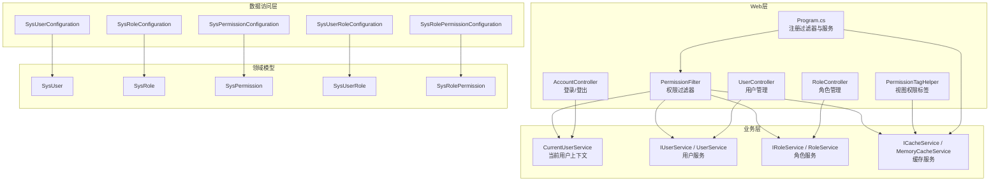
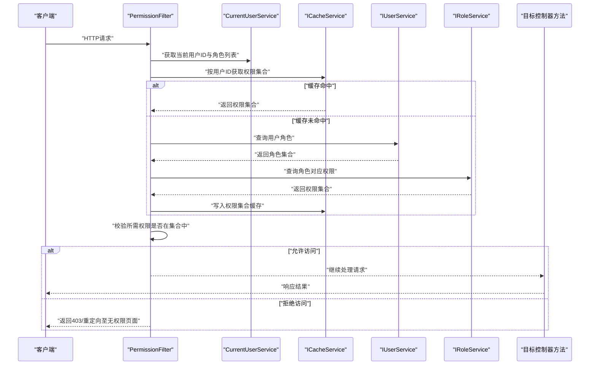
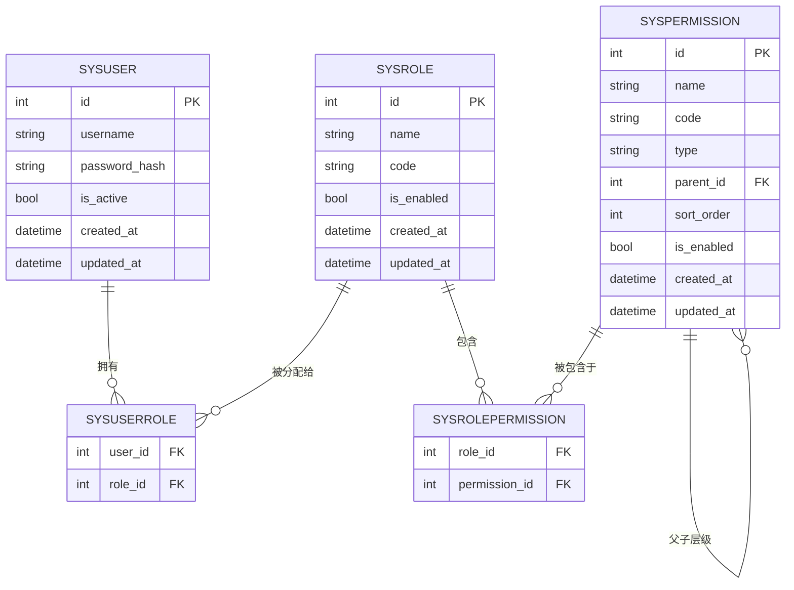
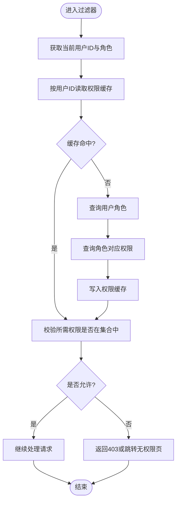
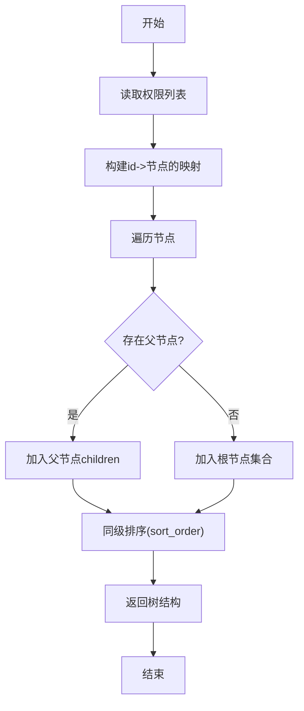
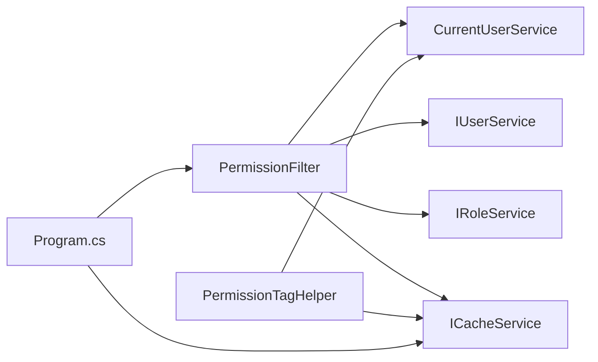

# 授权控制策略

<cite>
**本文引用的文件**   
- [PermissionFilter.cs](file://EquipmentIMS.Web/Filters/PermissionFilter.cs)
- [SysPermission.cs](file://EquipmentIMS.Models/Entities/SysPermission.cs)
- [SysRole.cs](file://EquipmentIMS.Models/Entities/SysRole.cs)
- [SysUser.cs](file://EquipmentIMS.Models/Entities/SysUser.cs)
- [SysRolePermission.cs](file://EquipmentIMS.Models/Entities/SysRolePermission.cs)
- [SysUserRole.cs](file://EquipmentIMS.Models/Entities/SysUserRole.cs)
- [SysPermissionConfiguration.cs](file://EquipmentIMS.DAL/Configurations/SysPermissionConfiguration.cs)
- [SysRoleConfiguration.cs](file://EquipmentIMS.DAL/Configurations/SysRoleConfiguration.cs)
- [SysUserConfiguration.cs](file://EquipmentIMS.DAL/Configurations/SysUserConfiguration.cs)
- [SysRolePermissionConfiguration.cs](file://EquipmentIMS.DAL/Configurations/SysRolePermissionConfiguration.cs)
- [SysUserRoleConfiguration.cs](file://EquipmentIMS.DAL/Configurations/SysUserRoleConfiguration.cs)
- [IUserService.cs](file://EquipmentIMS.BLL/Interfaces/IUserService.cs)
- [IRoleService.cs](file://EquipmentIMS.BLL/Interfaces/IRoleService.cs)
- [ICacheService.cs](file://EquipmentIMS.BLL/Interfaces/ICacheService.cs)
- [MemoryCacheService.cs](file://EquipmentIMS.BLL/Services/MemoryCacheService.cs)
- [CurrentUserService.cs](file://EquipmentIMS.BLL/Services/CurrentUserService.cs)
- [Program.cs](file://EquipmentIMS.Web/Program.cs)
- [PermissionTagHelper.cs](file://EquipmentIMS.Web/Extensions/PermissionTagHelper.cs)
- [AccountController.cs](file://EquipmentIMS.Web/Controllers/AccountController.cs)
- [RoleController.cs](file://EquipmentIMS.Web/Controllers/RoleController.cs)
- [UserController.cs](file://EquipmentIMS.Web/Controllers/UserController.cs)
</cite>

## 目录
1. [简介](#简介)
2. [项目结构](#项目结构)
3. [核心组件](#核心组件)
4. [架构总览](#架构总览)
5. [详细组件分析](#详细组件分析)
6. [依赖关系分析](#依赖关系分析)
7. [性能考虑](#性能考虑)
8. [故障排查指南](#故障排查指南)
9. [结论](#结论)
10. [附录](#附录)

## 简介
本文件聚焦THMS系统的授权控制策略，围绕基于角色的访问控制（RBAC）模型进行系统化说明。内容涵盖：
- RBAC实体与数据模型设计（用户、角色、权限及其关联）
- PermissionFilter权限过滤器的实现原理（控制器与方法级授权）
- 权限继承机制、动态权限加载与缓存策略
- 自定义授权属性开发、权限树构建算法、批量权限分配
- 权限审计与变更追踪的最佳实践

## 项目结构
授权相关代码分布在以下层次：
- Web层：过滤器、控制器、视图辅助标签、程序启动配置
- 业务层：服务接口与内存缓存实现、当前用户上下文
- 数据访问层：EF Core配置（实体映射）
- 领域模型：用户、角色、权限及中间表实体

图表来源
- [PermissionFilter.cs](file://EquipmentIMS.Web/Filters/PermissionFilter.cs)
- [Program.cs](file://EquipmentIMS.Web/Program.cs)
- [PermissionTagHelper.cs](file://EquipmentIMS.Web/Extensions/PermissionTagHelper.cs)
- [AccountController.cs](file://EquipmentIMS.Web/Controllers/AccountController.cs)
- [RoleController.cs](file://EquipmentIMS.Web/Controllers/RoleController.cs)
- [UserController.cs](file://EquipmentIMS.Web/Controllers/UserController.cs)
- [CurrentUserService.cs](file://EquipmentIMS.BLL/Services/CurrentUserService.cs)
- [IUserService.cs](file://EquipmentIMS.BLL/Interfaces/IUserService.cs)
- [IRoleService.cs](file://EquipmentIMS.BLL/Interfaces/IRoleService.cs)
- [ICacheService.cs](file://EquipmentIMS.BLL/Interfaces/ICacheService.cs)
- [MemoryCacheService.cs](file://EquipmentIMS.BLL/Services/MemoryCacheService.cs)
- [SysPermissionConfiguration.cs](file://EquipmentIMS.DAL/Configurations/SysPermissionConfiguration.cs)
- [SysRoleConfiguration.cs](file://EquipmentIMS.DAL/Configurations/SysRoleConfiguration.cs)
- [SysUserConfiguration.cs](file://EquipmentIMS.DAL/Configurations/SysUserConfiguration.cs)
- [SysRolePermissionConfiguration.cs](file://EquipmentIMS.DAL/Configurations/SysRolePermissionConfiguration.cs)
- [SysUserRoleConfiguration.cs](file://EquipmentIMS.DAL/Configurations/SysUserRoleConfiguration.cs)
- [SysPermission.cs](file://EquipmentIMS.Models/Entities/SysPermission.cs)
- [SysRole.cs](file://EquipmentIMS.Models/Entities/SysRole.cs)
- [SysUser.cs](file://EquipmentIMS.Models/Entities/SysUser.cs)
- [SysRolePermission.cs](file://EquipmentIMS.Models/Entities/SysRolePermission.cs)
- [SysUserRole.cs](file://EquipmentIMS.Models/Entities/SysUserRole.cs)

章节来源
- [PermissionFilter.cs](file://EquipmentIMS.Web/Filters/PermissionFilter.cs)
- [Program.cs](file://EquipmentIMS.Web/Program.cs)
- [PermissionTagHelper.cs](file://EquipmentIMS.Web/Extensions/PermissionTagHelper.cs)
- [AccountController.cs](file://EquipmentIMS.Web/Controllers/AccountController.cs)
- [RoleController.cs](file://EquipmentIMS.Web/Controllers/RoleController.cs)
- [UserController.cs](file://EquipmentIMS.Web/Controllers/UserController.cs)
- [CurrentUserService.cs](file://EquipmentIMS.BLL/Services/CurrentUserService.cs)
- [IUserService.cs](file://EquipmentIMS.BLL/Interfaces/IUserService.cs)
- [IRoleService.cs](file://EquipmentIMS.BLL/Interfaces/IRoleService.cs)
- [ICacheService.cs](file://EquipmentIMS.BLL/Interfaces/ICacheService.cs)
- [MemoryCacheService.cs](file://EquipmentIMS.BLL/Services/MemoryCacheService.cs)
- [SysPermissionConfiguration.cs](file://EquipmentIMS.DAL/Configurations/SysPermissionConfiguration.cs)
- [SysRoleConfiguration.cs](file://EquipmentIMS.DAL/Configurations/SysRoleConfiguration.cs)
- [SysUserConfiguration.cs](file://EquipmentIMS.DAL/Configurations/SysUserConfiguration.cs)
- [SysRolePermissionConfiguration.cs](file://EquipmentIMS.DAL/Configurations/SysRolePermissionConfiguration.cs)
- [SysUserRoleConfiguration.cs](file://EquipmentIMS.DAL/Configurations/SysUserRoleConfiguration.cs)
- [SysPermission.cs](file://EquipmentIMS.Models/Entities/SysPermission.cs)
- [SysRole.cs](file://EquipmentIMS.Models/Entities/SysRole.cs)
- [SysUser.cs](file://EquipmentIMS.Models/Entities/SysUser.cs)
- [SysRolePermission.cs](file://EquipmentIMS.Models/Entities/SysRolePermission.cs)
- [SysUserRole.cs](file://EquipmentIMS.Models/Entities/SysUserRole.cs)

## 核心组件
- 权限过滤器（PermissionFilter）
  - 在请求进入Action前执行，校验当前用户是否具备所需权限；支持控制器与方法级标注
  - 通过当前用户上下文获取用户标识与角色集合，结合缓存中的权限集进行判定
- 当前用户上下文（CurrentUserService）
  - 从HTTP上下文解析已认证用户的身份与角色信息
- 权限缓存（ICacheService/MemoryCacheService）
  - 提供按用户或全局维度的权限集合缓存，减少重复查询
- 用户与角色服务（IUserService/IRoleService）
  - 暴露用户、角色、权限的查询能力，供过滤器与业务逻辑使用
- 视图权限标签（PermissionTagHelper）
  - 在视图中根据当前用户权限渲染/隐藏菜单或按钮

章节来源
- [PermissionFilter.cs](file://EquipmentIMS.Web/Filters/PermissionFilter.cs)
- [CurrentUserService.cs](file://EquipmentIMS.BLL/Services/CurrentUserService.cs)
- [ICacheService.cs](file://EquipmentIMS.BLL/Interfaces/ICacheService.cs)
- [MemoryCacheService.cs](file://EquipmentIMS.BLL/Services/MemoryCacheService.cs)
- [IUserService.cs](file://EquipmentIMS.BLL/Interfaces/IUserService.cs)
- [IRoleService.cs](file://EquipmentIMS.BLL/Interfaces/IRoleService.cs)
- [PermissionTagHelper.cs](file://EquipmentIMS.Web/Extensions/PermissionTagHelper.cs)

## 架构总览
下图展示了从请求到授权决策的关键路径：过滤器拦截请求，读取当前用户与角色，查询并缓存权限，最终决定是否放行。

图表来源
- [PermissionFilter.cs](file://EquipmentIMS.Web/Filters/PermissionFilter.cs)
- [CurrentUserService.cs](file://EquipmentIMS.BLL/Services/CurrentUserService.cs)
- [ICacheService.cs](file://EquipmentIMS.BLL/Interfaces/ICacheService.cs)
- [MemoryCacheService.cs](file://EquipmentIMS.BLL/Services/MemoryCacheService.cs)
- [IUserService.cs](file://EquipmentIMS.BLL/Interfaces/IUserService.cs)
- [IRoleService.cs](file://EquipmentIMS.BLL/Interfaces/IRoleService.cs)
- [AccountController.cs](file://EquipmentIMS.Web/Controllers/AccountController.cs)
- [RoleController.cs](file://EquipmentIMS.Web/Controllers/RoleController.cs)
- [UserController.cs](file://EquipmentIMS.Web/Controllers/UserController.cs)

## 详细组件分析

### RBAC数据模型与关系
- 实体定义
  - 用户（SysUser）：代表系统使用者
  - 角色（SysRole）：一组权限的集合
  - 权限（SysPermission）：最小授权单元，可包含层级结构
  - 用户-角色（SysUserRole）：多对多关系
  - 角色-权限（SysRolePermission）：多对多关系
- EF Core配置
  - 各实体的配置类定义了主键、外键、索引等约束，确保关系完整性与查询性能

图表来源
- [SysUser.cs](file://EquipmentIMS.Models/Entities/SysUser.cs)
- [SysRole.cs](file://EquipmentIMS.Models/Entities/SysRole.cs)
- [SysPermission.cs](file://EquipmentIMS.Models/Entities/SysPermission.cs)
- [SysUserRole.cs](file://EquipmentIMS.Models/Entities/SysUserRole.cs)
- [SysRolePermission.cs](file://EquipmentIMS.Models/Entities/SysRolePermission.cs)
- [SysUserConfiguration.cs](file://EquipmentIMS.DAL/Configurations/SysUserConfiguration.cs)
- [SysRoleConfiguration.cs](file://EquipmentIMS.DAL/Configurations/SysRoleConfiguration.cs)
- [SysPermissionConfiguration.cs](file://EquipmentIMS.DAL/Configurations/SysPermissionConfiguration.cs)
- [SysUserRoleConfiguration.cs](file://EquipmentIMS.DAL/Configurations/SysUserRoleConfiguration.cs)
- [SysRolePermissionConfiguration.cs](file://EquipmentIMS.DAL/Configurations/SysRolePermissionConfiguration.cs)

章节来源
- [SysUser.cs](file://EquipmentIMS.Models/Entities/SysUser.cs)
- [SysRole.cs](file://EquipmentIMS.Models/Entities/SysRole.cs)
- [SysPermission.cs](file://EquipmentIMS.Models/Entities/SysPermission.cs)
- [SysUserRole.cs](file://EquipmentIMS.Models/Entities/SysUserRole.cs)
- [SysRolePermission.cs](file://EquipmentIMS.Models/Entities/SysRolePermission.cs)
- [SysUserConfiguration.cs](file://EquipmentIMS.DAL/Configurations/SysUserConfiguration.cs)
- [SysRoleConfiguration.cs](file://EquipmentIMS.DAL/Configurations/SysRoleConfiguration.cs)
- [SysPermissionConfiguration.cs](file://EquipmentIMS.DAL/Configurations/SysPermissionConfiguration.cs)
- [SysUserRoleConfiguration.cs](file://EquipmentIMS.DAL/Configurations/SysUserRoleConfiguration.cs)
- [SysRolePermissionConfiguration.cs](file://EquipmentIMS.DAL/Configurations/SysRolePermissionConfiguration.cs)

### PermissionFilter权限过滤器
- 职责
  - 在请求进入Action之前检查当前用户是否具备所需权限
  - 支持控制器级别与方法级别的细粒度授权
- 关键流程
  - 解析当前用户标识与角色集合
  - 从缓存中获取该用户的权限集合（未命中则回源查询）
  - 判断所需权限是否在集合中，决定放行或拒绝
- 典型用法
  - 在控制器或方法上标注授权特性（例如要求特定权限码）
  - 未通过校验时返回403或重定向至“无权限”页面

图表来源
- [PermissionFilter.cs](file://EquipmentIMS.Web/Filters/PermissionFilter.cs)
- [CurrentUserService.cs](file://EquipmentIMS.BLL/Services/CurrentUserService.cs)
- [ICacheService.cs](file://EquipmentIMS.BLL/Interfaces/ICacheService.cs)
- [MemoryCacheService.cs](file://EquipmentIMS.BLL/Services/MemoryCacheService.cs)
- [IUserService.cs](file://EquipmentIMS.BLL/Interfaces/IUserService.cs)
- [IRoleService.cs](file://EquipmentIMS.BLL/Interfaces/IRoleService.cs)

章节来源
- [PermissionFilter.cs](file://EquipmentIMS.Web/Filters/PermissionFilter.cs)
- [CurrentUserService.cs](file://EquipmentIMS.BLL/Services/CurrentUserService.cs)
- [ICacheService.cs](file://EquipmentIMS.BLL/Interfaces/ICacheService.cs)
- [MemoryCacheService.cs](file://EquipmentIMS.BLL/Services/MemoryCacheService.cs)
- [IUserService.cs](file://EquipmentIMS.BLL/Interfaces/IUserService.cs)
- [IRoleService.cs](file://EquipmentIMS.BLL/Interfaces/IRoleService.cs)

### 权限继承机制
- 概念
  - 权限树采用父子层级结构，父权限通常表示更高层级的操作域（如模块），子权限表示具体动作（如查看、编辑、删除）
- 实现要点
  - 在权限表中维护parent_id字段以表达层级关系
  - 在授权判断时可支持“父权限即包含子权限”的策略，或在UI层面仅展示父节点而实际校验子节点
- 适用场景
  - 简化菜单渲染与导航控制
  - 统一权限命名与分组管理

章节来源
- [SysPermission.cs](file://EquipmentIMS.Models/Entities/SysPermission.cs)
- [SysPermissionConfiguration.cs](file://EquipmentIMS.DAL/Configurations/SysPermissionConfiguration.cs)

### 动态权限加载与缓存策略
- 动态加载
  - 首次访问时按用户ID加载其角色与权限，随后写入缓存
  - 当用户角色或权限发生变更后，主动清理对应缓存键，保证下次访问加载最新权限
- 缓存策略建议
  - 使用内存缓存（MemoryCacheService）存储用户权限集合
  - 设置合理的过期时间与失效策略（事件驱动失效优先于时间过期）
  - 为热点用户与低并发环境优化命中率

章节来源
- [ICacheService.cs](file://EquipmentIMS.BLL/Interfaces/ICacheService.cs)
- [MemoryCacheService.cs](file://EquipmentIMS.BLL/Services/MemoryCacheService.cs)
- [PermissionFilter.cs](file://EquipmentIMS.Web/Filters/PermissionFilter.cs)

### 自定义授权属性开发
- 目标
  - 在控制器或方法上声明式地指定所需权限码，提升可读性与一致性
- 设计思路
  - 定义一个特性类，携带权限码参数
  - 在过滤器中解析特性参数，并与当前用户权限集合比对
- 最佳实践
  - 将常用权限组合封装为预置特性（如“管理员”、“财务审核员”）
  - 避免在特性中承载复杂逻辑，保持声明式简洁

章节来源
- [PermissionFilter.cs](file://EquipmentIMS.Web/Filters/PermissionFilter.cs)

### 权限树构建算法
- 输入
  - 权限集合（含id、name、code、parent_id、sort_order等）
- 输出
  - 树形结构（根节点与子节点嵌套）
- 算法步骤
  - 将扁平权限列表转换为字典映射（id -> 节点）
  - 遍历节点，依据parent_id挂接到父节点
  - 对同级节点按sort_order排序
  - 收集所有根节点作为树的顶层
- 复杂度
  - 时间O(n)，空间O(n)，适合中等规模权限集

[此图为概念性流程图，不直接映射具体源码文件]

### 批量权限分配
- 场景
  - 为新角色一次性授予多个权限，或为用户批量分配角色
- 实现要点
  - 使用事务保证一致性
  - 去重与幂等处理，避免重复插入
  - 触发权限缓存失效，确保后续访问生效

章节来源
- [SysRolePermission.cs](file://EquipmentIMS.Models/Entities/SysRolePermission.cs)
- [SysUserRole.cs](file://EquipmentIMS.Models/Entities/SysUserRole.cs)
- [SysRolePermissionConfiguration.cs](file://EquipmentIMS.DAL/Configurations/SysRolePermissionConfiguration.cs)
- [SysUserRoleConfiguration.cs](file://EquipmentIMS.DAL/Configurations/SysUserRoleConfiguration.cs)

### 视图侧权限控制（PermissionTagHelper）
- 作用
  - 在视图中根据当前用户权限显示/隐藏菜单项或按钮
- 工作原理
  - 读取当前用户权限集合（优先缓存）
  - 根据传入的权限码判断是否渲染

章节来源
- [PermissionTagHelper.cs](file://EquipmentIMS.Web/Extensions/PermissionTagHelper.cs)
- [ICacheService.cs](file://EquipmentIMS.BLL/Interfaces/ICacheService.cs)
- [MemoryCacheService.cs](file://EquipmentIMS.BLL/Services/MemoryCacheService.cs)
- [CurrentUserService.cs](file://EquipmentIMS.BLL/Services/CurrentUserService.cs)

## 依赖关系分析
- 组件耦合
  - PermissionFilter依赖CurrentUserService、IUserService、IRoleService、ICacheService
  - Program.cs负责注册过滤器与缓存服务
  - 视图标签PermissionTagHelper依赖缓存与当前用户上下文
- 外部集成点
  - EF Core配置用于持久化RBAC实体
  - 内存缓存用于加速权限查询

图表来源
- [PermissionFilter.cs](file://EquipmentIMS.Web/Filters/PermissionFilter.cs)
- [PermissionTagHelper.cs](file://EquipmentIMS.Web/Extensions/PermissionTagHelper.cs)
- [Program.cs](file://EquipmentIMS.Web/Program.cs)
- [CurrentUserService.cs](file://EquipmentIMS.BLL/Services/CurrentUserService.cs)
- [IUserService.cs](file://EquipmentIMS.BLL/Interfaces/IUserService.cs)
- [IRoleService.cs](file://EquipmentIMS.BLL/Interfaces/IRoleService.cs)
- [ICacheService.cs](file://EquipmentIMS.BLL/Interfaces/ICacheService.cs)

章节来源
- [PermissionFilter.cs](file://EquipmentIMS.Web/Filters/PermissionFilter.cs)
- [PermissionTagHelper.cs](file://EquipmentIMS.Web/Extensions/PermissionTagHelper.cs)
- [Program.cs](file://EquipmentIMS.Web/Program.cs)
- [CurrentUserService.cs](file://EquipmentIMS.BLL/Services/CurrentUserService.cs)
- [IUserService.cs](file://EquipmentIMS.BLL/Interfaces/IUserService.cs)
- [IRoleService.cs](file://EquipmentIMS.BLL/Interfaces/IRoleService.cs)
- [ICacheService.cs](file://EquipmentIMS.BLL/Interfaces/ICacheService.cs)

## 性能考虑
- 缓存命中率
  - 合理设置缓存键（按用户ID或角色维度），提高命中率
- 查询优化
  - 使用批量查询与投影，减少往返数据库次数
  - 为权限表建立必要的索引（如parent_id、code）
- 失效策略
  - 优先事件驱动失效（角色/权限变更后立即清理缓存）
  - 辅以短TTL兜底，防止脏读
- 视图渲染
  - 在视图层复用已加载的权限集合，避免重复计算

[本节为通用性能指导，不直接分析具体文件]

## 故障排查指南
- 常见问题
  - 登录后仍提示无权限：检查当前用户上下文是否正确解析、权限缓存是否及时失效
  - 权限变更后未生效：确认是否触发了缓存清理逻辑
  - 菜单/按钮未显示：检查PermissionTagHelper使用的权限码是否与后端一致
- 定位步骤
  - 在过滤器入口记录用户ID、角色列表与所需权限码
  - 打印缓存命中情况与权限集合大小
  - 核对权限树结构与父子关系是否符合预期

章节来源
- [PermissionFilter.cs](file://EquipmentIMS.Web/Filters/PermissionFilter.cs)
- [PermissionTagHelper.cs](file://EquipmentIMS.Web/Extensions/PermissionTagHelper.cs)
- [MemoryCacheService.cs](file://EquipmentIMS.BLL/Services/MemoryCacheService.cs)

## 结论
THMS的授权控制策略以RBAC为核心，通过过滤器实现统一的控制器与方法级授权，结合当前用户上下文与缓存服务，达到高效且可扩展的权限管理。配合权限树、视图标签与批量分配能力，可满足复杂业务场景下的精细化授权需求。建议在权限变更时强化事件驱动的缓存失效与审计日志，保障安全与可追溯性。

## 附录
- 登录与鉴权入口参考
  - AccountController：登录、登出、密码修改等入口，影响当前用户上下文
- 角色与用户管理入口参考
  - RoleController：角色创建、编辑、权限分配
  - UserController：用户创建、编辑、角色分配

章节来源
- [AccountController.cs](file://EquipmentIMS.Web/Controllers/AccountController.cs)
- [RoleController.cs](file://EquipmentIMS.Web/Controllers/RoleController.cs)
- [UserController.cs](file://EquipmentIMS.Web/Controllers/UserController.cs)