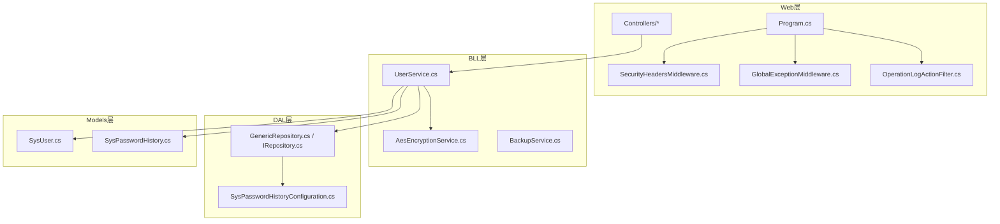
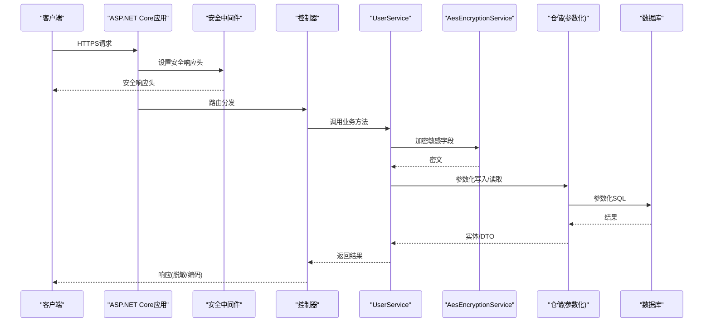
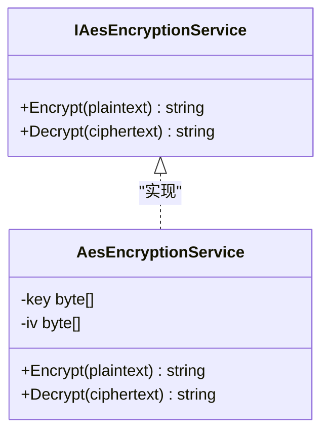
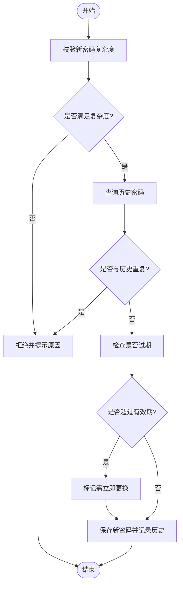
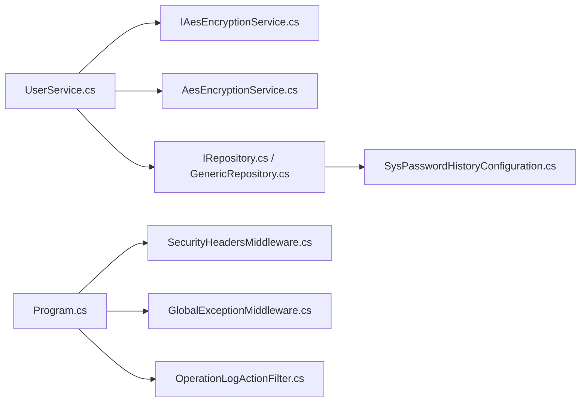

# 数据安全保护

<cite>
**本文引用的文件**   
- [AesEncryptionService.cs](file://EquipmentIMS.BLL/Services/AesEncryptionService.cs)
- [IAesEncryptionService.cs](file://EquipmentIMS.BLL/Interfaces/IAesEncryptionService.cs)
- [UserService.cs](file://EquipmentIMS.BLL/Services/UserService.cs)
- [SysUser.cs](file://EquipmentIMS.Models/Entities/SysUser.cs)
- [SysPasswordHistory.cs](file://EquipmentIMS.Models/Entities/SysPasswordHistory.cs)
- [SysPasswordHistoryConfiguration.cs](file://EquipmentIMS.DAL/Configurations/SysPasswordHistoryConfiguration.cs)
- [SecurityHeadersMiddleware.cs](file://EquipmentIMS.Web/Filters/SecurityHeadersMiddleware.cs)
- [GlobalExceptionMiddleware.cs](file://EquipmentIMS.Web/Filters/GlobalExceptionMiddleware.cs)
- [Program.cs](file://EquipmentIMS.Web/Program.cs)
- [appsettings.json](file://EquipmentIMS.Web/appsettings.json)
- [BackupService.cs](file://EquipmentIMS.BLL/Services/BackupService.cs)
- [IRepository.cs](file://EquipmentIMS.DAL/Interfaces/IRepository.cs)
- [GenericRepository.cs](file://EquipmentIMS.DAL/Repositories/GenericRepository.cs)
- [OperationLogActionFilter.cs](file://EquipmentIMS.Web/Filters/OperationLogActionFilter.cs)
</cite>

## 目录
1. [简介](#简介)
2. [项目结构](#项目结构)
3. [核心组件](#核心组件)
4. [架构总览](#架构总览)
5. [详细组件分析](#详细组件分析)
6. [依赖关系分析](#依赖关系分析)
7. [性能与安全权衡](#性能与安全权衡)
8. [故障排查指南](#故障排查指南)
9. [结论](#结论)
10. [附录：安全配置清单](#附录安全配置清单)

## 简介
本文件面向THMS系统的数据安全保护，聚焦以下方面：
- 敏感数据的加密存储机制与使用模式（重点：AesEncryptionService的AES对称加密）
- 密码安全策略（复杂度、历史检查、定期更换）
- SQL注入防护、XSS防护、输入验证与输出编码
- 数据传输加密（HTTPS）、数据库连接加密、文件上传安全检查
- 数据脱敏、日志安全、备份加密等高级安全配置

## 项目结构
本项目采用分层架构：Web层（控制器、中间件、过滤器）、BLL业务逻辑层（服务与接口）、DAL数据访问层（仓储与实体映射）、Models领域模型。安全相关能力主要分布在：
- Web层：全局异常处理、安全响应头、操作日志过滤
- BLL层：加密服务、用户服务（含密码策略）、备份服务
- DAL层：实体与配置（如密码历史表映射）
- Models层：用户与密码历史实体定义

图表来源
- [Program.cs](file://EquipmentIMS.Web/Program.cs)
- [SecurityHeadersMiddleware.cs](file://EquipmentIMS.Web/Filters/SecurityHeadersMiddleware.cs)
- [GlobalExceptionMiddleware.cs](file://EquipmentIMS.Web/Filters/GlobalExceptionMiddleware.cs)
- [OperationLogActionFilter.cs](file://EquipmentIMS.Web/Filters/OperationLogActionFilter.cs)
- [AesEncryptionService.cs](file://EquipmentIMS.BLL/Services/AesEncryptionService.cs)
- [UserService.cs](file://EquipmentIMS.BLL/Services/UserService.cs)
- [BackupService.cs](file://EquipmentIMS.BLL/Services/BackupService.cs)
- [GenericRepository.cs](file://EquipmentIMS.DAL/Repositories/GenericRepository.cs)
- [IRepository.cs](file://EquipmentIMS.DAL/Interfaces/IRepository.cs)
- [SysPasswordHistoryConfiguration.cs](file://EquipmentIMS.DAL/Configurations/SysPasswordHistoryConfiguration.cs)
- [SysUser.cs](file://EquipmentIMS.Models/Entities/SysUser.cs)
- [SysPasswordHistory.cs](file://EquipmentIMS.Models/Entities/SysPasswordHistory.cs)

章节来源
- [Program.cs](file://EquipmentIMS.Web/Program.cs)
- [SecurityHeadersMiddleware.cs](file://EquipmentIMS.Web/Filters/SecurityHeadersMiddleware.cs)
- [GlobalExceptionMiddleware.cs](file://EquipmentIMS.Web/Filters/GlobalExceptionMiddleware.cs)
- [OperationLogActionFilter.cs](file://EquipmentIMS.Web/Filters/OperationLogActionFilter.cs)
- [AesEncryptionService.cs](file://EquipmentIMS.BLL/Services/AesEncryptionService.cs)
- [UserService.cs](file://EquipmentIMS.BLL/Services/UserService.cs)
- [BackupService.cs](file://EquipmentIMS.BLL/Services/BackupService.cs)
- [GenericRepository.cs](file://EquipmentIMS.DAL/Repositories/GenericRepository.cs)
- [IRepository.cs](file://EquipmentIMS.DAL/Interfaces/IRepository.cs)
- [SysPasswordHistoryConfiguration.cs](file://EquipmentIMS.DAL/Configurations/SysPasswordHistoryConfiguration.cs)
- [SysUser.cs](file://EquipmentIMS.Models/Entities/SysUser.cs)
- [SysPasswordHistory.cs](file://EquipmentIMS.Models/Entities/SysPasswordHistory.cs)

## 核心组件
- AesEncryptionService：提供对称加密/解密能力，用于敏感字段（如手机号、身份证号、密钥等）的持久化保护。
- UserService：实现用户注册、登录、修改密码等流程，集成密码复杂度校验、历史密码检查与定期更换策略。
- SecurityHeadersMiddleware：统一设置HTTP响应头，降低XSS、点击劫持等风险。
- GlobalExceptionMiddleware：集中捕获并规范化异常，避免敏感信息泄露。
- BackupService：负责系统数据备份，结合配置实现备份文件的加密与安全管理。
- 仓储与实体：通过参数化查询与实体映射，减少SQL注入风险；密码历史实体与配置支持密码策略落地。

章节来源
- [AesEncryptionService.cs](file://EquipmentIMS.BLL/Services/AesEncryptionService.cs)
- [IAesEncryptionService.cs](file://EquipmentIMS.BLL/Interfaces/IAesEncryptionService.cs)
- [UserService.cs](file://EquipmentIMS.BLL/Services/UserService.cs)
- [SecurityHeadersMiddleware.cs](file://EquipmentIMS.Web/Filters/SecurityHeadersMiddleware.cs)
- [GlobalExceptionMiddleware.cs](file://EquipmentIMS.Web/Filters/GlobalExceptionMiddleware.cs)
- [BackupService.cs](file://EquipmentIMS.BLL/Services/BackupService.cs)
- [IRepository.cs](file://EquipmentIMS.DAL/Interfaces/IRepository.cs)
- [GenericRepository.cs](file://EquipmentIMS.DAL/Repositories/GenericRepository.cs)
- [SysPasswordHistory.cs](file://EquipmentIMS.Models/Entities/SysPasswordHistory.cs)
- [SysPasswordHistoryConfiguration.cs](file://EquipmentIMS.DAL/Configurations/SysPasswordHistoryConfiguration.cs)

## 架构总览
下图展示从请求到数据落库的安全路径，包括传输加密、输入校验、业务层加密、参数化查询与响应头加固。

图表来源
- [Program.cs](file://EquipmentIMS.Web/Program.cs)
- [SecurityHeadersMiddleware.cs](file://EquipmentIMS.Web/Filters/SecurityHeadersMiddleware.cs)
- [UserService.cs](file://EquipmentIMS.BLL/Services/UserService.cs)
- [AesEncryptionService.cs](file://EquipmentIMS.BLL/Services/AesEncryptionService.cs)
- [GenericRepository.cs](file://EquipmentIMS.DAL/Repositories/GenericRepository.cs)
- [IRepository.cs](file://EquipmentIMS.DAL/Interfaces/IRepository.cs)

## 详细组件分析

### AES对称加密服务（AesEncryptionService）
- 职责
  - 提供统一的加/解密接口，供业务层对敏感数据进行持久化保护。
  - 对外暴露接口以屏蔽底层算法细节，便于替换或升级。
- 使用模式
  - 在用户服务中，对需要落库的敏感字段进行加密后再持久化。
  - 读取时先解密再返回给上层或视图层，确保明文不出内存边界。
- 关键设计点
  - 通过接口隔离实现，便于测试与替换。
  - 建议配合密钥管理（配置文件/密钥管理服务），避免硬编码。
- 典型调用链
  - 控制器 -> 用户服务 -> 加密服务 -> 仓储 -> 数据库

图表来源
- [IAesEncryptionService.cs](file://EquipmentIMS.BLL/Interfaces/IAesEncryptionService.cs)
- [AesEncryptionService.cs](file://EquipmentIMS.BLL/Services/AesEncryptionService.cs)

章节来源
- [IAesEncryptionService.cs](file://EquipmentIMS.BLL/Interfaces/IAesEncryptionService.cs)
- [AesEncryptionService.cs](file://EquipmentIMS.BLL/Services/AesEncryptionService.cs)
- [UserService.cs](file://EquipmentIMS.BLL/Services/UserService.cs)

### 密码安全策略（UserService）
- 复杂度校验
  - 要求最小长度、包含大小写字母、数字与特殊字符的组合，防止弱口令。
- 历史密码检查
  - 新增/修改密码前，比对最近N次历史密码，禁止重复使用。
- 定期更换机制
  - 根据配置项控制最大有效期，到期强制更换；记录上次更换时间。
- 持久化与审计
  - 密码历史表由实体与配置共同描述，确保策略可追溯。
- 流程图（密码变更）

图表来源
- [UserService.cs](file://EquipmentIMS.BLL/Services/UserService.cs)
- [SysPasswordHistory.cs](file://EquipmentIMS.Models/Entities/SysPasswordHistory.cs)
- [SysPasswordHistoryConfiguration.cs](file://EquipmentIMS.DAL/Configurations/SysPasswordHistoryConfiguration.cs)

章节来源
- [UserService.cs](file://EquipmentIMS.BLL/Services/UserService.cs)
- [SysPasswordHistory.cs](file://EquipmentIMS.Models/Entities/SysPasswordHistory.cs)
- [SysPasswordHistoryConfiguration.cs](file://EquipmentIMS.DAL/Configurations/SysPasswordHistoryConfiguration.cs)

### 输入验证与输出编码
- 输入验证
  - 控制器层使用模型绑定与数据注解进行基础校验；业务层再次执行规则校验，形成双重保障。
- 输出编码
  - 视图渲染默认启用HTML编码；对富文本场景采用白名单过滤与上下文感知编码。
- 安全响应头
  - 通过中间件统一设置CSP、X-Frame-Options、X-Content-Type-Options等，缓解XSS与点击劫持。

章节来源
- [SecurityHeadersMiddleware.cs](file://EquipmentIMS.Web/Filters/SecurityHeadersMiddleware.cs)

### SQL注入防护
- 参数化查询
  - 仓储层统一封装参数化命令，杜绝字符串拼接SQL。
- ORM映射
  - 实体与配置分离，避免动态拼接表名/列名。
- 权限最小化
  - 数据库账户仅授予必要权限，限制DDL/DML范围。

章节来源
- [IRepository.cs](file://EquipmentIMS.DAL/Interfaces/IRepository.cs)
- [GenericRepository.cs](file://EquipmentIMS.DAL/Repositories/GenericRepository.cs)

### 数据传输加密（HTTPS）
- 强制HTTPS
  - 在应用启动阶段启用HTTPS重定向，确保所有流量走TLS通道。
- 证书管理
  - 生产环境使用受信任证书，定期轮换与监控过期。

章节来源
- [Program.cs](file://EquipmentIMS.Web/Program.cs)
- [appsettings.json](file://EquipmentIMS.Web/appsettings.json)

### 数据库连接加密
- 连接串加密
  - 将数据库连接字符串置于受保护的配置源或密钥管理服务中，运行时解密加载。
- 传输加密
  - 启用数据库驱动的连接加密选项（如TLS），防止窃听与篡改。

章节来源
- [appsettings.json](file://EquipmentIMS.Web/appsettings.json)

### 文件上传安全检查
- 类型与内容校验
  - 基于MIME与文件头双重校验，拒绝可执行脚本。
- 大小与数量限制
  - 限制单文件大小与并发上传数量，防止资源耗尽。
- 存储隔离
  - 上传文件存放于非执行目录，并通过独立静态资源服务访问。
- 病毒扫描
  - 接入第三方扫描服务，对可疑文件拦截。

[本节为通用安全实践说明，不直接分析具体文件]

### 数据脱敏
- 列表与导出
  - 对手机号、邮箱、身份证等字段进行掩码处理，避免完整明文暴露。
- 日志脱敏
  - 在日志管道中自动替换敏感字段，防止日志泄露。

章节来源
- [OperationLogActionFilter.cs](file://EquipmentIMS.Web/Filters/OperationLogActionFilter.cs)

### 日志安全
- 集中化与分级
  - 按级别输出，敏感信息不入日志；错误堆栈仅在开发环境打印。
- 防篡改与留存
  - 日志落盘加密与完整性校验，保留周期符合合规要求。

章节来源
- [GlobalExceptionMiddleware.cs](file://EquipmentIMS.Web/Filters/GlobalExceptionMiddleware.cs)
- [OperationLogActionFilter.cs](file://EquipmentIMS.Web/Filters/OperationLogActionFilter.cs)

### 备份加密
- 备份流程
  - 定时触发备份任务，生成压缩包并落盘。
- 加密与签名
  - 对备份文件进行对称加密与完整性校验，密钥与文件分离保管。
- 恢复演练
  - 定期执行恢复演练，验证可用性与一致性。

章节来源
- [BackupService.cs](file://EquipmentIMS.BLL/Services/BackupService.cs)

## 依赖关系分析
- 低耦合高内聚
  - 加密服务通过接口抽象，业务层仅依赖契约，便于替换实现。
- 参数化与ORM
  - 仓储层统一参数化，降低SQL注入面；实体配置与模型解耦。
- 中间件与过滤器
  - 安全响应头、异常处理、操作日志分别由中间件与过滤器承担，职责清晰。

图表来源
- [UserService.cs](file://EquipmentIMS.BLL/Services/UserService.cs)
- [IAesEncryptionService.cs](file://EquipmentIMS.BLL/Interfaces/IAesEncryptionService.cs)
- [AesEncryptionService.cs](file://EquipmentIMS.BLL/Services/AesEncryptionService.cs)
- [IRepository.cs](file://EquipmentIMS.DAL/Interfaces/IRepository.cs)
- [GenericRepository.cs](file://EquipmentIMS.DAL/Repositories/GenericRepository.cs)
- [SysPasswordHistoryConfiguration.cs](file://EquipmentIMS.DAL/Configurations/SysPasswordHistoryConfiguration.cs)
- [Program.cs](file://EquipmentIMS.Web/Program.cs)
- [SecurityHeadersMiddleware.cs](file://EquipmentIMS.Web/Filters/SecurityHeadersMiddleware.cs)
- [GlobalExceptionMiddleware.cs](file://EquipmentIMS.Web/Filters/GlobalExceptionMiddleware.cs)
- [OperationLogActionFilter.cs](file://EquipmentIMS.Web/Filters/OperationLogActionFilter.cs)

章节来源
- [UserService.cs](file://EquipmentIMS.BLL/Services/UserService.cs)
- [IAesEncryptionService.cs](file://EquipmentIMS.BLL/Interfaces/IAesEncryptionService.cs)
- [AesEncryptionService.cs](file://EquipmentIMS.BLL/Services/AesEncryptionService.cs)
- [IRepository.cs](file://EquipmentIMS.DAL/Interfaces/IRepository.cs)
- [GenericRepository.cs](file://EquipmentIMS.DAL/Repositories/GenericRepository.cs)
- [SysPasswordHistoryConfiguration.cs](file://EquipmentIMS.DAL/Configurations/SysPasswordHistoryConfiguration.cs)
- [Program.cs](file://EquipmentIMS.Web/Program.cs)
- [SecurityHeadersMiddleware.cs](file://EquipmentIMS.Web/Filters/SecurityHeadersMiddleware.cs)
- [GlobalExceptionMiddleware.cs](file://EquipmentIMS.Web/Filters/GlobalExceptionMiddleware.cs)
- [OperationLogActionFilter.cs](file://EquipmentIMS.Web/Filters/OperationLogActionFilter.cs)

## 性能与安全权衡
- 加密开销
  - AES对称加密计算成本较低，但批量读写时应注意批处理与缓存策略，避免频繁加解密造成延迟。
- 密码历史查询
  - 历史密码表应建立索引，避免全表扫描；分页与限深查询提升性能。
- 日志与脱敏
  - 脱敏与日志格式化应在异步管道中进行，避免阻塞主流程。
- 备份窗口
  - 选择低峰期执行备份，压缩与加密并行化，缩短窗口。

[本节为通用指导，不直接分析具体文件]

## 故障排查指南
- 无法解密
  - 检查密钥与IV配置是否正确、版本兼容；确认密文字符集与编码一致。
- 密码策略失败
  - 查看复杂度规则与历史密码匹配逻辑；核对有效期配置项。
- 安全响应头缺失
  - 确认中间件已注册且顺序正确；检查反向代理是否覆盖响应头。
- 日志泄露敏感信息
  - 审查异常处理与日志过滤器的脱敏规则；定位未脱敏的字段。
- 备份不可用
  - 校验备份文件完整性与解密密钥；检查磁盘空间与权限。

章节来源
- [GlobalExceptionMiddleware.cs](file://EquipmentIMS.Web/Filters/GlobalExceptionMiddleware.cs)
- [OperationLogActionFilter.cs](file://EquipmentIMS.Web/Filters/OperationLogActionFilter.cs)
- [BackupService.cs](file://EquipmentIMS.BLL/Services/BackupService.cs)

## 结论
THMS系统在数据安全的多个层面形成了闭环：传输层HTTPS、应用层输入校验与输出编码、业务层敏感数据加密与密码策略、数据层参数化查询与实体映射、运维层备份加密与日志安全。通过接口抽象与中间件/过滤器机制，系统在保证安全性的同时具备良好的可扩展性与可维护性。

## 附录：安全配置清单
- 传输加密
  - 强制HTTPS、启用HSTS、合理配置TLS版本与套件
- 数据库
  - 连接串加密、启用连接加密、最小权限账户
- 应用安全
  - 安全响应头、全局异常处理、输入校验与输出编码
- 密码策略
  - 复杂度、历史检查、定期更换、锁定策略
- 文件上传
  - 类型/大小限制、病毒扫描、非执行目录存储
- 日志与审计
  - 脱敏、分级、集中化、完整性校验
- 备份
  - 加密、签名、异地容灾、恢复演练

[本节为通用清单，不直接分析具体文件]