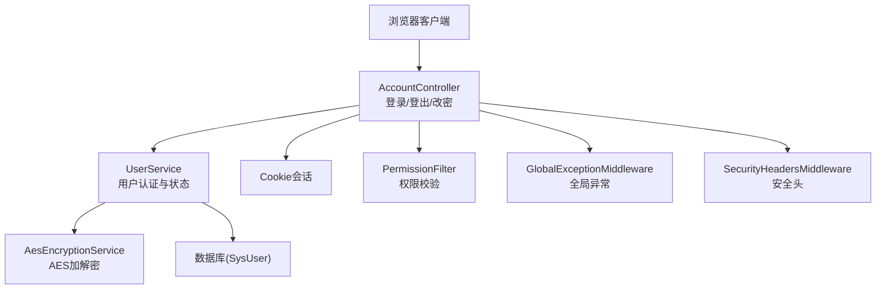
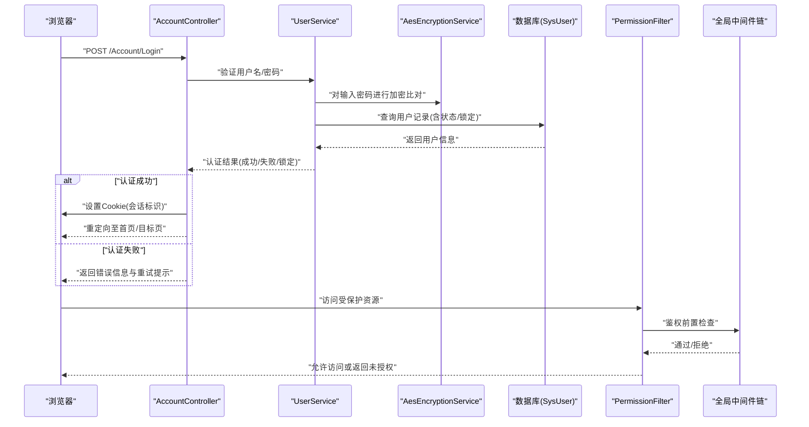
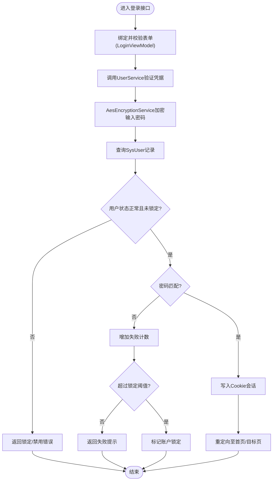
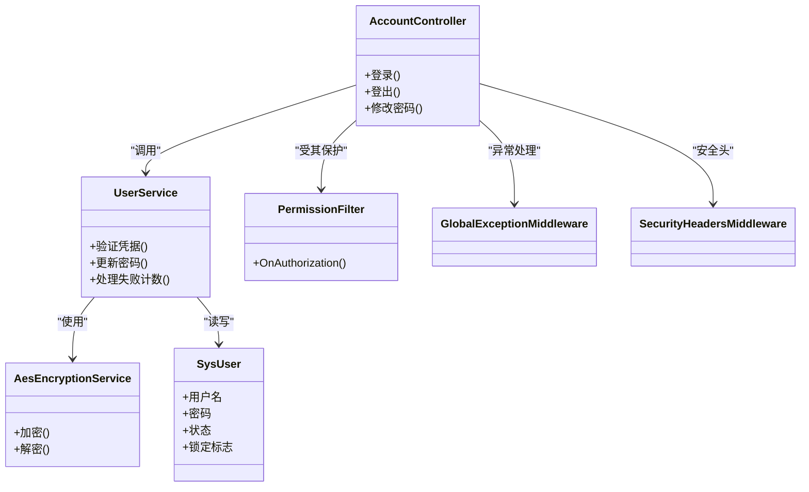

# 身份认证机制

<cite>
**本文引用的文件**   
- [AccountController.cs](file://EquipmentIMS.Web/Controllers/AccountController.cs)
- [LoginViewModel.cs](file://EquipmentIMS.Web/ViewModels/LoginViewModel.cs)
- [ChangePasswordViewModel.cs](file://EquipmentIMS.Web/ViewModels/ChangePasswordViewModel.cs)
- [UserService.cs](file://EquipmentIMS.BLL/Services/UserService.cs)
- [IAesEncryptionService.cs](file://EquipmentIMS.BLL/Interfaces/IAesEncryptionService.cs)
- [AesEncryptionService.cs](file://EquipmentIMS.BLL/Services/AesEncryptionService.cs)
- [SysUser.cs](file://EquipmentIMS.Models/Entities/SysUser.cs)
- [PermissionFilter.cs](file://EquipmentIMS.Web/Filters/PermissionFilter.cs)
- [GlobalExceptionMiddleware.cs](file://EquipmentIMS.Web/Filters/GlobalExceptionMiddleware.cs)
- [SecurityHeadersMiddleware.cs](file://EquipmentIMS.Web/Filters/SecurityHeadersMiddleware.cs)
- [Program.cs](file://EquipmentIMS.Web/Program.cs)
- [appsettings.json](file://EquipmentIMS.Web/appsettings.json)
</cite>

## 目录
1. [简介](#简介)
2. [项目结构](#项目结构)
3. [核心组件](#核心组件)
4. [架构总览](#架构总览)
5. [详细组件分析](#详细组件分析)
6. [依赖关系分析](#依赖关系分析)
7. [性能考虑](#性能考虑)
8. [故障排查指南](#故障排查指南)
9. [结论](#结论)
10. [附录](#附录)

## 简介
本文件面向THMS系统的身份认证机制，聚焦于基于Cookie的会话认证实现。内容涵盖：
- 用户登录验证流程与登出流程
- 密码加密存储（使用AesEncryptionService）
- 会话管理机制（Cookie）
- AccountController中的登录、登出、密码修改等核心接口
- 用户状态管理、登录失败处理、账户锁定策略
- JWT令牌集成方案与多因素认证扩展点
- 认证中间件配置与自定义认证过滤器开发指南

## 项目结构
围绕认证相关的关键位置如下：
- Web层控制器与视图模型：AccountController、LoginViewModel、ChangePasswordViewModel
- 业务服务层：UserService、AesEncryptionService及其接口
- 数据实体：SysUser
- 安全过滤与中间件：PermissionFilter、GlobalExceptionMiddleware、SecurityHeadersMiddleware
- 应用启动与配置：Program.cs、appsettings.json

图表来源
- [AccountController.cs](file://EquipmentIMS.Web/Controllers/AccountController.cs)
- [UserService.cs](file://EquipmentIMS.BLL/Services/UserService.cs)
- [AesEncryptionService.cs](file://EquipmentIMS.BLL/Services/AesEncryptionService.cs)
- [SysUser.cs](file://EquipmentIMS.Models/Entities/SysUser.cs)
- [PermissionFilter.cs](file://EquipmentIMS.Web/Filters/PermissionFilter.cs)
- [GlobalExceptionMiddleware.cs](file://EquipmentIMS.Web/Filters/GlobalExceptionMiddleware.cs)
- [SecurityHeadersMiddleware.cs](file://EquipmentIMS.Web/Filters/SecurityHeadersMiddleware.cs)

章节来源
- [AccountController.cs](file://EquipmentIMS.Web/Controllers/AccountController.cs)
- [LoginViewModel.cs](file://EquipmentIMS.Web/ViewModels/LoginViewModel.cs)
- [ChangePasswordViewModel.cs](file://EquipmentIMS.Web/ViewModels/ChangePasswordViewModel.cs)
- [UserService.cs](file://EquipmentIMS.BLL/Services/UserService.cs)
- [AesEncryptionService.cs](file://EquipmentIMS.BLL/Services/AesEncryptionService.cs)
- [SysUser.cs](file://EquipmentIMS.Models/Entities/SysUser.cs)
- [PermissionFilter.cs](file://EquipmentIMS.Web/Filters/PermissionFilter.cs)
- [GlobalExceptionMiddleware.cs](file://EquipmentIMS.Web/Filters/GlobalExceptionMiddleware.cs)
- [SecurityHeadersMiddleware.cs](file://EquipmentIMS.Web/Filters/SecurityHeadersMiddleware.cs)
- [Program.cs](file://EquipmentIMS.Web/Program.cs)
- [appsettings.json](file://EquipmentIMS.Web/appsettings.json)

## 核心组件
- AccountController：提供登录、登出、密码修改等认证相关HTTP接口；负责Cookie写入/清除、表单校验结果返回、页面跳转或重定向。
- UserService：封装用户认证逻辑，包括凭据校验、用户状态检查、失败计数与锁定策略、密码更新等。
- AesEncryptionService：提供对称加密能力，用于敏感信息（如密码）的加解密操作。
- SysUser：用户实体，包含用户名、密码、状态、锁定信息等字段。
- PermissionFilter：请求级权限校验过滤器，可结合认证上下文进行授权控制。
- GlobalExceptionMiddleware：统一异常处理中间件，保障认证流程的错误响应一致性。
- SecurityHeadersMiddleware：注入安全响应头，增强认证相关的安全基线。
- Program.cs与appsettings.json：注册中间件、过滤器与服务，加载认证相关配置项。

章节来源
- [AccountController.cs](file://EquipmentIMS.Web/Controllers/AccountController.cs)
- [UserService.cs](file://EquipmentIMS.BLL/Services/UserService.cs)
- [AesEncryptionService.cs](file://EquipmentIMS.BLL/Services/AesEncryptionService.cs)
- [SysUser.cs](file://EquipmentIMS.Models/Entities/SysUser.cs)
- [PermissionFilter.cs](file://EquipmentIMS.Web/Filters/PermissionFilter.cs)
- [GlobalExceptionMiddleware.cs](file://EquipmentIMS.Web/Filters/GlobalExceptionMiddleware.cs)
- [SecurityHeadersMiddleware.cs](file://EquipmentIMS.Web/Filters/SecurityHeadersMiddleware.cs)
- [Program.cs](file://EquipmentIMS.Web/Program.cs)
- [appsettings.json](file://EquipmentIMS.Web/appsettings.json)

## 架构总览
下图展示了从浏览器发起登录到服务端完成认证并下发Cookie的整体流程，以及后续受保护资源的访问路径。

图表来源
- [AccountController.cs](file://EquipmentIMS.Web/Controllers/AccountController.cs)
- [UserService.cs](file://EquipmentIMS.BLL/Services/UserService.cs)
- [AesEncryptionService.cs](file://EquipmentIMS.BLL/Services/AesEncryptionService.cs)
- [SysUser.cs](file://EquipmentIMS.Models/Entities/SysUser.cs)
- [PermissionFilter.cs](file://EquipmentIMS.Web/Filters/PermissionFilter.cs)
- [GlobalExceptionMiddleware.cs](file://EquipmentIMS.Web/Filters/GlobalExceptionMiddleware.cs)
- [SecurityHeadersMiddleware.cs](file://EquipmentIMS.Web/Filters/SecurityHeadersMiddleware.cs)

## 详细组件分析

### 登录流程（AccountController + UserService + AesEncryptionService）
- 入口：AccountController的登录接口接收表单数据（用户名、密码）。
- 校验：调用UserService进行用户存在性、状态与锁定检查。
- 密码比对：UserService委托AesEncryptionService对明文密码进行加密后与数据库中保存的密文进行比对。
- 结果处理：
  - 成功：写入Cookie作为会话凭证，并重定向至目标页面。
  - 失败：累计失败次数，达到阈值则触发账户锁定；返回错误信息供前端展示。
- 视图模型：LoginViewModel承载登录表单绑定与校验。

图表来源
- [AccountController.cs](file://EquipmentIMS.Web/Controllers/AccountController.cs)
- [LoginViewModel.cs](file://EquipmentIMS.Web/ViewModels/LoginViewModel.cs)
- [UserService.cs](file://EquipmentIMS.BLL/Services/UserService.cs)
- [AesEncryptionService.cs](file://EquipmentIMS.BLL/Services/AesEncryptionService.cs)
- [SysUser.cs](file://EquipmentIMS.Models/Entities/SysUser.cs)

章节来源
- [AccountController.cs](file://EquipmentIMS.Web/Controllers/AccountController.cs)
- [LoginViewModel.cs](file://EquipmentIMS.Web/ViewModels/LoginViewModel.cs)
- [UserService.cs](file://EquipmentIMS.BLL/Services/UserService.cs)
- [AesEncryptionService.cs](file://EquipmentIMS.BLL/Services/AesEncryptionService.cs)
- [SysUser.cs](file://EquipmentIMS.Models/Entities/SysUser.cs)

### 登出流程（AccountController）
- 入口：AccountController的登出接口。
- 处理：清除本地Cookie会话，销毁服务器端关联的会话状态（如有），并重定向至登录页。
- 安全建议：确保登出后所有敏感页面不可通过后退访问，必要时配合缓存控制与安全头。

章节来源
- [AccountController.cs](file://EquipmentIMS.Web/Controllers/AccountController.cs)

### 密码修改流程（AccountController + UserService + AesEncryptionService）
- 入口：AccountController的密码修改接口，接收旧密码与新密码。
- 校验：验证当前登录用户身份、旧密码正确性、新密码复杂度要求。
- 更新：UserService调用AesEncryptionService对新密码进行加密，持久化到SysUser。
- 反馈：成功后返回提示，必要时强制重新登录或刷新会话。

章节来源
- [AccountController.cs](file://EquipmentIMS.Web/Controllers/AccountController.cs)
- [ChangePasswordViewModel.cs](file://EquipmentIMS.Web/ViewModels/ChangePasswordViewModel.cs)
- [UserService.cs](file://EquipmentIMS.BLL/Services/UserService.cs)
- [AesEncryptionService.cs](file://EquipmentIMS.BLL/Services/AesEncryptionService.cs)
- [SysUser.cs](file://EquipmentIMS.Models/Entities/SysUser.cs)

### 用户状态管理与账户锁定策略
- 用户状态：SysUser中维护用户启用/禁用、锁定标志等字段。
- 失败计数：登录失败时递增失败计数，达到阈值则锁定账户。
- 解锁策略：支持管理员手动解锁或定时自动解锁（可通过后台任务或服务扩展）。
- 审计日志：建议记录登录失败与锁定事件，便于审计与风控。

章节来源
- [SysUser.cs](file://EquipmentIMS.Models/Entities/SysUser.cs)
- [UserService.cs](file://EquipmentIMS.BLL/Services/UserService.cs)

### 会话管理机制（Cookie）
- 写入：认证成功后在响应中写入Cookie，包含会话标识与必要声明。
- 读取：后续请求由过滤器或中间件解析Cookie以识别用户身份。
- 安全属性：建议启用HttpOnly、Secure、SameSite等属性，防止XSS与CSRF风险。
- 过期策略：根据业务需求设置滑动过期或绝对过期时间。

章节来源
- [AccountController.cs](file://EquipmentIMS.Web/Controllers/AccountController.cs)
- [PermissionFilter.cs](file://EquipmentIMS.Web/Filters/PermissionFilter.cs)

### 权限校验（PermissionFilter）
- 作用：在请求到达控制器前进行鉴权，依据用户角色/权限决定是否放行。
- 与认证的关系：先认证（Cookie解析）再授权（权限判断）。
- 扩展点：可按资源维度细化权限控制，支持动态权限加载与缓存。

章节来源
- [PermissionFilter.cs](file://EquipmentIMS.Web/Filters/PermissionFilter.cs)

### 全局异常处理（GlobalExceptionMiddleware）
- 作用：捕获认证与授权过程中的异常，统一转换为友好响应。
- 价值：避免将内部错误暴露给客户端，提升安全性与用户体验。

章节来源
- [GlobalExceptionMiddleware.cs](file://EquipmentIMS.Web/Filters/GlobalExceptionMiddleware.cs)

### 安全响应头（SecurityHeadersMiddleware）
- 作用：为响应注入安全相关的HTTP头，如HSTS、X-Frame-Options等。
- 价值：加固认证与页面渲染过程的安全性。

章节来源
- [SecurityHeadersMiddleware.cs](file://EquipmentIMS.Web/Filters/SecurityHeadersMiddleware.cs)

## 依赖关系分析
- AccountController依赖UserService进行认证与状态管理。
- UserService依赖AesEncryptionService进行密码加解密。
- SysUser作为用户实体的数据载体，被UserService读写。
- PermissionFilter在请求管道中对已认证用户进行授权检查。
- 全局中间件（GlobalExceptionMiddleware、SecurityHeadersMiddleware）贯穿整个请求生命周期。

图表来源
- [AccountController.cs](file://EquipmentIMS.Web/Controllers/AccountController.cs)
- [UserService.cs](file://EquipmentIMS.BLL/Services/UserService.cs)
- [AesEncryptionService.cs](file://EquipmentIMS.BLL/Services/AesEncryptionService.cs)
- [SysUser.cs](file://EquipmentIMS.Models/Entities/SysUser.cs)
- [PermissionFilter.cs](file://EquipmentIMS.Web/Filters/PermissionFilter.cs)
- [GlobalExceptionMiddleware.cs](file://EquipmentIMS.Web/Filters/GlobalExceptionMiddleware.cs)
- [SecurityHeadersMiddleware.cs](file://EquipmentIMS.Web/Filters/SecurityHeadersMiddleware.cs)

章节来源
- [AccountController.cs](file://EquipmentIMS.Web/Controllers/AccountController.cs)
- [UserService.cs](file://EquipmentIMS.BLL/Services/UserService.cs)
- [AesEncryptionService.cs](file://EquipmentIMS.BLL/Services/AesEncryptionService.cs)
- [SysUser.cs](file://EquipmentIMS.Models/Entities/SysUser.cs)
- [PermissionFilter.cs](file://EquipmentIMS.Web/Filters/PermissionFilter.cs)
- [GlobalExceptionMiddleware.cs](file://EquipmentIMS.Web/Filters/GlobalExceptionMiddleware.cs)
- [SecurityHeadersMiddleware.cs](file://EquipmentIMS.Web/Filters/SecurityHeadersMiddleware.cs)

## 性能考虑
- 密码加密成本：AesEncryptionService为对称加密，开销较低；若未来替换为高成本哈希算法（如bcrypt/argon2），需评估CPU占用与并发影响。
- 会话存储：Cookie仅携带轻量标识，避免在Cookie中存放大量敏感数据。
- 失败计数与锁定：建议在Redis或内存缓存中维护失败计数，减少数据库压力。
- 权限缓存：PermissionFilter可缓存用户权限集合，降低频繁查询开销。
- 中间件顺序：合理配置中间件顺序，尽早短路非法请求，减少不必要的处理。

[本节为通用指导，不直接分析具体文件]

## 故障排查指南
- 登录失败：
  - 检查LoginViewModel绑定与校验是否生效。
  - 确认UserService中失败计数与锁定阈值逻辑是否正确。
  - 查看AesEncryptionService的加解密实现是否与数据库密文一致。
- 会话无效：
  - 检查Cookie的域、路径、过期时间与安全属性配置。
  - 确认PermissionFilter是否能正确解析Cookie并构建用户上下文。
- 权限拒绝：
  - 核对PermissionFilter的授权规则与用户角色/权限映射。
- 异常与日志：
  - 利用GlobalExceptionMiddleware捕获并记录异常堆栈。
  - 结合SecurityHeadersMiddleware检查安全头是否按预期注入。

章节来源
- [LoginViewModel.cs](file://EquipmentIMS.Web/ViewModels/LoginViewModel.cs)
- [AccountController.cs](file://EquipmentIMS.Web/Controllers/AccountController.cs)
- [UserService.cs](file://EquipmentIMS.BLL/Services/UserService.cs)
- [AesEncryptionService.cs](file://EquipmentIMS.BLL/Services/AesEncryptionService.cs)
- [PermissionFilter.cs](file://EquipmentIMS.Web/Filters/PermissionFilter.cs)
- [GlobalExceptionMiddleware.cs](file://EquipmentIMS.Web/Filters/GlobalExceptionMiddleware.cs)
- [SecurityHeadersMiddleware.cs](file://EquipmentIMS.Web/Filters/SecurityHeadersMiddleware.cs)

## 结论
THMS的身份认证采用基于Cookie的会话模式，结合UserService与AesEncryptionService实现安全的凭据校验与密码存储。AccountController集中处理登录、登出与密码修改等关键流程，并通过PermissionFilter进行授权控制。全局中间件保障了异常处理与安全头的统一注入。整体架构清晰、职责分明，具备良好的可扩展性，便于后续引入JWT与多因素认证。

[本节为总结性内容，不直接分析具体文件]

## 附录

### JWT令牌集成方案（建议）
- 登录成功后签发JWT，并将其放入Cookie（HttpOnly、Secure、SameSite=Strict）。
- 在PermissionFilter中解析Cookie内的JWT，验证签名与有效期，构建ClaimsPrincipal。
- 对于API场景，可在请求头中携带Authorization: Bearer <token>，由中间件统一解析与校验。
- 刷新令牌：提供独立的刷新接口，使用Refresh Token换取新的Access Token。

[本节为概念性说明，不直接分析具体文件]

### 多因素认证扩展点（建议）
- 在UserService中增加二次验证步骤（短信验证码、TOTP等）。
- 登录流程分阶段：第一阶段凭据校验，第二阶段MFA校验，通过后才写入Cookie。
- 在AccountController中新增MFA提交接口，并在视图中引导用户完成二次验证。
- 在PermissionFilter中可记录MFA状态，用于敏感操作的二次确认。

[本节为概念性说明，不直接分析具体文件]

### 认证中间件配置与自定义过滤器开发指南
- 中间件注册：在Program.cs中注册全局异常处理与安全头中间件，确保它们位于认证与授权之前。
- 过滤器注册：在Program.cs中注册PermissionFilter，使其作用于需要授权的控制器或动作。
- 自定义过滤器：
  - 继承现有过滤器基类或实现相应接口。
  - 在OnAuthorization中解析Cookie/JWT，校验用户身份与权限。
  - 对未认证或未授权请求返回标准响应（重定向或401/403）。
- 配置项：在appsettings.json中定义Cookie名称、超时时间、安全属性、锁定阈值等参数，便于环境差异化配置。

章节来源
- [Program.cs](file://EquipmentIMS.Web/Program.cs)
- [appsettings.json](file://EquipmentIMS.Web/appsettings.json)
- [PermissionFilter.cs](file://EquipmentIMS.Web/Filters/PermissionFilter.cs)
- [GlobalExceptionMiddleware.cs](file://EquipmentIMS.Web/Filters/GlobalExceptionMiddleware.cs)
- [SecurityHeadersMiddleware.cs](file://EquipmentIMS.Web/Filters/SecurityHeadersMiddleware.cs)