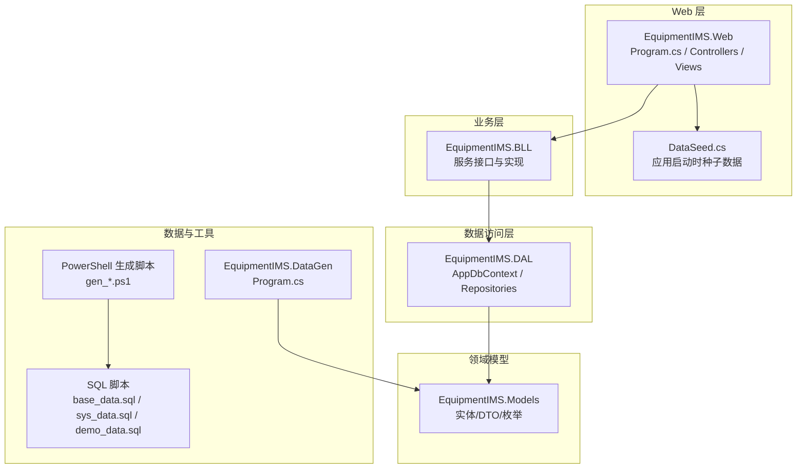
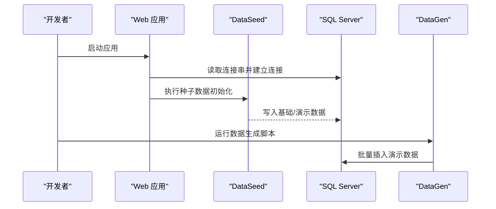
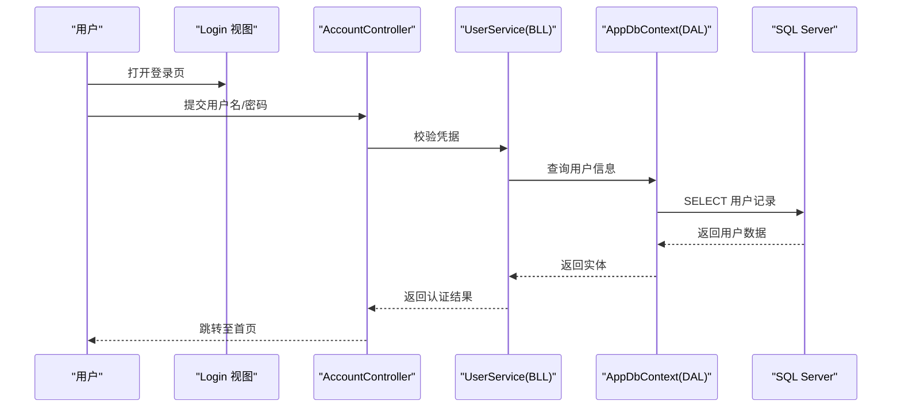
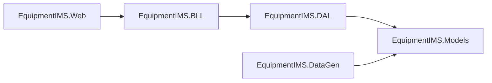

# 快速开始

<cite>
**本文引用的文件**   
- [Program.cs](file://EquipmentIMS.Web/Program.cs)
- [appsettings.json](file://EquipmentIMS.Web/appsettings.json)
- [appsettings.Development.json](file://EquipmentIMS.Web/appsettings.Development.json)
- [DataSeed.cs](file://EquipmentIMS.Web/DataSeed.cs)
- [EquipmentIMS.sln](file://EquipmentIMS.sln)
- [base_data.sql](file://base_data.sql)
- [sys_data.sql](file://sys_data.sql)
- [demo_data.sql](file://demo_data.sql)
- [gen_all.ps1](file://gen_all.ps1)
- [gen_sys.ps1](file://gen_sys.ps1)
- [gen_prod.ps1](file://gen_prod.ps1)
- [gen_pur.ps1](file://gen_pur.ps1)
- [gen_sale.ps1](file://gen_sale.ps1)
- [gen_stock.ps1](file://gen_stock.ps1)
- [gen_maint.ps1](file://gen_maint.ps1)
- [gen_inv.ps1](file://gen_inv.ps1)
- [EquipmentIMS.DataGen/Program.cs](file://EquipmentIMS.DataGen/Program.cs)
- [EquipmentIMS.DAL/AppDbContext.cs](file://EquipmentIMS.DAL/AppDbContext.cs)
- [EquipmentIMS.Models/Entities/SysUser.cs](file://EquipmentIMS.Models/Entities/SysUser.cs)
- [EquipmentIMS.Models/DTOs/UserDto.cs](file://EquipmentIMS.Models/DTOs/UserDto.cs)
- [EquipmentIMS.Web/Controllers/AccountController.cs](file://EquipmentIMS.Web/Controllers/AccountController.cs)
- [EquipmentIMS.Web/Views/Account/Login.cshtml](file://EquipmentIMS.Web/Views/Account/Login.cshtml)
- [EquipmentIMS.Web/Models/ErrorViewModel.cs](file://EquipmentIMS.Web/Models/ErrorViewModel.cs)
- [EquipmentIMS.Web/Filters/GlobalExceptionMiddleware.cs](file://EquipmentIMS.Web/Filters/GlobalExceptionMiddleware.cs)
</cite>

## 目录
1. [简介](#简介)
2. [项目结构](#项目结构)
3. [核心组件](#核心组件)
4. [架构总览](#架构总览)
5. [详细组件分析](#详细组件分析)
6. [依赖分析](#依赖分析)
7. [性能考虑](#性能考虑)
8. [故障排除指南](#故障排除指南)
9. [结论](#结论)
10. [附录](#附录)

## 简介
本指南面向首次接触 THMS（设备库存管理系统）的开发者与实施人员，目标是在 30 分钟内完成环境准备、数据库初始化、项目启动与第一个用户登录体验。文档涵盖：
- 开发环境要求（.NET Core 版本、SQL Server 版本、IDE 配置）
- 完整的数据库初始化步骤（基础数据与演示数据导入）
- 项目克隆、依赖安装、配置修改与运行
- 常见问题排查
- 首个管理员账户登录与基本操作演示

## 项目结构
THMS 采用分层架构：Web 层（MVC + API）、业务逻辑层（BLL）、数据访问层（DAL）、领域模型（Models），并提供独立的数据生成工具与 SQL 脚本。

图表来源
- [Program.cs](file://EquipmentIMS.Web/Program.cs)
- [DataSeed.cs](file://EquipmentIMS.Web/DataSeed.cs)
- [EquipmentIMS.DAL/AppDbContext.cs](file://EquipmentIMS.DAL/AppDbContext.cs)
- [EquipmentIMS.DataGen/Program.cs](file://EquipmentIMS.DataGen/Program.cs)
- [base_data.sql](file://base_data.sql)
- [sys_data.sql](file://sys_data.sql)
- [demo_data.sql](file://demo_data.sql)
- [gen_all.ps1](file://gen_all.ps1)

章节来源
- [EquipmentIMS.sln](file://EquipmentIMS.sln)

## 核心组件
- Web 入口与中间件
  - Program.cs：注册服务、中间件、路由与视图；读取 appsettings 配置。
  - GlobalExceptionMiddleware：全局异常处理，统一错误响应。
  - ErrorViewModel：错误页面模型。
- 数据种子
  - DataSeed.cs：在应用启动阶段执行基础数据与演示数据的初始化。
- 数据访问
  - AppDbContext：EF Core 上下文，连接字符串来自配置。
- 数据生成器
  - EquipmentIMS.DataGen/Program.cs：独立程序，用于批量生成演示数据。
- 配置
  - appsettings.json / appsettings.Development.json：包含数据库连接串、日志等配置项。

章节来源
- [Program.cs](file://EquipmentIMS.Web/Program.cs)
- [appsettings.json](file://EquipmentIMS.Web/appsettings.json)
- [appsettings.Development.json](file://EquipmentIMS.Web/appsettings.Development.json)
- [DataSeed.cs](file://EquipmentIMS.Web/DataSeed.cs)
- [EquipmentIMS.DAL/AppDbContext.cs](file://EquipmentIMS.DAL/AppDbContext.cs)
- [EquipmentIMS.Web/Filters/GlobalExceptionMiddleware.cs](file://EquipmentIMS.Web/Filters/GlobalExceptionMiddleware.cs)
- [EquipmentIMS.Web/Models/ErrorViewModel.cs](file://EquipmentIMS.Web/Models/ErrorViewModel.cs)
- [EquipmentIMS.DataGen/Program.cs](file://EquipmentIMS.DataGen/Program.cs)

## 架构总览
系统采用经典三层架构，Web 层通过控制器调用 BLL 服务，BLL 使用 DAL 仓储与 EF Core 上下文访问数据库。数据种子与数据生成器分别在应用启动和独立运行时注入初始数据。

图表来源
- [Program.cs](file://EquipmentIMS.Web/Program.cs)
- [DataSeed.cs](file://EquipmentIMS.Web/DataSeed.cs)
- [EquipmentIMS.DataGen/Program.cs](file://EquipmentIMS.DataGen/Program.cs)
- [appsettings.json](file://EquipmentIMS.Web/appsettings.json)

## 详细组件分析

### 开发环境要求
- .NET SDK
  - 建议使用 .NET 8 SDK（或更高兼容版本）。若本地为 .NET 6/7，请确保解决方案能正常编译与运行。
- SQL Server
  - 推荐 SQL Server 2019 或更高版本；也可使用 SQL Server Express 2019+。
  - 启用 TCP/IP 与混合身份验证（Windows + SQL Server 认证），以便使用用户名/密码连接。
- IDE
  - Visual Studio 2022（推荐）或 VS Code + C# 扩展。
  - 建议安装 SQL Server Management Studio (SSMS) 以管理数据库。
- 其他
  - PowerShell 5.1 或更高（用于运行 gen_*.ps1 脚本）。
  - 防火墙放行 SQL Server 端口（默认 1433）。

章节来源
- [appsettings.json](file://EquipmentIMS.Web/appsettings.json)
- [appsettings.Development.json](file://EquipmentIMS.Web/appsettings.Development.json)

### 数据库初始化步骤
- 创建空数据库
  - 在 SQL Server 中创建一个空数据库（例如：THMS）。
- 导入基础数据
  - 执行 base_data.sql 与 sys_data.sql，创建表结构与基础字典、权限、角色等数据。
- 导入演示数据
  - 方式一：使用 PowerShell 脚本一键生成
    - 运行根目录下的 gen_all.ps1，将自动依次执行各模块脚本（产品、采购、销售、库存、维护等）。
  - 方式二：手动执行分步脚本
    - 按顺序执行 gen_prod.ps1、gen_pur.ps1、gen_sale.ps1、gen_stock.ps1、gen_maint.ps1、gen_inv.ps1。
  - 方式三：直接执行 demo_data.sql（如已提供完整演示数据）。
- 验证数据
  - 打开 SSMS，检查关键表是否有记录（用户、角色、产品、仓库、供应商、客户、订单等）。

章节来源
- [base_data.sql](file://base_data.sql)
- [sys_data.sql](file://sys_data.sql)
- [demo_data.sql](file://demo_data.sql)
- [gen_all.ps1](file://gen_all.ps1)
- [gen_sys.ps1](file://gen_sys.ps1)
- [gen_prod.ps1](file://gen_prod.ps1)
- [gen_pur.ps1](file://gen_pur.ps1)
- [gen_sale.ps1](file://gen_sale.ps1)
- [gen_stock.ps1](file://gen_stock.ps1)
- [gen_maint.ps1](file://gen_maint.ps1)
- [gen_inv.ps1](file://gen_inv.ps1)

### 项目克隆、依赖安装、配置与启动
- 克隆项目
  - git clone <仓库地址>
  - 进入项目根目录。
- 恢复 NuGet 包
  - 在 Visual Studio 中打开 EquipmentIMS.sln，还原 NuGet 包。
  - 或在命令行执行 dotnet restore。
- 修改数据库连接
  - 编辑 appsettings.json 或 appsettings.Development.json 中的连接字符串，指向你的 SQL Server 实例与数据库名。
- 启动应用
  - Visual Studio：选择 EquipmentIMS.Web 为启动项目，F5 运行。
  - 命令行：dotnet run --project EquipmentIMS.Web。
- 首次运行
  - 应用启动时会执行 DataSeed 进行基础数据初始化。
  - 浏览器访问 http://localhost:端口号（默认通常为 5000 或 5001）。

章节来源
- [EquipmentIMS.sln](file://EquipmentIMS.sln)
- [appsettings.json](file://EquipmentIMS.Web/appsettings.json)
- [appsettings.Development.json](file://EquipmentIMS.Web/appsettings.Development.json)
- [Program.cs](file://EquipmentIMS.Web/Program.cs)
- [DataSeed.cs](file://EquipmentIMS.Web/DataSeed.cs)

### 第一个用户登录与基本操作演示
- 获取管理员账号
  - 若 DataSeed 已执行，系统中应存在默认管理员账户（用户名/密码请参考 DataSeed 或系统提示）。
  - 若未找到默认账户，可通过“用户管理”界面新增一个具有管理员角色的用户。
- 登录流程
  - 打开浏览器访问应用首页，点击“登录”。
  - 输入管理员用户名与密码，提交后进入系统。
- 基本操作示例
  - 查看仪表盘：登录后进入首页仪表盘，查看库存预警、待办事项等概览。
  - 产品管理：进入“产品管理”，新增/编辑产品，设置价格、分类、仓库等信息。
  - 采购入库：新建采购订单，完成后执行入库，更新库存数量。
  - 销售出库：创建销售订单，执行出库，扣减库存并生成交易流水。
  - 库存盘点：发起盘点任务，录入实盘数量，生成差异报告。
  - 报表中心：查看库存、采购、销售、维修等报表。

图表来源
- [EquipmentIMS.Web/Controllers/AccountController.cs](file://EquipmentIMS.Web/Controllers/AccountController.cs)
- [EquipmentIMS.Web/Views/Account/Login.cshtml](file://EquipmentIMS.Web/Views/Account/Login.cshtml)
- [EquipmentIMS.DAL/AppDbContext.cs](file://EquipmentIMS.DAL/AppDbContext.cs)
- [EquipmentIMS.Models/Entities/SysUser.cs](file://EquipmentIMS.Models/Entities/SysUser.cs)
- [EquipmentIMS.Models/DTOs/UserDto.cs](file://EquipmentIMS.Models/DTOs/UserDto.cs)

章节来源
- [EquipmentIMS.Web/Controllers/AccountController.cs](file://EquipmentIMS.Web/Controllers/AccountController.cs)
- [EquipmentIMS.Web/Views/Account/Login.cshtml](file://EquipmentIMS.Web/Views/Account/Login.cshtml)
- [EquipmentIMS.Models/Entities/SysUser.cs](file://EquipmentIMS.Models/Entities/SysUser.cs)
- [EquipmentIMS.Models/DTOs/UserDto.cs](file://EquipmentIMS.Models/DTOs/UserDto.cs)

### 数据生成器与脚本说明
- 独立数据生成器
  - EquipmentIMS.DataGen/Program.cs：可单独运行，用于批量生成演示数据，适合测试与演示环境。
- PowerShell 脚本
  - gen_all.ps1：一键生成所有模块演示数据。
  - gen_sys.ps1、gen_prod.ps1、gen_pur.ps1、gen_sale.ps1、gen_stock.ps1、gen_maint.ps1、gen_inv.ps1：分模块生成数据，便于按需导入。

章节来源
- [EquipmentIMS.DataGen/Program.cs](file://EquipmentIMS.DataGen/Program.cs)
- [gen_all.ps1](file://gen_all.ps1)
- [gen_sys.ps1](file://gen_sys.ps1)
- [gen_prod.ps1](file://gen_prod.ps1)
- [gen_pur.ps1](file://gen_pur.ps1)
- [gen_sale.ps1](file://gen_sale.ps1)
- [gen_stock.ps1](file://gen_stock.ps1)
- [gen_maint.ps1](file://gen_maint.ps1)
- [gen_inv.ps1](file://gen_inv.ps1)

## 依赖分析
- 项目依赖
  - Web 层依赖 BLL 与 Models。
  - BLL 依赖 DAL 与 Models。
  - DAL 依赖 Models 与 EF Core。
  - DataGen 依赖 Models。
- 外部依赖
  - SQL Server 驱动（由 EF Core 提供）。
  - 第三方库（如 Excel 导出、缓存、加密等）在各自项目中引用。

图表来源
- [EquipmentIMS.sln](file://EquipmentIMS.sln)

章节来源
- [EquipmentIMS.sln](file://EquipmentIMS.sln)

## 性能考虑
- 数据库连接池
  - 合理设置最大连接数与超时时间，避免在高并发下耗尽连接。
- 索引优化
  - 对常用查询字段（如产品编码、仓库ID、订单日期）建立合适索引。
- 分页与筛选
  - 列表查询务必使用分页与条件筛选，减少数据传输量。
- 缓存策略
  - 对字典、菜单、权限等静态数据使用内存缓存，降低数据库压力。
- 异步与后台任务
  - 报表导出、邮件通知等耗时操作放入后台任务队列，避免阻塞请求线程。

[本节为通用指导，不直接分析具体文件]

## 故障排除指南
- 无法连接数据库
  - 检查 appsettings.json 或 appsettings.Development.json 的连接字符串是否正确。
  - 确认 SQL Server 服务已启动，TCP/IP 已启用，端口 1433 未被防火墙拦截。
  - 若使用 Windows 认证失败，切换为 SQL Server 认证并配置用户名/密码。
- 应用启动时报错
  - 查看全局异常中间件输出的错误信息，定位具体异常类型与堆栈。
  - 确认 NuGet 包已还原，SDK 版本与项目一致。
- 登录失败
  - 确认数据库中是否存在管理员用户及角色权限。
  - 若 DataSeed 未执行，请先运行种子数据或手动创建管理员账户。
- 演示数据缺失
  - 重新执行 gen_all.ps1 或分步脚本，确保脚本中连接字符串正确。
  - 检查 SQL Server 日志，确认脚本执行是否成功。

章节来源
- [appsettings.json](file://EquipmentIMS.Web/appsettings.json)
- [appsettings.Development.json](file://EquipmentIMS.Web/appsettings.Development.json)
- [EquipmentIMS.Web/Filters/GlobalExceptionMiddleware.cs](file://EquipmentIMS.Web/Filters/GlobalExceptionMiddleware.cs)
- [EquipmentIMS.Web/Models/ErrorViewModel.cs](file://EquipmentIMS.Web/Models/ErrorViewModel.cs)
- [EquipmentIMS.Web/DataSeed.cs](file://EquipmentIMS.Web/DataSeed.cs)

## 结论
按照本指南完成环境准备、数据库初始化与项目启动后，您可在 30 分钟内成功运行 THMS 并完成首次登录与核心功能体验。建议在正式部署前完善安全配置（HTTPS、强密码策略、最小权限原则）与备份策略。

[本节为总结性内容，不直接分析具体文件]

## 附录
- 常用命令
  - 还原包：dotnet restore
  - 构建：dotnet build
  - 运行：dotnet run --project EquipmentIMS.Web
  - 发布：dotnet publish -c Release -o ./publish
- 参考路径
  - 解决方案：EquipmentIMS.sln
  - Web 入口：EquipmentIMS.Web/Program.cs
  - 配置文件：EquipmentIMS.Web/appsettings.json、EquipmentIMS.Web/appsettings.Development.json
  - 数据种子：EquipmentIMS.Web/DataSeed.cs
  - 数据生成器：EquipmentIMS.DataGen/Program.cs
  - SQL 脚本：base_data.sql、sys_data.sql、demo_data.sql
  - 生成脚本：gen_all.ps1、gen_sys.ps1、gen_prod.ps1、gen_pur.ps1、gen_sale.ps1、gen_stock.ps1、gen_maint.ps1、gen_inv.ps1

章节来源
- [EquipmentIMS.sln](file://EquipmentIMS.sln)
- [Program.cs](file://EquipmentIMS.Web/Program.cs)
- [appsettings.json](file://EquipmentIMS.Web/appsettings.json)
- [appsettings.Development.json](file://EquipmentIMS.Web/appsettings.Development.json)
- [DataSeed.cs](file://EquipmentIMS.Web/DataSeed.cs)
- [EquipmentIMS.DataGen/Program.cs](file://EquipmentIMS.DataGen/Program.cs)
- [base_data.sql](file://base_data.sql)
- [sys_data.sql](file://sys_data.sql)
- [demo_data.sql](file://demo_data.sql)
- [gen_all.ps1](file://gen_all.ps1)
- [gen_sys.ps1](file://gen_sys.ps1)
- [gen_prod.ps1](file://gen_prod.ps1)
- [gen_pur.ps1](file://gen_pur.ps1)
- [gen_sale.ps1](file://gen_sale.ps1)
- [gen_stock.ps1](file://gen_stock.ps1)
- [gen_maint.ps1](file://gen_maint.ps1)
- [gen_inv.ps1](file://gen_inv.ps1)