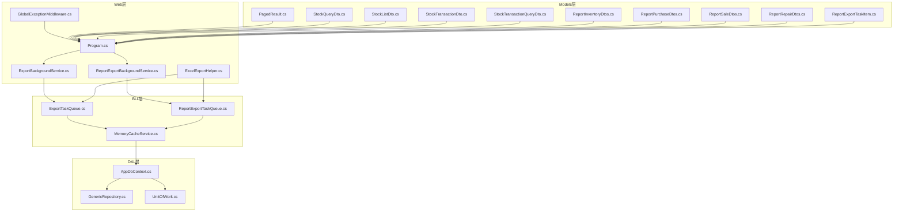
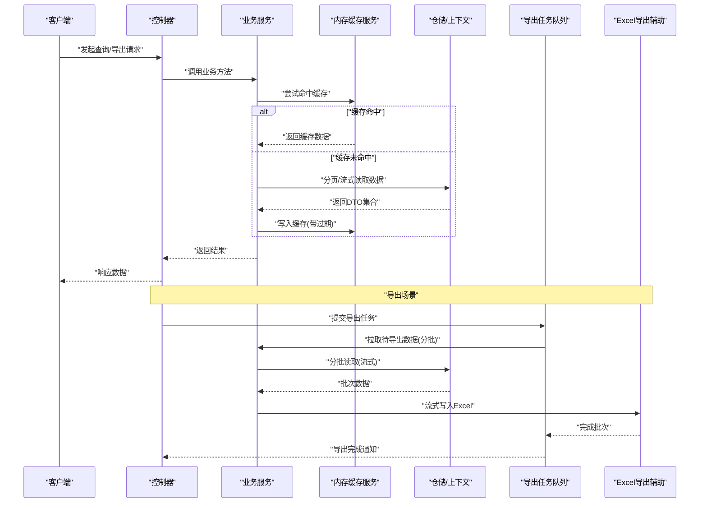
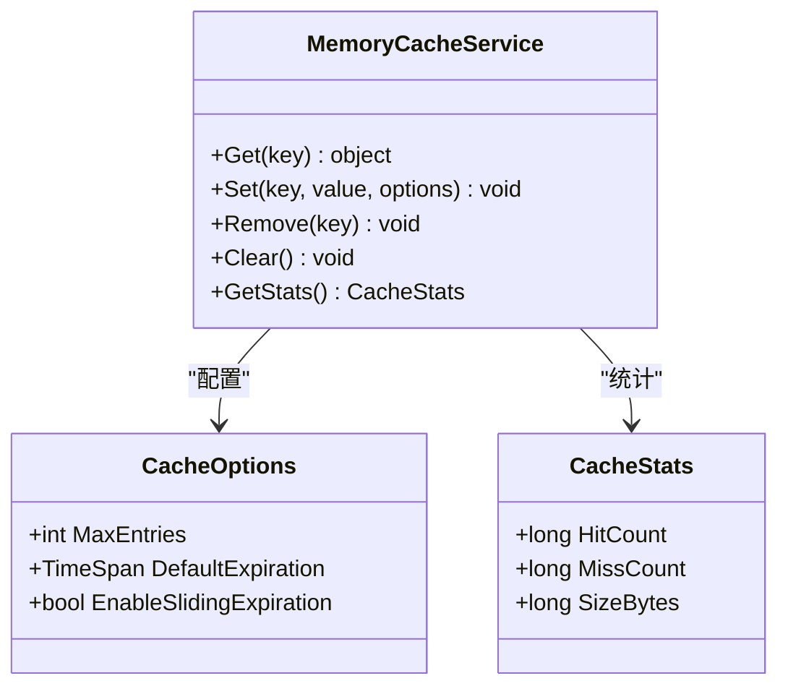
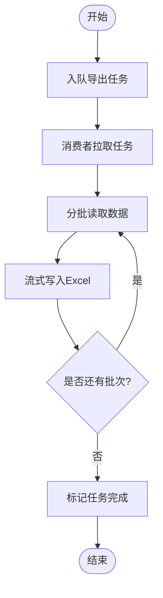
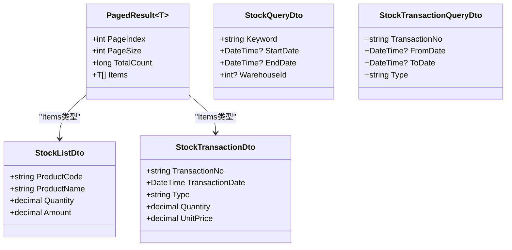
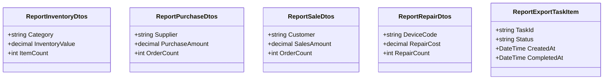
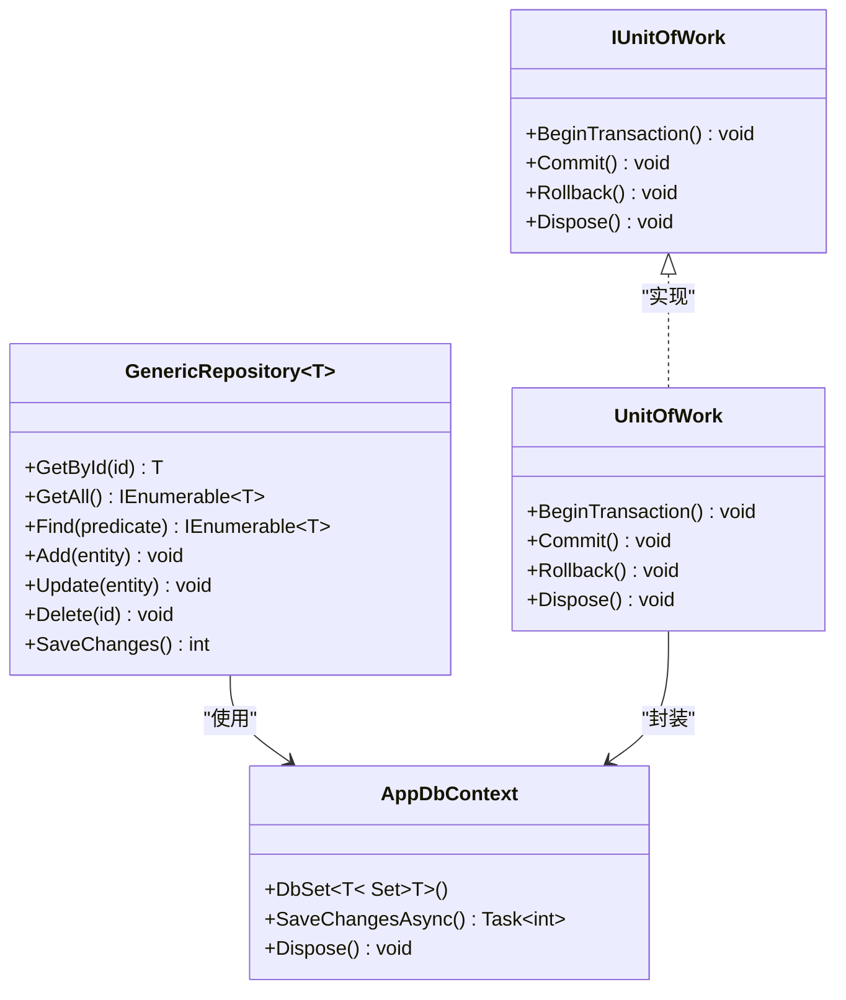
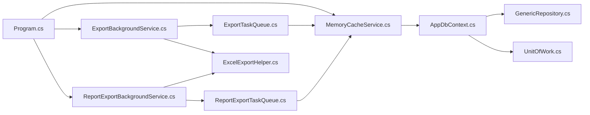

# 内存管理优化

<cite>
**本文引用的文件**   
- [Program.cs](file://EquipmentIMS.Web/Program.cs)
- [appsettings.json](file://EquipmentIMS.Web/appsettings.json)
- [MemoryCacheService.cs](file://EquipmentIMS.BLL/Services/MemoryCacheService.cs)
- [ExportBackgroundService.cs](file://EquipmentIMS.Web/BackgroundServices/ExportBackgroundService.cs)
- [ReportExportBackgroundService.cs](file://EquipmentIMS.Web/BackgroundServices/ReportExportBackgroundService.cs)
- [ExportTaskQueue.cs](file://EquipmentIMS.BLL/Services/ExportTaskQueue.cs)
- [ReportExportTaskQueue.cs](file://EquipmentIMS.BLL/Services/ReportExportTaskQueue.cs)
- [ExcelExportHelper.cs](file://EquipmentIMS.Web/Helpers/ExcelExportHelper.cs)
- [PagedResult.cs](file://EquipmentIMS.Models/DTOs/PagedResult.cs)
- [StockQueryDto.cs](file://EquipmentIMS.Models/DTOs/StockQueryDto.cs)
- [StockListDto.cs](file://EquipmentIMS.Models/DTOs/StockListDto.cs)
- [StockTransactionDto.cs](file://EquipmentIMS.Models/DTOs/StockTransactionDto.cs)
- [StockTransactionQueryDto.cs](file://EquipmentIMS.Models/DTOs/StockTransactionQueryDto.cs)
- [ReportInventoryDtos.cs](file://EquipmentIMS.Models/DTOs/Reports/ReportInventoryDtos.cs)
- [ReportPurchaseDtos.cs](file://EquipmentIMS.Models/DTOs/Reports/ReportPurchaseDtos.cs)
- [ReportSaleDtos.cs](file://EquipmentIMS.Models/DTOs/Reports/ReportSaleDtos.cs)
- [ReportRepairDtos.cs](file://EquipmentIMS.Models/DTOs/Reports/ReportRepairDtos.cs)
- [ReportExportTaskItem.cs](file://EquipmentIMS.Models/DTOs/Reports/ReportExportTaskItem.cs)
- [GenericRepository.cs](file://EquipmentIMS.DAL/Repositories/GenericRepository.cs)
- [AppDbContext.cs](file://EquipmentIMS.DAL/AppDbContext.cs)
- [IUnitOfWork.cs](file://EquipmentIMS.DAL/Interfaces/IUnitOfWork.cs)
- [UnitOfWork.cs](file://EquipmentIMS.DAL/Repositories/UnitOfWork.cs)
- [GlobalExceptionMiddleware.cs](file://EquipmentIMS.Web/Filters/GlobalExceptionMiddleware.cs)
</cite>

## 目录
1. [简介](#简介)
2. [项目结构](#项目结构)
3. [核心组件](#核心组件)
4. [架构总览](#架构总览)
5. [详细组件分析](#详细组件分析)
6. [依赖关系分析](#依赖关系分析)
7. [性能考虑](#性能考虑)
8. [故障排查指南](#故障排查指南)
9. [结论](#结论)
10. [附录](#附录)

## 简介
本指南面向THMS系统的内存管理与性能优化，聚焦以下目标：
- 对象生命周期管理与内存泄漏检测、预防策略
- 大数据量处理的内存优化：流式处理、分批处理、对象池化
- 垃圾回收优化、内存压力监控与性能计数器使用
- DTO/实体映射/视图模型优化策略
- 内存快照分析、性能剖析工具使用、内存瓶颈定位方法
- 最佳实践与常见陷阱规避

## 项目结构
THMS采用分层架构（Web/BLL/DAL/Models），结合后台任务与缓存服务进行数据处理。与内存管理密切相关的模块包括：
- Web层：控制器、中间件、后台服务、导出辅助类
- BLL层：业务服务、队列与后台任务、缓存服务
- DAL层：EF Core上下文、仓储与单元工作
- Models层：DTO、实体、分页结果等

图表来源
- [Program.cs](file://EquipmentIMS.Web/Program.cs)
- [MemoryCacheService.cs](file://EquipmentIMS.BLL/Services/MemoryCacheService.cs)
- [ExportBackgroundService.cs](file://EquipmentIMS.Web/BackgroundServices/ExportBackgroundService.cs)
- [ReportExportBackgroundService.cs](file://EquipmentIMS.Web/BackgroundServices/ReportExportBackgroundService.cs)
- [ExportTaskQueue.cs](file://EquipmentIMS.BLL/Services/ExportTaskQueue.cs)
- [ReportExportTaskQueue.cs](file://EquipmentIMS.BLL/Services/ReportExportTaskQueue.cs)
- [ExcelExportHelper.cs](file://EquipmentIMS.Web/Helpers/ExcelExportHelper.cs)
- [PagedResult.cs](file://EquipmentIMS.Models/DTOs/PagedResult.cs)
- [StockQueryDto.cs](file://EquipmentIMS.Models/DTOs/StockQueryDto.cs)
- [StockListDto.cs](file://EquipmentIMS.Models/DTOs/StockListDto.cs)
- [StockTransactionDto.cs](file://EquipmentIMS.Models/DTOs/StockTransactionDto.cs)
- [StockTransactionQueryDto.cs](file://EquipmentIMS.Models/DTOs/StockTransactionQueryDto.cs)
- [ReportInventoryDtos.cs](file://EquipmentIMS.Models/DTOs/Reports/ReportInventoryDtos.cs)
- [ReportPurchaseDtos.cs](file://EquipmentIMS.Models/DTOs/Reports/ReportPurchaseDtos.cs)
- [ReportSaleDtos.cs](file://EquipmentIMS.Models/DTOs/Reports/ReportSaleDtos.cs)
- [ReportRepairDtos.cs](file://EquipmentIMS.Models/DTOs/Reports/ReportRepairDtos.cs)
- [ReportExportTaskItem.cs](file://EquipmentIMS.Models/DTOs/Reports/ReportExportTaskItem.cs)
- [GenericRepository.cs](file://EquipmentIMS.DAL/Repositories/GenericRepository.cs)
- [AppDbContext.cs](file://EquipmentIMS.DAL/AppDbContext.cs)
- [IUnitOfWork.cs](file://EquipmentIMS.DAL/Interfaces/IUnitOfWork.cs)
- [UnitOfWork.cs](file://EquipmentIMS.DAL/Repositories/UnitOfWork.cs)
- [GlobalExceptionMiddleware.cs](file://EquipmentIMS.Web/Filters/GlobalExceptionMiddleware.cs)

章节来源
- [Program.cs](file://EquipmentIMS.Web/Program.cs)
- [appsettings.json](file://EquipmentIMS.Web/appsettings.json)

## 核心组件
- 内存缓存服务：提供进程内缓存能力，需关注过期策略、容量上限与淘汰策略，避免长期驻留大对象。
- 后台导出服务与任务队列：负责批量数据导出，应实现分块读取、流式写入与资源释放。
- Excel导出辅助：涉及大量对象构建与序列化，建议流式输出与对象复用。
- 分页与查询DTO：限制返回字段、控制页大小，减少一次性加载的数据体积。
- EF Core上下文与仓储：注意连接与变更跟踪范围，避免长生命周期上下文导致内存膨胀。
- 全局异常中间件：统一错误处理，防止异常路径中未释放的资源造成泄漏。

章节来源
- [MemoryCacheService.cs](file://EquipmentIMS.BLL/Services/MemoryCacheService.cs)
- [ExportBackgroundService.cs](file://EquipmentIMS.Web/BackgroundServices/ExportBackgroundService.cs)
- [ReportExportBackgroundService.cs](file://EquipmentIMS.Web/BackgroundServices/ReportExportBackgroundService.cs)
- [ExportTaskQueue.cs](file://EquipmentIMS.BLL/Services/ExportTaskQueue.cs)
- [ReportExportTaskQueue.cs](file://EquipmentIMS.BLL/Services/ReportExportTaskQueue.cs)
- [ExcelExportHelper.cs](file://EquipmentIMS.Web/Helpers/ExcelExportHelper.cs)
- [PagedResult.cs](file://EquipmentIMS.Models/DTOs/PagedResult.cs)
- [StockQueryDto.cs](file://EquipmentIMS.Models/DTOs/StockQueryDto.cs)
- [StockListDto.cs](file://EquipmentIMS.Models/DTOs/StockListDto.cs)
- [StockTransactionDto.cs](file://EquipmentIMS.Models/DTOs/StockTransactionDto.cs)
- [StockTransactionQueryDto.cs](file://EquipmentIMS.Models/DTOs/StockTransactionQueryDto.cs)
- [GenericRepository.cs](file://EquipmentIMS.DAL/Repositories/GenericRepository.cs)
- [AppDbContext.cs](file://EquipmentIMS.DAL/AppDbContext.cs)
- [IUnitOfWork.cs](file://EquipmentIMS.DAL/Interfaces/IUnitOfWork.cs)
- [UnitOfWork.cs](file://EquipmentIMS.DAL/Repositories/UnitOfWork.cs)
- [GlobalExceptionMiddleware.cs](file://EquipmentIMS.Web/Filters/GlobalExceptionMiddleware.cs)

## 架构总览
下图展示从请求到数据访问与导出的关键路径，以及内存敏感点（如分页、缓存、后台任务、导出）。

图表来源
- [Program.cs](file://EquipmentIMS.Web/Program.cs)
- [MemoryCacheService.cs](file://EquipmentIMS.BLL/Services/MemoryCacheService.cs)
- [ExportBackgroundService.cs](file://EquipmentIMS.Web/BackgroundServices/ExportBackgroundService.cs)
- [ReportExportBackgroundService.cs](file://EquipmentIMS.Web/BackgroundServices/ReportExportBackgroundService.cs)
- [ExportTaskQueue.cs](file://EquipmentIMS.BLL/Services/ExportTaskQueue.cs)
- [ReportExportTaskQueue.cs](file://EquipmentIMS.BLL/Services/ReportExportTaskQueue.cs)
- [ExcelExportHelper.cs](file://EquipmentIMS.Web/Helpers/ExcelExportHelper.cs)
- [GenericRepository.cs](file://EquipmentIMS.DAL/Repositories/GenericRepository.cs)
- [AppDbContext.cs](file://EquipmentIMS.DAL/AppDbContext.cs)

## 详细组件分析

### 内存缓存服务（MemoryCacheService）
- 设计要点
  - 设置合理的最大条目数与默认过期时间，避免无限增长
  - 对热点小对象做短期缓存；对大对象或频繁变化的数据谨慎缓存
  - 提供显式失效接口，支持按键或前缀清理
- 风险与优化
  - 避免在缓存中存放完整实体图，仅缓存必要DTO片段
  - 使用弱引用或LRU策略降低峰值内存占用
  - 监控缓存命中率与内存占用，动态调整参数

图表来源
- [MemoryCacheService.cs](file://EquipmentIMS.BLL/Services/MemoryCacheService.cs)

章节来源
- [MemoryCacheService.cs](file://EquipmentIMS.BLL/Services/MemoryCacheService.cs)

### 导出后台服务与任务队列（ExportBackgroundService / ReportExportBackgroundService / ExportTaskQueue / ReportExportTaskQueue）
- 设计要点
  - 将大批量导出拆分为任务项，使用队列解耦生产与消费
  - 消费者侧分批读取数据并流式写入Excel，避免一次性加载全部数据
  - 为每个任务维护状态与进度，支持失败重试与取消
- 风险与优化
  - 控制并发度，避免过多任务同时占用内存
  - 及时释放临时对象与文件句柄，避免泄漏
  - 对导出结果进行压缩或分片存储，降低瞬时峰值

图表来源
- [ExportBackgroundService.cs](file://EquipmentIMS.Web/BackgroundServices/ExportBackgroundService.cs)
- [ReportExportBackgroundService.cs](file://EquipmentIMS.Web/BackgroundServices/ReportExportBackgroundService.cs)
- [ExportTaskQueue.cs](file://EquipmentIMS.BLL/Services/ExportTaskQueue.cs)
- [ReportExportTaskQueue.cs](file://EquipmentIMS.BLL/Services/ReportExportTaskQueue.cs)
- [ExcelExportHelper.cs](file://EquipmentIMS.Web/Helpers/ExcelExportHelper.cs)

章节来源
- [ExportBackgroundService.cs](file://EquipmentIMS.Web/BackgroundServices/ExportBackgroundService.cs)
- [ReportExportBackgroundService.cs](file://EquipmentIMS.Web/BackgroundServices/ReportExportBackgroundService.cs)
- [ExportTaskQueue.cs](file://EquipmentIMS.BLL/Services/ExportTaskQueue.cs)
- [ReportExportTaskQueue.cs](file://EquipmentIMS.BLL/Services/ReportExportTaskQueue.cs)
- [ExcelExportHelper.cs](file://EquipmentIMS.Web/Helpers/ExcelExportHelper.cs)

### 分页与查询DTO（PagedResult / StockQueryDto / StockListDto / StockTransactionDto / StockTransactionQueryDto）
- 设计要点
  - 分页结果包含页码、总数、每页大小与数据列表，确保服务端只返回当前页数据
  - 查询DTO仅包含必要过滤字段，避免传递冗余信息
  - 列表DTO精简字段，按需投影，减少传输与内存占用
- 风险与优化
  - 限制最大页大小，防止恶意请求导致内存暴涨
  - 对复杂查询使用数据库端聚合与投影，减少应用层计算

图表来源
- [PagedResult.cs](file://EquipmentIMS.Models/DTOs/PagedResult.cs)
- [StockQueryDto.cs](file://EquipmentIMS.Models/DTOs/StockQueryDto.cs)
- [StockListDto.cs](file://EquipmentIMS.Models/DTOs/StockListDto.cs)
- [StockTransactionDto.cs](file://EquipmentIMS.Models/DTOs/StockTransactionDto.cs)
- [StockTransactionQueryDto.cs](file://EquipmentIMS.Models/DTOs/StockTransactionQueryDto.cs)

章节来源
- [PagedResult.cs](file://EquipmentIMS.Models/DTOs/PagedResult.cs)
- [StockQueryDto.cs](file://EquipmentIMS.Models/DTOs/StockQueryDto.cs)
- [StockListDto.cs](file://EquipmentIMS.Models/DTOs/StockListDto.cs)
- [StockTransactionDto.cs](file://EquipmentIMS.Models/DTOs/StockTransactionDto.cs)
- [StockTransactionQueryDto.cs](file://EquipmentIMS.Models/DTOs/StockTransactionQueryDto.cs)

### 报表DTO（ReportInventoryDtos / ReportPurchaseDtos / ReportSaleDtos / ReportRepairDtos / ReportExportTaskItem）
- 设计要点
  - 报表DTO按主题域拆分，便于按需填充与缓存
  - 导出任务项记录任务元数据与状态，避免重复计算
- 风险与优化
  - 报表数据量大时，优先使用数据库端汇总与分页
  - 对跨表关联的报表，尽量在SQL层完成JOIN与聚合

图表来源
- [ReportInventoryDtos.cs](file://EquipmentIMS.Models/DTOs/Reports/ReportInventoryDtos.cs)
- [ReportPurchaseDtos.cs](file://EquipmentIMS.Models/DTOs/Reports/ReportPurchaseDtos.cs)
- [ReportSaleDtos.cs](file://EquipmentIMS.Models/DTOs/Reports/ReportSaleDtos.cs)
- [ReportRepairDtos.cs](file://EquipmentIMS.Models/DTOs/Reports/ReportRepairDtos.cs)
- [ReportExportTaskItem.cs](file://EquipmentIMS.Models/DTOs/Reports/ReportExportTaskItem.cs)

章节来源
- [ReportInventoryDtos.cs](file://EquipmentIMS.Models/DTOs/Reports/ReportInventoryDtos.cs)
- [ReportPurchaseDtos.cs](file://EquipmentIMS.Models/DTOs/Reports/ReportPurchaseDtos.cs)
- [ReportSaleDtos.cs](file://EquipmentIMS.Models/DTOs/Reports/ReportSaleDtos.cs)
- [ReportRepairDtos.cs](file://EquipmentIMS.Models/DTOs/Reports/ReportRepairDtos.cs)
- [ReportExportTaskItem.cs](file://EquipmentIMS.Models/DTOs/Reports/ReportExportTaskItem.cs)

### 数据访问层（GenericRepository / AppDbContext / IUnitOfWork / UnitOfWork）
- 设计要点
  - 使用单元工作模式管理事务与上下文生命周期
  - 仓储层提供分页与投影查询，避免全表加载
  - 对只读查询禁用变更跟踪，减少内存开销
- 风险与优化
  - 避免长生命周期上下文持有大量实体
  - 合理设置命令超时与连接池参数

图表来源
- [GenericRepository.cs](file://EquipmentIMS.DAL/Repositories/GenericRepository.cs)
- [AppDbContext.cs](file://EquipmentIMS.DAL/AppDbContext.cs)
- [IUnitOfWork.cs](file://EquipmentIMS.DAL/Interfaces/IUnitOfWork.cs)
- [UnitOfWork.cs](file://EquipmentIMS.DAL/Repositories/UnitOfWork.cs)

章节来源
- [GenericRepository.cs](file://EquipmentIMS.DAL/Repositories/GenericRepository.cs)
- [AppDbContext.cs](file://EquipmentIMS.DAL/AppDbContext.cs)
- [IUnitOfWork.cs](file://EquipmentIMS.DAL/Interfaces/IUnitOfWork.cs)
- [UnitOfWork.cs](file://EquipmentIMS.DAL/Repositories/UnitOfWork.cs)

### 全局异常中间件（GlobalExceptionMiddleware）
- 设计要点
  - 统一捕获异常，记录日志并返回友好响应
  - 确保异常路径中释放临时资源，避免泄漏
- 风险与优化
  - 避免在中间件中执行耗时操作
  - 对大对象或文件句柄进行显式释放

章节来源
- [GlobalExceptionMiddleware.cs](file://EquipmentIMS.Web/Filters/GlobalExceptionMiddleware.cs)

## 依赖关系分析
- 组件耦合
  - 后台服务依赖任务队列与缓存服务
  - 缓存服务依赖数据访问层进行回填
  - 导出辅助依赖队列与业务服务
- 外部依赖
  - EF Core上下文与数据库连接池
  - 文件系统（导出文件）
- 潜在循环依赖
  - 通过接口与队列解耦，避免直接双向依赖

图表来源
- [Program.cs](file://EquipmentIMS.Web/Program.cs)
- [MemoryCacheService.cs](file://EquipmentIMS.BLL/Services/MemoryCacheService.cs)
- [ExportBackgroundService.cs](file://EquipmentIMS.Web/BackgroundServices/ExportBackgroundService.cs)
- [ReportExportBackgroundService.cs](file://EquipmentIMS.Web/BackgroundServices/ReportExportBackgroundService.cs)
- [ExportTaskQueue.cs](file://EquipmentIMS.BLL/Services/ExportTaskQueue.cs)
- [ReportExportTaskQueue.cs](file://EquipmentIMS.BLL/Services/ReportExportTaskQueue.cs)
- [ExcelExportHelper.cs](file://EquipmentIMS.Web/Helpers/ExcelExportHelper.cs)
- [AppDbContext.cs](file://EquipmentIMS.DAL/AppDbContext.cs)
- [GenericRepository.cs](file://EquipmentIMS.DAL/Repositories/GenericRepository.cs)
- [UnitOfWork.cs](file://EquipmentIMS.DAL/Repositories/UnitOfWork.cs)

章节来源
- [Program.cs](file://EquipmentIMS.Web/Program.cs)
- [appsettings.json](file://EquipmentIMS.Web/appsettings.json)

## 性能考虑
- 对象生命周期管理
  - 短生命周期对象：尽量在方法作用域内创建与释放，避免静态集合持有引用
  - 长生命周期对象：使用工厂与容器管理，明确注册与销毁时机
- 内存泄漏检测与预防
  - 定期审查静态字段、事件订阅、定时器与回调
  - 对文件句柄、网络连接、数据库连接使用using或显式Dispose
  - 避免在缓存中存放大对象或频繁变化数据
- 大数据量处理
  - 流式处理：使用异步枚举器与流式写入，避免一次性加载
  - 分批处理：分页读取与写入，控制批大小与并发度
  - 对象池化：对高频率创建销毁的对象（如缓冲区、格式化器）进行复用
- 垃圾回收优化
  - 减少大对象堆分配，避免频繁GC
  - 合理设置GC阈值与服务器模式，平衡吞吐与延迟
- 内存压力监控与性能计数器
  - 监控托管堆大小、GC次数、线程池等待、IO队列长度
  - 结合指标平台进行告警与趋势分析
- DTO/实体映射/视图模型优化
  - 使用投影与只读DTO，减少不必要字段
  - 避免在映射过程中创建中间大对象
  - 对视图模型进行裁剪，仅保留UI所需字段
- 内存快照分析与性能剖析
  - 使用内存快照对比前后差异，定位持续增长的对象
  - 使用CPU与内存剖析工具识别热点方法与分配路径
- 最佳实践与常见陷阱
  - 避免在循环中累积字符串与集合
  - 避免在缓存中存放实体图或导航属性
  - 避免在后台任务中长时间持有上下文或连接

[本节为通用指导，不直接分析具体文件]

## 故障排查指南
- 常见问题
  - 内存持续增长：检查缓存策略、静态集合、未释放资源
  - GC频繁：分析大对象分配与分配热点，优化数据结构与算法
  - 导出卡顿或OOM：确认是否流式写入与分批读取，控制并发
- 定位方法
  - 采集内存快照，比较不同时间点差异
  - 使用性能剖析工具定位分配热点
  - 增加关键路径的指标与日志，观察峰值与趋势
- 缓解措施
  - 调整缓存过期与容量
  - 降低批大小与并发度
  - 引入对象池与流式处理

章节来源
- [GlobalExceptionMiddleware.cs](file://EquipmentIMS.Web/Filters/GlobalExceptionMiddleware.cs)
- [MemoryCacheService.cs](file://EquipmentIMS.BLL/Services/MemoryCacheService.cs)
- [ExportBackgroundService.cs](file://EquipmentIMS.Web/BackgroundServices/ExportBackgroundService.cs)
- [ReportExportBackgroundService.cs](file://EquipmentIMS.Web/BackgroundServices/ReportExportBackgroundService.cs)
- [ExcelExportHelper.cs](file://EquipmentIMS.Web/Helpers/ExcelExportHelper.cs)

## 结论
通过对THMS系统的关键组件进行内存管理优化，重点在于：
- 明确对象生命周期与资源释放
- 采用流式与分批处理应对大数据量
- 合理使用缓存与对象池，避免过度分配
- 建立完善的监控与剖析体系，持续发现与修复问题
- 优化DTO与映射策略，减少不必要的内存占用

[本节为总结性内容，不直接分析具体文件]

## 附录
- 配置参考
  - 应用设置中的缓存与后台任务相关参数
- 示例路径
  - 分页与查询DTO定义位置
  - 报表DTO与导出任务项定义位置
  - 仓储与上下文实现位置

章节来源
- [appsettings.json](file://EquipmentIMS.Web/appsettings.json)
- [PagedResult.cs](file://EquipmentIMS.Models/DTOs/PagedResult.cs)
- [StockQueryDto.cs](file://EquipmentIMS.Models/DTOs/StockQueryDto.cs)
- [StockListDto.cs](file://EquipmentIMS.Models/DTOs/StockListDto.cs)
- [StockTransactionDto.cs](file://EquipmentIMS.Models/DTOs/StockTransactionDto.cs)
- [StockTransactionQueryDto.cs](file://EquipmentIMS.Models/DTOs/StockTransactionQueryDto.cs)
- [ReportInventoryDtos.cs](file://EquipmentIMS.Models/DTOs/Reports/ReportInventoryDtos.cs)
- [ReportPurchaseDtos.cs](file://EquipmentIMS.Models/DTOs/Reports/ReportPurchaseDtos.cs)
- [ReportSaleDtos.cs](file://EquipmentIMS.Models/DTOs/Reports/ReportSaleDtos.cs)
- [ReportRepairDtos.cs](file://EquipmentIMS.Models/DTOs/Reports/ReportRepairDtos.cs)
- [ReportExportTaskItem.cs](file://EquipmentIMS.Models/DTOs/Reports/ReportExportTaskItem.cs)
- [GenericRepository.cs](file://EquipmentIMS.DAL/Repositories/GenericRepository.cs)
- [AppDbContext.cs](file://EquipmentIMS.DAL/AppDbContext.cs)
- [IUnitOfWork.cs](file://EquipmentIMS.DAL/Interfaces/IUnitOfWork.cs)
- [UnitOfWork.cs](file://EquipmentIMS.DAL/Repositories/UnitOfWork.cs)