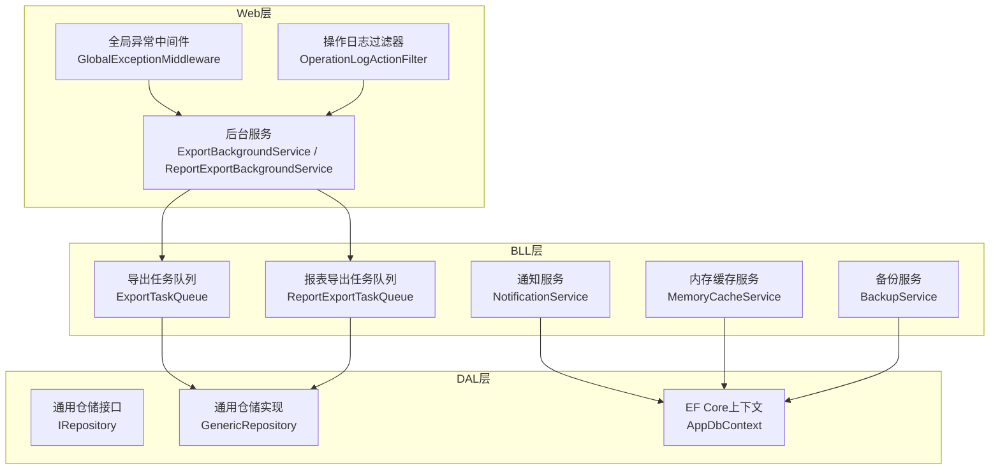
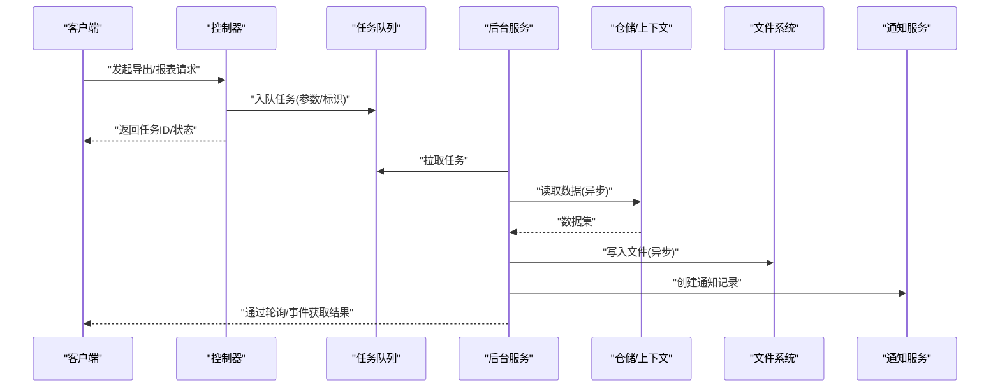
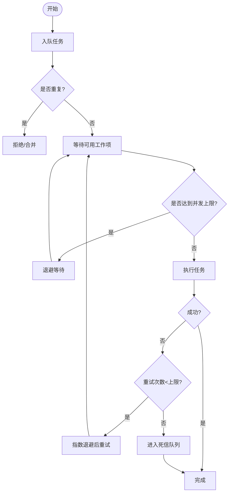
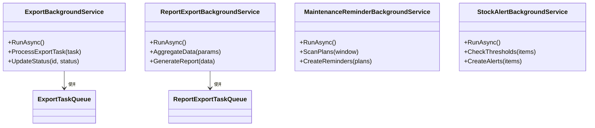
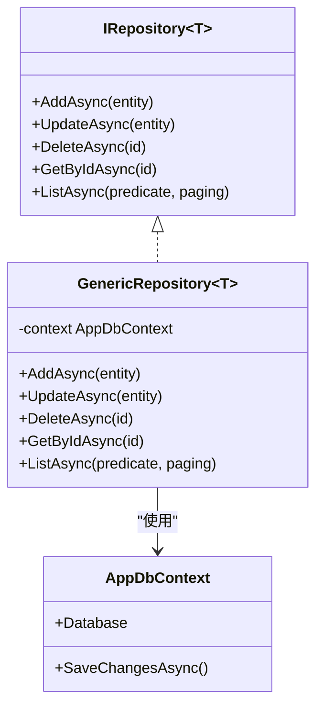
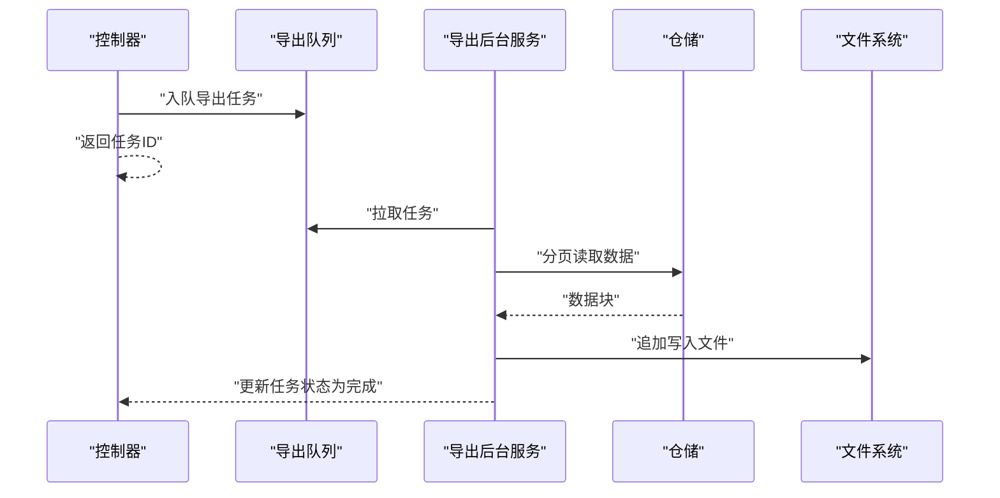
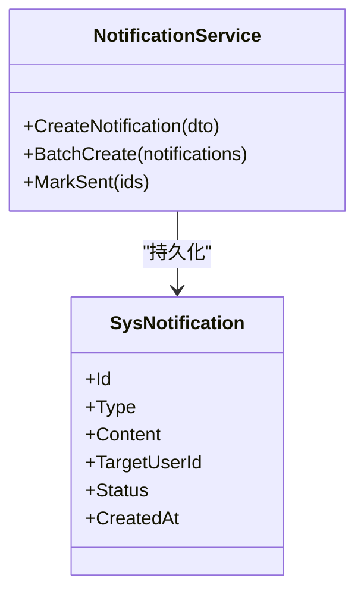
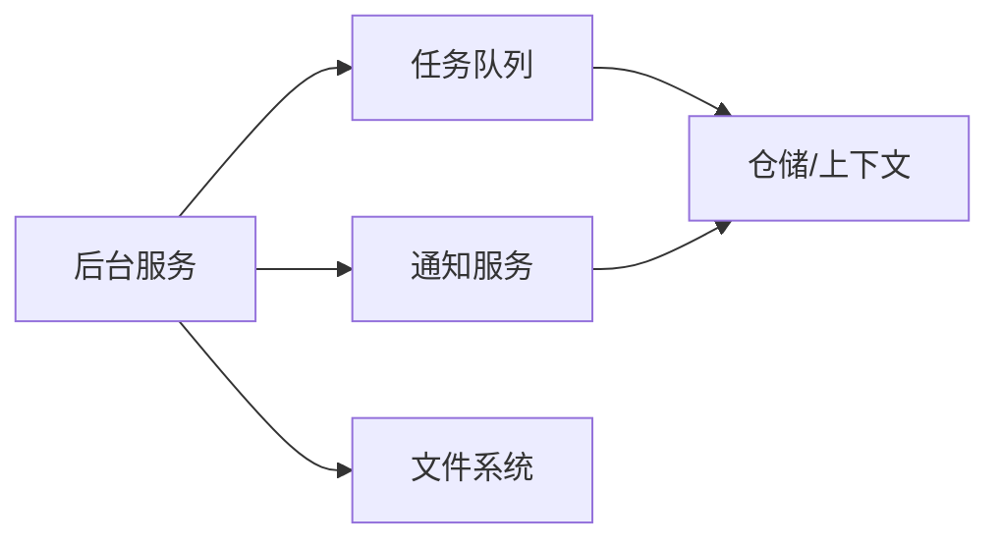

# 异步处理优化

<cite>
**本文引用的文件**   
- [Program.cs](file://EquipmentIMS.Web/Program.cs)
- [ExportBackgroundService.cs](file://EquipmentIMS.Web/BackgroundServices/ExportBackgroundService.cs)
- [ReportExportBackgroundService.cs](file://EquipmentIMS.Web/BackgroundServices/ReportExportBackgroundService.cs)
- [MaintenanceReminderBackgroundService.cs](file://EquipmentIMS.Web/BackgroundServices/MaintenanceReminderBackgroundService.cs)
- [StockAlertBackgroundService.cs](file://EquipmentIMS.Web/BackgroundServices/StockAlertBackgroundService.cs)
- [ExportTaskQueue.cs](file://EquipmentIMS.BLL/Services/ExportTaskQueue.cs)
- [ReportExportTaskQueue.cs](file://EquipmentIMS.BLL/Services/ReportExportTaskQueue.cs)
- [NotificationService.cs](file://EquipmentIMS.BLL/Services/NotificationService.cs)
- [INotificationService.cs](file://EquipmentIMS.BLL/Interfaces/INotificationService.cs)
- [MemoryCacheService.cs](file://EquipmentIMS.BLL/Services/MemoryCacheService.cs)
- [ICacheService.cs](file://EquipmentIMS.BLL/Interfaces/ICacheService.cs)
- [GlobalExceptionMiddleware.cs](file://EquipmentIMS.Web/Filters/GlobalExceptionMiddleware.cs)
- [OperationLogActionFilter.cs](file://EquipmentIMS.Web/Filters/OperationLogActionFilter.cs)
- [SysNotificationConfiguration.cs](file://EquipmentIMS.DAL/Configurations/SysNotificationConfiguration.cs)
- [SysNotification.cs](file://EquipmentIMS.Models/Entities/SysNotification.cs)
- [BackupService.cs](file://EquipmentIMS.BLL/Services/BackupService.cs)
- [IRepository.cs](file://EquipmentIMS.DAL/Interfaces/IRepository.cs)
- [GenericRepository.cs](file://EquipmentIMS.DAL/Repositories/GenericRepository.cs)
- [AppDbContext.cs](file://EquipmentIMS.DAL/AppDbContext.cs)
</cite>

## 目录
1. [简介](#简介)
2. [项目结构](#项目结构)
3. [核心组件](#核心组件)
4. [架构总览](#架构总览)
5. [详细组件分析](#详细组件分析)
6. [依赖关系分析](#依赖关系分析)
7. [性能考虑](#性能考虑)
8. [故障排查指南](#故障排查指南)
9. [结论](#结论)
10. [附录](#附录)

## 简介
本文件聚焦于THMS系统的异步处理优化，围绕后台服务、任务队列、并发控制、错误重试、异步仓储与文件处理、通知发送、调度优化、资源池化、内存泄漏防护、监控告警、指标收集、故障恢复策略以及调试技巧与最佳实践进行系统化说明。目标是帮助读者理解现有实现并在此基础上进一步提升吞吐、稳定性与可观测性。

## 项目结构
系统采用分层架构：Web层提供控制器与中间件；BLL层封装业务逻辑与后台任务队列；DAL层负责数据访问；Models定义实体与DTO。异步能力主要分布在以下位置：
- Web层后台服务：基于IHostedService的定时或常驻任务
- BLL层任务队列：用于导出等耗时任务的排队与执行
- DAL层仓储：通用仓储接口与EF Core上下文
- 配置与扩展：服务注册、缓存、日志与异常处理

图表来源
- [ExportBackgroundService.cs](file://EquipmentIMS.Web/BackgroundServices/ExportBackgroundService.cs)
- [ReportExportBackgroundService.cs](file://EquipmentIMS.Web/BackgroundServices/ReportExportBackgroundService.cs)
- [ExportTaskQueue.cs](file://EquipmentIMS.BLL/Services/ExportTaskQueue.cs)
- [ReportExportTaskQueue.cs](file://EquipmentIMS.BLL/Services/ReportExportTaskQueue.cs)
- [NotificationService.cs](file://EquipmentIMS.BLL/Services/NotificationService.cs)
- [MemoryCacheService.cs](file://EquipmentIMS.BLL/Services/MemoryCacheService.cs)
- [BackupService.cs](file://EquipmentIMS.BLL/Services/BackupService.cs)
- [IRepository.cs](file://EquipmentIMS.DAL/Interfaces/IRepository.cs)
- [GenericRepository.cs](file://EquipmentIMS.DAL/Repositories/GenericRepository.cs)
- [AppDbContext.cs](file://EquipmentIMS.DAL/AppDbContext.cs)
- [GlobalExceptionMiddleware.cs](file://EquipmentIMS.Web/Filters/GlobalExceptionMiddleware.cs)
- [OperationLogActionFilter.cs](file://EquipmentIMS.Web/Filters/OperationLogActionFilter.cs)

章节来源
- [Program.cs](file://EquipmentIMS.Web/Program.cs)
- [ExportBackgroundService.cs](file://EquipmentIMS.Web/BackgroundServices/ExportBackgroundService.cs)
- [ReportExportBackgroundService.cs](file://EquipmentIMS.Web/BackgroundServices/ReportExportBackgroundService.cs)
- [ExportTaskQueue.cs](file://EquipmentIMS.BLL/Services/ExportTaskQueue.cs)
- [ReportExportTaskQueue.cs](file://EquipmentIMS.BLL/Services/ReportExportTaskQueue.cs)
- [NotificationService.cs](file://EquipmentIMS.BLL/Services/NotificationService.cs)
- [MemoryCacheService.cs](file://EquipmentIMS.BLL/Services/MemoryCacheService.cs)
- [BackupService.cs](file://EquipmentIMS.BLL/Services/BackupService.cs)
- [IRepository.cs](file://EquipmentIMS.DAL/Interfaces/IRepository.cs)
- [GenericRepository.cs](file://EquipmentIMS.DAL/Repositories/GenericRepository.cs)
- [AppDbContext.cs](file://EquipmentIMS.DAL/AppDbContext.cs)
- [GlobalExceptionMiddleware.cs](file://EquipmentIMS.Web/Filters/GlobalExceptionMiddleware.cs)
- [OperationLogActionFilter.cs](file://EquipmentIMS.Web/Filters/OperationLogActionFilter.cs)

## 核心组件
- 后台服务（IHostedService）
  - 导出后台服务：负责消费导出任务队列并生成文件
  - 报表导出后台服务：批量聚合数据并生成报表
  - 维护提醒后台服务：周期性扫描计划任务并触发提醒
  - 库存预警后台服务：定期评估库存阈值并生成预警
- 任务队列
  - 导出任务队列：承载Excel导出等IO密集型任务
  - 报表导出任务队列：承载复杂报表计算与导出
- 通知服务：持久化通知记录，支持后续推送
- 缓存服务：内存缓存，降低热点查询压力
- 仓储与上下文：通用仓储接口与EF Core上下文，支撑异步数据访问

章节来源
- [ExportBackgroundService.cs](file://EquipmentIMS.Web/BackgroundServices/ExportBackgroundService.cs)
- [ReportExportBackgroundService.cs](file://EquipmentIMS.Web/BackgroundServices/ReportExportBackgroundService.cs)
- [MaintenanceReminderBackgroundService.cs](file://EquipmentIMS.Web/BackgroundServices/MaintenanceReminderBackgroundService.cs)
- [StockAlertBackgroundService.cs](file://EquipmentIMS.Web/BackgroundServices/StockAlertBackgroundService.cs)
- [ExportTaskQueue.cs](file://EquipmentIMS.BLL/Services/ExportTaskQueue.cs)
- [ReportExportTaskQueue.cs](file://EquipmentIMS.BLL/Services/ReportExportTaskQueue.cs)
- [NotificationService.cs](file://EquipmentIMS.BLL/Services/NotificationService.cs)
- [MemoryCacheService.cs](file://EquipmentIMS.BLL/Services/MemoryCacheService.cs)

## 架构总览
下图展示了从请求到后台处理的端到端流程，包括控制器入站、队列入队、后台服务出队、仓储访问与结果落盘/通知。

图表来源
- [ExportBackgroundService.cs](file://EquipmentIMS.Web/BackgroundServices/ExportBackgroundService.cs)
- [ReportExportBackgroundService.cs](file://EquipmentIMS.Web/BackgroundServices/ReportExportBackgroundService.cs)
- [ExportTaskQueue.cs](file://EquipmentIMS.BLL/Services/ExportTaskQueue.cs)
- [ReportExportTaskQueue.cs](file://EquipmentIMS.BLL/Services/ReportExportTaskQueue.cs)
- [NotificationService.cs](file://EquipmentIMS.BLL/Services/NotificationService.cs)
- [IRepository.cs](file://EquipmentIMS.DAL/Interfaces/IRepository.cs)
- [GenericRepository.cs](file://EquipmentIMS.DAL/Repositories/GenericRepository.cs)
- [AppDbContext.cs](file://EquipmentIMS.DAL/AppDbContext.cs)

## 详细组件分析

### 任务队列设计与并发控制
- 设计要点
  - 任务模型：包含任务类型、参数、状态、进度、错误信息、时间戳等
  - 入队/出队：线程安全集合或阻塞队列，避免重复消费
  - 并发度：限制同时运行的任务数，防止资源耗尽
  - 优先级：按业务重要性排序，保障关键任务优先
- 并发控制建议
  - 使用信号量或限流器限制并行度
  - 每个任务独立生命周期，失败不影响其他任务
  - 任务去重：相同参数的任务合并或拒绝重复入队
- 错误重试机制
  - 指数退避重试，最大重试次数上限
  - 死信队列：超过阈值的任务转入死信，人工介入
  - 幂等性：确保重试不会导致数据不一致

图表来源
- [ExportTaskQueue.cs](file://EquipmentIMS.BLL/Services/ExportTaskQueue.cs)
- [ReportExportTaskQueue.cs](file://EquipmentIMS.BLL/Services/ReportExportTaskQueue.cs)

章节来源
- [ExportTaskQueue.cs](file://EquipmentIMS.BLL/Services/ExportTaskQueue.cs)
- [ReportExportTaskQueue.cs](file://EquipmentIMS.BLL/Services/ReportExportTaskQueue.cs)

### 后台服务与调度优化
- 导出后台服务
  - 职责：持续监听导出队列，生成文件并更新状态
  - 优化点：批处理大小、分页读取、流式写入
- 报表导出后台服务
  - 职责：聚合多表数据，生成报表
  - 优化点：只选必要字段、索引利用、分批聚合
- 维护提醒后台服务
  - 职责：周期扫描维护计划，生成提醒
  - 优化点：增量扫描、时间窗口过滤
- 库存预警后台服务
  - 职责：检查库存低于阈值，生成预警
  - 优化点：缓存阈值配置、批量比较

图表来源
- [ExportBackgroundService.cs](file://EquipmentIMS.Web/BackgroundServices/ExportBackgroundService.cs)
- [ReportExportBackgroundService.cs](file://EquipmentIMS.Web/BackgroundServices/ReportExportBackgroundService.cs)
- [MaintenanceReminderBackgroundService.cs](file://EquipmentIMS.Web/BackgroundServices/MaintenanceReminderBackgroundService.cs)
- [StockAlertBackgroundService.cs](file://EquipmentIMS.Web/BackgroundServices/StockAlertBackgroundService.cs)
- [ExportTaskQueue.cs](file://EquipmentIMS.BLL/Services/ExportTaskQueue.cs)
- [ReportExportTaskQueue.cs](file://EquipmentIMS.BLL/Services/ReportExportTaskQueue.cs)

章节来源
- [ExportBackgroundService.cs](file://EquipmentIMS.Web/BackgroundServices/ExportBackgroundService.cs)
- [ReportExportBackgroundService.cs](file://EquipmentIMS.Web/BackgroundServices/ReportExportBackgroundService.cs)
- [MaintenanceReminderBackgroundService.cs](file://EquipmentIMS.Web/BackgroundServices/MaintenanceReminderBackgroundService.cs)
- [StockAlertBackgroundService.cs](file://EquipmentIMS.Web/BackgroundServices/StockAlertBackgroundService.cs)

### 异步仓储操作与数据访问
- 通用仓储接口与实现
  - 提供增删改查的异步方法，统一事务边界
  - 结合EF Core上下文，避免连接泄露
- 数据访问优化
  - 只加载必要字段，减少网络与序列化开销
  - 使用AsNoTracking提升读性能
  - 合理分页与游标，避免一次性加载大数据集
- 事务与一致性
  - 在后台任务中显式开启事务，保证批量操作的原子性
  - 长事务拆分，避免锁竞争

图表来源
- [IRepository.cs](file://EquipmentIMS.DAL/Interfaces/IRepository.cs)
- [GenericRepository.cs](file://EquipmentIMS.DAL/Repositories/GenericRepository.cs)
- [AppDbContext.cs](file://EquipmentIMS.DAL/AppDbContext.cs)

章节来源
- [IRepository.cs](file://EquipmentIMS.DAL/Interfaces/IRepository.cs)
- [GenericRepository.cs](file://EquipmentIMS.DAL/Repositories/GenericRepository.cs)
- [AppDbContext.cs](file://EquipmentIMS.DAL/AppDbContext.cs)

### 异步文件处理与导出
- 导出流程
  - 控制器接收请求，将任务入队并立即返回任务ID
  - 后台服务拉取任务，分页读取数据，流式写入文件
  - 完成后更新任务状态并提供下载链接
- 优化建议
  - 使用流式API避免大对象驻留内存
  - 分块写入，及时释放缓冲区
  - 对磁盘IO进行限速与重试，避免抖动影响

图表来源
- [ExportBackgroundService.cs](file://EquipmentIMS.Web/BackgroundServices/ExportBackgroundService.cs)
- [ExportTaskQueue.cs](file://EquipmentIMS.BLL/Services/ExportTaskQueue.cs)
- [IRepository.cs](file://EquipmentIMS.DAL/Interfaces/IRepository.cs)
- [GenericRepository.cs](file://EquipmentIMS.DAL/Repositories/GenericRepository.cs)

章节来源
- [ExportBackgroundService.cs](file://EquipmentIMS.Web/BackgroundServices/ExportBackgroundService.cs)
- [ExportTaskQueue.cs](file://EquipmentIMS.BLL/Services/ExportTaskQueue.cs)

### 异步通知发送与持久化
- 通知服务职责
  - 创建通知记录，持久化到数据库
  - 支持后续推送渠道（站内消息、邮件、短信等）
- 设计要点
  - 通知实体包含类型、内容、目标用户、状态、时间戳
  - 批量插入，减少往返
  - 失败重试与幂等键，避免重复发送

图表来源
- [NotificationService.cs](file://EquipmentIMS.BLL/Services/NotificationService.cs)
- [SysNotification.cs](file://EquipmentIMS.Models/Entities/SysNotification.cs)
- [SysNotificationConfiguration.cs](file://EquipmentIMS.DAL/Configurations/SysNotificationConfiguration.cs)

章节来源
- [NotificationService.cs](file://EquipmentIMS.BLL/Services/NotificationService.cs)
- [SysNotification.cs](file://EquipmentIMS.Models/Entities/SysNotification.cs)
- [SysNotificationConfiguration.cs](file://EquipmentIMS.DAL/Configurations/SysNotificationConfiguration.cs)

### 资源池化与内存管理
- 连接池
  - EF Core默认连接池，需关注Max Pool Size与超时配置
  - 避免长事务持有连接，及时释放上下文
- 缓存服务
  - 内存缓存用于热点配置与字典数据
  - 设置过期时间与淘汰策略，防止内存膨胀
- 文件与IO
  - 使用流式读写，避免一次性加载大文件
  - 控制并发写，避免磁盘争用

章节来源
- [MemoryCacheService.cs](file://EquipmentIMS.BLL/Services/MemoryCacheService.cs)
- [ICacheService.cs](file://EquipmentIMS.BLL/Interfaces/ICacheService.cs)
- [AppDbContext.cs](file://EquipmentIMS.DAL/AppDbContext.cs)

### 监控告警与指标收集
- 指标维度
  - 队列长度、出队速率、任务成功率、平均处理时长
  - 文件生成大小、IO吞吐、错误率
  - 通知发送成功率、延迟
- 采集方式
  - 在后台服务与队列处埋点，输出结构化日志
  - 暴露Prometheus指标端点（可选）
- 告警规则
  - 队列积压超过阈值
  - 任务失败率突增
  - 文件生成失败或长时间未完成

章节来源
- [ExportBackgroundService.cs](file://EquipmentIMS.Web/BackgroundServices/ExportBackgroundService.cs)
- [ReportExportBackgroundService.cs](file://EquipmentIMS.Web/BackgroundServices/ReportExportBackgroundService.cs)
- [ExportTaskQueue.cs](file://EquipmentIMS.BLL/Services/ExportTaskQueue.cs)
- [ReportExportTaskQueue.cs](file://EquipmentIMS.BLL/Services/ReportExportTaskQueue.cs)
- [NotificationService.cs](file://EquipmentIMS.BLL/Services/NotificationService.cs)

### 故障恢复策略
- 重试与退避
  - 指数退避+抖动，避免雪崩
  - 最大重试次数与死信队列
- 幂等与补偿
  - 为任务引入唯一键，避免重复执行
  - 对部分失败的任务进行补偿处理
- 降级与熔断
  - 非关键路径降级（如通知延迟发送）
  - 外部依赖不可用时快速失败

章节来源
- [ExportTaskQueue.cs](file://EquipmentIMS.BLL/Services/ExportTaskQueue.cs)
- [ReportExportTaskQueue.cs](file://EquipmentIMS.BLL/Services/ReportExportTaskQueue.cs)
- [NotificationService.cs](file://EquipmentIMS.BLL/Services/NotificationService.cs)

### 调试技巧与常见问题
- 调试技巧
  - 启用详细日志，记录任务ID、参数、耗时、错误堆栈
  - 使用分布式追踪ID贯穿请求与后台任务
  - 本地模拟队列与慢依赖，复现问题
- 常见问题
  - 任务堆积：检查并发度与下游依赖性能
  - 内存泄漏：确认未释放的文件句柄与上下文
  - 死锁与锁竞争：缩短事务、避免跨进程锁
  - 通知丢失：检查幂等键与重试策略

章节来源
- [GlobalExceptionMiddleware.cs](file://EquipmentIMS.Web/Filters/GlobalExceptionMiddleware.cs)
- [OperationLogActionFilter.cs](file://EquipmentIMS.Web/Filters/OperationLogActionFilter.cs)

## 依赖关系分析
- 组件耦合
  - 后台服务依赖任务队列与仓储，低耦合高内聚
  - 通知服务与仓储解耦，便于替换推送渠道
- 外部依赖
  - EF Core上下文与数据库
  - 文件系统（导出与备份）
  - 缓存服务（内存）
- 潜在循环依赖
  - 当前未发现明显循环依赖，保持单向调用链

图表来源
- [ExportBackgroundService.cs](file://EquipmentIMS.Web/BackgroundServices/ExportBackgroundService.cs)
- [ReportExportBackgroundService.cs](file://EquipmentIMS.Web/BackgroundServices/ReportExportBackgroundService.cs)
- [ExportTaskQueue.cs](file://EquipmentIMS.BLL/Services/ExportTaskQueue.cs)
- [ReportExportTaskQueue.cs](file://EquipmentIMS.BLL/Services/ReportExportTaskQueue.cs)
- [NotificationService.cs](file://EquipmentIMS.BLL/Services/NotificationService.cs)
- [IRepository.cs](file://EquipmentIMS.DAL/Interfaces/IRepository.cs)
- [GenericRepository.cs](file://EquipmentIMS.DAL/Repositories/GenericRepository.cs)
- [AppDbContext.cs](file://EquipmentIMS.DAL/AppDbContext.cs)

章节来源
- [ExportBackgroundService.cs](file://EquipmentIMS.Web/BackgroundServices/ExportBackgroundService.cs)
- [ReportExportBackgroundService.cs](file://EquipmentIMS.Web/BackgroundServices/ReportExportBackgroundService.cs)
- [ExportTaskQueue.cs](file://EquipmentIMS.BLL/Services/ExportTaskQueue.cs)
- [ReportExportTaskQueue.cs](file://EquipmentIMS.BLL/Services/ReportExportTaskQueue.cs)
- [NotificationService.cs](file://EquipmentIMS.BLL/Services/NotificationService.cs)
- [IRepository.cs](file://EquipmentIMS.DAL/Interfaces/IRepository.cs)
- [GenericRepository.cs](file://EquipmentIMS.DAL/Repositories/GenericRepository.cs)
- [AppDbContext.cs](file://EquipmentIMS.DAL/AppDbContext.cs)

## 性能考虑
- 队列与并发
  - 调整并发度以匹配CPU与IO能力
  - 使用背压机制，防止过载
- 数据访问
  - 选择必要字段，减少列宽
  - 合理使用索引与分页
- 文件IO
  - 流式写入，控制缓冲区大小
  - 压缩与分片存储，降低传输成本
- 缓存
  - 热点数据缓存，设置合理TTL
  - 缓存穿透与击穿防护

[本节为通用指导，不直接分析具体文件]

## 故障排查指南
- 日志与中间件
  - 全局异常中间件捕获未处理异常，统一返回格式
  - 操作日志过滤器记录关键操作轨迹
- 指标与告警
  - 监控队列积压、任务失败率、文件生成耗时
  - 设定阈值告警，及时干预
- 恢复与回滚
  - 任务级事务，失败回滚
  - 死信队列人工复核与补偿

章节来源
- [GlobalExceptionMiddleware.cs](file://EquipmentIMS.Web/Filters/GlobalExceptionMiddleware.cs)
- [OperationLogActionFilter.cs](file://EquipmentIMS.Web/Filters/OperationLogActionFilter.cs)

## 结论
通过对后台服务、任务队列、仓储访问、文件处理与通知发送的系统化分析与优化建议，THMS可在高并发与大数据量场景下保持稳定与高效。建议在生产环境完善监控告警与指标采集，持续迭代并发度与重试策略，确保系统在峰值负载下的鲁棒性与可观测性。

[本节为总结，不直接分析具体文件]

## 附录
- 相关服务注册与启动入口参考
  - Program.cs中的服务注册与后台服务启动
- 备份服务作为异步任务示例
  - BackupService可作为后台任务调度的参考实现

章节来源
- [Program.cs](file://EquipmentIMS.Web/Program.cs)
- [BackupService.cs](file://EquipmentIMS.BLL/Services/BackupService.cs)