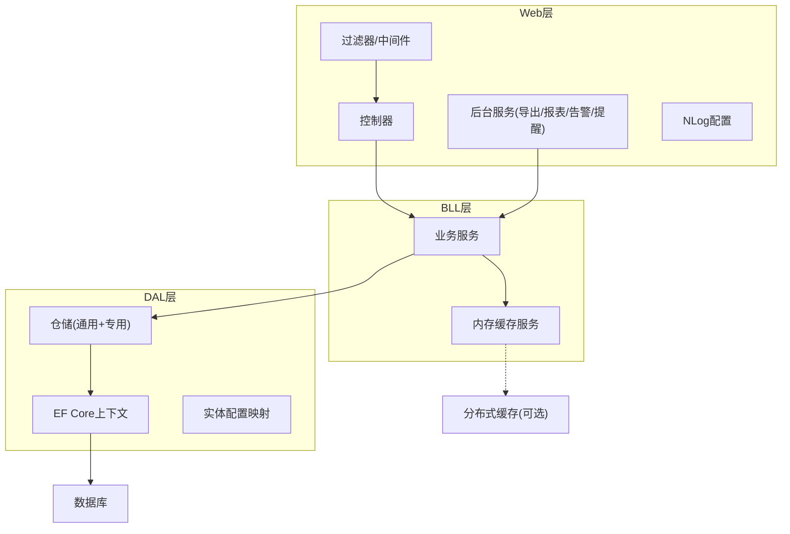
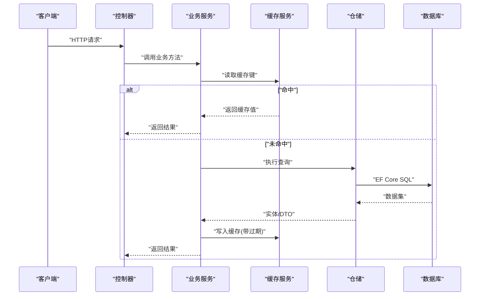
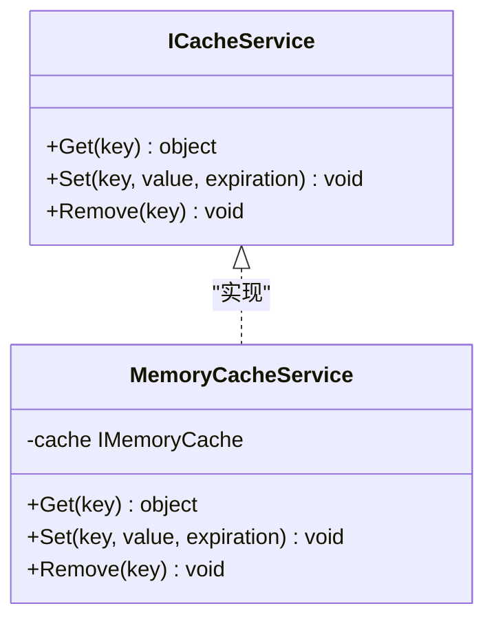
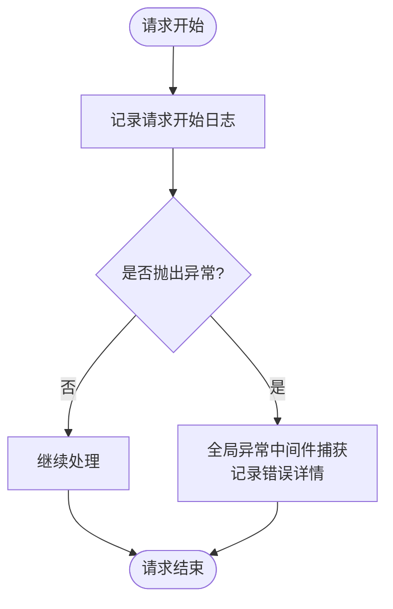
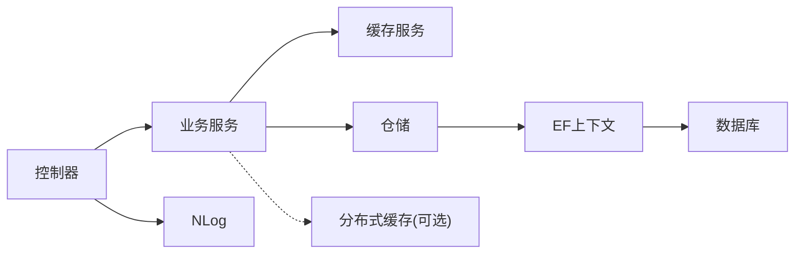

# 性能优化

<cite>
**本文引用的文件**   
- [Program.cs](file://EquipmentIMS.Web/Program.cs)
- [appsettings.json](file://EquipmentIMS.Web/appsettings.json)
- [nlog.config](file://EquipmentIMS.Web/nlog.config)
- [MemoryCacheService.cs](file://EquipmentIMS.BLL/Services/MemoryCacheService.cs)
- [ICacheService.cs](file://EquipmentIMS.BLL/Interfaces/ICacheService.cs)
- [AppDbContext.cs](file://EquipmentIMS.DAL/AppDbContext.cs)
- [GenericRepository.cs](file://EquipmentIMS.DAL/Repositories/GenericRepository.cs)
- [StockRepository.cs](file://EquipmentIMS.DAL/Repositories/StockRepository.cs)
- [ExportBackgroundService.cs](file://EquipmentIMS.Web/BackgroundServices/ExportBackgroundService.cs)
- [ReportExportBackgroundService.cs](file://EquipmentIMS.Web/BackgroundServices/ReportExportBackgroundService.cs)
- [StockAlertBackgroundService.cs](file://EquipmentIMS.Web/BackgroundServices/StockAlertBackgroundService.cs)
- [MaintenanceReminderBackgroundService.cs](file://EquipmentIMS.Web/BackgroundServices/MaintenanceReminderBackgroundService.cs)
- [GlobalExceptionMiddleware.cs](file://EquipmentIMS.Web/Filters/GlobalExceptionMiddleware.cs)
- [OperationLogActionFilter.cs](file://EquipmentIMS.Web/Filters/OperationLogActionFilter.cs)
</cite>

## 目录
1. [简介](#简介)
2. [项目结构](#项目结构)
3. [核心组件](#核心组件)
4. [架构总览](#架构总览)
5. [详细组件分析](#详细组件分析)
6. [依赖关系分析](#依赖关系分析)
7. [性能考量](#性能考量)
8. [故障排查指南](#故障排查指南)
9. [结论](#结论)
10. [附录](#附录)

## 简介
本指南面向THMS（设备库存管理系统）的性能优化，围绕缓存策略、数据库与EF Core调优、异步与并发、日志与监控、部署与扩展、测试与瓶颈分析等维度提供系统化建议。文档结合仓库中现有实现（内存缓存、后台任务、仓储层、中间件与过滤器、NLog配置等），给出可落地的优化路径与最佳实践。

## 项目结构
THMS采用分层架构：Web层（控制器、中间件、过滤器、后台服务）、BLL业务层（服务与缓存）、DAL数据访问层（DbContext、仓储、配置映射）、Models领域模型与DTO。该结构天然支持横向扩展与关注点分离，便于在关键路径引入缓存、异步与批处理等手段。

图表来源
- [Program.cs](file://EquipmentIMS.Web/Program.cs)
- [MemoryCacheService.cs](file://EquipmentIMS.BLL/Services/MemoryCacheService.cs)
- [AppDbContext.cs](file://EquipmentIMS.DAL/AppDbContext.cs)
- [GenericRepository.cs](file://EquipmentIMS.DAL/Repositories/GenericRepository.cs)
- [StockRepository.cs](file://EquipmentIMS.DAL/Repositories/StockRepository.cs)
- [ExportBackgroundService.cs](file://EquipmentIMS.Web/BackgroundServices/ExportBackgroundService.cs)
- [ReportExportBackgroundService.cs](file://EquipmentIMS.Web/BackgroundServices/ReportExportBackgroundService.cs)
- [StockAlertBackgroundService.cs](file://EquipmentIMS.Web/BackgroundServices/StockAlertBackgroundService.cs)
- [MaintenanceReminderBackgroundService.cs](file://EquipmentIMS.Web/BackgroundServices/MaintenanceReminderBackgroundService.cs)
- [nlog.config](file://EquipmentIMS.Web/nlog.config)

章节来源
- [Program.cs](file://EquipmentIMS.Web/Program.cs)
- [appsettings.json](file://EquipmentIMS.Web/appsettings.json)

## 核心组件
- 缓存抽象与内存缓存
  - 通过接口统一缓存能力，当前实现基于进程内内存缓存，适合热点小对象与跨请求共享的只读数据。
  - 建议后续扩展为“本地缓存 + 分布式缓存”双层策略，兼顾低延迟与水平扩展一致性。
- 数据访问与仓储
  - EF Core上下文集中管理连接与变更跟踪；仓储封装查询与事务边界，避免重复SQL与过度跟踪。
- 后台任务
  - 使用后台服务承载耗时操作（导出、报表生成、库存预警、维护提醒），降低请求链路时延并削峰填谷。
- 日志与异常
  - NLog用于结构化日志输出；全局异常中间件统一错误响应与记录；操作日志过滤器记录关键动作。

章节来源
- [ICacheService.cs](file://EquipmentIMS.BLL/Interfaces/ICacheService.cs)
- [MemoryCacheService.cs](file://EquipmentIMS.BLL/Services/MemoryCacheService.cs)
- [AppDbContext.cs](file://EquipmentIMS.DAL/AppDbContext.cs)
- [GenericRepository.cs](file://EquipmentIMS.DAL/Repositories/GenericRepository.cs)
- [StockRepository.cs](file://EquipmentIMS.DAL/Repositories/StockRepository.cs)
- [ExportBackgroundService.cs](file://EquipmentIMS.Web/BackgroundServices/ExportBackgroundService.cs)
- [ReportExportBackgroundService.cs](file://EquipmentIMS.Web/BackgroundServices/ReportExportBackgroundService.cs)
- [StockAlertBackgroundService.cs](file://EquipmentIMS.Web/BackgroundServices/StockAlertBackgroundService.cs)
- [MaintenanceReminderBackgroundService.cs](file://EquipmentIMS.Web/BackgroundServices/MaintenanceReminderBackgroundService.cs)
- [GlobalExceptionMiddleware.cs](file://EquipmentIMS.Web/Filters/GlobalExceptionMiddleware.cs)
- [OperationLogActionFilter.cs](file://EquipmentIMS.Web/Filters/OperationLogActionFilter.cs)
- [nlog.config](file://EquipmentIMS.Web/nlog.config)

## 架构总览
下图展示一次典型请求从进入Web到返回响应的关键路径，以及缓存与数据库的交互位置。

图表来源
- [MemoryCacheService.cs](file://EquipmentIMS.BLL/Services/MemoryCacheService.cs)
- [GenericRepository.cs](file://EquipmentIMS.DAL/Repositories/GenericRepository.cs)
- [StockRepository.cs](file://EquipmentIMS.DAL/Repositories/StockRepository.cs)
- [AppDbContext.cs](file://EquipmentIMS.DAL/AppDbContext.cs)

## 详细组件分析

### 缓存策略设计与实现
- 目标与场景
  - 减少热点读放大：如字典表、系统配置、产品类目、供应商信息等低频写高频读的数据。
  - 降低数据库压力：聚合统计类只读视图或报表快照。
  - 提升首屏与列表页体验：分页前的基础元数据预取。
- 设计要点
  - 缓存键命名规范：包含租户/环境/版本前缀，避免冲突。
  - 失效策略：TTL过期 + 主动失效（写后删除/更新）。
  - 防穿透：空值缓存短TTL或布隆过滤器（可选）。
  - 防雪崩：随机抖动过期时间、热点键预热。
  - 一致性：先写库再删缓存，或采用延迟双删（视业务容忍度）。
- 当前实现
  - 接口定义统一缓存能力，内存缓存基于进程内存储，适合单机或小规模集群。
  - 建议在关键服务注入缓存，并在读写路径加入命中/未命中指标。
- 分布式缓存演进
  - 当多实例部署时，将底层替换为Redis等分布式缓存，保持接口不变，平滑升级。
  - 注意序列化开销与网络RTT，对大对象进行压缩或分片。

图表来源
- [ICacheService.cs](file://EquipmentIMS.BLL/Interfaces/ICacheService.cs)
- [MemoryCacheService.cs](file://EquipmentIMS.BLL/Services/MemoryCacheService.cs)

章节来源
- [ICacheService.cs](file://EquipmentIMS.BLL/Interfaces/ICacheService.cs)
- [MemoryCacheService.cs](file://EquipmentIMS.BLL/Services/MemoryCacheService.cs)

### 数据库查询优化与索引设计
- 查询层面
  - 仅选择必要字段，避免Select *；尽量投影到DTO以减少传输与反序列化成本。
  - 合理使用AsNoTracking用于只读查询，降低变更跟踪开销。
  - 分页查询使用Skip/Take或游标式分页，避免深分页。
  - 复杂条件组合建立复合索引，遵循最左前缀原则。
- EF Core调优
  - 批量插入使用AddRange或第三方批量库，减少往返次数。
  - 合理设置连接池大小与命令超时，避免长事务占用连接。
  - 拆分大事务，避免长时间持有锁。
  - 对热点查询启用查询缓存（应用侧）或物化视图（数据库侧）。
- 索引策略
  - 主键/外键索引检查；频繁过滤/排序列建立索引。
  - 覆盖索引减少回表；定期评估无用索引带来的写放大。
  - 统计信息更新与索引重建计划。

章节来源
- [AppDbContext.cs](file://EquipmentIMS.DAL/AppDbContext.cs)
- [GenericRepository.cs](file://EquipmentIMS.DAL/Repositories/GenericRepository.cs)
- [StockRepository.cs](file://EquipmentIMS.DAL/Repositories/StockRepository.cs)

### 异步编程模式与并发处理
- 异步优先
  - 控制器与服务层使用async/await，避免阻塞线程池。
  - 避免在I/O密集路径中使用.Result或Wait()造成死锁风险。
- 并发控制
  - 限制并发导出/报表任务数量，防止资源耗尽。
  - 使用信号量或队列限流，保护下游数据库与外部服务。
- 资源池化
  - 复用HttpClient、DbConnection等长生命周期资源。
  - 合理配置线程池与后台任务并行度，避免饥饿。

章节来源
- [ExportBackgroundService.cs](file://EquipmentIMS.Web/BackgroundServices/ExportBackgroundService.cs)
- [ReportExportBackgroundService.cs](file://EquipmentIMS.Web/BackgroundServices/ReportExportBackgroundService.cs)
- [StockAlertBackgroundService.cs](file://EquipmentIMS.Web/BackgroundServices/StockAlertBackgroundService.cs)
- [MaintenanceReminderBackgroundService.cs](file://EquipmentIMS.Web/BackgroundServices/MaintenanceReminderBackgroundService.cs)

### 日志记录的优化配置与性能监控
- NLog配置
  - 使用异步写入器，避免同步IO阻塞请求。
  - 按级别与模块分流，生产环境关闭调试级日志。
  - 结构化日志字段标准化，便于检索与分析。
- 性能监控
  - 采集关键指标：QPS、P95/P99延迟、错误率、缓存命中率、慢查询数、连接池使用率。
  - 在关键路径埋点：缓存命中/未命中、EF执行时长、后台任务吞吐。
- 异常与审计
  - 全局异常中间件捕获未处理异常并记录上下文。
  - 操作日志过滤器记录关键业务动作，便于追踪与审计。

图表来源
- [GlobalExceptionMiddleware.cs](file://EquipmentIMS.Web/Filters/GlobalExceptionMiddleware.cs)
- [OperationLogActionFilter.cs](file://EquipmentIMS.Web/Filters/OperationLogActionFilter.cs)
- [nlog.config](file://EquipmentIMS.Web/nlog.config)

章节来源
- [nlog.config](file://EquipmentIMS.Web/nlog.config)
- [GlobalExceptionMiddleware.cs](file://EquipmentIMS.Web/Filters/GlobalExceptionMiddleware.cs)
- [OperationLogActionFilter.cs](file://EquipmentIMS.Web/Filters/OperationLogActionFilter.cs)

### 部署层面的优化：负载均衡、水平扩展与CDN
- 负载均衡
  - 使用反向代理或云LB分发流量，开启健康检查与优雅停机。
  - 会话无状态化，必要时将用户态数据迁移至分布式缓存或外部存储。
- 水平扩展
  - 多实例部署配合分布式缓存与消息队列，保证一致性与可扩展性。
  - 数据库读写分离与连接池隔离，避免热点实例拥塞。
- CDN加速
  - 静态资源（JS/CSS/图片）上CDN，缩短首字节时间。
  - 浏览器缓存头与Gzip/Brotli压缩配合使用。

[本节为概念性内容，不直接分析具体文件]

## 依赖关系分析
- 组件耦合
  - 控制器依赖服务，服务依赖缓存与仓储，仓储依赖EF上下文，层次清晰。
  - 后台服务与业务服务解耦，通过队列或定时触发，避免阻塞请求。
- 外部依赖
  - 数据库连接由EF Core管理；可选Redis作为分布式缓存。
  - 日志通过NLog输出到文件或远程收集器。

图表来源
- [Program.cs](file://EquipmentIMS.Web/Program.cs)
- [MemoryCacheService.cs](file://EquipmentIMS.BLL/Services/MemoryCacheService.cs)
- [GenericRepository.cs](file://EquipmentIMS.DAL/Repositories/GenericRepository.cs)
- [AppDbContext.cs](file://EquipmentIMS.DAL/AppDbContext.cs)
- [nlog.config](file://EquipmentIMS.Web/nlog.config)

章节来源
- [Program.cs](file://EquipmentIMS.Web/Program.cs)
- [GenericRepository.cs](file://EquipmentIMS.DAL/Repositories/GenericRepository.cs)
- [StockRepository.cs](file://EquipmentIMS.DAL/Repositories/StockRepository.cs)
- [AppDbContext.cs](file://EquipmentIMS.DAL/AppDbContext.cs)

## 性能考量
- 缓存命中率与过期策略
  - 针对热点键设置差异化TTL，避免雪崩；对写多读少数据谨慎缓存。
- 数据库连接与事务
  - 控制事务粒度，避免长事务；对批量操作使用分批提交。
- 异步与背压
  - 后台任务具备重试与退避机制；对下游限流保护。
- 资源使用
  - 监控GC与线程池使用，避免频繁分配大对象；启用对象池化。
- 前端与网络
  - 合并与压缩静态资源，启用HTTP/2与Keep-Alive。

[本节为通用指导，不直接分析具体文件]

## 故障排查指南
- 常见问题定位
  - 高CPU/内存：检查是否存在同步阻塞、循环查询、未释放资源。
  - 数据库慢查询：抓取慢SQL与执行计划，补充索引或改写查询。
  - 缓存不一致：核对写路径顺序与失效策略，增加一致性校验。
- 工具与方法
  - 使用NLog结构化日志定位问题上下文。
  - 使用全局异常中间件捕获异常堆栈与请求参数摘要。
  - 使用性能剖析工具（如dotnet-counters、PerfView）观察运行时指标。

章节来源
- [GlobalExceptionMiddleware.cs](file://EquipmentIMS.Web/Filters/GlobalExceptionMiddleware.cs)
- [OperationLogActionFilter.cs](file://EquipmentIMS.Web/Filters/OperationLogActionFilter.cs)
- [nlog.config](file://EquipmentIMS.Web/nlog.config)

## 结论
通过在关键路径引入缓存、优化EF查询与索引、全面异步化与并发控制、完善日志与监控，并结合负载均衡与CDN部署优化，THMS可在高并发与大数据量场景下保持稳定与高性能。建议逐步落地上述措施，并以压测与线上指标验证收益。

[本节为总结性内容，不直接分析具体文件]

## 附录
- 性能测试方法
  - 基准测试：针对热点接口与批量导入导出编写压测脚本，模拟峰值负载。
  - 容量规划：以P95/P99延迟与错误率为目标，逐步扩容实例与数据库资源。
- 瓶颈分析工具
  - 运行时：dotnet-counters、dotnet-trace、PerfView。
  - 数据库：执行计划分析与慢查询日志。
  - 缓存：命中率与延迟监控，必要时引入Redis监控面板。

[本节为方法论说明，不直接分析具体文件]