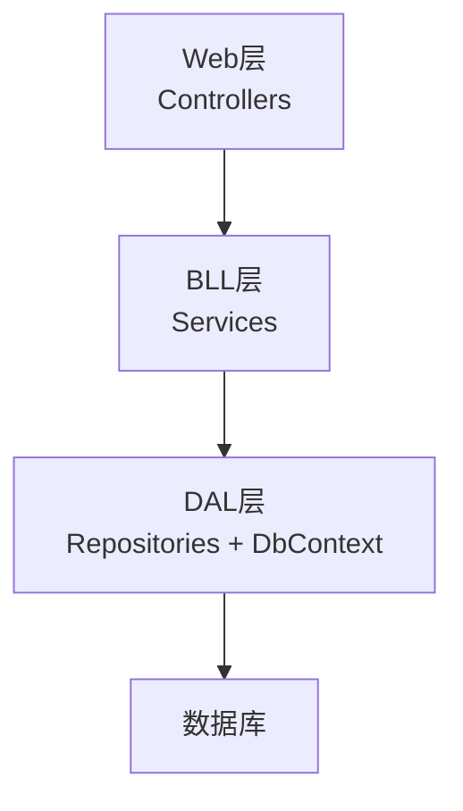
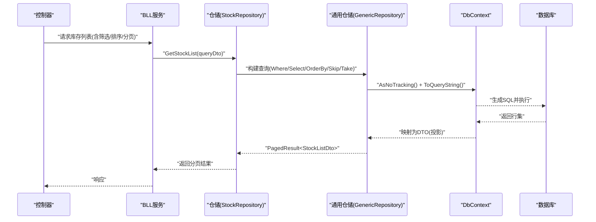
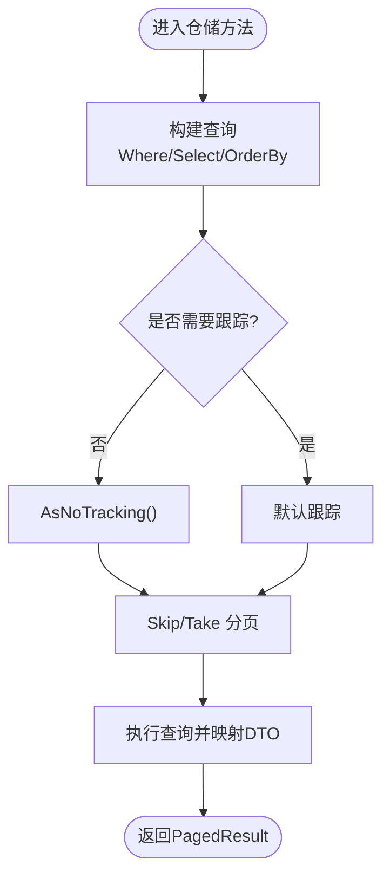
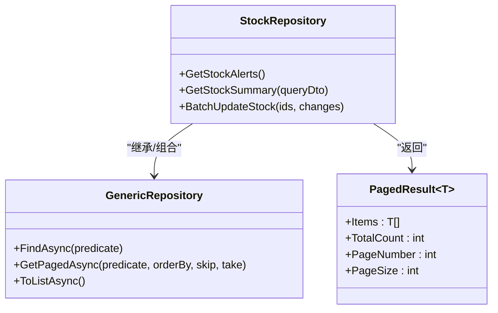
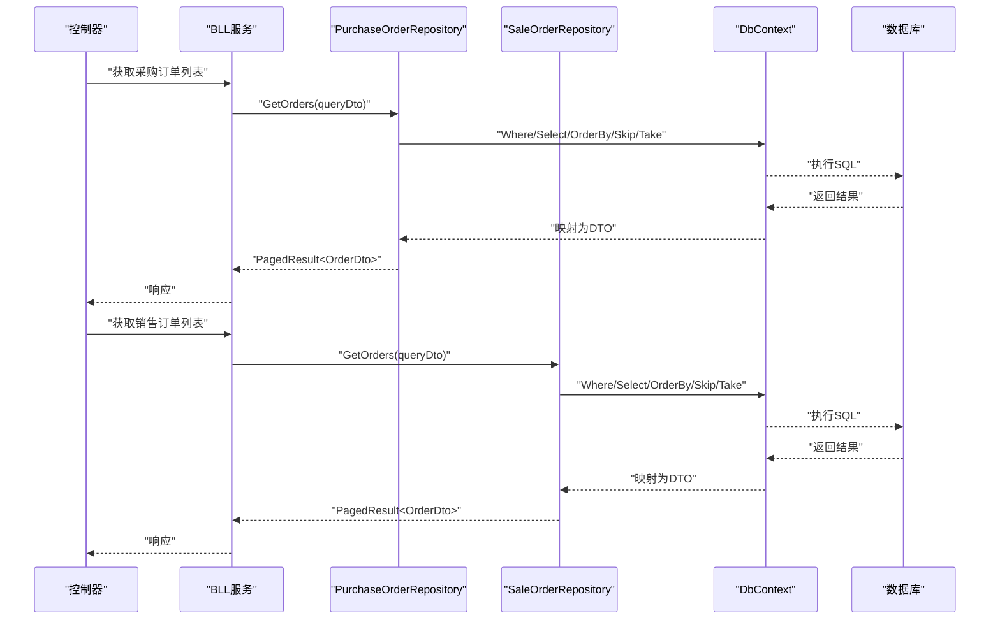
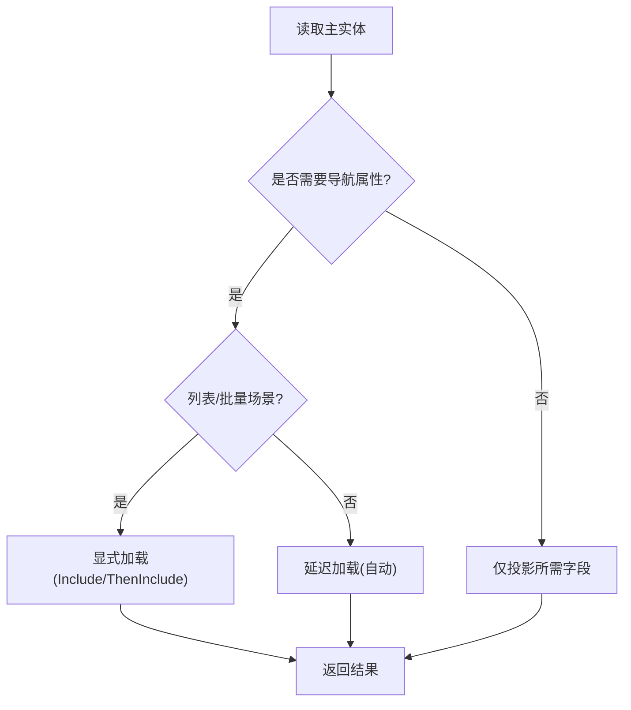
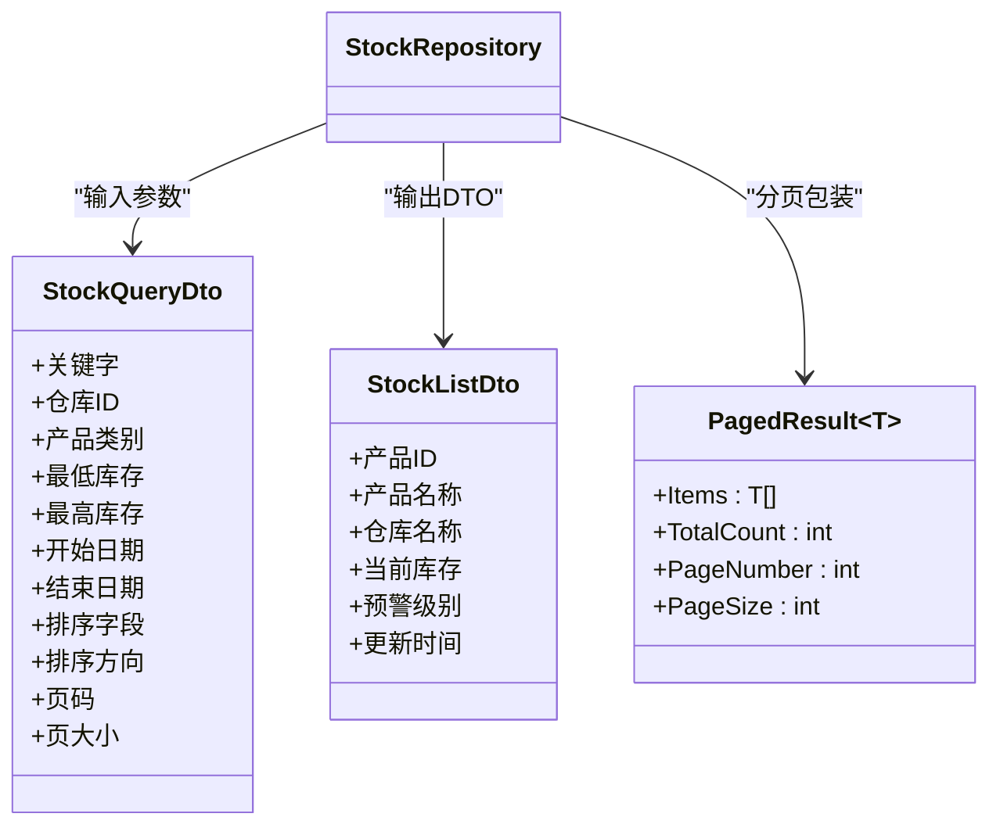
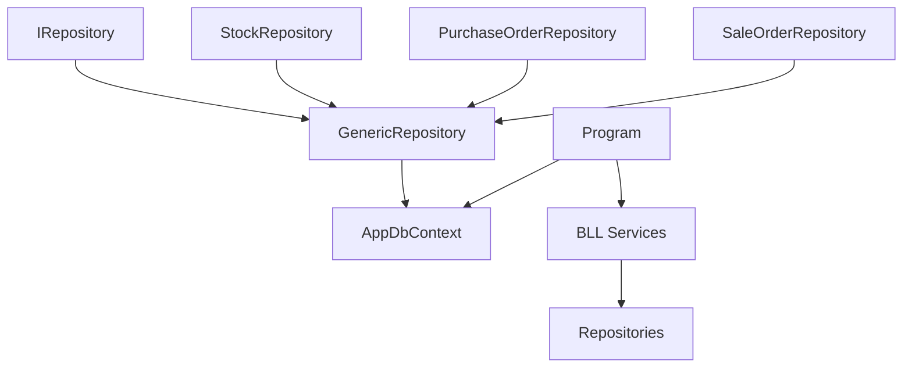

# 数据库查询优化

<cite>
**本文引用的文件**   
- [AppDbContext.cs](file://EquipmentIMS.DAL/AppDbContext.cs)
- [ServiceCollectionExtensions.cs](file://EquipmentIMS.DAL/Extensions/ServiceCollectionExtensions.cs)
- [GenericRepository.cs](file://EquipmentIMS.DAL/Repositories/GenericRepository.cs)
- [StockRepository.cs](file://EquipmentIMS.DAL/Repositories/StockRepository.cs)
- [PurchaseOrderRepository.cs](file://EquipmentIMS.DAL/Repositories/PurchaseOrderRepository.cs)
- [SaleOrderRepository.cs](file://EquipmentIMS.DAL/Repositories/SaleOrderRepository.cs)
- [IRepository.cs](file://EquipmentIMS.DAL/Interfaces/IRepository.cs)
- [PagedResult.cs](file://EquipmentIMS.Models/DTOs/PagedResult.cs)
- [StockQueryDto.cs](file://EquipmentIMS.Models/DTOs/StockQueryDto.cs)
- [StockListDto.cs](file://EquipmentIMS.Models/DTOs/StockListDto.cs)
- [Program.cs](file://EquipmentIMS.Web/Program.cs)
- [appsettings.json](file://EquipmentIMS.Web/appsettings.json)
</cite>

## 目录
1. [简介](#简介)
2. [项目结构](#项目结构)
3. [核心组件](#核心组件)
4. [架构总览](#架构总览)
5. [详细组件分析](#详细组件分析)
6. [依赖关系分析](#依赖关系分析)
7. [性能考量](#性能考量)
8. [故障排查指南](#故障排查指南)
9. [结论](#结论)
10. [附录](#附录)

## 简介
本指南面向THMS系统的数据库查询优化，聚焦于EF Core在仓储层与业务层的最佳实践。内容涵盖：
- EF Core查询优化：延迟加载、显式加载、投影查询的使用场景与注意事项
- 索引设计与优化策略：复合索引、覆盖索引、选择性索引的创建原则
- 分页查询优化、批量操作优化、事务处理优化
- SQL查询分析与执行计划解读、慢查询定位方法
- 连接池配置、查询超时设置、死锁预防策略
- 实际查询案例的性能对比与优化效果评估方法

## 项目结构
THMS采用分层架构：Web层调用BLL服务，BLL通过DAL仓储访问数据，底层使用EF Core与数据库交互。与数据库查询优化直接相关的代码主要位于DAL仓储层与模型/DTO定义中。

[本节为概念性说明，不直接分析具体文件]

## 核心组件
- AppDbContext：EF Core上下文，负责实体映射、连接字符串、全局查询行为（如是否启用跟踪）等
- GenericRepository：通用仓储基类，提供基础CRUD与分页能力
- StockRepository / PurchaseOrderRepository / SaleOrderRepository：领域仓储，封装复杂查询、聚合统计、批处理等
- PagedResult / StockQueryDto / StockListDto：分页结果与查询/列表DTO，用于投影与数据传输
- Program / appsettings.json：应用启动与配置，包含数据库连接、日志、中间件等

**章节来源**
- [AppDbContext.cs](file://EquipmentIMS.DAL/AppDbContext.cs)
- [GenericRepository.cs](file://EquipmentIMS.DAL/Repositories/GenericRepository.cs)
- [StockRepository.cs](file://EquipmentIMS.DAL/Repositories/StockRepository.cs)
- [PurchaseOrderRepository.cs](file://EquipmentIMS.DAL/Repositories/PurchaseOrderRepository.cs)
- [SaleOrderRepository.cs](file://EquipmentIMS.DAL/Repositories/SaleOrderRepository.cs)
- [IRepository.cs](file://EquipmentIMS.DAL/Interfaces/IRepository.cs)
- [PagedResult.cs](file://EquipmentIMS.Models/DTOs/PagedResult.cs)
- [StockQueryDto.cs](file://EquipmentIMS.Models/DTOs/StockQueryDto.cs)
- [StockListDto.cs](file://EquipmentIMS.Models/DTOs/StockListDto.cs)
- [Program.cs](file://EquipmentIMS.Web/Program.cs)
- [appsettings.json](file://EquipmentIMS.Web/appsettings.json)

## 架构总览
下图展示了从控制器到数据库的关键路径，以及仓储层如何组织查询与分页。

**图表来源**
- [StockRepository.cs](file://EquipmentIMS.DAL/Repositories/StockRepository.cs)
- [GenericRepository.cs](file://EquipmentIMS.DAL/Repositories/GenericRepository.cs)
- [AppDbContext.cs](file://EquipmentIMS.DAL/AppDbContext.cs)
- [PagedResult.cs](file://EquipmentIMS.Models/DTOs/PagedResult.cs)
- [StockListDto.cs](file://EquipmentIMS.Models/DTOs/StockListDto.cs)

**章节来源**
- [StockRepository.cs](file://EquipmentIMS.DAL/Repositories/StockRepository.cs)
- [GenericRepository.cs](file://EquipmentIMS.DAL/Repositories/GenericRepository.cs)
- [AppDbContext.cs](file://EquipmentIMS.DAL/AppDbContext.cs)
- [PagedResult.cs](file://EquipmentIMS.Models/DTOs/PagedResult.cs)
- [StockListDto.cs](file://EquipmentIMS.Models/DTOs/StockListDto.cs)

## 详细组件分析

### 仓储层与分页查询优化
- 使用投影查询（Select DTO）减少网络传输与对象跟踪开销
- 使用 AsNoTracking 提升只读查询性能
- 使用 Skip/Take 实现高效分页，避免全表扫描
- 将筛选条件下推到数据库端（Where），减少内存过滤

**图表来源**
- [GenericRepository.cs](file://EquipmentIMS.DAL/Repositories/GenericRepository.cs)
- [StockRepository.cs](file://EquipmentIMS.DAL/Repositories/StockRepository.cs)
- [PagedResult.cs](file://EquipmentIMS.Models/DTOs/PagedResult.cs)

**章节来源**
- [GenericRepository.cs](file://EquipmentIMS.DAL/Repositories/GenericRepository.cs)
- [StockRepository.cs](file://EquipmentIMS.DAL/Repositories/StockRepository.cs)
- [PagedResult.cs](file://EquipmentIMS.Models/DTOs/PagedResult.cs)

### 复杂查询与聚合统计
- 针对库存预警、出入库汇总等场景，使用GroupBy与聚合函数在数据库侧计算
- 结合索引优化聚合列与分组列的选择性
- 对高频报表查询考虑物化视图或定时快照（视业务而定）

**图表来源**
- [StockRepository.cs](file://EquipmentIMS.DAL/Repositories/StockRepository.cs)
- [GenericRepository.cs](file://EquipmentIMS.DAL/Repositories/GenericRepository.cs)
- [PagedResult.cs](file://EquipmentIMS.Models/DTOs/PagedResult.cs)

**章节来源**
- [StockRepository.cs](file://EquipmentIMS.DAL/Repositories/StockRepository.cs)
- [GenericRepository.cs](file://EquipmentIMS.DAL/Repositories/GenericRepository.cs)
- [PagedResult.cs](file://EquipmentIMS.Models/DTOs/PagedResult.cs)

### 采购与销售订单仓储
- 订单列表查询通常涉及多表关联与状态筛选，应优先投影至DTO并建立合适索引
- 使用显式加载按需获取导航属性，避免N+1问题
- 对高频筛选字段（如订单号、客户/供应商ID、状态、日期范围）建立索引

**图表来源**
- [PurchaseOrderRepository.cs](file://EquipmentIMS.DAL/Repositories/PurchaseOrderRepository.cs)
- [SaleOrderRepository.cs](file://EquipmentIMS.DAL/Repositories/SaleOrderRepository.cs)
- [AppDbContext.cs](file://EquipmentIMS.DAL/AppDbContext.cs)

**章节来源**
- [PurchaseOrderRepository.cs](file://EquipmentIMS.DAL/Repositories/PurchaseOrderRepository.cs)
- [SaleOrderRepository.cs](file://EquipmentIMS.DAL/Repositories/SaleOrderRepository.cs)
- [AppDbContext.cs](file://EquipmentIMS.DAL/AppDbContext.cs)

### 延迟加载与显式加载
- 延迟加载：在需要时自动加载导航属性，适合交互式详情页面；注意可能引发N+1查询
- 显式加载：在明确控制点加载导航属性，适合批量或列表场景，避免额外查询
- 建议：列表页尽量使用投影与显式加载，详情页按需延迟加载

[本节为概念性说明，不直接分析具体文件]

### 投影查询与DTO建模
- 使用DTO进行投影，减少字段传输与对象跟踪成本
- 将常用查询条件封装为DTO（如StockQueryDto），提高可维护性与复用性
- 分页结果统一使用PagedResult<T>，便于前端展示

**图表来源**
- [StockQueryDto.cs](file://EquipmentIMS.Models/DTOs/StockQueryDto.cs)
- [StockListDto.cs](file://EquipmentIMS.Models/DTOs/StockListDto.cs)
- [PagedResult.cs](file://EquipmentIMS.Models/DTOs/PagedResult.cs)
- [StockRepository.cs](file://EquipmentIMS.DAL/Repositories/StockRepository.cs)

**章节来源**
- [StockQueryDto.cs](file://EquipmentIMS.Models/DTOs/StockQueryDto.cs)
- [StockListDto.cs](file://EquipmentIMS.Models/DTOs/StockListDto.cs)
- [PagedResult.cs](file://EquipmentIMS.Models/DTOs/PagedResult.cs)
- [StockRepository.cs](file://EquipmentIMS.DAL/Repositories/StockRepository.cs)

## 依赖关系分析
仓储层依赖通用仓储接口与EF Core上下文，DTO与模型定义在Models层，Web层通过Program与配置注入上下文与服务。

**图表来源**
- [IRepository.cs](file://EquipmentIMS.DAL/Interfaces/IRepository.cs)
- [GenericRepository.cs](file://EquipmentIMS.DAL/Repositories/GenericRepository.cs)
- [StockRepository.cs](file://EquipmentIMS.DAL/Repositories/StockRepository.cs)
- [PurchaseOrderRepository.cs](file://EquipmentIMS.DAL/Repositories/PurchaseOrderRepository.cs)
- [SaleOrderRepository.cs](file://EquipmentIMS.DAL/Repositories/SaleOrderRepository.cs)
- [AppDbContext.cs](file://EquipmentIMS.DAL/AppDbContext.cs)
- [Program.cs](file://EquipmentIMS.Web/Program.cs)

**章节来源**
- [IRepository.cs](file://EquipmentIMS.DAL/Interfaces/IRepository.cs)
- [GenericRepository.cs](file://EquipmentIMS.DAL/Repositories/GenericRepository.cs)
- [StockRepository.cs](file://EquipmentIMS.DAL/Repositories/StockRepository.cs)
- [PurchaseOrderRepository.cs](file://EquipmentIMS.DAL/Repositories/PurchaseOrderRepository.cs)
- [SaleOrderRepository.cs](file://EquipmentIMS.DAL/Repositories/SaleOrderRepository.cs)
- [AppDbContext.cs](file://EquipmentIMS.DAL/AppDbContext.cs)
- [Program.cs](file://EquipmentIMS.Web/Program.cs)

## 性能考量

### EF Core查询优化技巧
- 延迟加载：适用于交互式详情页面，但需警惕N+1问题
- 显式加载：在批量或列表场景中按需加载导航属性，避免多余查询
- 投影查询：使用Select DTO，减少字段传输与对象跟踪开销
- AsNoTracking：只读查询禁用跟踪，提升性能
- 分页：使用Skip/Take，避免一次性拉取大量数据

**章节来源**
- [GenericRepository.cs](file://EquipmentIMS.DAL/Repositories/GenericRepository.cs)
- [StockRepository.cs](file://EquipmentIMS.DAL/Repositories/StockRepository.cs)
- [PagedResult.cs](file://EquipmentIMS.Models/DTOs/PagedResult.cs)

### 索引设计与优化策略
- 复合索引：为多列筛选与排序组合创建，遵循“高选择性列在前”的原则
- 覆盖索引：包含查询所需的所有列，避免回表
- 选择性索引：对区分度高的列建立索引，提升过滤效率
- 更新代价：权衡读写比例，避免过多索引影响写入性能

[本节为概念性说明，不直接分析具体文件]

### 分页查询优化
- 使用Skip/Take实现分页，确保排序列有索引
- 避免在分页前进行大数据量内存过滤
- 合理设置页大小，平衡用户体验与数据库压力

**章节来源**
- [GenericRepository.cs](file://EquipmentIMS.DAL/Repositories/GenericRepository.cs)
- [PagedResult.cs](file://EquipmentIMS.Models/DTOs/PagedResult.cs)

### 批量操作优化
- 使用批量插入/更新/删除，减少往返次数
- 合并小事务，降低锁竞争与日志开销
- 对于大批量导入，考虑分批次提交与并行度控制

**章节来源**
- [StockRepository.cs](file://EquipmentIMS.DAL/Repositories/StockRepository.cs)

### 事务处理优化
- 最小化事务范围，缩短持有锁的时间
- 避免长事务与用户交互阻塞
- 合理设置隔离级别，防止脏读/不可重复读/幻读

**章节来源**
- [StockRepository.cs](file://EquipmentIMS.DAL/Repositories/StockRepository.cs)

### SQL查询分析与执行计划解读
- 使用EF Core的ToQueryString调试生成的SQL
- 在数据库中查看执行计划，关注索引缺失、全表扫描、高CPU/IO操作
- 针对慢查询添加或调整索引，必要时改写查询逻辑

**章节来源**
- [GenericRepository.cs](file://EquipmentIMS.DAL/Repositories/GenericRepository.cs)

### 连接池配置与查询超时
- 根据并发与资源限制配置最大连接数、最小连接数、连接生命周期
- 设置合理的命令超时，避免长时间阻塞
- 监控连接池使用情况，识别泄漏与瓶颈

**章节来源**
- [ServiceCollectionExtensions.cs](file://EquipmentIMS.DAL/Extensions/ServiceCollectionExtensions.cs)
- [Program.cs](file://EquipmentIMS.Web/Program.cs)
- [appsettings.json](file://EquipmentIMS.Web/appsettings.json)

### 死锁预防策略
- 固定访问顺序，避免循环等待
- 减少事务内操作数量，缩短锁持有时间
- 使用合适的索引，避免锁升级与范围锁扩大

[本节为概念性说明，不直接分析具体文件]

### 实际查询案例与效果评估
- 案例一：库存列表查询
  - 优化前：未投影、未分页、未建索引，导致全表扫描与大对象传输
  - 优化后：投影DTO、Skip/Take分页、复合索引，显著降低响应时间与带宽
- 案例二：采购订单汇总
  - 优化前：多次子查询与内存聚合
  - 优化后：数据库侧GroupBy与覆盖索引，减少CPU与内存占用
- 评估方法：对比执行计划、查询耗时、吞吐与资源利用率

**章节来源**
- [StockRepository.cs](file://EquipmentIMS.DAL/Repositories/StockRepository.cs)
- [PurchaseOrderRepository.cs](file://EquipmentIMS.DAL/Repositories/PurchaseOrderRepository.cs)
- [GenericRepository.cs](file://EquipmentIMS.DAL/Repositories/GenericRepository.cs)

## 故障排查指南
- 慢查询定位：开启EF Core日志，捕获ToQueryString输出，结合数据库执行计划分析
- N+1问题：检查Include/ThenUse与延迟加载使用位置，改用投影或显式加载
- 连接池耗尽：监控连接池指标，排查未释放上下文或长事务
- 死锁检测：查看数据库死锁报告，调整事务边界与索引设计

**章节来源**
- [GenericRepository.cs](file://EquipmentIMS.DAL/Repositories/GenericRepository.cs)
- [StockRepository.cs](file://EquipmentIMS.DAL/Repositories/StockRepository.cs)
- [Program.cs](file://EquipmentIMS.Web/Program.cs)
- [appsettings.json](file://EquipmentIMS.Web/appsettings.json)

## 结论
通过合理使用EF Core的投影、分页、显式加载与AsNoTracking，并结合科学的索引设计与事务管理，可以显著提升THMS系统的查询性能与稳定性。建议在关键路径持续监控与调优，形成闭环优化机制。

[本节为总结性说明，不直接分析具体文件]

## 附录
- 术语解释：延迟加载、显式加载、投影查询、覆盖索引、选择性索引、连接池、执行计划
- 参考实践：按业务域划分仓储，统一分页与DTO规范，建立索引评审流程

[本节为概念性说明，不直接分析具体文件]