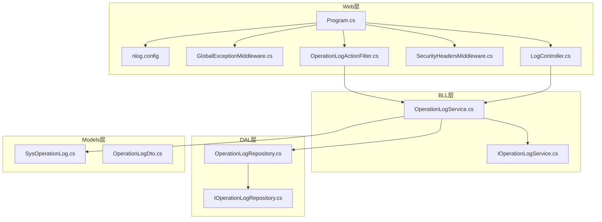
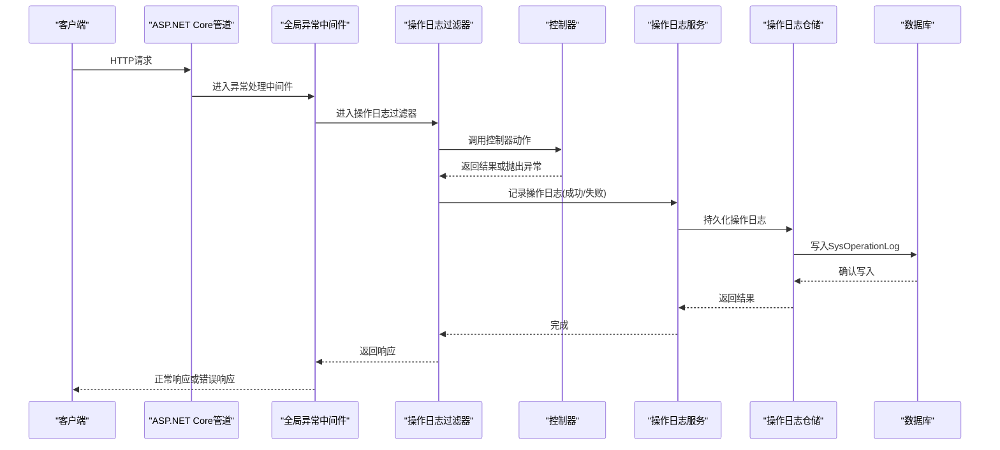
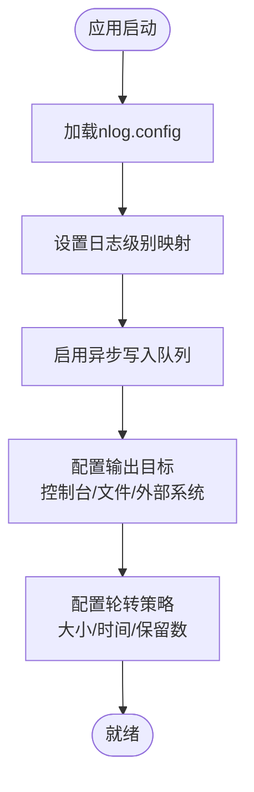
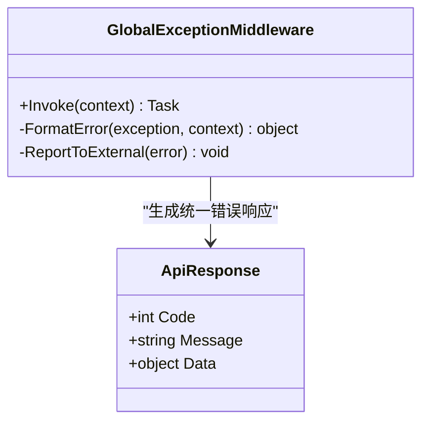
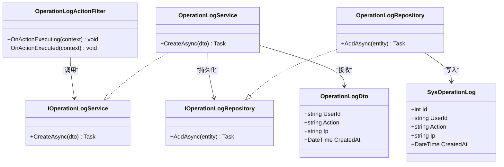
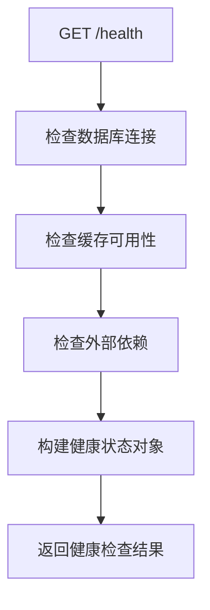
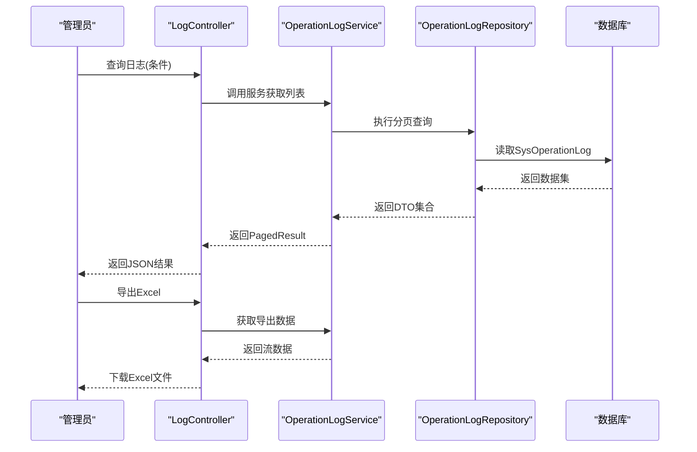
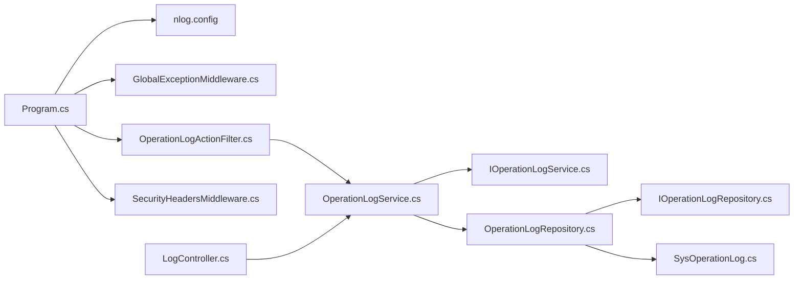

# 监控与诊断

<cite>
**本文引用的文件**   
- [Program.cs](file://EquipmentIMS.Web/Program.cs)
- [nlog.config](file://EquipmentIMS.Web/nlog.config)
- [GlobalExceptionMiddleware.cs](file://EquipmentIMS.Web/Filters/GlobalExceptionMiddleware.cs)
- [OperationLogActionFilter.cs](file://EquipmentIMS.Web/Filters/OperationLogActionFilter.cs)
- [SecurityHeadersMiddleware.cs](file://EquipmentIMS.Web/Filters/SecurityHeadersMiddleware.cs)
- [LogController.cs](file://EquipmentIMS.Web/Controllers/LogController.cs)
- [OperationLogService.cs](file://EquipmentIMS.BLL/Services/OperationLogService.cs)
- [IOperationLogService.cs](file://EquipmentIMS.BLL/Interfaces/IOperationLogService.cs)
- [OperationLogRepository.cs](file://EquipmentIMS.DAL/Repositories/OperationLogRepository.cs)
- [IOperationLogRepository.cs](file://EquipmentIMS.DAL/Interfaces/IOperationLogRepository.cs)
- [SysOperationLog.cs](file://EquipmentIMS.Models/Entities/SysOperationLog.cs)
- [OperationLogDto.cs](file://EquipmentIMS.Models/DTOs/OperationLogDto.cs)
- [appsettings.json](file://EquipmentIMS.Web/appsettings.json)
</cite>

## 目录
1. [简介](#简介)
2. [项目结构](#项目结构)
3. [核心组件](#核心组件)
4. [架构总览](#架构总览)
5. [详细组件分析](#详细组件分析)
6. [依赖关系分析](#依赖关系分析)
7. [性能考虑](#性能考虑)
8. [故障排查指南](#故障排查指南)
9. [结论](#结论)
10. [附录](#附录)

## 简介
本章节面向THMS系统的监控与诊断体系，围绕NLog日志框架、全局异常处理中间件、操作日志记录、健康检查与状态监控、性能指标定义以及运维保障实践进行系统化说明。文档旨在帮助开发者与运维人员快速理解系统可观测性能力，并掌握日常排障与优化方法。

## 项目结构
THMS采用分层架构：Web层负责HTTP请求处理、中间件与过滤器；BLL层提供业务服务；DAL层提供数据访问；Models层定义实体、DTO与枚举。监控与诊断相关的关键位置如下：
- Web层：NLog配置、全局异常中间件、操作日志Action Filter、安全头中间件、日志查询控制器、健康检查入口（由Program注册）
- BLL层：操作日志服务接口与实现
- DAL层：操作日志仓储接口与实现
- Models层：操作日志实体与DTO

图表来源
- [Program.cs](file://EquipmentIMS.Web/Program.cs)
- [nlog.config](file://EquipmentIMS.Web/nlog.config)
- [GlobalExceptionMiddleware.cs](file://EquipmentIMS.Web/Filters/GlobalExceptionMiddleware.cs)
- [OperationLogActionFilter.cs](file://EquipmentIMS.Web/Filters/OperationLogActionFilter.cs)
- [SecurityHeadersMiddleware.cs](file://EquipmentIMS.Web/Filters/SecurityHeadersMiddleware.cs)
- [LogController.cs](file://EquipmentIMS.Web/Controllers/LogController.cs)
- [IOperationLogService.cs](file://EquipmentIMS.BLL/Interfaces/IOperationLogService.cs)
- [OperationLogService.cs](file://EquipmentIMS.BLL/Services/OperationLogService.cs)
- [IOperationLogRepository.cs](file://EquipmentIMS.DAL/Interfaces/IOperationLogRepository.cs)
- [OperationLogRepository.cs](file://EquipmentIMS.DAL/Repositories/OperationLogRepository.cs)
- [SysOperationLog.cs](file://EquipmentIMS.Models/Entities/SysOperationLog.cs)
- [OperationLogDto.cs](file://EquipmentIMS.Models/DTOs/OperationLogDto.cs)

章节来源
- [Program.cs](file://EquipmentIMS.Web/Program.cs)
- [nlog.config](file://EquipmentIMS.Web/nlog.config)
- [GlobalExceptionMiddleware.cs](file://EquipmentIMS.Web/Filters/GlobalExceptionMiddleware.cs)
- [OperationLogActionFilter.cs](file://EquipmentIMS.Web/Filters/OperationLogActionFilter.cs)
- [SecurityHeadersMiddleware.cs](file://EquipmentIMS.Web/Filters/SecurityHeadersMiddleware.cs)
- [LogController.cs](file://EquipmentIMS.Web/Controllers/LogController.cs)
- [IOperationLogService.cs](file://EquipmentIMS.BLL/Interfaces/IOperationLogService.cs)
- [OperationLogService.cs](file://EquipmentIMS.BLL/Services/OperationLogService.cs)
- [IOperationLogRepository.cs](file://EquipmentIMS.DAL/Interfaces/IOperationLogRepository.cs)
- [OperationLogRepository.cs](file://EquipmentIMS.DAL/Repositories/OperationLogRepository.cs)
- [SysOperationLog.cs](file://EquipmentIMS.Models/Entities/SysOperationLog.cs)
- [OperationLogDto.cs](file://EquipmentIMS.Models/DTOs/OperationLogDto.cs)

## 核心组件
本节聚焦监控与诊断的核心组件及其职责边界：
- NLog日志框架：负责结构化日志采集、异步写入、轮转策略与输出目标配置
- 全局异常处理中间件：统一捕获未处理异常，格式化错误响应，触发异常上报
- 操作日志Action Filter：在控制器动作执行前后记录审计信息
- 操作日志服务与仓储：将操作日志持久化到数据库
- 日志查询控制器：提供日志检索与导出能力
- 健康检查与状态监控：通过中间件或端点暴露应用健康与运行状态

章节来源
- [nlog.config](file://EquipmentIMS.Web/nlog.config)
- [GlobalExceptionMiddleware.cs](file://EquipmentIMS.Web/Filters/GlobalExceptionMiddleware.cs)
- [OperationLogActionFilter.cs](file://EquipmentIMS.Web/Filters/OperationLogActionFilter.cs)
- [OperationLogService.cs](file://EquipmentIMS.BLL/Services/OperationLogService.cs)
- [OperationLogRepository.cs](file://EquipmentIMS.DAL/Repositories/OperationLogRepository.cs)
- [LogController.cs](file://EquipmentIMS.Web/Controllers/LogController.cs)

## 架构总览
下图展示了从HTTP请求进入，到日志记录、异常处理、操作审计与健康检查的整体流程。

图表来源
- [Program.cs](file://EquipmentIMS.Web/Program.cs)
- [GlobalExceptionMiddleware.cs](file://EquipmentIMS.Web/Filters/GlobalExceptionMiddleware.cs)
- [OperationLogActionFilter.cs](file://EquipmentIMS.Web/Filters/OperationLogActionFilter.cs)
- [OperationLogService.cs](file://EquipmentIMS.BLL/Services/OperationLogService.cs)
- [OperationLogRepository.cs](file://EquipmentIMS.DAL/Repositories/OperationLogRepository.cs)
- [SysOperationLog.cs](file://EquipmentIMS.Models/Entities/SysOperationLog.cs)

## 详细组件分析

### NLog日志框架配置与优化
- 日志级别管理：按环境区分默认级别，支持运行时动态调整，便于生产环境降低噪音
- 异步日志写入：启用异步队列与缓冲，避免I/O阻塞主线程，提升吞吐
- 日志轮转策略：基于文件大小与时间进行轮转，保留历史文件数量上限，控制磁盘占用
- 输出目标：控制台、文件、外部系统（如集中式日志平台），可按级别路由
- 结构化字段：包含请求ID、用户标识、IP、耗时等上下文，便于追踪与分析

图表来源
- [nlog.config](file://EquipmentIMS.Web/nlog.config)
- [appsettings.json](file://EquipmentIMS.Web/appsettings.json)

章节来源
- [nlog.config](file://EquipmentIMS.Web/nlog.config)
- [appsettings.json](file://EquipmentIMS.Web/appsettings.json)

### 全局异常处理中间件设计与实现
- 异常捕获：在管道最外层捕获所有未处理异常，确保稳定返回
- 错误响应格式化：统一封装错误码、消息、堆栈摘要与请求上下文，便于前端展示与后端分析
- 异常上报机制：对关键异常进行上报（如发送到集中式日志平台或告警通道），附带TraceId与请求路径
- 降级与保护：在上报失败时不阻断主流程，保证可用性

图表来源
- [GlobalExceptionMiddleware.cs](file://EquipmentIMS.Web/Filters/GlobalExceptionMiddleware.cs)

章节来源
- [GlobalExceptionMiddleware.cs](file://EquipmentIMS.Web/Filters/GlobalExceptionMiddleware.cs)

### 操作日志记录的业务价值与技术实现
- 业务价值：审计追踪（谁在何时做了什么）、行为分析（高频操作识别）、安全监控（敏感操作告警）
- 技术实现：
  - Action Filter在动作执行前后收集上下文（用户、IP、参数摘要、耗时）
  - 通过操作日志服务抽象持久化逻辑，解耦仓储细节
  - 仓储层使用EF Core写入SysOperationLog表，支持分页与筛选
  - DTO用于传输与展示，屏蔽内部实体结构

图表来源
- [OperationLogActionFilter.cs](file://EquipmentIMS.Web/Filters/OperationLogActionFilter.cs)
- [IOperationLogService.cs](file://EquipmentIMS.BLL/Interfaces/IOperationLogService.cs)
- [OperationLogService.cs](file://EquipmentIMS.BLL/Services/OperationLogService.cs)
- [IOperationLogRepository.cs](file://EquipmentIMS.DAL/Interfaces/IOperationLogRepository.cs)
- [OperationLogRepository.cs](file://EquipmentIMS.DAL/Repositories/OperationLogRepository.cs)
- [SysOperationLog.cs](file://EquipmentIMS.Models/Entities/SysOperationLog.cs)
- [OperationLogDto.cs](file://EquipmentIMS.Models/DTOs/OperationLogDto.cs)

章节来源
- [OperationLogActionFilter.cs](file://EquipmentIMS.Web/Filters/OperationLogActionFilter.cs)
- [IOperationLogService.cs](file://EquipmentIMS.BLL/Interfaces/IOperationLogService.cs)
- [OperationLogService.cs](file://EquipmentIMS.BLL/Services/OperationLogService.cs)
- [IOperationLogRepository.cs](file://EquipmentIMS.DAL/Interfaces/IOperationLogRepository.cs)
- [OperationLogRepository.cs](file://EquipmentIMS.DAL/Repositories/OperationLogRepository.cs)
- [SysOperationLog.cs](file://EquipmentIMS.Models/Entities/SysOperationLog.cs)
- [OperationLogDto.cs](file://EquipmentIMS.Models/DTOs/OperationLogDto.cs)

### 健康检查与状态监控
- 健康检查端点：暴露应用健康状态，包括依赖项（数据库、缓存、外部服务）检查
- 应用状态监控：结合NLog统计关键指标（错误率、慢请求、资源使用）
- 安全头中间件：增强响应安全头，辅助安全审计与合规

图表来源
- [Program.cs](file://EquipmentIMS.Web/Program.cs)
- [SecurityHeadersMiddleware.cs](file://EquipmentIMS.Web/Filters/SecurityHeadersMiddleware.cs)

章节来源
- [Program.cs](file://EquipmentIMS.Web/Program.cs)
- [SecurityHeadersMiddleware.cs](file://EquipmentIMS.Web/Filters/SecurityHeadersMiddleware.cs)

### 日志查询与导出
- 日志查询控制器：提供按时间范围、用户、动作类型、IP等条件检索日志
- 导出能力：支持将查询结果导出为Excel，便于离线分析与归档
- 权限控制：仅授权角色可访问，防止敏感信息泄露

图表来源
- [LogController.cs](file://EquipmentIMS.Web/Controllers/LogController.cs)
- [OperationLogService.cs](file://EquipmentIMS.BLL/Services/OperationLogService.cs)
- [OperationLogRepository.cs](file://EquipmentIMS.DAL/Repositories/OperationLogRepository.cs)
- [SysOperationLog.cs](file://EquipmentIMS.Models/Entities/SysOperationLog.cs)

章节来源
- [LogController.cs](file://EquipmentIMS.Web/Controllers/LogController.cs)
- [OperationLogService.cs](file://EquipmentIMS.BLL/Services/OperationLogService.cs)
- [OperationLogRepository.cs](file://EquipmentIMS.DAL/Repositories/OperationLogRepository.cs)
- [SysOperationLog.cs](file://EquipmentIMS.Models/Entities/SysOperationLog.cs)

## 依赖关系分析
监控与诊断模块的依赖关系如下：
- Program.cs作为入口，注册NLog、全局异常中间件、操作日志过滤器、安全头中间件与健康检查
- 操作日志过滤器依赖BLL层的操作日志服务，服务再依赖DAL层的仓储
- 仓储层依赖EF Core与数据库
- 模型层提供实体与DTO，贯穿各层

图表来源
- [Program.cs](file://EquipmentIMS.Web/Program.cs)
- [nlog.config](file://EquipmentIMS.Web/nlog.config)
- [GlobalExceptionMiddleware.cs](file://EquipmentIMS.Web/Filters/GlobalExceptionMiddleware.cs)
- [OperationLogActionFilter.cs](file://EquipmentIMS.Web/Filters/OperationLogActionFilter.cs)
- [SecurityHeadersMiddleware.cs](file://EquipmentIMS.Web/Filters/SecurityHeadersMiddleware.cs)
- [OperationLogService.cs](file://EquipmentIMS.BLL/Services/OperationLogService.cs)
- [IOperationLogService.cs](file://EquipmentIMS.BLL/Interfaces/IOperationLogService.cs)
- [OperationLogRepository.cs](file://EquipmentIMS.DAL/Repositories/OperationLogRepository.cs)
- [IOperationLogRepository.cs](file://EquipmentIMS.DAL/Interfaces/IOperationLogRepository.cs)
- [SysOperationLog.cs](file://EquipmentIMS.Models/Entities/SysOperationLog.cs)
- [LogController.cs](file://EquipmentIMS.Web/Controllers/LogController.cs)

章节来源
- [Program.cs](file://EquipmentIMS.Web/Program.cs)
- [nlog.config](file://EquipmentIMS.Web/nlog.config)
- [GlobalExceptionMiddleware.cs](file://EquipmentIMS.Web/Filters/GlobalExceptionMiddleware.cs)
- [OperationLogActionFilter.cs](file://EquipmentIMS.Web/Filters/OperationLogActionFilter.cs)
- [SecurityHeadersMiddleware.cs](file://EquipmentIMS.Web/Filters/SecurityHeadersMiddleware.cs)
- [OperationLogService.cs](file://EquipmentIMS.BLL/Services/OperationLogService.cs)
- [IOperationLogService.cs](file://EquipmentIMS.BLL/Interfaces/IOperationLogService.cs)
- [OperationLogRepository.cs](file://EquipmentIMS.DAL/Repositories/OperationLogRepository.cs)
- [IOperationLogRepository.cs](file://EquipmentIMS.DAL/Interfaces/IOperationLogRepository.cs)
- [SysOperationLog.cs](file://EquipmentIMS.Models/Entities/SysOperationLog.cs)
- [LogController.cs](file://EquipmentIMS.Web/Controllers/LogController.cs)

## 性能考虑
- 异步日志写入：在高并发场景下显著降低I/O阻塞，建议开启队列与批处理
- 日志级别调优：生产环境默认Info或Warn，按需临时提升Debug以定位问题
- 轮转策略：合理设置单文件大小与保留数量，避免磁盘爆满
- 健康检查：轻量级检查，避免引入额外延迟；依赖检查应带超时与重试
- 操作日志：避免记录敏感字段，参数摘要需脱敏；批量写入减少DB压力

[本节为通用指导，无需具体文件引用]

## 故障排查指南
- 日志分析方法：
  - 按TraceId串联请求链路，定位跨层调用问题
  - 过滤错误级别日志，结合用户与IP维度分析异常热点
  - 关注慢请求日志，结合数据库慢查询与外部依赖延迟
- 性能问题诊断流程：
  - 观察健康检查与NLog指标，识别瓶颈环节
  - 对比不同环境配置，验证是否为配置导致
  - 使用操作日志还原用户操作序列，复现场景
- 故障排查工具箱：
  - 日志查询控制器：在线检索与导出
  - 全局异常中间件：统一错误响应与上报
  - 健康检查端点：快速判断服务可用性与依赖状态

章节来源
- [LogController.cs](file://EquipmentIMS.Web/Controllers/LogController.cs)
- [GlobalExceptionMiddleware.cs](file://EquipmentIMS.Web/Filters/GlobalExceptionMiddleware.cs)
- [Program.cs](file://EquipmentIMS.Web/Program.cs)

## 结论
THMS的监控与诊断体系以NLog为核心，结合全局异常处理与操作日志审计，形成覆盖请求全链路的可观测能力。通过健康检查与状态监控，运维团队能够快速发现与定位问题，保障系统稳定性与安全性。持续优化日志策略与指标定义，将进一步提升排障效率与系统韧性。

[本节为总结性内容，无需具体文件引用]

## 附录
- 术语解释：
  - TraceId：请求唯一标识，用于跨层追踪
  - 健康检查：对外暴露的应用可用性检测端点
  - 操作日志：记录用户关键操作的审计数据
- 最佳实践：
  - 统一错误响应格式，便于前端与监控集成
  - 操作日志脱敏，避免泄露敏感信息
  - 定期清理历史日志，控制存储成本

[本节为补充信息，无需具体文件引用]