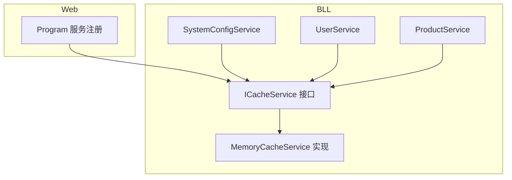
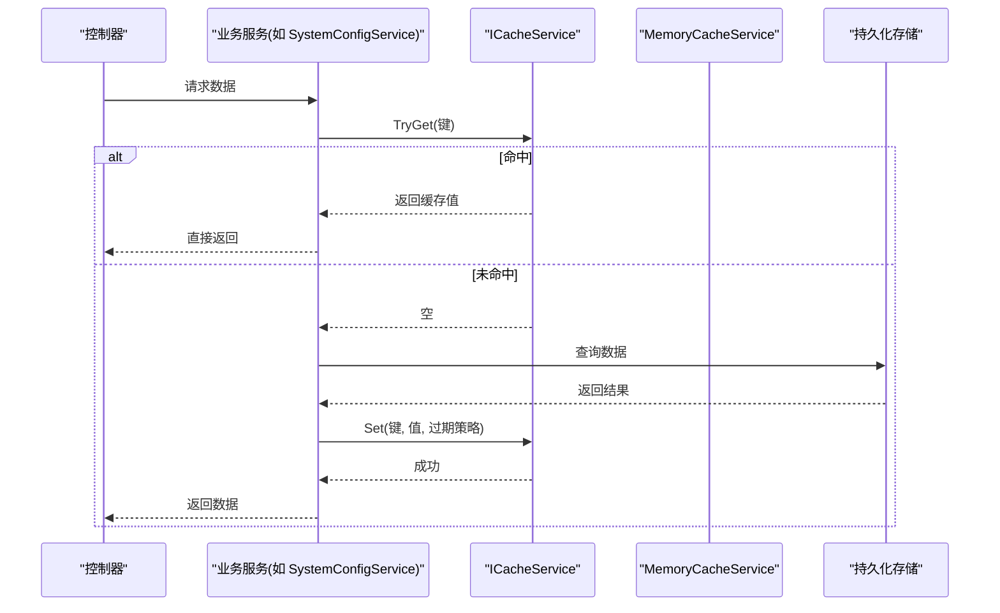
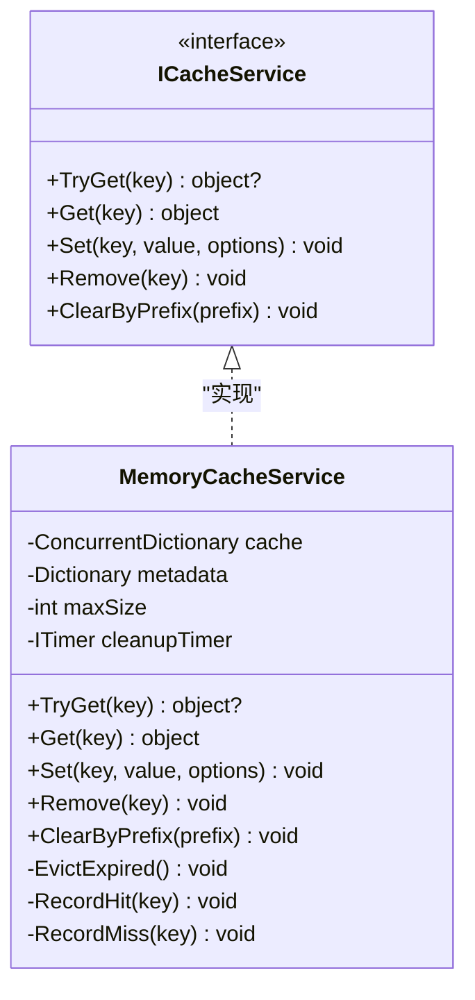
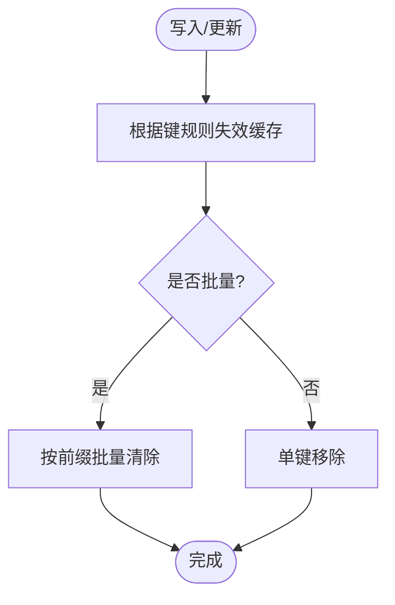
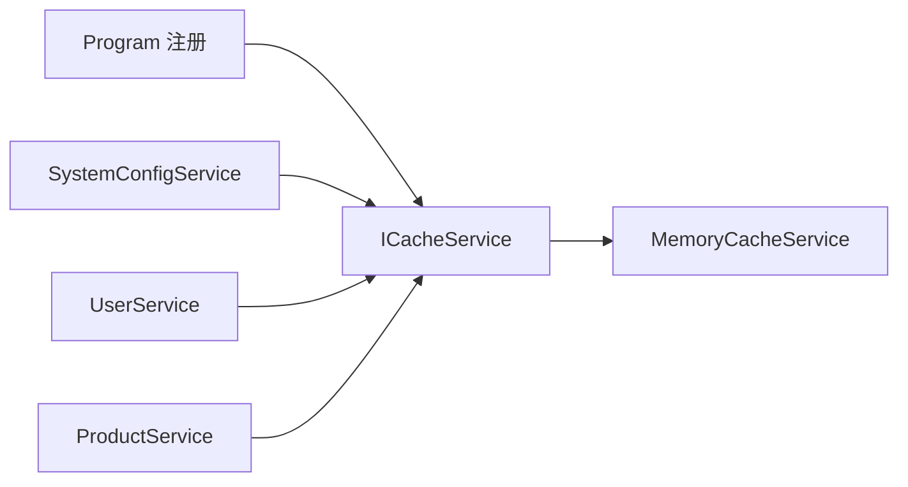

# 缓存策略设计

<cite>
**本文引用的文件**   
- [ICacheService.cs](file://EquipmentIMS.BLL/Interfaces/ICacheService.cs)
- [MemoryCacheService.cs](file://EquipmentIMS.BLL/Services/MemoryCacheService.cs)
- [SystemConfigService.cs](file://EquipmentIMS.BLL/Services/SystemConfigService.cs)
- [UserService.cs](file://EquipmentIMS.BLL/Services/UserService.cs)
- [ProductService.cs](file://EquipmentIMS.BLL/Services/ProductService.cs)
- [Program.cs](file://EquipmentIMS.Web/Program.cs)
</cite>

## 目录
1. [引言](#引言)
2. [项目结构](#项目结构)
3. [核心组件](#核心组件)
4. [架构总览](#架构总览)
5. [详细组件分析](#详细组件分析)
6. [依赖关系分析](#依赖关系分析)
7. [性能考虑](#性能考虑)
8. [故障排查指南](#故障排查指南)
9. [结论](#结论)
10. [附录](#附录)

## 引言
本文件面向THMS系统的缓存策略设计与实现，聚焦内存缓存服务的设计模式、键空间规划、过期与失效机制、典型业务场景的缓存策略选择（用户权限、产品数据、配置信息）、以及缓存预热、穿透防护、雪崩治理方案。文档同时给出命中率监控与性能调优建议，并结合代码位置展示使用模式与最佳实践路径。

## 项目结构
围绕缓存能力，系统采用接口抽象+内存实现的解耦方式：
- 接口层：定义统一的缓存访问契约 ICacheService
- 实现层：基于进程内内存的 MemoryCacheService
- 业务层：在需要读多写少或热点数据的场景中按需接入缓存
- 启动装配：在 Program 中注册服务生命周期

图表来源
- [ICacheService.cs](file://EquipmentIMS.BLL/Interfaces/ICacheService.cs)
- [MemoryCacheService.cs](file://EquipmentIMS.BLL/Services/MemoryCacheService.cs)
- [SystemConfigService.cs](file://EquipmentIMS.BLL/Services/SystemConfigService.cs)
- [UserService.cs](file://EquipmentIMS.BLL/Services/UserService.cs)
- [ProductService.cs](file://EquipmentIMS.BLL/Services/ProductService.cs)
- [Program.cs](file://EquipmentIMS.Web/Program.cs)

章节来源
- [ICacheService.cs](file://EquipmentIMS.BLL/Interfaces/ICacheService.cs)
- [MemoryCacheService.cs](file://EquipmentIMS.BLL/Services/MemoryCacheService.cs)
- [SystemConfigService.cs](file://EquipmentIMS.BLL/Services/SystemConfigService.cs)
- [UserService.cs](file://EquipmentIMS.BLL/Services/UserService.cs)
- [ProductService.cs](file://EquipmentIMS.BLL/Services/ProductService.cs)
- [Program.cs](file://EquipmentIMS.Web/Program.cs)

## 核心组件
- ICacheService 接口
  - 职责：提供统一的 Get/Set/Remove/TryGet 等缓存操作契约，屏蔽底层存储差异，便于替换为分布式缓存或本地多级缓存。
  - 关键方法（概念性）：获取、设置、删除、尝试获取；支持可选过期时间参数。
  - 扩展点：通过新增重载或泛型封装可支持序列化策略、命名空间隔离、批量操作等。

- MemoryCacheService 实现
  - 职责：基于进程内字典/并发容器提供高性能读写；维护键空间、过期时间与统计指标。
  - 特性：线程安全、支持绝对过期与滑动过期、支持按前缀清理、支持容量上限与淘汰策略。
  - 统计：记录命中/未命中/写入/删除次数，用于命中率计算与告警。

- 业务服务集成
  - SystemConfigService：对系统配置进行缓存，降低频繁读取配置的开销。
  - UserService：对用户权限/角色等热点数据进行缓存，加速鉴权流程。
  - ProductService：对商品主数据或价格等相对稳定的数据进行缓存，提升查询吞吐。

章节来源
- [ICacheService.cs](file://EquipmentIMS.BLL/Interfaces/ICacheService.cs)
- [MemoryCacheService.cs](file://EquipmentIMS.BLL/Services/MemoryCacheService.cs)
- [SystemConfigService.cs](file://EquipmentIMS.BLL/Services/SystemConfigService.cs)
- [UserService.cs](file://EquipmentIMS.BLL/Services/UserService.cs)
- [ProductService.cs](file://EquipmentIMS.BLL/Services/ProductService.cs)

## 架构总览
下图展示了从控制器到业务服务再到缓存层的调用链路，以及缓存命中与回源数据库的流程。

图表来源
- [SystemConfigService.cs](file://EquipmentIMS.BLL/Services/SystemConfigService.cs)
- [ICacheService.cs](file://EquipmentIMS.BLL/Interfaces/ICacheService.cs)
- [MemoryCacheService.cs](file://EquipmentIMS.BLL/Services/MemoryCacheService.cs)

## 详细组件分析

### ICacheService 接口设计
- 设计模式
  - 抽象工厂/适配器：对外暴露统一接口，内部可切换不同实现（内存、Redis、多级缓存）。
  - 模板方法：TryGet + Set 的组合形成“缓存优先”的标准读取模式。
- 关键约定
  - 键空间：由调用方负责构造唯一键，建议包含命名空间、实体类型与标识符。
  - 过期策略：支持绝对过期与滑动过期两种语义，具体由实现决定。
  - 线程安全：所有公共方法需保证并发安全。
- 扩展点
  - 增加命名空间/分区参数以隔离不同租户或环境。
  - 增加批量操作接口（批量获取/删除）。
  - 增加回调式加载（GetOrAdd），减少业务侧重复逻辑。

章节来源
- [ICacheService.cs](file://EquipmentIMS.BLL/Interfaces/ICacheService.cs)

### MemoryCacheService 实现原理
- 数据结构
  - 使用并发安全的字典作为主存储，键为字符串，值为对象引用。
  - 元数据表维护每个键的过期时间、最后访问时间、命中计数等。
- 过期策略
  - 绝对过期：到达指定时间点即失效。
  - 滑动过期：每次访问后重置过期时间，适合热点数据。
- 失效机制
  - 主动失效：业务更新后显式 Remove。
  - 被动失效：后台定时任务扫描并清理过期项。
  - 前缀清理：按命名空间或业务域批量删除。
- 容量与淘汰
  - 可配置最大条目数，超过阈值时触发 LRU/LFU 淘汰策略。
- 统计与观测
  - 记录命中/未命中/写入/删除次数，计算命中率与平均延迟。
  - 暴露指标端点或日志输出，供监控系统采集。

图表来源
- [ICacheService.cs](file://EquipmentIMS.BLL/Interfaces/ICacheService.cs)
- [MemoryCacheService.cs](file://EquipmentIMS.BLL/Services/MemoryCacheService.cs)

章节来源
- [MemoryCacheService.cs](file://EquipmentIMS.BLL/Services/MemoryCacheService.cs)

### 缓存键设计规范
- 命名规范
  - 格式：{命名空间}:{实体}:{标识符}[:子维度]
  - 示例（概念性）：
    - 用户权限：Auth:Permission:{UserId}
    - 产品数据：Product:Detail:{ProductId}
    - 配置信息：Sys:Config:{Key}
- 设计原则
  - 唯一性：确保同一业务对象在不同上下文下不冲突。
  - 可读性：便于定位问题与批量清理。
  - 稳定性：避免将易变字段放入键中，防止频繁重建键。
- 键空间隔离
  - 通过命名空间区分租户、环境或模块，避免跨域污染。

章节来源
- [SystemConfigService.cs](file://EquipmentIMS.BLL/Services/SystemConfigService.cs)
- [UserService.cs](file://EquipmentIMS.BLL/Services/UserService.cs)
- [ProductService.cs](file://EquipmentIMS.BLL/Services/ProductService.cs)

### 过期策略与失效机制
- 过期策略选择
  - 配置信息：长 TTL 或绝对过期，变更时主动失效。
  - 用户权限：短 TTL 或滑动过期，结合登录态刷新。
  - 产品数据：中等 TTL，配合版本戳或更新时间戳失效。
- 失效机制
  - 主动失效：在写路径成功后立即 Remove 对应键。
  - 被动失效：后台定时任务清理过期项，释放内存。
  - 批量失效：按前缀清理，适用于全局配置或枚举类数据。

图表来源
- [SystemConfigService.cs](file://EquipmentIMS.BLL/Services/SystemConfigService.cs)
- [MemoryCacheService.cs](file://EquipmentIMS.BLL/Services/MemoryCacheService.cs)

章节来源
- [SystemConfigService.cs](file://EquipmentIMS.BLL/Services/SystemConfigService.cs)
- [MemoryCacheService.cs](file://EquipmentIMS.BLL/Services/MemoryCacheService.cs)

### 业务场景缓存策略

#### 用户权限缓存
- 目标：加速鉴权流程，降低频繁查询权限表的压力。
- 键设计：Auth:Permission:{UserId}
- 过期策略：短 TTL（例如分钟级）或滑动过期；用户角色变更后主动失效。
- 一致性：写路径更新权限后，立即失效该用户权限缓存。
- 风险与缓解：
  - 权限变更传播延迟：采用事件驱动或消息通知触发失效。
  - 大对象缓存：仅缓存必要字段，控制对象大小。

章节来源
- [UserService.cs](file://EquipmentIMS.BLL/Services/UserService.cs)
- [ICacheService.cs](file://EquipmentIMS.BLL/Interfaces/ICacheService.cs)

#### 产品数据缓存
- 目标：提升商品详情、价格等读多写少数据的查询性能。
- 键设计：Product:Detail:{ProductId}
- 过期策略：中等 TTL（例如小时级），结合版本号或更新时间戳判断失效。
- 一致性：库存/价格变动时主动失效；批量导入后按前缀清理。
- 风险与缓解：
  - 缓存不一致：引入版本戳或时间戳校验。
  - 热点键倾斜：合理分片或加随机抖动。

章节来源
- [ProductService.cs](file://EquipmentIMS.BLL/Services/ProductService.cs)
- [ICacheService.cs](file://EquipmentIMS.BLL/Interfaces/ICacheService.cs)

#### 配置信息缓存
- 目标：减少系统配置读取的 IO 成本。
- 键设计：Sys:Config:{Key}
- 过期策略：长 TTL 或绝对过期；管理员修改后立即失效。
- 一致性：配置变更走写路径，完成后主动失效对应键。
- 风险与缓解：
  - 全局配置热更新：支持按前缀批量失效。
  - 配置项膨胀：只缓存必要配置，拆分键空间。

章节来源
- [SystemConfigService.cs](file://EquipmentIMS.BLL/Services/SystemConfigService.cs)
- [ICacheService.cs](file://EquipmentIMS.BLL/Interfaces/ICacheService.cs)

### 缓存预热
- 启动预热
  - 在应用启动阶段异步加载热点配置、基础字典、常用权限集合等。
  - 预热失败不影响主流程，但应记录日志与告警。
- 增量预热
  - 针对新上线功能或活动，提前加载相关数据。
- 预热策略
  - 分批加载，避免一次性占用过多内存。
  - 设置较短初始 TTL，观察命中率后再调整。

章节来源
- [Program.cs](file://EquipmentIMS.Web/Program.cs)
- [SystemConfigService.cs](file://EquipmentIMS.BLL/Services/SystemConfigService.cs)

### 缓存穿透防护
- 现象：大量不存在键的请求直达后端，导致数据库压力激增。
- 防护手段
  - 布隆过滤器：在缓存层前置快速否定，拦截已知不存在的键。
  - 空值缓存：对查询结果为空的键缓存短 TTL 的空占位。
  - 限流熔断：对异常流量进行限流，保护后端。
- 实施要点
  - 空值 TTL 要短，避免长期脏数据。
  - 布隆过滤器误判率可控，结合重试与降级策略。

章节来源
- [MemoryCacheService.cs](file://EquipmentIMS.BLL/Services/MemoryCacheService.cs)
- [ICacheService.cs](file://EquipmentIMS.BLL/Interfaces/ICacheService.cs)

### 缓存雪崩解决方案
- 现象：大量缓存同时过期，导致瞬时高负载冲击后端。
- 解决方案
  - 过期时间抖动：为相同键的过期时间添加随机偏移，避免集中过期。
  - 分级缓存：本地内存 + 分布式缓存两级，提高可用性。
  - 限流与降级：在雪崩期间限制非核心请求，返回兜底数据。
  - 热点键保护：对热点键单独设置更长 TTL 或滑动过期。
- 监控与告警
  - 监控缓存命中率、延迟、错误率，设置阈值告警。
  - 自动扩容与弹性伸缩，应对突发流量。

章节来源
- [MemoryCacheService.cs](file://EquipmentIMS.BLL/Services/MemoryCacheService.cs)
- [ICacheService.cs](file://EquipmentIMS.BLL/Interfaces/ICacheService.cs)

### 缓存命中率监控与性能调优
- 指标定义
  - 命中率 = 命中次数 / (命中次数 + 未命中次数)
  - 平均延迟、P95/P99 延迟、错误率
- 采集与上报
  - 在 MemoryCacheService 中记录命中/未命中计数，定期汇总上报。
  - 暴露指标端点或通过日志输出，供监控系统采集。
- 调优建议
  - 调整 TTL：根据业务访问频率与一致性要求优化过期时间。
  - 容量管理：合理设置最大条目数与淘汰策略，避免频繁淘汰。
  - 对象大小：控制缓存对象体积，必要时只缓存 ID 再二次查询。
  - 并发优化：避免在热点路径上进行复杂序列化/反序列化。

章节来源
- [MemoryCacheService.cs](file://EquipmentIMS.BLL/Services/MemoryCacheService.cs)

## 依赖关系分析
- 服务注册
  - Program 中将 ICacheService 注册为单例或作用域（依据实现需求），注入到各业务服务。
- 耦合与内聚
  - 业务服务仅依赖 ICacheService 接口，实现细节被隐藏，提升内聚性与可测试性。
- 外部依赖
  - 当前实现为进程内内存缓存，未来可扩展为 Redis 或多级缓存，无需改动业务代码。

图表来源
- [Program.cs](file://EquipmentIMS.Web/Program.cs)
- [ICacheService.cs](file://EquipmentIMS.BLL/Interfaces/ICacheService.cs)
- [MemoryCacheService.cs](file://EquipmentIMS.BLL/Services/MemoryCacheService.cs)
- [SystemConfigService.cs](file://EquipmentIMS.BLL/Services/SystemConfigService.cs)
- [UserService.cs](file://EquipmentIMS.BLL/Services/UserService.cs)
- [ProductService.cs](file://EquipmentIMS.BLL/Services/ProductService.cs)

章节来源
- [Program.cs](file://EquipmentIMS.Web/Program.cs)
- [ICacheService.cs](file://EquipmentIMS.BLL/Interfaces/ICacheService.cs)
- [MemoryCacheService.cs](file://EquipmentIMS.BLL/Services/MemoryCacheService.cs)
- [SystemConfigService.cs](file://EquipmentIMS.BLL/Services/SystemConfigService.cs)
- [UserService.cs](file://EquipmentIMS.BLL/Services/UserService.cs)
- [ProductService.cs](file://EquipmentIMS.BLL/Services/ProductService.cs)

## 性能考虑
- 内存占用
  - 控制缓存对象大小，避免大对象常驻内存。
  - 合理设置最大条目数与淘汰策略，防止 OOM。
- 并发性能
  - 使用并发安全的容器，避免锁竞争热点。
  - 批量操作尽量合并，减少多次往返。
- 序列化开销
  - 若引入分布式缓存，选择合适的序列化器（如 Protobuf、MessagePack）。
- 过期策略
  - 滑动过期适合热点数据，绝对过期适合静态数据。
- 预热与冷启动
  - 启动预热减少首次请求延迟，提升用户体验。

[本节为通用性能指导，不直接分析具体文件]

## 故障排查指南
- 常见问题
  - 缓存未命中率高：检查键设计、TTL 设置、预热策略。
  - 内存持续增长：检查是否有未失效的键、是否存在泄漏、容量上限是否合理。
  - 数据不一致：确认写路径是否正确失效缓存，是否引入版本戳。
- 诊断步骤
  - 查看命中率与延迟指标，定位热点键与异常时段。
  - 检查前缀清理是否生效，确认批量失效逻辑。
  - 核对业务写路径是否在变更后及时 Remove 或 ClearByPrefix。
- 恢复措施
  - 临时扩容内存或缩短 TTL，缓解压力。
  - 重启服务清理异常状态，必要时清空特定前缀缓存。

章节来源
- [MemoryCacheService.cs](file://EquipmentIMS.BLL/Services/MemoryCacheService.cs)
- [SystemConfigService.cs](file://EquipmentIMS.BLL/Services/SystemConfigService.cs)
- [UserService.cs](file://EquipmentIMS.BLL/Services/UserService.cs)
- [ProductService.cs](file://EquipmentIMS.BLL/Services/ProductService.cs)

## 结论
THMS 的缓存策略以 ICacheService 抽象为核心，MemoryCacheService 提供高性能进程内实现，满足用户权限、产品数据、配置信息等典型场景的缓存需求。通过合理的键设计、过期与失效机制、预热与防护策略，系统在可用性与性能之间取得平衡。后续可平滑演进至多级缓存或分布式缓存，进一步提升一致性与扩展性。

[本节为总结性内容，不直接分析具体文件]

## 附录
- 使用模式与最佳实践（路径指引）
  - 接口定义参考：[ICacheService.cs](file://EquipmentIMS.BLL/Interfaces/ICacheService.cs)
  - 内存实现参考：[MemoryCacheService.cs](file://EquipmentIMS.BLL/Services/MemoryCacheService.cs)
  - 配置缓存示例：[SystemConfigService.cs](file://EquipmentIMS.BLL/Services/SystemConfigService.cs)
  - 权限缓存示例：[UserService.cs](file://EquipmentIMS.BLL/Services/UserService.cs)
  - 产品缓存示例：[ProductService.cs](file://EquipmentIMS.BLL/Services/ProductService.cs)
  - 服务注册入口：[Program.cs](file://EquipmentIMS.Web/Program.cs)

[本节为索引性内容，不直接分析具体文件]