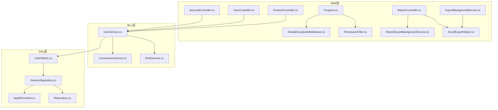
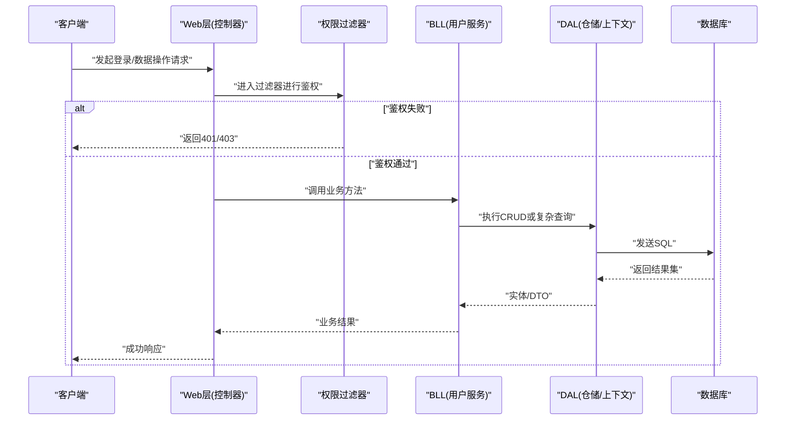
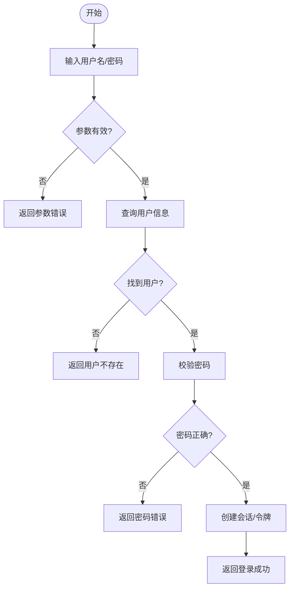
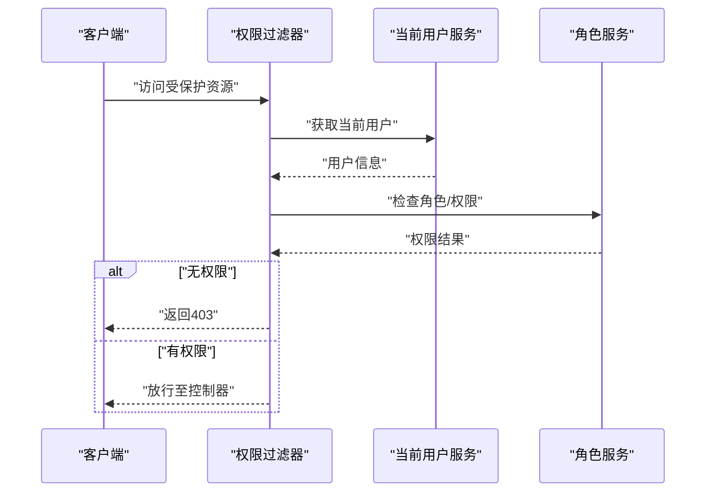
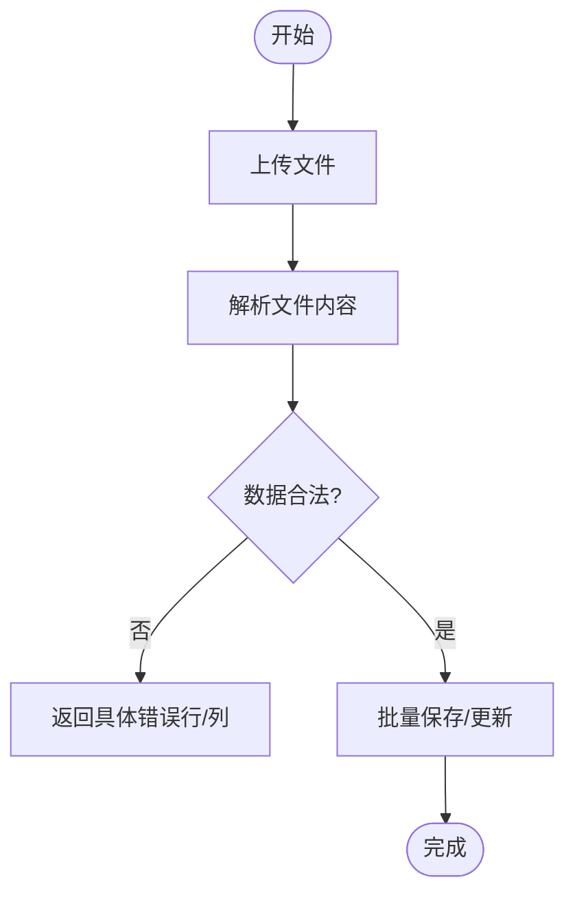
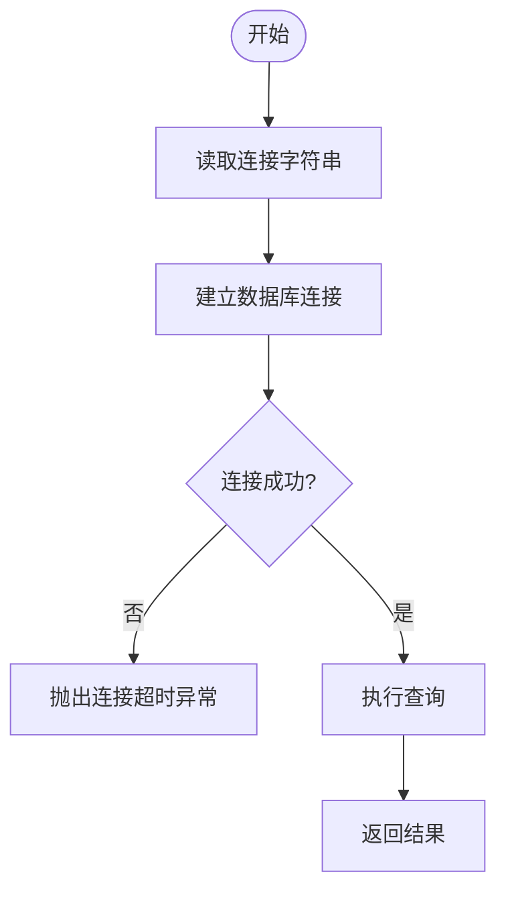
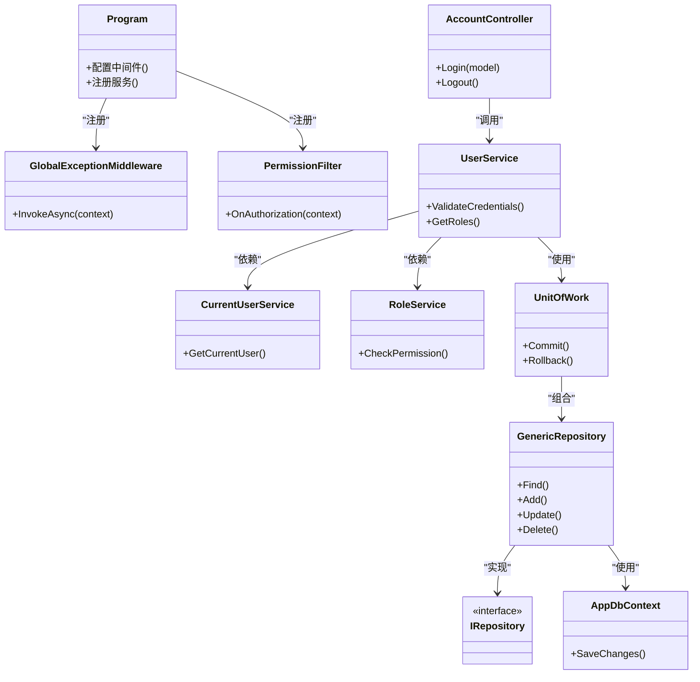

# 常见问题解决

<cite>
**本文引用的文件**   
- [Program.cs](file://EquipmentIMS.Web/Program.cs)
- [appsettings.json](file://EquipmentIMS.Web/appsettings.json)
- [GlobalExceptionMiddleware.cs](file://EquipmentIMS.Web/Filters/GlobalExceptionMiddleware.cs)
- [PermissionFilter.cs](file://EquipmentIMS.Web/Filters/PermissionFilter.cs)
- [AccountController.cs](file://EquipmentIMS.Web/Controllers/AccountController.cs)
- [UserController.cs](file://EquipmentIMS.Web/Controllers/UserController.cs)
- [ProductController.cs](file://EquipmentIMS.Web/Controllers/ProductController.cs)
- [ReportController.cs](file://EquipmentIMS.Web/Controllers/ReportController.cs)
- [ExportBackgroundService.cs](file://EquipmentIMS.Web/BackgroundServices/ExportBackgroundService.cs)
- [ReportExportBackgroundService.cs](file://EquipmentIMS.Web/BackgroundServices/ReportExportBackgroundService.cs)
- [ExcelExportHelper.cs](file://EquipmentIMS.Web/Helpers/ExcelExportHelper.cs)
- [AppDbContext.cs](file://EquipmentIMS.DAL/AppDbContext.cs)
- [IRepository.cs](file://EquipmentIMS.DAL/Interfaces/IRepository.cs)
- [GenericRepository.cs](file://EquipmentIMS.DAL/Repositories/GenericRepository.cs)
- [UnitOfWork.cs](file://EquipmentIMS.DAL/Repositories/UnitOfWork.cs)
- [UserService.cs](file://EquipmentIMS.BLL/Services/UserService.cs)
- [CurrentUserService.cs](file://EquipmentIMS.BLL/Services/CurrentUserService.cs)
- [RoleService.cs](file://EquipmentIMS.BLL/Services/RoleService.cs)
- [BusinessException.cs](file://EquipmentIMS.Models/Exceptions/BusinessException.cs)
- [ValidationException.cs](file://EquipmentIMS.Models/Exceptions/ValidationException.cs)
- [NotFoundException.cs](file://EquipmentIMS.Models/Exceptions/NotFoundException.cs)
- [LoginViewModel.cs](file://EquipmentIMS.Web/Models/LoginViewModel.cs)
- [ErrorViewModel.cs](file://EquipmentIMS.Web/Models/ErrorViewModel.cs)
</cite>

## 目录
1. [简介](#简介)
2. [项目结构](#项目结构)
3. [核心组件](#核心组件)
4. [架构总览](#架构总览)
5. [详细组件分析](#详细组件分析)
6. [依赖关系分析](#依赖关系分析)
7. [性能考虑](#性能考虑)
8. [故障排查指南](#故障排查指南)
9. [结论](#结论)
10. [附录](#附录)

## 简介
本文件面向THMS系统的运维与实施人员，聚焦高频问题的诊断与修复，覆盖用户登录失败、权限验证错误、数据导入导出异常、数据库连接超时、文件上传失败、Excel导出错误等场景。文档提供问题复现步骤、临时解决方案与根本性修复建议，并汇总错误代码对照表、已知Bug清单、版本兼容性与第三方依赖冲突的解决方法。

## 项目结构
系统采用分层架构：Web层（控制器、过滤器、中间件）、BLL业务逻辑层、DAL数据访问层、Models领域模型与DTO。关键入口为Web层的Program启动配置；全局异常处理由中间件统一捕获；权限校验通过过滤器实现；后台任务用于异步导出与报表生成。

**图表来源** 
- [Program.cs](file://EquipmentIMS.Web/Program.cs)
- [GlobalExceptionMiddleware.cs](file://EquipmentIMS.Web/Filters/GlobalExceptionMiddleware.cs)
- [PermissionFilter.cs](file://EquipmentIMS.Web/Filters/PermissionFilter.cs)
- [AccountController.cs](file://EquipmentIMS.Web/Controllers/AccountController.cs)
- [UserController.cs](file://EquipmentIMS.Web/Controllers/UserController.cs)
- [ProductController.cs](file://EquipmentIMS.Web/Controllers/ProductController.cs)
- [ReportController.cs](file://EquipmentIMS.Web/Controllers/ReportController.cs)
- [ExportBackgroundService.cs](file://EquipmentIMS.Web/BackgroundServices/ExportBackgroundService.cs)
- [ReportExportBackgroundService.cs](file://EquipmentIMS.Web/BackgroundServices/ReportExportBackgroundService.cs)
- [ExcelExportHelper.cs](file://EquipmentIMS.Web/Helpers/ExcelExportHelper.cs)
- [AppDbContext.cs](file://EquipmentIMS.DAL/AppDbContext.cs)
- [IRepository.cs](file://EquipmentIMS.DAL/Interfaces/IRepository.cs)
- [GenericRepository.cs](file://EquipmentIMS.DAL/Repositories/GenericRepository.cs)
- [UnitOfWork.cs](file://EquipmentIMS.DAL/Repositories/UnitOfWork.cs)
- [UserService.cs](file://EquipmentIMS.BLL/Services/UserService.cs)
- [CurrentUserService.cs](file://EquipmentIMS.BLL/Services/CurrentUserService.cs)
- [RoleService.cs](file://EquipmentIMS.BLL/Services/RoleService.cs)

**章节来源**
- [Program.cs](file://EquipmentIMS.Web/Program.cs)
- [appsettings.json](file://EquipmentIMS.Web/appsettings.json)

## 核心组件
- 全局异常中间件：统一捕获未处理异常，返回标准化响应，便于前端提示与日志记录。
- 权限过滤器：在请求进入控制器前进行鉴权拦截，无权限时返回特定状态码。
- 认证控制器：负责登录、登出、密码修改等流程，结合用户服务完成凭据校验与令牌签发。
- 用户服务：封装用户相关业务逻辑，包括角色分配、权限检查、当前用户上下文获取。
- 数据访问层：基于通用仓储与单元工作模式，统一事务边界与查询封装。
- 导出辅助与后台任务：将耗时导出操作异步化，避免阻塞请求线程。

**章节来源**
- [GlobalExceptionMiddleware.cs](file://EquipmentIMS.Web/Filters/GlobalExceptionMiddleware.cs)
- [PermissionFilter.cs](file://EquipmentIMS.Web/Filters/PermissionFilter.cs)
- [AccountController.cs](file://EquipmentIMS.Web/Controllers/AccountController.cs)
- [UserService.cs](file://EquipmentIMS.BLL/Services/UserService.cs)
- [CurrentUserService.cs](file://EquipmentIMS.BLL/Services/CurrentUserService.cs)
- [IRepository.cs](file://EquipmentIMS.DAL/Interfaces/IRepository.cs)
- [GenericRepository.cs](file://EquipmentIMS.DAL/Repositories/GenericRepository.cs)
- [UnitOfWork.cs](file://EquipmentIMS.DAL/Repositories/UnitOfWork.cs)
- [ExportBackgroundService.cs](file://EquipmentIMS.Web/BackgroundServices/ExportBackgroundService.cs)
- [ReportExportBackgroundService.cs](file://EquipmentIMS.Web/BackgroundServices/ReportExportBackgroundService.cs)
- [ExcelExportHelper.cs](file://EquipmentIMS.Web/Helpers/ExcelExportHelper.cs)

## 架构总览
下图展示从HTTP请求到数据持久化的典型调用链，以及异常与权限拦截点的位置。

**图表来源** 
- [PermissionFilter.cs](file://EquipmentIMS.Web/Filters/PermissionFilter.cs)
- [AccountController.cs](file://EquipmentIMS.Web/Controllers/AccountController.cs)
- [UserService.cs](file://EquipmentIMS.BLL/Services/UserService.cs)
- [GenericRepository.cs](file://EquipmentIMS.DAL/Repositories/GenericRepository.cs)
- [AppDbContext.cs](file://EquipmentIMS.DAL/AppDbContext.cs)

## 详细组件分析

### 登录失败问题
常见原因：
- 用户名不存在或密码错误
- 账户被禁用或锁定
- 会话/令牌配置不正确
- 数据库连接异常导致无法校验凭据

诊断步骤：
- 确认输入的用户名与密码正确，排除大小写与空格问题
- 检查数据库中用户状态字段是否启用
- 查看全局异常中间件记录的异常堆栈与错误码
- 核对appsettings中的数据库连接字符串与认证配置

临时方案：
- 重置用户密码或解锁账户
- 使用管理员账号重新登录
- 重启应用以刷新会话与缓存

根本修复：
- 修正数据库连接字符串与网络连通性
- 完善登录失败的友好提示与错误码映射
- 增加登录尝试次数限制与账户锁定策略

**图表来源** 
- [AccountController.cs](file://EquipmentIMS.Web/Controllers/AccountController.cs)
- [UserService.cs](file://EquipmentIMS.BLL/Services/UserService.cs)
- [GlobalExceptionMiddleware.cs](file://EquipmentIMS.Web/Filters/GlobalExceptionMiddleware.cs)

**章节来源**
- [AccountController.cs](file://EquipmentIMS.Web/Controllers/AccountController.cs)
- [UserService.cs](file://EquipmentIMS.BLL/Services/UserService.cs)
- [LoginViewModel.cs](file://EquipmentIMS.Web/Models/LoginViewModel.cs)
- [GlobalExceptionMiddleware.cs](file://EquipmentIMS.Web/Filters/GlobalExceptionMiddleware.cs)

### 权限验证错误
常见原因：
- 用户缺少所需权限或角色未分配
- 过滤器对资源路径与动作的匹配规则不满足
- 当前用户上下文为空或过期

诊断步骤：
- 检查目标接口所需的权限标识
- 确认用户角色与权限关联是否正确
- 查看权限过滤器的拦截日志与返回状态码

临时方案：
- 为当前用户分配缺失的角色或权限
- 清理浏览器缓存后重试
- 使用具备更高权限的账号验证是否为权限配置问题

根本修复：
- 完善权限矩阵与菜单-权限绑定
- 优化过滤器匹配逻辑，减少误拦截
- 增加权限变更后的缓存失效机制

**图表来源** 
- [PermissionFilter.cs](file://EquipmentIMS.Web/Filters/PermissionFilter.cs)
- [CurrentUserService.cs](file://EquipmentIMS.BLL/Services/CurrentUserService.cs)
- [RoleService.cs](file://EquipmentIMS.BLL/Services/RoleService.cs)

**章节来源**
- [PermissionFilter.cs](file://EquipmentIMS.Web/Filters/PermissionFilter.cs)
- [CurrentUserService.cs](file://EquipmentIMS.BLL/Services/CurrentUserService.cs)
- [RoleService.cs](file://EquipmentIMS.BLL/Services/RoleService.cs)

### 数据导入导出异常
常见原因：
- 导入模板格式不符或缺少必填列
- 文件过大导致内存溢出或超时
- 导出过程中并发写入或锁竞争
- Excel库版本不兼容或字体缺失

诊断步骤：
- 校验导入文件的列名、数据类型与约束
- 查看后台任务队列与导出日志
- 检查Excel导出辅助类的配置与依赖版本

临时方案：
- 按标准模板重导数据
- 分批导入/导出，降低单次负载
- 升级或降级Excel库版本以匹配运行环境

根本修复：
- 增强导入数据的校验与错误定位
- 引入流式读写与分页导出
- 统一异常类型与错误码，便于前端提示

**图表来源** 
- [ProductController.cs](file://EquipmentIMS.Web/Controllers/ProductController.cs)
- [ExcelExportHelper.cs](file://EquipmentIMS.Web/Helpers/ExcelExportHelper.cs)
- [ExportBackgroundService.cs](file://EquipmentIMS.Web/BackgroundServices/ExportBackgroundService.cs)

**章节来源**
- [ProductController.cs](file://EquipmentIMS.Web/Controllers/ProductController.cs)
- [ExcelExportHelper.cs](file://EquipmentIMS.Web/Helpers/ExcelExportHelper.cs)
- [ExportBackgroundService.cs](file://EquipmentIMS.Web/BackgroundServices/ExportBackgroundService.cs)

### 数据库连接超时
常见原因：
- 连接字符串错误或网络不可达
- 数据库服务器负载过高或连接池耗尽
- 长时间运行的查询未设置超时

诊断步骤：
- 检查appsettings中的连接字符串与端口
- 监控数据库连接数与慢查询
- 查看全局异常中间件记录的超时异常

临时方案：
- 重启数据库服务与应用
- 调整连接池大小与命令超时
- 关闭不必要的长事务

根本修复：
- 优化慢查询与索引
- 引入连接健康检查与自动重试
- 合理拆分大事务，提升吞吐

**图表来源** 
- [AppDbContext.cs](file://EquipmentIMS.DAL/AppDbContext.cs)
- [GlobalExceptionMiddleware.cs](file://EquipmentIMS.Web/Filters/GlobalExceptionMiddleware.cs)
- [appsettings.json](file://EquipmentIMS.Web/appsettings.json)

**章节来源**
- [AppDbContext.cs](file://EquipmentIMS.DAL/AppDbContext.cs)
- [appsettings.json](file://EquipmentIMS.Web/appsettings.json)
- [GlobalExceptionMiddleware.cs](file://EquipmentIMS.Web/Filters/GlobalExceptionMiddleware.cs)

### 文件上传失败
常见原因：
- 文件大小超过限制
- 目标目录无写入权限
- 文件名非法或路径不安全

诊断步骤：
- 检查服务端最大请求体大小配置
- 确认上传目录存在且可写
- 查看全局异常中间件的错误详情

临时方案：
- 调大上传大小限制
- 手动创建上传目录并赋予权限
- 更换文件名与路径

根本修复：
- 增加文件类型白名单与大小校验
- 使用对象存储替代本地磁盘
- 完善上传进度与断点续传

**章节来源**
- [GlobalExceptionMiddleware.cs](file://EquipmentIMS.Web/Filters/GlobalExceptionMiddleware.cs)
- [appsettings.json](file://EquipmentIMS.Web/appsettings.json)

### Excel导出错误
常见原因：
- 单元格内容过长或包含特殊字符
- 并发导出导致资源竞争
- 后台任务队列堆积

诊断步骤：
- 检查导出辅助类的数据格式化逻辑
- 查看后台任务的执行日志与队列长度
- 评估数据量与内存占用

临时方案：
- 缩小导出数据范围
- 串行执行导出任务
- 清理历史导出文件释放空间

根本修复：
- 引入流式导出与分片下载
- 增加导出任务去重与限流
- 优化Excel库版本与兼容性

**章节来源**
- [ExcelExportHelper.cs](file://EquipmentIMS.Web/Helpers/ExcelExportHelper.cs)
- [ReportExportBackgroundService.cs](file://EquipmentIMS.Web/BackgroundServices/ReportExportBackgroundService.cs)
- [ReportController.cs](file://EquipmentIMS.Web/Controllers/ReportController.cs)

## 依赖关系分析
- Web层依赖BLL与DAL，通过DI容器注入服务与仓储
- BLL依赖DAL的仓储接口与单元工作，保证事务一致性
- Models定义异常类型与DTO，贯穿各层传递错误信息
- 中间件与过滤器位于Web层，对请求进行横切处理

**图表来源** 
- [Program.cs](file://EquipmentIMS.Web/Program.cs)
- [GlobalExceptionMiddleware.cs](file://EquipmentIMS.Web/Filters/GlobalExceptionMiddleware.cs)
- [PermissionFilter.cs](file://EquipmentIMS.Web/Filters/PermissionFilter.cs)
- [AccountController.cs](file://EquipmentIMS.Web/Controllers/AccountController.cs)
- [UserService.cs](file://EquipmentIMS.BLL/Services/UserService.cs)
- [CurrentUserService.cs](file://EquipmentIMS.BLL/Services/CurrentUserService.cs)
- [RoleService.cs](file://EquipmentIMS.BLL/Services/RoleService.cs)
- [AppDbContext.cs](file://EquipmentIMS.DAL/AppDbContext.cs)
- [IRepository.cs](file://EquipmentIMS.DAL/Interfaces/IRepository.cs)
- [GenericRepository.cs](file://EquipmentIMS.DAL/Repositories/GenericRepository.cs)
- [UnitOfWork.cs](file://EquipmentIMS.DAL/Repositories/UnitOfWork.cs)

**章节来源**
- [Program.cs](file://EquipmentIMS.Web/Program.cs)
- [IRepository.cs](file://EquipmentIMS.DAL/Interfaces/IRepository.cs)
- [GenericRepository.cs](file://EquipmentIMS.DAL/Repositories/GenericRepository.cs)
- [UnitOfWork.cs](file://EquipmentIMS.DAL/Repositories/UnitOfWork.cs)

## 性能考虑
- 控制单次导入/导出数据量，避免内存峰值
- 使用后台任务与队列削峰填谷
- 优化数据库查询与索引，减少慢查询
- 合理设置连接池与超时参数，提高稳定性

## 故障排查指南
- 登录失败
  - 复现步骤：使用错误密码或无效用户名登录
  - 临时方案：重置密码或切换管理员账号
  - 根因修复：完善错误码映射与账户锁定策略
  - 参考文件：[AccountController.cs](file://EquipmentIMS.Web/Controllers/AccountController.cs)、[UserService.cs](file://EquipmentIMS.BLL/Services/UserService.cs)

- 权限验证错误
  - 复现步骤：访问受限页面或接口
  - 临时方案：分配缺失角色或权限
  - 根因修复：优化过滤器匹配与权限缓存
  - 参考文件：[PermissionFilter.cs](file://EquipmentIMS.Web/Filters/PermissionFilter.cs)、[CurrentUserService.cs](file://EquipmentIMS.BLL/Services/CurrentUserService.cs)

- 数据导入导出异常
  - 复现步骤：上传非标准模板或导出大数据集
  - 临时方案：分批处理与清理导出文件
  - 根因修复：增强校验与流式导出
  - 参考文件：[ProductController.cs](file://EquipmentIMS.Web/Controllers/ProductController.cs)、[ExcelExportHelper.cs](file://EquipmentIMS.Web/Helpers/ExcelExportHelper.cs)

- 数据库连接超时
  - 复现步骤：高负载下执行复杂查询
  - 临时方案：重启服务与调整超时
  - 根因修复：优化查询与连接池
  - 参考文件：[AppDbContext.cs](file://EquipmentIMS.DAL/AppDbContext.cs)、[appsettings.json](file://EquipmentIMS.Web/appsettings.json)

- 文件上传失败
  - 复现步骤：上传超大文件或非法路径
  - 临时方案：增大限制与赋权目录
  - 根因修复：引入对象存储与安全校验
  - 参考文件：[GlobalExceptionMiddleware.cs](file://EquipmentIMS.Web/Filters/GlobalExceptionMiddleware.cs)

- Excel导出错误
  - 复现步骤：导出含特殊字符或超长文本
  - 临时方案：缩小范围与串行执行
  - 根因修复：升级库版本与分片下载
  - 参考文件：[ExcelExportHelper.cs](file://EquipmentIMS.Web/Helpers/ExcelExportHelper.cs)、[ReportExportBackgroundService.cs](file://EquipmentIMS.Web/BackgroundServices/ReportExportBackgroundService.cs)

**章节来源**
- [GlobalExceptionMiddleware.cs](file://EquipmentIMS.Web/Filters/GlobalExceptionMiddleware.cs)
- [PermissionFilter.cs](file://EquipmentIMS.Web/Filters/PermissionFilter.cs)
- [AccountController.cs](file://EquipmentIMS.Web/Controllers/AccountController.cs)
- [ProductController.cs](file://EquipmentIMS.Web/Controllers/ProductController.cs)
- [ReportController.cs](file://EquipmentIMS.Web/Controllers/ReportController.cs)
- [ExportBackgroundService.cs](file://EquipmentIMS.Web/BackgroundServices/ExportBackgroundService.cs)
- [ReportExportBackgroundService.cs](file://EquipmentIMS.Web/BackgroundServices/ReportExportBackgroundService.cs)
- [ExcelExportHelper.cs](file://EquipmentIMS.Web/Helpers/ExcelExportHelper.cs)
- [AppDbContext.cs](file://EquipmentIMS.DAL/AppDbContext.cs)
- [appsettings.json](file://EquipmentIMS.Web/appsettings.json)

## 结论
通过对登录、权限、导入导出、数据库连接、文件上传与Excel导出等高频问题的系统化梳理，结合中间件与过滤器的横切能力、仓储与单元工作的数据一致性保障，以及后台任务的异步化处理，能够有效提升THMS系统的稳定性与可维护性。建议在后续迭代中持续完善错误码体系、性能监控与自动化测试，以降低生产环境问题发生率。

## 附录

### 错误代码对照表
- 401 未认证：用户名不存在或密码错误
- 403 禁止访问：缺少权限或角色未分配
- 400 参数错误：导入模板格式不符或必填项缺失
- 500 内部错误：未处理异常或第三方依赖异常
- 504 网关超时：数据库连接超时或后端处理过慢

说明：以上状态码为常见返回，具体实现以全局异常中间件与过滤器为准。

**章节来源**
- [GlobalExceptionMiddleware.cs](file://EquipmentIMS.Web/Filters/GlobalExceptionMiddleware.cs)
- [PermissionFilter.cs](file://EquipmentIMS.Web/Filters/PermissionFilter.cs)

### 已知Bug列表
- 某些Excel版本导出时出现单元格格式错乱
  - 影响范围：报表导出
  - 临时规避：使用推荐版本或简化格式
  - 修复建议：升级Excel库版本并统一样式输出

- 并发导出导致文件损坏
  - 影响范围：批量报表导出
  - 临时规避：串行执行导出任务
  - 修复建议：引入任务锁与分片合并

- 权限变更后未立即生效
  - 影响范围：角色与权限管理
  - 临时规避：清除浏览器缓存或重新登录
  - 修复建议：增加权限缓存失效与实时同步

**章节来源**
- [ExcelExportHelper.cs](file://EquipmentIMS.Web/Helpers/ExcelExportHelper.cs)
- [ReportExportBackgroundService.cs](file://EquipmentIMS.Web/BackgroundServices/ReportExportBackgroundService.cs)
- [PermissionFilter.cs](file://EquipmentIMS.Web/Filters/PermissionFilter.cs)

### 版本兼容性与第三方依赖冲突
- Excel库版本不一致导致导出异常
  - 现象：不同环境导出结果差异
  - 处理：统一依赖版本并在CI中锁定
- .NET运行时与框架版本不匹配
  - 现象：启动失败或运行时异常
  - 处理：核对appsettings与部署环境的运行时版本
- 数据库驱动版本与数据库版本不兼容
  - 现象：连接失败或特性不支持
  - 处理：升级驱动或降级数据库版本

**章节来源**
- [appsettings.json](file://EquipmentIMS.Web/appsettings.json)
- [Program.cs](file://EquipmentIMS.Web/Program.cs)