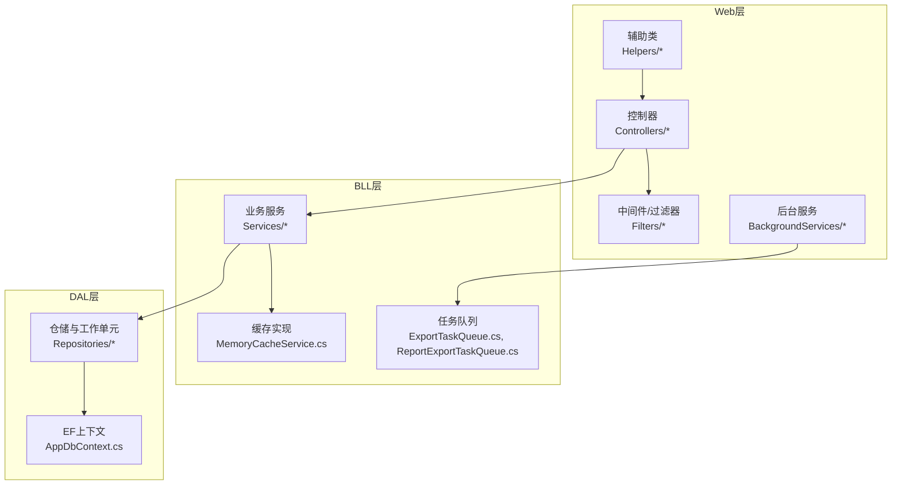
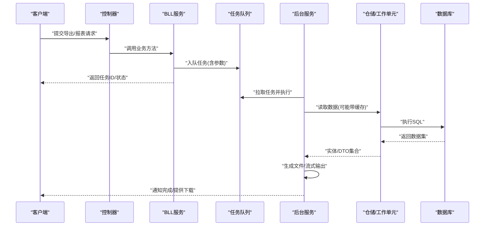
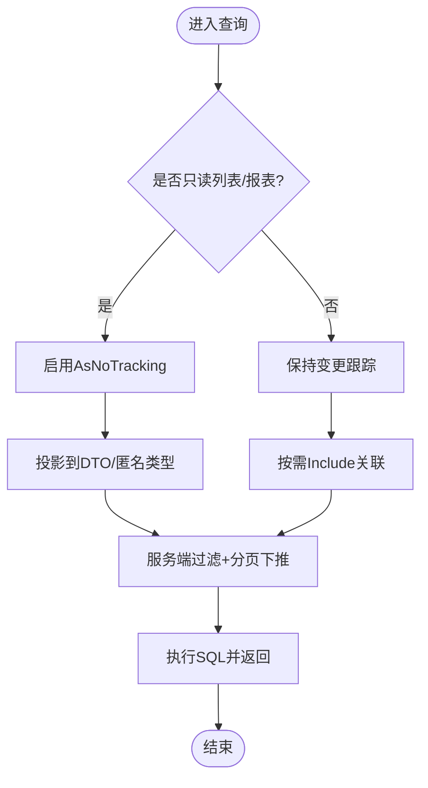
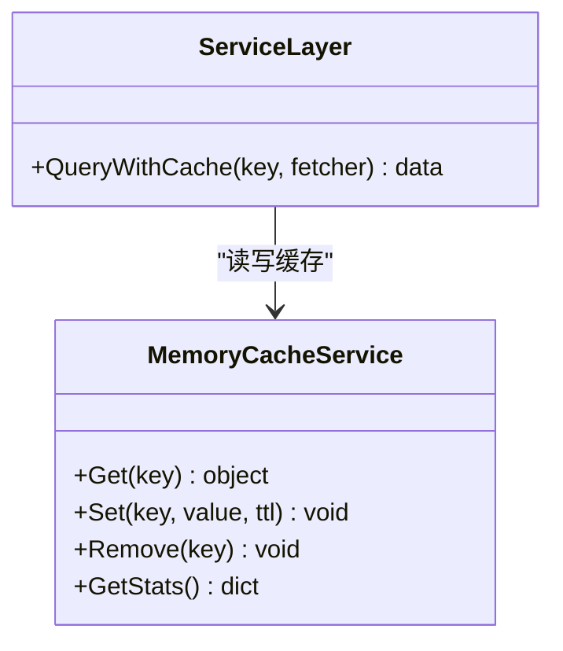
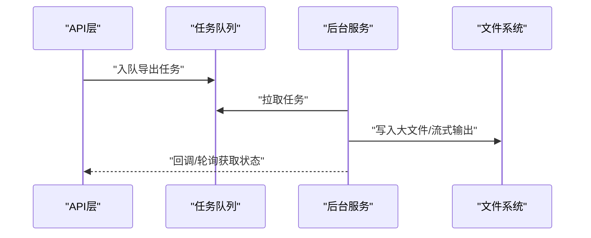
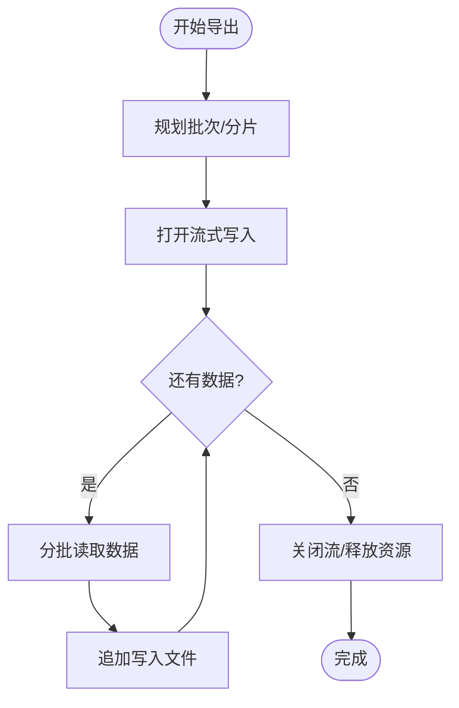
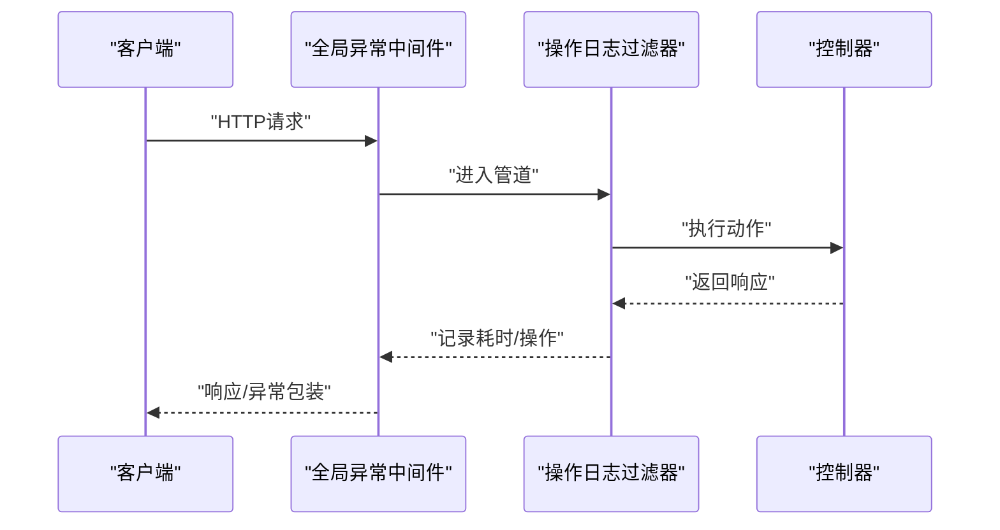
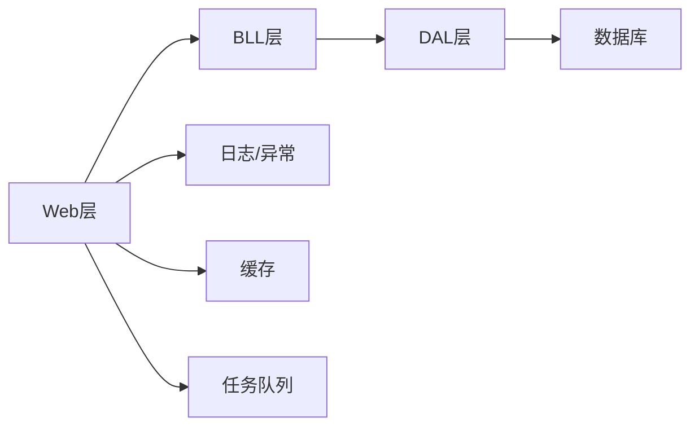

# 性能问题诊断

<cite>
**本文引用的文件**   
- [Program.cs](file://EquipmentIMS.Web/Program.cs)
- [AppDbContext.cs](file://EquipmentIMS.DAL/AppDbContext.cs)
- [GenericRepository.cs](file://EquipmentIMS.DAL/Repositories/GenericRepository.cs)
- [UnitOfWork.cs](file://EquipmentIMS.DAL/Repositories/UnitOfWork.cs)
- [MemoryCacheService.cs](file://EquipmentIMS.BLL/Services/MemoryCacheService.cs)
- [ExportTaskQueue.cs](file://EquipmentIMS.BLL/Services/ExportTaskQueue.cs)
- [ReportExportTaskQueue.cs](file://EquipmentIMS.BLL/Services/ReportExportTaskQueue.cs)
- [ExportBackgroundService.cs](file://EquipmentIMS.Web/BackgroundServices/ExportBackgroundService.cs)
- [ReportExportBackgroundService.cs](file://EquipmentIMS.Web/BackgroundServices/ReportExportBackgroundService.cs)
- [ExcelExportHelper.cs](file://EquipmentIMS.Web/Helpers/ExcelExportHelper.cs)
- [GlobalExceptionMiddleware.cs](file://EquipmentIMS.Web/Filters/GlobalExceptionMiddleware.cs)
- [OperationLogActionFilter.cs](file://EquipmentIMS.Web/Filters/OperationLogActionFilter.cs)
- [nlog.config](file://EquipmentIMS.Web/nlog.config)
- [appsettings.json](file://EquipmentIMS.Web/appsettings.json)
</cite>

## 目录
1. [简介](#简介)
2. [项目结构](#项目结构)
3. [核心组件](#核心组件)
4. [架构总览](#架构总览)
5. [详细组件分析](#详细组件分析)
6. [依赖关系分析](#依赖关系分析)
7. [性能考量](#性能考量)
8. [故障排查指南](#故障排查指南)
9. [结论](#结论)
10. [附录](#附录)

## 简介
本手册面向THMS系统的性能问题诊断与优化，聚焦以下目标：
- CPU占用过高、内存泄漏、响应缓慢等瓶颈的定位方法
- Entity Framework查询优化、数据库索引分析与缓存命中率监控
- 异步任务队列积压、文件导出性能、报表生成慢等场景的优化策略
- 性能监控工具使用、Profiling分析、负载测试的实施指导

## 项目结构
系统采用分层架构：Web层（控制器、中间件、后台服务）、BLL业务逻辑层（服务、缓存、任务队列）、DAL数据访问层（EF上下文、仓储、工作单元），以及Models与DTOs。

图表来源
- [Program.cs](file://EquipmentIMS.Web/Program.cs)
- [AppDbContext.cs](file://EquipmentIMS.DAL/AppDbContext.cs)
- [GenericRepository.cs](file://EquipmentIMS.DAL/Repositories/GenericRepository.cs)
- [MemoryCacheService.cs](file://EquipmentIMS.BLL/Services/MemoryCacheService.cs)
- [ExportTaskQueue.cs](file://EquipmentIMS.BLL/Services/ExportTaskQueue.cs)
- [ReportExportTaskQueue.cs](file://EquipmentIMS.BLL/Services/ReportExportTaskQueue.cs)
- [ExportBackgroundService.cs](file://EquipmentIMS.Web/BackgroundServices/ExportBackgroundService.cs)
- [ReportExportBackgroundService.cs](file://EquipmentIMS.Web/BackgroundServices/ReportExportBackgroundService.cs)
- [ExcelExportHelper.cs](file://EquipmentIMS.Web/Helpers/ExcelExportHelper.cs)

章节来源
- [Program.cs](file://EquipmentIMS.Web/Program.cs)
- [AppDbContext.cs](file://EquipmentIMS.DAL/AppDbContext.cs)

## 核心组件
- 应用启动与依赖注入：在Program中注册服务、中间件、日志与配置，决定运行时性能基线。
- EF上下文与仓储：AppDbContext统一连接与变更跟踪；GenericRepository提供通用CRUD与分页；UnitOfWork管理事务边界。
- 缓存：MemoryCacheService封装本地内存缓存，用于热点数据与报表结果缓存。
- 异步任务队列：ExportTaskQueue与ReportExportTaskQueue承载导出与报表任务，配合后台服务消费。
- 导出辅助：ExcelExportHelper负责Excel写入，影响I/O与CPU峰值。
- 全局异常与操作日志：GlobalExceptionMiddleware与OperationLogActionFilter记录错误与耗时，便于定位慢请求。

章节来源
- [Program.cs](file://EquipmentIMS.Web/Program.cs)
- [AppDbContext.cs](file://EquipmentIMS.DAL/AppDbContext.cs)
- [GenericRepository.cs](file://EquipmentIMS.DAL/Repositories/GenericRepository.cs)
- [UnitOfWork.cs](file://EquipmentIMS.DAL/Repositories/UnitOfWork.cs)
- [MemoryCacheService.cs](file://EquipmentIMS.BLL/Services/MemoryCacheService.cs)
- [ExportTaskQueue.cs](file://EquipmentIMS.BLL/Services/ExportTaskQueue.cs)
- [ReportExportTaskQueue.cs](file://EquipmentIMS.BLL/Services/ReportExportTaskQueue.cs)
- [ExcelExportHelper.cs](file://EquipmentIMS.Web/Helpers/ExcelExportHelper.cs)
- [GlobalExceptionMiddleware.cs](file://EquipmentIMS.Web/Filters/GlobalExceptionMiddleware.cs)
- [OperationLogActionFilter.cs](file://EquipmentIMS.Web/Filters/OperationLogActionFilter.cs)

## 架构总览
下图展示典型“报表导出”链路：前端发起请求→控制器→BLL服务→任务队列→后台服务→仓储/EF→数据库→返回下载链接或进度。

图表来源
- [Program.cs](file://EquipmentIMS.Web/Program.cs)
- [ExportTaskQueue.cs](file://EquipmentIMS.BLL/Services/ExportTaskQueue.cs)
- [ReportExportTaskQueue.cs](file://EquipmentIMS.BLL/Services/ReportExportTaskQueue.cs)
- [ExportBackgroundService.cs](file://EquipmentIMS.Web/BackgroundServices/ExportBackgroundService.cs)
- [ReportExportBackgroundService.cs](file://EquipmentIMS.Web/BackgroundServices/ReportExportBackgroundService.cs)
- [GenericRepository.cs](file://EquipmentIMS.DAL/Repositories/GenericRepository.cs)
- [AppDbContext.cs](file://EquipmentIMS.DAL/AppDbContext.cs)

## 详细组件分析

### 组件A：Entity Framework查询与仓储优化
- 关注点
  - 避免N+1查询：尽量使用Include/Select投影到DTO，减少对象图加载。
  - 只读查询禁用变更跟踪：对列表/报表查询使用AsNoTracking提升吞吐。
  - 分页与过滤下推：在服务端进行Top/Skip/Take与Where条件下推到SQL。
  - 批量更新/删除：大批量操作使用批量库或存储过程，避免逐条SaveChanges。
- 关键路径
  - GenericRepository中的分页与查询方法
  - UnitOfWork的事务边界控制
- 建议指标
  - 平均/分位延迟、SQL行数与往返次数、内存分配速率

图表来源
- [GenericRepository.cs](file://EquipmentIMS.DAL/Repositories/GenericRepository.cs)
- [UnitOfWork.cs](file://EquipmentIMS.DAL/Repositories/UnitOfWork.cs)
- [AppDbContext.cs](file://EquipmentIMS.DAL/AppDbContext.cs)

章节来源
- [GenericRepository.cs](file://EquipmentIMS.DAL/Repositories/GenericRepository.cs)
- [UnitOfWork.cs](file://EquipmentIMS.DAL/Repositories/UnitOfWork.cs)
- [AppDbContext.cs](file://EquipmentIMS.DAL/AppDbContext.cs)

### 组件B：缓存服务与命中率监控
- 关注点
  - 缓存粒度：按查询键聚合，避免过大对象长期驻留。
  - 过期策略：TTL与主动失效结合，保证一致性。
  - 命中率统计：记录命中/未命中与大小，评估收益。
- 关键路径
  - MemoryCacheService的Get/Set/Remove接口
- 建议指标
  - 命中率、平均存取时延、内存占用、淘汰率

图表来源
- [MemoryCacheService.cs](file://EquipmentIMS.BLL/Services/MemoryCacheService.cs)

章节来源
- [MemoryCacheService.cs](file://EquipmentIMS.BLL/Services/MemoryCacheService.cs)

### 组件C：异步任务队列与后台服务
- 关注点
  - 队列容量与背压：限制并发与队列长度，防止OOM。
  - 重试与死信：失败任务重试、告警与人工介入。
  - 资源隔离：导出/报表任务与在线请求分离。
- 关键路径
  - ExportTaskQueue、ReportExportTaskQueue
  - ExportBackgroundService、ReportExportBackgroundService
- 建议指标
  - 队列长度、处理时长分布、失败率、CPU/内存峰值

图表来源
- [ExportTaskQueue.cs](file://EquipmentIMS.BLL/Services/ExportTaskQueue.cs)
- [ReportExportTaskQueue.cs](file://EquipmentIMS.BLL/Services/ReportExportTaskQueue.cs)
- [ExportBackgroundService.cs](file://EquipmentIMS.Web/BackgroundServices/ExportBackgroundService.cs)
- [ReportExportBackgroundService.cs](file://EquipmentIMS.Web/BackgroundServices/ReportExportBackgroundService.cs)

章节来源
- [ExportTaskQueue.cs](file://EquipmentIMS.BLL/Services/ExportTaskQueue.cs)
- [ReportExportTaskQueue.cs](file://EquipmentIMS.BLL/Services/ReportExportTaskQueue.cs)
- [ExportBackgroundService.cs](file://EquipmentIMS.Web/BackgroundServices/ExportBackgroundService.cs)
- [ReportExportBackgroundService.cs](file://EquipmentIMS.Web/BackgroundServices/ReportExportBackgroundService.cs)

### 组件D：文件导出与报表生成
- 关注点
  - 流式写入：避免一次性构建超大对象，降低GC压力。
  - 压缩与分片：大报表分卷导出，支持断点续传。
  - I/O与CPU平衡：合理线程池与缓冲大小。
- 关键路径
  - ExcelExportHelper的写入逻辑
- 建议指标
  - 导出耗时、峰值内存、磁盘吞吐、CPU利用率

图表来源
- [ExcelExportHelper.cs](file://EquipmentIMS.Web/Helpers/ExcelExportHelper.cs)

章节来源
- [ExcelExportHelper.cs](file://EquipmentIMS.Web/Helpers/ExcelExportHelper.cs)

### 组件E：全局异常与操作日志（性能观测）
- 关注点
  - 请求级耗时埋点：在过滤器中记录起止时间，识别慢接口。
  - 异常堆栈与上下文：统一捕获，附带用户、租户、参数摘要。
  - 日志级别与采样：生产环境降低冗余日志，保留关键路径。
- 关键路径
  - GlobalExceptionMiddleware、OperationLogActionFilter
- 建议指标
  - P95/P99延迟、错误率、慢请求占比

图表来源
- [GlobalExceptionMiddleware.cs](file://EquipmentIMS.Web/Filters/GlobalExceptionMiddleware.cs)
- [OperationLogActionFilter.cs](file://EquipmentIMS.Web/Filters/OperationLogActionFilter.cs)

章节来源
- [GlobalExceptionMiddleware.cs](file://EquipmentIMS.Web/Filters/GlobalExceptionMiddleware.cs)
- [OperationLogActionFilter.cs](file://EquipmentIMS.Web/Filters/OperationLogActionFilter.cs)

## 依赖关系分析
- Web层依赖BLL服务与中间件；BLL依赖DAL仓储与缓存；DAL依赖EF上下文与数据库。
- 后台服务通过队列与BLL解耦，避免阻塞前台请求。
- 日志与异常处理贯穿请求生命周期，为性能分析提供数据源。

图表来源
- [Program.cs](file://EquipmentIMS.Web/Program.cs)
- [AppDbContext.cs](file://EquipmentIMS.DAL/AppDbContext.cs)
- [MemoryCacheService.cs](file://EquipmentIMS.BLL/Services/MemoryCacheService.cs)
- [ExportTaskQueue.cs](file://EquipmentIMS.BLL/Services/ExportTaskQueue.cs)
- [ReportExportTaskQueue.cs](file://EquipmentIMS.BLL/Services/ReportExportTaskQueue.cs)

章节来源
- [Program.cs](file://EquipmentIMS.Web/Program.cs)
- [AppDbContext.cs](file://EquipmentIMS.DAL/AppDbContext.cs)

## 性能考量
- CPU占用过高
  - 定位：Profiler抓取热点方法，关注循环、字符串拼接、序列化、正则、加密解密。
  - 优化：向量化/批处理、投影到DTO、减少对象创建、复用缓冲区、并行化独立计算。
- 内存泄漏
  - 定位：快照对比、GC Heap Dump、事件查看器/PerfMon观察托管堆增长。
  - 优化：及时释放非托管资源、避免静态集合无限增长、缩短缓存TTL、避免闭包引用大对象。
- 响应缓慢
  - 定位：P95/P99延迟、慢SQL、锁等待、线程池饥饿。
  - 优化：索引与查询改写、分页与投影、异步化、连接池与超时调优。
- EF查询优化
  - AsNoTracking、Select投影、Include谨慎使用、避免在LINQ中执行复杂函数、必要时用原生SQL。
- 数据库索引分析
  - 使用执行计划与慢查询日志，关注全表扫描、回表、排序/哈希；为高频过滤/排序/Join列建立合适索引。
- 缓存命中率监控
  - 记录命中/未命中、TTL命中率、内存占用；对热点报表做短期缓存与版本化键。
- 异步任务队列积压
  - 限流与背压、水平扩展消费者、失败重试与死信、监控队列深度与处理时长。
- 文件导出与报表生成
  - 流式写入、分片导出、压缩、后台异步化、避免在主线程构建大对象。
- 监控与可观测性
  - 结构化日志、分布式追踪、指标上报（Prometheus/Grafana）、APM（Application Insights）。
- Profiling与负载测试
  - 使用.NET Profiler/Visual Studio Diagnostic Tools/JetBrains dotTrace；使用k6/Locust/JMeter进行压测，关注SLO与回归。

[本节为通用指导，不直接分析具体文件]

## 故障排查指南
- 快速定位慢请求
  - 通过操作日志过滤器记录的耗时，筛选P95/P99接口；结合异常中间件的错误上下文。
- 定位慢SQL
  - 开启EF命令日志，收集慢查询；在数据库侧分析执行计划与索引缺失。
- 队列积压与OOM
  - 检查队列长度、消费者数量、单任务内存占用；调整批大小与并发度，增加实例或横向扩容。
- 导出卡顿
  - 确认是否流式写入；检查磁盘I/O与网络带宽；考虑分片与压缩。
- 日志与配置
  - 核对nlog.config的日志级别与滚动策略；检查appsettings.json的连接串、缓存与队列配置。

章节来源
- [OperationLogActionFilter.cs](file://EquipmentIMS.Web/Filters/OperationLogActionFilter.cs)
- [GlobalExceptionMiddleware.cs](file://EquipmentIMS.Web/Filters/GlobalExceptionMiddleware.cs)
- [nlog.config](file://EquipmentIMS.Web/nlog.config)
- [appsettings.json](file://EquipmentIMS.Web/appsettings.json)

## 结论
通过分层架构的可观测性与合理的EF/索引/缓存/队列设计，可有效定位并缓解CPU、内存与响应延迟问题。建议在生产环境持续采集指标与日志，结合Profiler与压测形成闭环优化。

[本节为总结性内容，不直接分析具体文件]

## 附录
- 常用命令与工具
  - .NET内置：dotnet-counters、dotnet-trace、dotnet-gcdump
  - APM：Application Insights、OpenTelemetry
  - 压测：k6、JMeter、Locust
- 指标清单
  - 请求延迟分位、错误率、吞吐量、队列深度、缓存命中率、SQL执行时间与行数、GC暂停与分配速率、线程池排队数。

[本节为补充信息，不直接分析具体文件]