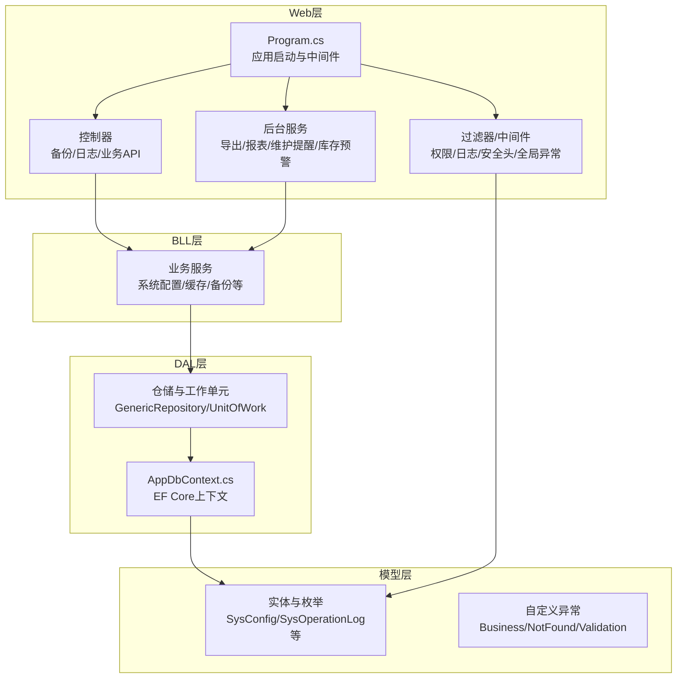
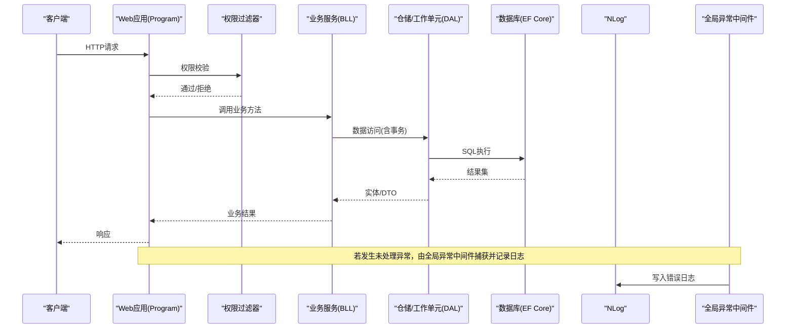
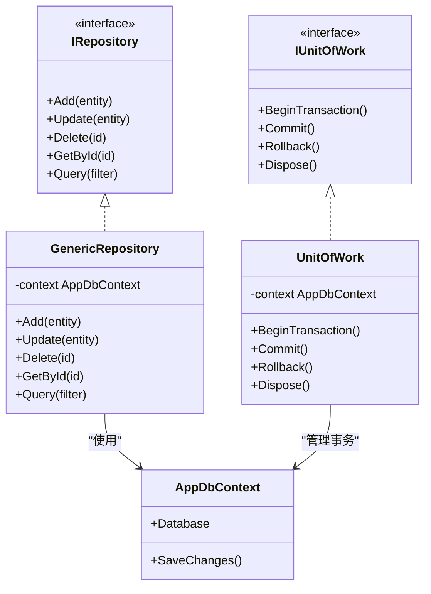
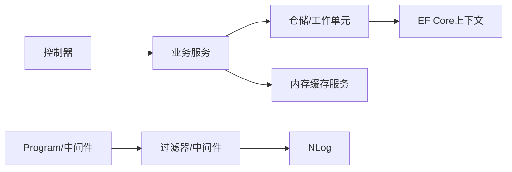

# 故障排查

<cite>
**本文引用的文件**   
- [Program.cs](file://EquipmentIMS.Web/Program.cs)
- [appsettings.json](file://EquipmentIMS.Web/appsettings.json)
- [nlog.config](file://EquipmentIMS.Web/nlog.config)
- [GlobalExceptionMiddleware.cs](file://EquipmentIMS.Web/Filters/GlobalExceptionMiddleware.cs)
- [PermissionFilter.cs](file://EquipmentIMS.Web/Filters/PermissionFilter.cs)
- [OperationLogActionFilter.cs](file://EquipmentIMS.Web/Filters/OperationLogActionFilter.cs)
- [SecurityHeadersMiddleware.cs](file://EquipmentIMS.Web/Filters/SecurityHeadersMiddleware.cs)
- [AppDbContext.cs](file://EquipmentIMS.DAL/AppDbContext.cs)
- [UnitOfWork.cs](file://EquipmentIMS.DAL/Repositories/UnitOfWork.cs)
- [GenericRepository.cs](file://EquipmentIMS.DAL/Repositories/GenericRepository.cs)
- [IRepository.cs](file://EquipmentIMS.DAL/Interfaces/IRepository.cs)
- [IUnitOfWork.cs](file://EquipmentIMS.DAL/Interfaces/IUnitOfWork.cs)
- [MemoryCacheService.cs](file://EquipmentIMS.BLL/Services/MemoryCacheService.cs)
- [ExportBackgroundService.cs](file://EquipmentIMS.Web/BackgroundServices/ExportBackgroundService.cs)
- [MaintenanceReminderBackgroundService.cs](file://EquipmentIMS.Web/BackgroundServices/MaintenanceReminderBackgroundService.cs)
- [ReportExportBackgroundService.cs](file://EquipmentIMS.Web/BackgroundServices/ReportExportBackgroundService.cs)
- [StockAlertBackgroundService.cs](file://EquipmentIMS.Web/BackgroundServices/StockAlertBackgroundService.cs)
- [BackupController.cs](file://EquipmentIMS.Web/Controllers/BackupController.cs)
- [LogController.cs](file://EquipmentIMS.Web/Controllers/LogController.cs)
- [SystemConfigService.cs](file://EquipmentIMS.BLL/Services/SystemConfigService.cs)
- [SysConfig.cs](file://EquipmentIMS.Models/Entities/SysConfig.cs)
- [SysOperationLog.cs](file://EquipmentIMS.Models/Entities/SysOperationLog.cs)
- [BusinessException.cs](file://EquipmentIMS.Models/Exceptions/BusinessException.cs)
- [NotFoundException.cs](file://EquipmentIMS.Models/Exceptions/NotFoundException.cs)
- [ValidationException.cs](file://EquipmentIMS.Models/Exceptions/ValidationException.cs)
</cite>

## 目录
1. [简介](#简介)
2. [项目结构](#项目结构)
3. [核心组件](#核心组件)
4. [架构总览](#架构总览)
5. [详细组件分析](#详细组件分析)
6. [依赖关系分析](#依赖关系分析)
7. [性能考虑](#性能考虑)
8. [故障排查指南](#故障排查指南)
9. [结论](#结论)
10. [附录](#附录)

## 简介
本手册面向THMS（设备库存管理系统）的运维与研发人员，聚焦于生产环境的故障定位、诊断与恢复。内容覆盖数据库连接问题、权限验证失败、性能瓶颈、日志分析方法、错误堆栈解读、调试工具使用技巧、内存泄漏检测、CPU占用分析、磁盘空间监控、系统健康检查与服务可用性监控、告警通知配置、紧急恢复流程、数据修复脚本与回滚操作等。文档以仓库中的实际代码为依据，提供可操作的步骤与图示，帮助快速定位并解决问题。

## 项目结构
THMS采用分层架构：Web层（控制器、中间件、过滤器、后台服务）、BLL业务逻辑层、DAL数据访问层、Models领域模型与DTO。关键入口在Web层的Program中完成服务注册、中间件管线与配置加载；数据访问通过EF Core DbContext与仓储/工作单元模式实现；日志由NLog统一输出；异常由全局中间件捕获并标准化返回。

图表来源
- [Program.cs](file://EquipmentIMS.Web/Program.cs)
- [GlobalExceptionMiddleware.cs](file://EquipmentIMS.Web/Filters/GlobalExceptionMiddleware.cs)
- [PermissionFilter.cs](file://EquipmentIMS.Web/Filters/PermissionFilter.cs)
- [OperationLogActionFilter.cs](file://EquipmentIMS.Web/Filters/OperationLogActionFilter.cs)
- [SecurityHeadersMiddleware.cs](file://EquipmentIMS.Web/Filters/SecurityHeadersMiddleware.cs)
- [AppDbContext.cs](file://EquipmentIMS.DAL/AppDbContext.cs)
- [UnitOfWork.cs](file://EquipmentIMS.DAL/Repositories/UnitOfWork.cs)
- [GenericRepository.cs](file://EquipmentIMS.DAL/Repositories/GenericRepository.cs)
- [MemoryCacheService.cs](file://EquipmentIMS.BLL/Services/MemoryCacheService.cs)
- [ExportBackgroundService.cs](file://EquipmentIMS.Web/BackgroundServices/ExportBackgroundService.cs)
- [MaintenanceReminderBackgroundService.cs](file://EquipmentIMS.Web/BackgroundServices/MaintenanceReminderBackgroundService.cs)
- [ReportExportBackgroundService.cs](file://EquipmentIMS.Web/BackgroundServices/ReportExportBackgroundService.cs)
- [StockAlertBackgroundService.cs](file://EquipmentIMS.Web/BackgroundServices/StockAlertBackgroundService.cs)
- [SysConfig.cs](file://EquipmentIMS.Models/Entities/SysConfig.cs)
- [SysOperationLog.cs](file://EquipmentIMS.Models/Entities/SysOperationLog.cs)
- [BusinessException.cs](file://EquipmentIMS.Models/Exceptions/BusinessException.cs)
- [NotFoundException.cs](file://EquipmentIMS.Models/Exceptions/NotFoundException.cs)
- [ValidationException.cs](file://EquipmentIMS.Models/Exceptions/ValidationException.cs)

章节来源
- [Program.cs](file://EquipmentIMS.Web/Program.cs)
- [AppDbContext.cs](file://EquipmentIMS.DAL/AppDbContext.cs)
- [UnitOfWork.cs](file://EquipmentIMS.DAL/Repositories/UnitOfWork.cs)
- [GenericRepository.cs](file://EquipmentIMS.DAL/Repositories/GenericRepository.cs)
- [MemoryCacheService.cs](file://EquipmentIMS.BLL/Services/MemoryCacheService.cs)
- [ExportBackgroundService.cs](file://EquipmentIMS.Web/BackgroundServices/ExportBackgroundService.cs)
- [MaintenanceReminderBackgroundService.cs](file://EquipmentIMS.Web/BackgroundServices/MaintenanceReminderBackgroundService.cs)
- [ReportExportBackgroundService.cs](file://EquipmentIMS.Web/BackgroundServices/ReportExportBackgroundService.cs)
- [StockAlertBackgroundService.cs](file://EquipmentIMS.Web/BackgroundServices/StockAlertBackgroundService.cs)
- [SysConfig.cs](file://EquipmentIMS.Models/Entities/SysConfig.cs)
- [SysOperationLog.cs](file://EquipmentIMS.Models/Entities/SysOperationLog.cs)
- [BusinessException.cs](file://EquipmentIMS.Models/Exceptions/BusinessException.cs)
- [NotFoundException.cs](file://EquipmentIMS.Models/Exceptions/NotFoundException.cs)
- [ValidationException.cs](file://EquipmentIMS.Models/Exceptions/ValidationException.cs)

## 核心组件
- 应用启动与中间件管线：负责加载配置、注册服务、启用认证授权、日志、异常处理、安全头等。
- 全局异常中间件：统一捕获未处理异常，记录日志并返回标准错误响应。
- 权限过滤器与安全头中间件：校验用户权限、注入安全响应头。
- 操作日志过滤器：记录关键操作审计信息。
- EF Core上下文与仓储/工作单元：封装数据库访问、事务边界与通用CRUD。
- 内存缓存服务：提供进程内缓存能力。
- 后台任务服务：执行导出、报表生成、维护提醒、库存预警等异步任务。
- 备份与日志控制器：提供备份与日志查询接口。
- 系统配置服务与实体：集中管理运行时配置项。
- 自定义异常类型：规范业务异常、未找到异常、参数校验异常。

章节来源
- [Program.cs](file://EquipmentIMS.Web/Program.cs)
- [GlobalExceptionMiddleware.cs](file://EquipmentIMS.Web/Filters/GlobalExceptionMiddleware.cs)
- [PermissionFilter.cs](file://EquipmentIMS.Web/Filters/PermissionFilter.cs)
- [OperationLogActionFilter.cs](file://EquipmentIMS.Web/Filters/OperationLogActionFilter.cs)
- [SecurityHeadersMiddleware.cs](file://EquipmentIMS.Web/Filters/SecurityHeadersMiddleware.cs)
- [AppDbContext.cs](file://EquipmentIMS.DAL/AppDbContext.cs)
- [UnitOfWork.cs](file://EquipmentIMS.DAL/Repositories/UnitOfWork.cs)
- [GenericRepository.cs](file://EquipmentIMS.DAL/Repositories/GenericRepository.cs)
- [MemoryCacheService.cs](file://EquipmentIMS.BLL/Services/MemoryCacheService.cs)
- [ExportBackgroundService.cs](file://EquipmentIMS.Web/BackgroundServices/ExportBackgroundService.cs)
- [MaintenanceReminderBackgroundService.cs](file://EquipmentIMS.Web/BackgroundServices/MaintenanceReminderBackgroundService.cs)
- [ReportExportBackgroundService.cs](file://EquipmentIMS.Web/BackgroundServices/ReportExportBackgroundService.cs)
- [StockAlertBackgroundService.cs](file://EquipmentIMS.Web/BackgroundServices/StockAlertBackgroundService.cs)
- [BackupController.cs](file://EquipmentIMS.Web/Controllers/BackupController.cs)
- [LogController.cs](file://EquipmentIMS.Web/Controllers/LogController.cs)
- [SystemConfigService.cs](file://EquipmentIMS.BLL/Services/SystemConfigService.cs)
- [SysConfig.cs](file://EquipmentIMS.Models/Entities/SysConfig.cs)
- [SysOperationLog.cs](file://EquipmentIMS.Models/Entities/SysOperationLog.cs)
- [BusinessException.cs](file://EquipmentIMS.Models/Exceptions/BusinessException.cs)
- [NotFoundException.cs](file://EquipmentIMS.Models/Exceptions/NotFoundException.cs)
- [ValidationException.cs](file://EquipmentIMS.Models/Exceptions/ValidationException.cs)

## 架构总览
下图展示请求从进入Web应用到持久化存储的关键路径，以及异常与日志的统一处理方式。

图表来源
- [Program.cs](file://EquipmentIMS.Web/Program.cs)
- [PermissionFilter.cs](file://EquipmentIMS.Web/Filters/PermissionFilter.cs)
- [GlobalExceptionMiddleware.cs](file://EquipmentIMS.Web/Filters/GlobalExceptionMiddleware.cs)
- [UnitOfWork.cs](file://EquipmentIMS.DAL/Repositories/UnitOfWork.cs)
- [GenericRepository.cs](file://EquipmentIMS.DAL/Repositories/GenericRepository.cs)
- [AppDbContext.cs](file://EquipmentIMS.DAL/AppDbContext.cs)
- [nlog.config](file://EquipmentIMS.Web/nlog.config)

## 详细组件分析

### 全局异常中间件与错误响应
- 职责：捕获所有未处理异常，记录结构化日志，返回统一错误格式，避免将内部细节暴露给客户端。
- 关键点：区分业务异常与系统异常；对敏感信息进行脱敏；确保异常堆栈完整记录以便排障。
- 建议：为常见异常类型定义明确的HTTP状态码与消息模板；在日志中包含请求ID、用户标识、时间戳与调用链。

章节来源
- [GlobalExceptionMiddleware.cs](file://EquipmentIMS.Web/Filters/GlobalExceptionMiddleware.cs)
- [BusinessException.cs](file://EquipmentIMS.Models/Exceptions/BusinessException.cs)
- [NotFoundException.cs](file://EquipmentIMS.Models/Exceptions/NotFoundException.cs)
- [ValidationException.cs](file://EquipmentIMS.Models/Exceptions/ValidationException.cs)

### 权限过滤器与安全头中间件
- 权限过滤器：基于角色/权限策略进行访问控制，拦截无权限请求并返回相应状态码。
- 安全头中间件：注入必要的HTTP安全头（如X-Frame-Options、Content-Security-Policy等），提升安全性。
- 建议：结合操作日志过滤器记录权限判定结果与失败原因，便于审计与回溯。

章节来源
- [PermissionFilter.cs](file://EquipmentIMS.Web/Filters/PermissionFilter.cs)
- [SecurityHeadersMiddleware.cs](file://EquipmentIMS.Web/Filters/SecurityHeadersMiddleware.cs)
- [OperationLogActionFilter.cs](file://EquipmentIMS.Web/Filters/OperationLogActionFilter.cs)

### 数据访问层：仓储与工作单元
- 仓储模式：封装通用CRUD与复杂查询，降低业务层与数据访问耦合。
- 工作单元：统一管理事务边界，确保多仓储操作的一致性。
- 建议：对慢查询添加索引与分页；避免在循环中进行数据库往返；必要时使用批量操作或分片提交。

图表来源
- [IRepository.cs](file://EquipmentIMS.DAL/Interfaces/IRepository.cs)
- [GenericRepository.cs](file://EquipmentIMS.DAL/Repositories/GenericRepository.cs)
- [IUnitOfWork.cs](file://EquipmentIMS.DAL/Interfaces/IUnitOfWork.cs)
- [UnitOfWork.cs](file://EquipmentIMS.DAL/Repositories/UnitOfWork.cs)
- [AppDbContext.cs](file://EquipmentIMS.DAL/AppDbContext.cs)

章节来源
- [IRepository.cs](file://EquipmentIMS.DAL/Interfaces/IRepository.cs)
- [GenericRepository.cs](file://EquipmentIMS.DAL/Repositories/GenericRepository.cs)
- [IUnitOfWork.cs](file://EquipmentIMS.DAL/Interfaces/IUnitOfWork.cs)
- [UnitOfWork.cs](file://EquipmentIMS.DAL/Repositories/UnitOfWork.cs)
- [AppDbContext.cs](file://EquipmentIMS.DAL/AppDbContext.cs)

### 内存缓存服务
- 职责：提供进程内缓存能力，减少重复计算与数据库压力。
- 风险：需关注过期策略、容量上限与并发访问；避免缓存穿透与雪崩。
- 建议：为热点数据设置合理TTL；增加缓存预热；对大对象进行序列化优化。

章节来源
- [MemoryCacheService.cs](file://EquipmentIMS.BLL/Services/MemoryCacheService.cs)

### 后台服务（导出、报表、维护提醒、库存预警）
- 职责：执行耗时任务，避免阻塞主请求链路。
- 风险：长时间运行导致资源占用高；任务堆积引发队列膨胀；失败重试策略不当造成重复处理。
- 建议：为每个后台服务设置超时与最大重试次数；记录任务进度与失败原因；提供停止与重启接口。

章节来源
- [ExportBackgroundService.cs](file://EquipmentIMS.Web/BackgroundServices/ExportBackgroundService.cs)
- [ReportExportBackgroundService.cs](file://EquipmentIMS.Web/BackgroundServices/ReportExportBackgroundService.cs)
- [MaintenanceReminderBackgroundService.cs](file://EquipmentIMS.Web/BackgroundServices/MaintenanceReminderBackgroundService.cs)
- [StockAlertBackgroundService.cs](file://EquipmentIMS.Web/BackgroundServices/StockAlertBackgroundService.cs)

### 备份与日志控制器
- 备份控制器：触发数据备份任务，支持按策略生成备份文件。
- 日志控制器：提供日志查询与下载接口，便于在线排障。
- 建议：备份任务应异步执行并记录进度；日志查询支持时间范围与级别过滤。

章节来源
- [BackupController.cs](file://EquipmentIMS.Web/Controllers/BackupController.cs)
- [LogController.cs](file://EquipmentIMS.Web/Controllers/LogController.cs)

### 系统配置服务与实体
- 职责：集中管理运行时配置项，支持动态调整部分行为。
- 建议：对敏感配置加密存储；变更时记录审计日志；提供默认值与校验规则。

章节来源
- [SystemConfigService.cs](file://EquipmentIMS.BLL/Services/SystemConfigService.cs)
- [SysConfig.cs](file://EquipmentIMS.Models/Entities/SysConfig.cs)

## 依赖关系分析
- 低耦合：控制器仅依赖服务接口，服务依赖仓储接口，仓储依赖EF Core上下文，层次清晰。
- 潜在环：注意服务间不要互相直接引用，避免循环依赖；通过接口与依赖注入解耦。
- 外部依赖：数据库驱动、NLog、缓存库、Excel导出库等，需在部署环境正确安装与配置。

图表来源
- [Program.cs](file://EquipmentIMS.Web/Program.cs)
- [PermissionFilter.cs](file://EquipmentIMS.Web/Filters/PermissionFilter.cs)
- [GlobalExceptionMiddleware.cs](file://EquipmentIMS.Web/Filters/GlobalExceptionMiddleware.cs)
- [MemoryCacheService.cs](file://EquipmentIMS.BLL/Services/MemoryCacheService.cs)
- [UnitOfWork.cs](file://EquipmentIMS.DAL/Repositories/UnitOfWork.cs)
- [GenericRepository.cs](file://EquipmentIMS.DAL/Repositories/GenericRepository.cs)
- [AppDbContext.cs](file://EquipmentIMS.DAL/AppDbContext.cs)
- [nlog.config](file://EquipmentIMS.Web/nlog.config)

章节来源
- [Program.cs](file://EquipmentIMS.Web/Program.cs)
- [PermissionFilter.cs](file://EquipmentIMS.Web/Filters/PermissionFilter.cs)
- [GlobalExceptionMiddleware.cs](file://EquipmentIMS.Web/Filters/GlobalExceptionMiddleware.cs)
- [MemoryCacheService.cs](file://EquipmentIMS.BLL/Services/MemoryCacheService.cs)
- [UnitOfWork.cs](file://EquipmentIMS.DAL/Repositories/UnitOfWork.cs)
- [GenericRepository.cs](file://EquipmentIMS.DAL/Repositories/GenericRepository.cs)
- [AppDbContext.cs](file://EquipmentIMS.DAL/AppDbContext.cs)
- [nlog.config](file://EquipmentIMS.Web/nlog.config)

## 性能考虑
- 数据库层面：为高频查询字段建立索引；避免SELECT *；使用分页与投影；合并多次往返为批量操作。
- 应用层面：合理使用缓存；避免在循环中执行数据库操作；对耗时任务使用后台服务；限制单次处理的数据量。
- 资源层面：监控CPU、内存、磁盘IO与网络带宽；设置合理的线程池与连接池大小；避免长事务。
- 日志层面：控制日志级别与采样率；避免在热路径写入过多日志；定期轮转与归档。

[本节为通用指导，不直接分析具体文件]

## 故障排查指南

### 常见问题与解决方案

#### 数据库连接问题
- 现象：应用启动时报连接失败；请求频繁出现超时或连接池耗尽。
- 诊断步骤：
  - 检查配置文件中的连接字符串是否正确（服务器地址、端口、数据库名、凭据）。
  - 确认数据库服务可达（网络连通性、防火墙规则、DNS解析）。
  - 查看NLog输出的错误日志，定位具体异常类型与堆栈。
  - 检查连接池配置与最大连接数是否合理。
- 解决方案：
  - 修正连接字符串与网络配置。
  - 调整连接池大小与超时参数。
  - 对慢查询添加索引或优化SQL。
  - 在应用层增加重试与熔断机制（针对瞬时故障）。

章节来源
- [appsettings.json](file://EquipmentIMS.Web/appsettings.json)
- [AppDbContext.cs](file://EquipmentIMS.DAL/AppDbContext.cs)
- [nlog.config](file://EquipmentIMS.Web/nlog.config)
- [GlobalExceptionMiddleware.cs](file://EquipmentIMS.Web/Filters/GlobalExceptionMiddleware.cs)

#### 权限验证失败
- 现象：用户登录后访问受限页面返回401/403；某些接口被拒绝。
- 诊断步骤：
  - 检查登录成功后的令牌/会话是否正确下发。
  - 查看权限过滤器日志，确认用户角色与权限映射。
  - 核对数据库中用户-角色-权限关系是否完整。
- 解决方案：
  - 修复用户角色分配与权限授予。
  - 更新前端路由与按钮级权限显示。
  - 在权限过滤器中增加更详细的失败原因日志。

章节来源
- [PermissionFilter.cs](file://EquipmentIMS.Web/Filters/PermissionFilter.cs)
- [OperationLogActionFilter.cs](file://EquipmentIMS.Web/Filters/OperationLogActionFilter.cs)
- [SysUser.cs](file://EquipmentIMS.Models/Entities/SysUser.cs)
- [SysRole.cs](file://EquipmentIMS.Models/Entities/SysRole.cs)
- [SysPermission.cs](file://EquipmentIMS.Models/Entities/SysPermission.cs)
- [SysUserRole.cs](file://EquipmentIMS.Models/Entities/SysUserRole.cs)
- [SysRolePermission.cs](file://EquipmentIMS.Models/Entities/SysRolePermission.cs)

#### 性能瓶颈
- 现象：页面加载缓慢；导出/报表任务耗时过长；CPU或内存占用高。
- 诊断步骤：
  - 使用性能分析工具（如dotnet-counters、dotnet-trace）采集CPU与GC指标。
  - 检查数据库慢查询日志与执行计划。
  - 审查后台任务的并发度与批处理大小。
  - 查看缓存命中率与热点数据分布。
- 解决方案：
  - 优化SQL与索引；引入分页与投影。
  - 调整后台任务并行度与批大小；增加超时与重试策略。
  - 预热缓存；对大对象进行序列化优化。
  - 扩容或水平扩展应用实例。

章节来源
- [ExportBackgroundService.cs](file://EquipmentIMS.Web/BackgroundServices/ExportBackgroundService.cs)
- [ReportExportBackgroundService.cs](file://EquipmentIMS.Web/BackgroundServices/ReportExportBackgroundService.cs)
- [MemoryCacheService.cs](file://EquipmentIMS.BLL/Services/MemoryCacheService.cs)
- [GenericRepository.cs](file://EquipmentIMS.DAL/Repositories/GenericRepository.cs)
- [AppDbContext.cs](file://EquipmentIMS.DAL/AppDbContext.cs)

#### 日志分析方法与错误堆栈解读
- 日志位置：NLog配置文件定义了输出目标（文件/控制台/远程），可通过日志控制器在线查询。
- 关键字段：时间戳、级别、消息、异常类型、堆栈、请求ID、用户标识。
- 解读技巧：
  - 先按时间窗口筛选，再按级别过滤（Error/Fatal优先）。
  - 根据异常类型快速分类（业务异常、未找到、参数校验、数据库异常）。
  - 追踪请求ID串联上下游日志。
- 建议：为关键路径增加结构化日志；避免打印敏感信息。

章节来源
- [nlog.config](file://EquipmentIMS.Web/nlog.config)
- [LogController.cs](file://EquipmentIMS.Web/Controllers/LogController.cs)
- [GlobalExceptionMiddleware.cs](file://EquipmentIMS.Web/Filters/GlobalExceptionMiddleware.cs)
- [SysOperationLog.cs](file://EquipmentIMS.Models/Entities/SysOperationLog.cs)

#### 调试工具使用技巧
- dotnet-counters：实时查看CPU、内存、GC、线程池等指标。
- dotnet-trace：采集CPU与GC跟踪，生成性能报告。
- dotnet-dump：生成内存快照，配合Visual Studio或dotnet-gcdump分析内存泄漏。
- 日志控制器：在线检索与下载日志，辅助快速定位问题。

章节来源
- [LogController.cs](file://EquipmentIMS.Web/Controllers/LogController.cs)

#### 内存泄漏检测
- 现象：进程内存持续增长，GC无法回收；最终导致OOM。
- 手段：
  - 使用dotnet-dump生成快照，分析托管堆与句柄泄漏。
  - 检查未释放的资源（文件流、数据库连接、事件订阅）。
  - 审查缓存服务是否设置过期策略与容量上限。
- 解决：修复资源释放；优化缓存策略；限制一次性加载的数据量。

章节来源
- [MemoryCacheService.cs](file://EquipmentIMS.BLL/Services/MemoryCacheService.cs)
- [UnitOfWork.cs](file://EquipmentIMS.DAL/Repositories/UnitOfWork.cs)
- [GenericRepository.cs](file://EquipmentIMS.DAL/Repositories/GenericRepository.cs)

#### CPU占用分析
- 现象：CPU持续高位，响应延迟增大。
- 手段：
  - 使用dotnet-trace采集CPU样本，识别热点方法与锁竞争。
  - 检查后台任务是否过度并行或死循环。
  - 分析数据库慢查询与锁等待。
- 解决：优化算法与数据结构；减少锁粒度；拆分任务与限流。

章节来源
- [ExportBackgroundService.cs](file://EquipmentIMS.Web/BackgroundServices/ExportBackgroundService.cs)
- [ReportExportBackgroundService.cs](file://EquipmentIMS.Web/BackgroundServices/ReportExportBackgroundService.cs)
- [AppDbContext.cs](file://EquipmentIMS.DAL/AppDbContext.cs)

#### 磁盘空间监控
- 现象：磁盘空间不足导致备份失败、日志无法写入。
- 手段：
  - 监控日志文件大小与轮转策略。
  - 检查备份目录空间与保留策略。
  - 清理临时文件与旧版本数据。
- 解决：调整日志轮转与压缩；限制备份数量；扩容磁盘或迁移存储。

章节来源
- [nlog.config](file://EquipmentIMS.Web/nlog.config)
- [BackupController.cs](file://EquipmentIMS.Web/Controllers/BackupController.cs)

#### 系统健康检查与服务可用性监控
- 健康检查：
  - 在Program中注册健康检查端点，检查数据库连接、缓存可用性与关键依赖。
  - 对外暴露健康状态供负载均衡与健康探针使用。
- 可用性监控：
  - 通过外部监控平台定时访问健康端点与关键API。
  - 记录响应时间与成功率，设置阈值告警。
- 告警通知：
  - 集成邮件/短信/企业微信等通知渠道。
  - 对关键指标（错误率、延迟、资源使用）设置多级告警。

章节来源
- [Program.cs](file://EquipmentIMS.Web/Program.cs)
- [nlog.config](file://EquipmentIMS.Web/nlog.config)

#### 紧急恢复流程
- 原则：先止血后修复，最小影响范围，可回滚。
- 步骤：
  - 立即暂停相关后台任务与导入导出。
  - 切换流量到备用实例或降级功能。
  - 使用最近一次有效备份恢复数据。
  - 验证核心业务流程与数据一致性。
  - 逐步恢复服务并观察指标。
- 回滚操作：
  - 回滚应用版本至上一稳定版本。
  - 回滚数据库变更（如有），确保兼容。
  - 清理临时数据与中间状态。

章节来源
- [BackupController.cs](file://EquipmentIMS.Web/Controllers/BackupController.cs)
- [Program.cs](file://EquipmentIMS.Web/Program.cs)

#### 数据修复脚本
- 场景：脏数据、不一致状态、缺失关联。
- 方法：
  - 编写幂等的修复脚本，支持增量执行与回滚。
  - 在测试环境充分验证后再在生产执行。
  - 记录修复前后差异与审计日志。
- 建议：使用事务包裹修复逻辑；分批执行避免锁表。

章节来源
- [UnitOfWork.cs](file://EquipmentIMS.DAL/Repositories/UnitOfWork.cs)
- [GenericRepository.cs](file://EquipmentIMS.DAL/Repositories/GenericRepository.cs)
- [SysOperationLog.cs](file://EquipmentIMS.Models/Entities/SysOperationLog.cs)

## 结论
THMS通过清晰的层次结构与统一的异常、日志、权限与安全机制，为故障排查提供了良好基础。运维与研发应结合日志分析、性能工具与健康检查，形成闭环的排障体系。对于数据库、权限、性能等常见问题，建议制定标准化的诊断清单与处置预案，并在演练中验证恢复流程与回滚方案的有效性。

## 附录

### 常用命令与工具
- 查看进程与资源：top/htop、tasklist、wmic
- .NET性能工具：dotnet-counters、dotnet-trace、dotnet-dump
- 日志查看：tail、grep、日志控制器在线查询
- 数据库诊断：慢查询日志、执行计划、连接池监控

### 配置项参考
- 连接字符串：位于应用配置文件中，包含数据库服务器、凭据与选项。
- NLog配置：定义日志级别、输出目标与轮转策略。
- 系统配置：通过系统配置服务管理运行时参数。

章节来源
- [appsettings.json](file://EquipmentIMS.Web/appsettings.json)
- [nlog.config](file://EquipmentIMS.Web/nlog.config)
- [SystemConfigService.cs](file://EquipmentIMS.BLL/Services/SystemConfigService.cs)
- [SysConfig.cs](file://EquipmentIMS.Models/Entities/SysConfig.cs)